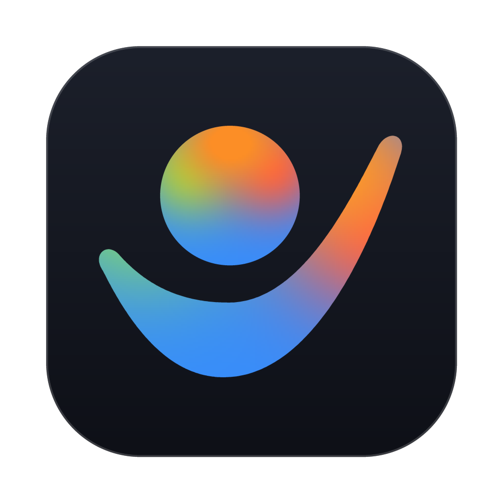

<p align="center">
  <picture>
    <source media="(prefers-color-scheme: dark)" srcset="assets/branding/agy-hq-icon-obsidian.png" />
    <source media="(prefers-color-scheme: light)" srcset="assets/branding/agy-hq-icon-white.png" />
    
  </picture>
</p>

# `agy-hq` — Personal Agent OS for Google Antigravity

**`agy-hq`** (Headquarter) is a lightweight, open-source **Personal Agent OS** built on top of **Google Antigravity**. It turns an always-on Mac running Antigravity into a 24/7 general-purpose, proactive personal assistant—while keeping **100% of your personal memory, files, and credentials isolated in a private `Vault` (`local/`)**.

---

## Why `agy-hq`?

Frontier personal agents (Meta Muse, OpenAI `dots`, Claude Duet/Cowork, OpenClaw, Nous Hermes) share six core capabilities:
1. **100% General-Purpose & Open-Ended** (handles any ad-hoc request—coding, writing a post, deep research, planning, or life admin—without boxing you into rigid categories)
2. **Always-On Execution** (runs 24/7 on your always-on Mac desktop)
3. **Silent-by-Default Heartbeat** (0-token background checks in Go that only wake the LLM when something is actionable)
4. **Event Triggers** (`fsnotify` drop-folder watching in `local/inbox/`, RSS/filing monitors, CI checks)
5. **Pocket Access & 1-Tap Approvals** (piggybacking on **Antigravity Remote Control** Web/PWA on Day 1, with pluggable Google Chat / Telegram adapters)
6. **Consolidated Memory & Compounding Skills** (0-token `Stop` turn capture, nightly "sleep-time" memory consolidation, and progressive-disclosure `.agents/skills/*/SKILL.md` workflows)

---

## Quickstart (1-Line Setup)

On a clean machine with **Google Antigravity** installed, run:

```sh
git clone https://github.com/zjshen14/agy-hq.git headquarter && cd headquarter && ./scripts/bootstrap.sh
```

What this single line does:
1. Checks for Go (installing via Homebrew on macOS if missing) and compiles `./bin/hq`.
2. Runs `./bin/hq init` to scaffold your git-ignored private Vault (`./local/USER.md`, `./local/MEMORY.md`, `./local/CONSOLE.md`, `./local/.git`, and isolated directories).
3. Installs a `.git/hooks/pre-commit` PII guard so personal paths or emails can never be committed to the root repo.
4. Runs `./bin/hq doctor` to verify all health checks pass.

> **Zero-Touch GUI Option:** Even if you only `git clone` and open `headquarter` directly in Antigravity without running `./scripts/bootstrap.sh`, the `SessionStart` hook in [`.agents/hooks.json`](.agents/hooks.json) automatically compiles `./bin/hq`, initializes `./local/`, claims your `[HQ] Front Desk` conversation, and pins the live `hq_console.md` artifact on Turn 1.
>
> 💡 **Tip:** Pin your `[HQ] Front Desk` conversation to the Antigravity sidebar (via the conversation header menu) so it stays permanently anchored at the top above ephemeral task threads.

---

## Two-Layer Architecture: Open-Source Engine vs. Private Vault

```text
agy-hq/                                # LAYER 1: Open-Source Agent OS (This Git Repo)
├── .gitignore                         # Strictly ignores /local/, /bin/, and secrets
├── AGENTS.md                          # General-purpose personal assistant rules
├── assets/branding/                   # Official Asymmetric Wing Cradle icon pack (SVG, PNG & social preview)
├── cmd/hq/                            # Go CLI: init | hook | daemon | propose | notify | status
├── internal/                          # Go microkernel (hooks, 0-token trigger runner, approvals, Aux UI)
├── templates/                         # Starter blueprints copied by `hq init` into ./local/
├── docs/                              # Product specs, technical RFCs, ADRs & research
├── .agents/
│   ├── hooks.json                     # SessionStart (memory), PreToolUse (action guard), Stop (0-token log)
│   └── plugins/agy-hq/                # Official agy-hq plugin bundle (icon + progressive-disclosure skills)
│
└── local/                             # LAYER 2: Your Private Vault (Separate Private Git Repo)
    ├── USER.md                        # Your profile, preferences, writing voice & goals
    ├── MEMORY.md                      # Consolidated long-term memory + topic notes
    ├── triggers.yaml                  # Your cron schedules, 0-token pre-checks & inbox/ drop rules
    ├── inbox/                         # Zero-prompt file drop folder (CSVs, PDFs, notes, receipts)
    ├── workspace/                     # Open workspace for any task (posts, research, projects, notes)
    ├── private/                       # High-PII records (beancount ledger, taxes) with extra guardrails
    └── memory/                        # facts.jsonl, journal/YYYY-MM-DD/<convId>.json, pending/, outbox/
```

---

## Documentation & Specifications

Full product specs (PRDs), technical designs (RFCs 0001–0007), architecture decision records (ADRs 0001–0006), and frontier research live in **[`docs/`](docs/README.md)**.

---

## CLI Quick Reference (`./bin/hq`)

| Category | Command | Description |
|---|---|---|
| **Core** | `./bin/hq init` | Initialize git-ignored private `local/` Vault and local git repo |
| | `./bin/hq doctor` | Verify Antigravity sandbox, Remote Control, CLI tools, and Vault health |
| | `./bin/hq status` | Display pending approvals queue, active worktrees, and health |
| **Daemon & Triggers** | `./bin/hq daemon install` | Install `systemd` or `launchd` background HQ daemon service |
| | `./bin/hq daemon status` | Check background daemon status, PID, and uptime |
| | `./bin/hq daemon uninstall` | Cleanly stop and uninstall background daemon service |
| | `./bin/hq heartbeat` | Run 0-token idle pre-checks, Dead-Man's Switch, and drop router |
| **Task Lifecycle** | `./bin/hq spawn --task=<slug> --prompt="..."` | Spawn dedicated Task Conversation in isolated worktree |
| | `./bin/hq subagent --role="..." --prompt="..."` | Launch nested child subagent under current conversation |
| | `./bin/hq complete <task-slug-or-conv-id>` | Mark an active task conversation as completed |
| | `./bin/hq archive <task-slug-or-conv-id>` | Archive a completed task conversation |
| | `./bin/hq reopen <task-slug-or-conv-id>` | Reopen an archived task conversation |
| | `./bin/hq worktree add <repo> <task>` | Create isolated git worktree in `local/worktrees/<repo>-<task>/` |
| **Updates & Migration** | `./bin/hq upgrade` | Snapshot Vault, pull latest commits, recompile CLI, and migrate |
| | `./bin/hq migrate` | Run non-destructive Vault schema and template migrations |
| **Safety & Approvals** | `./bin/hq propose --type=... --cmd="..."` | Stage irreversible outbound action for 1-tap approval |
| | `./bin/hq approve <id> [--sha256=<hash>]` | Verify SHA-256 and deterministically execute staged action |
| | `./bin/hq reject <id>` | Reject and remove pending outbound proposal |
| **Gmail Primitives** | `./bin/hq gmail init --email=<email>` | Configure primary or secondary Gmail account |
| | `./bin/hq gmail status` | Inspect configured Gmail accounts and sidecar auth status |
| | `./bin/hq gmail list [--query="..."]` | Search and list Gmail messages without LLM exposure |
| | `./bin/hq gmail read --thread=<id>` | Read email thread quarantined in sandboxed text format |
| | `./bin/hq gmail draft --to=... --body=...` | Create or update draft email for staged review |
| | `./bin/hq gmail triage` | Run pure-Go unread sidecar precheck and batch triage items |
