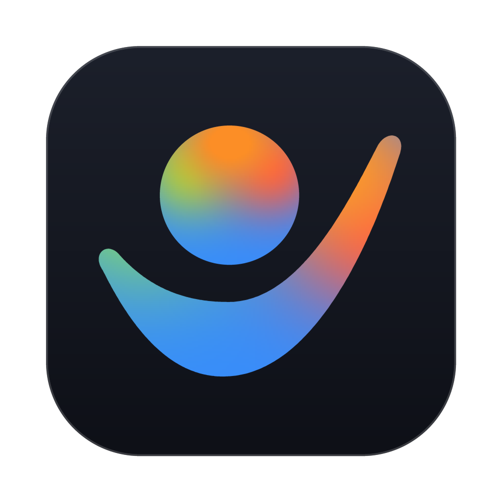
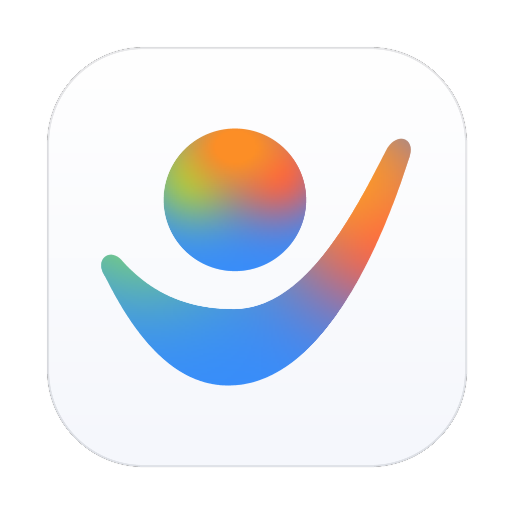
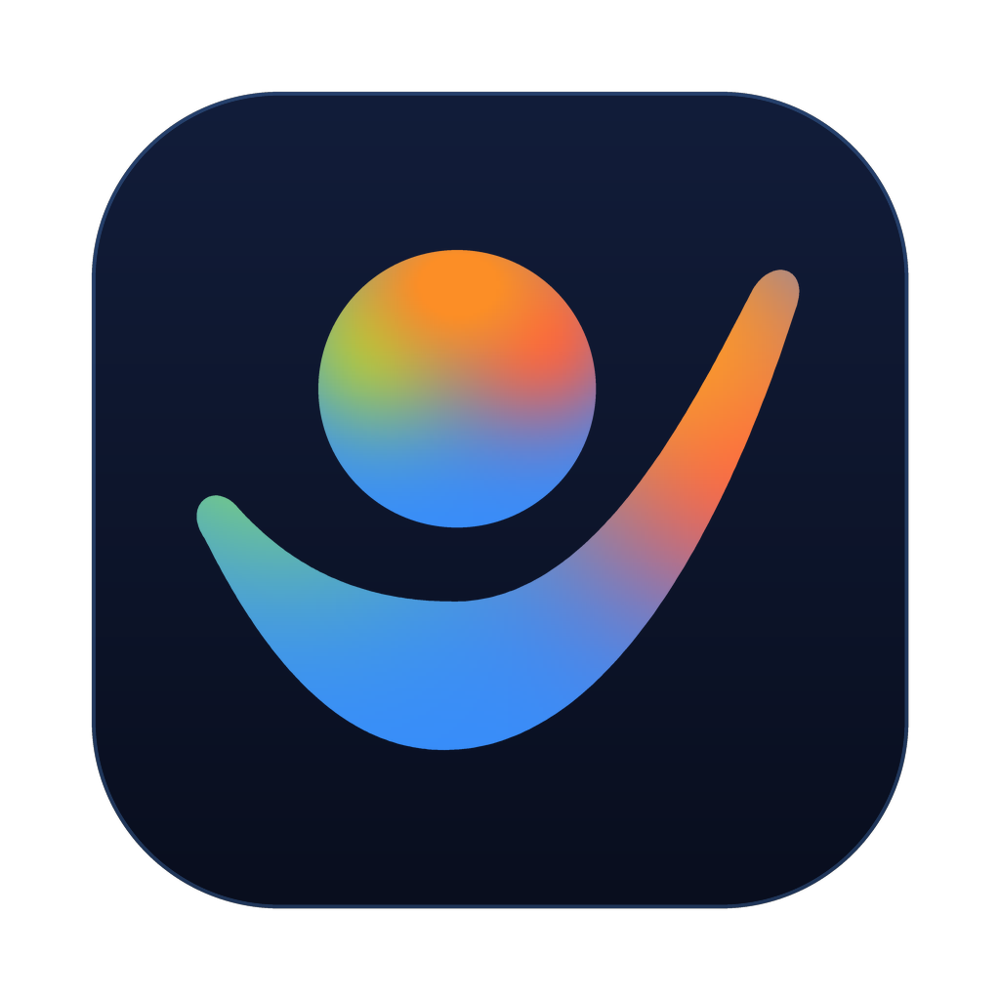

# `agy-hq` Brand Identity & Icon System

  
  &nbsp;&nbsp;&nbsp;&nbsp;
  
  &nbsp;&nbsp;&nbsp;&nbsp;
  

## Design Concept: **The Asymmetric Wing Cradle**

`agy-hq` (Headquarter) is the 24/7 personal proactive assistant OS built on top of **Google Antigravity**. Its visual mark follows the principle **"Borrow the Physics, Change the Verb"**:

- **Google Antigravity (`∩` Rising Arch):** Represents weightless upward propulsion.
- **`agy-hq` (`Asymmetric Wing Cradle` + `Floating Orb`):** Inverts the Antigravity ribbon into an asymmetric, soaring wing cradle (`∪` sweeping from a tucked lower-left curve into a high upper-right wingtip) holding a levitating orb across a zero-gravity gap.
  - The **Asymmetric Wing** breaks bilateral stick-figure (`\o/`) pareidolia while expressing attentiveness, care, and forward momentum.
  - The **Floating Orb** represents your daily world, memory, and proactive morning brief held effortlessly in zero gravity.

## Color Palette (Official Antigravity 4-Color Spectrum)

Both the Asymmetric Wing and the Floating Orb share Google Antigravity's 4-color mesh spectrum:

| Swatch | Role | Hex |
| :--- | :--- | :--- |
| **Antigravity Blue** | Base foundation & lower belly | `#378DFC` / `#378BFB` |
| **Lime-Mint** | Left flank illumination | `#8AE05C` / `#A3C644` |
| **Solar Orange** | Apex crown & warm focal energy | `#FF9A26` / `#F3842E` |
| **Coral Red** | Right wing flank | `#F85852` / `#EF624A` |

### Squircle Surfaces

- **Pro Obsidian (`#1C202B` → `#0E1017`):** Primary dark-mode OS companion icon (`agy-hq-icon-obsidian.png` / `.svg`).
- **Native White (`#FFFFFF` → `#F5F7FC`):** Direct 1:1 stock companion to the official Google Antigravity icon (`agy-hq-icon-white.png` / `.svg`).
- **Midnight Sapphire (`#121D3A` → `#090E1E`):** Deep sapphire alternative (`agy-hq-icon-sapphire.png` / `.svg`).

## Directory Contents

- `agy-hq-icon-obsidian.png` (`1024×1024`) — Primary dark squircle icon
- `agy-hq-icon-white.png` (`1024×1024`) — Native white squircle icon
- `agy-hq-icon-sapphire.png` (`1024×1024`) — Midnight sapphire squircle icon
- `agy-hq-mark.png` (`1024×1024`) — Standalone transparent-background glyph
- `social-preview.png` (`1280×640`) — GitHub repository OpenGraph / Social Preview banner
- `svg/agy-hq-icon-obsidian.svg` — Pure cubic-Bezier vector (Pro Obsidian)
- `svg/agy-hq-icon-white.svg` — Pure cubic-Bezier vector (Native White)
- `svg/agy-hq-icon-sapphire.svg` — Pure cubic-Bezier vector (Midnight Sapphire)
- `svg/agy-hq-mark.svg` — Pure cubic-Bezier standalone vector mark
- `icons/` — Multi-resolution exports (`512x512`, `256x256`, `128x128`, `64x64`, `32x32`)
