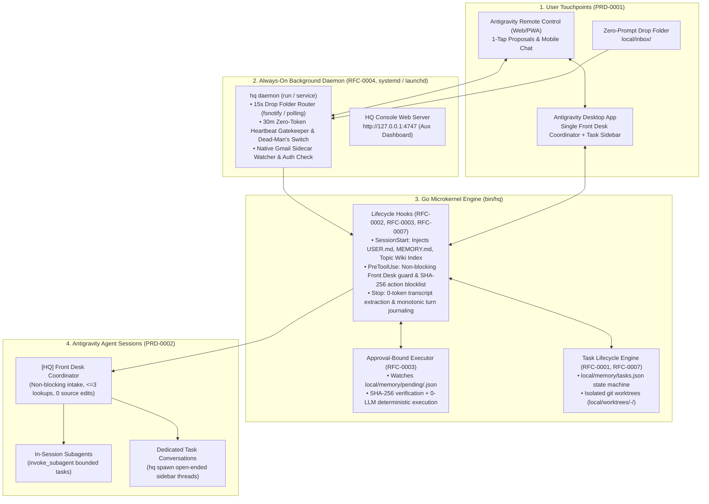
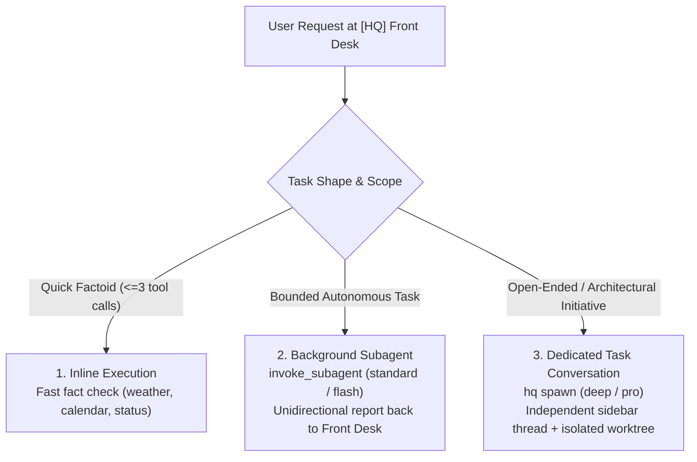
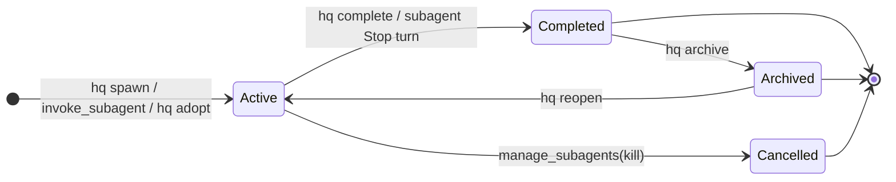
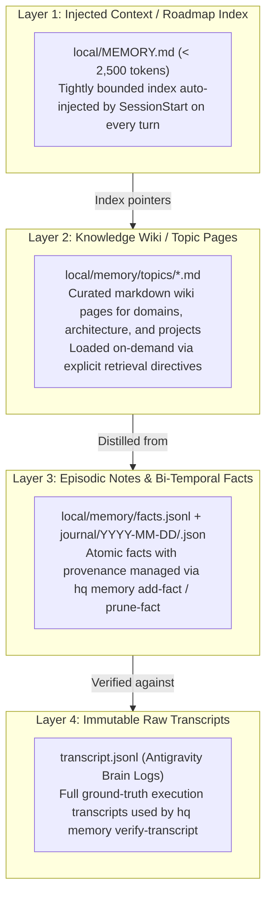

# System Architecture Overview

> For detailed subsystem specifications, see [Technical Designs (`docs/design/`)](README.md#3-technical-designs-docsdesign). For product workflows, see [Product Designs (`docs/product/`)](README.md#2-product-designs-docsproduct).

---

## 1. Architectural Philosophy

**`agy-hq` (Headquarter)** turns an always-on Mac running Google Antigravity into a 24/7 general-purpose, proactive personal assistant using four core principles:

1. **General-Purpose by Default, Boosted by Additive Skills ([ADR-0006](decisions/0006-general-agent-and-skills-over-packs.md), [PRD-0002](product/0002-open-workflows-and-skills.md)):** The agent is never boxed into rigid domain packs. It can handle *any* open-ended request (writing a post, planning a trip, debugging code, researching a stock) out of the box, while progressive-disclosure `.agents/skills/*/SKILL.md` files provide expert runbooks when relevant.
2. **Piggyback on Antigravity's Native Strengths ([ADR-0001](decisions/0001-option-1.5-hybrid-on-antigravity.md)):** Reuse Antigravity's code execution, macOS Seatbelt sandbox, Chrome DevTools browser automation, MCP client, subagents, cron scheduler, and mobile **Remote Control** PWA.
3. **A Thin Go Microkernel (`bin/hq`, [ADR-0002](decisions/0002-go-microkernel-binary.md)):** Plug into Antigravity's `hooks.json` and `sidecar.json` interfaces to add cross-session memory, zero-token event pre-checks, lock-free per-task parallel isolation, and deterministic approval gates.
4. **Strict Two-Layer Separation ([ADR-0003](decisions/0003-two-layer-oss-and-private-vault.md), [RFC-0001](design/0001-vault-and-task-isolation.md)):** Keep the open-source engine and reusable skills in the public-safe root repository, while isolating 100% of personal profile data, memories, journals, triggers, and files inside `local/` (an independent private git repository).

---

## 2. System Topology



---

## 3. Background Daemon Architecture (`systemd` / `launchd`)

To deliver genuine 24/7 proactive personal assistance without requiring open IDE windows or manual CLI runs, `agy-hq` includes an always-on background daemon:

- **OS Service Management:** Installed and uninstalled via `./bin/hq daemon install`, `./bin/hq daemon status`, and `./bin/hq daemon uninstall`.
  - On **macOS**: Configures a user LaunchAgent in `~/Library/LaunchAgents/com.antigravity.hq.daemon.plist` with `RunAtLoad` and `KeepAlive`.
  - On **Linux**: Configures a user systemd service unit in `~/.config/systemd/user/hq-daemon.service` with automatic restarts and journal logging.
- **Zero-Token Idle Pre-Checks (RFC-0004):** The daemon executes two high-frequency pure-Go timers in 0 LLM tokens:
  1. **15-Second Inbox Scanner:** Scans `local/inbox/`, routes incoming files (CSVs $\rightarrow$ `ledger-ingest`, tax PDFs $\rightarrow$ `tax-prep`, SEC filings $\rightarrow$ `thesis-check`, general $\rightarrow$ `inbox-triage`), moves them to `local/inbox/queued/`, and triggers quarantined execution.
  2. **30-Minute Heartbeat Gatekeeper & Dead-Man's Switch:** Evaluates daily quota caps, checks unread status, and monitors whether today's `brief-YYYY-MM-DD.md` has been compiled by 08:00 AM, firing a high-priority alert if missed.
- **Embedded Aux Web UI:** Hosts the local HTTP server (`127.0.0.1:4747`) for the right-hand HQ Console dashboard.

---

## 4. Mechanical Non-Blocking Front Desk Guardrails

The single `[HQ] Front Desk` conversation acts as the intake coordinator across Desktop and Mobile Remote Control. To keep this thread responsive and prevent long-running tasks from locking the user out of conversations, `internal/hooks` enforces mechanical `PreToolUse` guardrails:



- **Zero Source/Worktree Edits:** Direct file modifications (`edit_file`, `write_file`) in source code or worktrees are hard-blocked by `PreToolUse` on the Front Desk thread.
- **Zero Heavy Build/Test Suites:** Commands like `go test`, `npm test`, `cargo test`, or `make test` are rejected inline; they must be executed inside dedicated subagents or task worktrees.
- **Inline Lookup Cap:** Inline research tool calls (`read_file`, grep, find, shell lookups) are capped at **3 calls per turn**. (Turn-1 initialization housekeeping reads of `local/CONSOLE.md`, `hq_console.md`, and `local/triggers.yaml` are explicitly exempted).
- **Silent Ledger Discipline:** Subagent logs, quota counters, and task board tables stay strictly inside the live `hq_console.md` artifact; the Front Desk only delivers synthesized executive takeaways upon task completion.

---

## 5. Task Conversation Lifecycle State Machine

Task conversations and subagents move through a deterministic lifecycle tracked in `local/memory/tasks.json` and mirrored in the live `hq_console.md` Task Board:



| State | Transition Trigger | Actions Taken |
|---|---|---|
| **`🟢 active`** | `hq spawn --task=<slug>`, `invoke_subagent`, or `hq adopt` | Allocates isolated worktree (`local/worktrees/<repo>-<task>/`), registers task in `tasks.json`, syncs `hq_console.md`. |
| **`✅ completed`** | `hq complete <slug-or-id>` or child subagent `Stop` hook | Updates task status to `completed`, preserves summary and timing, updates Task Board. |
| **`📦 archived`** | `hq archive <slug-or-id>` | Moves completed task to archived section on Task Board, freeing active view space while preserving history. |
| **`🟢 active` (reopened)** | `hq reopen <slug-or-id>` | Restores archived task back to active state for further work. |
| **`🛑 cancelled`** | `manage_subagents(Action: "kill")` | Subagent killed before normal turn completion; marked cancelled in `tasks.json`. |

---

## 6. Four-Layer Memory Hierarchy & Dreaming (RFC-0006)

To prevent long-running agents from suffering from memory bloat or compounding false self-reported summaries, `agy-hq` implements Anthropic-grounded four-layer memory architecture:



1. **Layer 1: Roadmap Index (`local/MEMORY.md`):** Tightly capped summary (<2,500 tokens) of active priorities, durable user preferences, and a clickable index of topic pages.
2. **Layer 2: Knowledge Wiki (`local/memory/topics/*.md`):** Modular topic pages covering system architecture, project playbooks, and domain lessons. `SessionStart` injects retrieval directives so the agent reads matching topic files before re-investigating.
3. **Layer 3: Bi-Temporal Atomic Facts (`local/memory/facts.jsonl`):** Structured facts with provenance timestamps (`valid_from`, `valid_to`, `source_conv`, `superseded_by`). Managed via CLI commands: `hq memory add-fact`, `hq memory prune-fact`, and `hq memory compact`.
4. **Layer 4: Immutable Raw Transcripts (`transcript.jsonl`):** The ground-truth log of every tool call, input, and response. Nightly consolidation ("dreaming" via `/sleep-consolidate`) runs `hq memory verify-transcript` to falsify self-reported claims against raw execution before promoting them into durable memory.

---

## 7. Repository & Vault Layout

```text
agy-hq/                                # LAYER 1: Open-Source Agent OS (Root Git Repo)
├── .gitignore                         # Ignores /local/, /bin/, and *.secret*
├── AGENTS.md                          # General-purpose assistant rules (mounts ./local/)
├── go.mod                             # Go module for bin/hq
├── cmd/hq/                            # CLI: init | hook | daemon | propose | notify | status | memory | gmail | spawn | subagent | complete
├── internal/                          # Go microkernel packages
│   ├── kernel/                        # Trigger runner, worker pool, daemon installer, quota circuit breaker
│   ├── hooks/                         # SessionStart, PreToolUse action/PII guard, Stop parser
│   ├── approvals/                     # SHA-256 pending queue & deterministic CLI executor
│   ├── channels/                      # Pluggable adapter (Remote Control default; GChat/Telegram ready)
│   ├── gmail/                         # Decoupled Gmail Layer 1 primitives & sidecar engine
│   ├── vault/                         # Memory auditing, 4-layer topics, bi-temporal fact engine
│   ├── worktree/                      # Isolated git worktree lifecycle manager
│   ├── doctor/                        # Diagnostic checks for sandbox, CLI, and Vault health
│   ├── e2e/                           # Black-box E2E tests for CUJ 1–15
│   └── webui/                         # Single-page Aux Console (sidecar://hq/dashboard, http://127.0.0.1:4747)
├── templates/                         # Starter blueprints copied into ./local/ by `hq init`
├── docs/                              # Documentation Hub (product/, design/, decisions/, research/)
├── .agents/
│   ├── hooks.json                     # Connects Antigravity lifecycle hooks to ./bin/hq
│   └── skills/                        # Additive, progressive-disclosure SKILL.md workflows:
│       ├── morning-brief/
│       ├── sleep-consolidate/
│       ├── swe-pulse/
│       ├── thesis-check/
│       ├── inbox-triage/
│       ├── ledger-ingest/
│       ├── tax-prep/
│       └── filing-diff/
│
└── local/                             # LAYER 2: Private User Vault (Independent Private Git Repo)
    ├── .git/                          # Backed up to private remote (never public)
    ├── .gitignore                     # Ignores worktrees/ and repos/ inside the Vault git repo
    ├── config.yaml                    # Channel settings, concurrency & daily quota budgets
    ├── triggers.yaml                  # Declarative cron schedules, 0-token pre-checks & inbox rules
    ├── USER.md                        # Personal profile, preferences, writing voice & goals
    ├── MEMORY.md                      # Consolidated Roadmap Index (<2,500 tokens)
    ├── CONSOLE.md                     # Live status artifact & task board template
    ├── inbox/                         # Drag-and-drop folder (CSVs, PDFs, notes, receipts)
    ├── notes/                         # Open-ended non-repo work (posts, research, theses, plans)
    ├── worktrees/                     # Parallel git worktrees (<repo>-<task>/) across any GitHub repo
    ├── repos/                         # Optional bare git clones for external GitHub repos
    ├── private/                       # High-PII records (ledger/, taxes/) with stricter context guard
    └── memory/                        # 4-layer memory store:
        ├── topics/                    # Topic wiki pages (RFC-0006)
        ├── facts.jsonl                # Bi-temporal atomic facts (RFC-0006)
        ├── journal/YYYY-MM-DD/        # Monotonic per-turn execution journals
        ├── tasks.json                 # Tracked task conversations & lifecycle states
        ├── front_desk.json            # Active Front Desk intake lease & armed triggers
        ├── gmail/                     # Gmail registry, drafts, and quarantine staging (RFC-0005)
        ├── pending/                   # Staged proposals for 1-tap approval (RFC-0003)
        ├── outbox/                    # Executed proposals and delivery payloads
        └── interventions.jsonl        # Cryptographic execution and intervention audit trail
```
