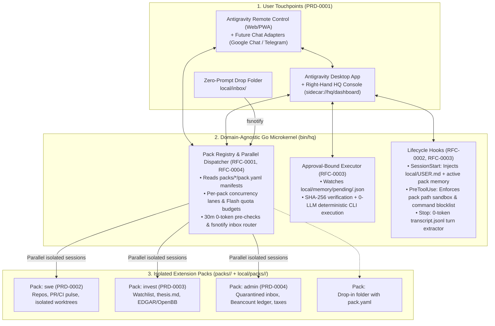

# System Architecture Overview

> For detailed subsystem specifications, see [Technical Designs (`docs/design/`)](README.md#3-technical-designs-docsdesign). For product workflows, see [Product Designs (`docs/product/`)](README.md#2-product-designs-docsproduct).

---

## 1. Architectural Philosophy

**`agy-hq` (Headquarter)** turns an always-on Mac running Google Antigravity into a 24/7 proactive personal assistant using three core principles:

1. **Piggyback on Antigravity's Strengths ([ADR-0001](decisions/0001-option-1.5-hybrid-on-antigravity.md)):** Reuse Antigravity's native code execution, macOS Seatbelt sandbox, Chrome DevTools browser automation, MCP client, subagents, cron scheduler, and mobile **Remote Control** PWA.
2. **Add a Thin, Domain-Agnostic Go Microkernel (`bin/hq`, [ADR-0002](decisions/0002-go-microkernel-binary.md)):** Use Antigravity's `hooks.json` and `sidecar.json` interfaces to add cross-session memory, zero-token event pre-checks, parallel pack isolation, and deterministic approval gates.
3. **Strict Two-Layer Separation ([ADR-0003](decisions/0003-two-layer-oss-and-private-vault.md), [RFC-0001](design/0001-vault-and-pack-isolation.md)):** Keep the open-source engine and generic Extension Packs in the public-safe root repository, while isolating 100% of personal profile data, memories, journals, and domain state inside `local/` (an independent private git repository).

---

## 2. System Topology



---

## 3. Repository & Vault Layout

```text
agy-hq/                                # LAYER 1: Open-Source Agent OS (Root Git Repo)
├── .gitignore                         # Ignores /local/, /bin/, and *.secret*
├── AGENTS.md                          # Generic kernel rules (dynamically mounts ./local/)
├── go.mod                             # Go module for bin/hq
├── cmd/hq/                            # CLI: init | hook | daemon | propose | notify | status
├── internal/                          # Domain-agnostic Go packages
│   ├── kernel/                        # Pack registry, parallel dispatcher, quota circuit breaker
│   ├── hooks/                         # SessionStart, PreToolUse guard, Stop transcript parser
│   ├── approvals/                     # SHA-256 pending queue & deterministic CLI executor
│   ├── channels/                      # Pluggable adapter (Remote Control default; GChat/Telegram ready)
│   └── webui/                         # Single-page Aux Console (sidecar://hq/dashboard)
├── packs/                             # Open-Source Extension Packs (schemas + SKILL.md only)
│   ├── swe/                           # PRD-0002: pack.yaml + skills/
│   ├── invest/                        # PRD-0003: pack.yaml + skills/
│   └── admin/                         # PRD-0004: pack.yaml + skills/
├── templates/                         # Starter blueprints copied into ./local/ by `hq init`
├── docs/                              # Documentation Hub (product/, design/, decisions/, research/)
├── .agents/
│   ├── hooks.json                     # Connects Antigravity lifecycle hooks to ./bin/hq
│   └── skills/                        # Core skills (morning-brief, sleep-consolidate) + pack symlinks
│
└── local/                             # LAYER 2: Private User Vault (Independent Private Git Repo)
    ├── .git/                          # Backed up to private remote (never public)
    ├── config.yaml                    # Enabled packs, channel config, daily quota budgets
    ├── USER.md                        # Personal profile, preferences, timezone
    ├── MEMORY.md                      # Consolidated global memory (<2,500 tokens)
    ├── inbox/                         # Drag-and-drop folder (CSVs, PDFs, receipts)
    ├── memory/                        # facts.jsonl, interventions.jsonl, journal/, pending/, outbox/, proposals/
    └── packs/{swe,invest,admin,...}/  # Private per-pack state & custom private packs
```
