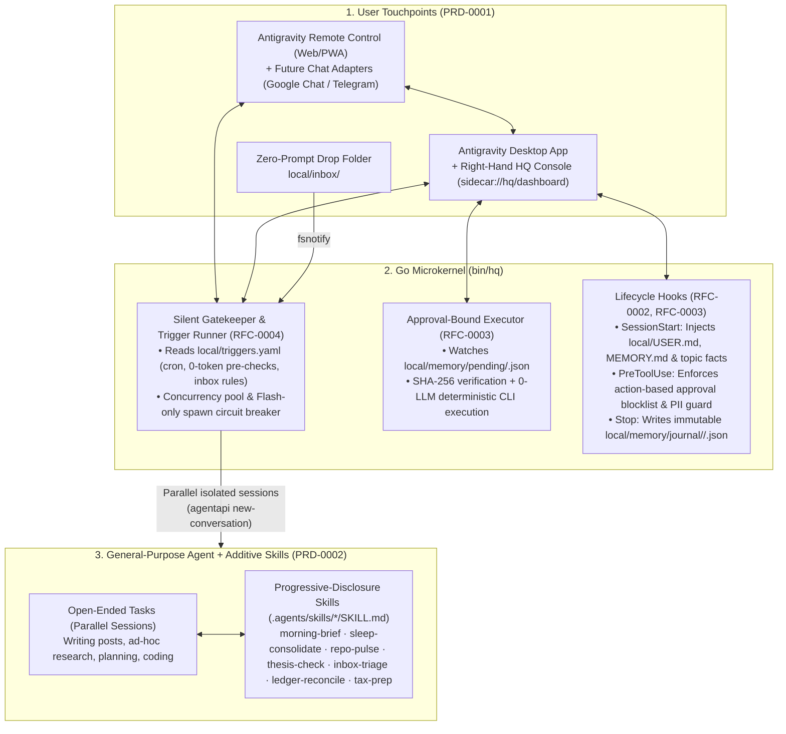

# System Architecture Overview

> For detailed subsystem specifications, see [Technical Designs (`docs/design/`)](README.md#3-technical-designs-docsdesign). For product workflows, see [Product Designs (`docs/product/`)](README.md#2-product-designs-docsproduct).

---

## 1. Architectural Philosophy

**`agy-hq` (Headquarter)** turns an always-on Mac running Google Antigravity into a 24/7 general-purpose, proactive personal assistant using four core principles:

1. **General-Purpose by Default, Boosted by Additive Skills ([ADR-0006](decisions/0006-general-agent-and-skills-over-packs.md), [PRD-0002](product/0002-open-workflows-and-skills.md)):** The agent is never boxed into rigid domain packs. It can handle *any* open-ended request (writing a post, planning a trip, debugging code, researching a stock) out of the box, while progressive-disclosure `.agents/skills/*/SKILL.md` files provide expert runbooks when relevant.
2. **Piggyback on Antigravity's Native Strengths ([ADR-0001](decisions/0001-option-1.5-hybrid-on-antigravity.md)):** Reuse Antigravity's code execution, macOS Seatbelt sandbox, Chrome DevTools browser automation, MCP client, subagents, cron scheduler, and mobile **Remote Control** PWA.
3. **A Thin Go Microkernel (`bin/hq`, [ADR-0002](decisions/0002-go-microkernel-binary.md)):** Plug into Antigravity's `hooks.json` and `sidecar.json` interfaces to add cross-session memory, zero-token event pre-checks, lock-free per-task parallel isolation, and deterministic approval gates.
4. **Strict Two-Layer Separation ([ADR-0003](decisions/0003-two-layer-oss-and-private-vault.md), [RFC-0001](design/0001-vault-and-task-isolation.md)):** Keep the open-source engine and reusable skills in the public-safe root repository, while isolating 100% of personal profile data, memories, journals, triggers, and files inside `local/` (an independent private git repository).

---

## 2. System Topology



---

## 3. Repository & Vault Layout

```text
agy-hq/                                # LAYER 1: Open-Source Agent OS (Root Git Repo)
├── .gitignore                         # Ignores /local/, /bin/, and *.secret*
├── AGENTS.md                          # General-purpose assistant rules (mounts ./local/)
├── go.mod                             # Go module for bin/hq
├── cmd/hq/                            # CLI: init | hook | daemon | propose | notify | status
├── internal/                          # Go microkernel packages
│   ├── kernel/                        # Trigger runner, worker pool, quota circuit breaker
│   ├── hooks/                         # SessionStart, PreToolUse action/PII guard, Stop parser
│   ├── approvals/                     # SHA-256 pending queue & deterministic CLI executor
│   ├── channels/                      # Pluggable adapter (Remote Control default; GChat/Telegram ready)
│   └── webui/                         # Single-page Aux Console (sidecar://hq/dashboard)
├── templates/                         # Starter blueprints copied into ./local/ by `hq init`
├── docs/                              # Documentation Hub (product/, design/, decisions/, research/)
├── .agents/
│   ├── hooks.json                     # Connects Antigravity lifecycle hooks to ./bin/hq
│   └── skills/                        # Additive, progressive-disclosure SKILL.md workflows:
│       ├── morning-brief/
│       ├── sleep-consolidate/
│       ├── repo-pulse/
│       ├── thesis-check/
│       ├── inbox-triage/
│       ├── ledger-reconcile/
│       └── tax-prep/
│
└── local/                             # LAYER 2: Private User Vault (Independent Private Git Repo)
    ├── .git/                          # Backed up to private remote (never public)
    ├── config.yaml                    # Channel settings, concurrency & daily quota budgets
    ├── triggers.yaml                  # Declarative cron schedules, 0-token pre-checks & inbox rules
    ├── USER.md                        # Personal profile, preferences, writing voice & goals
    ├── MEMORY.md                      # Consolidated long-term memory (<2,500 tokens)
    ├── inbox/                         # Drag-and-drop folder (CSVs, PDFs, notes, receipts)
    ├── workspace/                     # Open workspace for any task (posts, research, notes, projects)
    ├── private/                       # High-PII records (ledger/, taxes/) with stricter context guard
    └── memory/                        # facts.jsonl, topics/*.md, journal/YYYY-MM-DD/<convId>.json, pending/, outbox/
```
