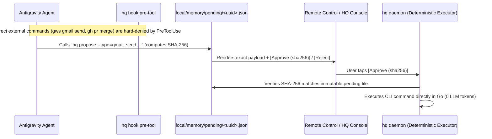

# RFC-0003: Safety, Quarantined Readers & Approval-Bound Execution

- **Status:** Approved
- **Related Docs:** [02 — Academic Frontier §5](../research/02_academic.md), [04 — Antigravity Audit §4](../research/04_antigravity_audit.md)

---

## 1. Threat Model: Breaking the Lethal Trifecta

Per Simon Willison's *Lethal Trifecta* and DeepMind's *CaMeL* architecture, an agent with (1) private data, (2) untrusted input (emails, web pages, external PDFs), and (3) external action capability can be hijacked via indirect prompt injection. Because adaptive attacks bypass >90% of model-level prompt filters (*Nasr, Carlini et al., 2025*), safety must be enforced architecturally:

1. **Step-0 Sandbox Prerequisite:** Global/workspace permission preset must be set to `Default` or `Auto` (enabling macOS Seatbelt `sandbox-exec`), never `Turbo`.
2. **Quarantined Readers:** Any background job reading untrusted content (inbox triage, web scraping, filing ingestion) is granted **read-only + local summary write permissions only**.
3. **Approval-Bound Execution for All Irreversible External Actions:** The LLM never directly executes external sends, third-party merges, external publishes, or payments. Routine git pushes of verified code to this repository (`git push origin main`) are explicitly exempt once tests and PII checks pass.

---

## 2. Approval-Bound Execution Flow (`hq propose` → `hq daemon`)

1. **Hard Block in `PreToolUse` (`hq hook pre-tool`):**
   - Intercepts `run_command` and write-capable tools.
   - Immediately returns `{"decision": "deny"}` if an agent attempts to directly run outbound/irreversible commands (`gws gmail send`, `gh pr merge`, `gh release create`, payment CLIs), instructing it to call `hq propose` instead. (Routine pushes to this repository on clean merge are explicitly exempt once tests pass.)
2. **Staging a Proposal (`hq propose`):**
   - Writes `local/memory/pending/<uuid>.json` containing the action type, exact arguments, requesting conversation ID, timestamp, and `sha256` checksum.
3. **Zero-LLM Execution on User Approval:**
   - When the user approves the item in Remote Control or the `HQ Console` side pane, `hq daemon` verifies the `sha256` checksum and executes the deterministic CLI command itself in Go—**with zero LLM in the loop after approval**.
   - Logs the outcome to `local/memory/interventions.jsonl`.
