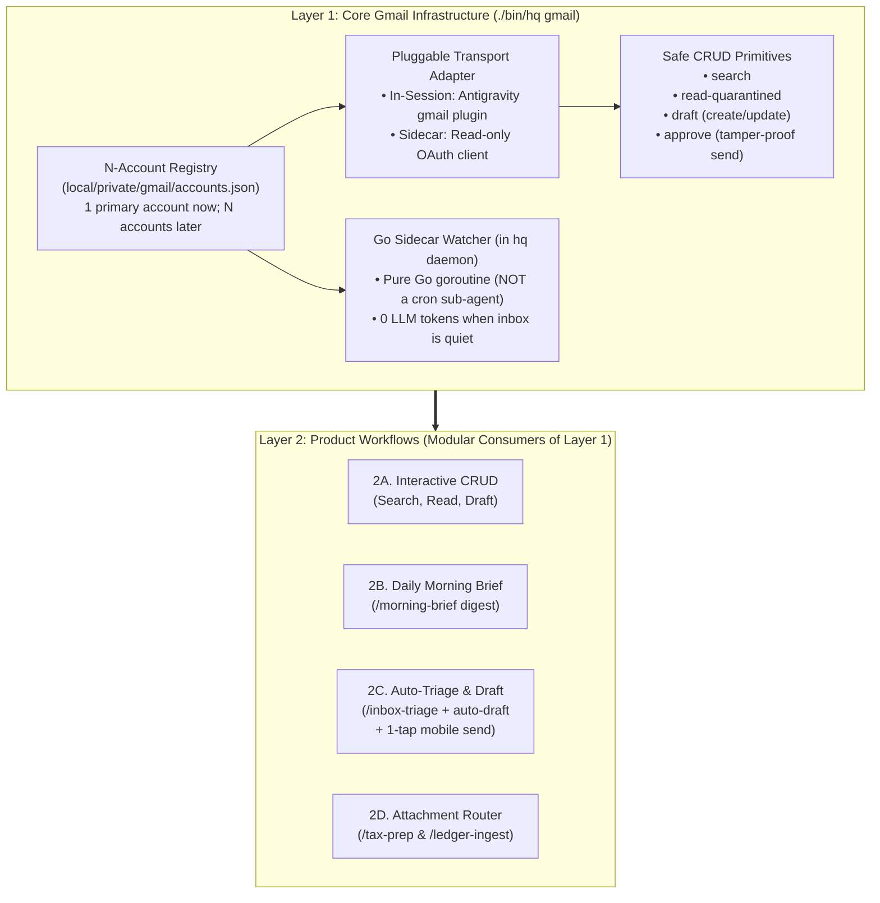

# RFC-0005: Decoupled Gmail Infrastructure (Layer 1) & Product Workflows (Layer 2)

- **Status:** Approved
- **Related Documents:** [RFC-0001](0001-vault-and-task-isolation.md), [RFC-0003](0003-approval-bound-execution.md), [RFC-0004](0004-heartbeat-and-channels.md)

---

## 1. Architectural Principle: Two-Layer Decoupling

To keep `agy-hq` modular and extensible, Gmail support is split into two strictly decoupled layers:

1. **Layer 1 — Core Gmail Infrastructure & Safe CRUD Primitives (`internal/gmail` + `./bin/hq gmail`):**
   - Solves **how `agy-hq` connects to Gmail**, authenticates across **1 primary Gmail account today and $N$ arbitrary Gmail accounts tomorrow**, runs a **0-token pure Go sidecar watcher** inside `hq daemon` (never a cron LLM sub-agent), and exposes **4 safe CRUD primitives** (`search`, `read-quarantined`, `draft`, and approval-gated `send`).
2. **Layer 2 — Product Workflows & Skills (Modular Consumers of Layer 1):**
   - Consumes Layer 1's CLI primitives to deliver concrete user experiences step-by-step:
     - **2A. Interactive Gmail CRUD** from the Front Desk.
     - **2B. Daily Morning Brief (`/morning-brief`)** digest.
     - **2C. Sidecar-Triggered Inbox Triage + Auto-Drafting (`/inbox-triage`)** with 1-tap mobile send approval.
     - **2D. Verified Attachment Routing (`/tax-prep` & `/ledger-ingest`)**.



---

## 2. Layer 1 Specification: Core Gmail Infrastructure (`internal/gmail`)

### 2.1 Extensible $N$-Account Registry (`local/private/gmail/accounts.json`)
Rather than hardcoding `"personal"` vs. `"work"`, accounts are stored in an alias-keyed registry in `local/private/gmail/accounts.json` (`0600` permissions, inside the private Vault):

```json
{
  "defaultAccount": "primary",
  "accounts": {
    "primary": {
      "alias": "primary",
      "email": "user@gmail.com",
      "agyAccount": "",
      "tokenFile": "local/private/gmail/tokens/primary.json",
      "query": "label:INBOX is:unread category:primary",
      "enabled": true
    }
  }
}
```

- **Single Account Today:** Running `./bin/hq gmail init --email=<you@gmail.com>` registers `primary` as `defaultAccount`. When `--account` is omitted from any `./bin/hq gmail` command, it resolves to `defaultAccount`.
- **Multiple Gmail Accounts Later:** Running `./bin/hq gmail add-account --alias=<name> --email=<addr>` adds another Gmail account cleanly. Each account maintains its own cursor state in `local/memory/gmail/state-<alias>.json`.

### 2.2 Pluggable Transport Adapter
All Gmail operations go through `./bin/hq gmail <subcommand>` backed by a `Provider` interface in `internal/gmail`:
1. **Antigravity Plugin CLI Transport (`gmail` binary):**
   - Uses Antigravity's native `gmail` plugin (`~/.gemini/config/plugins/gmail` / `/usr/share/antigravity/resources/app/extensions/antigravity/bin/gmail-*`) when running inside an active Antigravity session with `GCLI_ACCESS_TOKEN` or `ANTIGRAVITY_LS_ADDRESS` broker access.
2. **Direct Read-Only OAuth2 HTTP Transport (`gmail.googleapis.com`):**
   - Used by the `hq daemon` Go sidecar (and as an automatic fallback when outside an interactive session) using a `gmail.readonly` OAuth token stored in `local/private/gmail/tokens/<alias>.json` (`0600`).
3. **Mock/Fixture Transport (for deterministic offline unit & E2E testing):**
   - Controlled via `HQ_GMAIL_MOCK_DIR` or mock HTTP server in tests.

### 2.3 Pure Go Sidecar Watcher in `hq daemon` (`./bin/hq gmail precheck`)
The background Gmail checker runs as a **pure Go goroutine inside `hq daemon`** (and is also callable via `./bin/hq gmail precheck` in `local/triggers.yaml`):
- **0 LLM Tokens When Quiet:** Queries Gmail for unread `Primary` messages newer than the per-account watermark in `local/memory/gmail/state-<alias>.json` (using atomic `.tmp` + `os.Rename` state updates).
- **Deduplication:** Tracks seen message IDs and thread IDs so an already-triaged unread email never triggers duplicate spawns.
- **Batch Handoff:** When new unread human threads arrive, writes a batch manifest to `local/memory/gmail/batches/<batchId>.json` and spawns `[Auto] Gmail Triage` passing only `--batch=<batchId>` (never raw email subjects/bodies in the CLI command line or task title).

### 2.4 The 4 Safe CRUD Primitives & Mechanical Security Guardrails

1. **`./bin/hq gmail search [--account=<alias>] [--query="..."] [--max=20]`**
   - Returns structured JSON metadata (`id`, `threadId`, `from`, `to`, `subject`, `date`, `snippet`, `labels`).
2. **`./bin/hq gmail read-quarantined --thread=<threadId> [--account=<alias>]`**
   - Parses MIME parts and strips all `<script>`, `<style>`, hidden DOM elements (`display:none`, `opacity:0`, `font-size:0`), HTML comments, and external tracking images (``), converting visible HTML to plain text.
   - Wraps untrusted content in a per-invocation 128-bit random nonce boundary (`<untrusted_email_<nonce>>...</untrusted_email_<nonce>>`) and defangs non-allowlisted URLs.
   - Records the active conversation ID in `local/memory/tainted_sessions.json` so `PreToolUse` enforces the **Quarantined Reader profile** (blocking reads of `local/private/**` and `local/MEMORY.md`, and blocking arbitrary shell/network egress).
3. **`./bin/hq gmail draft --to="..." --subject="..." --body="..." [--thread=<id>] [--account=<alias>]`**
   - Creates or updates a plain-text Gmail draft (`Content-Type: text/plain; charset=utf-8`).
   - Safe and allowed autonomously without blocking on approval.
4. **Tamper-Proof 1-Tap Send (`./bin/hq propose --type=gmail_send --draft=<draftId>` -> `./bin/hq approve <id>`):**
   - Direct execution of `gmail ... send-message` or `gmail ... send-draft` is **hard-denied by `PreToolUse`** in every conversation.
   - Staging a send proposal via `./bin/hq propose --type=gmail_send --draft=<draftId> [--account=<alias>]` fetches the draft's canonical `From`, `To`, `Cc`, `Subject`, and plain-text body, computes `contentHash = sha256(account + "\n" + to + "\n" + cc + "\n" + subject + "\n" + body)`, and stores the snapshot in the proposal metadata.
   - Before executing the send, `./bin/hq approve <id> --sha256=<prefix>` re-fetches the draft and verifies its `contentHash` still matches the approved snapshot, preventing draft bait-and-switch attacks.

---

## 3. Layer 2 Specification: Product Workflows & Phased Rollout

- **Milestone 1 (Layer 1 Foundation):**
  - Implement `internal/gmail` package (`accounts.json` registry, HTML-to-text quarantine sanitizer, search/read/draft/send primitives, `precheck` sidecar state machine, and `hq gmail` CLI subcommands).
  - Enforce `gmail` outbound send blocking and quarantined session tainting in `internal/hooks/hooks.go` and draft hash verification in `internal/approvals/approvals.go`.
  - Wire `hq daemon` sidecar loop to run `gmail.RunPrecheck` alongside heartbeat checks.
- **Milestone 2 (Daily Brief & Sidecar Auto-Draft Triage):**
  - Update `.agents/skills/morning-brief/SKILL.md` and `.agents/skills/inbox-triage/SKILL.md` to consume `./bin/hq gmail` primitives, automatically create plain-text draft replies for actionable emails, and stage 1-tap send approvals.
- **Milestone 3 (Verified Attachment Quarantine):**
  - Add `./bin/hq gmail attachment-quarantine` with `Authentication-Results` (`dkim=pass`) check against `trusted_sender_domains` in `local/triggers.yaml` before auto-routing to `/tax-prep` or `/ledger-ingest`.
