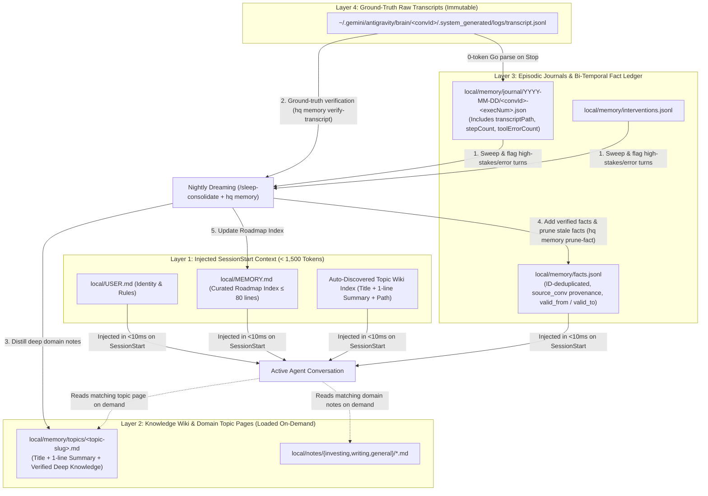

# RFC-0006: Four-Layer Memory Hierarchy, Ground-Truth Dreaming & Proactive Pruning

- **Status:** Approved & Implemented
- **Author:** `[Task:headquarter] agy-hq-memory-upgrade` (`gemini-4-argon-high`)
- **Created:** 2026-11-08
- **Supersedes / Extends:** [RFC-0002 (Zero-Token Journaling & Sleep-Time Memory Consolidation)](./0002-memory-and-consolidation.md)
- **Related Docs:** [RFC-0001](./0001-vault-and-task-isolation.md), [ADR-0005](../decisions/0005-zero-token-stop-hook-vs-blocking-gate.md)

---

## 1. Motivation & Research Grounding

Anthropic's engineering research, ***"The components of agent memory"*** (Lance Martin, 2026), evaluates how long-running agents accumulate, verify, organize, and prune knowledge across sessions without weight updates. While it strongly validates `agy-hq`'s 3-phase lifecycle in [RFC-0002](./0002-memory-and-consolidation.md) (SessionStart injection $\rightarrow$ Turn journaling $\rightarrow$ Offline sleep consolidation), it establishes four empirical principles that expose concrete gaps in our current implementation:

1. **The Four-Layer Memory Stack (Roadmap Index $\neq$ Storage Attic):**
   - High-performing agents separate memory into four distinct layers:
     1. **Injected Context (Top Layer):** A tightly bounded **Roadmap Index** automatically loaded into every session.
     2. **Knowledge Wiki / Topic Map:** Structured markdown topic pages (`topics/*.md`) linking domain lessons, architecture invariants, and project playbooks.
     3. **Granular Episodic Notes & Facts:** Atomic facts, user interventions, and turn journals captured from execution.
     4. **Raw Ground-Truth Transcripts (Bottom Layer):** The exhaustive, immutable log of every session (`transcript.jsonl`).
2. **Offline "Dreaming" Requires Ground-Truth Transcript Verification:**
   - Agents frequently write overly optimistic or inaccurate self-summaries at the end of a turn (e.g., claiming a bug was fixed or a root cause was proven when intermediate tool calls actually failed or only tested a partial path).
   - Nightly consolidation ("dreaming") only prevents false memories from compounding if the consolidation agent cross-references self-reported summaries against **ground-truth transcripts** (`transcript.jsonl`) before promoting claims into durable memory.
3. **Volume $\neq$ Quality (The Unpruned Memory Trap):**
   - Allowing flat memory files or fact lists to grow unchecked actively degrades reasoning performance and causes agents to stall. Proactive deprecation and pruning of resolved tasks, deleted worktrees, and superseded assumptions are as critical as adding new facts.
4. **Explicit Retrieval Directives & Purpose-Driven Consolidation:**
   - Models routinely ignore memory directories unless the injected `SessionStart` context explicitly shows a compact index of available topic files **and** instructs the agent to read matching topic pages before investigating from scratch.
   - Conversely, imposing rigid extraction checklists on the consolidation agent degrades memory quality on frontier models compared to giving the dreaming agent clear architectural purpose and verification tools.

---

## 2. Audit of Current `agy-hq` Memory Architecture

An audit of `agy-hq` across [RFC-0002](./0002-memory-and-consolidation.md), [`internal/hooks/hooks.go`](../../internal/hooks/hooks.go), [`internal/vault/vault.go`](../../internal/vault/vault.go), and [`.agents/skills/sleep-consolidate/SKILL.md`](../../.agents/skills/sleep-consolidate/SKILL.md) identified four architectural gaps:

| Subsystem | Current Implementation | Identified Gap vs. Anthropic Research |
| :--- | :--- | :--- |
| **1. `Stop` Turn Journaling**<br>([`internal/hooks/hooks.go`](../../internal/hooks/hooks.go)) | `HandleStop` parses `payload.TranscriptPath` via `parseTranscriptSummary` and writes `local/memory/journal/YYYY-MM-DD/<convId>-<execNum>.json`. | **Discards `TranscriptPath` & Error Signals:** `JournalEntry` does not persist `transcriptPath`, total step count, or tool error counts (`status == "ERROR"`). `responseSummary` only grabs the last `PLANNER_RESPONSE` truncated to 500 runes. Nightly consolidation cannot trace a journal entry back to its ground-truth `transcript.jsonl` or spot turns where tools failed silently. |
| **2. `SessionStart` & `MEMORY.md`**<br>([`internal/hooks/hooks.go`](../../internal/hooks/hooks.go), [`templates/MEMORY.md`](../../templates/MEMORY.md)) | `HandleSessionStart` injects the entire `local/MEMORY.md` file verbatim plus up to 25 active facts. `vault.Init` creates `local/memory/topics/`, but nothing reads or indexes it. | **Flat Attic & Orphan `topics/` Dir:** `local/MEMORY.md` has no size/token enforcement and mixes transient priorities with permanent facts. `local/memory/topics/` is completely unused: `SessionStart` neither lists available topic pages nor instructs the agent to consult them on demand. |
| **3. Bi-Temporal Facts (`facts.jsonl`)**<br>([`internal/vault/vault.go`](../../internal/vault/vault.go)) | `LoadActiveFacts` scans `local/memory/facts.jsonl` line-by-line and returns every line where `valid_to == null` (last 25). | **Broken Supersession & No Pruning CLI:** Because `LoadActiveFacts` does not deduplicate by `Fact.ID`, appending an updated record with `valid_to != null` leaves the original line (`valid_to: null`) active forever. Manual LLM edits to `.jsonl` files are error-prone, and `Fact` lacks provenance fields (`source_conv`, `verified`, `superseded_by`). |
| **4. Nightly Consolidation**<br>([`.agents/skills/sleep-consolidate/SKILL.md`](../../.agents/skills/sleep-consolidate/SKILL.md)) | 24-line skill instructing a `flash` job to read `journal/YYYY-MM-DD/*.json` and patch `MEMORY.md` and `facts.jsonl`. | **No Ground-Truth Verification or Wiki Split:** Summarizes 500-rune snippets without checking `transcript.jsonl`, never distills deep knowledge into `local/memory/topics/*.md`, and performs no garbage collection against completed tasks (`tasks.json`) or removed worktrees. |

---

## 3. Proposed Architecture: Four-Layer Memory Engine



---

### 3.1 Upgrade 1: Ground-Truth Transcript Verification in `Stop` & Nightly Dreaming

#### A. Enriched Zero-Token `JournalEntry` (`internal/hooks/hooks.go`)
Preserve the `<5ms`, 0-token guarantee of `hq hook stop` while recording the ground-truth transcript pointer and execution health metrics:

```go
type JournalEntry struct {
	Timestamp         string   `json:"timestamp"`
	ConversationID    string   `json:"conversationId"`
	ExecutionNum      int      `json:"executionNum"`
	TranscriptPath    string   `json:"transcriptPath,omitempty"`
	WorkspacePaths    []string `json:"workspacePaths,omitempty"`
	ModelName         string   `json:"modelName,omitempty"`
	StepCount         int      `json:"stepCount,omitempty"`
	ToolErrorCount    int      `json:"toolErrorCount,omitempty"`
	UserPrompt        string   `json:"userPrompt,omitempty"`
	ToolsUsed         []string `json:"toolsUsed,omitempty"`
	FilesModified     []string `json:"filesModified,omitempty"`
	TerminationReason string   `json:"terminationReason"`
	ResponseSummary   string   `json:"responseSummary,omitempty"`
}
```

In `parseTranscriptSummary(transcriptPath)`:
- Count total steps (`StepCount`) and steps where `status == "ERROR"` (`ToolErrorCount`).
- Capture both `write_file`/`edit_file` paths and any state-changing `run_command` invocations.

#### B. Zero-Token Transcript Verifier CLI (`./bin/hq memory verify-transcript <convId-or-path>`)
Raw `transcript.jsonl` files can exceed 500 KB–5 MB, making it expensive and noisy for the nightly consolidation LLM to read raw JSONL directly. We add a deterministic Go subcommand `./bin/hq memory verify-transcript <convId>` that parses `<appDataDir>/brain/<convId>/.system_generated/logs/transcript.jsonl` in `<10ms` and emits a compact, ground-truth verification digest:
- All `USER_INPUT` prompts in chronological order (detecting mid-session user corrections or rejections).
- All tool calls that returned `status: "ERROR"` or non-zero exit codes (exposing failed builds/tests or reverted approaches).
- Actual files modified on disk and git commits/branches created.
- Final `PLANNER_RESPONSE` vs. intermediate errors so the dreaming agent can immediately spot discrepancies between what an agent *thought* it did and what *actually* succeeded.

---

### 3.2 Upgrade 2: The "Roadmap Index vs. Topic Pages" Wiki Split

#### A. `local/MEMORY.md` as a Strictly Bounded Roadmap Index
`local/MEMORY.md` is redefined from a flat storage file into a **Roadmap Index (Table of Contents)** with a hard target budget of **$\le 80$ lines ($\le 1,200$ tokens)**:
1. **`## Active Priorities`**: Current high-level initiatives (linked to active worktrees or task slugs; pruned automatically when tasks complete).
2. **`## Core Operating Invariants`**: Durable cross-domain preferences that apply to almost every session.
3. **`## Knowledge Map (Topic Wiki Pointers)`**: 1-line summary pointers to deep topic pages in `local/memory/topics/<slug>.md` and `local/notes/<domain>/`.

#### B. Standardized Topic Pages (`local/memory/topics/<slug>.md`)
Detailed technical lessons, subsystem invariants, repository gotchas, and domain playbooks live in individual markdown files under `local/memory/topics/<slug>.md`. Each topic file uses a lightweight header convention parsed in `<1ms` by Go:

```markdown
# <Topic Title>
> **Summary:** One-sentence executive summary of what this topic page covers and when to read it.
> **Updated:** 2026-11-08 | **Source Conversations:** `tk000001`, `tk000002`

## Key Invariants & Lessons
...
```

#### C. Auto-Discovery & Retrieval Directive in `SessionStart` (`internal/hooks/hooks.go`)
During `hq hook session-start`:
1. `vault.LoadTopicIndex(vaultDir)` scans `local/memory/topics/*.md` and extracts each file's slug, title, one-line `> **Summary:**`, and absolute `file://` path.
2. If topic pages exist, `HandleSessionStart` injects a compact `## HQ Knowledge Wiki (Topic Index — Read On-Demand)` section with an explicit retrieval directive:
   > *"When your task involves any topic listed below, call `read_file` on its topic page first to load verified architectural context and avoid repeating past mistakes."*
3. If `local/MEMORY.md` exceeds `MaxMemoryIndexLines` (80 lines), `HandleSessionStart` truncates the injected view at 80 lines with a warning banner (`[MEMORY.md exceeds 80-line Roadmap Index cap; run /sleep-consolidate or ./bin/hq memory status to distill into local/memory/topics/]`) so `SessionStart` context never bloats.

---

### 3.3 Upgrade 3: Bi-Temporal Fact Provenance & Proactive Pruning

#### A. Upgraded `Fact` Schema & ID-Deduplicated Loading (`internal/vault/vault.go`)
We extend `vault.Fact` (backward-compatibly with existing `facts.jsonl` lines) to track provenance and verification status:

```go
type Fact struct {
	ID           string  `json:"id"`
	Topic        string  `json:"topic"`
	Statement    string  `json:"statement"`
	SourceConv   string  `json:"source_conv,omitempty"`
	Verified     bool    `json:"verified,omitempty"`
	ValidFrom    string  `json:"valid_from"`
	ValidTo      *string `json:"valid_to"`
	SupersededBy string  `json:"superseded_by,omitempty"`
}
```

**Bug Fix in `vault.LoadActiveFacts(vaultDir, limit)`:**
- Instead of naively appending every line where `ValidTo == nil`, `LoadActiveFacts` maintains an ordered map by `Fact.ID` as it scans `facts.jsonl` from top to bottom.
- If a later line in `facts.jsonl` updates an existing `ID` with a non-null `ValidTo` (or supersedes it), that `ID` is removed from the active set.
- `CompactFacts(vaultDir)` rewrites `facts.jsonl` cleanly so each `ID` appears once with its latest state (preserving expired facts with `valid_to != nil` for historical audit while eliminating duplicate lines).

#### B. Deterministic `./bin/hq memory` CLI Subcommands (`cmd/hq/main.go`)
To eliminate fragile manual JSONL editing by LLMs, `./bin/hq memory` provides deterministic operations:

1. `./bin/hq memory status`:
   - Audits `local/MEMORY.md` line count & estimated token count against the 80-line / 1,200-token Roadmap Index budget.
   - Lists all topic pages in `local/memory/topics/*.md` with their 1-line summaries.
   - Counts active vs. expired facts in `local/memory/facts.jsonl`.
   - Identifies stale priorities (e.g., worktrees or task slugs mentioned in `MEMORY.md` that are already `completed`/`cancelled` in `tasks.json` or no longer exist in `local/worktrees/`).
2. `./bin/hq memory add-fact --topic=<topic> --statement="..." [--source=<convId>] [--verified] [--id=<id>]`:
   - Appends a properly formatted bi-temporal `Fact` to `local/memory/facts.jsonl`.
3. `./bin/hq memory prune-fact <fact-id> [--superseded-by=<new-id>]`:
   - Marks `<fact-id>` with `valid_to = <RFC3339 now>` (and optional `superseded_by`) and compacts duplicate ID entries in `facts.jsonl`.
4. `./bin/hq memory verify-transcript <conv-id-or-journal-path>`:
   - Outputs the 0-token ground-truth verification digest from `transcript.jsonl` for a conversation.

---

### 3.4 Upgrade 4: Purpose-Driven Nightly Dreaming (`.agents/skills/sleep-consolidate/SKILL.md`)

We upgrade `.agents/skills/sleep-consolidate/SKILL.md` (and `templates/sidecars/hq-sleep-consolidate/sidecar.json`) from a simplistic log summarizer into a 4-stage **Dreaming & Verification Runbook**:

1. **Stage 1 — Baseline Health & Stale Reference Audit (`./bin/hq memory status`):**
   - Inspect current `MEMORY.md` budget usage, existing topic pages in `local/memory/topics/*.md`, active facts, and any stale task/worktree references flagged by `hq memory status`.
2. **Stage 2 — Episodic Sweep & Ground-Truth Transcript Verification:**
   - Read today's `local/memory/journal/YYYY-MM-DD/*.json` and `local/memory/interventions.jsonl`.
   - For any non-trivial conversation (especially turns with `toolErrorCount > 0`, user corrections, architectural decisions, or task completions), run `./bin/hq memory verify-transcript <conversationId>` to verify what actually occurred in `transcript.jsonl` before recording any durable lesson.
3. **Stage 3 — Proactive Pruning & Wiki Distillation:**
   - **Prune:** Expire outdated, contradicted, or one-off task facts via `./bin/hq memory prune-fact <id>`. Remove completed tasks/worktrees from `MEMORY.md`'s `## Active Priorities`.
   - **Distill to Topic Wiki:** Put detailed architectural findings, domain playbooks, or repository-specific lessons into `local/memory/topics/<slug>.md` (with `# Title` and `> **Summary:** ...`), never directly into `MEMORY.md`.
   - **Update Roadmap Index:** Keep `local/MEMORY.md` under 80 lines as a crisp executive map pointing to `local/memory/topics/<slug>.md` and `local/notes/`.
   - **Record Verified Atomic Facts:** Use `./bin/hq memory add-fact --topic=... --statement="..." --source=<convId> --verified`.
4. **Stage 4 — Skill Proposals & Private Vault Commit:**
   - Stage recurring workflow improvements or user intervention lessons in `local/memory/proposals/YYYY-MM-DD-<slug>.md`.
   - Run `./bin/hq memory status` to confirm `MEMORY.md` is within budget, then commit `local/` git repository.

---

## 4. Vault Schema Migration (`v3 -> v4`)

In [`internal/vault/migrate.go`](../../internal/vault/migrate.go), bumping `CurrentSchemaVersion` from `3` to `4` will execute a non-destructive migration step (`v4_memory_wiki_and_fact_dedup`):
1. Ensure `local/memory/topics/` exists and seed an initial `local/memory/topics/agy-hq-harness.md` topic page if `topics/` is empty.
2. Run `vault.CompactFacts(vaultDir)` on `local/memory/facts.jsonl` to deduplicate any historical fact records by `ID`.
3. Update `templates/MEMORY.md` to include the `## Knowledge Map (Topic Wiki)` section (and non-destructively append the section header to `local/MEMORY.md` if absent).
4. Add a `Memory Roadmap Budget` check to `./bin/hq doctor` (`PASS` if `MEMORY.md` $\le 80$ lines, `WARN` if over budget).

---

## 5. Resolved Design Decisions (2026-11-08)

1. **`SessionStart` Topic Discovery Behavior:** **Approved Option A (Auto-Discover Header Summaries)** — `hq hook session-start` scans `local/memory/topics/*.md`, extracts each file's `# Title` and `> **Summary:**` line, and injects a compact `## HQ Knowledge Wiki (Topic Index — Read On-Demand)` section alongside `MEMORY.md` with an explicit retrieval directive.
2. **Nightly Dreaming Model Tier (`hq-sleep-consolidate`):** **Approved Option A (`flash` / `gemini-3.8-flash-high` paired with 0-token `./bin/hq memory verify-transcript`)** — `/sleep-consolidate` *is* the nightly dreaming engine, upgraded from naive journal-snippet summarization to full ground-truth transcript verification, topic wiki distillation, and active fact pruning.
3. **Fact Pruning Policy:** **Approved Option A (Soft Expiration via `valid_to` + ID Deduplication)** — `./bin/hq memory prune-fact <id>` sets `valid_to` to the current timestamp and compacts duplicate ID lines in `facts.jsonl`, keeping expired records for historical auditability while excluding them from `SessionStart`.
