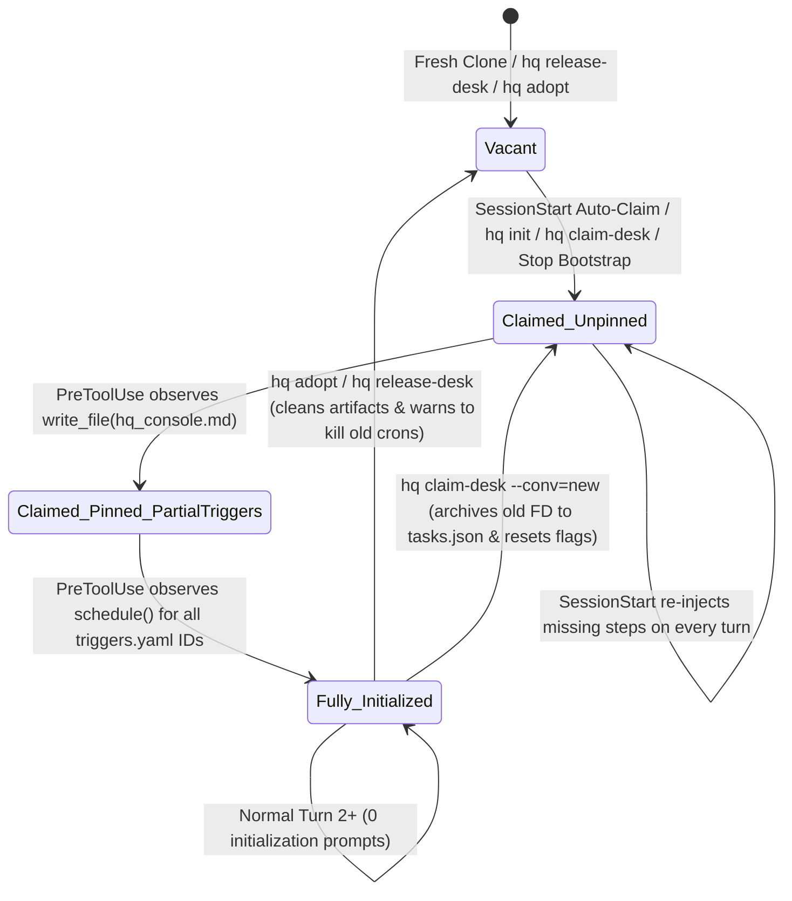

# RFC-0007: Front Desk Initialization & Handover Lifecycle Hardening

- **Status:** Draft / In Review
- **Related Docs:** [RFC-0001](0001-vault-and-task-isolation.md), [RFC-0002](0002-memory-and-consolidation.md), [RFC-0004](0004-heartbeat-and-channels.md), [AGENTS.md](../../AGENTS.md)

---

## 1. Executive Summary & Problem Statement

In `agy-hq`, the single `[HQ] Front Desk` thread serves as the user's non-blocking intake coordinator across Desktop and Mobile Remote Control. During real-world usage across five lifecycle transitions—**(1) Fresh Clone**, **(2) In-Session Bootstrap**, **(3) Shift Change / Handover**, **(4) Conversation Refresh (Turn 2+)**, and **(5) Machine / Daemon Restart**—several critical state invariants were repeatedly forgotten or silently lost:

1. **Missed `SessionStart` Initialization:** When bootstrapping inside an already-open conversation or claiming the desk via `./bin/hq claim-desk`, subsequent turns saw an existing `front_desk.json` lease and suppressed the Turn-1 initialization protocol—even though `hq_console.md` had never been pinned and triggers had never been armed.
2. **Missing `hq_console.md` UI Pinning:** While `webui.SyncMarkdownConsole` wrote `<artifactDir>/hq_console.md` on disk, Antigravity's UI only surfaces an artifact card after the agent invokes `write_file` with `ArtifactMetadata` at least once in that conversation. Because `front_desk.json` did not track `consolePinned`, an unpinned console went undetected.
3. **Dormant Proactive Triggers (`triggers.yaml`):** Schedules declared in `local/triggers.yaml` (`morning-brief`, `edgar-close-watch`, `sleep-consolidate`) sat dormant or partially armed because `HandleSessionStart` never inspected `triggers.yaml` or instructed the Front Desk to register missing schedules via Antigravity's `schedule` tool, and `PreToolUse` never tracked `schedule` / `manage_task` calls.
4. **Subagent Task Board, Multi-Line Title Corruption & Journal Overwrites:**
   - `hq spawn` invoked `agentapi new-conversation` *before* registering the task in `local/memory/tasks.json`, racing with the child conversation's `SessionStart`/`Stop` hooks.
   - Untracked conversations spawned directly via `agentapi` dumped raw multi-line prompts (2,000+ chars) into `ActiveTask.Title`, breaking the Markdown table in `hq_console.md` and polluting `SessionStart` context across all threads.
   - When `StopPayload.ExecutionNum` was `0` (the default in live Antigravity `Stop` hook payloads), `HandleStop` overwrote `<convId>-0.json` on every turn instead of appending monotonic per-turn journal files.
5. **Incomplete Shift Handover (`adopt` / `release-desk` / `claim-desk`):** Replacing a Front Desk via `hq claim-desk` orphaned the previous Front Desk conversation from `tasks.json`, left stale `active_artifact_dir.txt` and `front_desk_turn.json` files on disk, and failed to coordinate cleanup of standing `IsDaemon: true` cron tasks in the demoted thread.

This RFC documents the root-cause audit across all code paths and specifies the deterministic state machine that guarantees every Turn-1 invariant.

---

## 2. End-to-End Audit of Failure Modes & Root Causes

### 2.1 Lifecycle Transition Matrix



### 2.2 Detailed Root-Cause Analysis

| Failure Mode | Code Location | Root Cause | Impact |
| :--- | :--- | :--- | :--- |
| **FM-1a: Suppressed Init Banner after `hq init` / `claim-desk` / Partial Turn 1** | `internal/hooks/hooks.go` (`HandleSessionStart` L101–115) | `HandleSessionStart` only emitted `New [HQ] Front Desk Initialization Required` when `!ok` (`front_desk.json` did not exist). If `hq init`, `hq claim-desk`, or Turn 1 created `front_desk.json` before `write_file(hq_console.md)` and `schedule(...)` were called, Turn 2 hit `else if existing.ConversationID == payload.ConversationID` and silently skipped initialization. | `hq_console.md` never pinned in UI; cron triggers never armed. |
| **FM-1b: Worktree Hook Binary Resolution** | `.agents/hooks.json` (L6, L16, L25) | Hook commands only checked `./bin/hq` and `../bin/hq`. Task conversations and subagents scoped to `local/worktrees/<repo>-<task>/` run 3 levels below root (`../../../bin/hq`). | Hooks silently failed when invoked from inside an isolated worktree. |
| **FM-1c: Subagent Clobbering of Front Desk Pointers** | `internal/hooks/hooks.go` (`HandleSessionStart` L82–90, L144–147; `HandleStop` L405–419) | Every conversation unconditionally wrote its own `conversationId` to `front_desk_turn.json` and its own `artifactDirectoryPath` to `active_artifact_dir.txt`. | Subagents reset the Front Desk's 3-lookup counter mid-turn and pointed `active_artifact_dir.txt` at subagent brain directories. |
| **FM-2a: No Tracking of `hq_console.md` UI Pin State** | `internal/kernel/kernel.go` (`FrontDeskLease` L40–44) | `FrontDeskLease` lacked `ConsolePinned` and `ArmedTriggers` fields, and `HandlePreToolUse` did not record when `write_file` targeted `hq_console.md`. | `hq` and `hq doctor` could not distinguish between a raw file on disk and an artifact registered with Antigravity's UI. |
| **FM-2b: Init Housekeeping Penalized by Lookup Cap** | `internal/hooks/hooks.go` (`HandlePreToolUse` L350–363) | Calling `read_file` on `local/CONSOLE.md`, `<artifactDir>/hq_console.md`, or `local/triggers.yaml` counted against Rule C's 3-call inline research limit. | Turn-1 initialization consumed up to 2 of the user's 3 allowed inline lookups. |
| **FM-3a: Dormant `triggers.yaml` Schedules** | `internal/hooks/hooks.go`, `.agents/hooks.json`, `AGENTS.md` | `HandleSessionStart` did not parse `local/triggers.yaml` or instruct the Front Desk to call `schedule(CronExpression=..., IsDaemon=true, Prompt=...)`. `.agents/hooks.json` did not match `schedule` or `manage_task` in `PreToolUse`. | `morning-brief`, `edgar-close-watch`, and `sleep-consolidate` remained unscheduled unless the user manually asked about each one. |
| **FM-3b: `CRON_TZ=` Prefix vs. 5-Field Cron** | `templates/triggers.yaml` (`CRON_TZ=America/Los_Angeles 30 7 * * *`) | `triggers.yaml` includes a `CRON_TZ=...` prefix, whereas Antigravity's `schedule` tool schema specifies a 5-field cron expression (`30 7 * * *`). | Passing raw 6-token strings risks parser rejection or inconsistent task descriptions. |
| **FM-4a: `hq spawn` Registration Race Condition** | `cmd/hq/main.go` (`case "spawn"` L457–469) | `kernel.SpawnTask` executed `agentapi new-conversation` *before* `kernel.RegisterTask`. The child conversation's `SessionStart` and `Stop` hooks ran before `RegisterTask` wrote `tasks.json`. | `HandleStop` treated the child as an untracked conversation and created a duplicate `conv-<shortId>` task entry. |
| **FM-4b: Multi-Line Prompt Corruption in `tasks.json`** | `internal/hooks/hooks.go` (`HandleStop` L519–529), `internal/kernel/kernel.go` (`RegisterTask`) | Untracked conversations set `Title = "[Task:general] " + payload.LastUserInput` without stripping newlines, pipes, or truncating length. | Multi-line prompts broke the Markdown table in `hq_console.md` and injected 2,000-char prompts into every conversation's `SessionStart` context. |
| **FM-4c: `ExecutionNum == 0` Journal Overwrites** | `internal/hooks/hooks.go` (`HandleStop` L437–438) | When Antigravity omitted `executionNum` (`0`), `HandleStop` always wrote `<convId>-0.json`, overwriting previous turns of the same conversation on the same day. Subagent turns also had empty `UserPrompt` in `CONSOLE.md`. | Loss of earlier same-day turn journals; blank activity lines in `hq_console.md`. |
| **FM-5: Incomplete Shift Handover** | `cmd/hq/main.go` (`claim-desk`, `release-desk`, `adopt`), `internal/kernel/kernel.go` | `claim-desk` overwrote the previous Front Desk without archiving it in `tasks.json`, required `--conv` even when `ANTIGRAVITY_CONVERSATION_ID` was set, and `ReleaseFrontDesk` left stale `active_artifact_dir.txt` / `front_desk_turn.json` files. | Orphaned previous Front Desk threads; lingering cron tasks in demoted threads. |

---

## 3. Deterministic Architecture & Solutions

### 3.1 Enriched `FrontDeskLease` State & Transcript Reconciliation (`internal/kernel/`)

We extend `FrontDeskLease` in `local/memory/front_desk.json` to explicitly track Turn-1 completion invariants for the active Front Desk conversation:

```go
type ArmedTrigger struct {
	ID      string `json:"id"`
	Cron    string `json:"cron"`
	Skill   string `json:"skill,omitempty"`
	ArmedAt string `json:"armedAt"`
}

type FrontDeskLease struct {
	ConversationID string                  `json:"conversationId"`
	ArtifactDir    string                  `json:"artifactDir,omitempty"`
	ConsolePinned  bool                    `json:"consolePinned,omitempty"`
	ArmedTriggers  map[string]ArmedTrigger `json:"armedTriggers,omitempty"`
	UpdatedAt      string                  `json:"updatedAt"`
}
```

1. **Idempotent Same-Conversation Updates (`SetFrontDesk`):**
   - If `SetFrontDesk` is called for the **same** `convID` that already holds the lease, it preserves `ConsolePinned` and `ArmedTriggers` while self-healing `ArtifactDir` if a non-empty path is provided.
   - If `SetFrontDesk` is called for a **new** `convID`:
     - It removes `hq_console.md` and `hq_console.md.metadata.json` from the previous Front Desk's `ArtifactDir`.
     - It initializes `ConsolePinned = false` and an empty `ArmedTriggers` map for the new `convID`.
2. **Real-Time Hook Tracking + Transcript Backfill (`ReconcileFrontDeskFromTranscript`):**
   - **Real-Time (`HandlePreToolUse`):**
     - When the active Front Desk calls `write_file` or `edit_file` targeting `hq_console.md`, `kernel.MarkConsolePinned(vaultDir, convID)` sets `ConsolePinned = true`.
     - When the active Front Desk calls `schedule`, `kernel.RecordArmedTrigger(vaultDir, convID, cronExpr, prompt)` matches the cron expression or skill against `local/triggers.yaml` and records the armed trigger in `ArmedTriggers[id]`.
   - **Transcript Reconciliation (`ReconcileFrontDeskFromTranscript`):**
     - On `SessionStart` and `Stop` (and `SyncMarkdownConsole`), if `ConsolePinned` is false or any schedule in `local/triggers.yaml` is missing from `ArmedTriggers`, `ReconcileFrontDeskFromTranscript` scans the Front Desk's `transcript.jsonl` (`<artifactDir>/.system_generated/logs/transcript.jsonl`) for prior `write_file(hq_console.md)` and `schedule(...)` tool calls.
     - This guarantees seamless backward compatibility for already-running Front Desk conversations without requiring redundant tool calls.

### 3.2 Two-Layer Trigger Execution & Zero-Duplication Contract

To eliminate any ambiguity between `hq daemon` (`systemd` / `launchd`) and Antigravity's in-conversation `schedule` tool:

1. **Layer 1 — OS Background Daemon (`hq daemon`):**
   - Runs 24/7 in pure Go (`0` LLM tokens when idle).
   - Watches `local/inbox/` every 15 seconds for file drops and runs the 30-minute gatekeeper pre-check (`RunHeartbeat`), checking the dead-man's switch for `brief-YYYY-MM-DD.md` after 08:00.
   - Does **not** duplicate the interactive cron schedules when they are armed in the active Front Desk.
2. **Layer 2 — Front Desk Native Cron Schedules (`schedule` tool with `IsDaemon: true`):**
   - Every schedule declared in `local/triggers.yaml` (`morning-brief` at `30 7 * * *`, `edgar-close-watch` at `30 13 * * 1-5`, `sleep-consolidate` at `30 23 * * *`) is normalized via `ScheduleTrigger.FiveFieldCron()` (stripping `CRON_TZ=...`) and `ScheduleTrigger.DefaultPrompt()`.
   - Whenever `HandleSessionStart` detects unarmed schedules in `local/triggers.yaml` for the active Front Desk, it injects the exact `schedule(CronExpression=..., IsDaemon=true, Prompt=...)` calls required to arm them on Turn 1.

### 3.3 Persistent Turn-1 Initialization Checklist in `HandleSessionStart`

Instead of only checking `if !ok`, `HandleSessionStart` evaluates:
- `justClaimed := !ok`
- `needsConsolePin := !fd.ConsolePinned`
- `_, unarmedTriggers := kernel.GetUnarmedTriggers(vaultDir)`

Whenever `justClaimed || needsConsolePin || len(unarmedTriggers) > 0`, `HandleSessionStart` emits the `## 🚀 New [HQ] Front Desk Initialization Required` banner with the exact remaining steps:
- **Step 1 (Zero Redundant Reads):** Confirms `USER.md`, `MEMORY.md`, active facts, pending approvals, worktrees, tracked tasks, and `triggers.yaml` are already injected below.
- **Step 2 (Pin Live Console Artifact):** Instructs the agent to read `local/CONSOLE.md` and call `write_file` on `<artifactDir>/hq_console.md` with `ArtifactMetadata`. (Exempted from the 3-call lookup cap in `HandlePreToolUse`).
- **Step 3 (Arm Proactive Schedules from `local/triggers.yaml`):** Lists the exact `schedule(CronExpression="...", IsDaemon=true, Prompt="...")` call for each unarmed trigger.
- **Step 4 (Concise Welcome):** Present a short status summary with clickable links.

Once `fd.ConsolePinned == true` and `len(unarmedTriggers) == 0`, subsequent turns emit only the concise `[HQ] Front Desk Coordinator (NON-BLOCKING)` role banner.

### 3.4 Task Title Sanitization, Pre-Spawn Registration & Monotonic Turn Journals

1. **Single-Line Title Sanitization (`kernel.SanitizeTaskTitle`):**
   - Strips `<USER_REQUEST>` tags, extracts the first non-empty line, collapses whitespace, replaces `|` with `-`, enforces `[Task:<scope>]` / `[Subagent:<scope>]` prefixing, and truncates at 88 runes.
   - Applied at write time in `kernel.RegisterTask`, at stop time in `HandleStop`, during migration in `vault.Migrate`, and at render time in `webui.SyncMarkdownConsole`.
2. **Pre-Spawn Task Registration (`cmd/hq/main.go` + `HandleSessionStart`):**
   - `hq spawn` registers the `ActiveTask` in `local/memory/tasks.json` *before* invoking `kernel.SpawnTask`, and updates `ConversationID` once `ExtractUUID(out)` returns (or links it automatically on the child's `SessionStart` / `Stop` hook).
3. **Monotonic Turn Journaling (`HandleStop`):**
   - If `payload.ExecutionNum <= 0`, `HandleStop` scans `local/memory/journal/YYYY-MM-DD/<convId>-*.json` and assigns `maxExecNum + 1` (starting at `1`), preventing same-day turn overwrites while preserving explicit `executionNum` values in tests.
   - If `payload.LastUserInput` is empty, `parseTranscriptSummary` extracts the latest `USER_INPUT` (stripped of XML wrapper tags) or falls back to `ResponseSummary` so `Recent Turn Activity` in `hq_console.md` is never blank.

### 3.5 Clean Shift Handover (`claim-desk`, `release-desk`, `adopt`) & `hq doctor` Verification

1. **`hq claim-desk`:**
   - Resolves `--conv` automatically from `ANTIGRAVITY_CONVERSATION_ID` or `ANTIGRAVITY_SOURCE_METADATA` when omitted.
   - Archives the outgoing Front Desk conversation (`prev.ConversationID`) into `local/memory/tasks.json` as `completed` (`[Task:headquarter] Archived Front Desk Shift (<shortId>)`) if not already tracked.
   - Prints the Turn-1 Initialization Checklist (pinning `hq_console.md` + arming `triggers.yaml` + cancelling old cron tasks in the previous Front Desk).
2. **`hq release-desk` & `hq adopt`:**
   - Cleans up `<prev.ArtifactDir>/hq_console.md`, `hq_console.md.metadata.json`, `local/memory/active_artifact_dir.txt`, and `local/memory/front_desk_turn.json`.
   - Emits a handover reminder if the demoted Front Desk had armed cron triggers so the agent cancels them via `manage_task(Action="kill")`.
3. **`hq doctor` Verification (`internal/doctor/doctor.go`):**
   - Verifies Front Desk Intake Lease, `hq_console.md` artifact sync & metadata presence, Scheduled Triggers & Daemon Heartbeat (including armed trigger count in the Front Desk), and Task Board & Quota integrity (flagging any unsanitized task titles or open circuit breakers).
