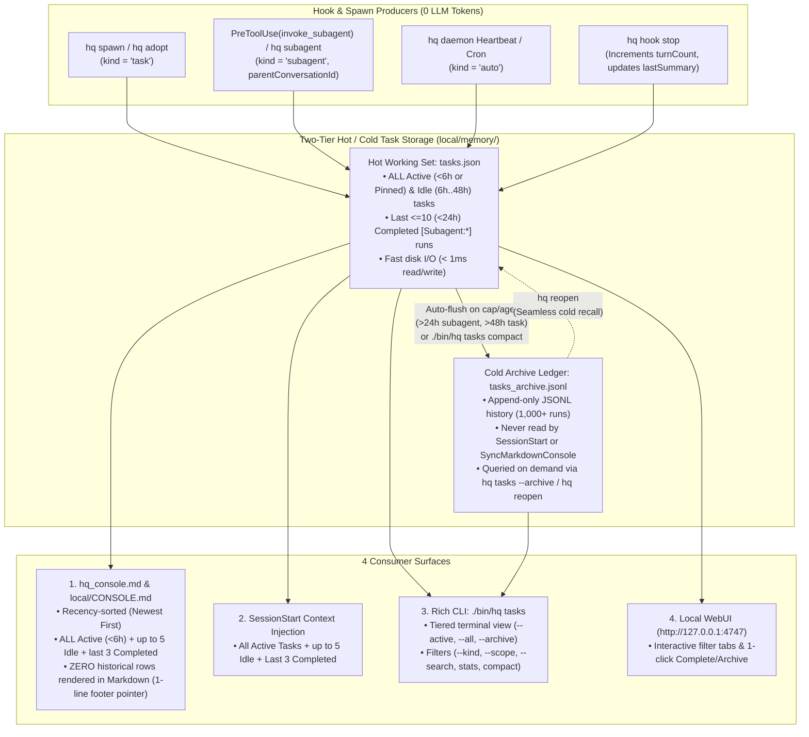
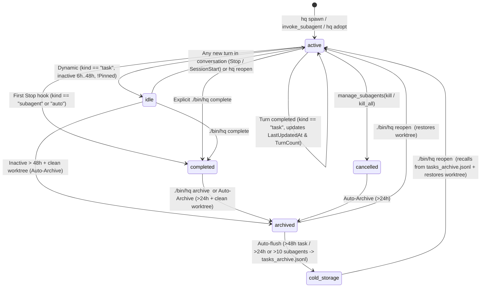

# RFC-0009: Scalable Task Board, Live Console & Hot/Cold Lifecycle Redesign

- **Status:** Draft v3 (Updated: Never Truncate Truly Active Tasks; Cap Only Idle & Completed History)
- **Author:** `[Task:taskboard] taskboard-redesign` (`gemini-4-argon-high`)
- **Created:** 2026-11-08
- **Related Documents:** [RFC-0001](0001-vault-and-task-isolation.md), [RFC-0006](0006-memory-engine-upgrade.md), [RFC-0007](0007-front-desk-initialization-hardening.md), [06 — Task Board, Console Layout & Conversation Lifecycle Audit](../research/06_taskboard_and_console_audit.md)

---

## 1. Motivation & Problem Statement

Within 24 hours of live operation, `agy-hq` tracked **23 conversations** in `local/memory/tasks.json` (6 multi-turn `[Task:<scope>]` sidebar conversations and 17 ephemeral `[Subagent:<scope>]` background runs). At this rate (`~15–25` spawns/day), `tasks.json` and `hq_console.md` will exceed **500 rows within 30 days** and **5,000+ rows over a year**.

Our Phase 1 audit ([06 — Task Board Audit](../research/06_taskboard_and_console_audit.md)) identified six concrete failure modes:
1. **Oldest-First Table Inversion:** `SyncMarkdownConsole` renders `tasks.json` in append order (`0..N-1`), burying active tasks at row 22 beneath 18 finished subagents from yesterday.
2. **Task vs. Subagent Conflation:** Ephemeral 90-second subagent runs (`~70%` of entries) sit in the same flat table as multi-day `[Task:<scope>]` initiatives and lose their `parentConversationId` lineage.
3. **Missing `Idle` & `Stalled` States ("Zombie Active" Threads):** Multi-turn sidebar tasks never auto-complete on `Stop`, so a task untouched for 12 hours or 4 days looks identical (`🟢 active`) to one actively running right now.
4. **Unbounded `SessionStart` Token Bloat:** `HandleSessionStart` injects every entry in `tasks.json` (including completed and archived tasks) into `<SYSTEM_MESSAGE>` on every turn (`O(N)` token growth).
5. **No Cold Storage Rotation & Markdown Rendering Bloat:** Rendering historical tasks in `hq_console.md` (even inside a collapsed `<details>` tag) forces the Markdown renderer and DOM to parse thousands of historical rows on every turn.
6. **Missing CLI (`./bin/hq tasks`) & WebUI Task Board:** There is no `./bin/hq tasks` CLI command, and `http://127.0.0.1:4747` (`internal/webui/webui.go`) omits `{{.Tasks}}` from its HTML template.

---

## 2. Architecture Overview



---

## 3. Data Model & Lifecycle State Machine (`Vault Schema v5`)

### 3.1 Enriched `ActiveTask` Struct (`internal/kernel/kernel.go`)

All new fields use `omitempty` so existing `local/memory/tasks.json` files unmarshal with zero breakage, and helper methods (`EffectiveKind()`, `EffectiveScope()`, `EffectiveStatus(now)`) infer missing metadata on the fly:

```go
// ActiveTask tracks a task conversation or background subagent in local/memory/tasks.json
// (hot working set) and local/memory/tasks_archive.jsonl (cold history ledger).
type ActiveTask struct {
	TaskSlug             string `json:"taskSlug"`
	Title                string `json:"title"`
	Kind                 string `json:"kind,omitempty"`                 // "task" | "subagent" | "auto"
	Scope                string `json:"scope,omitempty"`                // e.g. "agy-hq", "brand", "NVDA", "personal"
	Tier                 string `json:"tier"`                           // "quick" | "standard" | "deep"
	Model                string `json:"model"`
	ParentConversationID string `json:"parentConversationId,omitempty"` // Links nested subagent to parent Task or Front Desk
	WorktreeDir          string `json:"worktreeDir,omitempty"`
	RepoRoot             string `json:"repoRoot,omitempty"`
	ConversationID       string `json:"conversationId,omitempty"`
	TurnCount            int    `json:"turnCount,omitempty"`            // Monotonic turn count updated on hq hook stop
	Pinned               bool   `json:"pinned,omitempty"`               // Keeps task anchored at top of Active board
	CreatedAt            string `json:"createdAt"`
	LastUpdatedAt        string `json:"lastUpdatedAt"`
	CompletedAt          string `json:"completedAt,omitempty"`
	ArchivedAt           string `json:"archivedAt,omitempty"`
	LastSummary          string `json:"lastSummary,omitempty"`
	Status               string `json:"status"`                         // Stored: active, idle, completed, cancelled, archived
}
```

### 3.2 Deterministic Lifecycle State Machine & Dynamic `Idle` / `Stalled` Detection



| Effective Status | Badge in `hq_console.md` | Rule / Trigger Condition |
| :--- | :--- | :--- |
| **`active`** | `🟢 \`active\`` | Stored `status == "active"` and updated within the last `6 hours` (or `Pinned == true`). |
| **`idle`** | `⏸️ \`idle\`` | Stored `status == "idle"` OR (`kind == "task"`, `status == "active"`, `!Pinned`, and `now - LastUpdatedAt` between `6h` and `48h`). Automatically wakes to `🟢 \`active\`` on the next turn. |
| **`stalled`** *(subagent warning)* | `⚠️ \`stalled\`` | `kind == "subagent"` (or `"auto"`), `status == "active"`, and `now - LastUpdatedAt >= 30m` without a `Stop` hook. |
| **`completed`** | `✅ \`completed\`` | Stored `status == "completed"`. |
| **`cancelled`** | `🛑 \`cancelled\`` | Stored `status == "cancelled"`. |
| **`archived`** | `📦 \`archived\`` | Stored `status == "archived"` (worktree verified clean & removed; rotated to `tasks_archive.jsonl` after grace window). |

---

## 4. Console Layout & Tiered Cap Policy (`hq_console.md` & `local/CONSOLE.md`)

### 4.1 Per-Tier Inclusion & Cap Rules (`SelectConsoleTasks`)
What bloated `hq_console.md` to 22+ rows was **not** having 22 active tasks—it was **18 `✅ completed` subagents** staying in the table forever, plus old `[Task:...]` threads that remained `"status": "active"` forever when the user moved on without running `./bin/hq complete`.

Instead of capping active tasks, `SyncMarkdownConsole` applies **per-tier limits**:

| Priority Tier | Included Items | Console Row Limit | Rationale |
| :--- | :--- | :---: | :--- |
| **Tier 1: Active (`🟢 active` / `⚠️ stalled`)** | All currently active `[Task:...]` threads and running `[Subagent:...]` workers (`< 6h` since last update, or `--pinned`, sorted newest-first). | **Show ALL (`No Cap`)** | Never hide genuinely active work, even if 10+ tasks are active simultaneously. |
| **Tier 2: Idle (`⏸️ idle`)** | Top-level `[Task:...]` threads untouched for `6h – 48h` (sorted newest-first). | **Up to `5` rows** | Prevents "zombie active" threads from piling up while keeping recent side threads one click away. |
| **Tier 3: Just-Finished (`✅ completed` / `🛑 cancelled`)** | Recently completed/cancelled tasks & subagents (`< 2h`). | **Max `3` rows** | Shows the immediate takeaway of a subagent that just finished without dumping historical subagents. |
| **Tier 4: Historical Completed & Archived** | Older completed (`> 3` or `> 2h`) and archived tasks (whether 10 or 10,000). | **`0` table rows** *(1-line footer pointer)* | Keeps `hq_console.md` fast and compact forever. |

### 4.2 Before vs. After Mockup (`hq_console.md` Section 2)

```markdown
## 📋 2. Task Board (`4` Active · `0` Idle · `18` Completed · `1` Archived)

| Status | Task Conversation | Slug | Latest Progress |
| :--- | :--- | :--- | :--- |
| 🟢 `active` | **[[Task:taskboard] taskboard-redesign (deep/gemini-4-argon-high)](conversation://00000000-0000-0000-0000-000000000101)** | `taskboard-redesign` · *just now · 🌿 wt* | Updated RFC-0009: show all active tasks, decay >6h to idle, cap completed at 3. |
| 🟢 `active` | **[[Subagent:agy-hq] Pin Suggestion UX Enhancer [standard]](conversation://00000000-0000-0000-0000-000000000102)** | `subagent-agy-hq-pin-suggestion-ux-enhancer` · *2m ago* | Running in background... |
| 🟢 `active` | **[[Task:brand] brand-icon-design (deep/gemini-4-argon-high)](conversation://00000000-0000-0000-0000-000000000103)** | `brand-icon-design` · *3m ago · 🌿 wt · 7 turns* | Fixed StartCascade Turn-1 kickoff and reviewed Opus 5.5 Round 4 icon concepts. |
| 🟢 `active` | **[[Task:gchat] gchat-integration-rfc (deep/gemini-4-argon-high)](conversation://00000000-0000-0000-0000-000000000104)** | `gchat-integration-rfc` · *35m ago* | Completed RFC-0008 and Layer 1 multi-transport Google Chat implementation. |
| ✅ `completed` | **[[Subagent:brand] Opus 5.5 Creative Director [deep]](conversation://00000000-0000-0000-0000-000000000105)** | `subagent-brand-opus-5-5-creative-director` · *6m ago · ↳ brand* | Sent critique of earlier icon rounds and 4 new concepts to lead designer thread. |
| ✅ `completed` | **[[Subagent:personal] Project Launch Timeline Finder [standard]](conversation://00000000-0000-0000-0000-000000000106)** | `subagent-personal-project-launch-timeline-finder` · *45m ago* | Compiled full timeline and deadlines for Q4 Project Launch. |
| ✅ `completed` | **[[Subagent:NVDA] Thesis & Dip-Buying Architect [deep]](conversation://00000000-0000-0000-0000-000000000107)** | `subagent-nvda-thesis-dip-buying-architect` · *1h ago* | NVDA Investment Playbook written to `local/notes/investing/nvda_thesis.md`. |

- *15 older completed task(s) and 1 archived task(s) preserved in local/memory/tasks.json (0 in tasks_archive.jsonl) — run `./bin/hq tasks --all` or `./bin/hq tasks --archive` to inspect.*
```

---

## 5. Hot/Cold Storage & Rolling Archive Compaction

### 5.1 Two-Tier Storage Layout (`local/memory/`)
1. **`local/memory/tasks.json` (Hot Working Set):**
   - Stores all `active` and `idle` tasks, plus at most the last `10` recently `completed`/`cancelled` subagents (`< 24h`) and recently `archived` tasks (`< 48h`).
   - Kept small so `SessionStart`, `PreToolUse`, `Stop`, and `SyncMarkdownConsole` execute in `< 1ms` without ever reading cold storage.
2. **`local/memory/tasks_archive.jsonl` (Cold Append-Only Ledger):**
   - Stores one JSON object per line (`ActiveTask` schema) for all historical completed, cancelled, and archived tasks rotated out of `tasks.json` (1,000+ entries).
   - **Never read during `SessionStart`, `PreToolUse`, `Stop`, or `SyncMarkdownConsole`.** Only read when the user explicitly runs `./bin/hq tasks --archive`, `./bin/hq tasks --search=...`, or `./bin/hq reopen <old-slug>`.

### 5.2 Deterministic Compaction Rules (`kernel.CompactTasks(vaultDir, opts)`)
Invoked automatically when completed/archived items in `tasks.json` exceed their hot retention cap, during `./bin/hq tasks compact`, and during nightly `/sleep-consolidate`:
1. **Ephemeral Subagent Rotation (`kind == "subagent"` or `"auto"`):**
   - Any `completed` or `cancelled` subagent with `now - LastUpdatedAt > 24h` (or beyond the `10` most recent completed subagents) is appended to `local/memory/tasks_archive.jsonl` and removed from `tasks.json`.
2. **Top-Level Task Auto-Archive & Cold Rotation (`kind == "task"`):**
   - **24h Grace (`completed -> archived`) & 48h Dormant (`idle -> archived`):** Completed/cancelled tasks `> 24h` old (and idle tasks untouched `> 48h` with a clean worktree and `!Pinned`) transition to `status = "archived"` (cleaning up their worktree directory if still present).
   - **48h Grace (`archived -> tasks_archive.jsonl`):** Archived tasks `> 48h` old are appended to `local/memory/tasks_archive.jsonl` and removed from `tasks.json`.
3. **Seamless Cold Recall in `hq reopen <target>`:**
   - If `./bin/hq reopen <slug-or-conv-id>` does not find `<target>` in `local/memory/tasks.json`, it scans `local/memory/tasks_archive.jsonl`, promotes the matching record back into `tasks.json` with `Status = "active"`, removes it from `tasks_archive.jsonl`, and recreates its git worktree (`hq/<slug>`).

### 5.3 Bounded `SessionStart` Context Injection (`internal/hooks/hooks.go`)
`HandleSessionStart` calls `kernel.SelectSessionStartTasks(tasks, now)`:
- Injects **all `active` tasks/subagents** + up to **5 `idle` tasks** + at most the **3 most recently completed tasks**.
- Appends a single summary footer if older tasks were omitted:
  `- *(+15 older completed/archived tasks omitted from context; run './bin/hq tasks' to inspect)*`

---

## 6. CLI (`./bin/hq tasks`) & WebUI (`:4747`) Experience

### 6.1 Rich `./bin/hq tasks` CLI Subcommand
```sh
# Default tiered view: Active, Idle, and top 5 Recently Completed
./bin/hq tasks

# Filter views
./bin/hq tasks --active               # Only active & idle conversations
./bin/hq tasks --all                  # All hot tasks in local/memory/tasks.json
./bin/hq tasks --archive [--limit=50] # Paginated cold history from local/memory/tasks_archive.jsonl
./bin/hq tasks --kind=task            # Filter by kind: task | subagent | auto
./bin/hq tasks --scope=brand          # Filter by project/domain scope
./bin/hq tasks --search="icon"        # Stream-search across hot tasks.json + cold tasks_archive.jsonl
./bin/hq tasks --json                 # Machine-readable JSON output

# Lifecycle & maintenance subcommands
./bin/hq tasks stats                  # Summary counts by status, kind, tier, model, and storage tier
./bin/hq tasks compact [--dry-run]    # Run rolling auto-archive (>24h) & cold rotation (>48h)
./bin/hq tasks pin <slug-or-conv-id>  # Pin/unpin a priority task at the top of the Task Board
./bin/hq tasks unpin <slug-or-conv-id>
```

### 6.2 Local WebUI Dashboard Upgrade (`internal/webui/webui.go`)
Add the bounded **Task Board** card grid to `http://127.0.0.1:4747` (`pageTmpl`) between *Pending Approvals* and *Active Worktrees* with filter pills (`Active & Idle`, `Tasks Only`, `Subagents`, `Recent Completed`) and 1-click **`Complete`** / **`Archive`** POST actions.

### 6.3 Bonus Harness Hardening: Backtick-Safe `hq spawn` & Subagent Lineage
1. **Parent Conversation Lineage (`ParentConversationID`):** Propagated from `HandlePreToolUse(invoke_subagent)` and `SpawnSubagent` onto `ActiveTask.ParentConversationID`.
2. **Preventing Bash Backtick Subshell Stripping in `hq spawn`:** `HandlePreToolUse` detects unescaped backticks inside double-quoted `hq spawn --prompt="..."` commands and escapes them via `overwrite` so bash never strips inline code spans.

---

## 7. Migration Path (`Vault Schema v4 -> v5`)

Running `./bin/hq migrate` (or `./bin/hq upgrade`) executes **Migration `v4 -> v5` (`v5_taskboard_hierarchy_and_archive`)** non-destructively:
1. Snapshots `local/.git` if dirty.
2. Backfills `kind` (`"task"` vs. `"subagent"` vs. `"auto"`) and `scope` on all existing records in `local/memory/tasks.json`.
3. Initializes `local/memory/tasks_archive.jsonl`, flushes excess historical completed subagents beyond the hot cap, and updates `local/CONSOLE.md` and `<artifactDir>/hq_console.md`.
