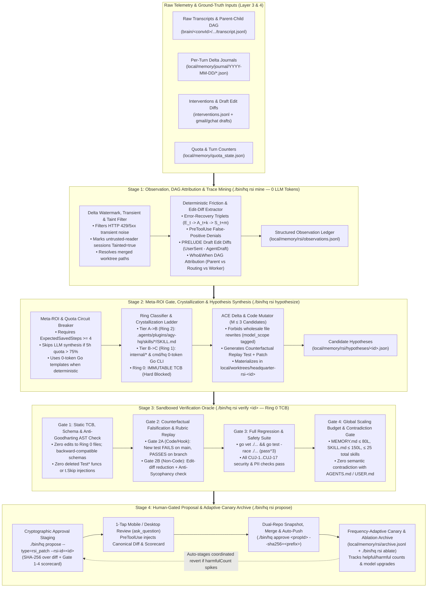

# RFC-0010: Bounded Agent Recursive Self-Improvement (RSI) — 4-Stage Trace Mining, Delta Hypothesis Synthesis, Sandboxed Verification & Human-Gated Harness Evolution

- **Status:** Approved & Implemented (Phases 1–4 Complete, Verified by `CUJ-17`)
- **Author:** `[Task:agent] agent-rsi-framework` (`gemini-4-argon-high`)
- **Created:** 2026-11-08
- **Extends:** [RFC-0002 (Sleep-Time Memory Consolidation)](./0002-memory-and-consolidation.md), [RFC-0003 (Approval-Bound Execution)](./0003-approval-bound-execution.md), [RFC-0006 (4-Layer Memory & Ground-Truth Dreaming)](./0006-memory-engine-upgrade.md), [RFC-0009 (Scalable Task Board & Parent-Child Lineage)](./0009-task-board-redesign.md)
- **Companion Research:** [07 — Agent Recursive Self-Improvement (RSI): Literature Survey, Industry Frontier, Production Trace Loops & Safety Invariants](../research/07_agent_recursive_self_improvement.md)

---

## 1. Motivation & Empirical Problem Statement

### 1.1 The Missing Link in `agy-hq`: Declarative Memory vs. Procedural & Harness Evolution
In [RFC-0006](./0006-memory-engine-upgrade.md), `agy-hq` established a 4-layer **declarative and episodic memory hierarchy** (`local/MEMORY.md` Roadmap Index $\rightarrow$ `local/memory/topics/*.md` Wiki $\rightarrow$ `facts.jsonl` & `journal/` $\rightarrow$ raw `transcript.jsonl`), verified nightly by `./bin/hq memory verify-transcript`.

However, auditing `agy-hq`'s live production usage (`57` turn journals, `24` tracked task conversations, and `5` approval interventions across `2026-11-07` and `2026-11-08`) reveals that **declarative memory alone cannot fix recurring procedural or harness friction**:
1. **Unclosed Proposal Dead End (`local/memory/proposals/`):**
   - Stage 4 of [`.agents/plugins/agy-hq/skills/sleep-consolidate/SKILL.md`](../../.agents/plugins/agy-hq/skills/sleep-consolidate/SKILL.md#L61-L63) instructs the dreaming agent to write markdown files into `local/memory/proposals/YYYY-MM-DD-<slug>.md`.
   - In practice, `local/memory/proposals/` currently contains **`0` files**, and **zero code in `cmd/hq` or `internal/` reads, parses, verifies, regression-tests, or stages those files for approval**.
2. **Repeated Intra-Session Error-Recovery Chains:**
   - When an agent encounters a CLI flag mismatch (e.g., `gmail_go query` failing in conversation `tk000002` step `700` before discovering `gmail_go readonly search` at step `704`), an overly broad `PreToolUse` block (`gmail readonly search` blocked as an outbound send at step `702`), or bash backtick stripping in `./bin/hq spawn --prompt="..."`, the agent burns 4–15 extra steps recovering on the fly.
   - Without a systematic **Recursive Self-Improvement (RSI)** pipeline, that recovery knowledge remains trapped in a single session's transcript—or worse, is summarized only as a prose note rather than compiled into a verified `SKILL.md` delta, a `PreToolUse` regex fix, or a deterministic Go CLI enhancement.
3. **Telemetry & Verifier Blind Spots Discovered in Live Audit ([`07_agent_recursive_self_improvement.md §4`](../research/07_agent_recursive_self_improvement.md#4-empirical-audit-of-agy-hq-live-telemetry-first-24-hours)):**
   - **Defect A (`read_file` False-Positive Errors):** [`isTranscriptStepError`](../../internal/hooks/hooks.go#L845-L859) matches the substring `"Command exited with code "` across *all* tool outputs. Reading `hooks.go` or `cuj_e2e_test.go` via `read_file` triggers false-positive `toolErrorCount` increments (observed in `tk000003` steps `91` and `114`).
   - **Defect B (Cumulative Multi-Turn Error Inflation):** [`parseTranscriptSummaryWithMetrics`](../../internal/hooks/hooks.go#L861-L944) scans `transcript.jsonl` from step `0` on every `Stop` hook, re-reporting a single Turn-1 error across 30+ subsequent clean turns (`fd000001-...-10.json` through `-42.json`).
   - **Defect C (Deleted Worktree False Discrepancies):** [`VerifyTranscript`](../../internal/hooks/hooks.go#L1135-L1140) flags files edited inside `local/worktrees/<slug>/` as "no longer exists on disk" after the worktree is cleanly merged into `main` and removed (emitting 15 false warnings on `tk000002`).

### 1.2 Theoretical & Industry Grounding: *Verification Is the Bottleneck*
As documented across 30 primary academic works and 10 commercial/OSS harnesses in [Companion Research 07](../research/07_agent_recursive_self_improvement.md), modern RSI systems converge on three empirical laws:
1. **Unverified Self-Modification Degrades Performance (`-1.3 pp` vs. `+16.2 pp`):** On **SkillsBench (2026)**, allowing agents to write and accumulate unverified `SKILL.md` files reduced average pass rates by `-1.3 pp`, whereas verified, tightly scoped skills improved pass rates by **`+16.2 pp`**. Similarly, **Darwin Gödel Machine (DGM, 2025)** (`20% -> 50%` on SWE-bench) and **SICA (2025)** (`17% -> 53%`) achieved `2.5x–3x` leaps only because every self-patch was gated by an empirical test suite in an isolated sandbox.
2. **Wholesale Rewrites Cause Context Collapse (ACE, 2025):** Allowing an LLM to rewrite `AGENTS.md`, `MEMORY.md`, or `SKILL.md` wholesale causes progressive **brevity bias** and **context collapse**—erasing subtle edge-case rules. Updates must be expressed as **atomic, provenance-tagged delta operations** with post-deployment `helpful`/`harmful` attribution counters.
3. **Safety Requires Architectural Ring-Fencing (Denison et al., Anthropic 2024):** Self-modifying agents subject to proxy optimization pressure generalize from mild specification gaming to **directly rewriting unit tests and reward scripts (`reward tampering`)**. The verification oracle and security kernel must reside in an **immutable Trusted Computing Base (Ring 0)** that the RSI loop is mechanically forbidden from editing.

### 1.3 Eight Core Architectural Requirements Derived from Prior Art
Synthesizing the academic frontier and commercial/open-source production harnesses ([`07_agent_recursive_self_improvement.md`](../research/07_agent_recursive_self_improvement.md)) establishes **eight architectural requirements** that a general-purpose Personal Agent OS must satisfy beyond naive SWE-only self-patching:

| # | Naive RSI Failure Mode | Prior-Art Grounding | Architectural Requirement in RFC-0010 |
| :-: | :--- | :--- | :--- |
| **1** | **SWE-Only Binary Oracle Bias:** Assuming every RSI target has a `go test` or non-zero exit code oracle ignores non-code domains (email/chat drafting, investment research, writing). | *PRELUDE / CIPHER* (Gao et al., ACL 2024); *Process Supervision* (Lightman et al., ICLR 2024) | **Implicit Draft Edit-Diff Mining (`FrictionDraftEdited`)** ($\Delta = \text{Sent}_{\text{user}} - \text{Draft}_{\text{agent}}$) in Stage 1 and an **Anti-Sycophancy / Epistemic Calibration Rubric (`Gate 2B`)** for `thesis-check` and `filing-diff`. |
| **2** | **Single-Transcript Linear Attribution:** Mining each `transcript.jsonl` in isolation blinds RSI to whether a subagent failure was caused by the **parent's delegation prompt**, **wrong model tier**, or **worker skill**. | *Who&When* & *TRUCE* (Multi-Agent Credit Assignment, 2025–2026); *RouteLLM* (ICLR 2025) | **DAG-Aware Failure Attribution (`FaultLayer`)** in Stage 1 using `parentConversationId`, classifying friction into `delegation_prompt`, `model_routing`, vs. `worker_aci_or_skill`. |
| **3** | **Disconnected Skill vs. Code Loops:** Treating `SKILL.md` rules (Ring 2) and Go CLI code (Ring 1) as static, separate buckets misses progressive tool compilation. | *LATM: LLMs as Tool Makers* (DeepMind, ICLR 2024); *SkillWeaver* (2025) | **3-Tier Crystallization Ladder:** $\text{Ad-hoc LLM Turn (10k tok)} \xrightarrow{\ge 2\times} \text{Ring 2 SKILL.md Rule (1k tok)} \xrightarrow{\ge 5\times} \text{Ring 1 0-Token Go CLI Subcommand}$. |
| **4** | **Transient Fault Overfitting & Uniform 20-Run Canary Lag:** Failing to filter HTTP `429`/`5xx` noise causes one-shot overfitting; a fixed 20-session canary window takes 6+ months for weekly/quarterly skills (`tax-prep`, `filing-diff`). | *Braintrust Loop* & *SkillsBench* ($N=1$ personal-agent regime) | **Deterministic Transient-Fault Filter (`isTransientExternalError`)** in Stage 1, plus **Frequency-Adaptive Canary Graduation** ($K=15$ for daily tools; $K=3$ live + $K=5$ offline synthetic perturbations for rare skills). |
| **5** | **Cross-Model Scaffolding Overfitting ("Base-Model Upgrade Shock"):** Assuming a workaround learned on `Gemini 3.8 Flash` helps `Claude Opus 5.5` or `Gemini 4 Argon` forever. | *Cursor `.mdc`*, *Devin 2.0*, *ADAS* (Model-conditional scaffolding rot) | `model_scope` tags (`"all"`, `"flash-only"`, `"gemini-3.8-*"`) on `<!-- rsi:rule -->` blocks and `./bin/hq rsi ablate` to prune obsolete rules when base models upgrade. |
| **6** | **Skill Scaling Tax & Cross-Skill Contradictions:** Checking only single-file line counts ignores global frontmatter bloat and contradictory rules across files. | *SkillsBench (2026)* Scaling Tax; *Skill-V* Contract Verification | Target `.agents/plugins/agy-hq/skills/*/SKILL.md` with a **Global Skill Catalog Budget (`<= 25` skills, `<= 2,500` frontmatter tokens)** and a **Cross-Rule Contradiction Check** in `Gate 4`. |
| **7** | **Unbounded Cold-Path Meta-Quota Burn:** Spawning multi-worktree LLM searches without checking quota state or whether expected savings exceed synthesis cost. | *Sleep-Time Compute* (Lin et al., Letta/Berkeley 2025) | **Meta-ROI Gate ($\text{ExpectedSavedSteps} \ge 4$)**, **0-Token Pure-Go Template Synthesis** for routine CLI/rule fixes, and a **75% Rolling Quota Circuit Breaker** before any LLM hypothesis call. |
| **8** | **Uncoordinated Code vs. Vault State Rollback:** Reverting root repo commits without handling `local/memory/` schema state breaks workspace compatibility. | *Letta MemFS* & Transactional Migration Safety | **Dual-Repo (`root/.git` + `local/.git`) Coordinated Snapshots** in `hq rsi apply` and an **Additive-Only JSON Schema Invariant** in `Gate 1`. |

---

## 2. Value Proposition for `agy-hq`: Five High-Leverage RSI Loops

`agy-hq` targets **five concrete feedback loops** spanning software engineering, tool ergonomics, personal communications, investment research, and multi-agent routing:

| RSI Loop | Target Substrate | Triggering Observation Signal | Mutation Output | Verification Oracle | Expected Leverage in `agy-hq` |
| :--- | :--- | :--- | :--- | :--- | :--- |
| **Loop 1: Automated Skill Authoring & Delta Tuning** | `.agents/plugins/agy-hq/skills/*/SKILL.md` | • Error-recovery chains $(E_t \rightarrow A_{t+k} \rightarrow S_{t+m})$<br>• Recurrent $\ge 2$-session multi-step sequences<br>• User steering prompts | Structured ACE skill delta (`ADD_RULE`, `PATCH_RULE`, `DEPRECATE_RULE` with `model_scope`) | Frontmatter schema + global/per-skill budget + contradiction check + counterfactual replay | Eliminates repeated CLI/workflow discovery turns (saves `4–12` steps and `~8k` tokens per run). |
| **Loop 2: Hook & Guardrail Precision Tuning** | [`internal/hooks/hooks.go`](../../internal/hooks/hooks.go) (`PreToolUse` & `SessionStart` rules) | • `PreToolUse` denial followed by user override or safe read-only workaround<br>• Missed unsafe command caught at `propose` stage | Narrowed regex / allowlist refinement + paired positive/negative table test in [`hooks_test.go`](../../internal/hooks/hooks_test.go) | Must pass all existing `PreToolUse` security CUJs (`CUJ-3`, `CUJ-5`, `CUJ-15`, `CUJ-16`) + new replay test | Drives false-positive hook blocks toward `0%` while monotonically tightening outbound safety coverage. |
| **Loop 3: Error-Recovery & Neural-to-Symbolic Go Synthesis** | `internal/{gmail,gchat,kernel,vault,webui}/*` & `cmd/hq/main.go` | • Deterministic Go CLI panics, flag friction, or telemetry bugs (Defects A–C)<br>• Skill rules triggered $\ge 5$ times (`Tier B -> Tier C` promotion) | Minimal unified Go diff in isolated worktree (`local/worktrees/headquarter-rsi-<id>/`) + new unit/E2E regression test | `Gate 1` (TCB AST check) + `Gate 2A` (`FAIL` on `HEAD` $\rightarrow$ `PASS` on branch) + `Gate 3` (`go test -race ./...`) | Self-heals harness bugs overnight and crystallizes recurring LLM chores into `0`-token Go subcommands. |
| **Loop 4: Non-Code Implicit Preference & Epistemic Calibration** | `gmail`/`gchat` drafting rules, `thesis-check`, `filing-diff`, `local/USER.md` | • User edit diff on staged drafts ($\Delta = \text{Sent}_{\text{user}} - \text{Draft}_{\text{agent}}$)<br>• Investment thesis prediction checks against new 10-Q/10-K filings | Scoped style/tone rule in communication skills or falsification rubric rule in `thesis-check/SKILL.md` | `Gate 2B`: Edit-distance reduction on held-out draft pairs + Anti-Sycophancy falsification rubric check | Aligns communication drafts to user voice without nagging, and prevents sycophantic bias in investment memos. |
| **Loop 5: Multi-Agent Routing & Model-Upgrade Ablation** | [`sleep-consolidate`](../../.agents/plugins/agy-hq/skills/sleep-consolidate/SKILL.md), `local/triggers.yaml`, routing matrix | • DAG attribution (`fault_delegation_prompt` or `fault_model_routing`)<br>• Stale rules (`harmfulCount > helpfulCount`) or base-model upgrade | Routing tier adjustments, Front Desk delegation prompt templates, and `./bin/hq rsi ablate` rule pruning | Historical trace replay + quota budget verification (`./bin/hq memory status` & `./bin/hq rsi status`) | Preserves scarce `deep` (`pro`/`argon`/`opus`) quota and prevents scaffolding rot across model upgrades. |

---

## 3. Architecture Overview: The 4-Stage RSI Pipeline (`internal/rsi` + `./bin/hq rsi`)

We introduce package `internal/rsi` and the `./bin/hq rsi` CLI family, structured as a **4-stage verification-gated compiler pipeline** that runs on-demand or as Phase 2 of the nightly `/sleep-consolidate` automation:



---

## 4. Detailed Specification of the 4-Stage RSI Loop

### 4.1 Stage 1: Observation, DAG Attribution & Trace Mining (`internal/rsi/miner.go` + `./bin/hq rsi mine`)

#### A. Prerequisite Telemetry Fixes in `internal/hooks/hooks.go`
Before mining traces, we fix the three telemetry defects identified in our Day-1 audit:
1. **Tool-Scoped Error Detection (`isTranscriptStepError`):**
   - Only inspect `"Command exited with code "` on steps whose preceding or current tool call is `run_command` (or where `step.Status == "ERROR"`). Never match `"Command exited with code "` inside `read_file` or `grep_search` file contents.
2. **Per-Turn Delta Watermarks & Taint Tracking in `JournalEntry`:**
   - Extend `JournalEntry` with per-turn delta metrics computed from the previous execution's `StepCount` watermark (`local/memory/journal/YYYY-MM-DD/<convId>-<execNum-1>.json`):
     ```go
     type JournalEntry struct {
         // ... existing fields ...
         ParentConvID      string   `json:"parentConversationId,omitempty"`
         StepStartIdx      int      `json:"stepStartIdx"`      // First step_index belonging to this turn
         TurnStepCount     int      `json:"turnStepCount"`     // Steps executed in THIS turn only
         TurnErrorCount    int      `json:"turnErrorCount"`    // Non-transient errors in THIS turn only
         TransientErrors   int      `json:"transientErrors,omitempty"` // HTTP 429/502/503/timeout noise
         PreToolDenials    int      `json:"preToolDenials,omitempty"`
         TaintedSession    bool     `json:"taintedSession,omitempty"`  // True if quarantined untrusted content was read
     }
     ```
3. **Worktree-Aware Path Resolution in `VerifyTranscript`:**
   - When `VerifyTranscript` checks `FilesModified`, if a path matches `<vaultDir>/worktrees/<repo>-<slug>/<relPath>` and no longer exists because the worktree was merged and cleaned up, check whether `<rootDir>/<relPath>` exists on `main`. If it exists on `main`, record it as `mergedToMain: true` rather than emitting a false-positive `DiscrepancyWarning`.

#### B. Deterministic 0-Token Friction, Attribution & Edit-Diff Miner (`./bin/hq rsi mine [--since=24h]`)
`./bin/hq rsi mine` runs in pure Go (`<50ms`, `0` LLM tokens) across `local/memory/journal/`, `local/memory/interventions.jsonl`, `local/private/{gmail,gchat}/drafts/`, and matching `transcript.jsonl` files to emit structured, deduplicated `FrictionEvent` records to `local/memory/rsi/observations.jsonl`:

```go
type FrictionCategory string

const (
    FrictionErrorRecovery    FrictionCategory = "error_recovery_chain" // ToolError_t -> Fix_t+k -> Success_t+m
    FrictionPreToolDeny      FrictionCategory = "pretool_friction"     // Blocked by PreToolUse hook
    FrictionUserIntervention FrictionCategory = "user_intervention"    // Rejected proposal or corrective USER_INPUT
    FrictionDraftEdited      FrictionCategory = "draft_edited"         // PRELUDE: User edited staged draft before send/save
    FrictionRepeatedWorkflow FrictionCategory = "repeated_workflow"    // Recurrent N-step sequence across >=2 convs
    FrictionQuotaAnomaly     FrictionCategory = "quota_anomaly"        // >25 steps or deep-tier burn on routine task
)

type AttributionFaultLayer string

const (
    FaultWorkerACISkill   AttributionFaultLayer = "worker_aci_or_skill" // Child lacked CLI flag, hook allowlist, or skill rule
    FaultDelegationPrompt AttributionFaultLayer = "delegation_prompt"   // Parent omitted context/paths in invoke_subagent / spawn
    FaultModelRouting     AttributionFaultLayer = "model_routing"       // Assigned tier too weak (failed) or overkill (wasted quota)
)

type FrictionEvent struct {
    ID               string                `json:"id"`               // e.g., "obs-20261108-001"
    Fingerprint      string                `json:"fingerprint"`      // SHA-256 of normalized (category + faultLayer + tool + sig)
    FirstSeenAt      string                `json:"firstSeenAt"`
    LastSeenAt       string                `json:"lastSeenAt"`
    OccurrenceCount  int                   `json:"occurrenceCount"`  // Incremented when same fingerprint recurs
    Category         FrictionCategory      `json:"category"`
    FaultLayer       AttributionFaultLayer `json:"faultLayer"`       // Who&When multi-agent credit assignment
    ModelNames       []string              `json:"modelNames"`       // Models that experienced this friction
    ConversationIDs  []string              `json:"conversationIds"`
    ParentConvID     string                `json:"parentConversationId,omitempty"`
    Tainted          bool                  `json:"tainted"`          // True if any source session read untrusted external content
    ToolName         string                `json:"toolName,omitempty"`
    FailedCommand    string                `json:"failedCommand,omitempty"`
    ErrorMessage     string                `json:"errorMessage,omitempty"`
    RecoveryAction   string                `json:"recoveryAction,omitempty"` // Verified command/edit that succeeded at t+m
    DraftDiffSummary string                `json:"draftDiffSummary,omitempty"` // Unified diff if Category == FrictionDraftEdited
    WastedSteps      int                   `json:"wastedSteps"`              // m - t steps spent recovering
    TargetFiles      []string              `json:"targetFiles,omitempty"`
    Status           string                `json:"status"`           // "open", "hypothesized", "verified", "applied", "ignored"
}
```

**Four Key Extraction Heuristics (Pure Go):**
1. **Transient External Noise Filter (`isTransientExternalError`):** Ignores one-off network timeouts (`ETIMEDOUT`, `ECONNRESET`), rate limits (`HTTP 429`), and upstream server blips (`HTTP 502/503/504`) unless the same command fails $\ge 3$ times without retry backoff (in which case it flags a missing retry wrapper in `internal/*`).
2. **Error-Recovery Triplet Extractor:** When step $t$ has a non-transient `isTranscriptStepError == true` on tool $T$ (e.g., `run_command` with `gmail_go query`) and a subsequent step $t+m$ ($1 \le m \le 10$) succeeds on the same tool $T$ or target binary (`gmail_go readonly search`), extract `(FailedCommand, ErrorMessage, RecoveryAction, WastedSteps = m)`.
3. **`Who&When` Multi-Agent DAG Credit Assignment:** When a child subagent or spawned task (`ParentConvID != ""`) encounters friction in its first 5 steps searching for files that were already read in the parent conversation, `miner.go` assigns `FaultLayer = FaultDelegationPrompt` (targeting the parent's delegation instructions rather than the worker skill). If a `quick`/`flash_lite` worker fails $>3$ consecutive reasoning/edit steps on a multi-file task, it assigns `FaultLayer = FaultModelRouting`.
4. **`PRELUDE` Draft Edit-Diff Extractor:** When a staged draft in `local/private/{gmail,gchat}/drafts/` or `local/notes/` is superseded by a user-edited version prior to `approve`, `miner.go` records the normalized diff in `DraftDiffSummary` (`Category: FrictionDraftEdited`).

---

### 4.2 Stage 2: Meta-ROI Gate, Crystallization Ladder & Hypothesis Generation (`internal/rsi/mutator.go` + `./bin/hq rsi hypothesize`)

#### A. Cold-Path Meta-ROI Gate & Quota Circuit Breaker
To ensure the RSI loop never consumes more compute/quota than it saves:
1. **Expected Step Savings Threshold:** An observation cluster is eligible for LLM-assisted hypothesis synthesis only if:
   $$\text{ExpectedStepSavings} = \text{OccurrenceCount} \times \text{WastedSteps} \ge 4 \quad \text{OR} \quad \text{Category} \in \{\text{user\_intervention}, \text{draft\_edited}\}$$
2. **0-Token Pure-Go Template Synthesis First:** If an `error_recovery_chain` has a deterministic command replacement $(C_{\text{fail}} \rightarrow C_{\text{ok}})$ mapping to a known skill in `.agents/plugins/agy-hq/skills/<domain>/SKILL.md`, `mutator.go` synthesizes the `<!-- rsi:rule -->` delta directly in Go (`0` LLM tokens).
3. **75% Quota Circuit Breaker:** Before spawning any LLM hypothesis worker, `./bin/hq rsi hypothesize` checks `local/memory/quota_state.json`. If rolling 5-hour quota usage exceeds `75%`, LLM synthesis is deferred to the next idle window, and nightly RSI is hard-capped at $\le 2$ LLM-generated hypotheses per night.

#### B. The 3-Tier Neural-to-Symbolic Crystallization Ladder (*LATM* & *SkillWeaver*)
Stage 2 progressively compiles recurring procedural work from expensive token-space reasoning into zero-token Go execution:
- **Tier A $\rightarrow$ Tier B (Ad-hoc Trajectory $\rightarrow$ Ring 2 `SKILL.md` Rule, at $\ge 2$ occurrences):** Encodes the verified recovery path or workflow into `.agents/plugins/agy-hq/skills/<domain>/SKILL.md`, cutting 5–15 exploratory steps down to 1–2 guided tool calls.
- **Tier B $\rightarrow$ Tier C (Ring 2 `SKILL.md` Rule $\rightarrow$ Ring 1 `./bin/hq` Go CLI Subcommand, at $\ge 5$ occurrences):** When an `rsi:rule` in `SKILL.md` reaches `helpful >= 5` and involves a deterministic sequence of shell/JSON/file operations, Stage 2 proposes promoting that workflow into a native Go subcommand or flag inside `internal/*` / `cmd/hq/main.go`—reducing runtime LLM token cost to **`0` tokens**.

#### C. Concentric Mutation Rings & Allowed Operators

| Ring | Target Scope | Allowed Mutation Operators | Verification & Approval Requirement |
| :--- | :--- | :--- | :--- |
| **Ring 0 (Immutable TCB)** | • `internal/approvals/*`<br>• `internal/rsi/tcb.go` & `verifier.go`<br>• `.gitignore` Vault boundaries<br>• Core `PreToolUse` approval gates | **NONE (`HARD DENY`)** | Mechanically blocked by `Gate 1` static check. Only direct human git commits outside RSI can modify Ring 0. |
| **Ring 1 (Go Kernel, CLI & Hooks)** | • `internal/{hooks,kernel,vault,gmail,gchat,webui,doctor}/*`<br>• `cmd/hq/main.go`<br>• `AGENTS.md` | • `UNIFIED_CODE_DIFF` (in isolated worktree)<br>• `ADD_REGRESSION_TEST` (mandatory companion test) | Full `Gate 1–4` verification (`go test -race ./...` + counterfactual fail-then-pass replay + schema compat) + **1-Tap Human SHA-256 Approval (`rsi_patch`)**. |
| **Ring 2 (Procedural Skills & Triggers)** | • `.agents/plugins/agy-hq/skills/*/SKILL.md`<br>• `local/triggers.yaml` | • `ADD_SKILL_RULE` (atomic bullet with ID & `model_scope`)<br>• `PATCH_SKILL_RULE` (incremental delta)<br>• `DEPRECATE_SKILL_RULE`<br>• `NEW_SKILL_DRAFT` ($\le 150$ lines) | `Gate 1` (no wholesale rewrite, $\le 150$ lines) + `Gate 2` (skill lint & replay fixture) + `Gate 4` (contradiction check) + **1-Tap Human SHA-256 Approval (`rsi_skill_patch`)**. |
| **Ring 3 (Declarative Wiki & Facts)** | • `local/memory/topics/*.md`<br>• `local/memory/facts.jsonl`<br>• `local/MEMORY.md` ($\le 80$ lines) | • `hq memory add-fact --verified`<br>• `hq memory prune-fact`<br>• Topic Wiki delta update | Ground-truth `VerifyTranscript` check + `MEMORY.md <= 80` line cap; auto-committed to private `local/.git` during `/sleep-consolidate`. |

#### D. ACE-Compliant, Model-Scoped Playbook Delta Schema
To prevent **context collapse** (ACE, 2025) and **cross-model scaffolding overfitting**, Ring 2 skill mutations are never allowed to regenerate an entire `SKILL.md` file. Instead, each `.agents/plugins/agy-hq/skills/<name>/SKILL.md` maintains a `## Learned Operational Rules (RSI Managed)` section where rules carry explicit provenance, `model_scope`, and attribution counters:

```markdown
## Learned Operational Rules (RSI Managed)
<!-- rsi:rule id="r-gmail-001" source="obs-20261108-002" model_scope="all" added="2026-11-08" helpful="4" harmful="0" -->
- **Use `gmail_go readonly search` (Not `query`):** When invoking the `gmail_go` binary directly, always pass `readonly search "<query>" --max <N>`; the top-level `query` subcommand does not exist.
<!-- /rsi:rule -->
```

---

### 4.3 Stage 3: Sandboxed Verification & E2E Regression Suite (`internal/rsi/verifier.go` + `./bin/hq rsi verify <id>`)

Stage 3 is the **immutable verification oracle** (`internal/rsi/tcb.go` + `verifier.go`). It executes inside an isolated git worktree (`local/worktrees/headquarter-rsi-<id>/`) and enforces **four sequential hard gates**:

#### Gate 1: Immutable TCB, Schema Compatibility & Anti-Goodharting Static Audit (`internal/rsi/tcb.go`)
1. **Ring 0 Path Blocklist:** Immediately rejects any diff touching `internal/approvals/*`, `internal/rsi/tcb.go`, `internal/rsi/verifier.go`, `.gitignore`, or `.git/hooks/*`.
2. **Anti-Goodharting Test Integrity Check (`go/ast`):**
   - **No Test Deletion:** Existing `Test*` functions in `*_test.go` must be a strict superset of `main` ($\text{Tests}_{\text{candidate}} \supseteq \text{Tests}_{\text{main}}$).
   - **No `t.Skip` Injection:** Rejects any diff adding `t.Skip`, `t.SkipNow`, `t.Skipf`, or `os.Exit(0)` inside tests.
   - **Mandatory New Test for Ring 1:** Any Ring 1 code mutation MUST include at least one new or expanded `Test*` function (`ReplayTestName`).
3. **Backward-Compatible Vault Schema Check:** Verifies that exported JSON struct tags in `internal/{vault,kernel,hooks}/*.go` are additive-only (existing JSON field names/types cannot be removed or renamed without a migration step), guaranteeing safe rollback.
4. **Taint Provenance Check:** Verifies that none of `SourceObservationIDs` has `Tainted == true`.

#### Gate 2: Dual-Mode Counterfactual Replay (`Gate 2A` Code Falsification & `Gate 2B` Non-Code Rubric)
- **Gate 2A — Deterministic Code & Hook Falsification (`FAIL` on `HEAD` $\rightarrow$ `PASS` on Candidate):**
  1. Applies *only* the `*_test.go` (and `testdata/`) hunks to unpatched `main` and runs `go test -run <ReplayTestName>`.
  2. `<ReplayTestName>` MUST **fail** on unpatched `main` (proving the test reproduces the friction and is not vacuous).
  3. Applies the implementation hunks in the candidate worktree and re-runs `go test -run <ReplayTestName>`, which MUST **pass**.
- **Gate 2B — Non-Code Edit-Diff & Anti-Sycophancy Rubric Oracle (for `Ring 2` Communication/Investing Skills):**
  1. For `FrictionDraftEdited` rules: replays the original prompt with the new `SKILL.md` rule and verifies that edit distance to the user's final sent text decreases relative to the unpatched baseline.
  2. For `thesis-check` and `filing-diff` rules: verifies that the rule enforces **falsification symmetry** (requiring explicit disconfirming evidence / kill-criteria checks) and does not bias toward one-sided bullish/bearish conclusions.
  3. For low-frequency skills (`tax-prep`, `ledger-ingest`, `filing-diff`): runs $K=5$ synthetic perturbed input fixtures offline to establish statistical confidence without waiting months for live sessions.

#### Gate 3: Full Monotonic E2E & Race Regression Suite (`pass^k`)
1. Runs `go vet ./...` and `go test -race -count=1 ./...` across the entire repository (`CUJ-1` through `CUJ-17`).
2. Runs `go test -count=3` (`pass^3` consistency check) on `internal/hooks`, `internal/kernel`, and `internal/rsi`.
3. Runs `./bin/hq doctor` and the pre-commit PII scanner to verify zero PII leakage in code or test fixtures.

#### Gate 4: Complexity, Global Skill Scaling & Contradiction Gate
1. **Per-File & Global Catalog Caps:**
   - `local/MEMORY.md <= 80` lines (`1,200` tokens).
   - Each `.agents/plugins/agy-hq/skills/*/SKILL.md <= 150` lines and `<= 30` active `rsi:rule` blocks.
   - **Global Skill Catalog Cap:** `<= 25` total skills across `.agents/plugins/agy-hq/skills/` (`<= 2,500` aggregate frontmatter tokens) with non-overlapping trigger descriptions to prevent the SkillsBench scaling tax.
   - `AGENTS.md <= 24 KB` and Ring 1 diffs `<= 250` net changed non-test lines.
2. **Cross-Rule Contradiction Check:** Scans `AGENTS.md` and `local/USER.md` to ensure no proposed `rsi:rule` contradicts core constitutional invariants (e.g., Front Desk 3-lookup cap, approval-bound outbound execution, Vault PII boundary).

---

### 4.4 Stage 4: Staged Human-in-the-Loop Proposal, Adaptive Canary & Ablation (`./bin/hq rsi propose <id>`)

#### A. Cryptographic Approval Staging & `PreToolUse` Canonical Preview
1. `./bin/hq rsi propose <id>` stages a pending proposal in `local/memory/pending/<propId>.json` (`ActionType: "rsi_patch"` or `"rsi_skill_patch"`).
2. `PreToolUse` in [`internal/hooks/hooks.go`](../../internal/hooks/hooks.go) mechanically injects the **Canonical Gate 1–4 Scorecard, Fault Attribution Layer, Target Files, `diffSha256` prefix, and Unified Diff Preview** into the `ask_question` prompt so the user can approve or reject with 1 tap on Mobile Remote Control or Desktop.

#### B. Dual-Repo Transactional Apply & Stepping-Stone Archive (`./bin/hq approve <propId>`)
When approved via `./bin/hq approve <propId> --sha256=<prefix>`:
1. **Dual-Repo Pre-Apply Snapshot:** Takes a coordinated commit/tag checkpoint in both `local/.git` (`vault.SnapshotVault`) and the root repo so code and Vault state can always be rolled back together.
2. Re-verifies `DiffSHA256`, merges `hq/rsi-<id>` into `main`, recompiles `./bin/hq`, removes the temporary worktree, and auto-pushes `origin/main`.
3. Records the deployment in `local/memory/rsi/archive.jsonl` with a **Frequency-Adaptive Canary Window**:
   - **High-Frequency Targets (`hooks`, `gmail`, `gchat`, Front Desk routing):** `TargetCanaryRuns = 15`.
   - **Low-Frequency Domain Skills (`tax-prep`, `filing-diff`, `thesis-check`, `ledger-ingest`):** `TargetCanaryRuns = 3` live runs (backed by the $K=5$ offline perturbation runs in Gate 2B).
4. **Auto-Revert on Regression:** If target friction recurs $\ge 2$ times or `HarmfulCount > HelpfulCount` during the canary window, `./bin/hq rsi mine` automatically stages a 1-tap coordinated revert proposal.

#### C. Model-Upgrade Scaffolding Ablation (`./bin/hq rsi ablate --model=<new-model>`)
When a new frontier model is adopted (e.g., upgrading the default model in `USER.md`), running `./bin/hq rsi ablate` evaluates all active `<!-- rsi:rule -->` entries against their historical replay fixtures *with the rule temporarily stripped*:
- If the new model passes the replay fixture in 1 step *without* the rule (or if a rule has `helpfulCount == 0` over 30 sessions), `hq rsi ablate` stages a `DEPRECATE_SKILL_RULE` cleanup proposal—keeping `.agents/plugins/agy-hq/skills/` lean and immune to scaffolding rot.

---

## 5. Safety Invariants & Alignment Architecture (Defense-in-Depth)

| Safety Threat | Architectural Defense in `agy-hq` (RFC-0010) | Enforcement Layer |
| :--- | :--- | :--- |
| **1. Unbounded Self-Modification / Alignment Drift** | **Concentric Mutation Rings (Ring 0–3):** Ring 0 (`internal/approvals`, `internal/rsi/tcb.go`, `.gitignore`) is strictly immutable by RSI. Ring 1 (code/hooks) and Ring 2 (skills/triggers) require explicit 1-tap human SHA-256 approval via `./bin/hq approve`. | `Gate 1` Static Path Blocklist + `internal/approvals` SHA-256 Gate |
| **2. Goodharting / Reward Tampering (Denison et al., 2024)** | **Evaluator-Mutator Separation & AST Ratchet:** The mutator cannot edit `internal/rsi/tcb.go` or `verifier.go`. `Gate 1` parses `*_test.go` ASTs to forbid deleting any `Test*` function or adding `t.Skip`. `Gate 2A` requires the new replay test to **fail** on unpatched `main` and **pass** on the candidate branch. | `Gate 1` Go `go/ast` Inspector + `Gate 2A` Counterfactual Falsification |
| **3. Indirect Prompt Injection Poisoning Skills or Hooks** | **Taint Quarantine Exclusion:** Any turn/session that reads untrusted external data (`hq gmail read-quarantined`, `hq gchat read-quarantined`, untrusted web fetch) sets `TaintedSession: true`. `Gate 1` hard-rejects any Ring 1 or Ring 2 hypothesis derived from a tainted observation. | `hooks.go` Session Taint Tracker + `Gate 1` Provenance Check |
| **4. Non-Code Sycophancy Drift (Investing & Writing)** | **PRELUDE Edit-Diff Grounding & Falsification Symmetry (`Gate 2B`):** Communication rules learn from actual user edit diffs ($\text{Sent}_{\text{user}} - \text{Draft}_{\text{agent}}$); investing rules are checked for symmetric bull/bear falsification criteria. | Stage 1 Edit-Diff Miner + `Gate 2B` Rubric Verifier |
| **5. Context Collapse, Skill Scaling Tax & Scaffolding Rot** | **ACE Delta Algebra, Global Catalog Cap (`<= 25` skills) & `./bin/hq rsi ablate`:** Wholesale rewrites are blocked; rules carry `model_scope` tags and `helpful`/`harmful` counters; obsolete workarounds are pruned on model upgrades. | `Gate 4` Budget/Contradiction Verifier + `hq rsi ablate` |
| **6. Cold-Path Quota Exhaustion & Stateful Rollback Failure** | **75% Quota Circuit Breaker, $\ge 4$-Step ROI Gate & Dual-Repo Snapshots:** Routine fixes use 0-token Go templates; LLM synthesis respects `quota_state.json`; `Gate 1` enforces additive-only JSON schemas with coordinated `root/.git` + `local/.git` snapshots. | Stage 2 Quota Gate + `Gate 1` Schema Check + Stage 4 Dual Snapshot |

---

## 6. CLI Surface & Integration with `/sleep-consolidate`

### 6.1 New `./bin/hq rsi` Subcommands
```sh
# Stage 1: Mine recent journals, transcripts, draft edit-diffs, and DAG attribution into observations.jsonl (0 LLM tokens)
./bin/hq rsi mine [--since=24h] [--json]

# Stage 2: Synthesize a bounded RSI hypothesis (0-token Go template or quota-gated LLM worktree candidate)
./bin/hq rsi hypothesize --obs=<obs-id> --ring=<1|2> --title="<title>" [--operator=add_skill_rule|unified_code_diff]

# Stage 3: Run the 4-Gate Sandboxed Verification Oracle (TCB AST + Counterfactual FAIL->PASS + go test -race + Budgets)
./bin/hq rsi verify <rsi-id>

# Stage 4: Stage a verified hypothesis into local/memory/pending/ for 1-tap human SHA-256 approval
./bin/hq rsi propose <rsi-id>

# Deterministic executor invoked ONLY by `./bin/hq approve <prop-id> --sha256=<prefix>`
./bin/hq rsi apply <rsi-id> --expect-diff-sha256=<sha256>

# Run model-upgrade scaffolding ablation across active <!-- rsi:rule --> blocks against replay fixtures
./bin/hq rsi ablate [--model=<model-name>]

# Inspect open friction observations, DAG fault breakdown, candidate hypotheses, and canary archive health
./bin/hq rsi status
```

---

## 7. Phased Implementation Roadmap (Phases 1–4 Mapped 1:1 to RSI Stages 1–4)

### Phase 1: Telemetry Hardening & Stage 1 DAG/Edit-Diff Trace Miner (`internal/hooks` + `internal/rsi/miner.go`)
- [ ] **Fix Defect A (`read_file` False-Positive Errors):** Update [`isTranscriptStepError`](../../internal/hooks/hooks.go#L845-L859) so `"Command exited with code "` is checked only on `run_command` steps, never on `read_file` or `grep_search` outputs.
- [ ] **Fix Defect B (Per-Turn Delta Watermarks):** Add `StepStartIdx`, `TurnStepCount`, `TurnErrorCount`, `TransientErrors`, and `TaintedSession` to `JournalEntry` in [`internal/hooks/hooks.go`](../../internal/hooks/hooks.go).
- [ ] **Fix Defect C (Merged Worktree Path Resolution):** Update [`VerifyTranscript`](../../internal/hooks/hooks.go#L1135-L1140) to resolve `<vaultDir>/worktrees/<repo>-<slug>/<relPath>` against `<rootDir>/<relPath>` on `main` before emitting missing-file warnings.
- [ ] **Implement Stage 1 Miner (`./bin/hq rsi mine` & `./bin/hq rsi status`):** Build `internal/rsi/miner.go` with `isTransientExternalError` filtering (ignoring HTTP `429`/`5xx`/timeout noise), error-recovery triplet extraction $(E_t \rightarrow A_{t+k} \rightarrow S_{t+m})$, `Who&When` parent-child `FaultLayer` attribution (`delegation_prompt`, `model_routing`, `worker_aci_or_skill`), and `PRELUDE` draft edit-diff extraction (`local/memory/rsi/observations.jsonl`).

### Phase 2: Stage 2 ROI-Gated Hypothesis Generator & ACE Skill Delta Engine (`internal/rsi/mutator.go`)
- [ ] **Cold-Path Economic Gate & Quota Circuit Breaker:** Enforce the $\text{ExpectedSavedSteps} \ge 4$ threshold and the `75%` rolling 5-hour quota circuit breaker (`local/memory/quota_state.json`) before spawning any LLM hypothesis worker.
- [ ] **0-Token Go Template Synthesis & 3-Tier Crystallization Ladder:** Implement deterministic Go rule synthesis for CLI/hook recovery pairs and `Tier A -> Tier B` (`SKILL.md` rule at $\ge 2$ runs) $\rightarrow$ `Tier B -> Tier C` (`./bin/hq` 0-token Go CLI promotion at $\ge 5$ runs).
- [ ] **ACE Atomic Delta Applier (`ACEDeltaOp`):** Implement structured `<!-- rsi:rule id="..." model_scope="..." helpful="0" harmful="0" -->` insertion, patching, and deprecation across `.agents/plugins/agy-hq/skills/*/SKILL.md` (forbidding wholesale file rewrites).
- [ ] **Implement `./bin/hq rsi hypothesize`:** Materialize candidate hypotheses (`local/memory/rsi/hypotheses/<id>.json`) and isolated git worktrees (`local/worktrees/headquarter-rsi-<id>/`).

### Phase 3: Stage 3 4-Gate Sandboxed Verification Oracle & Ring 0 TCB Guard (`internal/rsi/{tcb,verifier}.go`)
- [ ] **Gate 1 (`internal/rsi/tcb.go`):** Implement the Ring 0 path blocklist (`internal/approvals/*`, `internal/rsi/{tcb,verifier}.go`, `.gitignore`), Go `go/ast` anti-Goodharting test integrity verifier (blocking deleted `Test*` functions or `t.Skip` injections), additive-only JSON schema checker, and taint provenance blocker (`Tainted == false`).
- [ ] **Gate 2 (`internal/rsi/verifier.go`):** Implement **Gate 2A** Counterfactual Falsification Replay (proving `ReplayTestName` **fails** on unpatched `main` and **passes** on the candidate branch) and **Gate 2B** Non-Code Edit-Diff & Anti-Sycophancy Rubric verification (plus $K=5$ synthetic input perturbations for low-frequency skills).
- [ ] **Gate 3 & Gate 4 (`./bin/hq rsi verify <id>`):** Run `go vet ./...`, `go test -race ./...` (`pass^3` on concurrent packages), `./bin/hq doctor` PII checks, global skill catalog caps (`<= 25` skills, `<= 150` lines/skill, `MEMORY.md <= 80` lines), and cross-rule contradiction checks against `AGENTS.md` and `local/USER.md`.

### Phase 4: Stage 4 Cryptographic Approval Bridge, Adaptive Canary, Ablation & `CUJ-17` E2E Suite
- [ ] **Approval & `PreToolUse` Integration:** Wire `rsi_patch` and `rsi_skill_patch` into `./bin/hq propose` and [`internal/hooks/hooks.go`](../../internal/hooks/hooks.go) so `ask_question` mechanically displays the canonical Gate 1–4 scorecard, fault attribution layer, `diffSha256` prefix, and unified diff preview on Mobile Remote Control and Desktop.
- [ ] **Dual-Repo Transactional Apply & Adaptive Canary Archive (`./bin/hq rsi apply`):** Snapshot both `root/.git` and `local/.git`, verify `DiffSHA256`, merge `hq/rsi-<id>`, recompile `./bin/hq`, auto-push `origin/main`, and track frequency-adaptive canary windows ($K=15$ for daily tools, $K=3$ live runs for rare skills) in `local/memory/rsi/archive.jsonl` with automatic revert staging on regression.
- [ ] **Model-Upgrade Scaffolding Ablation (`./bin/hq rsi ablate`) & Skill Integration:** Implement replay ablation sweeps for `model_scope` rules and upgrade [`.agents/plugins/agy-hq/skills/sleep-consolidate/SKILL.md`](../../.agents/plugins/agy-hq/skills/sleep-consolidate/SKILL.md) Stage 4.
- [ ] **End-to-End Acceptance Suite (`CUJ-17`):** Add `TestCUJ17_AgentRSIMiningVerificationAndApproval` in [`internal/e2e/cuj_e2e_test.go`](../../internal/e2e/cuj_e2e_test.go) verifying trace mining, Gate 1 anti-Goodharting & taint blocks, Gate 2 vacuous-test rejection, and full SHA-256 approved patch application.
