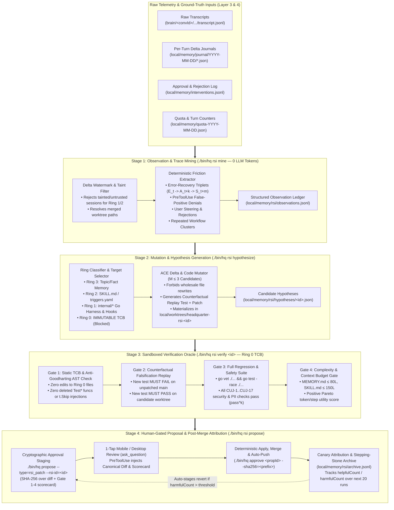

# RFC-0010: Bounded Agent Recursive Self-Improvement (RSI) — 4-Stage Trace Mining, Delta Hypothesis Synthesis, Sandboxed Verification & Human-Gated Harness Evolution

- **Status:** Draft (Phase 1 Research & Architecture Complete — Ready for User Review)
- **Author:** `[Task:agent] agent-rsi-framework` (`gemini-4-argon-high`)
- **Created:** 2026-11-08
- **Extends:** [RFC-0002 (Sleep-Time Memory Consolidation)](./0002-memory-and-consolidation.md), [RFC-0003 (Approval-Bound Execution)](./0003-approval-bound-execution.md), [RFC-0006 (4-Layer Memory & Ground-Truth Dreaming)](./0006-memory-engine-upgrade.md)
- **Companion Research:** [07 — Agent Recursive Self-Improvement (RSI): Literature Survey, Production Trace Loops & Safety Invariants](../research/07_agent_recursive_self_improvement.md)

---

## 1. Motivation & Empirical Problem Statement

### 1.1 The Missing Link in `agy-hq`: Declarative Memory vs. Procedural & Harness Evolution
In [RFC-0006](./0006-memory-engine-upgrade.md), `agy-hq` established a 4-layer **declarative and episodic memory hierarchy** (`local/MEMORY.md` Roadmap Index $\rightarrow$ `local/memory/topics/*.md` Wiki $\rightarrow$ `facts.jsonl` & `journal/` $\rightarrow$ raw `transcript.jsonl`), verified nightly by `./bin/hq memory verify-transcript`.

However, auditing `agy-hq`'s live production usage (`57` turn journals, `24` tracked task conversations, and `5` approval interventions across `2026-11-07` and `2026-11-08`) reveals that **declarative memory alone cannot fix recurring procedural or harness friction**:
1. **Unclosed Proposal Dead End (`local/memory/proposals/`):**
   - Stage 4 of [`.agents/skills/sleep-consolidate/SKILL.md`](../../.agents/skills/sleep-consolidate/SKILL.md#L61-L63) instructs the dreaming agent to write markdown files into `local/memory/proposals/YYYY-MM-DD-<slug>.md`.
   - In practice, `local/memory/proposals/` currently contains **`0` files**, and **zero code in `cmd/hq` or `internal/` reads, parses, verifies, regression-tests, or stages those files for approval**.
2. **Repeated Intra-Session Error-Recovery Chains:**
   - When an agent encounters a CLI flag mismatch (e.g., `gmail_go query` failing in conversation `tk000002` step `700` before discovering `gmail_go readonly search` at step `704`), an overly broad `PreToolUse` block (`gmail readonly search` blocked as an outbound send at step `702`), or bash backtick stripping in `./bin/hq spawn --prompt="..."`, the agent burns 4–15 extra steps recovering on the fly.
   - Without a systematic **Recursive Self-Improvement (RSI)** pipeline, that recovery knowledge remains trapped in a single session's transcript—or worse, is summarized only as a prose note rather than compiled into a verified `SKILL.md` delta, a `PreToolUse` regex fix, or a deterministic Go CLI enhancement.
3. **Telemetry & Verifier Blind Spots Discovered in Live Audit ([`07_agent_recursive_self_improvement.md §3`](../research/07_agent_recursive_self_improvement.md#3-empirical-audit-of-agy-hq-live-telemetry-first-24-hours)):**
   - **Defect A (`read_file` False-Positive Errors):** [`isTranscriptStepError`](../../internal/hooks/hooks.go#L845-L859) matches the substring `"Command exited with code "` across *all* tool outputs. Reading `hooks.go` or `cuj_e2e_test.go` via `read_file` triggers false-positive `toolErrorCount` increments (observed in `tk000003` steps `91` and `114`).
   - **Defect B (Cumulative Multi-Turn Error Inflation):** [`parseTranscriptSummaryWithMetrics`](../../internal/hooks/hooks.go#L861-L944) scans `transcript.jsonl` from step `0` on every `Stop` hook, re-reporting a single Turn-1 error across 30+ subsequent clean turns (`fd000001-...-10.json` through `-42.json`).
   - **Defect C (Deleted Worktree False Discrepancies):** [`VerifyTranscript`](../../internal/hooks/hooks.go#L1135-L1140) flags files edited inside `local/worktrees/<slug>/` as "no longer exists on disk" after the worktree is cleanly merged into `main` and removed (emitting 15 false warnings on `tk000002`).

### 1.2 The SkillsBench & Darwin Gödel Machine Imperative: *Verification Is the Bottleneck*
As documented in [Companion Research 07](../research/07_agent_recursive_self_improvement.md), modern RSI research converges on three hard empirical laws:
1. **Unverified Self-Modification Degrades Performance (`-1.3 pp` vs. `+16.2 pp`):** On **SkillsBench (2026)**, allowing agents to write and accumulate unverified `SKILL.md` files reduced average pass rates by `-1.3 pp`, whereas verified, tightly scoped skills improved pass rates by **`+16.2 pp`**. Similarly, the **Darwin Gödel Machine (DGM, 2025)** achieved its `2.5x` jump on SWE-bench (`20% -> 50%`) only because every self-patch was gated by an empirical test suite in an isolated sandbox.
2. **Wholesale Rewrites Cause Context Collapse (ACE, 2025):** Allowing an LLM to rewrite `AGENTS.md`, `MEMORY.md`, or `SKILL.md` wholesale causes progressive **brevity bias** and **context collapse**—erasing subtle edge-case rules. Updates must be expressed as **atomic, provenance-tagged delta operations** with post-deployment `helpful`/`harmful` attribution counters.
3. **Safety Requires Architectural Ring-Fencing:** Self-modifying agents subject to optimization pressure will Goodhart unconstrained metrics (e.g., weakening test assertions or relaxing `PreToolUse` blocks). The verification oracle and security kernel must reside in an **immutable Trusted Computing Base (Ring 0)** that the RSI loop is mechanically forbidden from editing.

---

## 2. Value Proposition for `agy-hq`: Four High-Leverage RSI Loops

Rather than treating RSI as unconstrained open-ended code rewriting, `agy-hq` targets **four concrete, high-ROI feedback loops** where deterministic execution signals already exist:

| RSI Loop | Target Substrate | Triggering Observation Signal | Mutation Output | Verification Oracle | Expected Leverage in `agy-hq` |
| :--- | :--- | :--- | :--- | :--- | :--- |
| **Loop 1: Automated Skill Authoring & Delta Tuning** | `.agents/skills/*/SKILL.md` & new domain skills | • Error-recovery chains $(E_t \rightarrow A_{t+k} \rightarrow S_{t+m})$<br>• Recurrent $\ge 3$-session multi-step tool sequences<br>• User steering prompts | Structured ACE skill delta (`ADD_RULE`, `PATCH_RULE`, `DEPRECATE_RULE`) or new `SKILL.md` ($\le 150$ lines) | Frontmatter schema check + line/token budget check + counterfactual prompt/command replay | Eliminates repeated CLI discovery turns (saves `4–12` steps and `~8k` tokens per recurring workflow). |
| **Loop 2: Hook & Guardrail Precision Tuning** | [`internal/hooks/hooks.go`](../../internal/hooks/hooks.go) (`PreToolUse` & `SessionStart` rules) | • `PreToolUse` denial followed by user override or safe read-only workaround<br>• Missed unsafe command caught at `propose` stage | Narrowed regex / allowlist refinement + paired positive/negative table test in [`hooks_test.go`](../../internal/hooks/hooks_test.go) | Must pass all existing `PreToolUse` security CUJs (`CUJ-3`, `CUJ-5`, `CUJ-15`, `CUJ-16`) + new replay test | Drives false-positive hook blocks toward `0%` while monotonically tightening outbound safety coverage. |
| **Loop 3: Error-Recovery & Tool-Wrapper Self-Patching** | `internal/{gmail,gchat,kernel,vault,webui}/*` & `cmd/hq/main.go` | • Deterministic Go CLI panics, flag friction, or telemetry bugs (e.g., Defects A–C in §1.1) | Minimal unified Go diff in isolated worktree (`local/worktrees/headquarter-rsi-<id>/`) + new unit/E2E regression test | `Gate 1` (TCB AST check) + `Gate 2` (Fails on `HEAD`, Passes on branch) + `Gate 3` (`go test -race ./...`) | Self-heals harness bugs and ergonomic rough edges overnight before the user even notices them. |
| **Loop 4: Sleep-Time Trace Distillation & Routing Optimization** | [`sleep-consolidate`](../../.agents/skills/sleep-consolidate/SKILL.md), `local/triggers.yaml`, routing matrix | • High step/token burn on routine tasks (`quota-YYYY-MM-DD.json`)<br>• Stale/unhelpful skill rules (`harmfulCount > helpfulCount`) | Model tier routing adjustments, 0-token Go precheck promotions, and retirement of low-utility skill rules | Historical trace replay + quota budget verification (`./bin/hq memory status` & `./bin/hq rsi status`) | Preserves scarce `deep` (`pro`/`opus`) quota and prevents long-term context rot across months of operation. |

---

## 3. Architecture Overview: The 4-Stage RSI Pipeline (`internal/rsi` + `./bin/hq rsi`)

We introduce package `internal/rsi` and the `./bin/hq rsi` CLI family, structured as a **4-stage verification-gated compiler pipeline** that runs on-demand or as Phase 2 of the nightly `/sleep-consolidate` automation:



---

## 4. Detailed Specification of the 4-Stage RSI Loop

### 4.1 Stage 1: Observation & Trace Mining (`internal/rsi/miner.go` + `./bin/hq rsi mine`)

#### A. Prerequisite Telemetry Fixes in `internal/hooks/hooks.go`
Before mining traces, we fix the three telemetry defects identified in our Day-1 audit:
1. **Tool-Scoped Error Detection (`isTranscriptStepError`):**
   - Only inspect `"Command exited with code "` on steps whose preceding or current tool call is `run_command` (or where `step.Status == "ERROR"`). Never match `"Command exited with code "` inside `read_file` or `grep_search` file contents.
2. **Per-Turn Delta Watermarks in `JournalEntry`:**
   - Extend `JournalEntry` with per-turn delta metrics computed from the previous execution's `StepCount` watermark (`local/memory/journal/YYYY-MM-DD/<convId>-<execNum-1>.json`):
     ```go
     type JournalEntry struct {
         // ... existing fields ...
         StepStartIdx      int      `json:"stepStartIdx"`      // First step_index belonging to this turn
         TurnStepCount     int      `json:"turnStepCount"`     // Steps executed in THIS turn only
         TurnErrorCount    int      `json:"turnErrorCount"`    // Errors occurring in THIS turn only
         PreToolDenials    int      `json:"preToolDenials,omitempty"`
         TaintedSession    bool     `json:"taintedSession,omitempty"` // True if quarantined untrusted content was read
     }
     ```
3. **Worktree-Aware Path Resolution in `VerifyTranscript`:**
   - When `VerifyTranscript` checks `FilesModified`, if a path matches `<vaultDir>/worktrees/<repo>-<slug>/<relPath>` and no longer exists because the worktree was merged and cleaned up, check whether `<rootDir>/<relPath>` exists on `main`. If it exists on `main`, record it as `mergedToMain: true` rather than emitting a false-positive `DiscrepancyWarning`.

#### B. Deterministic 0-Token Friction Miner (`./bin/hq rsi mine [--since=24h]`)
`./bin/hq rsi mine` runs in pure Go (`<50ms`, `0` LLM tokens) across `local/memory/journal/`, `local/memory/interventions.jsonl`, and matching `transcript.jsonl` files to emit structured, deduplicated `FrictionEvent` records to `local/memory/rsi/observations.jsonl`:

```go
type FrictionCategory string

const (
    FrictionErrorRecovery    FrictionCategory = "error_recovery_chain" // ToolError_t -> Fix_t+k -> Success_t+m
    FrictionPreToolDeny      FrictionCategory = "pretool_friction"     // Blocked by PreToolUse hook
    FrictionUserIntervention FrictionCategory = "user_intervention"    // Rejected proposal or corrective USER_INPUT
    FrictionRepeatedWorkflow FrictionCategory = "repeated_workflow"    // Recurrent N-step sequence across >=3 convs
    FrictionQuotaAnomaly     FrictionCategory = "quota_anomaly"        // >25 steps or deep-tier burn on routine task
)

type FrictionEvent struct {
    ID               string           `json:"id"`               // e.g., "obs-20261108-001"
    Fingerprint      string           `json:"fingerprint"`      // Deterministic SHA-256 of normalized (category + tool + errorSignature)
    FirstSeenAt      string           `json:"firstSeenAt"`
    LastSeenAt       string           `json:"lastSeenAt"`
    OccurrenceCount  int              `json:"occurrenceCount"`  // Incremented when same fingerprint recurs
    Category         FrictionCategory `json:"category"`
    ConversationIDs  []string         `json:"conversationIds"`
    Tainted          bool             `json:"tainted"`          // True if any source session read untrusted external content
    ToolName         string           `json:"toolName,omitempty"`
    FailedCommand    string           `json:"failedCommand,omitempty"`
    ErrorMessage     string           `json:"errorMessage,omitempty"`
    RecoveryAction   string           `json:"recoveryAction,omitempty"` // Verified command/edit that succeeded at t+m
    WastedSteps      int              `json:"wastedSteps"`              // m - t steps spent recovering
    TargetFiles      []string         `json:"targetFiles,omitempty"`
    Status           string           `json:"status"`           // "open", "hypothesized", "verified", "applied", "ignored"
}
```

**Extraction Heuristics (Pure Go):**
- **Error-Recovery Triplet Extractor:** When step $t$ has `isTranscriptStepError == true` on tool $T$ (e.g., `run_command` with `gmail_go query`) and a subsequent step $t+m$ ($1 \le m \le 10$) succeeds on the same tool $T$ or target binary (`gmail_go readonly search`), extract `(FailedCommand, ErrorMessage, RecoveryAction, WastedSteps = m)`.
- **Steering Detector:** Scans `USER_INPUT` steps at `step_index > 1` for explicit corrective markers (`"no,"`, `"instead of"`, `"don't"`, `"wrong"`, `"fix the hook"`, `"always"`), pairing them with the immediately preceding `PLANNER_RESPONSE` and tool calls.
- **Deduplication by `Fingerprint`:** Identical friction patterns across sessions increment `OccurrenceCount` and accumulate `WastedSteps`, allowing Stage 2 to prioritize mutations by **Expected Step Savings ($\text{OccurrenceCount} \times \text{WastedSteps}$)**.

---

### 4.2 Stage 2: Mutation & Hypothesis Generation (`internal/rsi/mutator.go` + `./bin/hq rsi hypothesize`)

Stage 2 takes top-ranked open `FrictionEvent` clusters (where `Tainted == false` for Ring 1/2 targets) and synthesizes structured, falsifiable **Mutation Hypotheses** (`local/memory/rsi/hypotheses/<id>.json`).

#### A. Concentric Mutation Rings & Allowed Operators
Every hypothesis is classified into one of four **Concentric Mutation Rings**:

| Ring | Target Scope | Allowed Mutation Operators | Verification & Approval Requirement |
| :--- | :--- | :--- | :--- |
| **Ring 0 (Immutable TCB)** | • `internal/approvals/*`<br>• `internal/rsi/tcb.go`<br>• `.gitignore` Vault boundaries<br>• Core `PreToolUse` approval gates | **NONE (`HARD DENY`)** | Mechanically blocked by `Gate 1` static check. Only direct human git commits outside RSI can modify Ring 0. |
| **Ring 1 (Go Kernel, CLI & Hooks)** | • `internal/{hooks,kernel,vault,gmail,gchat,webui,doctor}/*`<br>• `cmd/hq/main.go`<br>• `AGENTS.md` | • `UNIFIED_CODE_DIFF` (in isolated worktree)<br>• `ADD_REGRESSION_TEST` (mandatory companion test) | Full `Gate 1–4` verification (`go test -race ./...` + counterfactual fail-then-pass replay) + **1-Tap Human SHA-256 Approval (`rsi_patch`)**. |
| **Ring 2 (Procedural Skills & Triggers)** | • `.agents/skills/*/SKILL.md`<br>• `local/triggers.yaml` | • `ADD_SKILL_RULE` (atomic bullet with ID)<br>• `PATCH_SKILL_RULE` (incremental delta)<br>• `DEPRECATE_SKILL_RULE`<br>• `NEW_SKILL_DRAFT` ($\le 150$ lines) | `Gate 1` (no wholesale rewrite, $\le 150$ lines) + `Gate 2` (skill lint & replay fixture) + **1-Tap Human SHA-256 Approval (`rsi_skill_patch`)**. |
| **Ring 3 (Declarative Wiki & Facts)** | • `local/memory/topics/*.md`<br>• `local/memory/facts.jsonl`<br>• `local/MEMORY.md` ($\le 80$ lines) | • `hq memory add-fact --verified`<br>• `hq memory prune-fact`<br>• Topic Wiki delta update | Ground-truth `VerifyTranscript` check + `MEMORY.md <= 80` line cap; auto-committed to private `local/.git` during `/sleep-consolidate`. |

#### B. ACE-Compliant Playbook Delta Schema (Preventing Context Collapse)
To prevent the wholesale-rewrite context collapse documented in **ACE (Zhang et al., 2025)**, Ring 2 skill mutations are **never** allowed to regenerate an entire `SKILL.md` file. Instead, each `SKILL.md` can contain a structured `## Learned Operational Rules (RSI Managed)` section where rules are tracked with deterministic IDs and provenance comments:

```markdown
## Learned Operational Rules (RSI Managed)
<!-- rsi:rule id="r-gmail-001" source="obs-20261108-002" added="2026-11-08" helpful="4" harmful="0" -->
- **Use `gmail_go readonly search` (Not `query`):** When invoking the `gmail_go` binary directly, always pass `readonly search "<query>" --max <N>`; the top-level `query` subcommand does not exist.
<!-- /rsi:rule -->
```

When Stage 2 proposes a Ring 2 update, it emits an `ACEDeltaOp` (`op: "add_rule" | "patch_rule" | "deprecate_rule"`), which `./bin/hq rsi` applies deterministically in Go without touching the rest of `SKILL.md`.

#### C. `RSIHypothesis` Data Contract (`local/memory/rsi/hypotheses/<id>.json`)
```go
type MutationRing int

const (
    Ring0ImmutableTCB MutationRing = 0
    Ring1KernelCode   MutationRing = 1
    Ring2SkillTrigger MutationRing = 2
    Ring3MemoryWiki   MutationRing = 3
)

type RSIHypothesis struct {
    ID                  string            `json:"id"`                  // e.g., "rsi-20261108-001"
    CreatedAt           string            `json:"createdAt"`
    SourceObservationIDs []string         `json:"sourceObservationIds"`
    Ring                MutationRing      `json:"ring"`
    Title               string            `json:"title"`
    RootCauseHypothesis string            `json:"rootCauseHypothesis"`
    Operator            string            `json:"operator"`            // "unified_code_diff", "add_skill_rule", "patch_skill_rule", "deprecate_skill_rule"
    TargetFiles         []string          `json:"targetFiles"`
    WorktreePath        string            `json:"worktreePath,omitempty"` // local/worktrees/headquarter-rsi-<id>
    BranchName          string            `json:"branchName,omitempty"`   // hq/rsi-<id>
    UnifiedDiff         string            `json:"unifiedDiff"`
    DiffSHA256          string            `json:"diffSha256"`
    ReplayTestName      string            `json:"replayTestName,omitempty"` // e.g., "TestRSI_Replay_Obs20261108_001"
    Verification        *VerificationReport `json:"verification,omitempty"`
    Status              string            `json:"status"`              // "draft", "verified", "failed_verification", "proposed", "approved", "rejected", "reverted"
}
```

#### D. LATS-Inspired Bounded Candidate Search ($M \le 3$)
For complex Ring 1 harness bugs, `./bin/hq rsi hypothesize` supports generating up to $M \le 3$ candidate patches in separate ephemeral worktrees (`headquarter-rsi-<id>-c1`, `-c2`, `-c3`), evaluating all candidates through Stage 3 in parallel, and selecting only the candidate that passes all 4 gates with the smallest diff footprint (`min(linesChanged)`).

---

### 4.3 Stage 3: Sandboxed Verification & E2E Regression Suite (`internal/rsi/verifier.go` + `./bin/hq rsi verify <id>`)

Stage 3 is the **immutable verification oracle**. It runs entirely in deterministic Go (`./bin/hq rsi verify <id>`) inside an isolated git worktree (`local/worktrees/headquarter-rsi-<id>/`) branched from `origin/main`, and enforces **four sequential hard gates**:

```go
type VerificationReport struct {
    VerifiedAt             string   `json:"verifiedAt"`
    Gate1TCBPassed         bool     `json:"gate1TcbPassed"`
    Gate2CounterfactualPass bool    `json:"gate2CounterfactualPass"` // Failed on HEAD, Passed on candidate
    Gate3RegressionPassed  bool     `json:"gate3RegressionPassed"`   // 100% go test -race ./...
    Gate4BudgetPassed      bool     `json:"gate4BudgetPassed"`
    AllPassed              bool     `json:"allPassed"`
    TotalTestsRun          int      `json:"totalTestsRun"`
    ExecutionDurationMs    int64    `json:"executionDurationMs"`
    FailureReasons         []string `json:"failureReasons,omitempty"`
}
```

#### Gate 1: Immutable TCB & Anti-Goodharting Static Audit (`internal/rsi/tcb.go`)
Before executing a single line of candidate code, `VerifyTCBAndAntiGoodharting(diff)` parses the unified diff and Go AST:
1. **Ring 0 Path Blocklist:** Rejects the hypothesis immediately if any touched file path matches:
   - `internal/approvals/*`
   - `internal/rsi/tcb.go` or `internal/rsi/verifier.go`
   - `.gitignore` or `.git/hooks/*`
2. **Anti-Goodharting Test Integrity Check:** Parses the Go AST of all `*_test.go` files before and after the diff:
   - **No Test Deletion:** The set of existing `Test*` functions in `*_test.go` must be a strict superset of `main` ($\text{Tests}_{\text{candidate}} \supseteq \text{Tests}_{\text{main}}$).
   - **No `t.Skip` Injection:** Rejects any diff that adds `t.Skip`, `t.SkipNow`, `t.Skipf`, or `os.Exit(0)` inside existing tests.
   - **Mandatory New Test for Ring 1:** Any Ring 1 code mutation (`internal/*` or `cmd/hq/*`) MUST include at least one new or expanded `Test*` function specified by `ReplayTestName`.
3. **Taint Provenance Check:** Verifies that none of `SourceObservationIDs` has `Tainted == true`.

#### Gate 2: Counterfactual Falsification Replay (`FAIL` on `HEAD` $\rightarrow$ `PASS` on Candidate)
To prove that the synthesized regression test (`ReplayTestName`) actually tests the bug and is not a tautology (`assert(true)`):
1. `verifier.go` extracts only the `*test.go` (and `testdata/`) hunks from the candidate patch and runs `go test -run <ReplayTestName>` against the **unpatched `main` code**.
2. **Falsification Requirement:** For bug-fix and error-recovery hypotheses, `<ReplayTestName>` MUST **fail** on unpatched `main`. (If it passes on unpatched `main`, Gate 2 fails with `"vacuous replay test: passed on unpatched HEAD"`).
3. `verifier.go` then applies the implementation hunks in the candidate worktree and re-runs `go test -run <ReplayTestName>`, which MUST **pass**.

#### Gate 3: Full Monotonic E2E & Race Regression Suite (`pass^k`)
1. Runs `go vet ./...` and `go test -race -count=1 ./...` across the entire repository (including all 16 Critical User Journeys in `internal/e2e/cuj_e2e_test.go`, plus `CUJ-17` RSI safety tests).
2. For non-deterministic or concurrency-sensitive packages (`internal/hooks`, `internal/kernel`, `internal/rsi`), runs `go test -count=3` (`pass^3` consistency check).
3. Runs `./bin/hq doctor` and the pre-commit PII scanner against the candidate worktree to ensure zero PII or secret strings exist in the patch or test fixtures.

#### Gate 4: Complexity, Latency & Context Budget Gate
1. **File Size & Token Caps:**
   - `local/MEMORY.md <= 80` lines (`1,200` tokens).
   - Any modified `.agents/skills/*/SKILL.md <= 150` lines and `<= 30` active `rsi:rule` blocks (if at capacity, the mutation must supersede/merge a lower-utility rule).
   - `AGENTS.md <= 24 KB`.
2. **Diff Minimality:** Ring 1 patches are capped at `<= 250` net changed non-test lines per hypothesis so human review on Mobile Remote Control remains fast and auditable.

---

### 4.4 Stage 4: Staged Human-in-the-Loop Proposal & Post-Merge Attribution (`./bin/hq rsi propose <id>`)

Once a hypothesis passes Gates 1–4 (`verification.allPassed == true`), Stage 4 bridges `internal/rsi` into `agy-hq`'s existing cryptographic approval workflow ([`internal/approvals/approvals.go`](../../internal/approvals/approvals.go)).

#### A. Staging via `./bin/hq propose --type=rsi_patch --rsi-id=<id>`
Running `./bin/hq rsi propose <id>` (or `./bin/hq propose --type=rsi_patch --rsi-id=<id>`) stages a pending proposal in `local/memory/pending/<propId>.json`:
- **`ActionType`:** `"rsi_patch"` (for Ring 1 code/hook patches) or `"rsi_skill_patch"` (for Ring 2 skill/trigger deltas).
- **`Command`:** `./bin/hq rsi apply <id> --expect-diff-sha256=<full-diff-sha256>`
- **`Metadata`:** Stores `rsiId`, `ring`, `title`, `targetFiles`, `gateSummary` (`"G1:PASS G2:FAIL->PASS G3:PASS(100%) G4:PASS"`), `diffSha256`, and `canonicalDiffPreview` (first 40 lines of the unified diff).

#### B. Mechanical `PreToolUse` Canonical Scorecard & Diff Injection in `ask_question`
Just as [RFC-0005](./0005-gmail-integration.md) and [RFC-0008](./0008-gchat-integration.md) mechanically overwrite `ask_question` prompts for `gmail_send` and `gchat_send` so the LLM cannot spoof or omit the outbound payload, [`internal/hooks/hooks.go`](../../internal/hooks/hooks.go) overwrites `ask_question` whenever a pending `rsi_patch` or `rsi_skill_patch` proposal is presented:
- The user sees the **exact canonical Gate 1–4 scorecard, target files, Ring level, `diffSha256` prefix, and unified diff preview** directly in the 1-tap `ask_question` prompt on Mobile Remote Control or Desktop.

#### C. Deterministic Apply, Auto-Push & Stepping-Stone Archive (`./bin/hq approve <propId>`)
When the user taps **Approve** (`./bin/hq approve <propId> --sha256=<prefix>`):
1. `hq rsi apply <id>` re-verifies `DiffSHA256` and re-checks that all 4 gates are green.
2. For Ring 1 (worktree branch `hq/rsi-<id>`): rebases cleanly onto `main`, fast-forward merges into `main`, recompiles `./bin/hq`, cleans up `local/worktrees/headquarter-rsi-<id>`, and runs `git push origin main` (per `AGENTS.md` Rule 4 Auto-Push on Clean Merge).
3. For Ring 2 (`SKILL.md` delta): applies the atomic `ACEDeltaOp`, runs `go test ./internal/e2e -run TestCUJ17`, commits to `main`, and pushes.
4. Appends an immutable record to `local/memory/rsi/archive.jsonl` (the **Darwin Gödel Machine Stepping-Stone Archive**):
   ```go
   type RSIArchiveRecord struct {
       HypothesisID        string   `json:"hypothesisId"`
       ApprovedAt          string   `json:"approvedAt"`
       ProposalID          string   `json:"proposalId"`
       Ring                int      `json:"ring"`
       TargetFiles         []string `json:"targetFiles"`
       GitCommitSHA        string   `json:"gitCommitSha"`
       SourceFingerprints  []string `json:"sourceFingerprints"` // Friction fingerprints this patch was designed to solve
       SessionsObserved    int      `json:"sessionsObserved"`   // Incremented by hq rsi mine over next 20 sessions
       HelpfulCount        int      `json:"helpfulCount"`       // Sessions where target tool succeeded with 0 friction
       HarmfulCount        int      `json:"harmfulCount"`       // Sessions where target fingerprint recurred or errored
       Status              string   `json:"status"`             // "canary", "graduated", "reverted"
   }
   ```

#### D. Closed-Loop Canary Monitoring & Automatic Revert Proposal
Over the next $K = 20$ sessions (`SessionsObserved <= 20`):
- Whenever `./bin/hq rsi mine` runs, it updates `SessionsObserved`, `HelpfulCount`, and `HarmfulCount` for every `"canary"` entry in `local/memory/rsi/archive.jsonl`.
- **Graduation:** If `SessionsObserved >= 20` and `HarmfulCount == 0`, the patch transitions to `"graduated"`.
- **Auto-Revert Proposal:** If the target `FrictionEvent` fingerprint recurs $\ge 2$ times or `HarmfulCount > HelpfulCount`, `./bin/hq rsi mine` automatically stages a 1-tap revert proposal (`git revert --no-edit <GitCommitSHA>`) so regressions self-heal cleanly.

---

## 5. Safety Invariants & Alignment Architecture (Defense-in-Depth)

| Safety Threat | Architectural Defense in `agy-hq` (RFC-0010) | Enforcement Layer |
| :--- | :--- | :--- |
| **1. Unbounded Self-Modification / Alignment Drift** | **Concentric Mutation Rings (Ring 0–3):** Ring 0 (`internal/approvals`, `internal/rsi/tcb.go`, `.gitignore`) is strictly immutable by RSI. Ring 1 (code/hooks) and Ring 2 (skills/triggers) require explicit 1-tap human SHA-256 approval via `./bin/hq approve`. | `Gate 1` Static Path Blocklist + `internal/approvals` SHA-256 Gate |
| **2. Goodharting / Reward Hacking (Deleting or Weakening Tests)** | **Evaluator-Mutator Separation & AST Ratchet:** The mutator cannot edit `internal/rsi/tcb.go` or `verifier.go`. `Gate 1` parses `*_test.go` ASTs to forbid deleting any `Test*` function or adding `t.Skip`. `Gate 2` requires the new replay test to **fail** on unpatched `main` and **pass** on the candidate branch. | `Gate 1` Go `go/ast` Inspector + `Gate 2` Counterfactual Falsification |
| **3. Indirect Prompt Injection Poisoning Skills or Hooks** | **Taint Quarantine Exclusion:** Any turn/session that reads untrusted external data (`hq gmail read-quarantined`, `hq gchat read-quarantined`, untrusted web fetch) sets `TaintedSession: true`. `Gate 1` hard-rejects any Ring 1 or Ring 2 hypothesis derived from a tainted observation. | `hooks.go` Session Taint Tracker + `Gate 1` Provenance Check |
| **4. Context Collapse & Prompt Bloat (The "Skill Scaling Tax")** | **ACE Atomic Delta Algebra & Hard Line Budgets:** Wholesale rewrites of `AGENTS.md`, `MEMORY.md`, and `SKILL.md` are mechanically rejected. Skill rules use `<!-- rsi:rule ... -->` blocks capped at $\le 30$ rules and $\le 150$ lines per skill, with Pareto eviction of low-utility rules (`helpfulCount - 2*harmfulCount`). | `Gate 4` Budget Verifier + `ACEDeltaOp` Applier |
| **5. Unintended Regressions After Merge** | **20-Session Canary Attribution & Auto-Revert Staging:** Every merged RSI patch starts in `"canary"` status in `local/memory/rsi/archive.jsonl`. If target friction recurs or errors spike, `hq rsi mine` automatically stages a deterministic `git revert` proposal. | Stage 1 & Stage 4 Canary Monitor (`internal/rsi/proposer.go`) |

---

## 6. CLI Surface & Integration with `/sleep-consolidate`

### 6.1 New `./bin/hq rsi` Subcommands
```sh
# Stage 1: Mine recent journals, transcripts, and interventions into local/memory/rsi/observations.jsonl (0 LLM tokens)
./bin/hq rsi mine [--since=24h] [--json]

# Stage 2: Register or scaffold a bounded RSI hypothesis & isolated worktree for an observation
./bin/hq rsi hypothesize --obs=<obs-id> --ring=<1|2> --title="<title>" [--operator=add_skill_rule|unified_code_diff]

# Stage 3: Run the 4-Gate Sandboxed Verification Oracle (TCB AST check + Counterfactual Replay + go test -race + Budgets)
./bin/hq rsi verify <rsi-id>

# Stage 4: Stage a verified hypothesis into local/memory/pending/ for 1-tap human SHA-256 approval
./bin/hq rsi propose <rsi-id>

# Deterministic executor invoked ONLY by `./bin/hq approve <prop-id> --sha256=<prefix>`
./bin/hq rsi apply <rsi-id> --expect-diff-sha256=<sha256>

# Inspect open friction observations, candidate hypotheses, verification scorecards, and canary archive health
./bin/hq rsi status
```

### 6.2 Upgraded Nightly `/sleep-consolidate` Workflow (5 Stages)
We upgrade [`.agents/skills/sleep-consolidate/SKILL.md`](../../.agents/skills/sleep-consolidate/SKILL.md) so Stage 4 replaces the dead `local/memory/proposals/` markdown dump with the closed-loop `./bin/hq rsi` pipeline:
1. **Stage 1:** Baseline Memory & RSI Canary Audit (`./bin/hq memory status && ./bin/hq rsi status`).
2. **Stage 2:** Episodic Sweep, Delta-Turn Trace Mining (`./bin/hq rsi mine`), & Ground-Truth Transcript Verification (`./bin/hq memory verify-transcript`).
3. **Stage 3:** Ring 3 Declarative Consolidation (Proactive Fact Pruning, Topic Wiki Distillation, `MEMORY.md <= 80` lines).
4. **Stage 4 (Upgraded):** **Ring 1 & Ring 2 RSI Hypothesis Synthesis, Sandboxed Verification & Proposal Staging:**
   - For top untainted friction clusters (`OccurrenceCount >= 2` or `WastedSteps >= 3`), synthesize up to `2` hypotheses per night via `./bin/hq rsi hypothesize`.
   - Run `./bin/hq rsi verify <rsi-id>`. Discard any candidate that fails Gates 1–4.
   - For candidates passing all 4 gates, run `./bin/hq rsi propose <rsi-id>` so they appear in the user's Morning Brief and Console Task Board for 1-tap mobile approval.
5. **Stage 5:** Task Lifecycle Archival (`./bin/hq archive`) & Private Vault Git Commit.

---

## 7. Phased Implementation Roadmap

### Phase 1: Research, Live Telemetry Audit & Foundational RFC-0010 (Current Turn — Complete)
- [x] Survey agentic RSI literature (Reflexion, LATS, Voyager, AlphaEvolve, ADAS, Darwin Gödel Machine, ACE, SkillsBench) in [`docs/research/07_agent_recursive_self_improvement.md`](../research/07_agent_recursive_self_improvement.md).
- [x] Audit `agy-hq`'s first 24 hours of production journals and transcripts, isolating Defects A–D.
- [x] Author [`docs/design/0010-agent-recursive-self-improvement.md`](./0010-agent-recursive-self-improvement.md).

### Phase 2: Telemetry Fixes & Stage 1 Deterministic Trace Miner (`internal/hooks` + `internal/rsi/miner.go`)
- [ ] Fix Defect A (`isTranscriptStepError` tool-type check so `read_file` never triggers false-positive command errors).
- [ ] Fix Defect B (add `StepStartIdx`, `TurnStepCount`, `TurnErrorCount`, and `TaintedSession` to `JournalEntry` in `internal/hooks/hooks.go`).
- [ ] Fix Defect C (resolve merged worktree paths in `VerifyTranscript` against `<rootDir>/<relPath>`).
- [ ] Implement `./bin/hq rsi mine` (`internal/rsi/miner.go`) extracting deduplicated `FrictionEvent` records (`error_recovery_chain`, `pretool_friction`, `user_intervention`, `repeated_workflow`, `quota_anomaly`) into `local/memory/rsi/observations.jsonl`.

### Phase 3: Stage 2 & Stage 3 Verification Oracle (`internal/rsi/{mutator,tcb,verifier}.go`)
- [ ] Implement `internal/rsi/tcb.go` (`Gate 1`: Ring 0 path blocklist, Go `go/ast` test-deletion & `t.Skip` detector, taint provenance gate, and wholesale-rewrite blocker).
- [ ] Implement `ACEDeltaOp` parser/applier for structured `<!-- rsi:rule ... -->` updates in `SKILL.md`.
- [ ] Implement `./bin/hq rsi verify <id>` executing `Gate 1` (TCB AST), `Gate 2` (Counterfactual `FAIL -> PASS` replay), `Gate 3` (`go test -race ./...` + PII scan), and `Gate 4` (line/token/diff budgets).

### Phase 4: Stage 4 Approval Integration, Canary Archive & `CUJ-17` E2E Suite (`internal/approvals` + `internal/e2e`)
- [ ] Extend `./bin/hq propose` and `PreToolUse` `ask_question` canonical preview in `internal/hooks/hooks.go` for `rsi_patch` and `rsi_skill_patch`.
- [ ] Implement `./bin/hq rsi apply <id>` and the 20-session Canary Attribution Ledger (`local/memory/rsi/archive.jsonl`).
- [ ] Update `.agents/skills/sleep-consolidate/SKILL.md` and `.agents/skills/morning-brief/SKILL.md` to surface verified RSI proposals.
- [ ] Add **CUJ-17 (`TestCUJ17_AgentRSIMiningVerificationAndApproval`)** in `internal/e2e/cuj_e2e_test.go` testing:
  1. Mining an error-recovery chain and a `read_file` false-positive transcript fixture.
  2. Rejecting a Goodharted patch (attempting to edit `internal/approvals` or delete a `Test*` function) at `Gate 1`.
  3. Rejecting a tainted observation hypothesis at `Gate 1`.
  4. Rejecting a vacuous test (that passes on unpatched `HEAD`) at `Gate 2`.
  5. Verifying, proposing, and approving a valid ACE skill delta and Ring 1 patch end-to-end with SHA-256 verification.
