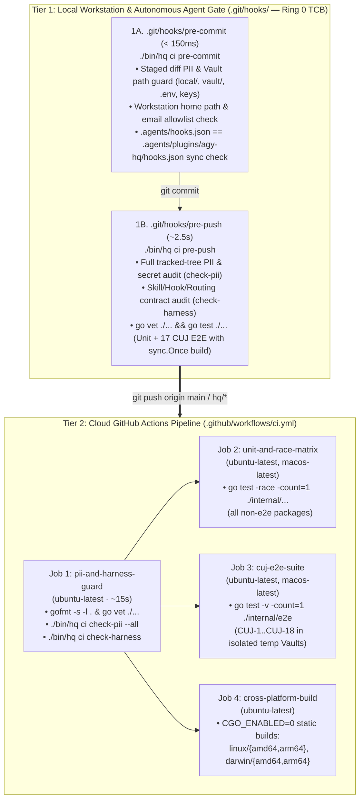

# RFC-0011: Automated CI/CD Pipeline, Mathematical PII/Vault Boundary Verification & Agent Harness Regression Gate

- **Status:** Draft (Phase 1 — Interactive Architecture Review)
- **Author:** `[Task:ci] ci-pipeline` (`gemini-4-argon-high`)
- **Created:** 2026-11-09
- **Related Documents:** [RFC-0001 (Two-Layer Vault Split)](./0001-vault-and-task-isolation.md), [RFC-0003 (Approval-Bound Execution)](./0003-approval-bound-execution.md), [RFC-0007 (Front Desk Initialization Hardening)](./0007-front-desk-initialization-hardening.md), [RFC-0010 (Bounded Agent RSI)](./0010-agent-recursive-self-improvement.md), [PRD-0003 (Critical User Journeys)](../product/0003-critical-user-journeys.md)

---

## 1. Motivation & Empirical Problem Statement

### 1.1 The Auto-Push Paradox in an Autonomous Personal Agent OS
Per [`AGENTS.md` Rule #4](../../AGENTS.md), routine git commits and pushes to the `agy-hq` repository (`git push origin main` or `git push -u origin hq/<task>`) are **exempt from manual human approval** so parallel worktrees and remote machines stay continuously synchronized, *provided* that:
1. All unit and E2E tests pass (`go test ./...` 100%).
2. Pre-commit PII checks pass (zero unencrypted personal data or `local/` files in the tracked tree).
3. The branch is cleanly rebased on `origin/main`.

However, auditing the repository today reveals **four structural gaps** between that policy and mechanical reality:

1. **Zero Cloud CI or Local Pre-Push Enforcement (Live Regression Caught on `HEAD` `89ef10f`):**
   - There is currently no `.github/workflows/ci.yml` and no `.git/hooks/pre-push` hook.
   - **Empirical Case Study (`HEAD` `89ef10f`):** When commit `89ef10f` (`chore(rsi): apply approved RSI skill rule rsi-rule-swe-pulse-2c42ca to swe-pulse`) added the first live production `<!-- rsi:rule -->` block to [`.agents/plugins/agy-hq/skills/swe-pulse/SKILL.md`](../../.agents/plugins/agy-hq/skills/swe-pulse/SKILL.md), it broke [`TestCUJ17_AgentRSIMiningVerificationAndApproval`](../../internal/e2e/cuj_e2e_test.go#L2129-L2133). Why? Because `CUJ-17` copies `.agents/` from `rootDir` into `isolatedRoot` and asserts `strings.Contains(statusOut, "1 active rsi:rule block(s)")`—implicitly assuming `0` baseline `rsi:rule` blocks exist in the repository's tracked skills (`1 baseline + 1 newly applied = 2 active rsi:rule block(s)`). Because neither `hq rsi apply` nor `git push` ran `go test ./internal/e2e/...`, `89ef10f` was pushed directly to `origin/main` with a broken E2E test.
2. **17x Redundant Binary Compilation in `internal/e2e/cuj_e2e_test.go` (`10.5s` Runtime):**
   - [`setupHQEnv(t)`](../../internal/e2e/cuj_e2e_test.go#L26-L49) runs `exec.Command("go", "build", "-o", binPath, "./cmd/hq")` inside **every single `TestCUJ*` function** (17 separate compilations of the 16MB `hq` binary).
   - Although each CUJ test executes in `< 120ms`, compiling `./cmd/hq` 17 times sequentially burns `~10.5s` (`12.5s` user CPU). Sharing a single `sync.Once`-compiled binary across all tests in `package e2e` drops the entire 17-CUJ E2E suite to **`~1.5s–2.0s`**, making full unit + E2E verification fast enough to run synchronously inside a local `pre-push` git hook.
3. **Environment-Dependent Blind Spots in `.git/hooks/pre-commit`:**
   - The current 16-line [`.git/hooks/pre-commit`](../../.git/hooks/pre-commit) script only inspects `git diff --cached` for literal matches of `$HOME` and `git config user.email`.
   - On a cloud GitHub Actions runner (`$HOME=/home/runner`, `git config user.email=""`), or when a commit is created with a different git email or `--no-verify`, this script cannot detect hardcoded workstation paths (`/home/<username>/`, `/Users/<username>/`), OAuth tokens (`ya29.*`, `1//*`), API keys (`AIza*`, `ghp_*`, `sk-*`), private keys, or personal email addresses in tracked files.
4. **No Automated Contract Gate for Skills, Hooks, and Model Routing:**
   - `agy-hq`'s behavior depends as much on declarative harness artifacts ([`.agents/hooks.json`](../../.agents/hooks.json), [`.agents/plugins/agy-hq/hooks.json`](../../.agents/plugins/agy-hq/hooks.json), [`.agents/plugins/agy-hq/skills/*/SKILL.md`](../../.agents/plugins/agy-hq/skills/), [`templates/triggers.yaml`](../../templates/triggers.yaml)) as on Go code. Drift between `.agents/hooks.json` and `.agents/plugins/agy-hq/hooks.json`, malformed YAML frontmatter in a `SKILL.md`, or an invalid `skill:` target in `templates/triggers.yaml` currently goes undetected until runtime.

---

## 2. Architecture Overview: Two-Tier Defense-in-Depth Topology

Because `agy-hq` agents auto-push to `origin/main` without human intervention on routine code changes, cloud CI alone is **necessary but insufficient**: if a commit leaks PII from `local/` or breaks a security hook, catching it *after* it lands on a public GitHub repository is too late.

We therefore establish a **Two-Tier Defense-in-Depth Architecture** backed by a unified, 0-token Go subcommand suite (`./bin/hq ci <check-pii|check-harness|pre-commit|pre-push>` in `internal/ci`) shared identically between local git hooks and GitHub Actions:



### 2.1 Ring 0 Trusted Computing Base (TCB) Protection
To prevent the RSI self-improvement loop ([RFC-0010](./0010-agent-recursive-self-improvement.md)) from weakening or bypassing CI checks ("reward tampering"), we expand [`Ring0ProtectedPaths` in `internal/rsi/tcb.go`](../../internal/rsi/tcb.go#L16-L24) to include:
- `.github/` (all GitHub Actions workflows)
- `internal/ci/` (the deterministic PII and harness contract verifiers)
- `scripts/bootstrap.sh`

---

## 3. Complete Testing Matrix & E2E Acceleration

### 3.1 Four-Layer Testing Matrix

| Layer | Target Packages / Files | Execution Command | Race Detector | OS Targets | Target Latency |
| :--- | :--- | :--- | :-: | :--- | :---: |
| **L0: Static & Contract Gate** | All `.go`, `SKILL.md`, `hooks.json`, `templates/*` | `gofmt -s -l . && go vet ./... && ./bin/hq ci check-pii && ./bin/hq ci check-harness` | N/A | Linux (`ubuntu-latest`) + Local | `< 1.5s` |
| **L1: Package Unit & Concurrency Tests** | `internal/{approvals,ci,doctor,gchat,gmail,hooks,kernel,rsi,vault,webui,worktree}` | `go test -race -count=1 ./internal/approvals ./internal/ci ...` | **Yes (`-race`)** | `ubuntu-latest` (`amd64`), `macos-latest` (`arm64`) | `~2.5s` |
| **L2: Deterministic CUJ E2E Suite** | `internal/e2e/cuj_e2e_test.go` (`CUJ-1`..`CUJ-18`) | `go test -v -count=1 ./internal/e2e -run "^TestCUJ"` | Process-isolated | `ubuntu-latest` (`amd64`), `macos-latest` (`arm64`) | `~1.8s` (down from `10.5s`) |
| **L3: Cross-Compile Build Verification** | `./cmd/hq` | `CGO_ENABLED=0 GOOS=<os> GOARCH=<arch> go build ./cmd/hq` | N/A | `linux/amd64`, `linux/arm64`, `darwin/amd64`, `darwin/arm64` | `~3.0s` |
| **L4: Live Agent E2E (Opt-In Only)** | `internal/e2e/live_agent_e2e_test.go` (`TestLiveAgentE2E`) | `HQ_LIVE_E2E=1 go test -v ./internal/e2e -run TestLiveAgentE2E` | N/A | Local workstation with `agy` CLI authenticated | Manual / Release only (`0` cloud tokens) |

### 3.2 `sync.Once` Shared Binary Compilation in `internal/e2e/cuj_e2e_test.go`
Currently, `setupHQEnv(t)` compiles `./cmd/hq` from scratch on every test. We refactor `setupHQEnv(t)` to compile `./cmd/hq` **exactly once** per `go test` process using a package-level `sync.Once` into a temporary directory, then copy (or hardlink) that compiled binary into each test's `t.TempDir()`:

```go
var (
	sharedBuildOnce sync.Once
	sharedBinPath   string
	sharedBuildErr  error
)
```

This preserves 100% filesystem and Vault isolation per test while eliminating 16 redundant `go build` invocations (reducing `go test ./internal/e2e` wall-clock time by **~82%**, from `10.5s` to `~1.8s`).

### 3.3 Fixing `CUJ-17` Baseline-Rule Independence
To fix the regression caught on `HEAD` (`89ef10f`) and guarantee that `TestCUJ17_AgentRSIMiningVerificationAndApproval` passes regardless of how many production `<!-- rsi:rule -->` blocks are committed to `.agents/plugins/agy-hq/skills/*/SKILL.md` in the future:
- Before running `hq rsi mine` in `CUJ-17`, we strip any pre-existing `<!-- rsi:rule ... -->` lines and `## Learned Rules & Preferences (RSI Managed)` sections from the isolated copy in `filepath.Join(isolatedRoot, ".agents")` (or assert `baselineRules + 1`).
- Furthermore, we update `hq rsi apply` (`internal/rsi/proposer.go`) so applying a Ring 1 or Ring 2 patch automatically validates harness contracts before committing.

---

## 4. Mathematical PII & Two-Layer Vault Boundary Verification (`internal/ci/pii.go`)

To guarantee zero leaks of private Vault data, workstation paths, personal emails, or credentials across both local commits and cloud CI runs (where `$HOME` and `git config user.email` do not match the author's workstation), `./bin/hq ci check-pii` enforces **five deterministic invariants** over every tracked file returned by `git ls-files` (plus `git diff --cached` in `--staged` mode):

| Invariant | Formal Rule | Pattern / Mechanism | Exemptions |
| :--- | :--- | :--- | :--- |
| **P1: Disjoint Vault & Binary Path Set** | $F_{\text{tracked}} \cap P_{\text{forbidden}} = \emptyset$ | Blocks any tracked file matching `^(local\|vault\|bin)/`, `^hq$`, `(^\|/)\.env(\..+)?$`, `\.(pem\|key\|p12\|pfx\|secret\|credentials)$`, `client_secret.*\.json$`, `token.*\.json$`. | `.env.example` if ever added. |
| **P2: No Submodule / Gitlink Leak** | $\forall f \in \text{Index}: \text{mode}(f) \neq 160000 \text{ on } \text{local/}$ | Inspects `git ls-files --stage` to ensure `local/` or `vault/` is never accidentally added as a gitlink/submodule (`mode 160000`), and verifies `/local/` is present in root `.gitignore`. | None. |
| **P3: Workstation Home Path Freedom** | Zero workstation user paths in tracked text files | Scans all tracked files for `(?i)(/home/[a-z0-9._-]+/\|/Users/[a-z0-9._-]+/\|C:\\Users\\[a-z0-9._-]+\\)` plus the runtime `$HOME` if set. | Synthetic documentation placeholders: `/home/runner/`, `/home/user/`, `/home/ubuntu/`, `/Users/username/`, `/Users/you/`, `/Users/user/`. |
| **P4: High-Precision Credential & PII Pattern Freedom** | Zero live tokens, private keys, or SSNs | Scans for:<br>• Google OAuth tokens: `\bya29\.[0-9A-Za-z_\-]{20,}\b`, `\b1//[0-9A-Za-z_\-]{40,}\b`<br>• Google API keys: `\bAIza[0-9A-Za-z_\-]{35}\b`<br>• GitHub tokens: `\b(gh[pousr]_[A-Za-z0-9_]{36,}\|github_pat_[A-Za-z0-9_]{50,})\b`<br>• AI API keys: `\bsk-(?:proj-\|ant-)?[A-Za-z0-9_\-]{24,}\b`<br>• Private keys: `-----BEGIN [A-Z ]*PRIVATE KEY-----`<br>• SSNs: `\b\d{3}-\d{2}-\d{4}\b` | Synthetic SSN test fixtures (`123-45-6789`) inside `*_test.go` files. |
| **P5: Strict Email Domain & Address Allowlist** | $\forall e \in \text{Emails}(F_{\text{tracked}}): e \in A_{\text{allowed}}$ | Extracts all `[a-zA-Z0-9._%+\-]+@[a-zA-Z0-9.\-]+\.[a-zA-Z]{2,}` literals across tracked files and rejects any address not matching the synthetic test allowlist (plus explicitly rejecting `git config user.email` if set). | Allowed domains: `@example.com`, `@partner.io`, `@localhost`, `@company.com`, `@domain.com`, `@acme.com`.<br>Allowed synthetic addresses: `user@gmail.com`, `you@gmail.com`, `me@gmail.com`, `alice@gmail.com`, `bob@gmail.com`, `sender@gmail.com`, `recipient@gmail.com`, `chat-noreply@google.com`, `noreply@github.com`. |

---

## 5. Automated Regression Gating for Agent Skills, Hooks & Routing Matrices (`internal/ci/harness.go`)

`./bin/hq ci check-harness` (and its companion unit test `internal/ci/ci_test.go` + `CUJ-18`) enforces **three structural and behavioral contract gates**:

### 5.1 Gate H1: Agent Skill Catalog & Frontmatter Contract
Scans every `.agents/plugins/agy-hq/skills/<slug>/SKILL.md` and verifies:
1. **Global Catalog Budget:** Total discovered skills $\le 25$ (`rsi.MaxGlobalSkills`), total YAML frontmatter token estimate $\le 2,500$ tokens.
2. **YAML Frontmatter Integrity:** Starts with `---`, closes with `---`, declares `name: <slug>` matching the parent folder name, and declares a non-empty `description`.
3. **Per-Skill Line & Rule Cap:** Total lines $\le 150$ (`rsi.MaxSkillMarkdownLines`) and active `<!-- rsi:rule ... -->` blocks $\le 30$ (`rsi.MaxActiveRSIRules`).
4. **RSI Rule Metadata Schema:** Every `<!-- rsi:rule ... -->` comment carries non-empty `id`, `source`, `model_scope`, and valid `YYYY-MM-DD` `added` date, with zero duplicate rule IDs across the repository.
5. **Safety Non-Contradiction:** Zero occurrences of forbidden bypass directives (`bypass hq propose`, `skip ask_question`, `commit personal identity`, `disable pre-commit`, `send email directly without approval`).

### 5.2 Gate H2: Hook Configuration Parity & `PreToolUse` Security Matrix
1. **Hook JSON Parity:** Verifies that [`.agents/hooks.json`](../../.agents/hooks.json) and [`.agents/plugins/agy-hq/hooks.json`](../../.agents/plugins/agy-hq/hooks.json) are valid JSON and **byte-for-byte identical**, preventing drift between workspace-level hooks and plugin-packaged hooks.
2. **Matcher Completeness:** Verifies the `PreToolUse` matcher includes all 10 required tool names (`run_command`, `edit_file`, `write_file`, `read_file`, `grep_search`, `find_by_name`, `invoke_subagent`, `manage_subagents`, `schedule`, `manage_task`).
3. **In-Memory Behavioral Contract Matrix:** Executes a deterministic probe matrix against `hooks.HandlePreToolUse` in an ephemeral temp Vault verifying:
   - **Outbound Blocklist:** `gh pr merge`, `gh release create`, `vercel --prod`, `gws gmail send`, `hq gmail send-draft`, `hq gchat send-draft`, `hq rsi apply` $\rightarrow$ **`deny`**; `hq propose --cmd="gh pr merge 1"` $\rightarrow$ **`allow`**.
   - **Browser Quarantine:** `mcp_chrome-devtools_navigate_page` on `https://chat.google.com` $\rightarrow$ **`deny`**.
   - **Tainted Session Lockdown:** Tainted conversation calling `search_web`, reading `local/private/secret.txt` or `local/MEMORY.md`, or running `curl` $\rightarrow$ **`deny`**; calling `./bin/hq gmail draft` or `./bin/hq propose` $\rightarrow$ **`allow`**.
   - **Front Desk Non-Blocking Guard:** Active Front Desk calling `edit_file` on `cmd/hq/main.go`, running `go test ./...` inline, or making a 4th `read_file` lookup in a single turn $\rightarrow$ **`deny`**; Turn-1 housekeeping read of `local/CONSOLE.md` $\rightarrow$ **`allow`**.

### 5.3 Gate H3: Model Routing, Inbox Classification & Proactive Trigger Matrix
1. **Model Routing Table (`kernel.ResolveModel`):** Verifies deterministic mapping for:
   - `quick` tier ("Summarize inbox status") $\rightarrow$ `gemini-3.8-flash-low` (`subagentModel: flash_lite`)
   - `standard` tier ("Implement unit tests for parser") $\rightarrow$ `gemini-3.8-flash-high` (`subagentModel: flash`)
   - `deep` tier ("Architecture design and security audit") $\rightarrow$ `gemini-4-argon-high` (`subagentModel: pro`)
   - Explicit & natural-language overrides ("use opus to audit", `--model=sonnet --depth=medium`) $\rightarrow$ `claude-opus-5-5-high`, `claude-sonnet-5-5-medium`.
2. **Inbox Drop Classifier (`kernel.ClassifyInboxFile`):** Verifies `statement.csv` / `bank.ofx` $\rightarrow$ `ledger-ingest`, `2026-W2.pdf` / `1099-INT.pdf` $\rightarrow$ `tax-prep`, `NVDA-10-Q.pdf` / `earnings-8-k.html` $\rightarrow$ `thesis-check`, `receipt.png` $\rightarrow$ `inbox-triage`.
3. **Trigger & Template Integrity (`templates/triggers.yaml`):** Parses `templates/triggers.yaml` via `kernel.LoadTriggers` and verifies every declared schedule has a valid 5-field cron expression (`s.FiveFieldCron()`) and maps to an existing skill file `.agents/plugins/agy-hq/skills/<s.Skill>/SKILL.md`.

---

## 6. Workflow Triggers, Job Topologies, Caching & Developer Experience

### 6.1 GitHub Actions Workflow (`.github/workflows/ci.yml`)
- **Triggers:**
  - `push` to `main` and `hq/**` topic branches.
  - `pull_request` targeting `main`.
  - `workflow_dispatch` for manual on-demand verification.
- **Permissions & Secret Management:**
  - `permissions: contents: read` (strict least privilege).
  - **Zero cloud secrets required:** `agy-hq` is a pure Go 1.24 microkernel with zero external module dependencies (`go.mod` uses only the Go standard library!), and all 18 CUJ E2E tests use deterministic local mock transports (`mock` for Gmail/GChat, local temp directories for Vault/Git). No Google OAuth credentials, API keys, or private Vault files are ever stored in GitHub Secrets.
- **Caching & Toolchain:**
  - Uses `actions/setup-go@v5` with `go-version-file: go.mod` and built-in Go build cache (`cache: true`). Because `go.mod` has zero external third-party module dependencies, `go mod download` takes `0ms`.
- **Job Topology:**
  1. `guard` (`ubuntu-latest`): Runs `gofmt -s -l .`, `go vet ./...`, builds `./bin/hq`, and runs `./bin/hq ci check-pii` + `./bin/hq ci check-harness`.
  2. `test` (`strategy.matrix.os: [ubuntu-latest, macos-latest]`): Runs `go test -race -count=1 ./internal/...` (unit + race detector) and `go test -v -count=1 ./internal/e2e -run "^TestCUJ"` (full CUJ E2E acceptance suite).
  3. `cross-build` (`ubuntu-latest`): Compiles `CGO_ENABLED=0` binaries for `linux/amd64`, `linux/arm64`, `darwin/amd64`, and `darwin/arm64`.

### 6.2 Developer & Agent Experience: Local Hook Auto-Installation (`hq ci install-hooks`)
- Running `./scripts/bootstrap.sh`, `./bin/hq init`, `./bin/hq migrate`, or `./bin/hq ci install-hooks` automatically installs/updates `.git/hooks/pre-commit` and `.git/hooks/pre-push`.
- Both hooks invoke `./bin/hq ci pre-commit` and `./bin/hq ci pre-push` (automatically compiling `./bin/hq` if missing or stale, with a pure-shell fallback in `pre-commit` if Go is unavailable).
- `./bin/hq doctor` adds Check #9 (`CI & Git Hook Guards`) verifying that both `.git/hooks/pre-commit` and `.git/hooks/pre-push` are installed and executable.

---

## 7. Implementation Plan & Verification Gate (`CUJ-18`)

Once design alignment is confirmed:
1. **Phase 1 (`internal/ci` & `./bin/hq ci`):** Implement `internal/ci/pii.go`, `internal/ci/harness.go`, `internal/ci/hooks.go`, and unit tests (`internal/ci/ci_test.go`), plus wire `./bin/hq ci <check-pii|check-harness|pre-commit|pre-push|install-hooks>` in `cmd/hq/main.go` and update `internal/rsi/tcb.go` (`Ring0ProtectedPaths`).
2. **Phase 2 (E2E Acceleration & `CUJ-17` / `CUJ-18`):** Refactor `setupHQEnv(t)` in `internal/e2e/cuj_e2e_test.go` to use `sync.Once` binary compilation (`10.5s` $\rightarrow$ `~1.8s`), fix `CUJ-17` baseline `rsi:rule` isolation, and add `TestCUJ18_CIPipelinePIIGuardAndHarnessContract` testing PII rejection, hook parity detection, and harness verification end-to-end.
3. **Phase 3 (`.github/workflows/ci.yml` & Git Hooks):** Create `.github/workflows/ci.yml`, update `scripts/bootstrap.sh`, `internal/vault/migrate.go`, and `internal/doctor/doctor.go` to auto-install `pre-commit` and `pre-push` hooks, verify 100% pass rate across all tests and linters, and push upstream.
