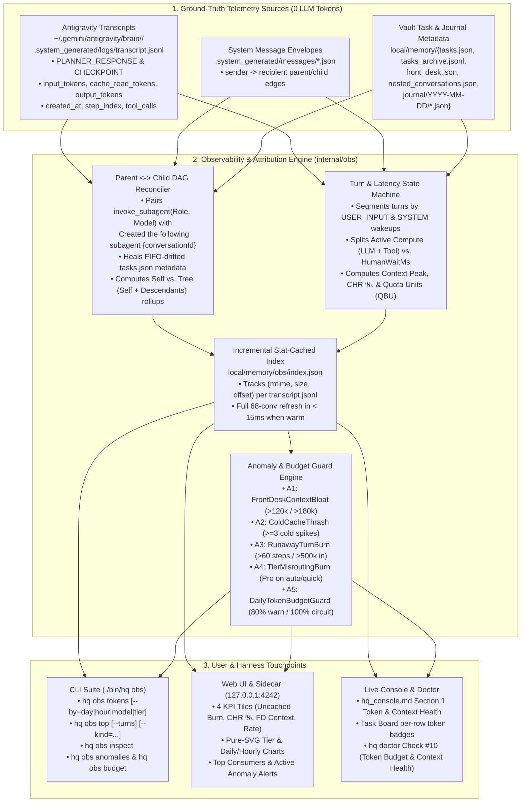

# RFC-0012: End-to-End Token Usage, Latency & Cost/Quota Observability

- **Status:** Implemented (Verified in CUJ-19)
- **Author:** `[Task:obs] Token Usage & Observability` (`gemini-4-argon-high`)
- **Created:** 2026-11-10
- **Note on Numbering:** Assigned sequential ID `RFC-0012` (`docs/design/0012-token-observability.md`) because `RFC-0001` through `RFC-0011` (including [RFC-0004: Silent Gatekeeper & Channels](./0004-heartbeat-and-channels.md)) are already allocated and implemented in `docs/design/`.
- **Related Documents:** [Research 08 (Empirical Token & Caching Audit)](../research/08_token_observability_and_telemetry.md), [RFC-0002 (Zero-Token Journaling)](./0002-memory-and-consolidation.md), [RFC-0004 (Quota Circuit Breaker)](./0004-heartbeat-and-channels.md), [RFC-0009 (Scalable Task Board & Live Console)](./0009-task-board-redesign.md), [RFC-0010 (Bounded Agent RSI)](./0010-agent-recursive-self-improvement.md)

---

## 1. Motivation & Problem Statement

As `agy-hq` orchestrates parallel coding worktrees, deep research tasks, investment watchdogs, and nightly memory consolidation across multiple model families (`Gemini 3.8 Flash`, `Gemini 4 Argon High`, `Claude Opus/Sonnet`, `Gemini 3.5 Flash Lite`), token and compute consumption currently operates in a **black box**:

1. **Zero Visibility into Token Burn, Cache Efficiency, or Context Bloat:**
   - Although Antigravity writes exact per-step `input_tokens`, `cache_read_tokens`, `output_tokens`, and `created_at` timestamps into `~/.gemini/antigravity/brain/<conv-id>/.system_generated/logs/transcript.jsonl`, `hq hook stop` (`internal/hooks/hooks.go`) currently discards all token and timing fields when writing `local/memory/journal/YYYY-MM-DD/<conv-id>-<exec>.json`.
   - Daily quota tracking (`local/memory/quota-YYYY-MM-DD.json`) only counts coarse **Layer-1 subagent spawn events** (`SpawnsToday / MaxDailySpawns`), treating a 6-step `flash_lite` lookup (`42k` uncached tokens) identically to a 319-step `gemini-4-argon-high` architecture build (`3.38M` uncached tokens, `47.4M` cached tokens).
2. **Hidden "Context Bloat × Cold-Cache Wakeup" Tax on `[HQ] Front Desk`:**
   - As proven in [Research 08](../research/08_token_observability_and_telemetry.md), continuous background subagents achieve **`94.5%–97.9%` Prefix Cache Hit Ratios (`CHR`)** because their steps execute seconds apart.
   - By contrast, the long-lived `[HQ] Front Desk` coordinator grows up to **`~256,000` context tokens** before Antigravity triggers an automatic `CHECKPOINT` compaction. Because interactive user prompts and scheduled `schedule` daemons arrive after idle intervals (`> 4–60 minutes`) that exceed prefix cache TTL, the Front Desk suffers repeated **`0%` CHR cold-start wakeups**, burning `150k–252k` uncached input tokens on a single 1-step coordinator turn (`9.51M` uncached input tokens across 110 turns—`23.9%` of the entire 68-conversation workspace).
3. **Three Telemetry & Attribution Bugs in Existing Hook Bookkeeping:**
   - **Bug B1 (Dual-Hook Duplicate Journal Writes):** Both `.agents/hooks.json` and `.agents/plugins/agy-hq/hooks.json` invoke `hq hook stop` and `hq hook pre-tool`, producing duplicate `0`-step journal files (`execNum = 2, 4, 6...`) and double-counting `TurnCount` / `SpawnsToday`.
   - **Bug B2 (Cross-Midnight `execNum` Reset in `priorJournalStepCount`):** When a conversation crosses midnight, `nextExecutionNum` resets `execNum = 1` in the new `YYYY-MM-DD` directory, causing `priorJournalStepCount` (`n >= currentExecNum`) to ignore all prior days' steps and re-attribute the entire conversation history to the first turn after midnight.
   - **Bug B3 (Subagent FIFO Queue Drift):** Queuing pending subagents in `PreToolUse` (`pending_subagents.json`) before Antigravity assigns a `conversationId` drifts whenever dual hooks or denied tool calls occur—misattributing subagent roles and models in `tasks.json`, even though the parent's `transcript.jsonl` (`Created the following subagent: {"conversationId": "..."}`) records the exact ground-truth parent-child mapping.

---

## 2. Architecture Overview

We introduce a zero-LLM-token observability subsystem (`internal/obs`) that ingests ground-truth telemetry directly from Antigravity transcripts, reconciles the multi-agent parent-child attribution DAG, persists incremental rollups in `local/memory/obs/`, and surfaces actionable metrics across `./bin/hq obs`, `hq_console.md`, the Antigravity Sidecar, and the Web UI (`http://127.0.0.1:4242`).



---

## 3. Pillar 1: Token Metrics Ingestion, Turn Segmentation & Attribution DAG (`internal/obs`)

### 3.1 Canonical Token, Latency & Quota Unit Definitions

For any set of LLM steps $S \subseteq \{\texttt{PLANNER\_RESPONSE}, \texttt{CHECKPOINT}\}$:

1. **Uncached Input Tokens (`InputTokens`):** $I(S) = \sum_{s \in S} I_s$
2. **Cache Read Tokens (`CacheReadTokens`):** $C(S) = \sum_{s \in S} C_s$
3. **Total Prompt Tokens (`PromptTokens`):** $P(S) = I(S) + C(S)$
4. **Output / Completion Tokens (`OutputTokens`):** $O(S) = \sum_{s \in S} O_s$
5. **Gross Tokens (`GrossTokens`):** $G(S) = I(S) + C(S) + O(S)$
6. **Uncached Burn (`UncachedTokens`):** $U(S) = I(S) + O(S)$ (the primary measure of non-cached token consumption).
7. **Prefix Cache Hit Ratio (`CacheHitRatio`):**
   $$\text{CHR}(S) = \begin{cases} \frac{C(S)}{I(S) + C(S)} & \text{if } I(S) + C(S) > 0 \\ 0 & \text{otherwise} \end{cases}$$
8. **Current & Peak Context Window (`CurrentContextTokens`, `PeakContextTokens`):**
   $$\text{CurrentCtx}(S) = I_{s_{\text{last}}} + C_{s_{\text{last}}}, \qquad \text{PeakCtx}(S) = \max_{s \in S} (I_s + C_s)$$
9. **Normalized Quota Burn Units (`QuotaUnits` / `EstCostUSD`):**
   To compare usage across tiers (`flash_lite` vs. `flash` vs. `argon/pro` vs. `claude-opus`) without letting `20M` cached Flash prefix reads dwarf `2M` uncached Argon tokens, `internal/obs` applies a configurable per-1M-token weight table (`local/memory/obs/budget.json`, with `1 QBU = $0.01` API-equivalent compute):

   | Tier | Canonical Model Matchers | Uncached Input (`$/1M`) | Cache Read (`$/1M`) | Output (`$/1M`) |
   | :--- | :--- | :---: | :---: | :---: |
   | `quick` | `flash-lite`, `flash_lite`, `flash-low` | `$0.10` | `$0.025` | `$0.40` |
   | `standard` | `gemini-3.8-flash-high`, `gemini-3.8-flash-tiered`, `flash` | `$0.30` | `$0.075` | `$2.50` |
   | `deep` (Gemini) | `gemini-4-argon-high`, `argon`, `pro` | `$1.25` | `$0.31` | `$10.00` |
   | `deep` (Claude) | `claude-sonnet-*` / `claude-opus-*` | `$3.00` / `$5.00` | `$0.30` / `$0.50` | `$15.00` / `$25.00` |

### 3.2 Transcript-Native Turn Segmentation & Three-Component Latency Split

Rather than relying solely on hook journal boundaries, `obs.ParseTranscript` segments each `transcript.jsonl` into deterministic **Execution Turns (`TurnSummary`)**:

- **Turn Start Boundary:** A new turn starts at `step_index == 0`, at every `USER_INPUT` (`TriggerKind: "user"`), or at any `SYSTEM_MESSAGE` with `source == "SYSTEM"` following a `PLANNER_RESPONSE` (`TriggerKind: "schedule"` when content contains `[Auto]` or matches a `triggers.yaml` prompt; `TriggerKind: "subagent_callback"` when content contains `[Message]` from a child agent; otherwise `"system_wakeup"`).
- **Three-Component Latency Decomposition:**
  - Every step carries `created_at` (RFC3339 UTC), and every `GENERIC` tool output step includes `Created At: <RFC3339>` and `Completed At: <RFC3339>` lines in its header.
  - For each turn, we decompose wall-clock time into:
    1. **`LLMLatencyMs`:** Sum of $(t_{\text{next\_step}} - t_{\text{planner\_step}})$ across all `PLANNER_RESPONSE` and `CHECKPOINT` steps in the turn.
    2. **`ToolLatencyMs`:** Sum of $(\text{CompletedAt} - \text{CreatedAt})$ across all non-interactive tool executions (`run_command`, `read_file`, `invoke_subagent`, etc.).
    3. **`HumanWaitMs`:** Sum of $(\text{CompletedAt} - \text{CreatedAt})$ on `ask_question` steps where the agent is paused waiting for user approval.
    4. **`ActiveLatencyMs = LLMLatencyMs + ToolLatencyMs`:** True compute + I/O latency excluding human decision wait time.

### 3.3 Ground-Truth Parent $\leftrightarrow$ Subagent DAG & Self vs. Tree Rollups

To eliminate the FIFO queue drift (`Bug B3`) discovered in `pending_subagents.json`:

1. **Deterministic Transcript & Message Extraction:**
   - Whenever a parent conversation calls `invoke_subagent(Role, Model, Prompt)` at step $i$, `internal/obs` inspects the subsequent `GENERIC` tool result (`Created the following subagent:\n{\n  "conversationId": "<childConvId>"\n}`) and `.system_generated/messages/*.json` (`sender` $\rightarrow$ `recipient`) to establish an immutable directed edge:
     $$\text{ParentConvID} \xrightarrow{(\text{StepIdx},\, \text{Role},\, \text{Model})} \text{ChildConvID}$$
2. **Automatic `tasks.json` Reconciliation:**
   - During `hq hook stop`, `hq console --sync`, and `hq obs`, `ReconcileSubagentAttribution(vaultDir)` repairs any mismatched subagent `Title`, `TaskSlug`, `Scope`, `Tier`, `Model`, or `ParentConversationID` in `local/memory/tasks.json`.
3. **Self vs. Tree Aggregation:**
   - Every conversation record in `internal/obs` exposes both:
     - **`Self` Metrics:** Tokens and steps consumed directly inside `ConversationID`'s own `transcript.jsonl`.
     - **`Tree` Metrics (`Self + Descendants`):** Recursive sum of `Self` plus all direct and nested child subagents spawned by `ConversationID`.

### 3.4 Fixing Hook Bookkeeping Bugs (`B1` & `B2` in `internal/hooks/hooks.go`)

1. **Fix `B1` (Dual-Hook Idempotency Guard):**
   - In `HandleStop`, after computing `stepStartIdx := priorJournalStepCount(vaultDir, payload.ConversationID)`, if `tm.StepCount > 0 && tm.StepCount <= stepStartIdx` (`tm.TurnStepCount == 0`), `HandleStop` recognizes that an identical `Stop` hook already journaled this step range milliseconds earlier and returns `{"decision":"stop"}` without writing a duplicate `0`-step journal file or double-incrementing `TurnCount`.
   - In `HandlePreToolUse` for `invoke_subagent`, deduplicate identical `(ConversationID, StepIdx, Role)` calls within a 10-second window so `SpawnsToday` and `pending_subagents.json` are never incremented twice for a single tool call.
2. **Fix `B2` (Cross-Midnight `priorJournalStepCount`):**
   - Remove the broken `n >= currentExecNum` filter in `priorJournalStepCount` so it always returns the true maximum `StepCount` recorded across all historical `YYYY-MM-DD` journal directories for `convID`.
3. **Incremental Stat-Cached Index (`local/memory/obs/index.json`):**
   - `internal/obs` caches per-conversation rollups keyed by `(TranscriptPath, FileSize, ModTimeUnixNano)`. Calling `./bin/hq obs` or rendering `/api/state` only re-parses `transcript.jsonl` files whose size or mtime has changed since the last scan (`< 15ms` warm latency across 68+ conversations).

---

## 4. Pillar 2: CLI Observability Commands (`./bin/hq obs`)

### 4.1 Command Grammar

```text
./bin/hq obs [tokens] [--since=7d|24h|today|all] [--by=day|hour|model|tier|kind|scope] [--json]
./bin/hq obs top      [--by=uncached|gross|cost|context|latency] [--kind=all|task|subagent|front_desk] [--tree] [--turns] [--limit=10] [--json]
./bin/hq obs inspect  <convId|taskSlug> [--turns] [--children] [--json]
./bin/hq obs anomalies [--since=7d|all] [--json]
./bin/hq obs budget   [--set-daily-uncached=<int>] [--set-daily-deep=<int>] [--set-warn-context=<int>] [--reset-circuit] [--json]
```

### 4.2 Sample Output: `./bin/hq obs tokens --since=7d`

```text
🔭 agy-hq Token & Latency Observability (Window: Last 7 Days · 68 Convs · 278 Turns · 4,894 LLM Steps)
────────────────────────────────────────────────────────────────────────────────────────────────────────
  Uncached Input:   39,816,608 tokens   │  Output + Thinking:    3,499,558 tokens
  Cache Read:      462,514,486 tokens   │  Gross Total:        505,830,652 tokens
  Prefix Cache CHR:      92.1% (🟢)     │  Compactions (Ckpt):          17 events
  Today Uncached:   10,142,562 / 15.0M  │  Front Desk Context:  29.6k / 256k (11.6% 🟢)

📊 Breakdown by Model & Tier:
Tier       Model                      Convs  Turns  Steps   Uncached In    Cache Read     Output   CHR %  Quota Share
─────────  ─────────────────────────  ─────  ─────  ─────  ────────────  ────────────  ─────────  ──────  ───────────
deep       gemini-4-argon-high           12    112  1,551    20,751,733   204,332,902  1,884,212   90.8%        64.2%
standard   gemini-3.8-flash-high         21    130  1,572    12,767,594   126,637,544    680,868   90.8%        19.1%
standard   gemini-3.8-flash-tiered       28     28  1,700     5,812,560   131,144,795    833,535   95.8%        13.8%
deep       claude-opus-5-5-high           4      4     26       436,299     1,404,016    110,093   76.3%         2.8%
quick      gemini-3.5-flash-lite          1      1      6        41,942       124,302        779   74.8%         0.1%

📅 Daily Breakdown (America/Los_Angeles):
Date        Turns  Steps   Uncached In    Cache Read     Output   CHR %  Uncached Burn Trend
──────────  ─────  ─────  ────────────  ────────────  ─────────  ──────  ────────────────────
2026-11-07     18    258     1,209,360    15,862,327    184,518   92.9%  █░░░░░░░░░░░░░░
2026-11-08    142  2,697    22,622,421   270,218,961  2,015,451   92.3%  ███████████████
2026-11-09     54    780     6,936,560    78,384,115    489,340   91.9%  █████░░░░░░░░░░
2026-11-10     64  1,158     9,311,202   100,241,124    831,360   91.5%  ██████░░░░░░░░░
```

### 4.3 Sample Output: `./bin/hq obs top --by=uncached --limit=5`

```text
🏆 Top 5 Conversations by Uncached Token Burn (Input + Output):
Rank  Conv ID   Kind        Model                  Turns  Steps   Self Uncached   Tree Uncached   CHR %   Peak Ctx  Title / Task Slug
────  ────────  ──────────  ─────────────────────  ─────  ─────  ──────────────  ──────────────  ──────  ─────────  ────────────────────────────────────────
#1    fd000001  front_desk  gemini-3.8-flash-high    110    500       9,797,383      24,112,904   85.3%    257,398  [HQ] Front Desk
#2    tk000003  task        gemini-4-argon-high       21    247       3,982,075       5,120,418   89.4%    275,135  [Task:gchat] gchat-integration-rfc
#3    tk000002  task        gemini-4-argon-high       16    319       3,676,715       3,676,715   93.4%    262,058  [Task:agy-hq] agy-hq-gmail-rfc
#4    tk000006  task        gemini-4-argon-high       14    131       2,684,632       2,684,632   88.4%    258,670  [Task:agent] agent-rsi-framework
#5    tk000009  task        gemini-4-argon-high        9    117       2,558,948       2,558,948   85.0%    259,375  [Task:taskboard] taskboard-redesign
```

---

## 5. Pillar 3: Live Console (`hq_console.md`), Sidecar & Web UI (`127.0.0.1:4242`) Integration

### 5.1 `hq_console.md` & `local/CONSOLE.md` Enhancements

In `internal/webui/webui.go` (`SyncMarkdownConsole`), we enrich two sections in 0 LLM tokens:

1. **Section 1 (`📊 1. Front Desk Lease, Daily Quota & Token Telemetry`):**
   - Adds live daily token burn, CHR %, Front Desk Context Health gauge (`CurrentCtx / 256k`), and tier distribution:
     ```markdown
     - **Token Burn Today:** `10.14M uncached (9.31M in + 831k out) / 15.0M budget (67.6%) · 100.24M cached (91.5% CHR)`
     - **Front Desk Context Window:** `29.6k / 256.0k tokens (11.6% — 🟢 COMPACT)`
     - **Active Anomalies:** `0 open alerts` *(or `⚠️ 1 alert: Front Desk context at 184k — run /compact to save ~150k uncached tokens/turn`)*
     ```
2. **Section 2 (`📋 2. Task Board`):**
   - Appends a compact token badge to each visible task row's `Slug` column: `` `token-observability` · *just now · 🌿 wt · ⚡ 184k (92% CHR)* ``.

### 5.2 Interactive Web UI (`http://127.0.0.1:4242`) & Sidecar Dashboard

We extend `DashboardState` (`/api/state`) with `Observability obs.DashboardSummary` and add an interactive **Token & Context Observability** panel directly below `Proactive Gatekeeper & Daily Quota`:

1. **Four Live KPI Cards:**
   - **Today's Uncached Burn:** `10.14M / 15.0M` with progress bar (`🟢 <80%`, `🟡 80–99%`, `🔴 >=100%`).
   - **Prefix Cache Hit Ratio (`CHR`):** `91.5%` (`100.2M cached / 109.5M prompt`).
   - **Front Desk Context Health:** `29.6k / 256k` (`11.6%`) with color-coded gauge turning amber at `120k` (`47%`) and red at `180k` (`70%`) with a `💡 Recommend /compact` badge.
   - **Deep Tier (`Argon/Opus`) Share:** Uncached tokens consumed by scarce `deep`-tier models today vs. daily deep budget (`5.0M`).
2. **Pure-SVG Visual Breakdown Charts (Zero External JS Libraries):**
   - **Horizontal Stacked Tier Bar:** Shows today's uncached token split across `Deep (Argon/Opus)`, `Standard (Flash)`, and `Quick (Flash Lite)`.
   - **7-Day Daily Burn & CHR Bar Strip:** Compact inline SVG bars for the last 7 days with hover tooltips.
3. **Per-Task Token Badges on Task Cards:**
   - Every task card in `#tasks-list` displays `Tokens: 3.98M self (5.12M tree) · CHR: 89.4% · Peak Ctx: 275k`.

---

## 6. Pillar 4: Anomaly Detection, Context Compaction Advisor & Budget Guards

`internal/obs/anomaly.go` evaluates **five deterministic rules** on every `hq hook stop`, `hq console --sync`, and `hq obs anomalies` invocation:

| Rule ID | Anomaly Name | Trigger Threshold (Configurable in `local/memory/obs/budget.json`) | Automated Action & Surface |
| :--- | :--- | :--- | :--- |
| **`A1`** | **`FrontDeskContextBloat`** | Active `[HQ] Front Desk` `CurrentContextTokens >= 120,000` (`WARN`) or `>= 180,000` (`CRITICAL`) | Surfaces `/compact` recommendation in `hq_console.md`, Web UI, and `hq doctor` Check #10; injects a 1-line tip in `SessionStart` when `>= 160,000` tokens. |
| **`A2`** | **`ColdCacheThrash`** | Conversation records $\ge 3$ steps with `input_tokens >= 50,000` and `CHR < 20%` within a 2-hour window | Flags intermittent cold-cache wakeup tax in `hq obs anomalies` and Web UI; estimates uncached tokens saved if `/compact` is run. |
| **`A3`** | **`RunawayTurnBurn`** | Single turn exceeds `60` planner steps OR `500,000` uncached tokens OR `50,000` output tokens | Appends alert to `local/memory/obs/anomalies.jsonl` and emits a `FrictionQuotaAnomaly` event into Stage 1 of the RSI miner (`internal/rsi/miner.go`). |
| **`A4`** | **`TierMisroutingBurn`** | Scheduled `kind: "auto"` trigger declared as `model: flash` in `triggers.yaml` is invoked on `pro`/`argon`, OR a `deep` subagent executes $\le 5$ lookup-only steps with 0 edits/writes | Flags routing drift between `triggers.yaml` / task complexity and actual model tier so `AGENTS.md` or skill prompts can be tightened. |
| **`A5`** | **`DailyTokenBudgetGuard`** | Today's uncached tokens exceed `80%` (`WARN`) or `100%` (`CIRCUIT OPEN`) of `DailyUncachedBudget` (default `15,000,000`) or `DailyDeepUncachedBudget` (default `5,000,000`) | **Never blocks interactive user turns.** At `80%`, warns in Console/Web UI/Doctor. At `100%`, opens the proactive background spawn circuit breaker in `QuotaState` to pause non-essential `kind: "auto"` cron spawns until midnight PT or `--reset-circuit`. |

---

## 7. Phased Implementation Plan & Verification Gate (`CUJ-19`)

Once we align on the open design questions below, implementation proceeds in three clean phases inside this worktree:

1. **Phase 2A — Core Engine & Hook Bugfixes (`internal/obs`, `internal/hooks`, `internal/kernel`):**
   - Implement `internal/obs/{obs.go, parser.go, dag.go, anomaly.go, obs_test.go}` with stat-cached transcript ingestion, turn/latency segmentation, parent-child DAG reconciliation, and anomaly detection.
   - Fix `Bug B1` (dual-hook idempotency), `Bug B2` (cross-midnight `priorJournalStepCount`), and `Bug B3` (ground-truth subagent attribution reconciliation in `tasks.json`), and enrich `JournalEntry` with per-turn token/latency metrics.
2. **Phase 2B — CLI, Live Console, Web UI & Doctor Integration (`cmd/hq`, `internal/webui`, `internal/doctor`, `internal/rsi`):**
   - Wire `./bin/hq obs <tokens|top|inspect|anomalies|budget>` in `cmd/hq/main.go`.
   - Update `internal/webui/webui.go` (`SyncMarkdownConsole` + `/api/state` + HTML/SVG dashboard cards) and `internal/doctor/doctor.go` (Check #10: `Token Budget & Context Health`).
   - Connect `A3`/`A4` anomalies to `internal/rsi/miner.go` (`FrictionQuotaAnomaly`).
3. **Phase 2C — End-to-End Verification (`CUJ-19` & Pre-Push CI Gate):**
   - Add `TestCUJ19_TokenObservabilityAnomalyAndBudgetGuards` in `internal/e2e/cuj_e2e_test.go` verifying multi-turn transcript ingestion, parent-child subagent tree rollups, cross-midnight journal accuracy, CLI JSON/table outputs, Web UI state, and `A1`–`A5` anomaly/budget circuit breakers.
   - Run `./bin/hq ci pre-push` (`100%` unit, race, PII, harness, and E2E pass), merge to `main`, and verify live on the 68 real transcripts.
