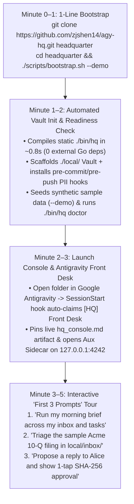

# RFC-0013: Open-Source Readiness, Forensic Privacy Sanitization, Governance & Launch Architecture

- **Status:** Implemented (Phases 1–3 Complete)
- **Author:** `[Task:oss] Open Source Strategy & Launch Plan` (`gemini-4-carbon-high`)
- **Created:** 2026-11-10
- **Note on Numbering:** Assigned `RFC-0013` (`docs/design/0013-open-source-launch-strategy.md`) and companion research [`09_open_source_agent_os_strategy.md`](../research/09_open_source_agent_os_strategy.md) because `RFC-0005` ([`0005-gmail-integration.md`](./0005-gmail-integration.md)) through `RFC-0012` are already allocated.
- **Related Documents:** [ADR-0003 (Two-Layer OSS & Private Vault)](../decisions/0003-two-layer-oss-and-private-vault.md), [RFC-0001 (Vault & Task Isolation)](./0001-vault-and-task-isolation.md), [RFC-0003 (Approval-Bound Execution)](./0003-approval-bound-execution.md), [RFC-0011 (CI Pipeline & PII Boundary Verification)](./0011-ci-pipeline-and-regression-harness.md), [Research 09 (OSS Strategy & Forensic Audit)](../research/09_open_source_agent_os_strategy.md)

---

## 1. Motivation & Objective

`agy-hq` (Headquarter) was architected from Day 1 around the **Two-Layer Vault Split** ([ADR-0003](../decisions/0003-two-layer-oss-and-private-vault.md)):
- **Layer 1 (`agy-hq` Root Repository):** Domain-agnostic Go microkernel (`cmd/hq/`, `internal/`), progressive-disclosure `.agents/plugins/agy-hq/skills/*/SKILL.md` workflows, declarative lifecycle hooks (`.agents/hooks.json`), and clean starter templates (`templates/`).
- **Layer 2 (`local/` Private User Vault):** Git-ignored personal state (`USER.md`, `MEMORY.md`, `triggers.yaml`, `inbox/`, `notes/`, `private/`, `memory/`, `worktrees/`) backed by its own independent local Git repository (`local/.git`).

Our goal is to open-source `agy-hq` as the **premier open-source Personal Agent OS for Google Antigravity**. Achieving a leak-proof, high-trust public release requires solving five engineering and product problems:
1. **Leak-Proof Privacy & Git History Sanitization:** Closing the gap between *syntactic* PII checks (`P1`–`P5`) and *contextual/relational* PII (`P6`), scrubbing 13 tracked files that currently contain real family/contact examples or space IDs, hardening subprocess `GIT_DIR` isolation, and sanitizing past Git commits before flipping the repository to Public.
2. **Licensing & Open-Source Governance:** Selecting the optimal license (`Apache-2.0` vs. `MIT`) and establishing `LICENSE`, `SECURITY.md`, `CONTRIBUTING.md`, `CODE_OF_CONDUCT.md`, and issue/PR templates.
3. **5-Minute Developer Onboarding (`./bin/hq init --demo`):** Eliminating "blank-canvas paralysis" for new users with 1-line setup, pre-requisite readiness checks (`./bin/hq doctor`), and synthetic sample data that brings the Task Board, Inbox Triage, and WebUI Sidecar (`:4242`) to life in under 60 seconds.
4. **Sharp Product Positioning:** Articulating why `agy-hq`'s "Option 1.5" microkernel architecture on Google Antigravity outperforms heavy Python agent frameworks, single-thread chat bots, and static prompt dotfiles.
5. **High-Signal Launch & Community Playbook:** Executing a developer-focused Show HN launch, 3-minute split-screen demo video, and contributor skill ecosystem.

---

## 2. Pillar 1: Two-Layer Vault & Leak-Proof Privacy Architecture

### 2.1 Forensic Audit Findings (`HEAD` `4a8642c` & Full Commit History)

As detailed in [Research 09 §2](../research/09_open_source_agent_os_strategy.md), auditing all 116 tracked files and the full commit graph (`git log --all -p`) revealed four concrete issues that must be remediated before public release:

```mermaid
flowchart LR
    subgraph CurrentGates["Existing RFC-0011 Invariants (P1–P5)"]
        P1["P1: Disjoint local/ & key paths"]
        P2["P2: .gitignore & no mode 160000"]
        P3["P3: Zero workstation /home/ paths"]
        P4["P4: Zero OAuth/API tokens or SSNs"]
        P5["P5: Synthetic email allowlist"]
    end

    subgraph ForensicFindings["Gaps Uncovered by RFC-0013 Forensic Audit"]
        G1["Gap 1: Contextual/Relational PII in 13 Tracked Files\n(Family names, Space names, Space IDs, handles)"]
        G2["Gap 2: Historical Commit Diff Leaks\n(Personal email in commits fced00e & b3c7550)"]
        G3["Gap 3: Subprocess GIT_DIR Environment Bleed\n(Orphaned test commits on hq/sample-repo-fix-bug)"]
        G4["Gap 4: Worktree .git File Detection & Template Drift\n(templates/config.yaml port 4747 vs 4242)"]
    end

    subgraph Remediation["RFC-0013 Hardening (P6 + History Scrub)"]
        R1["Invariant P6: Contextual & Vault-Entity Scanner\n+ Synthetic Space ID Allowlist"]
        R2["./bin/hq ci check-pii --history\n+ Pre-Release History Rewrite"]
        R3["SanitizedGitCommand() helper in\ninternal/vault & internal/worktree"]
        R4["Worktree-aware git checks +\nClean templates/ & --demo seed"]
    end

    CurrentGates --> ForensicFindings --> Remediation
```



#### Table 1: File-by-File Remediation Plan for Tracked Files (`HEAD`)

| File Path | Current Contextual PII / Drift (Redacted) | Clean Synthetic Replacement |
| :--- | :--- | :--- |
| [`AGENTS.md`](../../AGENTS.md) | Personal family topic `.md` (L21); private project slug (L58); personal task ID (L22); personal family/contact names, handle, and spaces (L77, L84) | `project-notes.md`; `webapp-redesign`; `sleep-consolidate`; `Alice / alex_dev / Engineering Core / Project Launch Space`, `"Alice Chen"` |
| [`README.md`](../../README.md) | Specific personal secondary watchdog schedule (L17); personal family/school space examples in skill descriptions | `deal-flow & filing watchdogs, SEC/EDGAR close-watch`; `"Project Launch Space"` / `"Engineering Core"` |
| [`.agents/plugins/agy-hq/skills/gchat/SKILL.md`](../../.agents/plugins/agy-hq/skills/gchat/SKILL.md) | Personal family/school space names, contact full name, personal handle, real 11-char space ID | `"Project Launch Space"`, `"Engineering Core"`, `"Alice Chen"`, `"alex_dev"`, `AAAA_LAUNCH_01`, `--query="Launch"` |
| [`.agents/plugins/agy-hq/skills/sleep-consolidate/SKILL.md`](../../.agents/plugins/agy-hq/skills/sleep-consolidate/SKILL.md) | Personal task ID and family topic `.md` filename | `sleep-consolidate`, `project-notes.md` |
| [`.agents/plugins/agy-hq/skills/thesis-check/SKILL.md`](../../.agents/plugins/agy-hq/skills/thesis-check/SKILL.md) | Specific personal secondary watchdog schedule | Generic `secondary-deal-watch` example |
| [`cmd/hq/main.go`](../../cmd/hq/main.go) | CLI help strings referencing personal school project space name (L722, L745, L767) | `"Project Launch Space"` or `spaces/AAAA_LAUNCH_01` |
| [`internal/gchat/cdp_ws.go`](../../internal/gchat/cdp_ws.go) | Comment referencing personal Gmail handle (L397) | `"alex_dev"` |
| [`internal/gchat/gchat.go`](../../internal/gchat/gchat.go) | Comments referencing personal family/school spaces, contact name, and real space IDs (L586, L616, L623) | `"Project LaunchPlan"`, `"Project Launch Space"`, `"Engineering Core"`, `"Alice"`, `AAAA_LAUNCH_01`, `AAAA_DM_ALICE` |
| [`internal/gchat/gchat_test.go`](../../internal/gchat/gchat_test.go) | Test fixtures using author first name, family/school space names, and 3 real Google Chat space IDs | `"Hey Alex..."`, `"Robotics Club"`, `"Project Launch Space"`, `"Engineering Core"`, `"Alice"`, `spaces/AAAA_LAUNCH_01`, `spaces/AAAA_DM_ALICE`, `spaces/AAAA_DM_BOB` |
| [`internal/webui/webui_test.go`](../../internal/webui/webui_test.go) | Test fixtures using personal contact name and real DM space ID (L181–L206) | `"Alice"` and `spaces/AAAA_DM_ALICE` |
| [`templates/USER.md`](../../templates/USER.md) | Personal family topic `.md` filename (L5) | `project-notes.md` |
| [`templates/config.yaml`](../../templates/config.yaml) | `listen_addr: "127.0.0.1:4747"` (L34) | `listen_addr: "127.0.0.1:4242"` (matching `hq webui` and Sidecar port 4242) |
| [`docs/architecture.md`](../../docs/architecture.md), [`docs/roadmap.md`](../../docs/roadmap.md), [`docs/design/0008-gchat-integration.md`](./0008-gchat-integration.md), [`docs/design/0009-task-board-redesign.md`](./0009-task-board-redesign.md), [`docs/research/06_taskboard_and_console_audit.md`](../research/06_taskboard_and_console_audit.md) | Examples using personal family/school space names, contact names, real space IDs, and personal task IDs | Replace with synthetic equivalents (`"Project Launch Space"`, `"Engineering Core"`, `"Alice Chen"`, `AAAA_LAUNCH_01`, `AAAA_DM_ALICE`) |

### 2.2 Invariant P6 (`P6-ContextualPII`) & History Scanner (`internal/ci/pii.go`)

We extend [`internal/ci/pii.go`](../../internal/ci/pii.go) with two new capabilities:

1. **Invariant P6 (`P6-ContextualPII` & Synthetic Google Chat Space ID Allowlist):**
   - **Google Chat Space ID Allowlist:** Any `spaces/[A-Za-z0-9_-]{8,}` literal in tracked files must use the synthetic prefix `spaces/AAAA_` or `spaces/SPACE_` (e.g., `spaces/AAAA_LAUNCH_01`, `spaces/AAAA_DM_ALICE`, `spaces/AAAA123`). Real opaque Base64-like Google Chat space IDs (`spaces/<opaque-11char-id>`) are deterministically rejected.
   - **Dynamic Local Vault Denylist (Zero-Leak Local Guard):** When `./bin/hq ci check-pii` runs on a developer's machine where `local/` exists, it optionally loads `local/private/pii-denylist.txt` (one case-insensitive token/phrase per line, auto-seeded during `hq init` or `sleep-consolidate` with personal names/entities from `local/USER.md` and `local/memory/spaces_cache.json` display names) without ever committing the denylist itself to the public repository!
2. **Full Git History Audit (`./bin/hq ci check-pii --history`):**
   - Scans `git log --all -p` across every reachable commit in the repository, running `scanLineForPII` on every added line (`+...`) in historical diffs and checking that no forbidden paths (`P1`) were ever committed in past revisions.
   - Verifies that `git branch -a` and `git tag` contain zero orphaned test refs (`hq/sample-repo-*`, `test@agy-hq.local`, `hq-vault@localhost`).

### 2.3 Hardening Subprocess Git Environment Isolation (`internal/vault/vault.go` & `internal/worktree/worktree.go`)

To prevent `git init`, `git add`, `git commit`, or `git worktree` calls inside `vault.Init` or `worktree.Add` from ever inheriting `GIT_DIR`, `GIT_WORK_TREE`, or `GIT_INDEX_FILE` when invoked from inside a parent Git hook or test runner:
- We introduce `vault.SanitizedGitEnv()` and apply it to every `exec.Command("git", ...)` call in `internal/vault/vault.go`, `internal/worktree/worktree.go`, and `internal/ci/`:
  ```go
  func SanitizedGitEnv() []string {
      var env []string
      for _, kv := range os.Environ() {
          if strings.HasPrefix(kv, "GIT_DIR=") ||
             strings.HasPrefix(kv, "GIT_WORK_TREE=") ||
             strings.HasPrefix(kv, "GIT_INDEX_FILE=") ||
             strings.HasPrefix(kv, "GIT_OBJECT_DIRECTORY=") ||
             strings.HasPrefix(kv, "GIT_ALTERNATE_OBJECT_DIRECTORIES=") {
              continue
          }
          env = append(env, kv)
      }
      return env
  }
  ```
- Additionally, in [`internal/ci/harness.go`](../../internal/ci/harness.go) (`listMarkdownFiles` and `loadGitTrackedAndStagedPaths`), we change `os.Stat(filepath.Join(rootDir, ".git"))` to allow **both directories and worktree `.git` files** (`err == nil` instead of `err == nil && st.IsDir()`), ensuring Gate H4-B validates `git ls-files` identically inside isolated git worktrees (`local/worktrees/*`).

---

## 3. Pillar 2: Licensing, Security Policy & Open-Source Governance

### 3.1 License Selection Analysis

We evaluate two permissive open-source licenses for `agy-hq`:

1. **Option 1 (Recommended): Apache License 2.0 (`Apache-2.0`)**
   - **Why it fits `agy-hq`:** Standard across Google open-source projects, Kubernetes, Go cloud-native tooling, and enterprise AI infrastructure. Provides an explicit patent license grant and defensive patent termination clause (§3), plus explicit trademark protection (§6) covering the `agy-hq` name and the Asymmetric Wing Cradle brand icons (`assets/branding/`).
2. **Option 2: MIT License (`MIT`)**
   - **Why it fits `agy-hq`:** Maximum simplicity (single-page license), universally understood by indie hackers and Show HN readers.
3. **Option 3: Dual `MIT OR Apache-2.0`**
   - Allows downstream users to choose either MIT or Apache-2.0 while retaining Apache-2.0 patent retaliation protection for contributions.

### 3.2 Governance Artifact Suite

Upon approval of Phase 1, we will author four root governance files:

| File | Core Contents & Invariants |
| :--- | :--- |
| **`LICENSE`** | Full text of the selected open-source license (`Apache-2.0` or `MIT`). |
| **`SECURITY.md`** | • **Threat Model:** How `agy-hq` breaks Simon Willison's *Lethal Trifecta* via Quarantine Taint (`internal/gmail`, `internal/gchat`), Browser Network Jails (`--host-resolver-rules` + `Network.setBlockedURLs`), and SHA-256 Approval-Bound Execution (`internal/approvals`).<br>• **Ring 0 TCB Definition:** Protected paths (`internal/hooks`, `internal/approvals`, `internal/ci`, `.agents/hooks.json`) that cannot be modified by autonomous RSI (`hq rsi`).<br>• **Vulnerability Disclosure:** Private reporting via GitHub Security Advisories (`Security -> Report a vulnerability`) with a 48-hour acknowledgment SLA. |
| **`CONTRIBUTING.md`** | • **Architecture Rules:** Zero-external-dependency Go stdlib rule ([ADR-0002](../decisions/0002-go-microkernel-binary.md)) and Two-Layer Vault boundary ([ADR-0003](../decisions/0003-two-layer-oss-and-private-vault.md)).<br>• **Authoring a Skill (`SKILL.md`):** How to add progressive-disclosure skills under `.agents/plugins/agy-hq/skills/<slug>/SKILL.md` within Gate H1 limits (`<= 200` lines per skill, `<= 2,500` total frontmatter tokens).<br>• **Local CI Gate:** Running `./bin/hq ci pre-push` (`< 2.5s` full unit + 18 CUJ E2E suite). |
| **`CODE_OF_CONDUCT.md`** | Contributor Covenant v2.1 adapted for the `agy-hq` community. |

---

## 4. Pillar 3: 5-Minute Developer Onboarding & Zero-Friction Quickstart

### 4.1 The 5-Minute Time-to-Magic Funnel

A developer discovering `agy-hq` on Hacker News or GitHub should go from `git clone` to interacting with a live, populated Personal Agent OS in **under 5 minutes**:



### 4.2 Designing `./bin/hq init --demo` (Synthetic Sample Data Seeder)

When a new user runs `./bin/hq init` today, `local/` is created with empty directories (`local/inbox/`, `local/notes/`, `local/memory/tasks.json` absent), resulting in an empty WebUI Console (`0` tasks, `0` pending approvals, `0` facts).

We extend `./bin/hq init` with a **`--demo` (or `--with-sample-data`) flag** (also exposed via `./scripts/bootstrap.sh --demo` and `./bin/hq demo reset`) that non-destructively populates the untracked `local/` Vault with realistic, clearly labeled `[Sample]` data:

1. **Sample Inbox Drop File (`local/inbox/acme-corp-2026-10-Q.html`):**
   - A concise, realistic synthetic SEC Form 10-Q excerpt for `Acme Cloud Corp (ACME)` showing revenue acceleration (`+42% YoY`) alongside a new customer-concentration risk factor, ready to be triaged by `/inbox-triage` or `/thesis-check`.
2. **Sample Investment Thesis (`local/notes/investing/ACME.md`):**
   - A structured thesis file with explicit **Kill Criteria (`KC-1`, `KC-2`)** demonstrating how `agy-hq` falsifies investment theses against new filings.
3. **Sample Active Task Board (`local/memory/tasks.json`):**
   - Seeds 3 representative Layer-1 tasks (`[Task:swe] Refactor Auth Middleware`, `[Task:investing] ACME Q3 10-Q Thesis Check`, `[Subagent:inbox] Morning Inbox Triage [quick]`) so `local/CONSOLE.md` and `http://127.0.0.1:4242` immediately showcase multi-agent coordination.
4. **Sample Pending Approval (`local/memory/pending/prop-demo-001.json`):**
   - Stages a safe, synthetic outbound proposal (`echo "[Demo] Approved PR #42 merge"` with a real SHA-256 digest and blockquote preview) so the user can test 1-click WebUI approval or 1-tap mobile `ask_question` approval immediately.
5. **Sample Bi-Temporal Facts (`local/memory/facts.jsonl`):**
   - Seeds 3 verified architectural/workflow facts so `./bin/hq memory status` and `SessionStart` demonstrate the 4-Layer Memory Engine out of the box.

### 4.3 Upgrading `./bin/hq doctor` for First-Time Onboarding

We enhance `./bin/hq doctor` (`internal/doctor/doctor.go`) with:
- **Go Toolchain & Build Verification:** Reports Go version (`go1.22+`) and binary freshness.
- **Actionable Fix Hints:** Every `WARN` or `FAIL` row includes the exact 1-line command to resolve it (`./bin/hq init`, `./bin/hq ci install-hooks`, `./bin/hq daemon install`).
- **`./bin/hq doctor --json`:** Machine-readable JSON output for CI and automated bug report diagnostics.

---

## 5. Pillar 4: Product Positioning & Value Proposition

### 5.1 Core Positioning Statement

> **`agy-hq` (Headquarter)** is a zero-dependency Go microkernel and plugin suite that turns **Google Antigravity** into a **24/7, privacy-first Personal Agent OS**—combining a non-blocking `[HQ] Front Desk` coordinator, parallel git-worktree task isolation, a 0-token live status console, cryptographic SHA-256 outbound approvals, and nightly transcript-verified memory dreaming, while keeping 100% of your personal data inside a git-ignored private Vault (`local/`).

### 5.2 The 6 Signature Capabilities (Why Developers Switch to `agy-hq`)

| Capability | The Status-Quo Pain | The `agy-hq` Breakthrough |
| :--- | :--- | :--- |
| **1. Non-Blocking Front Desk + Scoped Worktrees** | Single-thread agent chats freeze for 10 minutes whenever you ask the agent to write code or research a paper. | `PreToolUse` hooks cap the `[HQ] Front Desk` at `<= 3` fast lookups and route coding/deep research to background subagents or dedicated `[Task:<scope>]` sidebar threads in `local/worktrees/<repo>-<task>/`. |
| **2. Zero-Token Live Console (`hq_console.md` & `:4242` Sidecar)** | Agents waste thousands of tokens printing markdown status tables in chat, or leave you guessing what background tasks are doing. | The Go microkernel updates `<artifactDir>/hq_console.md` and the embedded Antigravity Sidecar (`sidecar://agy-hq-console/`) in **0 LLM tokens** on every turn and state transition. |
| **3. Two-Layer Vault with Mathematical PII Guards** | Putting personal notes, bank CSVs, and tax docs in an agent repo risks one accidental `git commit -a` leaking your life to GitHub. | Strict separation between the public engine and `./local/` (its own private git repo), enforced by a 6-invariant Go PII scanner (`./bin/hq ci check-pii`) in `pre-commit` and `pre-push`. |
| **4. Breaking the "Lethal Trifecta" (`hq propose` + Quarantine)** | Give an agent email/chat read + write access, and a prompt injection in an inbound email can exfiltrate private files. | Inbound emails/chats are read in **quarantined, network-jailed subagents** (`tainted` sessions blocked from reading `local/private/` or calling `search_web`). Every outbound write requires **1-tap SHA-256 human approval**. |
| **5. 4-Layer Memory & Silent Nightly Dreaming** | `MEMORY.md` files grow unboundedly, polluting every prompt with stale facts and burning context window tokens. | Keeps `MEMORY.md <= 80` lines as a Roadmap Index; nightly `sleep-consolidate` verifies turn journals against raw transcripts, distills deep notes into `local/memory/topics/*.md`, and rolls findings silently into the 7:30 AM Morning Brief. |
| **6. Bounded Recursive Self-Improvement (`hq rsi`)** | When an agent makes a mistake or gets corrected, you have to manually edit prompt files to stop it from repeating the error. | `hq rsi` mines 0-token friction signals from turn journals, synthesizes `<!-- rsi:rule -->` patches, verifies them against a 4-gate sandbox (Ring 0 TCB AST check + counterfactual replay + 18 CUJ E2E tests), and stages them for 1-tap approval. |

---

## 6. Pillar 5: Launch Strategy & Community Playbook

### 6.1 Draft "Show HN" Launch Post

**Title Candidates:**
1. `Show HN: Agy-hq – An open-source Personal Agent OS for Google Antigravity (Go, 0 deps)` *(Recommended)*
2. `Show HN: Agy-hq – Turn Google Antigravity into a 24/7 Personal Agent OS with a Private Vault`
3. `Show HN: Agy-hq – Non-blocking multi-agent coordination, 0-token console, and SHA-256 safety for Antigravity`

**First Comment (Founder Technical Overview Draft):**
> Hi HN! I'm sharing `agy-hq` (Headquarter), a lightweight, zero-dependency Go microkernel and skill suite that turns Google Antigravity into a 24/7 Personal Agent OS across software engineering, research, investing, and personal admin.
>
> **Why I built it:**
> Over the past few months I tried using both standalone agent frameworks and single-thread chat bots ("claws") as a daily personal assistant. I kept hitting four walls:
> 1. **The Blocking Thread Problem:** If I asked my assistant to fix a bug in a repo or diff two 10-K filings, the chat thread was blocked for 8 minutes while tool calls streamed by.
> 2. **The Privacy / Dotfiles Dilemma:** I wanted to version-control and open-source my agent harness, hooks, and skills—without ever risking a `git push` leaking my personal notes, family schedules, or financial ledgers.
> 3. **Context Window Bloating:** Dumping every learned fact into a single `MEMORY.md` file quickly burned thousands of tokens per turn and degraded instruction following.
> 4. **The "Lethal Trifecta" (Prompt Injection -> Exfiltration):** Letting an agent read untrusted emails/chats in the same session that has shell and outbound send access is a ticking time bomb.
>
> **How `agy-hq` works ("Option 1.5" Hybrid Architecture):**
> Instead of reinventing an agent runtime or web client, `agy-hq` piggybacks on Google Antigravity (desktop IDE + mobile Remote Control PWA + Seatbelt sandbox) and adds a single static Go binary (`./bin/hq`, 100% Go stdlib, compiles in `0.8s`) wired into Antigravity's `SessionStart`, `PreToolUse`, and `Stop` hooks:
>
> - **Two-Layer Vault Split (`agy-hq` vs. `local/`):** The root repo contains only the open-source Go microkernel and generic `.agents/plugins/agy-hq/skills/*/SKILL.md` runbooks. Running `./bin/hq init` scaffolds `./local/` as an independent, git-ignored private Git repository for your `USER.md`, `MEMORY.md`, `inbox/`, and `private/` records—guarded by a deterministic 6-invariant PII scanner in `pre-commit` and `pre-push`.
> - **Non-Blocking `[HQ] Front Desk` + Isolated Git Worktrees:** `PreToolUse` mechanically caps the Front Desk thread at `<= 3` fast lookup calls and blocks inline coding or test suites. Heavy work is automatically dispatched to background subagents or dedicated `[Task:<scope>]` sidebar conversations running in isolated git worktrees (`local/worktrees/<repo>-<task>/`).
> - **0-Token Live Console & Aux Sidecar (`:4242`):** Task board state, active worktrees, and quota circuit breakers are rendered directly by the Go binary into `<artifactDir>/hq_console.md` and an embedded Antigravity Sidecar (`sidecar://agy-hq-console/`) in 0 LLM tokens.
> - **Quarantine Taint & SHA-256 Outbound Approvals (`./bin/hq propose`):** Reading untrusted Gmail or Google Chat threads marks the subagent session `tainted` (blocking `local/private/` reads and external web/shell egress). Outbound actions are staged with a SHA-256 command digest and full payload preview for 1-tap mobile or WebUI approval.
> - **4-Layer Memory & Nightly Dreaming:** `MEMORY.md` is capped at `<= 80` lines as a Roadmap Index pointing to on-demand topic pages (`local/memory/topics/*.md`) and bi-temporal `facts.jsonl`. At 11:30 PM, a silent consolidation job verifies turn claims against raw JSONL transcripts and rolls takeaways into the 7:30 AM Morning Brief.
>
> **Try it in 60 seconds (with synthetic sample data):**
> ```sh
> git clone https://github.com/zjshen14/agy-hq.git headquarter && cd headquarter && ./scripts/bootstrap.sh --demo
> ```
>
> Every architectural trade-off (and why we rejected heavy vector DBs and blocking Stop hooks) is documented in `docs/design/` (RFCs 0001–0013) and tested end-to-end in `internal/e2e/cuj_e2e_test.go` (runs in `1.8s`). Would love your feedback and critiques!

### 6.2 3-Minute Demo Video Script & Storyboard

| Timestamp | Visual Layout | Action & Voiceover |
| :--- | :--- | :--- |
| **`0:00–0:30` — The Hook & 1-Line Bootstrap** | Split screen: Terminal (left) + Antigravity IDE (right). | Run `git clone ... && ./scripts/bootstrap.sh --demo`. Show `./bin/hq` compiling in `0.8s`, initializing the private `./local/` Vault, and passing `./bin/hq doctor`. Open the Aux Sidecar (`HQ Console`) showing the live Task Board. |
| **`0:30–1:15` — Non-Blocking Front Desk + Parallel Worktrees** | Antigravity `[HQ] Front Desk` pinned at top of sidebar + Aux Console open. | Ask Front Desk: *"Fix the flaky parser test in opencli and simultaneously check the ACME 10-Q filing in my inbox."* Show Front Desk immediately dispatching two parallel tasks in isolated worktrees while remaining 100% responsive to a quick follow-up question. |
| **`1:15–2:00` — Quarantine Taint & 1-Tap Mobile SHA-256 Approval** | Antigravity IDE (left) + iPhone Safari PWA Remote Control (right). | Show a quarantined subagent triaging an inbound message and staging a reply via `./bin/hq propose`. Highlight the mandatory markdown blockquote preview and 1-tap `ask_question` modal on iPhone verifying the SHA-256 prefix. |
| **`2:00–2:35` — Two-Layer Vault & PII Protection in Action** | Terminal showing `git status` in root vs `git -C local status`. | Attempt to stage a dummy file containing a personal email or `/Users/username/` path in the root repo. Show `.git/hooks/pre-commit` (`./bin/hq ci pre-commit`) catching and blocking the commit in `< 100ms`. |
| **`2:35–3:00` — 4-Layer Memory & Nightly RSI** | Terminal running `./bin/hq memory status` and `./bin/hq rsi status`. | Show the compact `<= 80`-line `MEMORY.md` Roadmap Index, Topic Wiki pages, and how `hq rsi` mines friction from turn journals and verifies skill upgrades against the 18-CUJ E2E test suite. |

### 6.3 Documentation Site & Community Roadmap

1. **Zero-Maintenance Documentation Hub (`docs/README.md` + GitHub Pages):**
   - Because Gate H4-B (`internal/ci/harness.go`) already enforces 100% valid relative Markdown links, balanced code fences, and index completeness across `docs/`, `docs/` can be published directly via **GitHub Pages (or VitePress)** with zero manual link maintenance.
2. **Community Contribution Focus Areas:**
   - **Additive Progressive-Disclosure Skills (`.agents/plugins/agy-hq/skills/<slug>/SKILL.md`):** Community-contributed runbooks (e.g., `arxiv-digest`, `linear-triage`, `calendar-optimizer`, `home-assistant`) that adhere to Gate H1 (`<= 200` lines).
   - **Pluggable Channel & Transport Adapters:** Extending `ChannelAdapter` (`internal/kernel`) to additional messaging surfaces (Telegram, Slack, Discord, Matrix) behind the same `hq propose` SHA-256 approval gate.

---

## 7. Phased Implementation Plan

| Phase | Scope & Deliverables | Verification Gate |
| :--- | :--- | :--- |
| **Phase 1: Research & RFC Review (Current)** | • Author [Research 09](../research/09_open_source_agent_os_strategy.md) and [RFC-0013](./0013-open-source-launch-strategy.md).<br>• Index both in [`docs/README.md`](../README.md).<br>• Align with user on license choice, history sanitization strategy, and `--demo` scope. | `./bin/hq ci pre-push` passes 100%. |
| **Phase 2: Codebase PII Scrubbing, `P6` Scanner & Git History Sanitization** | • Scrub all 13 tracked files in Table 1 (`AGENTS.md`, `README.md`, `gchat/SKILL.md`, `cmd/hq/main.go`, `internal/gchat/*`, `internal/webui/*`, `templates/*`, `docs/*`) to use synthetic personas and `spaces/AAAA_*` IDs.<br>• Implement `SanitizedGitEnv()` in `internal/vault/vault.go` and `internal/worktree/worktree.go` + worktree `.git` file support in `internal/ci/harness.go`.<br>• Implement Invariant `P6-ContextualPII` and `./bin/hq ci check-pii --history` in `internal/ci/pii.go` + unit tests in `internal/ci/ci_test.go`.<br>• Delete stray test branch `hq/sample-repo-fix-bug` and execute selected Git history sanitization (Option A or Option B). | `./bin/hq ci check-pii --history` reports `0` violations across all commits and refs; `go test -race ./...` passes. |
| **Phase 3: Licensing, Governance & 5-Minute Onboarding (`--demo`)** | • Add `LICENSE`, `SECURITY.md`, `CONTRIBUTING.md`, `CODE_OF_CONDUCT.md`, and `.github/ISSUE_TEMPLATE/`.<br>• Fix `templates/config.yaml` port (`4242`) and implement `./bin/hq init --demo` (`internal/vault/demo.go`) + `./scripts/bootstrap.sh --demo`.<br>• Add `CUJ-20` E2E test verifying 1-line `--demo` onboarding, sample inbox/task/approval seeding, and `hq doctor` checks. | `TestCUJ20_OpenSourceDemoOnboardingGovernanceAndPIIGuard` + `./bin/hq ci pre-push` pass 100%. |
| **Phase 4: Release Packaging (`v0.1.0`) & Launch Execution** | • Add `.github/workflows/release.yml` (cross-platform static binary builds + SHA-256 checksums on `v*` tags).<br>• Record 3-minute demo video and publish `v0.1.0` + Show HN post. | GitHub Release `v0.1.0` green across `darwin/{arm64,amd64}` and `linux/{amd64,arm64}`. |

---

## 8. Resolved Architectural Decisions

1. **Git History Sanitization Strategy (Section 2.2):**
   - **Decision:** **Option A (`git filter-repo` / Deterministic History Scrub)** — Rewrite the existing commits on `main` using a deterministic replacement map so all historical diffs (personal email, family names, real space IDs) are replaced with synthetic equivalents while preserving the full commit timeline and RFC evolution.
2. **Open-Source License Selection (Section 3.1):**
   - **Decision:** **Option A (`Apache-2.0`)** — Adopt the **Apache License 2.0** for explicit patent grant/retaliation protection (§3) and trademark protection (§6) covering `agy-hq` branding.
3. **5-Minute Onboarding Demo Flag (`./bin/hq init --demo`):**
   - **Decision:** **Option A (Opt-in `--demo` flag on `./bin/hq init --demo` & `./scripts/bootstrap.sh --demo`)** — Keep bare `./bin/hq init` completely clean while allowing 1-line demo evaluation with synthetic sample data via `--demo`.
