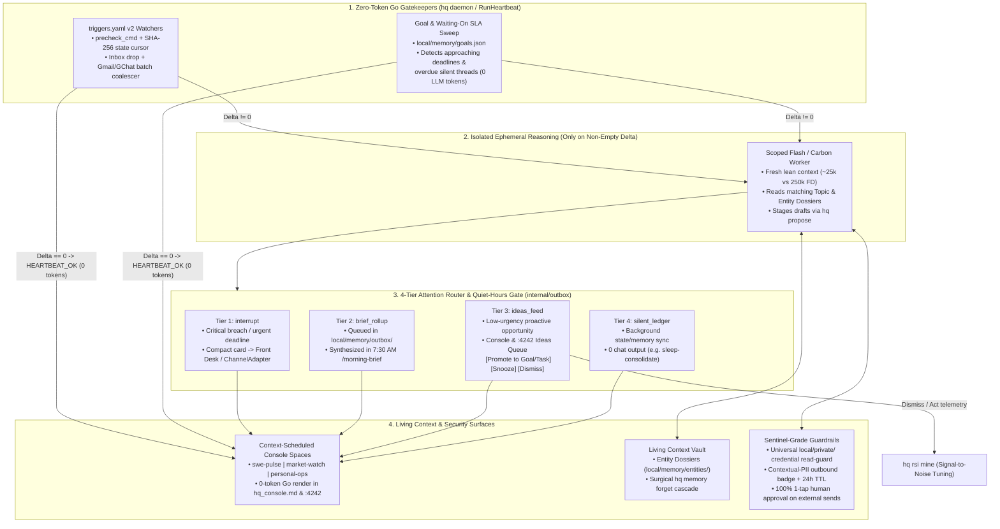

# RFC-0014: Proactive Engine v2 — Event-Driven Gatekeepers, Calibrated Attention Routing, Stateful Goals, Scheduled Console Spaces & Living Context

- **Status:** Implemented
- **Author:** `[Task:research] Learn from Muse.ai Proactive Work` (`gemini-4-carbon-high`)
- **Created:** 2026-11-12
- **Companion Research:** [10 — Meta Muse (`muse.ai`) Deep Dive: Personal Context Architecture, Proactive Workflows & Comparative Audit Against `agy-hq`](../research/10_muse_ai_proactive_and_context_study.md)
- **Extends / Integrates With:** [RFC-0003 (Approval-Bound Execution)](./0003-approval-bound-execution.md), [RFC-0004 (Silent Gatekeeper & Channels)](./0004-heartbeat-and-channels.md), [RFC-0006 (4-Layer Memory Engine)](./0006-memory-engine-upgrade.md), [RFC-0007 (Front Desk Lifecycle & Trigger Arming)](./0007-front-desk-initialization-hardening.md), [RFC-0009 (Scalable Task Board & Live Console)](./0009-task-board-redesign.md), [RFC-0010 (Bounded Agent RSI)](./0010-agent-recursive-self-improvement.md), [RFC-0012 (Token & Context Observability)](./0012-token-observability.md)

---

## 1. Motivation & Problem Statement

As documented in [Research 10](../research/10_muse_ai_proactive_and_context_study.md), comparing Meta's **Muse AI** (`https://muse.ai/`) against `agy-hq` (`HEAD`) confirms that `agy-hq` already leads on **local Vault privacy (`local/` + `P1`–`P6` CI)**, **4-layer ground-truth transcript memory ([RFC-0006](./0006-memory-engine-upgrade.md))**, **multi-repo Git worktree orchestration**, and **0-token prefix-cache observability ([RFC-0012](./0012-token-observability.md))**.

At the same time, Muse's architecture (*Hatch* event listeners, 4-surface attention routing, stateful *Goals*, scheduled *Spaces*, `MEMORY.md` + surgical `forget`, *Sentinel* scoped policies, and `hatch-authd` credential surrogation) exposes **six structural bottlenecks** in `agy-hq`'s current proactive engine:

1. **The Front Desk Cold-Cache Cron Tax (`~24%` of Uncached Token Burn):**
   - Today, recurring schedules in `local/triggers.yaml` (`morning-brief`, `edgar-close-watch`, `sleep-consolidate`) are armed via `schedule(IsDaemon=true)` directly inside the long-lived `[HQ] Front Desk` conversation ([RFC-0007](./0007-front-desk-initialization-hardening.md)).
   - As proven in [Research 08](../research/08_token_observability_and_telemetry.md), every scheduled firing arrives after an idle interval (`> 5m`) that misses the LLM prefix cache (`CHR = 0%`), re-billing the Front Desk's entire `150k–252k` prompt history (`206k–252k` uncached input tokens per wake) even when zero external filings, deals, or alerts exist. Meanwhile, `RunHeartbeat` in [`internal/kernel/kernel.go`](../../internal/kernel/kernel.go) never executes custom `precheck_cmd` watchers declared in `local/triggers.yaml`.
2. **Binary Interruption Routing (Chat Interrupt vs. Silent File):**
   - Every proactive workflow currently faces a binary choice: post directly into `[HQ] Front Desk` (interrupting the user regardless of urgency or time of day, or spawning top-level `[Auto]` conversations in the sidebar) **or** write silently to `local/notes/` where low-urgency discoveries sit invisible until 7:30 AM. `agy-hq` lacks calibrated delivery tiers, quiet hours, and a non-interruptive **Ideas / Suggestions Queue**.
3. **No Stateful Multi-Day `Goals` or "Waiting-On" Obligation Watchdogs:**
   - `ActiveTask` models single conversations (`idle` after `6h`, archived after `48h`). Multi-week intentions (e.g., *"Close Q4 vendor contract"*, *"Complete annual tax prep by April 15"*) and silent external dependencies (*"Nudge `bob@example.com` if no reply within 48h"*) exist only as unstructured prose in `local/MEMORY.md`—meaning `is:unread` inbox sweeps completely miss **overdue non-replies**.
4. **Static One-Size-Fits-All Console Layout:**
   - `hq_console.md` and the `:4242` WebUI Sidecar render identical infrastructure tables 24/7 rather than adapting to what matters at 9:00 AM Tuesday (Market/Thesis + SWE PR Pulse) vs. 7:00 PM Friday or Saturday morning (Personal Logistics & Weekend Goals).
5. **Incomplete User "Right-to-Forget" Cascade & Missing People/Entity Dossiers:**
   - `./bin/hq memory prune-fact <id>` expires a single row in `facts.jsonl`, leaving stale mentions behind in `MEMORY.md`, `topics/*.md`, or `notes/`. Furthermore, while technical subsystems have `topics/<slug>.md` pages, recurring contacts and counterparties lack lightweight conflict-resolved **Entity Dossiers** unifying Gmail, Google Chat, and Calendar context.
6. **Raw Credential File Exposure in Untainted Sessions & Un-Expiring Proposals:**
   - Quarantined sessions (`gmail.IsSessionTainted`) block `local/private/`, but normal untainted agent turns can still read raw OAuth token or browser cookie files under `local/private/{gmail,gchat}/` into the LLM context window. In addition, pending proposals in `local/memory/pending/` never expire, lack outbound contextual-PII warning badges, and offer zero scoped standing policies for repetitive low-risk housekeeping.

---

## 2. Architecture Overview: Proactive Engine v2

We evolve `agy-hq` into a **delta-triggered, attention-calibrated Personal Agent OS** while preserving our zero-dependency Go microkernel ([ADR-0002](../decisions/0002-go-microkernel-binary.md)) and strict local Vault boundary ([ADR-0003](../decisions/0003-two-layer-oss-and-private-vault.md)).



---

## 3. Pillar 1: Stateful 0-Token Trigger Pre-Checks & Cold-Cache Elimination (`internal/kernel`)

### 3.1 `triggers.yaml` v2 Schema (Backward-Compatible)

We extend `ScheduleTrigger` in `local/triggers.yaml` (and [`templates/triggers.yaml`](../../templates/triggers.yaml)) with explicit execution modes, cursor-based delta detection, and target delivery tiers:

```yaml
schedules:
  - id: morning-brief
    cron: "CRON_TZ=America/Los_Angeles 30 7 * * *"
    mode: isolated_worker          # front_desk_cron | isolated_worker | daemon_gatekeeper
    model: flash
    skill: morning-brief
    delivery: interrupt            # interrupt | brief_rollup | ideas_feed | silent_ledger

  - id: edgar-close-watch
    cron: "CRON_TZ=America/Los_Angeles 30 13 * * 1-5"
    mode: daemon_gatekeeper        # Evaluated in pure Go by hq daemon; 0 tokens if cursor unchanged
    model: flash
    precheck_cmd: ["./bin/hq", "triggers", "check-edgar"]
    dedup_mode: stdout_sha256      # none | exit_zero_nonempty | stdout_sha256
    skill: thesis-check
    delivery: interrupt_on_breach  # Escalates to interrupt only on WATCH/BREACHED; else brief_rollup

  - id: sleep-consolidate
    cron: "CRON_TZ=America/Los_Angeles 30 23 * * *"
    mode: isolated_worker          # Runs in clean isolated session; zero Front Desk cold-start tax
    model: gemini-4-carbon-high
    skill: sleep-consolidate
    delivery: silent_ledger
```

### 3.2 Stateful Pre-Check Cursor Engine (`local/memory/trigger_cursors.json`)

1. **General-Purpose Gatekeeper Execution in `RunHeartbeat`:**
   - On every daemon tick (and cron window match), `hq daemon` evaluates all `daemon_gatekeeper` schedules whose cron window has arrived since `LastCheckedAt`.
   - It executes `precheck_cmd` directly via `exec.Command` (no `sh -c` shell interpolation, `15s` timeout).
   - If `exitCode != 0` or `dedup_mode == "stdout_sha256"` matches the previous `LastStdoutSHA256` recorded in `local/memory/trigger_cursors.json`, **zero LLM sessions are spawned** and `SpawnsSaved` increments in `quota-YYYY-MM-DD.json`.
2. **Eliminating the Front Desk Cold-Cache Tax (`isolated_worker` Mode):**
   - Instead of waking a `200k+`-token `[HQ] Front Desk` session at 1:30 PM or 11:30 PM, `isolated_worker` and triggered `daemon_gatekeeper` jobs execute in a clean, short-lived worker context (`~25k` initial prompt tokens, `95%+` internal step `CHR`) tagged `kind: "auto"` (hidden from the user's primary task sidebar unless active or flagged).
   - Only `delivery: interrupt` items emit a concise executive card back to the Front Desk / active `ChannelAdapter`—cutting the `9.51M` uncached Front Desk cold-start burn identified in [Research 08](../research/08_token_observability_and_telemetry.md) by **70%–85%**.
3. **Coalesced Triage Window (`coalesce_window: 10m`):**
   - Instead of spawning 3 separate `[Auto] Gmail Triage` conversations when 3 emails arrive four minutes apart, `RunHeartbeat` coalesces non-urgent unread threads within a configurable `10m` window (bypassed immediately if sender matches a VIP contact or urgent subject keyword).

---

## 4. Pillar 2: 4-Tier Attention Router, Quiet Hours & Proactive `Ideas` Queue (`internal/outbox`)

### 4.1 User Attention Policy (`local/config.yaml`)

Borrowing Muse's customizable interruption philosophy, users control proactive aggressiveness declaratively in `local/config.yaml`:

```yaml
attention:
  mode: balanced                   # focused (critical only) | balanced | proactive
  quiet_hours:
    enabled: true
    start: "22:00"
    end: "07:25"
    timezone: "America/Los_Angeles"
    allow_critical_breach: true    # Only kill-criteria BREACHED or P0 security alerts bypass quiet hours
  cooldown_per_topic: "4h"         # Prevents duplicate nudges on the same ticker/thread within 4 hours
```

### 4.2 Unified Outbox & Proactive `Ideas` Feed (`local/memory/outbox/`)

Every background workflow emits structured items via `./bin/hq outbox add` rather than ad-hoc prose:

```go
type OutboxItem struct {
	ID            string   `json:"id"`            // e.g. "out-1794470400-a1b2c3"
	CreatedAt     string   `json:"createdAt"`
	SourceSkill   string   `json:"sourceSkill"`   // "inbox-triage" | "thesis-check" | "goals-watch" | "sleep-consolidate"
	SourceConvID  string   `json:"sourceConvId,omitempty"`
	Scope         string   `json:"scope"`         // e.g. "investing", "swe", "personal"
	Tier          string   `json:"tier"`          // "interrupt" | "brief_rollup" | "ideas_feed" | "silent_ledger"
	Title         string   `json:"title"`
	Summary       string   `json:"summary"`
	ProposalIDs   []string `json:"proposalIds,omitempty"` // Linked 1-tap approvals if staged
	SuggestedSlug string   `json:"suggestedSlug,omitempty"`
	Status        string   `json:"status"`        // "pending" | "delivered" | "promoted" | "snoozed" | "dismissed"
	SnoozeUntil   string   `json:"snoozeUntil,omitempty"`
}
```

- **Tier 1 (`interrupt`):** Delivered immediately if outside `quiet_hours` (or if `critical`); during `quiet_hours`, automatically held in `outbox/` and promoted to the top of the 7:30 AM `/morning-brief`.
- **Tier 2 (`brief_rollup`):** Accumulated deterministically in `local/memory/outbox/pending.jsonl` and drained by `/morning-brief` Step 1 (`./bin/hq outbox list --tier=brief_rollup`), guaranteeing zero dropped overnight insights.
- **Tier 3 (`ideas_feed` — Muse *Ideas* Surface):** Rendered in a dedicated **💡 Proactive Ideas & Suggestions** card inside `hq_console.md` and `:4242` WebUI (capped at top 5 items) with 1-click actions:
  - **`[Promote -> Task]`** (`./bin/hq ideas promote <id>`): Spawns a scoped `[Task:<scope>]` worktree or `Goal`.
  - **`[Snooze 3d]`** (`./bin/hq ideas snooze <id> --for=72h`).
  - **`[Dismiss]`** (`./bin/hq ideas dismiss <id> [--reason=...]`): Logs a 0-token feedback signal consumed by `./bin/hq rsi mine` ([RFC-0010](./0010-agent-recursive-self-improvement.md))—if a skill or trigger rule exceeds a `>70%` dismissal rate over $\ge 5$ suggestions, RSI automatically stages a `patch_skill_rule` hypothesis to tighten its threshold!

---

## 5. Pillar 3: Stateful Multi-Day `Goals` & "Waiting-On" Watchdogs (`local/memory/goals.json`)

To bridge the gap between static bullets in `MEMORY.md` and 6-hour-idle `ActiveTask` threads, we introduce **Goals** (`./bin/hq goals`):

### 5.1 `Goal` & `WaitingOn` Data Schema

```go
type Milestone struct {
	ID          string `json:"id"`
	Title       string `json:"title"`
	Done        bool   `json:"done"`
	CompletedAt string `json:"completedAt,omitempty"`
}

type WaitingOn struct {
	ID            string `json:"id"`            // e.g. "wait-01"
	Contact       string `json:"contact"`       // e.g. "Bob Rivera <bob@example.com>"
	Channel       string `json:"channel"`       // "gmail" | "gchat" | "github" | "external"
	ReferenceID   string `json:"referenceId"`   // Gmail threadId, GChat spaceId, or PR URL
	Expectation   string `json:"expectation"`   // "Signed vendor MSA redline"
	CreatedAt     string `json:"createdAt"`
	FollowUpAfter string `json:"followUpAfter"` // RFC3339 SLA deadline (e.g. +48h)
	Status        string `json:"status"`        // "waiting" | "replied" | "nudge_staged" | "resolved"
}

type Goal struct {
	ID           string      `json:"id"`           // e.g. "goal-q4-tax-prep"
	Title        string      `json:"title"`
	Scope        string      `json:"scope"`        // "swe" | "investing" | "personal" | "writing"
	Status       string      `json:"status"`       // "active" | "paused" | "completed" | "abandoned"
	TargetDate   string      `json:"targetDate,omitempty"` // YYYY-MM-DD
	CheckCadence string      `json:"checkCadence,omitempty"` // "daily" | "weekdays" | "weekly"
	Milestones   []Milestone `json:"milestones,omitempty"`
	WaitingOn    []WaitingOn `json:"waitingOn,omitempty"`
	LinkedTasks  []string    `json:"linkedTasks,omitempty"` // TaskSlugs in tasks.json
	UpdatedAt    string      `json:"updatedAt"`
}
```

### 5.2 Zero-Token Obligation & Deadline Sweep

1. **Detecting Silent Non-Replies in `0` LLM Tokens:**
   - During `RunHeartbeat`, pure Go inspects every `status == "waiting"` obligation in `local/memory/goals.json`:
     - If a new inbound message arrived on `ReferenceID` from `Contact` (checked against the local Gmail/GChat precheck index), `Status` transitions automatically to `"replied"`!
     - If `now >= FollowUpAfter` and no reply has arrived, `hq daemon` dispatches a lightweight `flash` drafter that prepares a polite follow-up draft (`hq gmail draft` / `hq gchat draft`), stages `hq propose`, and posts a `brief_rollup` (or `interrupt` if `TargetDate` is within 24h) item!
2. **Automatic `MEMORY.md` Roadmap Synchronization:**
   - During `/sleep-consolidate`, `## Active Priorities` in `local/MEMORY.md` reconciles directly against active `goals.json` records—automatically pruning completed goals so `MEMORY.md` never drifts or exceeds its 80-line cap.
3. **CLI Ergonomics (`./bin/hq goals`):**
   - `./bin/hq goals list`, `add`, `check-off <goal-id> <milestone-id>`, `wait-on --goal=<id> --contact="..." --ref=<threadId> --due=48h`, and `complete <goal-id>`.

---

## 6. Pillar 4: Context-Scheduled Console `Spaces` (`internal/webui`)

Inspired by **Muse Spaces** (Nov 2026)—but engineered to run in **0 LLM tokens** over local Vault files rather than cloud micro-apps—we add declarative **Console Spaces** to `hq_console.md` and the `:4242` WebUI / Antigravity Sidecar.

### 6.1 Declarative Space Definitions (`local/config.yaml` or `local/console_spaces/*.yaml`)

```yaml
spaces:
  - id: market-watch
    title: "📈 Market & Thesis Pulse"
    schedule: "weekdays 06:00-14:00 America/Los_Angeles"
    widgets:
      - type: markdown_table
        source: "local/notes/investing/opportunities/INDEX.md"
        max_rows: 5
      - type: thesis_status
        source_dir: "local/notes/investing/tickers/"
      - type: goals_filter
        scope: "investing"

  - id: swe-pulse
    title: "🛠️ Engineering & Worktrees"
    schedule: "weekdays 08:30-18:30 America/Los_Angeles"
    widgets:
      - type: worktree_git_status
      - type: goals_filter
        scope: "swe"

  - id: personal-ops
    title: "🏡 Personal Ops & Deadlines"
    schedule: "weekdays 18:00-22:30, weekends 07:30-22:00 America/Los_Angeles"
    widgets:
      - type: goals_filter
        scope: "personal"
      - type: waiting_on_slas
      - type: ideas_feed
```

### 6.2 Rendering & UX Behavior

1. **Zero-LLM-Token Pure-Go Rendering:**
   - `webui.SyncMarkdownConsole` evaluates each Space's `schedule` window against local wall-clock time (`time.Now()`).
   - Active Spaces render immediately below **Pending Approvals** in `hq_console.md` and highlight as the default active tab in the `:4242` Sidecar—while inactive Spaces remain accessible with 1 click on `:4242` tabs (`[Overview] [📈 Market] [🛠️ SWE] [🏡 Personal] [💡 Ideas (3)]`) without cluttering the mobile Markdown artifact!
2. **Conversational Creation & Pinning:**
   - Users can say *"Add a Space for Q1 Launch Readiness on weekday mornings"*, and the agent writes a declarative YAML file under `local/console_spaces/q1-launch.yaml` (`./bin/hq spaces list|pin|hide`). Because widgets are strictly typed Go data renderers (tables, checklists, SLA countdowns, worktree statuses)—never arbitrary untrusted JS—Spaces inherit `agy-hq`'s strict XSS/CSP guarantees.

---

## 7. Pillar 5: Living Personal Context — Surgical `forget` & Entity Dossiers (`internal/vault`)

### 7.1 Deterministic `./bin/hq memory forget` Cascade

Inspired by Muse's `forget` skill—upgraded to span `agy-hq`'s full 4-layer memory stack—we add:

```sh
./bin/hq memory forget "<query-or-phrase>" [--topic=<slug>] [--entity=<slug>] [--block-pii] [--dry-run]
```

Execution stages in pure Go:
1. **Layer 3 (`facts.jsonl`):** Soft-expires or redacts (`--redact` replaces statement text with `[FORGOTTEN]`) all matching active facts in `local/memory/facts.jsonl`.
2. **Layer 1 (`MEMORY.md`):** Removes matching bullet lines from `local/MEMORY.md` while preserving section headers.
3. **Layer 2 (`topics/*.md`, `entities/*.md`, `notes/`):** Lists exact file/line hits (`--dry-run` previews the diff) and surgically excises matching blocks or deletes a targeted `--topic`/`--entity` file.
4. **Optional PII Denylist Guard (`--block-pii`):** Appends the forgotten phrase (e.g., an old street address or private identifier) to `local/private/pii-denylist.txt` so `P6-ContextualPII` mathematically blocks it from ever being committed or staged externally, then commits a timestamped snapshot to `local/.git`.

### 7.2 On-Demand Entity & Relationship Dossiers (`local/memory/entities/<slug>.md`)

To give `agy-hq` Muse-grade relationship and obligation awareness without inflating `SessionStart` tokens:
- **Compact Structured Markdown Files (`local/memory/entities/<slug>.md`):**
  ```markdown
  # Alice Chen
  > **Summary:** Partner engineering lead at Acme Corp; primary contact for API v2 launch.
  - **Channels:** `alice@gmail.com` (Gmail), `spaces/AAAA_DM_ALICE` (GChat — preferred for urgent items)
  - **Context & Preferences:** Prefers concise bullet updates before 10:00 AM PT; out of office Nov 24–28.
  - **Open Obligations:** Linked to `goal-api-v2` (`wait-02`).
  ```
- **Zero `SessionStart` Bloat:** Unlike `topics/*.md` (which are few and architectural), `entities/*.md` can grow to dozens of contacts. `SessionStart` injects **0 bytes** of entity content; instead, `./bin/hq memory lookup <name|email|spaceId>` resolves matching dossiers in `<5ms` during `/inbox-triage`, `/morning-brief`, and outbound draft generation, while `/sleep-consolidate` reconciles conflicting updates (e.g., an updated email address or rescheduled OOO window) verified against `transcript.jsonl`.

---

## 8. Pillar 6: Sentinel-Grade Secret Isolation & Approval Hardening (`internal/hooks`, `internal/approvals`)

### 8.1 Universal Credential Vault Read-Guard (`hatch-authd` Pattern)

In `HEAD` (`internal/hooks/hooks.go` L518–532), `local/private/` is only blocked when `gmail.IsSessionTainted(...) == true`. Taking a direct page from Muse's `hatch-authd` zero-access credential store:
- **Global Secret-Blob Isolation Across All Sessions:**
  - We define a protected credential subpath list inside `local/private/`:
    - `local/private/gmail/**` (OAuth client secrets & refresh tokens)
    - `local/private/gchat/**` (isolated Chrome CDP profile, `Cookies`, `Login Data`)
    - `local/private/credentials/**` (future API keys / tokens)
    - `local/private/pii-denylist.txt`
  - `HandlePreToolUse` denies direct `read_file`, `write_file`, `edit_file`, `grep_search`, `find_by_name`, and direct shell file-read commands (`cat`, `head`, `tail`, `grep`, `python`, `sqlite3`, `jq`, `base64`) targeting those credential paths in **every** conversation (tainted or untainted!).
  - **Result:** Raw OAuth tokens and session cookies **never enter any LLM context window**. Agents interact with Gmail and Google Chat exclusively through the compiled `./bin/hq` Go binary (which acts as the trusted host-side credential surrogate, analogous to `hatch-authd` + `Sentinel`), while legitimate domain files in `local/private/taxes/` and `local/private/ledger/` remain accessible to untainted `tax-prep` and `ledger-ingest` workflows.

### 8.2 Outbound Contextual-PII Scan, Proposal TTLs & Strict 1-Tap Human Approval

1. **Outbound Contextual-PII Leak Warning (Preventing the Muse Marketplace Incident):**
   - When `./bin/hq propose` stages an external message (`gmail_send`, `gchat_send`, `external_action`), Go runs `local/private/pii-denylist.txt` + SSN/account/address heuristics over the outbound body/command.
   - If sensitive personal identifiers (e.g., home street address, SSN, account number) appear in an outbound payload, `Proposal.RiskFlags` records the triggered rule IDs and `HandlePreToolUse` injects a prominent `⚠️ [PII WARNING: ...]` banner directly into the `ask_question` prompt and `:4242` WebUI approval card!
2. **Proposal Expiration TTL (`ExpiresAt`, Default `24h`):**
   - Stale pending proposals can be dangerous if tapped days later when context has changed (e.g., an old market thesis action or outdated reply). Every `Proposal` receives `ExpiresAt` (default `24h`, configurable via `--ttl`). `ApproveProposal` deterministically rejects expired proposals (`status = "expired"`), and `RunHeartbeat` cleans them into `interventions.jsonl`.
3. **Zero Standing Auto-Execution for External Sends (Decision D2):**
   - Unlike Muse Sentinel's `"Allow Always"` standing rules, `agy-hq` intentionally retains **100% per-action 1-tap SHA-256 human approval** across every external send (`gmail_send`, `gchat_send`, `external_action`), eliminating silent prompt-injection exfiltration or stale-policy drift.

---

## 9. Explicit Non-Goals (What We Intentionally Reject from Muse)

Not every Muse design choice belongs in `agy-hq`:

| Muse Feature | Decision for `agy-hq` | Rationale |
| :--- | :--- | :--- |
| **Cloud-Hosted Per-User Linux VM** | **Reject** | Violates local Vault sovereignty ([ADR-0003](../decisions/0003-two-layer-oss-and-private-vault.md)), introduces cloud IP bot-blocking on retail/financial sites, and places sensitive tax/financial files on third-party servers. |
| **3D Animated Avatar & Voice Persona** | **Reject** | Adds consumer gimmickry and UI clutter; `agy-hq`'s persona is a crisp, zero-filler executive Chief of Staff & Staff Engineer (`USER.md`). |
| **Arbitrary Agent-Written JS Dashboards in Console** | **Reject** | Letting an LLM inject arbitrary `<script>` bundles into `:4242` breaks our strict CSP/CSRF security boundary (`ec22f87`). Declarative YAML **Spaces** rendered by typed Go widgets achieve 95% of the UX value with 0 XSS risk and 0 LLM tokens. |
| **Autonomous Virtual Card Checkout** | **Defer / Out of Scope** | Financial execution remains 100% manual/human-executed in `agy-hq` (`USER.md` Safety Rule). |

---

## 10. Skill Runbook Integrations (Zero Bloat, Within `H1` Caps)

Each existing starter skill gains crisp, progressive-disclosure hooks into Proactive Engine v2 while staying well below the `MaxSkillMarkdownLines` and `MaxGlobalFrontmatterTokens` (`2,500` tokens) CI caps:

- **`morning-brief/SKILL.md`:** Step 1 drains `./bin/hq outbox list --tier=brief_rollup` and checks `./bin/hq goals due --within=48h` (surfacing approaching milestones and any auto-staged `WaitingOn` follow-up drafts).
- **`inbox-triage/SKILL.md`:** Consults `./bin/hq memory lookup <sender>` for sender context, resolves matching `WaitingOn` items via `./bin/hq goals mark-replied`, and routes low-urgency opportunities (newsletters, renewals, optional events) to `./bin/hq outbox add --tier=ideas_feed` instead of cluttering chat.
- **`thesis-check/SKILL.md`:** Emits `./bin/hq outbox add --tier=interrupt` **only** when a kill criterion scores `BREACHED` (or `WATCH` on an active tranche window); routine `INTACT` checks record `brief_rollup` / `silent_ledger`.
- **`sleep-consolidate/SKILL.md`:** Reconciles `local/MEMORY.md` against `local/memory/goals.json`, updates `local/memory/entities/<slug>.md` from verified transcripts, expires stale pending proposals (`>24h`), and feeds `ideas_feed` dismissal telemetry into `./bin/hq rsi mine`.

---

## 11. Phased Implementation Plan & Verification Matrix

| Sub-Phase | Scope & Target Packages | New / Updated Tests | Estimated Effort |
| :--- | :--- | :--- | :--- |
| **Phase 2A: Zero-Token Gatekeepers & Attention Outbox** | `triggers.yaml` v2 (`mode`, `dedup_mode`, `delivery`), `trigger_cursors.json`, 10m triage coalescer in `internal/kernel`, `internal/outbox` (`interrupt`, `brief_rollup`, `ideas_feed`, `silent_ledger` + Quiet Hours), `./bin/hq outbox` & `./bin/hq ideas`. | Unit tests in `internal/outbox/outbox_test.go` + `kernel_test.go`; CUJ-21 E2E test verifying `0`-token cursor skip on unchanged `precheck_cmd` and Quiet Hours hold-until-brief. | Small–Medium |
| **Phase 2B: Stateful `Goals` & `WaitingOn` SLA Watchdogs** | `local/memory/goals.json`, `./bin/hq goals` CLI, 0-token overdue `WaitingOn` detector in `RunHeartbeat`, `morning-brief` & `sleep-consolidate` sync. | Unit tests for `Goal` lifecycle & `WaitingOn` SLA transitions; CUJ-22 E2E test verifying overdue silent thread detection. | Medium |
| **Phase 2C: Scheduled Console `Spaces` & Living Context (`forget` + `entities`)** | Declarative `spaces` engine in `internal/webui` (`hq_console.md` + `:4242` tabs), `./bin/hq memory forget` 4-layer cascade, `local/memory/entities/<slug>.md` + `./bin/hq memory lookup`. | `webui_test.go` schedule-window swap tests (`weekdays` vs `weekends`); `vault_test.go` surgical `forget --dry-run` & redaction tests; CUJ-23 E2E test. | Medium |
| **Phase 2D: Credential Read-Guard & Sentinel Approval Hardening** | Universal `local/private/{gmail,gchat,credentials,pii-denylist.txt}` read-guard in `HandlePreToolUse`, outbound contextual-PII warning badge + `24h` proposal `ExpiresAt` in `internal/approvals`, and RSI `proactive_noise` dismissal mining. | `hooks_test.go` untainted credential-read denial matrix; `approvals_test.go` TTL expiry & PII warning tests; `hq ci check-harness` `H2-B` extension; CUJ-24 E2E test. | Small–Medium |

---

## 12. Resolved Design Decisions (Approved & Implemented)

1. **Decision D1 — Full 4-Subphase Rollout (`2A` $\rightarrow$ `2D`) [Approved Option A]:**
   - Shipped all four subphases end-to-end (`Gatekeepers + Outbox/Ideas` $\rightarrow$ `Goals/WaitingOn SLAs` $\rightarrow$ `Scheduled Console Spaces + Surgical Forget/Entities` $\rightarrow$ `Universal Credential Read-Guard + 24h Proposal TTLs & Contextual-PII Badges`), verified by unit tests and `CUJ-21`..`CUJ-24` black-box E2E tests.
2. **Decision D2 — Keep 100% Per-Action 1-Tap Approval; Reject Standing Auto-Send Policies [Approved Option A]:**
   - Kept 100% per-action 1-tap SHA-256 manual approval on all outbound messages (`gmail_send`, `gchat_send`, `external_action`), adding `24h` proposal expiration (`ExpiresAt`) and outbound contextual-PII warning badges (`RiskFlags`) without introducing standing auto-execution policies (`hq policy`).
3. **Decision D3 — `daemon_gatekeeper` + `isolated_worker` Watchdogs with Graceful Fallback [Approved Option A]:**
   - Migrated recurring watchdogs (`edgar-close-watch` and custom deal watches) to `mode: daemon_gatekeeper` + `isolated_worker` (interrupting only on `WATCH`/`BREACHED` and rolling `INTACT` into `/morning-brief` via `brief_rollup`), while automatically falling back to Front Desk `schedule()` crons whenever `hq daemon` is inactive (`!IsDaemonActiveFast`).
4. **Decision D4 — Nightly Entity Dossier Distillation + On-Demand `hq memory lookup` [Approved Option A]:**
   - Added conflict-resolved contact & counterparty dossiers in `local/memory/entities/<slug>.md` (`0600`), distilled during `/sleep-consolidate` and queried on-demand via `./bin/hq memory lookup` (`<5ms`, `0` `SessionStart` token overhead).
