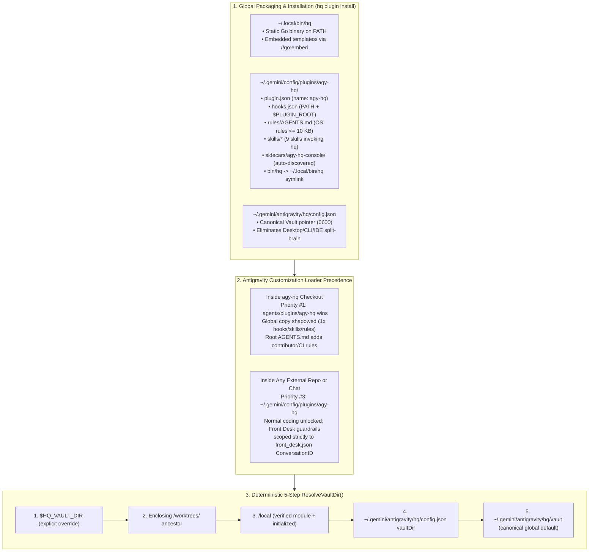

# RFC-0015: Standalone Global Antigravity Plugin Packaging, Embedded Templates & Workspace-Agnostic Vault Resolution

- **Status:** Implemented
- **Author:** `[Task:agy-hq] Package agy-hq as Global Plugin` (`gemini-4-carbon-high`)
- **Created:** 2026-11-13
- **Companion Research:** [11 — Antigravity Global Plugin Packaging & Vault Isolation Audit](../research/11_plugin_packaging_audit.md)
- **Extends / Integrates With:** [ADR-0001 (Hybrid Antigravity Architecture)](../decisions/0001-option-1.5-hybrid-on-antigravity.md), [ADR-0002 (Go Microkernel Binary)](../decisions/0002-go-microkernel-binary.md), [ADR-0003 (Two-Layer Vault)](../decisions/0003-two-layer-oss-and-private-vault.md), [RFC-0001 (Vault & Task Isolation)](./0001-vault-and-task-isolation.md), [RFC-0003 (Approval-Bound Execution & Quarantine)](./0003-approval-bound-execution.md), [RFC-0007 (Front Desk Initialization Hardening)](./0007-front-desk-initialization-hardening.md), [RFC-0010 (Bounded Agent RSI)](./0010-agent-recursive-self-improvement.md), [RFC-0011 (CI & Harness Regression Gate)](./0011-ci-pipeline-and-regression-harness.md), [RFC-0014 (Proactive Engine v2)](./0014-proactive-engine-and-living-context.md)

---

## 1. Motivation & Problem Statement

`agy-hq` was originally architected around opening Google Antigravity directly inside the `agy-hq` checkout (or inside git worktrees spawned under `local/worktrees/`). However, developers and knowledge workers regularly open Antigravity directly in external repositories (`~/Workspaces/webapp`, `~/Workspaces/infra`), scratch directories, or zero-workspace chat windows—and still expect their Personal Agent OS (4-layer memory, `hq propose` SHA-256 outbound safety, 9 domain skills, turn journaling, and the `:4242` HQ Console sidecar) to work seamlessly everywhere.

As documented in [Research 11](../research/11_plugin_packaging_audit.md), running `agy plugin validate --strict .agents/plugins/agy-hq` against `HEAD` (`bdcd98d`) fails with **1 error and 2 warnings**, and a deeper preflight audit uncovered **seven coupled defects** blocking global installation (`~/.gemini/config/plugins/agy-hq/` + `~/.local/bin/hq`):

1. **Malformed `sidecars.json` Breaks Plugin Validation:**
   - Legacy `.agents/plugins/agy-hq/sidecars.json` contained a JSON array (`[{...}]`), whereas Antigravity's customization loader parses `sidecars.json` as `customizations.JSONConfig` (`{"entries": [...]}`) for external paths and ignores the malformed file with an unmarshal error. Meanwhile, [`.agents/plugins/agy-hq/sidecars/agy-hq-console/sidecar.json`](../../.agents/plugins/agy-hq/sidecars/agy-hq-console/sidecar.json) already provides native sidecar auto-discovery (`agy-hq/agy-hq-console`).
2. **Live 2x Hook Execution Inside `headquarter` (`.agents/hooks.json` + Plugin `hooks.json`):**
   - Antigravity merges named hooks across distinct active customization sources. Having both root `.agents/hooks.json` and [`.agents/plugins/agy-hq/hooks.json`](../../.agents/plugins/agy-hq/hooks.json) fired `SessionStart`, `PreToolUse`, and `Stop` **twice** per turn inside `headquarter`—doubling `SessionStart` context tokens (`~3,000` extra prompt tokens) and incrementing the Front Desk `PreToolUse` lookup counter by `+2` per read!
3. **Workspace-Relative `./bin/hq` Paths Across Hooks, Sidecar, Skills & Security Regexes:**
   - Plugin hooks run with `cwd = <plugin_dir>` (`~/.gemini/config/plugins/agy-hq/`), where `./bin/hq` and `../../../bin/hq` do not exist.
   - All 9 bundled `SKILL.md` files instruct the model to invoke `./bin/hq`.
   - Worse, [`internal/hooks/hooks.go`](../../internal/hooks/hooks.go) hardcodes `^\s*(?:\./)?bin/hq\s+` in `reAllowedQuarantineHQCmd`, `reQuarantinedReadCmd`, and Front Desk `isHQCmd`—meaning switching skills to bare `hq` without updating `hooks.go` would **block** `hq gmail draft` / `hq propose` in quarantined sessions and charge Front Desk `hq status` calls against the 3-lookup turn cap!
   - [`main.mjs`](../../.agents/plugins/agy-hq/sidecars/agy-hq-console/main.mjs) only walks parent directories from `__dirname` looking for `bin/hq`, failing to find `~/.local/bin/hq` when installed globally.
4. **Workspace-Bound Rules & Vacant Front Desk Lease Hijack in External Repos:**
   - `.agents/plugins/agy-hq/` currently ships zero `rules/`, so global users lack Personal Agent OS instructions (`hq propose` preview rules, Vault boundary, model routing).
   - Conversely, in [`internal/hooks/hooks.go`](../../internal/hooks/hooks.go), when `front_desk.json` is vacant (`!ok`), `HandleSessionStart` and `HandleStop` automatically claim the `[HQ] Front Desk` lease for the very first conversation—which under a global plugin would **hijack** a user's first coding session in an unrelated repo (`~/Workspaces/webapp`) and hard-block `edit_file` and `npm test`!
5. **`ResolveRoot()` & `ResolveVaultDir()` Pollute Third-Party Go Repos & Clobber `.git/hooks`:**
   - In [`internal/vault/vault.go`](../../internal/vault/vault.go), `ResolveRoot()` matches **any** ancestor `go.mod` without checking the module path, falling back to `cwd`, and `ResolveVaultDir()` returns `<root>/local`. Running `hq` globally inside *any* third-party Go repo would create a stray `<other-repo>/local/` Vault and overwrite `<other-repo>/.git/hooks/` via `ci.InstallGitHooks(rootDir)`!
   - Running bare `hq` inside an `agy-hq` worktree (`<vault>/worktrees/headquarter-<slug>`) also falsely matches `<worktree>/go.mod` instead of the enclosing `<vault>`.
6. **Unembedded `templates/` Directory:**
   - `hq init`, `hq migrate`, and `SessionStart` auto-bootstrap read `templates/*` from disk relative to the `agy-hq` repo checkout, failing when `~/.local/bin/hq` runs standalone outside the repository.
7. **Global vs. Workspace Plugin Collision & Drift Visibility:**
   - Developers iterating on `agy-hq` have both `.agents/plugins/agy-hq/` (workspace) and `~/.gemini/config/plugins/agy-hq/` (global) present on disk; we must guarantee zero duplicate loading while surfacing version/bundle drift via `hq doctor` and `hq plugin status`.

---

## 2. Design Goals & Non-Goals

### Goals
1. **`0` Errors, `0` Warnings Validation:** `.agents/plugins/agy-hq` (and `~/.gemini/config/plugins/agy-hq`) passes `agy plugin validate --strict` cleanly, enforced automatically in CI (`H2-C`).
2. **Single Binary + Single Plugin Bundle Everywhere:** Installing `~/.local/bin/hq` + `~/.gemini/config/plugins/agy-hq/` via `hq plugin install` (or `scripts/bootstrap.sh --global`) works in **any** repository or empty chat with zero external file dependencies (`//go:embed` templates).
3. **Zero Cross-Surface Split-Brain & Zero Repo Pollution:** Third-party workspaces never get stray `./local/` folders, overwritten `.git/hooks/`, or accidental Front Desk non-blocking locks; CLI, Desktop, IDE, and `hq daemon` all resolve the exact same Vault deterministically.
4. **Zero-Friction Developer Ergonomics Inside `headquarter`:** Opening `headquarter` continues to use the live workspace plugin (`.agents/plugins/agy-hq/`) and existing checkout Vault (`./local` or pointer config) with 1x hook execution and zero duplicate rules/skills.

### Non-Goals
- Mutating Antigravity's private `~/.gemini/config/config.json` directly from `hq` (per upstream Antigravity customization rules, enable/disable state belongs strictly to `agy plugin` CLI or the Antigravity UI).
- Publishing `agy-hq` to a remote third-party plugin registry in this RFC (this RFC makes the plugin bundle 100% compliant with `agy plugin install <path>` and future Marketplace submission).

---

## 3. Architecture Overview



---

## 4. Detailed Technical Design

### 4.1 Plugin Bundle Cleanup: Deleting `sidecars.json` & Duplicate `.agents/hooks.json`

1. **Delete `.agents/plugins/agy-hq/sidecars.json`:**
   - Upstream Antigravity discovers sidecars inside plugins automatically by scanning `<plugin_root>/sidecars/*/sidecar.json`.
   - Removing `.agents/plugins/agy-hq/sidecars.json` eliminates the `customizations.JSONConfig` unmarshal error while keeping [`.agents/plugins/agy-hq/sidecars/agy-hq-console/sidecar.json`](../../.agents/plugins/agy-hq/sidecars/agy-hq-console/sidecar.json) auto-discovered as `agy-hq/agy-hq-console` (`sidecar://agy-hq/agy-hq-console/`).
2. **Delete Root `.agents/hooks.json` (Single-Source Hook Registration):**
   - Removing `.agents/hooks.json` makes [`.agents/plugins/agy-hq/hooks.json`](../../.agents/plugins/agy-hq/hooks.json) the single source of truth inside the `headquarter` workspace as well as globally.
   - This immediately fixes the 2x `SessionStart` token injection and 2x `PreToolUse` Front Desk lookup counter increment documented in [Research 11](../research/11_plugin_packaging_audit.md).
3. **Defense-in-Depth Hook Idempotency Guard (`internal/hooks/hooks.go`):**
   - Even if a user ever manually registers a duplicate hook entry, `HandleSessionStart` and `HandlePreToolUse` will check a lightweight `(conversationId, event, toolName, turnStepKey)` stamp with a `1500ms` window inside `<vault>/memory/.hook_dedup/` (or inside `front_desk_turn.json`), ensuring duplicate invocations within the same millisecond burst emit `{}` without double-injecting context or double-incrementing `turnState.Count`.

---

### 4.2 Installing `hq` on `PATH` (`~/.local/bin/hq`), `hq plugin` CLI & Hook/Sidecar/Skill Resolution

#### A. New `hq plugin` Subcommand Suite (`internal/plugin/plugin.go` + `cmd/hq/main.go`)

We introduce first-class plugin lifecycle management directly in `hq`:

| Command | Behavior |
| :--- | :--- |
| `hq plugin install [--bin-dir=~/.local/bin] [--vault-dir=...] [--global-vault]` | 1. Compiles (if run inside `agy-hq` source repo) or copies the running `hq` executable atomically (`0755`) to `~/.local/bin/hq`.<br>2. Syncs the validated plugin bundle to `~/.gemini/config/plugins/agy-hq/` (removing stale files like `sidecars.json`, never touching `~/.gemini/config/config.json`) and creates `~/.gemini/config/plugins/agy-hq/bin/hq -> ~/.local/bin/hq` so GUI launches without `~/.local/bin` on login `PATH` still resolve `${PLUGIN_ROOT}/bin/hq`.<br>3. Writes `~/.gemini/antigravity/hq/config.json` (`0600`) recording `vaultDir` (preserving an active `<repo>/local` Vault when run from `headquarter` unless `--global-vault` is passed, or `~/.gemini/antigravity/hq/vault` for standalone installs) and `sourceRepoDir`.<br>4. Bootstraps the target Vault via `vault.Init` if uninitialized and runs `hq plugin validate`.<br>5. Prints a `PATH` check reminder if `~/.local/bin` is not currently in `$PATH`. |
| `hq plugin status [--json]` | Reports `~/.local/bin/hq` path/version/SHA-256, `~/.gemini/config/plugins/agy-hq/` install state & bundle SHA-256 parity against `sourceRepoDir`, active `ResolveVaultDir()` result + resolution reason (`env`, `worktree`, `repo-local`, `global-pointer`, `global-default`), and `agy` CLI enablement status. |
| `hq plugin validate [dir]` | Runs `agy-hq`'s built-in deterministic plugin structural checks (`H2-C`) and, if `agy` CLI is on `PATH`, delegates to `agy plugin validate --strict <dir>`. |
| `hq plugin uninstall [--purge-bin]` | Removes `~/.gemini/config/plugins/agy-hq/` (and `~/.local/bin/hq` if `--purge-bin` is specified) while **strictly preserving** the user's private Vault (`~/.gemini/antigravity/hq/vault` or `local/`) so personal notes, ledgers, and memory are never destroyed by plugin uninstallation. |

Integration with existing lifecycle commands:
- **`scripts/bootstrap.sh --global`:** Compiles `./bin/hq` and runs `./bin/hq plugin install`.
- **`hq upgrade`:** After pulling `origin/main`, rebuilding `./bin/hq`, and running `hq migrate`, automatically refreshes `~/.local/bin/hq` and `~/.gemini/config/plugins/agy-hq/` whenever a global install is already present on the machine.

#### B. Workspace-Agnostic `.agents/plugins/agy-hq/hooks.json`

Per Antigravity's hook specification, command hooks execute with `cwd = <plugin_dir>` and `PLUGIN_ROOT=<plugin_dir>` in the environment, and `agy plugin validate` inspects relative `./...` command prefixes against `<plugin_dir>`. Using `export PATH="$HOME/.local/bin:$PATH"` with `$PLUGIN_ROOT`-anchored dev-checkout detection satisfies both `agy plugin validate --strict` (`0 errors, 0 warnings`) and every runtime environment (dev checkout, worktree, GUI Desktop without `.bashrc` `PATH`, and CLI):

```json
{
  "hq-kernel": {
    "SessionStart": [
      {
        "type": "command",
        "command": "export PATH=\"/opt/homebrew/bin:/usr/local/go/bin:$HOME/.local/go/bin:$HOME/.local/bin:$PATH\"; P=\"${PLUGIN_ROOT:-.}\"; R=\"$P/../../..\"; if [ -f \"$R/cmd/hq/main.go\" ]; then if [ ! -x \"$R/bin/hq\" ] || [ -n \"$(find \"$R/cmd\" \"$R/internal\" \"$R/templates\" -name '*.go' -newer \"$R/bin/hq\" -print -quit 2>/dev/null)\" ]; then (cd \"$R\" && go build -o ./bin/hq ./cmd/hq && ./bin/hq migrate --quiet) >/dev/null 2>&1 || true; fi; [ -x \"$R/bin/hq\" ] && exec \"$R/bin/hq\" hook session-start; fi; [ -x \"$P/bin/hq\" ] && exec \"$P/bin/hq\" hook session-start; command -v hq >/dev/null 2>&1 && exec hq hook session-start; exit 0",
        "timeout": 15
      }
    ],
    "PreToolUse": [
      {
        "matcher": "run_command|edit_file|write_file|read_file|grep_search|find_by_name|invoke_subagent|manage_subagents|schedule|manage_task",
        "hooks": [
          {
            "type": "command",
            "command": "export PATH=\"$HOME/.local/bin:$PATH\"; P=\"${PLUGIN_ROOT:-.}\"; R=\"$P/../../..\"; [ -f \"$R/cmd/hq/main.go\" ] && [ -x \"$R/bin/hq\" ] && exec \"$R/bin/hq\" hook pre-tool; [ -x \"$P/bin/hq\" ] && exec \"$P/bin/hq\" hook pre-tool; command -v hq >/dev/null 2>&1 && exec hq hook pre-tool; printf '{}\\n'",
            "timeout": 5
          }
        ]
      }
    ],
    "Stop": [
      {
        "type": "command",
        "command": "export PATH=\"$HOME/.local/bin:$PATH\"; P=\"${PLUGIN_ROOT:-.}\"; R=\"$P/../../..\"; [ -f \"$R/cmd/hq/main.go\" ] && [ -x \"$R/bin/hq\" ] && exec \"$R/bin/hq\" hook stop; [ -x \"$P/bin/hq\" ] && exec \"$P/bin/hq\" hook stop; command -v hq >/dev/null 2>&1 && exec hq hook stop; exit 0",
        "timeout": 10
      }
    ]
  }
}
```

> [!IMPORTANT]
> **Fail-Open Missing-Binary Resilience vs. Fail-Closed Active Policy:** If a user removes `~/.local/bin/hq` before disabling the plugin, `PreToolUse` falls through to `printf '{}\n'` rather than failing every IDE tool call with a shell `127: command not found` error. Whenever `hq` *is* present, `hq hook pre-tool-use` enforces full fail-closed security (`deny` on dangerous/outbound commands, `local/private/` credential reads, and quarantined session exfiltration).

#### C. Sidecar Launcher Resolution (`sidecars/agy-hq-console/main.mjs` & `templates/sidecars/...`)

`findHqBinary()` in [`main.mjs`](../../.agents/plugins/agy-hq/sidecars/agy-hq-console/main.mjs) (and its byte-identical mirror in `templates/sidecars/agy-hq-console/main.mjs`) is updated to resolve in strict order:
1. `process.env.HQ_BIN_PATH` (if executable).
2. Dev-repo checkout relative to `process.env.PLUGIN_ROOT || path.resolve(__dirname, "../..")`: `<repo>/bin/hq` **only if** `<repo>/cmd/hq/main.go` exists.
3. Bundled symlink `path.join(pluginRoot, "bin", "hq")`.
4. `path.join(os.homedir(), ".local", "bin", "hq")`.
5. Executable `hq` discovered across `process.env.PATH` (appended with `/opt/homebrew/bin:/usr/local/bin`).

When auto-spawning `hq daemon`, `main.mjs` spawns `hqBinary` with `cwd: os.homedir()` when not inside an `agy-hq` checkout so `ResolveVaultDir()` deterministically selects the user's global/pointer Vault rather than pinning an arbitrary directory.

#### D. Updating All 9 Skills, Templates & `hooks.go` / `gatekeeper.go` Command Matchers

1. **9 Bundled `SKILL.md` Files & Templates:**
   - Replace `./bin/hq` with `hq` across all 9 `.agents/plugins/agy-hq/skills/*/SKILL.md` files (`filing-diff`, `gchat`, `inbox-triage`, `ledger-ingest`, `morning-brief`, `sleep-consolidate`, `swe-pulse`, `tax-prep`, `thesis-check`) and `templates/{USER.md,triggers.yaml}` so agents in any external repository invoke `hq` cleanly via `PATH`.
2. **Backward-Compatible `PreToolUse` & Gatekeeper Command Matchers:**
   - In [`internal/hooks/hooks.go`](../../internal/hooks/hooks.go):
     - `reAllowedQuarantineHQCmd`: broaden prefix from `^\s*(?:\./)?bin/hq\s+` to `^\s*(?:(?:\S+/)?hq)\s+` so both `hq gmail draft ...` and `./bin/hq gmail draft ...` are permitted inside quarantined sessions while shell chaining (`;`, `|`, `&&`, `` ` ``, `$()`) remains strictly blocked.
     - `reQuarantinedReadCmd`: broaden prefix from `^\s*(?:\./)?bin/hq\s+` to `^\s*(?:(?:\S+/)?hq)\s+` so `hq gmail read-quarantined` and `hq gchat read-quarantined` taint sessions identically whether invoked via `PATH` or `./bin/hq`.
     - Front Desk `isSingleHQCommand(cmd string) bool`: recognize `hq`, `./bin/hq`, `bin/hq`, or `<abs-path>/hq` (without shell chaining operators) so Front Desk commands like `hq status`, `hq goals`, and `hq gchat propose` never consume the 3-lookup budget.
   - In [`internal/kernel/gatekeeper.go`](../../internal/kernel/gatekeeper.go) & [`internal/vault/migrate.go`](../../internal/vault/migrate.go):
     - In `runPrecheckCommand`, if `precheck_cmd[0]` is `./bin/hq`, `bin/hq`, or `hq` and is not found directly at `filepath.Join(rootDir, precheck_cmd[0])`, resolve `precheck_cmd[0]` via `os.Executable()` (falling back to `exec.LookPath("hq")`).
     - Add non-destructive Vault migration **Schema `v8`** rewriting legacy `precheck_cmd: ["./bin/hq", ...]` entries in existing `triggers.yaml` files to `["hq", ...]`.

---

### 4.3 Workspace-Agnostic Rules (`.agents/plugins/agy-hq/rules/AGENTS.md`) & Scoped Front Desk Guardrails

#### A. De-Duplicated Two-File Rule Split

Antigravity loads plugin rules from `<plugin_root>/rules/*.md` (plain Markdown, zero YAML frontmatter, `<= 24,000` bytes per file) and workspace rules from `<workspace>/AGENTS.md`, deduplicating by resolved file path rather than prose content. To avoid ~2,500 tokens of duplicate rules when working inside `headquarter`, we cleanly partition responsibilities:

1. **`.agents/plugins/agy-hq/rules/AGENTS.md` (`~6–8 KB`, loaded globally in every workspace):**
   - **Private Vault & Zero-PII Boundary:** Never commit personal notes, credentials, or PII into any project repository; `SessionStart` injects the active Vault location (`hq status` / `$HQ_VAULT_DIR`).
   - **Role-Scoped Conversation Modes:**
     - **In `[HQ] Front Desk` (the single thread holding `front_desk.json`):** Acts as the non-blocking coordinator (`<= 3` inline lookups; code edits, test suites, and open-ended research are delegated via `invoke_subagent` or `hq spawn --repo=<target> --task=<slug>`). Keep chat concise and executive; pin to the sidebar.
     - **In Any Regular Task or Project Conversation (every other thread, including opening external repos directly):** Operate as an unrestricted full-stack collaborator—edit files, run builds/tests, debug, and ship directly in the active workspace, using `hq` skills, memory (`hq memory lookup`), worktrees, and outbound approval gates as needed.
   - **Approval-Bound Outbound Execution (`hq propose` + Mandatory Payload Preview + 1-Tap `ask_question`):** Never directly send live emails, external chat messages, PR merges, or releases without `hq propose` (or `hq gchat propose`) + full markdown blockquote preview + `ask_question`.
   - **Silent Memory & Nightly Consolidation Invariants:** Never mention internal Vault ledger/memory file paths in conversational replies; automated `[Auto] Nightly Sleep Consolidation` runs 100% silently.
   - **Smart Model & Thinking-Depth Routing:** Honor user overrides; route `hq subagent` / `hq spawn` across `quick` (`hydrogen-low`), `routine` (`hydrogen-medium`), `standard` (`hydrogen-high`), `heavy` (`hydrogen-xhigh`), and `deep` (`carbon-high`).
2. **Root `AGENTS.md` (`~4–5 KB`, loaded only inside `headquarter` and its worktrees):**
   - Retains `agy-hq` engine contributor invariants:
     - Mandatory **Phase 1 (`Research -> RFC -> Approval -> Code`)** gate (`docs/design/NNNN-<slug>.md`, `docs/research/`, `docs/README.md`).
     - Local CI gate (`go build -o ./bin/hq ./cmd/hq && ./bin/hq ci pre-push` enforcing `P1`–`P6` PII checks, `H1`–`H4B` harness checks, `go vet`, and unit/E2E suites).
     - Zero-Dirty-Tree & Auto-Push invariant for `agy-hq` repository commits and merges.

#### B. Strict Front Desk Scoping & Vacant-Lease Hijack Prevention (`internal/hooks/hooks.go`)

1. **`PreToolUse` Non-Blocking Guard Remains Strictly Conversation-ID Scoped:**
   - All Front Desk non-blocking restrictions (`edit_file`/`write_file` blocks outside `<artifactDir>/hq_console.md`, `go test`/`npm test`/`pytest` blocks, and the 3-lookup turn cap) execute **if and only if** `fd.ConversationID != "" && fd.ConversationID == payload.ConversationID`.
   - Any other conversation ID—whether in `headquarter` or in an external repository—experiences **zero** Front Desk tool blocks while still receiving universal safety protections (blocking `rm -rf /`, direct unapproved `gmail send` / `gh pr merge`, `local/private/` credential reads, and quarantined session exfiltration).
2. **Vacant Front Desk Lease Guard (`shouldAutoClaimVacantFrontDesk`):**
   - Previously, whenever `front_desk.json` did not exist (`!ok`), `HandleSessionStart` and `HandleStop` unconditionally claimed the Front Desk lease for `payload.ConversationID`.
   - With global packaging, a brand-new user installing the plugin and opening `~/Workspaces/my-webapp` to fix a bug would otherwise have that coding thread turned into `[HQ] Front Desk`!
   - We update `HandleSessionStart` and `HandleStop` so a vacant lease is auto-claimed **only** when `shouldAutoClaimVacantFrontDesk(payload, vaultDir)` is true:
     1. `os.Getenv("HQ_AUTO_CLAIM_DESK") == "1"`, **OR**
     2. `len(payload.WorkspacePaths) == 0` (dedicated zero-workspace chat window or headless E2E test), **OR**
     3. `payload.WorkspacePaths[0]` resolves to a verified `agy-hq` repository root (`vault.IsAgyHQRepo(ws)` — excluding `<vault>/worktrees/*` task checkouts) or the Vault directory's parent.
   - When opening an external repository (`~/Workspaces/my-webapp`) while `front_desk.json` is vacant, `SessionStart` injects normal lightweight Vault context (`USER.md` + `MEMORY.md` + matching facts) and hints in 1 line (`Tip: Run 'hq claim-desk' in a dedicated chat thread to anchor a [HQ] Front Desk coordinator.`), leaving the coding session 100% unblocked!

---

### 4.4 Deterministic `ResolveVaultDir()`, `IsAgyHQRepo()` & Embedded `templates/` (`//go:embed`)

#### A. Why `~/.gemini/antigravity/hq/vault` + `config.json` Instead of `$PLUGIN_DATA/vault`

As verified in [Research 11](../research/11_plugin_packaging_audit.md), upstream Antigravity partitions `PLUGIN_DATA` into **three separate host directories**:
- Desktop 2.0: `~/.gemini/antigravity/plugin_data/agy-hq/`
- CLI (`agy`): `~/.gemini/antigravity-cli/plugin_data/agy-hq/`
- IDE: `~/.gemini/antigravity-ide/plugin_data/agy-hq/`

Furthermore, `PLUGIN_DATA` is completely unset when the user runs `hq status` in an ordinary terminal or runs `hq daemon` under `systemd`/`launchd`, and plugin-managed `plugin_data/` directories risk cleanup during plugin uninstall/reset flows.

Therefore, `agy-hq` uses a **surface-agnostic canonical Vault path** (`~/.gemini/antigravity/hq/vault`) paired with a lightweight user-owned pointer file (`~/.gemini/antigravity/hq/config.json`, `0600`):

```json
{
  "vaultDir": "/Users/you/.gemini/antigravity/hq/vault",
  "sourceRepoDir": "/Users/you/Workspaces/agy/headquarter",
  "updatedAt": "2026-11-13T16:00:00Z"
}
```

> [!TIP]
> **Zero Split-Brain for Existing `headquarter` Maintainers:** When an existing user with a populated `<headquarter>/local` Vault runs `hq plugin install` from their checkout, `config.json` records `"vaultDir": "<headquarter>/local"` by default (unless `--global-vault` is requested). Opening *any* external repo (`~/Workspaces/webapp`), running `hq status` in `~`, or running `hq daemon` immediately shares the exact same 4-layer memory, Task Board, Gmail/GChat proposals, and Console! Brand-new standalone users default cleanly to `~/.gemini/antigravity/hq/vault`.

#### B. Exact 5-Step `ResolveVaultDir()` & Engine Root Separation (`internal/vault/vault.go`)

1. **`IsAgyHQRepo(dir string) bool`:**
   - Reads the first 4 KB of `filepath.Join(dir, "go.mod")` and checks for `module github.com/zjshen14/agy-hq` (anchored on line boundaries). Never matches third-party Go repositories.
2. **`ResolveVaultDir() (string, error)` (5-Step Priority Order):**
   - **Step 1 (`HQ_VAULT_DIR`):** If `os.Getenv("HQ_VAULT_DIR")` is non-empty, return its cleaned absolute path (preserving 100% isolation for unit/E2E tests, custom Vault locations, and explicit overrides).
   - **Step 2 (Enclosing `<Vault>/worktrees/<slug>` Ancestor):** Walk ancestors of `cwd`; if `cwd` lies beneath `<V>/worktrees/<slug>` where `<V>` has `USER.md` or `memory/`, return `<V>`. (Fixes bare `hq` run inside `<repo>/local/worktrees/headquarter-*` or `<globalVault>/worktrees/*`!)
   - **Step 3 (Checkout-Local `./local` Inside Verified `agy-hq` Repo):** Walk ancestors of `cwd`; if an ancestor `R` satisfies `IsAgyHQRepo(R)` (and is not under a `worktrees/` parent) **and** (`<R>/local/USER.md` or `<R>/local/memory` exists, or `os.Getenv("HQ_LOCAL_VAULT") == "1"`), return `filepath.Join(R, "local")`.
   - **Step 4 (`~/.gemini/antigravity/hq/config.json` Pointer):** If `~/.gemini/antigravity/hq/config.json` specifies a non-empty `vaultDir`, return `vaultDir`.
   - **Step 5 (Canonical Global Default):** Return `filepath.Join(homeDir, ".gemini", "antigravity", "hq", "vault")`.
3. **Decoupling `ResolveEngineRoot()` from `ResolveWorkspaceDir()`:**
   - `ResolveEngineRoot()` returns `(repoDir, true)` **only** when `cwd` (or `config.json`'s `sourceRepoDir` for `hq upgrade`) satisfies `IsAgyHQRepo(dir)`.
   - `ci.InstallGitHooks(engineRoot)` in [`cmd/hq/main.go`](../../cmd/hq/main.go) and [`internal/vault/vault.go`](../../internal/vault/vault.go) executes **only** when `IsAgyHQRepo(cwdRoot)` is `true`—guaranteeing `hq init` / `hq migrate` never touches `.git/hooks/` in third-party repositories.
   - `hq spawn --repo=<target>` resolves `--repo=.` to the git toplevel of `cwd` (any repository!), `--repo=<abs-or-rel-path>`, or `--repo=<repo-name>` across sibling workspace roots, creating isolated worktrees in `<vaultDir>/worktrees/<repo>-<task>/`.

#### C. Zero-Copy Embedded Templates (`templates/embed.go`)

We add `templates/embed.go` (`package templates`) at the root of `templates/`:

```go
package templates

import "embed"

// FS embeds the default Vault bootstrap templates and HQ Console sidecar scripts
// so a standalone ~/.local/bin/hq binary can initialize and migrate Vaults anywhere.
//
//go:embed USER.md MEMORY.md config.yaml triggers.yaml gitignore.tmpl sidecars
var FS embed.FS
```

In [`internal/vault/vault.go`](../../internal/vault/vault.go) and [`internal/vault/migrate.go`](../../internal/vault/migrate.go):
- Add helper `readTemplateFile(diskTemplateDir, relPath string) ([]byte, error)`:
  - If `diskTemplateDir != ""` and `filepath.Join(diskTemplateDir, relPath)` exists on disk, read from disk (preserving test fixtures that synthesize custom template directories).
  - Otherwise, read `fs.ReadFile(templates.FS, filepath.ToSlash(relPath))`.
- `hq init`, `hq migrate`, and `SessionStart` auto-bootstrap now succeed with zero external files when `~/.local/bin/hq` is executed from any directory on the machine.

---

### 4.5 Clean Global vs. Workspace Plugin Coexistence (`name: "agy-hq"`)

| Option Evaluated | Behavior Inside `headquarter` Workspace | Behavior in External Workspaces | Verdict |
| :--- | :--- | :--- | :--- |
| **Option A (Selected): Keep identical `"name": "agy-hq"` and folder `agy-hq/` in both `.agents/plugins/agy-hq/` and `~/.gemini/config/plugins/agy-hq/`** | Priority #1 (`.agents/plugins/agy-hq`) wins and silently shadows Priority #3 (`~/.gemini/config/plugins/agy-hq`). **1x skills, 1x rules, 1x hooks, 1x sidecar**, with instant live edits in `.agents/plugins/agy-hq/`. | Priority #3 (`~/.gemini/config/plugins/agy-hq`) loads cleanly. **1x skills, 1x rules, 1x hooks, 1x sidecar.** | **Selected** |
| Option B (Rejected): Rename workspace plugin to `"agy-hq-dev"` | Antigravity treats `"agy-hq-dev"` and `"agy-hq"` as **two distinct active plugins**, loading 18 skills, 2x `rules/AGENTS.md`, 2x `hooks.json` executions, and conflicting `:4242` sidecars simultaneously! | `"agy-hq"` loads. | **Rejected** |

To prevent silent staleness when a contributor edits `.agents/plugins/agy-hq/` in `headquarter` and forgets to sync `~/.gemini/config/plugins/agy-hq/`:
1. **`hq upgrade`** automatically re-syncs `~/.local/bin/hq` and `~/.gemini/config/plugins/agy-hq/` whenever `~/.gemini/config/plugins/agy-hq/` exists.
2. **`hq doctor` Check #11 (`Global Plugin & Binary Sync`)** checks whether `~/.gemini/config/plugins/agy-hq/` or `~/.local/bin/hq` is installed and compares their deterministic SHA-256 digests against the active `agy-hq` checkout; if out of sync, `hq doctor` prints an actionable `WARN` (`Run 'hq plugin install' to sync global plugin & ~/.local/bin/hq`) without failing headless CI where no global install exists.

---

### 4.6 Three-Layer Versioning (`0.1.0`), Binary Parity & Daemon Skew Protection

Once `agy-hq` is distributed globally as a plugin, three artifacts evolve on a user's workstation and must never silently drift apart:

1. **Single-Source SemVer (`0.1.0`) & `hq version [--json]` (`internal/version/version.go`):**
   - Set canonical initial pre-1.0 SemVer to `"0.1.0"` (matching upstream Antigravity plugin SemVer conventions without a `v` prefix) in both [`.agents/plugins/agy-hq/plugin.json`](../../.agents/plugins/agy-hq/plugin.json) and `internal/version.Version`.
   - Expose `hq version [--json]` (and `hq --version` / `-v`), reporting `version`, VCS `commit` (from `-ldflags` or Go `runtime/debug.ReadBuildInfo`), and `vaultSchemaVersion` (`v8`).
   - CI Gate `H2-C` enforces strict SemVer syntax and exact equality between `.agents/plugins/agy-hq/plugin.json` `"version"` and `internal/version.Version` (plus git tag `vX.Y.Z` parity when `GITHUB_REF_NAME` is a release tag).
2. **Plugin ↔ Binary ↔ Running Daemon Skew Guards:**
   - **Plugin vs. Binary:** During `HandleSessionStart`, `hq plugin status`, and `hq doctor`, `hq` inspects `$PLUGIN_ROOT/plugin.json` (when `PLUGIN_ROOT` is set or global plugin is installed) and emits a 1-line warning if the active plugin manifest version diverges from `internal/version.Version`.
   - **Binary vs. `:4242` `hq daemon`:** `/healthz` in [`internal/webui/webui.go`](../../internal/webui/webui.go) includes `"version"` and `"vaultSchemaVersion"`; when `hq plugin install` or `hq upgrade` updates `~/.local/bin/hq`, it probes `:4242/healthz` and gracefully restarts a running background `hq daemon` if its live version or commit differs.
3. **Decoupled Monotonic Vault Schema (`CurrentSchemaVersion = 8`) & Forward-Safe Guard:**
   - Prompt/skill patch releases bump SemVer (`0.1.0` → `0.1.1`) without forcing Vault migrations, while structural Vault changes increment `CurrentSchemaVersion` (`7` → `8`).
   - If `vault.Migrate` encounters `prev.Version > CurrentSchemaVersion` (e.g., user ran an older `hq` binary against a newer Vault), it returns an explicit forward-compatibility error rather than downgrading `schema_version.json`.

---

## 5. Security, CI Harness (`H2-A/B/C`) & Ring-0 TCB Verification

### 5.1 Harness Contract Updates (`internal/ci/harness.go`)

| Gate | Previous Contract | Updated Contract in RFC-0015 |
| :--- | :--- | :--- |
| **`H2-A`** | Byte-parity between root `.agents/hooks.json` and `.agents/plugins/agy-hq/hooks.json` | **Single-Source Plugin `hooks.json` Invariant:** Assert root `.agents/hooks.json` does **not** exist (preventing 2x hook execution), `.agents/plugins/agy-hq/hooks.json` parses cleanly with `SessionStart`, `PreToolUse`, and `Stop` hooks, and contains zero bare `./bin/hq` relative paths that trigger `agy plugin validate` warnings. |
| **`H2-B`** | Probe `./bin/hq <subcmd>` referenced in `.agents/plugins/agy-hq/skills/*/SKILL.md` | **Skill CLI Reachability & PATH-Agnostic Invariant:** Extract subcommands from both `hq <subcmd>` and `./bin/hq <subcmd>` across all bundled `SKILL.md` files, probe every subcommand against the compiled `hq` binary, and **fail** if any bundled `SKILL.md` regresses to workspace-only `./bin/hq` invocations. |
| **`H2-C` (New)** | *(None)* | **Global Plugin Packaging & Upstream Validator Gate:**<br>1. Assert `.agents/plugins/agy-hq/plugin.json` is valid JSON with `"name": "agy-hq"`.<br>2. Assert `.agents/plugins/agy-hq/sidecars.json` does **not** exist and `.agents/plugins/agy-hq/sidecars/agy-hq-console/sidecar.json` is valid.<br>3. Assert `.agents/plugins/agy-hq/rules/AGENTS.md` exists, is `<= 24,000` bytes, and has **no** YAML frontmatter (`---` at byte 0).<br>4. Assert byte-parity between `.agents/plugins/agy-hq/sidecars/agy-hq-console/main.mjs` and `templates/sidecars/agy-hq-console/main.mjs`.<br>5. When `agy` CLI is present on `PATH`, execute `agy plugin validate --strict .agents/plugins/agy-hq` and assert exit code `0` with zero warnings (`⚠`) and zero errors (`✗`). |

### 5.2 Ring-0 Trusted Computing Base (`internal/rsi/tcb.go`)
Expand `Ring0ProtectedPaths` in [`internal/rsi/tcb.go`](../../internal/rsi/tcb.go) to protect:
- `.agents/plugins/agy-hq/plugin.json`
- `.agents/plugins/agy-hq/rules/`
(alongside existing `.agents/plugins/agy-hq/hooks.json`, `internal/hooks/`, `internal/approval/`, `internal/ci/`, and `internal/rsi/`), ensuring autonomous RSI proposals cannot tamper with global plugin manifest metadata or OS-wide safety rules.

### 5.3 Automated E2E Acceptance Suite (`CUJ-25` in `internal/e2e/cuj_e2e_test.go`)
Add `TestCUJ25_GlobalPluginPackagingAndStandaloneVault` verifying end-to-end:
1. **Standalone Binary + Embedded Templates:** Copy the compiled `hq` binary alone into a temp `HOME/.local/bin/hq` with **zero** `templates/` directory on disk; run `hq plugin install` and verify `~/.gemini/config/plugins/agy-hq/`, `~/.gemini/antigravity/hq/config.json`, and `~/.gemini/antigravity/hq/vault/{USER.md,MEMORY.md,config.yaml,triggers.yaml}` initialize cleanly from `templates.FS`.
2. **External Go Repository Isolation & Vacant-Lease Protection:** Simulate Antigravity opening a third-party Go repo (`$TMP/external-webapp/go.mod` with `module example.com/webapp`) while `front_desk.json` is vacant:
   - `hq hook session-start` loads context from `~/.gemini/antigravity/hq/vault`, does **not** create `$TMP/external-webapp/local`, does **not** modify `$TMP/external-webapp/.git/hooks`, and does **not** claim `front_desk.json`.
   - `hq hook pre-tool-use` **allows** `edit_file` on `$TMP/external-webapp/main.go` and `run_command("go test ./...")`, while still **denying** dangerous `rm -rf /`, direct `hq gmail send`, and reads of `~/.gemini/antigravity/hq/vault/private/gmail/token.json`.
   - `hq hook stop` journals the turn into `~/.gemini/antigravity/hq/vault/memory/journal/` without claiming `front_desk.json`.
3. **`PATH`-Based `hq` Regex Parity:** Verify quarantined session commands (`hq gmail read-quarantined`, `hq gmail draft`, `hq propose`) and `[HQ] Front Desk` single-command exemptions (`hq status`, `hq gchat propose`) behave identically for bare `hq` and `./bin/hq`.
4. **Worktree Ancestor Vault Resolution:** Verify running bare `hq status` inside `<vault>/worktrees/headquarter-feature` resolves `<vault>` (Step 2) rather than `<worktree>/local`.

---

## 6. Phase 2 Implementation Plan (Pending RFC Approval)

Upon approval of RFC-0015, Phase 2 executes in a single atomic, CI-verified commit series on `hq/plugin-packaging`:

1. **Embedded Templates & Vault/Workspace Resolver:**
   - Create `templates/embed.go` (`//go:embed`).
   - Update [`internal/vault/vault.go`](../../internal/vault/vault.go) and [`internal/vault/migrate.go`](../../internal/vault/migrate.go) (`IsAgyHQRepo`, 5-step `ResolveVaultDir`, `~/.gemini/antigravity/hq/config.json` helper, embedded `templates.FS` fallback, Schema `v8` `triggers.yaml` `./bin/hq` -> `hq` migration, guarded `InstallGitHooks`).
   - Update [`internal/worktree/worktree.go`](../../internal/worktree/worktree.go) and [`cmd/hq/main.go`](../../cmd/hq/main.go) for external `--repo` resolution and `IsAgyHQRepo`-guarded git hook installation.
2. **Plugin Bundle, Rules Split, Sidecar & 9 Skills:**
   - Delete `.agents/plugins/agy-hq/sidecars.json` and root `.agents/hooks.json`.
   - Update [`.agents/plugins/agy-hq/hooks.json`](../../.agents/plugins/agy-hq/hooks.json) and [`.agents/plugins/agy-hq/plugin.json`](../../.agents/plugins/agy-hq/plugin.json) / `.agents/plugins/agy-hq/README.md`.
   - Author `.agents/plugins/agy-hq/rules/AGENTS.md` (workspace-agnostic OS rules) and slim root [`AGENTS.md`](../../AGENTS.md) to `agy-hq` contributor/RFC/CI rules.
   - Update [`main.mjs`](../../.agents/plugins/agy-hq/sidecars/agy-hq-console/main.mjs) + `templates/sidecars/agy-hq-console/main.mjs`, all 9 `.agents/plugins/agy-hq/skills/*/SKILL.md` files, and `templates/{USER.md,triggers.yaml}` to use `hq` / `$PLUGIN_ROOT`.
3. **Hook Regexes, Vacant-Lease Guard, Gatekeeper & `hq plugin` CLI:**
   - Update [`internal/hooks/hooks.go`](../../internal/hooks/hooks.go) (`reAllowedQuarantineHQCmd`, `reQuarantinedReadCmd`, `isSingleHQCommand`, `shouldAutoClaimVacantFrontDesk`, and hook burst dedup) and [`internal/kernel/gatekeeper.go`](../../internal/kernel/gatekeeper.go).
   - Add `internal/plugin/plugin.go` (`install`, `uninstall`, `status`, `validate`), wire `hq plugin` + `hq upgrade` auto-sync in [`cmd/hq/main.go`](../../cmd/hq/main.go), add Check #11 in [`internal/doctor/doctor.go`](../../internal/doctor/doctor.go), and add `--global` to [`scripts/bootstrap.sh`](../../scripts/bootstrap.sh).
4. **CI Gate `H2`, Ring-0 TCB & `CUJ-25` Tests:**
   - Update [`internal/ci/harness.go`](../../internal/ci/harness.go) (`H2-A`, `H2-B`, `H2-C`) and [`internal/rsi/tcb.go`](../../internal/rsi/tcb.go).
   - Add unit tests (`internal/vault/vault_test.go`, `internal/hooks/hooks_test.go`, `internal/plugin/plugin_test.go`) and `TestCUJ25_GlobalPluginPackagingAndStandaloneVault` in [`internal/e2e/cuj_e2e_test.go`](../../internal/e2e/cuj_e2e_test.go).
   - Run `agy plugin validate --strict .agents/plugins/agy-hq` and `./bin/hq ci pre-push` to 100% green before requesting merge review.
