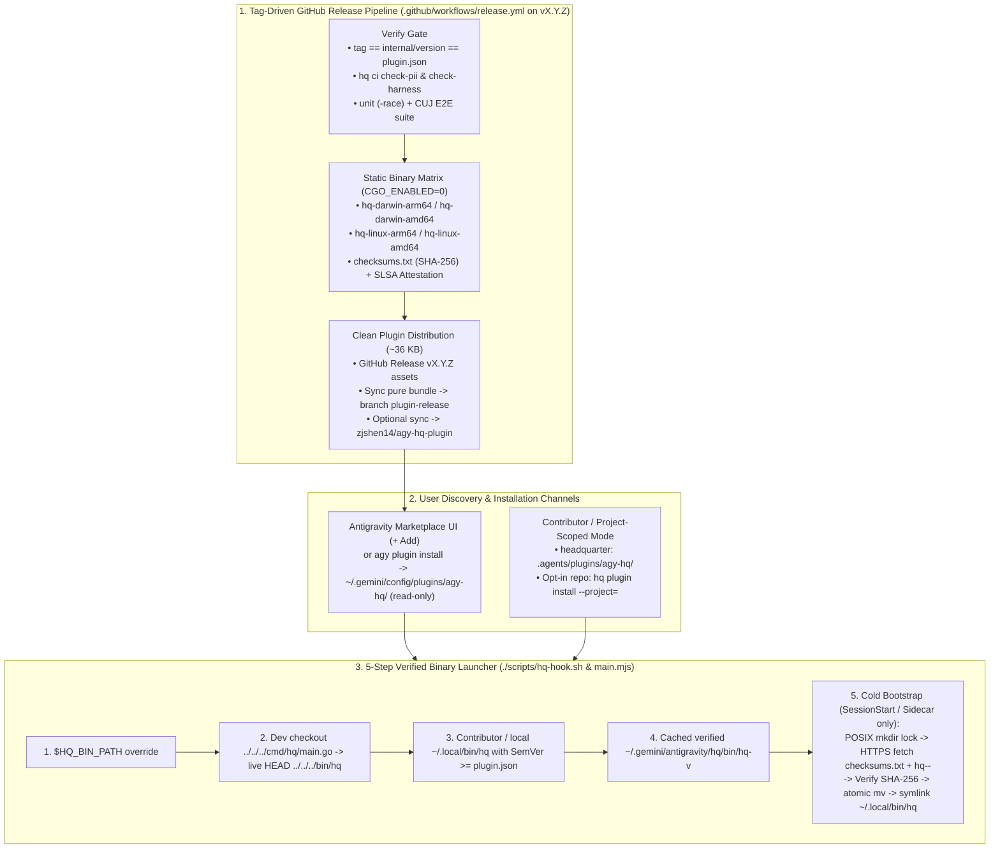

# RFC-0016: Antigravity Marketplace Distribution, Automated GitHub Release Matrix & Verified Binary Bootstrap

- **Status:** Proposed
- **Author:** `[Task:agy-hq] Marketplace Distribution & Binary Bootstrap` (`gemini-4-carbon-high`)
- **Created:** 2026-11-14
- **Companion Research:** [12 — Antigravity Marketplace Distribution, Repository Layout & Verified Binary Bootstrap Audit](../research/12_marketplace_distribution_and_binary_bootstrap.md)
- **Extends / Integrates With:** [ADR-0001 (Hybrid Antigravity Architecture)](../decisions/0001-option-1.5-hybrid-on-antigravity.md), [ADR-0002 (Go Microkernel Binary)](../decisions/0002-go-microkernel-binary.md), [RFC-0011 (CI & Harness Regression Gate)](./0011-ci-pipeline-and-regression-harness.md), [RFC-0013 (Open-Source Readiness & Governance)](./0013-open-source-launch-strategy.md), [RFC-0015 (Standalone Plugin Packaging & Vault Resolution)](./0015-global-plugin-packaging.md)

---

## 1. Motivation & Problem Statement

[RFC-0015](./0015-global-plugin-packaging.md) established `agy-hq`'s standalone plugin bundle ([`.agents/plugins/agy-hq/`](../../.agents/plugins/agy-hq)), embedded Vault templates (`//go:embed`), workspace-agnostic `ResolveVaultDir()`, and **project-scoped by default** installation (`hq plugin install`) so contributors can run `agy-hq` strictly inside `headquarter` (or opted-in repositories) at live `HEAD` without polluting `~/.gemini/config/plugins/`.

To publish `agy-hq` to the **Google Antigravity Marketplace** (via the official [Partner Intake Form](https://forms.gle/2EX5RFYPoJe1UgxR9)) and enable 1-command GitHub installation (`agy plugin install <github-url>`) for external users who have **neither Go nor a local `agy-hq` repository**, [Research 12](../research/12_marketplace_distribution_and_binary_bootstrap.md) identified **six concrete gaps** that must be closed:

1. **Zero-Go-Toolchain Cold Start:** Marketplace and `agy plugin install` unpack **only** the static plugin bundle into `~/.gemini/config/plugins/agy-hq/` (which is read-only and replaced on every plugin update). Without a self-bootstrapping binary fetcher, hooks (`SessionStart`, `PreToolUse`, `Stop`), skills (`hq status`, `hq propose`), and the `:4242` HQ Console sidecar silently no-op on every non-contributor machine.
2. **No Published GitHub Release Binary Matrix or `checksums.txt`:** Although [`.github/workflows/ci.yml`](../../.github/workflows/ci.yml) already cross-compiles `CGO_ENABLED=0` static binaries across `linux/{amd64,arm64}` and `darwin/{amd64,arm64}` on CI runs, no tag-triggered release workflow publishes signed/attested binaries + SHA-256 `checksums.txt` to GitHub Releases.
3. **`hooks.json` Inline Shell vs. Marketplace `./scripts/...` Requirement:** Upstream Marketplace pre-publish rules (`antigravity.google/docs/build-plugins`) specify that `<plugin-root>/hooks.json` must invoke relative `./scripts/...` helper scripts (`0755` preserved in Marketplace bundles) rather than inline `${PLUGIN_ROOT}` shell expressions.
4. **Manifest `$schema`, `displayName` Branding & Pre-Install `README.md`:** [`.agents/plugins/agy-hq/plugin.json`](../../.agents/plugins/agy-hq/plugin.json) lacks `"$schema": "https://antigravity.google/schemas/v1/plugin.json"`, uses `"agy-hq (Headquarter)"` instead of clean brand title `"Headquarter"`, bundles an unused `85 KB` `assets/logo.png` duplicate alongside `assets/logo.svg`, and ships a checkout-centric [`.agents/plugins/agy-hq/README.md`](../../.agents/plugins/agy-hq/README.md) on the Marketplace Overview tab.
5. **Repository Layout Tradeoff (`main` Monorepo vs. Clean Release Bundle):** As proven empirically in [Research 12 §3](../research/12_marketplace_distribution_and_binary_bootstrap.md), moving `.agents/plugins/agy-hq/` to the Go monorepo root would break contributor project-scoped discovery in `headquarter`, copy ~`3.5 MB` of Go source/docs into user profiles, and trigger `agy plugin validate --strict` warnings on root `AGENTS.md`. Conversely, `agy` `1.5.8+` natively installs `/tree/<ref>/<subpath>` URLs (`https://github.com/zjshen14/agy-hq/tree/main/.agents/plugins/agy-hq` and `https://github.com/zjshen14/agy-hq/tree/plugin-release`), allowing us to keep `.agents/plugins/agy-hq/` untouched on `main` while publishing a pure `~36 KB` standalone plugin branch (and optional mirror repo) automatically on every release tag!
6. **Binary-Only `hq upgrade` Gap:** [`cmd/hq/main.go`](../../cmd/hq/main.go) currently requires `cmd/hq` Go source on disk during `hq upgrade`, failing for standalone Marketplace users who want to upgrade `hq` and run Vault schema migrations from the terminal.

---

## 2. Design Goals & Non-Goals

### Goals
1. **1-Click Zero-Go Marketplace & GitHub UX:** External users who install `agy-hq` via the Antigravity Marketplace or `agy plugin install` get automatic, SHA-256-verified `hq` binary provisioning (`darwin/{arm64,amd64}`, `linux/{arm64,amd64}`), Vault initialization (`~/.gemini/antigravity/hq/vault`), and `:4242` HQ Console startup on their very first session—with **zero Go toolchain** and **zero manual build commands**.
2. **100% Preservation of Contributor Project-Scoped `HEAD` Workflow:** Inside `headquarter` (and opted-in contributor workspaces), `agy-hq` remains **strictly project-scoped** (`~/.gemini/config/plugins/agy-hq/` stays absent unless `--global` is explicitly requested) and continues running live `HEAD` binaries (`0` release downloads, never clobbering `~/.local/bin/hq`).
3. **100% Marketplace Pre-Publish Checklist & Schema Compliance:** `0` errors and `0` warnings under `agy plugin validate --strict`, official `$schema`, clean `displayName`, `./scripts/hq-hook.sh` (`0755`) relative hooks, immutable `<plugin-root>`, and Marketplace-ready `README.md`.
4. **Ring-0 Supply-Chain Integrity:** Mandatory HTTPS TLS 1.2+, exact SHA-256 `checksums.txt` verification *before* `chmod +x` or execution, GitHub SLSA Artifact Build Provenance (`actions/attest-build-provenance`), POSIX atomic lockfile, and `PreToolUse` `<5s` non-blocking safety.

### Non-Goals
- Native Windows `.exe` support outside WSL2 in `v0.1.x` (`hq` uses POSIX process groups and Unix signals; Windows users run inside WSL2 `linux/amd64` or `linux/arm64`, while native Windows shells gracefully no-op with a clear notice).
- Replacing Antigravity's own plugin updater (`agy-hq` updates its `hq-v<SemVer>` binary automatically whenever Antigravity updates `<plugin-root>/plugin.json` to a new `version`).

---

## 3. Architecture Overview



---

## 4. Detailed Technical Design

### 4.1 Strict Marketplace Manifest, Branding & Pre-Install `README.md`

#### A. [`.agents/plugins/agy-hq/plugin.json`](../../.agents/plugins/agy-hq/plugin.json)
We align every field with `https://antigravity.google/schemas/v1/plugin.json` (`additionalProperties: false`) and the Marketplace naming rules:

```json
{
  "$schema": "https://antigravity.google/schemas/v1/plugin.json",
  "name": "agy-hq",
  "displayName": "Headquarter",
  "version": "0.1.0",
  "description": "Personal Agent OS for Google Antigravity — 24/7 Front Desk coordinator, zero-token lifecycle hooks, isolated private Vault, and 1-tap approval-bound execution.",
  "logo": "assets/logo.svg",
  "author": {
    "name": "zjshen14",
    "url": "https://github.com/zjshen14/agy-hq"
  },
  "homepage": "https://github.com/zjshen14/agy-hq",
  "repository": "https://github.com/zjshen14/agy-hq",
  "license": "Apache-2.0",
  "keywords": [
    "agent-os",
    "personal-assistant",
    "memory",
    "worktrees",
    "approvals",
    "console"
  ],
  "suggestedPrompts": [
    "Run my Morning Brief across calendar, inbox, and active tasks",
    "Check open PRs, CI status, and active worktrees across my repos",
    "Run nightly sleep-time memory consolidation and Vault health check"
  ]
}
```

#### B. Lean Assets & Marketplace Card `README.md`
1. **Remove unreferenced `.agents/plugins/agy-hq/assets/logo.png` (`85 KB`):** [`.agents/plugins/agy-hq/assets/logo.svg`](../../.agents/plugins/agy-hq/assets/logo.svg) (`4.1 KB`, `1024x1024`, `9.18%` transparent margin, Light/Dark contrast stroke) already satisfies every Marketplace icon rule while cutting unpacked plugin bundle size from `~125 KB` to `~40 KB`.
2. **Update [`.agents/plugins/agy-hq/README.md`](../../.agents/plugins/agy-hq/README.md) for Pre-Install Marketplace Discovery:**
   - Lead with **Zero-Setup Quickstart** (install from Marketplace or `agy plugin install`, automatic SHA-256-verified `hq` binary bootstrap on macOS & Linux, zero Go required).
   - Document **How It Works Without Getting in Your Way**: normal coding sessions stay 100% unrestricted; only your designated `[HQ] Front Desk` coordinator thread activates non-blocking intake orchestration; 100% of personal notes, memory, and credentials live locally inside `~/.gemini/antigravity/hq/vault`.
   - Include a concise table of the **9 Bundled Workflows**, **`:4242` HQ Console Aux Pane**, and **Project-Scoped vs. Global CLI Options** for source contributors.

---

### 4.2 Marketplace-Compliant `./scripts/hq-hook.sh` (`0755`) & Declarative `hooks.json`

Per the upstream Marketplace checklist (`hooks.json` executes with `cwd = <plugin-root>` and must reference `./scripts/...` rather than `${PLUGIN_ROOT}`), we replace inline shell strings in [`.agents/plugins/agy-hq/hooks.json`](../../.agents/plugins/agy-hq/hooks.json) with `.agents/plugins/agy-hq/scripts/hq-hook.sh` (`chmod 0755`):

```json
{
  "hq-kernel": {
    "SessionStart": [
      {
        "type": "command",
        "command": "./scripts/hq-hook.sh session-start",
        "timeout": 20
      }
    ],
    "PreToolUse": [
      {
        "matcher": "run_command|edit_file|write_file|read_file|grep_search|find_by_name|invoke_subagent|manage_subagents|schedule|manage_task|ask_question|search_web|define_subagent|send_message|call_mcp_tool|mcp_.*",
        "hooks": [
          {
            "type": "command",
            "command": "./scripts/hq-hook.sh pre-tool",
            "timeout": 5
          }
        ]
      }
    ],
    "Stop": [
      {
        "type": "command",
        "command": "./scripts/hq-hook.sh stop",
        "timeout": 10
      }
    ]
  }
}
```

#### Immutable `<plugin-root>` Cleanup in [`internal/plugin/plugin.go`](../../internal/plugin/plugin.go)
- Installed Marketplace directories (`~/.gemini/config/plugins/agy-hq/`) are read-only and atomically replaced on update.
- We remove creation of `<plugin-root>/bin/hq` from `plugin.Install` (and prune any legacy `<plugin-root>/bin` symlink during `hq plugin install` / `hq upgrade`), storing all standalone binaries strictly under `~/.gemini/antigravity/hq/bin/` and `~/.local/bin/hq`.

---

### 4.3 5-Step Verified Binary Resolution & Zero-Toolchain Bootstrap (`scripts/hq-hook.sh` + `main.mjs`)

`.agents/plugins/agy-hq/scripts/hq-hook.sh` (`#!/bin/sh`, pure POSIX `sh`, `0755`) supports four subcommands:
- `./scripts/hq-hook.sh session-start`
- `./scripts/hq-hook.sh pre-tool`
- `./scripts/hq-hook.sh stop`
- `./scripts/hq-hook.sh ensure-bin` (invoked by [`sidecars/agy-hq-console/main.mjs`](../../.agents/plugins/agy-hq/sidecars/agy-hq-console/main.mjs) when local fast-paths miss, printing the verified `hq` binary path on `stdout`)

#### Deterministic 5-Step Binary Resolution Order

1. **Step 1 — Explicit Override (`$HQ_BIN_PATH`):**
   - If `$HQ_BIN_PATH` is set and executable, run it immediately (`0ms`, used by hermetic CI/E2E tests).
2. **Step 2 — Contributor Live-`HEAD` Checkout (`<plugin-root>/../../../cmd/hq/main.go`):**
   - When running inside the `headquarter` repository or any `local/worktrees/*` branch, auto-rebuild `<repo>/bin/hq` on `session-start` if any `.go` file is newer than `<repo>/bin/hq`, then `exec <repo>/bin/hq` (`0` network calls; contributor stays at live `HEAD`).
3. **Step 3 — Contributor / User-Installed `~/.local/bin/hq` (`SemVer >= plugin.json`):**
   - Check `$HQ_BIN_DIR/hq` (default `~/.local/bin/hq`) or `hq` on `$PATH`.
   - If `~/.local/bin/hq` is a **regular file** (installed from source via `hq plugin install` / `hq upgrade`) **or** reports `hq version --short` `>= <plugin.json version>`, execute it directly (`0` network calls; **never** overwrites a regular contributor binary at `~/.local/bin/hq`!).
4. **Step 4 — Cached Verified Release Binary (`~/.gemini/antigravity/hq/bin/hq-v<VER>`):**
   - Read `<VER>` from `<plugin-root>/plugin.json` (`"version": "X.Y.Z"`).
   - Check `${HQ_CACHE_DIR:-$HOME/.gemini/antigravity/hq}/bin/hq-v<VER>`. If executable, `exec` in `<1ms` (`0` network calls).
   - Notice how **Marketplace Plugin Updates Work Automatically**: when a user updates `agy-hq` in Marketplace from `0.1.0` to `0.2.0`, `plugin.json` changes to `"0.2.0"`, `hq-v0.2.0` is not yet cached, Step 3 sees old symlink `0.1.0 < 0.2.0`, and Step 5 transparently fetches and verifies `hq-v0.2.0`!
5. **Step 5 — Cryptographically Verified First-Run / Upgrade Download:**
   - **`PreToolUse` Non-Blocking Guard (`5s` SLA):** If invoked for `pre-tool`, **never** start a cold network download. If `.bootstrap.lock` exists, poll up to `20 x 100ms` (`2s`) for `hq-v<VER>` to appear; if still unavailable, output `{}` and `exit 0`.
   - **Platform Mapping:** `uname -s` (`Darwin -> darwin`, `Linux -> linux`) and `uname -m` (`x86_64|amd64 -> amd64`, `arm64|aarch64 -> arm64`). Unsupported platforms log once to `~/.gemini/antigravity/hq/logs/bootstrap.log` and `exit 0`.
   - **POSIX Atomic Directory Lock:** Acquire `mkdir "$CACHE_BIN_DIR/.bootstrap.lock"` (writing `$$` + epoch timestamp; automatically breaking stale locks older than `60s` or owned by a dead PID). Concurrent `SessionStart` and `main.mjs` sidecar startups serialize cleanly without double-downloading.
   - **HTTPS Fetch & Pre-Exec SHA-256 Verification:**
     - Base URL defaults to `https://github.com/zjshen14/agy-hq/releases/download/v<VER>` (overridable via `HQ_RELEASE_BASE_URL` ONLY in local loopback tests `http://127.0.0.1:*` when `HQ_TEST_ALLOW_HTTP_RELEASE=1`; production strictly enforces `https://` + `--proto '=https' --tlsv1.2`).
     - Download `checksums.txt` and `hq-<os>-<arch>` into `$CACHE_BIN_DIR/.tmp.$$/` (`umask 077`, mode `0600`, **not** executable).
     - Extract expected 64-char hex digest for `hq-<os>-<arch>` from `checksums.txt`, compute actual SHA-256 via `sha256sum`, `shasum -a 256`, or `openssl dgst -sha256`, and require an **exact match**. On any network or checksum error, `rm -rf "$TMPDIR"`, log the reason to `bootstrap.log`, and `exit 0` (fail-safe).
     - On match: `chmod 0755`, atomic `mv` to `$CACHE_BIN_DIR/hq-v<VER>`, update `$CACHE_BIN_DIR/hq -> hq-v<VER>`, and—**only if `~/.local/bin/hq` does not exist or is already a symlink into `$CACHE_BIN_DIR/`**—atomically symlink `~/.local/bin/hq -> $CACHE_BIN_DIR/hq-v<VER>`.
   - **Fresh macOS / Linux `PATH` Bridge for `run_command`:**
     - Before modifying `PATH`, `hq-hook.sh` records whether `command -v hq` succeeded on Antigravity's inherited `PATH`. If missing, it exports `HQ_ORIG_PATH_MISSING=1` when invoking `hq hook session-start`.
     - [`internal/hooks/hooks.go`](../../internal/hooks/hooks.go) (`HandleSessionStart`) appends a 1-line environment note (`Environment Note: hq is installed at ~/.local/bin/hq; if bare 'hq' is not in your shell PATH, prefix PATH="$HOME/.local/bin:$PATH"`) so agent `run_command` invocations of `hq` succeed on the very first turn even on a fresh macOS machine before `~/.zshrc` is updated.

---

### 4.4 Dual-Mode `hq upgrade` (Source `HEAD` vs. Standalone Release Binary)

We upgrade [`cmd/hq/main.go`](../../cmd/hq/main.go) (`case "upgrade":`) + [`internal/plugin/plugin.go`](../../internal/plugin/plugin.go) (`UpgradeBinaryRelease`) so `hq upgrade` works seamlessly for **both** personas:

| Persona | Detection Condition | `hq upgrade` Behavior |
| :--- | :--- | :--- |
| **Contributor / Author (`HEAD` Mode)** | `cmd/hq/main.go` exists at `rootDir` (or `GlobalConfig.SourceRepoDir` points to a local `agy-hq` git checkout, unless `--release` is explicitly passed) | **Unchanged live-`HEAD` workflow:** Snapshots Vault, runs `git pull --ff-only`, recompiles `./bin/hq` from `HEAD` with `-ldflags GitCommit`, runs `hq migrate`, and syncs `~/.local/bin/hq` + staged project/global plugin bundle. |
| **Marketplace / Standalone User (`Release` Mode)** | No local `agy-hq` Go source checkout exists (or `hq upgrade --release [--version=vX.Y.Z]` is passed) | 1. Snapshots uncommitted Vault changes.<br>2. Queries target version (`--version`, installed `~/.gemini/config/plugins/agy-hq/plugin.json` version if newer, or GitHub Releases API `releases/latest`).<br>3. Downloads `checksums.txt` + `hq-<os>-<arch>`, verifies SHA-256 in Go (`crypto/sha256`), installs `~/.gemini/antigravity/hq/bin/hq-v<VER>`, updates `~/.local/bin/hq`, and restarts `agy-hq.service` / daemon.<br>4. Re-execs `<newBin> migrate` to apply any new Vault schema migrations cleanly. |

---

### 4.5 Automated GitHub Release & Distribution Pipeline (`.github/workflows/release.yml`)

#### A. Repository & Distribution Layout Comparison

Based on our empirical `agy` `1.5.8` tests in [Research 12 §3](../research/12_marketplace_distribution_and_binary_bootstrap.md), we evaluated three repository layouts:

| Layout Option | Contributor `headquarter` Project Scope | `agy plugin validate --strict` | Direct `agy plugin install` URL | Marketplace Partner Intake Compatibility |
| :--- | :--- | :--- | :--- | :--- |
| **Option A (Recommended): Canonical `.agents/plugins/agy-hq/` on `main` + Automated `plugin-release` Branch (+ Optional Mirror Repo)** | **100% Preserved** (zero root collisions, zero global pollution) | **`0` errors, `0` warnings** (`findings: []`) | Works via **both** `https://github.com/zjshen14/agy-hq/tree/plugin-release` **and** `.../tree/main/.agents/plugins/agy-hq` (`~40 KB` pure bundle!) | **100% Compatible** (`plugin-release` branch is a pure standalone plugin tree; optional 1-secret push to `zjshen14/agy-hq-plugin` provides a root `<owner>/<repo>` URL if Intake requires default branch) |
| **Option B: Separate Hand-Maintained Plugin Repo Only** | Preserved, but splits PRs across two repos | `0` errors, `0` warnings | `https://github.com/zjshen14/agy-hq-plugin` | Compatible, but risks version/skill drift between engine and plugin repos |
| **Option C: Promote Plugin to `zjshen14/agy-hq` Root (`.antigravity-plugin/plugin.json`)** | **Broken** (workspace `.agents/plugins/*` discovery lost without workarounds) | **Warning** on root `AGENTS.md` | Copies entire ~`3.5 MB` Go codebase & docs into `~/.gemini/config/plugins/agy-hq/` | Pollutes Marketplace bundle with Go source, tests, and RFC archive |

**Decision:** Adopt **Option A**. [`.agents/plugins/agy-hq/`](../../.agents/plugins/agy-hq) remains the single source of truth in `zjshen14/agy-hq`. Whenever a `vX.Y.Z` tag is pushed, `.github/workflows/release.yml` automatically publishes the verified binary matrix to GitHub Releases **and** force-updates the pure standalone plugin tree onto branch `plugin-release` (plus mirrors to `zjshen14/agy-hq-plugin` automatically if repository variable/secret `PLUGIN_MIRROR_REPO` + `PLUGIN_MIRROR_TOKEN` are set).

#### B. `.github/workflows/release.yml` Specification

Triggered on `push.tags: ["v[0-9]+.[0-9]+.[0-9]+"]` (and `workflow_dispatch` dry-run):
1. **`verify` Job (`ubuntu-latest`, `permissions: contents: read`):**
   - Verifies exact 3-way SemVer parity: `GITHUB_REF_NAME` (`vX.Y.Z`) == `internal/version.Version` (`X.Y.Z`) == `.agents/plugins/agy-hq/plugin.json` (`"version": "X.Y.Z"`).
   - Runs `./bin/hq ci check-pii`, `./bin/hq ci check-harness` (`H1`–`H4B`), `go test -race ./...`, and `TestCUJ*`.
2. **`release` Job (`ubuntu-latest`, `needs: verify`, `permissions: contents: write, id-token: write, attestations: write`):**
   - Cross-compiles reproducible static binaries (`CGO_ENABLED=0 -trimpath -ldflags="-s -w -X github.com/zjshen14/agy-hq/internal/version.GitCommit=${GITHUB_SHA::12}"`) for:
     - `hq-darwin-arm64`
     - `hq-darwin-amd64`
     - `hq-linux-arm64`
     - `hq-linux-amd64`
   - Packages `agy-hq-plugin-vX.Y.Z.tar.gz` (from `.agents/plugins/agy-hq/` preserving `0755` on `scripts/hq-hook.sh`) and generates `checksums.txt` (`sha256sum hq-* agy-hq-plugin-*.tar.gz > checksums.txt`).
   - Generates SLSA build provenance attestations via GitHub's official `actions/attest-build-provenance@v2`.
   - Publishes the GitHub Release + release notes via GitHub CLI (`gh release create "$GITHUB_REF_NAME" dist/* --generate-notes --verify-tag` using built-in `GITHUB_TOKEN`, introducing **zero third-party release actions**).
   - Commits the pure `.agents/plugins/agy-hq/` contents as a clean root commit onto branch `plugin-release` (`git push --force origin HEAD:refs/heads/plugin-release`), and if `secrets.PLUGIN_MIRROR_TOKEN` is configured, pushes the same commit to `https://github.com/<owner>/agy-hq-plugin.git` `main`.

#### C. Maintainer Release Helper (`scripts/release.sh`)
To make cutting a release effortless and error-free from `main`:
- `./scripts/release.sh check` — verifies clean git status, SemVer parity, Marketplace bundle checklist, and `./bin/hq ci pre-push`.
- `./scripts/release.sh bump <X.Y.Z>` — updates `internal/version/version.go` and `.agents/plugins/agy-hq/plugin.json` to `<X.Y.Z>`, runs `./bin/hq ci pre-push`, and prints the exact commit + annotated tag commands (`git tag -a vX.Y.Z -m "Release vX.Y.Z" && git push origin main vX.Y.Z`).

---

### 4.6 Antigravity Marketplace Partner Intake Runbook

Once Phase 2 merges and tag `v0.1.0` (or `v0.2.0`) finishes `.github/workflows/release.yml`:
1. **Immediate Public Install (Works Instantly Before Partner Intake Review Completes):**
   ```bash
   agy plugin install https://github.com/zjshen14/agy-hq/tree/plugin-release
   ```
2. **Official Marketplace Listing Submission:**
   Submit Google's **[Antigravity Marketplace Partner Intake Form](https://forms.gle/2EX5RFYPoJe1UgxR9)** with:
   - **Plugin Name (`name`):** `agy-hq`
   - **Display Name (`displayName`):** `Headquarter`
   - **Repository / Plugin URL:** `https://github.com/zjshen14/agy-hq/tree/plugin-release` (or `https://github.com/zjshen14/agy-hq-plugin` if the intake form requests a bare root repository URL)
   - **License:** `Apache-2.0`
   - **Components Summary:** 9 Skills, 1 Always-On Rule (`rules/AGENTS.md`), 1 Lifecycle Hook Group (`hooks.json` -> `./scripts/hq-hook.sh`), 1 Console Sidecar (`agy-hq-console`).

---

## 5. Security & Privacy Invariants

1. **Pre-Exec Cryptographic SHA-256 Gate:** Neither `scripts/hq-hook.sh` nor `hq upgrade --release` ever marks a downloaded file executable (`chmod +x`) or executes a single instruction before verifying its 64-char hex SHA-256 against `checksums.txt` over HTTPS TLS 1.2+. Tampered or truncated downloads are unlinked immediately.
2. **Zero Third-Party GitHub Actions Supply-Chain Exposure:** `.github/workflows/release.yml` uses **only** official GitHub first-party actions (`actions/checkout@v4`, `actions/setup-go@v5`, `actions/attest-build-provenance@v2`) and the runner's built-in `gh` CLI.
3. **Immutable `<plugin-root>` & Preserved Private Vault:** Downloaded binaries live in `~/.gemini/antigravity/hq/bin/hq-v<VER>` (never inside `~/.gemini/config/plugins/agy-hq/`), and plugin updates or uninstalls never modify or delete the user's private Vault (`~/.gemini/antigravity/hq/vault` or `<repo>/local/`).
4. **Strict Project Scope on Maintainer Workstation:** Implementing `RFC-0016` does **not** install anything into `~/.gemini/config/plugins/` unless a user explicitly runs `agy plugin install` or `hq plugin install --global`.

---

## 6. CI Gate Updates & E2E Acceptance Suite (`CUJ-26`)

1. **Harness Gate `H2-A` & `H2-C` Updates ([`internal/ci/harness.go`](../../internal/ci/harness.go) + [`internal/plugin/plugin.go`](../../internal/plugin/plugin.go)):**
   - `H2-A`: Require `.agents/plugins/agy-hq/hooks.json` commands to invoke relative `./scripts/hq-hook.sh <session-start|pre-tool|stop>` (forbidding `${PLUGIN_ROOT}` or `./bin/hq` inside `hooks.json` per Marketplace checklist) and verify `.agents/plugins/agy-hq/scripts/hq-hook.sh` exists with executable mode `0755` (`mode & 0111 != 0`) and valid POSIX `sh -n` syntax!
   - `H2-C`: Enforce `"$schema": "https://antigravity.google/schemas/v1/plugin.json"`, official JSON Schema key allowlist (`additionalProperties: false`), `displayName` Marketplace branding rules (no `"Antigravity"`/`"Gemini"`/`"Claude"`/`"Cursor"` prefix or `"Plugin"`/`"MCP"` suffix), `README.md` non-empty presence, `assets/logo.svg` existence, and `agy plugin validate --strict .agents/plugins/agy-hq` (`0` errors, `0` warnings).
2. **Hermetic E2E Acceptance Suite (`CUJ-26: Zero-Toolchain Marketplace Cold Bootstrap, Tamper Rejection & Binary Self-Upgrade` in [`internal/e2e/cuj_e2e_test.go`](../../internal/e2e/cuj_e2e_test.go)):**
   - Spins up an in-process local loopback release server (`httptest.NewServer`) serving the real test `hq` binary (`hq-<os>-<arch>`) + valid `checksums.txt` for `v0.1.0` and `v0.2.0`.
   - **Subtest A (Cold Marketplace Install Bootstrap):** Stages `.agents/plugins/agy-hq/` into `$TMP_HOME/.gemini/config/plugins/agy-hq/` with **no `hq` binary on `PATH` and no Go checkout**, executes `./scripts/hq-hook.sh session-start`, and verifies:
     1) `hq-v0.1.0` is downloaded, SHA-256-verified, and cached at `$TMP_HOME/.gemini/antigravity/hq/bin/hq-v0.1.0`,
     2) `$TMP_HOME/.local/bin/hq` symlink is created,
     3) `$TMP_HOME/.gemini/config/plugins/agy-hq/` remains 100% untouched/clean (zero files written inside `<plugin-root>`), and
     4) `SessionStart` returns valid `injectSteps` JSON and initializes `$TMP_HOME/.gemini/antigravity/hq/vault`.
   - **Subtest B (Tampered Binary / Bad Checksum Rejection):** Serves a 1-byte-corrupted binary against valid `checksums.txt`, runs `./scripts/hq-hook.sh session-start` in a clean `$TMP_HOME`, and verifies exit `0`, zero cached binary written, and explicit tamper rejection logged in `bootstrap.log`.
   - **Subtest C (Concurrent `SessionStart` + Sidecar `ensure-bin` Lock Contention):** Fires 6 parallel `./scripts/hq-hook.sh` invocations on a cold cache and verifies the server receives **1** binary download (not 6) and all 6 callers succeed cleanly.
   - **Subtest D (Contributor `HEAD` Binary Never Overwritten & Standalone `hq upgrade --release`):** Verifies a regular binary at `$TMP_HOME/.local/bin/hq` (`0.1.0`) skips network download completely, and running standalone `hq upgrade --release --version=v0.2.0` upgrades cleanly to verified `hq-v0.2.0` + runs `hq migrate`.
