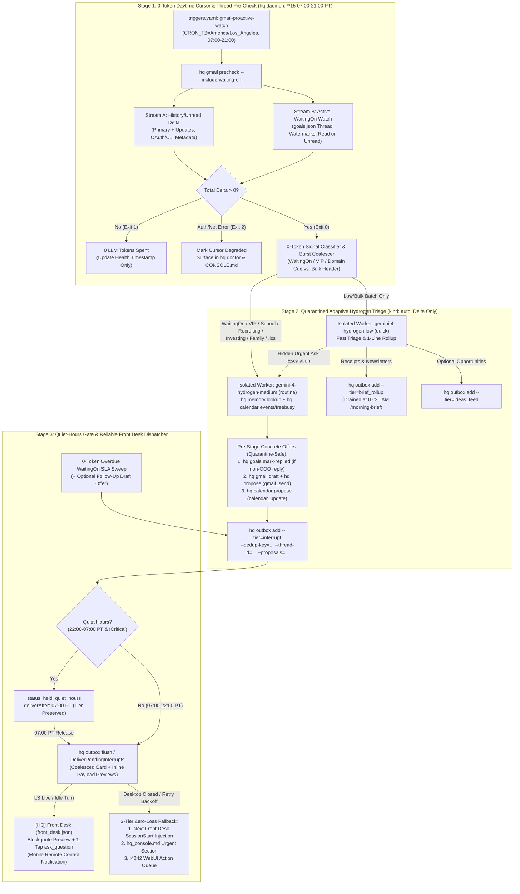

# RFC-0016: Muse-Style Proactive Gmail & Counterparty Thread Watcher — Zero-Token Daytime Cursor, Adaptive Hydrogen Delta Triage & Reliable Front Desk Interrupt Delivery

- **RFC ID:** `RFC-0016`
- **Status:** `Proposed (Phase 1 Review)`
- **Created:** `2026-11-14`
- **Related Documents:**
  - [PRD-0001: Core Product Vision & Day-in-the-Life UX](../product/0001-vision-and-ux.md)
  - [PRD-0003: Critical User Journeys (CUJs 1–24) & E2E Acceptance Criteria](../product/0003-critical-user-journeys.md)
  - [RFC-0003: Action-Based Safety, Quarantined Readers & Approval-Bound Execution](0003-approval-bound-execution.md)
  - [RFC-0005: Decoupled Native Gmail Integration](0005-gmail-integration.md)
  - [RFC-0007: Front Desk Initialization Hardening, Trigger Arming & Shift Handover](0007-front-desk-initialization-hardening.md)
  - [RFC-0012: End-to-End Token Usage, Latency & Cost/Quota Observability](0012-token-observability.md)
  - [RFC-0014: Proactive Engine v2 — Event-Driven Gatekeepers, Attention Routing & Living Context](0014-proactive-engine-and-living-context.md)
  - [Research 10: Meta Muse (`muse.ai`) Personal Context & Proactive Workflows Study](../research/10_muse_ai_proactive_and_context_study.md)
  - [Research 12: Forensic Audit — Proactive Gmail Watching, `WaitingOn` Threads & Outbox Delivery](../research/12_proactive_gmail_and_thread_watcher_audit.md)

---

## 1. Context & Problem Statement

In a high-leverage Personal Agent OS, the assistant should quietly watch inbound email and active counterparty threads throughout the workday (`07:00–21:00 PT`), spend **0 LLM tokens** when nothing new has arrived, silently roll newsletters and transactional receipts into the next morning's brief, and **proactively tap the user on the shoulder** only when an actionable reply or time-sensitive alert arrives—already armed with a 1-tap reply draft or calendar update.

Our forensic code audit ([Research 12](../research/12_proactive_gmail_and_thread_watcher_audit.md)) of Proactive Engine v2 ([RFC-0014](0014-proactive-engine-and-living-context.md)) identified four concrete gaps blocking this experience today:

1. **No Daytime Watcher Schedule & Blind `WaitingOn` Thread Detection:**
   - `templates/triggers.yaml` defines no daytime (`07:00–21:00 PT`, 15–20 min) Gmail gatekeeper; `hq daemon` relies on a hardcoded 30-minute 24/7 loop (`cmd/hq/main.go:1412`).
   - `SweepWaitingOnObligations` (`internal/kernel/goals.go:369-430`) checks only `now >= FollowUpAfter` and **never inspects Gmail threads** for counterparty replies.
   - `DefaultPrimaryQuery` (`label:INBOX is:unread category:primary -label:promotions -label:social` in `internal/gmail/gmail.go:28`) misses high-signal alerts filed by Gmail into `CATEGORY_UPDATES` (school portals, youth sports/family logistics, recruiting ATS platforms, calendar `.ics` updates, investor notices) as well as counterparty replies the user briefly opened on mobile (`!is:unread`)—causing false-positive overdue SLA alerts.
2. **Daemon Auth Split-Brain, Token Expiry Bug & At-Most-Once Cursor Loss:**
   - `gmail.RunPrecheck` (`gmail.go:831-880`) swallows `SearchMessages` errors (`if err != nil { continue }`) and falsely reports `"GMAIL_OK (0 new unread Primary messages; 0 LLM tokens)"` when background auth fails.
   - `loadAccessTokenFromFile` (`gmail.go:1288-1290`) returns cached `access_token` strings without checking `expiry`, `searchViaOAuthToken` strips sender/subject headers, `readThreadViaOAuthToken` truncates full MIME bodies to 160-char snippets, and `RunPrecheck` stamps `SeenMessageIDs` *before* triage workers succeed.
3. **The Outbox `interrupt` Delivery Black Hole:**
   - `outbox.Add` (`internal/outbox/outbox.go:383-430`) appends `status: "pending"` items to `local/memory/outbox/items.jsonl`, and **no component in `agy-hq` ever pushes pending `interrupt` items to `[HQ] Front Desk` (`front_desk.json`)**.
   - Legacy `RunHeartbeat` (`internal/kernel/kernel.go:2227-2244`) spawns orphaned `[Auto] Gmail Triage` sidebar conversations instead of delivering verified action cards to `[HQ] Front Desk` and Antigravity Remote Control.
4. **Quiet-Hours (`22:00–07:00 PT`) & SLA Escalation Bugs:**
   - `DefaultAttentionConfig()` (`outbox.go:89`) sets `QuietHours.Enabled = false` and `ParseAttentionConfig` (`outbox.go:180`) ignores `tz:` in `templates/config.yaml`.
   - `EvaluateDelivery` (`outbox.go:355-359`) irreversibly overwrites `TierInterrupt -> TierBriefRollup` during quiet hours instead of holding items until `07:00 PT`.
   - `SweepWaitingOnObligations` (`goals.go:385-401`) refuses to escalate overdue `WaitingOn` SLAs to `interrupt` unless the parent Goal has a `TargetDate` within 24 hours.

### 1.1 Design Goals

1. **Zero-LLM-Token Daytime Pre-Check (`07:00–21:00 PT`, every 15m):** Declarative `daemon_gatekeeper` schedule scanning both new inbound messages (`Primary` + `Updates`) and active `WaitingOn` counterparty threads (`0` LLM tokens when `Delta == 0`, transparent `hq doctor` health telemetry when auth degrades).
2. **Adaptive Hydrogen Delta Triage (`gemini-4-hydrogen-low` / `gemini-4-hydrogen-medium`):** Invoke LLMs **only on non-empty deltas** inside an isolated Quarantined Reader worker (`kind: "auto"`), using `gemini-4-hydrogen-low` (`quick`) for low-signal/bulk batches and `gemini-4-hydrogen-medium` (`routine`) when `WaitingOn` replies, known `EntityDossier` contacts, or high-priority domains (`school`, `recruiting`, `investing`, `family_logistics`) are present.
3. **Muse-Style Concrete Pre-Staged Offers ("Do the Work First"):** Actionable `interrupt` items arrive with pre-checked calendar availability and 1-tap SHA-256 proposals (`hq gmail draft` + `gmail_send` reply proposal and/or quarantine-safe `hq calendar propose` `calendar_update` proposal), while newsletters and receipts route silently to `brief_rollup`.
4. **Reliable, Deduplicated, Quiet-Hours-Safe Front Desk Delivery:** Coalesced push of pending `interrupt` items and overdue SLA nudges directly into `[HQ] Front Desk` during `07:00–22:00 PT` (waking mobile Remote Control with 1-tap `ask_question` cards), non-destructive `held_quiet_hours` queuing during `22:00–07:00 PT`, 3-layer `DedupKey` / thread-burst superseding, and 3-tier fallback (`SessionStart` injection + `hq_console.md` + `:4242` WebUI) when Antigravity Desktop is closed.

### 1.2 Non-Goals

- **No Direct Unapproved External Mutations:** Auto-sending replies or mutating Google Calendar events without human `hq approve` remains strictly forbidden ([RFC-0003](0003-approval-bound-execution.md)).
- **No Untrusted Email Bodies in `[HQ] Front Desk`:** Raw HTML/MIME bodies stay confined inside ephemeral tainted triage workers; `[HQ] Front Desk` receives only sanitized, schema-bounded summaries and SHA-256-locked proposal previews.
- **No Custom Cloud Push Relay Infrastructure:** No external Pub/Sub webhook servers or third-party cloud relays are required; everything runs locally on the user's workstation via `hq daemon` + Antigravity.

---

## 2. Architecture Overview

`RFC-0016` replaces the legacy orphaned-batch loop with a deterministic **3-Stage Proactive Pipeline**:



### Core Architectural Invariants

| Invariant | Enforcement Mechanism |
|---|---|
| **I1. Zero Empty-Poll Token Burn** | `hq gmail precheck --include-waiting-on` runs in pure Go inside `hq daemon`; exit code `1` (`Delta == 0`) aborts worker creation before any LLM call. |
| **I2. Lease-Before-Ack Cursor Safety** | Unseen message IDs and thread watermarks acquire a `30m` staging lease (`stagedLeases`) and only advance `ackedMessageIds` / `lastSeenMessageId` once `hq gmail record-triage` or `hq outbox add` commits—eliminating silent message drops on worker quota blocks or crashes. |
| **I3. Strict Quarantine Isolation** | `[HQ] Front Desk` never invokes `hq gmail read-quarantined`. Untrusted MIME content stays inside the ephemeral worker; calendar reads when tainted are restricted to self-availability (`hq calendar events|freebusy`), and calendar mutations are staged solely via `hq calendar propose`. |
| **I4. Non-Destructive Quiet Hours** | Between `22:00–07:00 PT`, non-critical `interrupt` items retain `tier: "interrupt"` with `status: "held_quiet_hours"` and release automatically at `07:00 PT` (coordinated with `07:30 AM` `/morning-brief` via `DeliveredAt` stamps so items are never double-notified). |
| **I5. At-Most-Once Idempotent Delivery** | Every outbox item carries a deterministic `DedupKey`; newer replies on an undelivered thread supersede stale pending cards, and `.flush.lock` + `DeliveredAt` guarantee each card wakes `[HQ] Front Desk` once. |

---

## 3. Stage 1: Zero-LLM-Token Daytime Cursor & Counterparty Thread Pre-Check

### 3.1 Declarative Schedule & Active Window (`templates/triggers.yaml` & `gatekeeper.go`)

We extend `ScheduleTrigger` (`internal/kernel/gatekeeper.go:25-40`) with an optional `window` (`"HH:MM-HH:MM"`, evaluated in the schedule's `CRON_TZ` timezone) and `cooldown_minutes` field, and add `gmail-proactive-watch` to `templates/triggers.yaml`:

```yaml
  # Daytime Proactive Gmail & Counterparty Thread Watcher (Every 15m, 07:00–21:00 PT, 0 tokens when idle)
  - id: gmail-proactive-watch
    cron: "CRON_TZ=America/Los_Angeles */15 7-21 * * *"
    window: "07:00-21:00"
    mode: daemon_gatekeeper
    model: hydrogen
    precheck_cmd: ["hq", "gmail", "precheck", "--include-waiting-on", "--json"]
    dedup_mode: exit_code
    delivery: interrupt_on_actionable
    skill: inbox-triage
    prompt: "[Auto] Triage pending Gmail & WaitingOn delta batch (`local/memory/gmail/batches/`): route actionable replies & urgent alerts to `interrupt` with pre-staged reply/calendar offers, and route newsletters/receipts to `brief_rollup`."
```

- **Exact Boundary Behavior (`window: "07:00-21:00"`):** Combined with `*/15 7-21 * * *`, ticks fire at `07:00, 07:15, ..., 20:45, 21:00 PT` (`57` checks/day) and skip `21:15, 21:30, 21:45 PT` as well as `21:01–06:59 PT`. Users preferring a 20-minute cadence simply edit `*/15` to `*/20` in `local/triggers.yaml`.
- **Three-State Pre-Check Exit Contract (`gatekeeper.go`):**
  - `exit 0`: `totalDelta > 0` $\rightarrow$ inspect structured JSON stdout (`recommendedModel`, `batchIds`, `highPriorityCount`) and spawn the adaptive worker.
  - `exit 1`: `totalDelta == 0` $\rightarrow$ healthy empty poll (`0` LLM tokens; update `lastCheckedAt` and `lastStatus = "ok_empty"`).
  - `exit 2`: transport or authentication failure (`GMAIL_AUTH_REQUIRED`, HTTP `5xx`, network unreachable) $\rightarrow$ **do not** mask as empty; record `lastStatus = "degraded"` + `lastError` in `gatekeeper_cursors.json` (`0` LLM tokens) and surface in `hq doctor` / `CONSOLE.md`.
- **Decoupling Legacy `RunHeartbeat` Gmail Poll:** When `triggers.yaml` defines `gmail-proactive-watch`, `RunHeartbeat` (`kernel.go:2220`) skips its legacy 24/7 30-minute `gmail.RunPrecheck` call so Gmail is never polled during `21:01–06:59 PT` or double-polled during the day.

### 3.2 Upgraded `AccountState` Watermark & Lease-Acked Cursor Schema

`local/memory/gmail/state-<alias>.json` (`internal/gmail/gmail.go:108-115`) is upgraded (backward-compatibly migrating existing `seenMessageIds` maps on first load):

```go
type ThreadWatermark struct {
	LastMessageID string `json:"lastMessageId"`
	MessageCount  int    `json:"messageCount"`
	LastCheckedAt string `json:"lastCheckedAt"`
}

type TransportHealth struct {
	AuthMode            string `json:"authMode"` // "oauth_token" | "plugin_cli" | "mock"
	LastSuccessAt       string `json:"lastSuccessAt,omitempty"`
	LastError           string `json:"lastError,omitempty"`
	LastErrorAt         string `json:"lastErrorAt,omitempty"`
	ConsecutiveFailures int    `json:"consecutiveFailures"`
}

type AccountState struct {
	Account          string                     `json:"account"`
	LastHistoryID    uint64                     `json:"lastHistoryId,omitempty"`
	LastCheckedAt    string                     `json:"lastCheckedAt"`
	AckedMessages    map[string]string          `json:"ackedMessages"`              // msgID -> ackedAt RFC3339 (14d GC)
	StagedLeases     map[string]string          `json:"stagedLeases,omitempty"`     // msgID -> leaseExpiresAt RFC3339 (30m TTL)
	ThreadWatermarks map[string]ThreadWatermark `json:"threadWatermarks,omitempty"` // threadID -> watermark (30d GC)
	Health           TransportHealth            `json:"health"`
}
```

- **Crash-Safe Lease Lifecycle:**
  1. `RunPrecheck` skips `m.ID` if present in `AckedMessages` **or** if `StagedLeases[m.ID] > now`.
  2. When creating `batch-<ts>-<hex>.json`, `RunPrecheck` sets `StagedLeases[m.ID] = now + 30m` (not `AckedMessages`).
  3. When the worker completes `hq gmail record-triage --batch=<batchId>` (or stages outbox items referencing the batch), `AckBatch` promotes all batch message IDs into `AckedMessages[m.ID] = now`, clears `StagedLeases`, and marks `batch.Status = "completed"`.
  4. If the worker was skipped by `QuotaState.CircuitOpen` or failed mid-turn, the `30m` lease expires and the next precheck re-picks the untriaged message automatically.
  5. Every `saveAccountState` prunes `AckedMessages` older than `14` days and `ThreadWatermarks` older than `30` days (unless still referenced by an active `WaitingOn` item).

### 3.3 Dual-Stream 0-Token Delta Engine (`Stream A` + `Stream B`)

#### Stream A: Inbound History & Broadened Unread Scan (`Primary` + `Updates`)

1. **Default Watcher Query Upgrade:**
   `DefaultWatcherQuery` widens from `category:primary`-only to:
   ```text
   label:INBOX is:unread newer_than:2d -category:promotions -category:social -category:forums
   ```
   Per-account `AccountConfig.Query` overrides in `local/private/gmail/accounts.json` remain honored if customized by the user; accounts still carrying the legacy untouched `DefaultPrimaryQuery` string are transparently upgraded during Vault schema migration (`v8 -> v9`).

2. **Incremental `users.history.list` + Metadata Enrichment (OAuth Transport Fixes):**
   - **Token Refresh Fix (`loadAccessTokenFromFile`):** Parse `expiry` (`RFC3339` or `expires_at` epoch) in `<vault>/private/gmail/tokens/<alias>.json`. Refresh automatically via `refresh_token` whenever `expiry` is missing, within `60s` of `now`, or upon HTTP `401`, atomically persisting the new `access_token` + `expiry` (`0600`).
   - **Incremental History Fast-Path:** When `LastHistoryID > 0` on OAuth transport, call `GET /gmail/v1/users/me/history?startHistoryId=<id>&historyTypes=messageAdded` (`1` tiny HTTP call, `<30ms` when `history` is empty!). Fall back cleanly to full `DefaultWatcherQuery` search if `LastHistoryID == 0` or Gmail returns HTTP `404` (expired `historyId`).
   - **Metadata Header Fetch (`searchViaOAuthToken`):** Fetch `/gmail/v1/users/me/messages/<id>?format=metadata` for unseen IDs, populating `From`, `To`, `Cc`, `Subject`, `Date`, `MessageIDHeader`, `InReplyTo`, `ListUnsubscribe`, `AutoSubmitted`, `Precedence`, `Snippet`, and `Labels`.
   - **Full MIME Body & Draft Parity (`readThreadViaOAuthToken`, `createDraftViaOAuthToken`, `sendDraftViaOAuthToken`):** Reuse `parseRawGmailMessage` in `readThreadViaOAuthToken` so full `text/plain` and sanitized `text/html` bodies are extracted (fixing the 160-char snippet truncation bug), and add REST `users.drafts.create` / `users.drafts.send` fallbacks (including `In-Reply-To` and `References` RFC 2822 headers so replies stay threaded in Gmail).

3. **Daemon vs. Antigravity Plugin Auth Diagnostics (`hq doctor` Check #12):**
   - Inside an Antigravity agent turn (`run_command`), bare `gmail` receives Antigravity's managed OAuth2 plugin token automatically. Outside an agent turn (`hq daemon`), background polling requires either a standalone OAuth `TokenFile` (`hq gmail login`) or standalone CLI credentials.
   - `hq doctor` adds Check #12 (`Proactive Gmail & Thread Watcher Health`), verifying `accounts.json`, daemon-context auth reachability, cursor freshness, and active `gmail-proactive-watch` schedule status. If only IDE-scoped plugin auth is present, `RunPrecheck` exits `2` (`GMAIL_AUTH_REQUIRED`) and `hq doctor` prints the exact 1-time `hq gmail login` setup command instead of silently reporting `GMAIL_OK`.

#### Stream B: Zero-Token Counterparty `WaitingOn` Thread Watch (`internal/kernel/goals.go` + `internal/gmail`)

We extend `WaitingOnItem` (`internal/kernel/goals.go:25-39`) with watermark and SLA priority metadata:

```go
type WaitingOnItem struct {
	ID                string `json:"id"`
	Counterparty      string `json:"counterparty"`                // e.g. "Bob Rivera <bob@example.com>"
	Channel           string `json:"channel"`                     // "gmail" | "gchat" | "github" | "other"
	ThreadOrSpace     string `json:"threadOrSpace,omitempty"`     // Gmail thread ID (e.g. "1934a8f0c2e1b001")
	Summary           string `json:"summary"`
	Priority          string `json:"priority,omitempty"`          // "urgent" | "normal" | "low" (default "normal")
	CreatedAt         string `json:"createdAt"`
	FollowUpAfter     string `json:"followUpAfter"`
	Status            string `json:"status"`                      // "waiting" | "replied" | "overdue" | "nudge_queued"
	RepliedAt         string `json:"repliedAt,omitempty"`
	LastSeenMessageID string `json:"lastSeenMessageId,omitempty"` // Watermark at registration / last check
	NudgeProposalID   string `json:"nudgeProposalId,omitempty"`   // Optional pre-staged follow-up draft proposal
}
```

On every `hq gmail precheck --include-waiting-on` tick (`0` LLM tokens):
1. Load all active `Goals` containing `WaitingOn` items with `Channel == "gmail"` and `Status` in `{"waiting", "nudge_queued"}`.
2. **Thread Auto-Binding:** If `ThreadOrSpace` is empty (the user ran `hq goals wait-on --counterparty="bob@example.com"` without a thread ID), run a lightweight metadata search `to:bob@example.com OR from:bob@example.com newer_than:14d` (`max=3`), bind the matching `ThreadID` + baseline `LastSeenMessageID` when unambiguous, and persist back to `goals.json`.
3. **Read-Agnostic, Tab-Agnostic Thread Inspection:** Fetch lightweight thread metadata (`GetThreadMetadata` — message IDs, `From`, `Date`, `Subject`, `Snippet`, `Auto-Submitted`). Because this queries the thread directly by `threadId`, it catches counterparty replies **even if the user already read the email on their phone (`!is:unread`) or Gmail routed it to `Updates` / `Forums`**.
4. **Reply vs. OOO Bounce Classification in Pure Go:**
   - Find any message after `LastSeenMessageID` whose `From` address does **not** belong to the user's configured Gmail account(s).
   - If `Auto-Submitted` equals `auto-replied` or `Subject` matches `(?i)^(out of office|automatic reply|auto-reply):`: attach `WaitingOnMatch{IsAutoReplyOOO: true}` so the worker surfaces an informational rollup/SLA adjustment **without** falsely closing `Status = "replied"`.
   - Otherwise: attach `WaitingOnMatch{GoalSlug, WaitID, Counterparty, Summary}` to the delta message, force `PriorityClass = "high"`, and suppress overdue SLA firing for that `WaitID` while triage is in flight.

### 3.4 Deterministic 0-Token Signal Classifier & Burst Coalescer

Before spawning any worker, `ClassifySummaryZeroToken` (`internal/gmail/precheck_classify.go`) tags every unseen `MessageSummary` in `<1ms`:

| Signal Rule (Evaluated Top-to-Bottom in Go) | Assigned `PriorityClass` | Domain Tag | Batch Routing Effect |
|---|---|---|---|
| `MatchedWaitingOn != nil` (non-OOO counterparty reply) | `"high"` | `waiting_on_reply` | Bypass coalescing; spawn `gemini-4-hydrogen-medium` immediately |
| Sender email/domain matches `local/memory/entities/*.md` or `reg.TrustedDomains` | `"high"` | `vip_contact` | Spawn `gemini-4-hydrogen-medium` |
| Attachment has `text/calendar` / `.ics` or subject has invite/reschedule cue | `"high"` | `calendar_logistics` | Spawn `gemini-4-hydrogen-medium` |
| Subject/snippet matches domain lexicons (`school`, `recruiting`, `investing`, `family_logistics`) **without** `Precedence: bulk` promo markers | `"high"` | `<matched_domain>` | Spawn `gemini-4-hydrogen-medium` |
| Headers carry `List-Unsubscribe`, `List-Id`, `Precedence: bulk|list`, or `noreply@` / `receipts@` sender patterns | `"low"` | `bulk_or_receipt` | Coalesce across up to 2 ticks (max 15m) if no `"high"` items; spawn `gemini-4-hydrogen-low` |
| All other unread `Primary` / `Updates` human messages | `"standard_check"` | `general_inbound` | Spawn `gemini-4-hydrogen-low` (escalates if body contains urgent ask) |

---

## 4. Stage 2: Smart Delta-Only Triage (`gemini-4-hydrogen-low` / `medium`) & Concrete Pre-Staged Offers

### 4.1 Adaptive Two-Gear Hydrogen Worker Spawning

`hq daemon` (`internal/kernel/daemon.go`) inspects the structured JSON output of `hq gmail precheck --include-waiting-on --json` and spawns **at most one** isolated background worker (`kind: "auto"`, dedicated background conversation—never `[HQ] Front Desk`) per delta cycle:

1. **Gear 1 — `gemini-4-hydrogen-low` (`quick` tier):**
   - Selected when `highPriorityCount == 0` (batch contains only `bulk_or_receipt` and/or `general_inbound` messages).
   - Reads sanitized plain text via `hq gmail read-quarantined`, extracts 1-line structured summaries, routes receipts/statements/newsletters to `brief_rollup` (`hq outbox add --tier=brief_rollup --dedup-key=gmail:<acct>:msg:<id>`), routes optional events/opportunities to `ideas_feed`, and marks spam `ignore`.
   - **Body-Level Escalation Rule:** If `hydrogen-low` opens a `general_inbound` email whose headers looked ordinary (e.g., `"Quick question"` from an unknown parent or recruiter `alice@example.com`) and finds a concrete scheduling request or deadline inside the body, it is authorized to invoke `hq calendar events` + `hq gmail draft` + `hq propose` and emit `--tier=interrupt` directly (or re-queue with `--escalate-medium` when multi-thread synthesis is needed).
2. **Gear 2 — `gemini-4-hydrogen-medium` (`routine` tier):**
   - Selected immediately whenever `highPriorityCount > 0`.
   - Runs `hq memory lookup <senderEmail>` to pull relationship context from Entity Dossiers (`<5ms`, 0 SessionStart bloat), checks calendar conflicts via `hq calendar events` / `hq calendar freebusy`, updates `WaitingOn` state, and stages concrete 1-tap offers before calling `hq outbox add --tier=interrupt`.

### 4.2 Domain Triage & Offer Routing Matrix

| Inbound Category | Examples (Synthetic) | Outbox Tier | Required Pre-Staged Offer(s) |
|---|---|---|---|
| **Active `WaitingOn` Reply** | `bob@example.com` replies with redlined MSA terms or answers a pending tax question | `interrupt` | 1. Run `hq goals mark-replied --goal=<slug> <waitId>`<br/>2. Stage next-step reply draft (`hq gmail draft` + `hq propose --type=gmail_send`) or calendar block |
| **School & Youth Alerts** | `school-office@example.org` announces early dismissal Friday 12:30 PM, teacher conference slot, or field-trip form due Thursday | `interrupt` | 1. Check Friday calendar conflicts (`hq calendar events`)<br/>2. Stage pickup/conference hold (`hq calendar propose --op=create`) + optional reply draft |
| **Family Logistics** | `coach@example.org` moves Saturday tennis practice from 9:00 AM to 11:00 AM; pediatric clinic confirms appointment | `interrupt` | 1. Locate existing event if reschedule (`hq calendar events --date=...`)<br/>2. Stage `hq calendar propose --op=update` (or `create`) + confirmation reply draft if requested |
| **Recruiting & Interviews** | `recruiting@acme.com` requests 3 availability windows next week for a 45m technical chat | `interrupt` | 1. Run `hq calendar freebusy` across next week's working hours<br/>2. Stage `hq gmail draft` offering 3 verified conflict-free PT windows + `hq propose --type=gmail_send` |
| **Investing & Tax Actionables** | `ir@acme.com` sends capital-call notice with wire deadline, proxy vote deadline, or K-1 availability | `interrupt` (or `critical` if `<24h` deadline / `KC-1` breach) | 1. Stage deadline reminder event (`hq calendar propose --op=create`)<br/>2. Route K-1 / filing attachment via `hq gmail download-attachment` into `local/quarantine/` |
| **Receipts, Statements & Shipping** | Order confirmation from `receipts@example.com`, monthly utility bill, package delivery update | `brief_rollup` | None (concise 1-line digest rolled into 7:30 AM `/morning-brief`) |
| **Newsletters & Industry Digests** | Engineering Substack from `newsletter@example.net`, macro weekly roundup | `brief_rollup` (or `ideas_feed` if actionable local event/CFP) | None (never `interrupt`) |
| **Promotions / Cold Spam** | Unsolicited vendor pitch that bypassed Gmail's Promotions tab | `silent_ledger` | `hq gmail record-triage --urgency=ignore` (`0` user surface area) |

### 4.3 Quarantine-Safe Concrete Offers (`hq gmail draft` + New `hq calendar` Bridge)

To deliver Muse's *"Do the Work First"* magic without weakening [RFC-0003](0003-approval-bound-execution.md)'s Quarantined Reader boundary (`hooks.go:715-722`), we introduce a strictly validated `hq calendar` CLI subcommand family (`cmd/hq/calendar_cli.go` + `internal/calendar/calendar.go`) permitted inside `reAllowedQuarantineHQCmd`:

1. **Read-Only Self-Availability Inspection (`hq calendar events` & `hq calendar freebusy`):**
   ```sh
   hq calendar events --date=2026-11-18 [--days=5] [--json]
   hq calendar freebusy --start=2026-11-18T08:00:00-08:00 --end=2026-11-20T18:00:00-08:00 [--json]
   ```
   - **Confused-Deputy Exfiltration Guard:** When `hooks.IsSessionTainted(vaultDir, convID)` is `true`, `hq calendar` rejects `--cal` values other than `primary` (or user-owned calendars configured in `config.yaml`) and **forbids `--email=<third-party>` on `freebusy`**, ensuring a prompt-injected email cannot probe external colleagues' schedules.
   - **Daemon/CLI Execution:** Invokes `gcalendar readonly events --json` / `gcalendar readonly freebusy --json` with validated `exec.Command` argv (no `sh -c`).

2. **Deterministic Calendar Proposal Staging (`hq calendar propose`):**
   ```sh
   hq calendar propose \
     --op=create \
     --summary="Early Pickup — Oak Knoll Dismissal" \
     --start="2026-11-20T12:30:00-08:00" \
     --end="2026-11-20T13:15:00-08:00" \
     --location="Main Gate" \
     --description="Source: Gmail thread 1934a8f0c2e1b001"
   ```
   - Supports `--op=create|update|rsvp` (`--event-id=<id>` required for `update|rsvp`; `--rsvp=accepted|declined|tentative`).
   - **Quarantine Attendee & Notification Lock:** In a tainted session, `--send-updates` is locked to `none` by default unless `--attendee` contains *only* addresses verified to appear in the quarantined thread's `From`/`To`/`Cc` metadata (`local/memory/gmail/triage-context-<convID>.json`), blocking prompt-injected invitations to attacker-controlled addresses.
   - Stages a standard SHA-256 `approvals.Proposal` (`ActionType: "calendar_update"`, `24h` TTL, contextual PII scan, structured `Metadata` with `op`, `eventSummary`, `start`, `end`, `conflictCheck`, and exact argv-escaped `gcalendar mutate ...` command).

3. **Daytime Overdue `WaitingOn` SLA Escalation & Nudge Staging (`SweepWaitingOnObligations`):**
   - Fixes Bug 3 (`goals.go:385-401`): whenever an active `WaitingOn` item (`Priority != "low"`) crosses `FollowUpAfter` **and** Stream B verified zero counterparty reply on the thread:
     - Emits `TierInterrupt` (regardless of whether `Goal.TargetDate` is empty or `>24h` away; `Priority == "low"` remains `TierBriefRollup`).
     - Spawns a lightweight `gemini-4-hydrogen-medium` helper (`[Auto] SLA Nudge Draft`) when `Channel == "gmail"` and `ThreadOrSpace != ""` to stage a polite, context-aware follow-up draft (`hq gmail draft --thread=<id>` + `hq propose --type=gmail_send`) and attach its `prop-...` ID to the `interrupt` outbox item!

---

## 5. Stage 3: Reliable Front Desk Delivery, Quiet Hours (`22:00–07:00 PT`) & Deduplication

### 5.1 Quiet-Hours Defaults, `tz:` Alias Fix & Non-Destructive Holding (`internal/outbox`)

1. **Config Fixes (`internal/outbox/outbox.go` & `templates/config.yaml`):**
   - `DefaultAttentionConfig()` sets `QuietHours.Enabled = true`, `Start = "22:00"`, `End = "07:00"`, `Timezone = "America/Los_Angeles"`, and `AllowCriticalBreach = true`.
   - `ParseAttentionConfig` accepts both `tz:` and `timezone:` YAML keys (fixing the mismatch with `templates/config.yaml:48`), and `templates/config.yaml` explicitly includes `enabled: true` under `attention.quiet_hours`.

2. **Non-Destructive `held_quiet_hours` Lifecycle:**
   Instead of overwriting `TierInterrupt -> TierBriefRollup` during `22:00–07:00 PT`, `EvaluateDelivery` preserves `Tier = TierInterrupt` and transitions `Status`:
   - **Normal `interrupt` arriving during `22:00–07:00 PT` (`!Critical`):** Stored with `Tier: "interrupt"`, `Status: "held_quiet_hours"`, `DeliverAfter: <next 07:00:00 in QuietHours.Timezone>`.
   - **Critical breach (`--critical` when `AllowCriticalBreach == true`, e.g., `<12h` wire/flight emergency or `KC-1` thesis falsification):** Stored with `Status: "pending"` and dispatched immediately even during quiet hours.
   - **Morning Release & `/morning-brief` De-Confliction:**
     - At `07:00 PT`, `DeliverPendingInterrupts` promotes any `held_quiet_hours` item whose `DeliverAfter <= now` to `Status: "pending"`, pushes the coalesced card to `[HQ] Front Desk`, and stamps `Status: "delivered"` + `DeliveredAt`.
     - At `07:30 PT`, `/morning-brief` runs `hq outbox drain`: it drains `brief_rollup` items (and promotes any `held_quiet_hours` / `pending` interrupts that failed `07:00 PT` push because Desktop was closed, stamping them `delivered`), while already-delivered `07:00 PT` interrupts are referenced in a single 1-line status pointer (`"1 urgent proposal already surfaced above — prop-..."`)—**zero dropped interrupts and zero duplicate morning pings**.

### 5.2 Three-Layer Deduplication & Upgraded `OutboxItem` Schema

We extend `OutboxItem` (`internal/outbox/outbox.go:42-62`) and `hq outbox add`:

```go
type OutboxItem struct {
	ID               string   `json:"id"`
	CreatedAt        string   `json:"createdAt"`
	UpdatedAt        string   `json:"updatedAt,omitempty"`
	Tier             string   `json:"tier"`                       // interrupt | brief_rollup | ideas_feed | silent_ledger
	Critical         bool     `json:"critical,omitempty"`
	Scope            string   `json:"scope"`
	SourceSkill      string   `json:"sourceSkill,omitempty"`
	Title            string   `json:"title"`
	Summary          string   `json:"summary"`
	DedupKey         string   `json:"dedupKey,omitempty"`         // e.g. "gmail:primary:msg:1934a8f" or "sla:tax-2026:wait-1:2026-11-14"
	ThreadID         string   `json:"threadId,omitempty"`         // Gmail thread ID or GChat space ID for burst superseding
	ProposalIDs      []string `json:"proposalIds,omitempty"`      // Linked SHA-256 proposals (prop-...)
	Status           string   `json:"status"`                     // pending | held_quiet_hours | delivered | superseded | drained | promoted | snoozed | dismissed
	DeliverAfter     string   `json:"deliverAfter,omitempty"`     // RFC3339 release timestamp when held by quiet hours
	DeliveredAt      string   `json:"deliveredAt,omitempty"`      // RFC3339 timestamp when pushed to [HQ] Front Desk
	DeliveredConvID  string   `json:"deliveredConvId,omitempty"`  // Front Desk conversationId that received the push
	DeliveryAttempts int      `json:"deliveryAttempts,omitempty"` // Retry counter on transient LS/agentapi failure
	NextAttemptAt    string   `json:"nextAttemptAt,omitempty"`    // Exponential backoff gate (1m -> 5m -> 15m)
	LastDeliveryErr  string   `json:"lastDeliveryErr,omitempty"`
	SnoozedUntil     string   `json:"snoozedUntil,omitempty"`
	DismissReason    string   `json:"dismissReason,omitempty"`
	PromotedTaskSlug string   `json:"promotedTaskSlug,omitempty"`
	DowngradedBy     string   `json:"downgradedBy,omitempty"`
}
```

**Three Deterministic Deduplication Guarantees:**
1. **Exact Message/SLA Idempotency (`--dedup-key`):** If `items.jsonl` already contains a non-superseded item with matching `DedupKey`, `outbox.Add` returns `{Item: existing, Deduplicated: true}` without appending a duplicate entry.
   - Standard keys: `gmail:<alias>:msg:<messageId>` and `sla:<goalSlug>:<waitId>:<followUpDate>`.
2. **Thread-Burst Superseding (`--thread-id`):** If a new `interrupt` item arrives with `ThreadID == X` while an earlier `pending` or `held_quiet_hours` (not yet `delivered`) item on `ThreadID == X` is still waiting in the queue, `outbox.Add` marks the older item `Status = "superseded"`, auto-rejects/expires its superseded draft proposal(s), and queues only the latest thread synthesis.
3. **Stale Proposal Pruning Before Push:** Prior to Front Desk dispatch, `DeliverPendingInterrupts` reconciles `ProposalIDs` against `approvals.List(vaultDir)`, omitting any proposal already approved, rejected, or past its `24h` TTL.

### 5.3 Reliable `[HQ] Front Desk` Dispatcher (`DeliverPendingInterrupts` & `hq outbox flush`)

We add `DeliverPendingInterrupts(vaultDir string, now time.Time) (FlushResult, error)` in `internal/outbox` (wired into `hq daemon`'s 1-minute scheduler loop, `RunHeartbeat`, and a new CLI command `hq outbox flush [--dry-run] [--json]`—also auto-invoked at the end of `hq outbox add --tier=interrupt` for sub-second daytime delivery!):

1. **Eligibility & Concurrency Lock:**
   - Acquire non-blocking lock `local/memory/outbox/.flush.lock` (`2m` stale-PID/TTL recovery) so concurrent worker `hq outbox add` calls and `hq daemon` ticks never double-dispatch.
   - If `InQuietHours(cfg, now)`, promote nothing unless `item.Critical && cfg.QuietHours.AllowCriticalBreach`. Outside quiet hours, first promote all `held_quiet_hours` items (`DeliverAfter <= now`) to `pending`.
   - Select all `TierInterrupt` items with `Status == "pending"` and (`NextAttemptAt == ""` or `now >= NextAttemptAt`).

2. **Busy-Turn Deferral & Warm-Cache Coalesced Payload:**
   - Resolve `fd, ok := kernel.GetFrontDesk(vaultDir)`. If no active Front Desk lease exists, leave `Status = "pending"` for the 3-tier fallback below.
   - Inspect `fd.ArtifactDir/.system_generated/logs/transcript.jsonl` tail (`<4 KB` stat/tail read): if the last step is an in-flight turn started `<90s` ago without a `DONE` planner response, defer `NextAttemptAt = now + 60s` to avoid interrupting an active user keystroke/turn.
   - Coalesce all eligible items (`1..N`) into **one compact message** with pre-expanded proposal metadata loaded from `local/memory/pending/<propId>.json` (`ID`, `ActionType`, `Summary`, `SHA256[:12]`, `RiskTier`, `RiskFlags`, and full draft/calendar preview):
     ```text
     [Auto:Proactive Inbox Alert] 2 time-sensitive items require your attention:

     1. [recruiting] ACME Technical Chat Availability — Recruiter (recruiting@acme.com) asked for 3 45m windows next week.
        - Pre-staged Offer: prop-1763112000-a1b2c3d4e5f6 (gmail_send, sha256:9f8e7d6c5b4a, risk:standard)
        - To: recruiting@acme.com | Subject: Re: ACME Staff Engineer Chat
        - Draft Body:
          Hi Jordan — thanks for reaching out. Based on my current calendar, any of these PT windows work next week:
          • Tue Nov 17, 10:30–11:15 AM PT
          • Wed Nov 18, 2:00–2:45 PM PT
          • Thu Nov 19, 11:00–11:45 AM PT
          Best, ...

     2. [school] Early Dismissal Friday 12:30 PM — Oak Knoll Office (school-office@example.org) announced minimum day schedule.
        - Pre-staged Offer: prop-1763112005-112233445566 (calendar_update, sha256:4a5b6c7d8e9f, risk:standard)
        - Calendar Action: Create "Early Pickup — Minimum Day" (2026-11-20 12:30–13:15 PT, 0 conflicts)

     Present a concise executive takeaway, render the mandatory markdown blockquote preview for each proposal above, and call `ask_question` so the user can approve in 1 tap (`hq approve <id> --sha256=<prefix>`), edit, or dismiss. (0 file lookups needed.)
     ```
   - **Zero Front Desk Lookup Overhead:** Because all proposal previews and SHA-256 prefixes are embedded inline by Go, `[HQ] Front Desk` (`gemini-4-hydrogen-medium`) needs **0 tool lookups** before calling `ask_question`, completing the turn in ~2–3 seconds and waking Antigravity Remote Control on the user's phone!

3. **Transport Execution & 3-Tier Offline Fallback:**
   - **Primary Push:** Invoke LanguageServer `SendUserCascadeMessage(fd.ConversationID, payload)` (falling back to `agentapi send-message <fd.ConversationID> <payload>`). On success, atomically mark items `Status = "delivered"`, `DeliveredAt = now`, `DeliveredConvID = fd.ConversationID`, and sync `CONSOLE.md`.
   - **Transient Failure Retry:** If Antigravity Desktop / LanguageServer is unreachable (e.g., laptop asleep or IDE closed), increment `DeliveryAttempts`, set `NextAttemptAt` with exponential backoff (`1m`, `5m`, `15m` max), and keep `Status = "pending"`.
   - **3-Tier Zero-Loss Visibility While Offline:**
     1. **`SessionStart` Hook Catch-Up (`internal/hooks/hooks.go`):** When `[HQ] Front Desk` starts its next turn (`SessionStart`), if `pending` undelivered `interrupt` items exist (outside quiet hours), `SessionStart` injects the exact coalesced alert block into `<SYSTEM_MESSAGE>` and stamps `Status = "delivered"` immediately.
     2. **`CONSOLE.md` & `hq_console.md` Top Banner (`internal/webui/webui.go`):** `SyncMarkdownConsole` renders a dedicated `## Urgent Attention & Pending Offers` section at the top of `hq_console.md` whenever `pending`, `held_quiet_hours`, or unapproved `delivered` `interrupt` proposals exist.
     3. **`:4242` WebUI Live Queue (`internal/webui/webui.go`):** `/api/state` exposes `interruptItems` and `briefRollupCount` alongside `ideasFeed`, allowing 1-click browser review/approval even without Antigravity Desktop open.

---

## 6. Security, Privacy & Quarantine Threat Analysis

| Threat Vector | Attack Scenario | Deterministic Mitigation in `RFC-0016` |
|---|---|---|
| **Prompt Injection via Untrusted Email (`Lethal Trifecta`)** | Malicious inbound email instructs the triage worker to read `~/.ssh` / `local/private/` and email secrets to `attacker@evil.com`. | Worker calls `hq gmail read-quarantined`, setting `tainted_<convID>.json`. `PreToolUse` (`hooks.go`) blocks all credential/private reads and arbitrary shell commands; outbound drafts cannot send without human `hq approve <id> --sha256=<prefix>` on `[HQ] Front Desk`, and `ScanOutboundContextualPII` badges any denylisted/PII leak (`CUJ-24`). |
| **Calendar Confused-Deputy Exfiltration / Invite Spam** | Prompt-injected email instructs worker to probe executives' schedules via `freebusy` or send spam calendar invites with attacker payload in `--description`. | When `IsSessionTainted` is `true`, `hq calendar freebusy` forbids `--email` (self primary calendar only), `hq calendar propose` restricts `--attendee` to addresses already on the quarantined thread's headers (`--send-updates=none` default), and mutations require human `hq approve`. |
| **Front Desk Context Poisoning** | Raw prompt-injected email body is pasted into `[HQ] Front Desk`, hijacking future coordinator turns. | `[HQ] Front Desk` never reads raw emails; `outbox.Add` enforces strict length caps (`Title <= 140`, `Summary <= 500` chars, control/HTML tags stripped), and proposal previews come from structured local draft/calendar specs. |
| **Notification Flood / Quota Exhaustion** | Burst of 100 automated GitHub/newsletter emails drains token budget or spams `[HQ] Front Desk`. | 1. 0-token pre-filter tags `List-Unsubscribe` / `Precedence: bulk` as `low`, routing to `brief_rollup` (`0` Front Desk interrupts).<br/>2. Thread-burst superseding collapses rapid thread replies into 1 card.<br/>3. `QuotaState` daily budget & hourly spawn circuit breakers (`RFC-0004` / `RFC-0012`) remain enforced on `kind: "auto"`, while lease-acked cursors preserve unprocessed mail until budget resets. |
| **Two-Layer Repo Privacy (`P1`–`P6`)** | Personal email addresses, thread IDs, or counterparty names leak into engine source/docs. | All watcher cursors (`state-<alias>.json`), batches, drafts, and outbox items live strictly inside git-ignored `<vault>/memory/` and `<vault>/private/`. |

---

## 7. Phased Implementation Plan (Phase 2) & Automated E2E Test Matrix

Following user approval of `RFC-0016`, Phase 2 implementation proceeds in four clean, verifiable sub-milestones on `hq/proactive-gmail-watcher`:

### Phase 2 Sub-Milestones

1. **Phase 2A — Layer 1 Gmail Cursor, OAuth Fixes & `WaitingOn` Thread Pre-Check (`internal/gmail`, `internal/kernel/goals.go`, `internal/kernel/gatekeeper.go`):**
   - Implement `AccountState` v2 (`LastHistoryID`, `AckedMessages` 14d GC, `StagedLeases` 30m lease, `ThreadWatermarks`, `TransportHealth`) and Vault schema migration (`v8 -> v9`).
   - Fix `loadAccessTokenFromFile` expiry check + auto-refresh persistence, `searchViaOAuthToken` metadata header enrichment, `readThreadViaOAuthToken` full MIME parsing, and OAuth REST `createDraft` / `sendDraft` parity (preserving `In-Reply-To` & `References`).
   - Implement `hq gmail precheck --include-waiting-on [--json]` (exit `0`/`1`/`2`), `Stream B` `WaitingOn` thread reply & OOO detection, 0-token `ClassifySummaryZeroToken`, `window: "07:00-21:00"` support in `gatekeeper.go`, `templates/triggers.yaml` `gmail-proactive-watch`, and `hq doctor` Check #12.
2. **Phase 2B — Quarantine-Safe `hq calendar` Bridge & Adaptive Hydrogen Routing (`internal/calendar`, `internal/hooks`, `internal/kernel/daemon.go`, `.agents/plugins/agy-hq/skills/inbox-triage/SKILL.md`):**
   - Implement `hq calendar events`, `hq calendar freebusy` (self-only when tainted), and `hq calendar propose` (`create|update|rsvp` -> `calendar_update` SHA-256 proposal with thread-attendee allowlist), plus mock transport `HQ_GCALENDAR_MOCK_DIR` for hermetic E2E testing.
   - Permit `hq calendar` in `reAllowedQuarantineHQCmd` (`hooks.go`).
   - Wire adaptive `gemini-4-hydrogen-low` vs. `gemini-4-hydrogen-medium` worker selection in `daemon.go` and update `inbox-triage/SKILL.md` with the domain routing & concrete offer playbook.
3. **Phase 2C — Outbox Dedup, Non-Destructive Quiet Hours & Reliable Front Desk Dispatcher (`internal/outbox`, `internal/hooks`, `internal/webui`, `.agents/plugins/agy-hq/skills/morning-brief/SKILL.md`):**
   - Fix `QuietHoursConfig` (`Enabled: true`, `tz:`/`timezone:` alias) and implement `held_quiet_hours` (`DeliverAfter: 07:00 PT`), `DedupKey`, `ThreadID` burst superseding, and `--proposals` linking.
   - Upgrade `SweepWaitingOnObligations` (`goals.go`) to escalate overdue `normal|urgent` SLAs to `TierInterrupt` without requiring `Goal.TargetDate <= 24h` and stage follow-up draft proposals.
   - Implement `DeliverPendingInterrupts` / `hq outbox flush` (with `.flush.lock`, `90s` busy-turn deferral, inline proposal previews, LS/agentapi mockable transport, exponential retry backoff, `SessionStart` catch-up injection, `CONSOLE.md` `## Urgent Attention & Pending Offers`, and `:4242` WebUI `interruptItems`).
4. **Phase 2D — Full CUJ E2E Suite (`CUJ-26`..`CUJ-28`), Docs Update & CI Pre-Push Gate:**
   - Add deterministic E2E tests in `internal/e2e/cuj_e2e_test.go` and update `docs/product/0003-critical-user-journeys.md`, `docs/architecture.md`, and `docs/README.md` (`Status: Implemented`).
   - Verify 100% pass on `./bin/hq ci pre-commit` and `./bin/hq ci pre-push`.

### Automated E2E Test Matrix (`internal/e2e/cuj_e2e_test.go`)

| CUJ ID | Test Function | Verified End-to-End Acceptance Criteria |
|---|---|---|
| **`CUJ-26`** | `TestCUJ26_ZeroTokenDaytimeGmailAndWaitingOnPrecheck` | 1. Empty inbox + unchanged `WaitingOn` thread returns `exit 1` (`0` LLM spawns).<br/>2. Reply from `bob@example.com` on an active `WaitingOn` thread already marked **read** (`!is:unread`) in `Updates` is caught in `0` tokens, matched to `wait-1`, suppresses false overdue SLA alert, and recommends `gemini-4-hydrogen-medium`.<br/>3. Bulk `List-Unsubscribe` newsletter batch recommends `gemini-4-hydrogen-low`.<br/>4. Simulated auth failure returns `exit 2` (`degraded` in `hq doctor`, never `GMAIL_OK`), and un-acked staging leases recover cleanly after expiry. |
| **`CUJ-27`** | `TestCUJ27_QuarantinedTriageConcreteReplyAndCalendarOffers` | 1. Tainted worker (`hq gmail read-quarantined`) checks self-calendar via `hq calendar events`/`freebusy` while `--email=colleague@acme.com` is deterministically denied.<br/>2. Stages both a threaded `gmail_send` reply draft (`hq gmail draft` + `hq propose`) and a `calendar_update` event proposal (`hq calendar propose`), blocking unverified external `--attendee` injection.<br/>3. Marks `WaitingOn` obligation `replied` (`hq goals mark-replied`) while ignoring OOO `Auto-Submitted: auto-replied` bounces. |
| **`CUJ-28`** | `TestCUJ28_OutboxFrontDeskDispatchQuietHoursAndDedup` | 1. Duplicate `--dedup-key` is idempotently ignored; rapid second `interrupt` on same `--thread-id` supersedes the undelivered card.<br/>2. At `23:15 PT` (quiet hours), non-critical `interrupt` enters `held_quiet_hours` (`Tier: "interrupt"` preserved), whereas `--critical` breaches immediately.<br/>3. At `07:05 PT`, `hq outbox flush` releases held items, delivers 1 coalesced inline-preview prompt to `front_desk.json` (via mockable Front Desk sender), stamps `deliveredAt`, and subsequent `07:30 PT` `hq outbox drain` does not double-notify.<br/>4. When Front Desk push fails (simulated offline IDE), backoff sets `nextAttemptAt`, `CONSOLE.md` renders `## Urgent Attention & Pending Offers`, and the next Front Desk `SessionStart` hook delivers the queued alert automatically. |

---

## 8. Open Design Decisions for User Review

Before proceeding to Phase 2 implementation, we highlight three calibrated defaults for confirmation (no blockers if the recommended defaults look right):

1. **Default Daytime Window & Cadence (`07:00–21:00 PT` vs. Quiet-Hours Start at `22:00 PT`):**
   - **Proposed Default:** Active Gmail/thread polling runs **every 15 minutes from `07:00` through `21:00 PT` inclusive** (`window: "07:00-21:00"`), while Outbox quiet hours hold non-critical interrupts from **`22:00` to `07:00 PT`** (giving the `21:00 PT` final sweep a 1-hour buffer until `22:00 PT` to finish triage and deliver any urgent evening card).
2. **Overnight Held Interrupt Morning Timing (`07:00 PT` Release vs. `07:30 PT` Morning Brief):**
   - **Proposed Default:** Release `held_quiet_hours` urgent interrupts on the **`07:00 PT` first daytime tick** (so urgent overnight replies with 1-tap proposals surface right as the day begins, with `DeliveredAt` preventing duplicate ping at the `07:30 PT` `/morning-brief`), rather than holding them an extra 30 minutes until `07:30 PT`.
3. **Quarantine Calendar Offer Scope (`--send-updates=none` Safe Default):**
   - **Proposed Default:** Pre-staged `calendar_update` proposals created by proactive email triage default to `--send-updates=none` for personal holds/reschedules (pickup blocks, deadline holds, solo schedule blocks) and only include `--send-updates=all` when RSVPing/updating an invite whose attendees are already verified participants on the inbound email thread, always shown explicitly in the blockquote preview prior to 1-tap `hq approve`.
