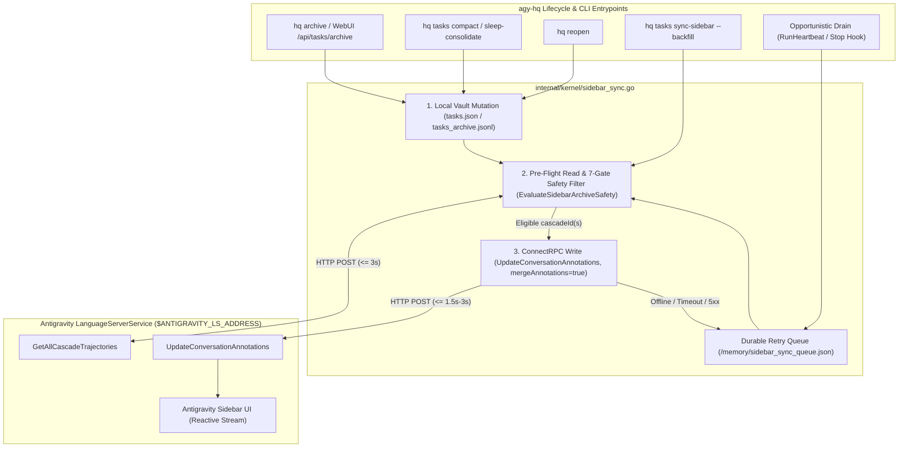

# RFC-0016: Antigravity Sidebar Conversation Archive Synchronization

- **Status:** Implemented
- **Date:** 2026-11-14
- **Companion Research:** [12 — Antigravity Sidebar Conversation Archive Synchronization Audit](../research/12_conversation_archive_sync_audit.md)
- **Related Designs:** [RFC-0002 (Sleep-Time Consolidation)](0002-memory-and-consolidation.md) · [RFC-0007 (Front Desk Initialization Hardening)](0007-front-desk-initialization-hardening.md) · [RFC-0009 (Task Board & Hot/Cold Lifecycle)](0009-task-board-redesign.md) · [RFC-0011 (CI Pipeline & Regression Harness)](0011-ci-pipeline-and-regression-harness.md)

---

## 1. Context & Motivation

In [RFC-0009](0009-task-board-redesign.md), `agy-hq` introduced a two-tier hot/cold task lifecycle (`<vault>/memory/tasks.json` and `<vault>/memory/tasks_archive.jsonl`). When tasks finish, they are archived either explicitly (`hq archive <slug>` or WebUI `POST /api/tasks/archive`) or automatically during compaction (`hq tasks compact`, `hq memory compact`, and nightly `/sleep-consolidate` Stage 4), and can be recalled on demand via `hq reopen <slug>`.

However, `agy-hq`'s internal archival state has hitherto been decoupled from Google Antigravity's native conversation sidebar:

1. **Sidebar Accumulation:** Top-level `[Task:<scope>]` threads spawned via `hq spawn` (`agentapi new-conversation`) and scheduled `[Auto]` worker conversations remain unarchived in Antigravity's left sidebar even after their Git worktrees are cleaned up and their metadata is rotated to `<vault>/memory/tasks_archive.jsonl`.
2. **Cold-Recall Desynchronization:** Conversely, if a user manually archives a conversation in Antigravity and later runs `hq reopen <slug>`, the thread remains hidden inside Antigravity's archived view until manually unarchived.
3. **Historical Backlog:** Existing `agy-hq` Vaults already hold historical archived tasks in `<vault>/memory/tasks_archive.jsonl` whose corresponding sidebar threads are still visible in the active conversation list.

As documented in [Research 12](../research/12_conversation_archive_sync_audit.md), neither `agy` CLI (`1.5.8`) nor `agentapi` exposes a headless conversation-archive command, whereas Antigravity's local `LanguageServerService` exposes two sanctioned ConnectRPC endpoints over `$ANTIGRAVITY_LS_ADDRESS` + `$ANTIGRAVITY_CSRF_TOKEN`:

- **`GetAllCascadeTrajectories`** — returns live `CascadeTrajectorySummary` metadata (`CascadeRunStatus`, active child/background counts, `annotations.archived`, `annotations.pinned`, `annotations.starred`, and `annotations.title`).
- **`UpdateConversationAnnotations`** — non-destructively updates `ConversationAnnotations.archived` (`proto3_optional` bool) and `archivalStatusTimestamp` (`mergeAnnotations: true`) for single (`cascadeId`) or batched (`cascadeIds`) conversations, pushing instant reactive updates to the sidebar UI without deleting trajectory transcripts.

---

## 2. Design Goals & Non-Goals

### 2.1 Goals

1. **Seamless Lifecycle Synchronization:** Automatically archive conversations in Antigravity's sidebar on `hq archive` and `hq tasks compact` (including nightly `/sleep-consolidate`), and unarchive them (`archived: false`) on `hq reopen`.
2. **Local-First Offline Resilience:** Never fail or block Vault operations (`ArchiveTask`, `CompactTasks`, `ReopenTask`) when `hq` runs outside Antigravity (missing env vars), when the Desktop App is closed, or when `LanguageServerService` times out. Persist unsynced transitions in a deduplicated retry queue (`<vault>/memory/sidebar_sync_queue.json`) that drains opportunistically.
3. **Zero False-Positive Archival (7-Gate Safety Model):** Guarantee mechanically that `[HQ] Front Desk`, Vault-pinned tasks, Antigravity UI-pinned/starred threads, currently executing caller threads, hot `active`/`idle`/`stalled` tasks, and live running/waiting trajectories are **never** auto-archived or backfilled.
4. **Safe Historical Backfill (`hq tasks sync-sidebar`):** Provide a deterministic `--backfill` workflow with `--dry-run` preview and batched ConnectRPC writes to clean up pre-existing historical tasks from `<vault>/memory/tasks_archive.jsonl` and `<vault>/memory/tasks.json`.
5. **Pure Go Stdlib & Full CI Verification:** Maintain `0` external Go dependencies (`Gate H4-A`) and cover all ConnectRPC wire contracts, safety gates, retry queue transitions, and backfill flows with deterministic `httptest.Server` unit and CUJ E2E tests.

### 2.2 Non-Goals

- **Trajectory Deletion:** `agy-hq` will **never** call `DeleteCascadeTrajectory` or `JetboxDeleteSummary`. Archiving must remain 100% reversible so `conversation://<id>` citations, `hq reopen`, `hq obs` token attribution, and `hq memory verify-transcript` continue to work indefinitely.
- **Direct Disk State Mutation:** `agy-hq` will **never** read or write internal Antigravity database/state files under `~/.gemini/antigravity/` (other than documented conversation transcripts/artifacts) or scrape host process tables for tokens.

---

## 3. Architecture Overview



> [!IMPORTANT]
> **Local-First Invariant:** Vault mutations in `<vault>/memory/tasks.json` and `<vault>/memory/tasks_archive.jsonl` always commit **before** any ConnectRPC call. A network timeout, missing `ANTIGRAVITY_LS_ADDRESS`, or `LanguageServerService` error never rolls back or fails `hq archive`, `hq reopen`, or `hq tasks compact`; unsynced conversation IDs fall back cleanly to `<vault>/memory/sidebar_sync_queue.json`.

---

## 4. ConnectRPC Sidebar Sync Client (`internal/kernel/sidebar_sync.go`)

### 4.1 Transport & Endpoint Discovery

`SidebarSyncClient` reuses the exact ConnectRPC HTTP/1.1 JSON convention established by `SpawnSubagent` in [kernel.go](../../internal/kernel/kernel.go):

- **Environment Resolution:** Reads `ANTIGRAVITY_LS_ADDRESS` (`host:port` or `http://host:port`) and `ANTIGRAVITY_CSRF_TOKEN`. If either is empty, `Client.Available()` returns `false` and callers immediately route to the offline queue without attempting network I/O.
- **Injectable Test Seam:** `SidebarSyncConfig` accepts optional `BaseURL`, `CSRFToken`, `HTTPClient`, and `Now func() time.Time` overrides (plus env overrides in subprocess E2E tests since `ANTIGRAVITY_LS_ADDRESS` and `ANTIGRAVITY_CSRF_TOKEN` are already standard env vars).
- **Strict Timeouts:**
  - Unary single-conversation write: `1500ms` (`DefaultSidebarUnaryTimeout`).
  - Trajectory summary snapshot (`GetAllCascadeTrajectories`) & batched writes (`<= 50` IDs): `3000ms` (`DefaultSidebarBatchTimeout`).
  - Opportunistic `Stop` hook queue flush: `500ms` total context deadline so turn teardown never lags.
- **Request Headers:**
  - `Content-Type: application/json`
  - `Connect-Protocol-Version: 1`
  - `x-codeium-csrf-token: <ANTIGRAVITY_CSRF_TOKEN>`

### 4.2 Wire Structs & `proto3_optional` Presence Guarantee

```go
// POST /exa.language_server_pb.LanguageServerService/GetAllCascadeTrajectories
type lsGetAllTrajectoriesRequest struct {
	ExcludeSubtrajectories bool `json:"excludeSubtrajectories"`
}

type lsGetAllTrajectoriesResponse struct {
	TrajectorySummaries map[string]LSTrajectorySummary `json:"trajectorySummaries"`
}

type LSTrajectorySummary struct {
	Summary             string                    `json:"summary"`
	StepCount           uint32                    `json:"stepCount"`
	Status              string                    `json:"status"`
	Annotations         LSConversationAnnotations `json:"annotations"`
	WaitingSteps        []json.RawMessage         `json:"waitingSteps"`
	NotFullyIdle        bool                      `json:"notFullyIdle"`
	BackgroundTaskCount uint32                    `json:"backgroundTaskCount"`
	HasActiveChildren   bool                      `json:"hasActiveChildren"`
	HasRunningSubagents bool                      `json:"hasRunningSubagents"`
}

type LSConversationAnnotations struct {
	Title                   string `json:"title,omitempty"`
	Archived                bool   `json:"archived"`
	ArchivalStatusTimestamp string `json:"archivalStatusTimestamp,omitempty"`
	Starred                 bool   `json:"starred"`
	Pinned                  bool   `json:"pinned"`
}

// POST /exa.language_server_pb.LanguageServerService/UpdateConversationAnnotations
type lsUpdateAnnotationsRequest struct {
	CascadeID        string                   `json:"cascadeId,omitempty"`
	CascadeIDs       []string                 `json:"cascadeIds,omitempty"`
	Annotations      lsConversationPatch      `json:"annotations"`
	MergeAnnotations bool                     `json:"mergeAnnotations"`
}

type lsConversationPatch struct {
	// Pointer *bool is mandatory so json.Marshal emits `"archived": false` on hq reopen
	// (setting synthetic oneof `_archived` under mergeAnnotations=true) while omitting when nil.
	Archived                *bool  `json:"archived,omitempty"`
	ArchivalStatusTimestamp string `json:"archivalStatusTimestamp,omitempty"`
	Pinned                  *bool  `json:"pinned,omitempty"`
}
```

Every archive or unarchive mutation sends:

- `mergeAnnotations: true` (preserving `title`, `pinned`, `starred`, `tags`, `groupId`, `permissionPreset`, and `coordinator`),
- `annotations.archived`: pointer to `true` (archive) or `false` (reopen),
- `annotations.archivalStatusTimestamp`: `now.UTC().Format(time.RFC3339Nano)`.

For batch operations (`compact`, `sync-sidebar`), `cascadeIds` are chunked into slices of at most `50` UUIDs per `UpdateConversationAnnotations` request (`DefaultSidebarBatchSize = 50`).

### 4.3 HTTP & Connect Error Classification

| Response Class | Examples | Handling |
|---|---|---|
| `200 OK` | `{}` | Mark synced (`SidebarArchived = desired`, `SidebarSyncedAt = nowUTC`); remove from retry queue if present. |
| Terminal Target Error | HTTP `404` or `400`, or Connect JSON error `"code": "not_found"` / `"invalid_argument"` (trajectory does not exist on this host) | Treat as **terminal non-retryable skip** (`not_in_ls`). Remove from retry queue so missing/deleted trajectories never loop forever. *(If a batch request returns `400`/`404`, fall back to per-ID calls for that chunk to isolate the missing UUID without failing valid siblings.)* |
| Transient / Offline Error | Missing env vars, dial refused, context deadline exceeded, HTTP `401`/`403` (stale CSRF port), `429`, `500`–`504` | Enqueue or bump retry backoff in `<vault>/memory/sidebar_sync_queue.json`; local CLI command still exits `0`. |

---

## 5. Seven-Gate Defense-in-Depth Safety Model

Before **any** `archived: true` request is sent to `LanguageServerService` — whether from `hq archive`, `hq tasks compact`, queue drain, or `hq tasks sync-sidebar --backfill` — `EvaluateSidebarArchiveSafety` evaluates 7 deterministic gates in strict order.

*(Note: Unarchiving via `hq reopen` (`desiredArchived == false`) only requires Gate S1 UUID validity and Gate S7 idempotency, as restoring visibility to a reopened conversation is always safe.)*

| Gate | Name | Check | Automated (`compact` / `backfill` / `drain`) | Explicit Single-Task (`hq archive <slug>`) |
|---|---|---|---|---|
| **S1** | **Canonical UUID** | `IsCanonicalUUID(convID)` (`8-4-4-4-12` lowercase hex) | **Skip** (`invalid_uuid`) | **Skip** (`invalid_uuid`) |
| **S2** | **`[HQ] Front Desk` Guard** | `convID == frontDesk.ConversationID` (`front_desk.json`) **OR** `strings.HasPrefix(strings.TrimSpace(summary.Annotations.Title), "[HQ] Front Desk")` | **Hard Block** (`front_desk`) | **Hard Block** (`front_desk`, even with `--force`; must `hq release-desk` / `claim-desk` first) |
| **S3** | **Caller Thread Guard** | `convID == os.Getenv("ANTIGRAVITY_CONVERSATION_ID")` | **Hard Block** (`caller_self`) | **Defer to Queue** (`caller_self_deferred`, `nextRetryAt = now + 15s` so an in-flight turn never archives itself mid-tool-call) |
| **S4** | **Vault & UI Pin / Star Guard** | `task.Pinned` **OR** `summary.Annotations.Pinned` **OR** `summary.Annotations.Starred` | **Hard Block** (`pinned_or_starred`) | **Block unless `--force`** (`ArchiveTask` rejects `task.Pinned` unless `force`; if UI-pinned/starred and `!force`, Vault archives locally with warning and skips sidebar archive) |
| **S5** | **Hot Vault Active State Guard** | `convID` matches a task in `<vault>/memory/tasks.json` with `Status` in `{"active", "idle", "stalled"}` | **Hard Block** (`active_in_vault`; purges stale queue item) | N/A (`ArchiveTask` itself transitions the target task to `"archived"` first) |
| **S6** | **Live Trajectory Activity Guard** | `summary` exists and ANY of: `status` not in `{"", "CASCADE_RUN_STATUS_UNSPECIFIED", "CASCADE_RUN_STATUS_IDLE"}`, `notFullyIdle`, `hasActiveChildren`, `hasRunningSubagents`, `backgroundTaskCount > 0`, or `len(waitingSteps) > 0` | **Hard Block** (`trajectory_busy`; if in retry queue, reschedule with backoff) | **Defer to Queue** unless `--no-sidebar` (never archive a live running/waiting trajectory mid-execution; queue retries once `IDLE`) |
| **S7** | **Idempotency Guard** | `summary` exists and `summary.Annotations.Archived == desiredArchived` | **No-Op** (`already_synced`; mark synced & clear queue) | **No-Op** (`already_synced`; mark synced & clear queue) |

### 5.1 Pre-Flight Snapshot Requirement

Can `UpdateConversationAnnotations(archived: true)` fire if `GetAllCascadeTrajectories` fails?

- **No — Fail Closed on Safety Read:** Because UI-side pins (`annotations.pinned`), stars (`annotations.starred`), and live trajectory execution (`CASCADE_RUN_STATUS_RUNNING` / `waitingSteps`) are authoritative in `LanguageServerService`, `agy-hq` **always** fetches `GetAllCascadeTrajectories` (`{"excludeSubtrajectories": true}`) before issuing `archived: true` writes. If `GetAllCascadeTrajectories` fails or times out, the candidate is safely placed into `<vault>/memory/sidebar_sync_queue.json` rather than writing blindly without UI pin/activity verification.
- **Missing Trajectory Entry (`!exists` in `trajectorySummaries`):** Because `GetAllCascadeTrajectories` is called with `excludeSubtrajectories: true`, nested child subtrajectories (e.g., `invoke_subagent` runs that are already hidden from the top-level sidebar) or conversations belonging to another machine/profile will not appear in `trajectorySummaries`. When `GetAllCascadeTrajectories` succeeds (`200 OK`) and `convID` is absent from `trajectorySummaries`, `EvaluateSidebarArchiveSafety` classifies it as `not_top_level_or_missing` (terminal no-op, `0` write RPCs needed).

---

## 6. Lifecycle Integration & Durable Offline Queue

### 6.1 Backward-Compatible `ActiveTask` Sync Metadata

We add two optional fields to `ActiveTask` in [kernel.go](../../internal/kernel/kernel.go) (serialized with `omitempty` in both `<vault>/memory/tasks.json` and `<vault>/memory/tasks_archive.jsonl`, requiring **no** breaking Vault schema migration):

```go
type ActiveTask struct {
	// ... existing RFC-0009 fields ...
	SidebarArchived bool   `json:"sidebarArchived,omitempty"`
	SidebarSyncedAt string `json:"sidebarSyncedAt,omitempty"`
}
```

### 6.2 Durable Retry Queue (`<vault>/memory/sidebar_sync_queue.json`)

When `LanguageServerService` is offline, unreachable, or temporarily busy (`Gate S3`/`S6` deferral or transient RPC error), `EnqueueSidebarSync` atomically updates `<vault>/memory/sidebar_sync_queue.json` (protected by an in-process mutex + atomic temp-file rename):

```go
type SidebarSyncQueue struct {
	UpdatedAt string                          `json:"updatedAt"`
	Items     map[string]SidebarSyncQueueItem `json:"items"` // keyed by ConversationID
}

type SidebarSyncQueueItem struct {
	ConversationID  string `json:"conversationId"`
	TaskSlug        string `json:"taskSlug,omitempty"`
	DesiredArchived bool   `json:"desiredArchived"`
	Force           bool   `json:"force,omitempty"`
	EnqueuedAt      string `json:"enqueuedAt"`
	UpdatedAt       string `json:"updatedAt"`
	Attempts        int    `json:"attempts"`
	NextRetryAt     string `json:"nextRetryAt"`
	LastError       string `json:"lastError,omitempty"`
}
```

- **State Supersession (Zero Stale Re-Archive):** Because `Items` is keyed by `ConversationID`, enqueuing `DesiredArchived: false` on `hq reopen` immediately overwrites any pending `DesiredArchived: true` entry for that conversation, resetting `Attempts = 0` and `NextRetryAt = now`.
- **Bounded Exponential Backoff & Dead-Letter Expiry:** Failed attempts increment `Attempts` and schedule `NextRetryAt` at `30s`, `2m`, `10m`, `30m`, `2h`, capped at `6h` (`MaxSidebarSyncBackoff`). After `MaxSidebarSyncAttempts = 20` consecutive failures (or `14` days age), the entry is pruned to prevent unbounded growth.

### 6.3 Behavior at Every `agy-hq` Touchpoint

1. **`hq archive <target> [--force] [--no-sidebar]` & WebUI `POST /api/tasks/archive`:**
   - `ArchiveTaskWithOptions(vaultDir, target, ArchiveTaskOptions{Force: force, SyncSidebar: !noSidebar})` (with `ArchiveTask(vaultDir, target, force)` delegating with `SyncSidebar: true` so WebUI `/api/tasks/archive` and existing callers gain sidebar sync automatically).
   - Commits worktree cleanup + `Status = "archived"` in `<vault>/memory/tasks.json`, then syncs `archived: true` (or enqueues on offline/deferral).
2. **`hq reopen <target> [--no-worktree] [--no-sidebar]`:**
   - `ReopenTaskWithOptions` restores the task to `<vault>/memory/tasks.json` (`Status = "active"`, `SidebarArchived = false`), supersedes any queued archive item, and calls `UpdateConversationAnnotations` with `Archived: ptr(false)` (or enqueues `DesiredArchived: false` if offline).
3. **`hq tasks compact [--dry-run] [--task-ttl=24h] [--no-sidebar] [--json]` & `hq memory compact`:**
   - Collects all `ConversationID`s newly archived or rotated to `<vault>/memory/tasks_archive.jsonl` during this compaction pass, plus due items in `<vault>/memory/sidebar_sync_queue.json`.
   - When `opts.DryRun == true`: performs **zero** `UpdateConversationAnnotations` calls and **zero** queue mutations; reports candidate counts in `CompactTasksReport`.
   - When `opts.DryRun == false && !opts.NoSidebar`: executes one `GetAllCascadeTrajectories` check + batched `UpdateConversationAnnotations` (`cascadeIds` chunks of `50`), updating `CompactTasksReport` (`SidebarSyncedCount`, `SidebarQueuedCount`, `SidebarSkippedCount`).
4. **Nightly `/sleep-consolidate` ([SKILL.md](../../.agents/plugins/agy-hq/skills/sleep-consolidate/SKILL.md) Stage 4):**
   - Already runs `hq tasks compact` inside Antigravity's scheduled turn (where `ANTIGRAVITY_LS_ADDRESS` and `ANTIGRAVITY_CSRF_TOKEN` are live). Automatically archives newly compacted `[Task:*]` and `[Auto]` threads and flushes any queued offline transitions in **0 extra tool calls** and **0 silent-night-invariant chat output**.
5. **`hq tasks pin <target>` / `hq tasks unpin <target>`:**
   - Best-effort syncs `Pinned: ptr(true|false)` (`mergeAnnotations: true`) to `LanguageServerService` when reachable so Vault pins and Antigravity sidebar pins stay aligned, without failing if offline.
6. **Opportunistic Background Drain (`RunHeartbeat` & `HandleStop`):**
   - `kernel.RunHeartbeat` (daemon startup + 30m tick) calls `DrainSidebarSyncQueue(vaultDir)` when `!dryRun`.
   - `hooks.HandleStop` performs a fast `os.Stat` on `<vault>/memory/sidebar_sync_queue.json` (`0ms` overhead when empty/absent); if non-empty and LS credentials are set, flushes due items under a `500ms` timeout before writing `{"decision":"stop"}`.

---

## 7. Historical Backfill & Reconciliation CLI (`hq tasks sync-sidebar`)

To clean up conversations from tasks that were archived before `RFC-0016`, we add a dedicated subcommand under `hq tasks`:

```sh
# 1. Preview pending queue + historical cold-archive backfill (0 mutations, 0 write RPCs)
hq tasks sync-sidebar --backfill --dry-run [--json]

# 2. Execute historical backfill cleanly in batches of 50
hq tasks sync-sidebar --backfill [--limit=500] [--batch-size=50] [--json]

# 3. Flush only pending queue + hot archived tasks (without scanning tasks_archive.jsonl)
hq tasks sync-sidebar [--dry-run] [--json]
```

### 7.1 Deterministic Backfill Algorithm

1. **Load Vault Ground Truth:**
   - Read `<vault>/memory/front_desk.json` (`frontDeskConvID`).
   - Read hot `<vault>/memory/tasks.json`: partition by `ConversationID` into **protected hot set** (`Status` in `{"active", "idle", "stalled"}` or `Pinned == true`) and **hot archived candidates** (`Status == "archived" && !Pinned`). Also include hot `completed`/`cancelled` `subagent`/`auto` tasks only if already marked `archived`; `completed` `task` threads within their 24h grace window remain untouched until `compact` or explicit `hq archive`.
   - If `--backfill` is set: stream `<vault>/memory/tasks_archive.jsonl` (deduplicating by `ConversationID`, latest record wins). Exclude any `ConversationID` present in the **protected hot set** (e.g., a task that was archived earlier and later reopened, or shares a conversation with an active task). Exclude any cold record with `Pinned == true`.
   - Merge pending due items from `<vault>/memory/sidebar_sync_queue.json`.
2. **Single Read Snapshot (`GetAllCascadeTrajectories`):**
   - Fetch `trajectorySummaries` (`excludeSubtrajectories: true`). If `LanguageServerService` is unreachable, report clear status (`LS offline; <N> queued`) and exit cleanly (`0` in queue-only mode; non-zero with actionable message if user explicitly invoked interactive `--backfill` outside Antigravity).
3. **Apply Seven-Gate Safety Filter (`S1`–`S7`):**
   - Categorize every candidate into:
     - `EligibleArchiveIDs` / `EligibleUnarchiveIDs`
     - `AlreadySyncedCount` (`S7`: `annotations.archived == true` already)
     - `MissingOrSubtrajectoryCount` (`!exists` in top-level `trajectorySummaries`)
     - `ProtectedSkipped` (`[]SidebarSkipDetail` recording `ConversationID`, `TaskSlug`, `Title`, and exact Gate reason: `front_desk`, `caller_self`, `vault_pinned`, `ui_pinned`, `ui_starred`, `active_in_vault`, `trajectory_busy`).
4. **Dry-Run vs. Batched Commit:**
   - If `--dry-run`: render human-readable summary table (or structured JSON with `--json`) listing exact candidates that *would* be archived and every protected thread that was *skipped*, without calling `UpdateConversationAnnotations`.
   - If live: apply `--limit` (default `500`, `0` = unlimited), chunk `EligibleArchiveIDs` into batches of `--batch-size` (default `50`), invoke `UpdateConversationAnnotations` (`mergeAnnotations: true`), update `SidebarArchived` / `SidebarSyncedAt` on hot tasks, and prune completed items from `<vault>/memory/sidebar_sync_queue.json`.

---

## 8. Regression Testing, CUJ E2E Suite & CI Gates

### 8.1 Unit Tests (`internal/kernel/sidebar_sync_test.go`)

Using `net/http/httptest.NewServer` to simulate `LanguageServerService/GetAllCascadeTrajectories` and `LanguageServerService/UpdateConversationAnnotations`:

1. **ConnectRPC Wire Contract:** Asserts `POST` path, `x-codeium-csrf-token` header enforcement, `mergeAnnotations: true`, explicit `"archived": true` on archive, explicit `"archived": false` (not omitted!) on reopen, valid RFC3339 UTC `archivalStatusTimestamp`, and batch `cascadeIds` chunking (`120` candidates -> `3` chunks of `50, 50, 20`).
2. **All 7 Safety Gates (`S1`–`S7`):**
   - `S1`: Rejects non-UUIDs (`"conv-demo"`, `""`).
   - `S2`: Never archives active `[HQ] Front Desk` (`front_desk.json` match OR `[HQ] Front Desk` title prefix), even when `Force: true`.
   - `S3`: Never archives caller `$ANTIGRAVITY_CONVERSATION_ID` during `CompactTasks` or `SyncSidebarBackfill`; defers to queue on explicit self-archive.
   - `S4`: Never auto-archives/backfills `ActiveTask.Pinned == true`, `annotations.pinned == true`, or `annotations.starred == true`.
   - `S5`: Never backfills a cold `tasks_archive.jsonl` UUID if a hot task in `tasks.json` with the same UUID is `active`, `idle`, or `stalled`.
   - `S6`: Never archives trajectories with `CASCADE_RUN_STATUS_RUNNING`, `CASCADE_RUN_STATUS_BUSY`, `CASCADE_RUN_STATUS_CANCELING`, `notFullyIdle: true`, `hasActiveChildren: true`, `hasRunningSubagents: true`, `backgroundTaskCount > 0`, or non-empty `waitingSteps`.
   - `S7`: Skips write RPC when `annotations.archived` already matches `desiredArchived`.
3. **Offline Fallback, Supersession & Terminal Error Pruning:**
   - Unset `ANTIGRAVITY_LS_ADDRESS` and HTTP `503` enqueue into `<vault>/memory/sidebar_sync_queue.json` while `ArchiveTask` / `CompactTasks` succeed locally.
   - `ReopenTask` while offline flips queued `DesiredArchived` from `true` to `false`.
   - Bringing mock LS online drains queue via `DrainSidebarSyncQueue` / `CompactTasks`.
   - HTTP `404` / Connect `not_found` removes item from queue without infinite retry.
4. **Backfill Dry-Run Invariant:** Verifies `SyncSidebar(..., DryRun: true, Backfill: true)` makes `1` read call (`GetAllCascadeTrajectories`), `0` write calls (`UpdateConversationAnnotations`), and `0` file mutations while reporting exact counts.

### 8.2 Critical User Journey E2E Tests (`internal/e2e/cuj_e2e_test.go`)

Extend the compiled `hq` binary E2E suite (`sync.Once` binary build) with a dedicated CUJ subtest (`TestCUJ_SidebarConversationArchiveSync`):

- Spins up a stateful mock `LanguageServerService` HTTP server holding synthetic trajectories: `[HQ] Front Desk` (`00000000-0000-0000-0000-000000000001`), a UI-pinned thread (`...0002`), a live running thread (`...0003`), an active hot task (`...0004`), a completed task (`...0005`), and two historical cold-archived tasks (`...0006`, `...0007`).
- Verifies:
  1. `hq archive` on `...0005` immediately flips `archived: true` on mock LS; `hq reopen` immediately flips `archived: false`.
  2. Offline `hq archive` (with `ANTIGRAVITY_LS_ADDRESS=""`) succeeds locally and enqueues; subsequent `hq tasks compact` with LS restored flushes the queue.
  3. `hq tasks sync-sidebar --backfill --dry-run --json` reports `...0006` and `...0007` as eligible while protecting `...0001`..`...0004` with `0` mutations.
  4. `hq tasks sync-sidebar --backfill` archives `...0006` and `...0007` on mock LS while leaving Front Desk, UI-pinned, running, and hot active trajectories `archived == false`.

### 8.3 CI Harness & `hq doctor` Integration

- **CI Gates (`hq ci pre-push` & `hq ci pre-commit`):**
  - `P1`–`P6` PII checks verify zero real workstation paths or live conversation IDs in code/docs/tests.
  - `H1`–`H2` verify `sleep-consolidate/SKILL.md` stays well under the 500-line ceiling and references only valid top-level `hq` subcommands (`hq tasks ...`).
  - `H4-A` verifies `go.mod` retains `0` external dependencies; `H4-B` verifies `docs/README.md` indexing and relative link integrity.
- **`hq doctor` (`internal/doctor/doctor.go`):**
  - Adds a non-failing `Sidebar Archive Sync Queue` diagnostic reporting `OK` when `<vault>/memory/sidebar_sync_queue.json` is empty or `< 10` pending items, and `WARN` if retry-exhausted / stale items accumulate (`remediation: run 'hq tasks sync-sidebar' inside Antigravity`).

---

## 9. Phase 2 Implementation Checklist (Post-Approval)

1. **`internal/kernel/sidebar_sync.go`:** Implement `SidebarSyncClient`, `EvaluateSidebarArchiveSafety` (`S1`–`S7`), `SidebarSyncQueue` persistence/backoff/supersession, `DrainSidebarSyncQueue`, and `SyncSidebar` (`--dry-run` / `--backfill` / batching).
2. **`internal/kernel/kernel.go`:** Add `SidebarArchived` / `SidebarSyncedAt` to `ActiveTask`; wire `ArchiveTaskWithOptions`, `ReopenTaskWithOptions`, `CompactTasks`, `SetTaskPinned`, and `RunHeartbeat` to `sidebar_sync.go`.
3. **`internal/hooks/hooks.go`:** Add `0ms` `os.Stat`-guarded opportunistic queue flush (`<= 500ms` deadline) at the tail of `HandleStop`.
4. **`cmd/hq/main.go`:** Add `--no-sidebar` flag to `hq archive`, `hq reopen`, and `hq tasks compact`; add `hq tasks sync-sidebar [--dry-run] [--backfill] [--limit=N] [--batch-size=N] [--json]` and update CLI usage text.
5. **`.agents/plugins/agy-hq/skills/sleep-consolidate/SKILL.md`:** Document automatic sidebar archive synchronization & retry queue drain during Stage 4 (`hq tasks compact`).
6. **`internal/doctor/doctor.go`:** Add `Sidebar Archive Sync Queue` health check.
7. **Tests & CI:** Add `internal/kernel/sidebar_sync_test.go` and `TestCUJ_SidebarConversationArchiveSync` in `internal/e2e/cuj_e2e_test.go`; run `./bin/hq ci pre-push` and `./bin/hq ci pre-commit`.
