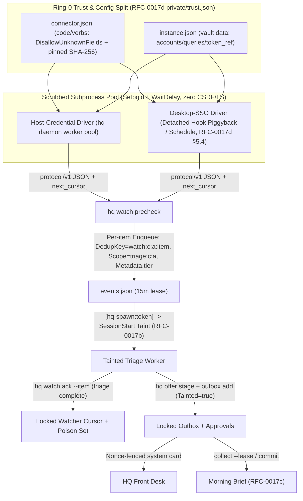

# RFC-0017a: Modular Connector Protocol, CLI Transport Profiles & 0-Token Watcher Engine

- **Status:** Proposed (Phase 1 Review)
- **Date:** 2026-11-14
- **Suite:** Part 1 of 4 — see also [RFC-0017b (Provenance Taint & Offer Gateway)](0017b-provenance-taint-and-offer-gateway.md), [RFC-0017c (Lease-Based Morning Brief & Extensions)](0017c-lease-based-morning-brief-and-extensions.md), and [RFC-0017d (Companion Extension Packs, Unified Trust & Host Portability)](0017d-enterprise-extensibility-and-portability.md)
- **Depends On:** [RFC-0003](0003-approval-bound-execution.md), [RFC-0005](0005-gmail-integration.md), [RFC-0008](0008-gchat-integration.md), [RFC-0014](0014-proactive-engine-and-living-context.md), [RFC-0015](0015-global-plugin-packaging.md), [RFC-0017d](0017d-enterprise-extensibility-and-portability.md), [RFC-0018](0018-always-on-agent-runtime-hardening.md)
- **Companion Research:** [13 — General Watcher Mechanism, Quarantine Provenance & Pluggable Enterprise Connector Audit](../research/13_proactive_channel_watcher_audit.md), [10 — Meta Muse (`muse.ai`) Deep Dive](../research/10_muse_ai_proactive_and_context_study.md), [14 — Anthropic Always-On Agents Gap Audit](../research/14_anthropic_always_on_agents_gap_audit.md)

---

## 1. Motivation & Scope Boundary

`agy-hq` must operate cleanly across **personal workstations and locked-down enterprise environments** without forking `bin/hq` or coupling core runtime loops to consumer Google Workspace setups. Even for the same vendor product (such as Gmail, Google Chat, or Calendar), enterprise deployments diverge in authentication (`AGY_ACCOUNT=user@acme.com` Desktop SSO shims vs. custom host OAuth/Kerberos CLIs), filtering (`-label:automated-ci`), DLP policy (`draft_only` vs. direct API send), and companion tooling (Slack, Jira / `twg`, GitHub Enterprise, Gerrit, PagerDuty, or internal corporate CLIs).

To keep each security-critical boundary deeply specified and independently verifiable, `RFC-0017` is organized into four cohesive specifications:
- **`RFC-0017a` (This Document):** Canonical `connector.json` (pinned code) vs. `<vault>/connectors/<id>/instance.json` (account/query data) split, shared `transport.kind: "cli"` profile unifying `hq gmail` and 1-step `hq gchat propose` (`#2`, `#3`), `hq-connector-protocol/v1` + built-in `jsonmap` adapter, scrubbed subprocess execution, shared locked file stores (`internal/store`), direct per-item `events.Enqueue` watcher engine (`Metadata["tier"]`), single-authority `hq watch ack`, `WaitingOn` thread inspection, and quiet-hours alignment.
- **[RFC-0017b](0017b-provenance-taint-and-offer-gateway.md):** Lease-time `[hq-spawn:<token>]` `SessionStart` provenance taint, fail-closed per-conversation taint store, human-presence HMAC approval capability (`N1`), tainted timer lockdown (`N3`), nonce-delimited `QuarantinedThread` reads, hardened `hq offer stage` gateway, proposal superseding, apply-time thread preconditions, and nonce-fenced Front Desk system cards.
- **[RFC-0017c](0017c-lease-based-morning-brief-and-extensions.md):** Side-effect-free `hq brief collect` + two-phase `--lease` / `hq brief commit`, provenance-safe tainted reader brief synthesis, and structured `brief.d` / `hq-brief` extensions (`quarantined: true` by default).
- **[RFC-0017d](0017d-enterprise-extensibility-and-portability.md):** Companion extension packs (`hq-extension.json`), two-lattice virtual merge, unified `<vault>/private/trust.json` ceremony, `hq dispatch resolve` + `skill_overrides` + `front_desk_overlays`, tier-only routing (`#1`), `internal/hostpaths` (`#6`), `hq sidecar console` (`#5`), and hook-piggybacked Desktop-SSO polling (`N4`).

---

## 2. End-to-End Architecture (`RFC-0017a`–`0017d`)



---

## 3. Split Manifest (`connector.json`) vs. Instance (`instance.json`) & `cli` Transports (`internal/connector`)

### 3.1 Fail-Closed `connector.json` (Code, Pinned) vs. `instance.json` (Data, Unpinned)
Because `agy-hq` enforces `0` external Go dependencies (`ADR-0002` / CI Gate `H4-A`) and the legacy line-oriented YAML helper (`internal/kernel/daemon.go:142-283`) splits flow lists on commas and silently ignores unknown keys, connector specifications use strict JSON (`encoding/json.NewDecoder` + **`DisallowUnknownFields()`**) split cleanly between **executable code** and **account data**:

| File | Responsibility | Pinned in `private/trust.json`? | Writer |
|---|---|---|---|
| `connectors/<id>/connector.json` (pack, Vault override, or embedded `core/*`) | Driver, `transport.kind`, `cli.path`, verb `argv` templates, output `jsonmap`, capabilities, `env_allow`, `requires_desktop_session` | **Yes** ([RFC-0017d §3](0017d-enterprise-extensibility-and-portability.md)); `hq` self-drivers pinned by `(version, commit)` | Pack author or human (`hq extension trust`) |
| `<vault>/connectors/<id>/instance.json` (Vault only, `0600`) | Account aliases, email, `agy_account`, `default_query`, `watch_spaces`, `enabled`, `default_account`, `token_ref` → `private/...` | **No** — strict schema rejecting any `path`/`argv`/`env` executable keys | `hq gmail init`, `hq gchat init`, `hq connector account add` |
| `<vault>/private/<id>/tokens/*.json` (`0600`) | OAuth / bearer secrets | All-session read/write guarded (`hooks.go`) | Interactive login flows |

- **Fail-Closed Defaults & Flag-Fused `{{param}}` Rules (`hq connector lint`):** `ParticipantLock *bool` defaults to **`true`** when omitted (loosening is Vault-only with a $\ge 16$-char justification per [RFC-0017d §2.2](0017d-enterprise-extensibility-and-portability.md)). `{{param}}` placeholders are permitted **only** fused to a flag (`--flag={{x}}`, `--flag={{?opt}}` omitted when empty, `--flag={{*list}}` expanded per element) or after `--`; standalone `"{{param}}"` before `--` is rejected by `hq connector lint`.

### 3.2 Unified `transport.kind: "cli"` Profile for Gmail (`#2`) & Google Chat (`#3`)
To eliminate dual-config drift across `private/{gmail,gchat}/accounts.json` and support custom enterprise CLIs without glue scripts, built-in `gmail` and `gchat` drivers share `transport.kind: "cli"` resolved via **`connector.Resolve("<id>")`**:
```json
{
  "schema_version": 1,
  "id": "gchat",
  "driver": { "builtin": "gchat" },
  "requires_desktop_session": false,
  "env_allow": ["AGY_ACCOUNT"],
  "transport": {
    "kind": "cli",
    "cli": {
      "path": "/opt/acme/bin/chat-cli",
      "auto_install_plugin": false,
      "verbs": {
        "list_spaces": ["list-spaces", "--json"],
        "list_messages": ["list-messages", "--space={{space}}", "--after={{?cursor}}", "--json"],
        "get_thread": ["get-thread", "--space={{space}}", "--thread={{thread_key}}", "--json"],
        "send": ["send", "--space={{space}}", "--thread={{?thread_key}}", "--body-file={{payload_file}}"]
      },
      "output": {
        "list_messages": {
          "jsonmap": {
            "items_pointer": "/messages",
            "item_id": "/name",
            "thread_key": "/thread/name",
            "sender": "/sender/email",
            "timestamp": "/createTime"
          }
        }
      }
    }
  },
  "capabilities": {
    "poll": { "enabled": true, "max_pages": 3, "page_size": 50 },
    "inspect_thread": { "enabled": true },
    "read_quarantined": { "enabled": true },
    "brief": { "enabled": true, "quarantined": true, "timeout_ms": 3000 },
    "offers": {
      "reply": { "recipient_params": { "space": "channel" }, "supports_wait_on": true }
    }
  }
}
```
`<vault>/connectors/gchat/instance.json`:
```json
{
  "schema_version": 1,
  "connector": "gchat",
  "default_account": "work",
  "accounts": {
    "work": {
      "email": "user@acme.com",
      "agy_account": "user@acme.com",
      "enabled": true,
      "watch_spaces": ["spaces/AAAA"],
      "token_ref": null
    }
  }
}
```
- **Single Resolver Across Interactive & Proactive Surfaces:** `hq gmail search|read-quarantined|draft`, interactive 1-step **`hq gchat propose`**, `hq watch precheck`, `WaitingOn` `inspect_thread`, and `hq brief collect` all execute against `connector.Resolve("<id>")`. Built-in Go drivers retain vendor security semantics (MIME/base64url decode, DKIM/SPF-aligned participants, payload hash binding) while delegating process invocation to `transport.cli`.
- **Safe Write Verbs & Zero Unsolicited Plugin Downloads (`#2`):** Write verbs (`create_draft`, `send_draft`, `send`) execute **only at `hq approve` time** via `Proposal.CommandArgv`, passing bodies exclusively in the immutable `0600` payload file (`--body-file={{payload_file}}`), never in `argv`. **`auto_install_plugin` defaults to `false`** (`--no-plugin-install` aliases it), retiring `ensureAntigravityGmailPlugin()`'s unpinned zip download (`gmail.go:291-330`); when explicitly opted in, installation uses sanctioned `agy plugin install`, and missing CLIs print the exact `cli.path` remedy.
- **One-Release `accounts.json` Migration & Drift Guard:** `hq connector migrate gmail|gchat` converts legacy `private/{gmail,gchat}/accounts.json` into `<vault>/connectors/<id>/instance.json` (preserving `oauth | cdp | gmail-bridge | webhook | mock` as built-in `transport.kind` values) and writes a `migrated_to` tombstone. Reads fall back for one release while writes target `instance.json` exclusively, and `hq doctor` flags any drift.

### 3.3 Layered Discovery & Unified Trust Consumption (`RFC-0017d`)
Connectors resolve in strict order: `<vault>/connectors/<id>/connector.json` → enabled & trusted companion packs (`<plugin>/hq-extension.json` `components.connectors` / `connector_defaults`, resolved via `internal/hostpaths` in [RFC-0017d §2, §5.2](0017d-enterprise-extensibility-and-portability.md)) → embedded `templates/connectors/{gmail,gchat,gcalendar}/connector.json` (`//go:embed`). Every non-embedded `connector.json` and external `cli.path` binary is SHA-256 verified before every `exec` against `<vault>/private/trust.json` ([RFC-0017d §3](0017d-enterprise-extensibility-and-portability.md)), failing closed with at most one `brief_rollup` notice per `(id, sha256)`.

---

## 4. `hq-connector-protocol/v1` & Built-In `jsonmap` Adapter

### 4.1 JSON-over-stdio Driver Contract (`hq-connector-protocol/v1`)
Non-trivial custom connectors (Gmail MIME/DKIM, Slack threads, Jira issues, Gerrit reviews) speak **`hq-connector-protocol/v1`**: `bin/hq` writes one JSON request object to `stdin` and parses one JSON response object from `stdout` via `cmd.Output()` (keeping `stderr` strictly separate).

- **Request (`stdin`):**
  ```json
  {
    "protocol_version": "v1",
    "op": "poll",
    "connector": "gmail-corp",
    "account": "work",
    "cursor": "hist_981220",
    "page_token": "",
    "max_items": 50,
    "params": { "query": "in:inbox is:unread -category:promotions newer_than:7d" }
  }
  ```
- **Response (`stdout`):**
  ```json
  {
    "protocol_version": "v1",
    "ok": true,
    "next_cursor": "hist_981299",
    "next_page_token": "",
    "items": [
      {
        "item_id": "193a8f01c2",
        "thread_key": "193a8e9900",
        "timestamp": "2026-11-14T16:10:00Z",
        "sender": "alice@example.com",
        "authenticated_participants": ["alice@example.com", "user@acme.com"],
        "mentions": ["user@acme.com"],
        "is_mention": true,
        "subject_or_room": "Q4 Architecture Sign-Off",
        "permalink": "https://mail.google.com/mail/u/0/#inbox/193a8e9900",
        "is_direct": true,
        "is_automated": false,
        "has_security_override": false,
        "has_schedule": true
      }
    ]
  }
  ```
- **Typed Error Taxonomy & Stderr Sanitization:**
  - When `ok == false` (or exit code $\ne 0$), drivers return `error: {code: "auth_expired" | "transient" | "permanent", message: "..."}`: `auth_expired` emits one `brief_rollup` re-auth notice per episode; `transient` alerts only on strike 3; `permanent` pauses until manifest/instance changes.
  - Before recording `LastError` or `stderr`, `internal/connector` strips `<plugin-card[\s\S]*?</plugin-card>` / `<plugin-card[^>]*>` tags so CLI auth stderr never injects unsolicited UI cards into Front Desk.

### 4.2 Zero-Glue Read-Only Enterprise Adapter (`hq connector-driver jsonmap`)
For read-only enterprise CLIs (`twg --json`, `gh api`, `ssh gerrit query --format=JSON` NDJSON, internal incident CLIs), `bin/hq` ships a pure-Go **`jsonmap` driver** supporting JSON arrays, JSON objects (`items_pointer: "/issues"`), and **NDJSON** streams via **RFC 6901 JSON-Pointer** paths, pure-Go transforms (`lower`, `join`, `rfc3339`, `const`), and equality predicates—verified offline via **`hq connector doctor [<id>]`** (probing `--version` + dry-run verb shapes) and **`hq connector test <id> --fixture=<dir>`**.

---

## 5. Subprocess Sandbox, Worker Pool & Desktop-SSO Lifecycle

### 5.1 Single Scrubbed Subprocess Environment (`internal/connector/exec.go`)
Every connector, schedule `precheck`, built-in `cli` verb, and `hq approve` execution shares one allowlist builder (`connector/exec.go` atop `sandbox.SanitizedEnv`):
- Preserves safe OS variables (`PATH`, `HOME`, `USER`, `LANG`, `TZ`, `SSL_CERT_*`) plus **only** keys declared in `env_allow` (e.g., `AGY_ACCOUNT`, `GH_HOST`, `KRB5CCNAME`).
- **Unconditionally strips `ANTIGRAVITY_CSRF_TOKEN` and `ANTIGRAVITY_LS_ADDRESS`** across all precheck and connector subprocesses (fixing `internal/kernel/gatekeeper.go:224` and `internal/gmail/gmail.go:1052`) so no child can forge Front Desk user turns (`B11`).
- **Always sets `ANTIGRAVITY_PLUGIN_SHIM_DIR=/nonexistent-hq-sentinel`** when absent so `language_server plugin-cli` fast-fails (`rc=1`) instead of hanging (>25s) when credentials are missing.

### 5.2 Bounded Worker Pool & Process-Group Kill
All connector polls, `WaitingOn` `inspect_thread` calls, and `hq brief collect` fan-outs run inside a bounded worker pool (`max_workers = 4`, default timeout `10s`) with `SysProcAttr{Setpgid: true}`, `syscall.Kill(-pid, SIGKILL)` on deadline, and `cmd.WaitDelay = 2 * time.Second`.

### 5.3 Host vs. Desktop-SSO Execution (`requires_desktop_session: bool`, `N4` Closed)
- **`requires_desktop_session: false`** (refresh token in `<vault>/private/`, `gh`, Kerberos/corp CLI): polled directly by `hq daemon`.
- **`requires_desktop_session: true`** (Antigravity `plugin-cli` shims requiring live `ANTIGRAVITY_CREDENTIAL_SCOPE`):
  - Empirical `/proc/<pid>/environ` verification ([Research 13 §3](../research/13_proactive_channel_watcher_audit.md)) proved that neither `agy-hq-console` sidecar nor `hq daemon` carries `ANTIGRAVITY_CREDENTIAL_SCOPE`.
  - Desktop-SSO connectors are therefore polled via the conversation-scoped hook-piggyback / `builtin: "schedule"` mechanism specified in **[RFC-0017d §5.4](0017d-enterprise-extensibility-and-portability.md)** (`0` disk persistence of `SCOPE`, zero `/tmp/agy-plugin-cli-*` caching, reporting `paused (no active desktop conversation)` when idle).

---

## 6. Locked Stores, Direct Event Enqueue & Single Commit Authority (`internal/store`, `internal/watcher`)

### 6.1 Shared Locked Atomic Store (`internal/store`)
A pure-Go `internal/store` package (`syscall.Flock` `.lock` file + temp file + `Sync()` + `os.Rename`, `0600`) upgrades `memory/outbox/items.jsonl`, `memory/goals.json`, `memory/trigger_cursors.json`, `<vault>/extensions.json`, and `<vault>/memory/watchers/<connector>-<account>.json`, eliminating concurrent lost-update races.

### 6.2 Direct Per-Item `events.Enqueue` With `Metadata["tier"]`
`hq watch precheck` retires 300-rune `GatekeeperEnvelope` stdout parsing:
1. Paginates enabled connectors concurrently up to `max_pages` using `cursor` / `next_cursor` so bursts $> \text{page\_size}$ never drop oldest items.
2. Items with `IsAutomated == true && !HasSecurityOverride && !HasSchedule` and no `WaitingOn` or private `<vault>/config.yaml` `attention.priority_rules` match (`templates/config.yaml` ships `priority_rules: []`, enforced empty by CI) roll directly into a 0-token `brief_rollup` entry (`HasSecurityOverride` preserves 2FA/security alerts).
3. Actionable items enqueue **one durable `Event` per item** directly into `events.json`:
   - `DedupKey: "watch:<connector>:<account>:<item_id>"` (`7d` active/done window),
   - `ScopeKey: "triage:<connector>:<account>"` (coalesced per account under `15m` `DefaultLeaseTTL`),
   - `Source: "connector:<connector>"` (triggers lease-time `[hq-spawn:<token>]` auto-taint in [RFC-0017b §2.1](0017b-provenance-taint-and-offer-gateway.md)),
   - `Metadata`: **opaque IDs and tier enum only** (`connector`, `account`, `item_id`, `thread_key`, and **`tier`** = `"quick"` for 1–3 routine items or `"routine"` for `WaitingOn`, `HasSchedule`, `HasSecurityOverride`, `priority_rules`, or $\ge 4$ items — resolved at dispatch via `routing.ResolveTier` in [RFC-0017d §5.1](0017d-enterprise-extensibility-and-portability.md); zero untrusted `Sender`/`Subject` text).

### 6.3 Single Commit Authority (`hq watch ack`) & Poison Dead-Letter Set
- **`hq watch ack --item=<item_id>` = "Triage Complete":** Sole authority advancing watcher watermarks (`LastCursor` + bounded in-horizon `AckedItemIDs`), validated server-side against the caller's leased batch. Staging an offer (including `ResumeOnDecide` proposals awaiting user approval) or logging an outbox digest counts as triage complete, so `Stop` while awaiting approval never re-triages the item.
- **Partial-Batch Safe `Stop` & Poison Set:** On `Stop`, `Source: "connector:*"` batches mark **only acked** item events `done` and **requeue unacked** items (`AttemptCount++`). Items reaching `StatusDropped` (`MaxAttempts` exhausted) enter `PoisonedItems` and emit **one** `brief_rollup` dead-letter notice so poison items never loop infinitely.

### 6.4 Reference Connectors, `WaitingOn` Inspection & Quiet-Hours Alignment
- Retires `RunHeartbeat`'s hardcoded 30m `gmail`/`gchat` loops (`kernel.go:2330-2410`); fixes Gmail direct OAuth REST (`expiry` refresh, metadata headers, MIME/base64url decode, REST draft CRUD); adds `(Connector, Account, ThreadKey, LastItemID, Priority)` to `GoalWaitingOn` with worker-pool `inspect_thread` verification; and fixes `ParseAttentionConfig` to honor both `tz:` and `timezone:`, default `QuietHours.Enabled = true` (`end: "07:30"`), resolve `tz: local` at `hq init`, and align `quotaDeferred` `AvailableAt = max(nextQuotaReset, quietHoursEnd)`.

---

## 7. Phase 2 Verification Plan (`CUJ-30a`)

- **`TestCUJ30a_ConnectorProtocolTrustAndWatcherEngine`:** Verifies `connector.json` vs. `instance.json` strict schemas (`DisallowUnknownFields` + `hq connector lint`), `transport.kind: "cli"` powering `hq gmail`, 1-step `hq gchat propose`, and `hq watch precheck` (`auto_install_plugin: false`, legacy `accounts.json` migration + drift check), `private/trust.json` SHA-256 verification, `jsonmap` RFC 6901 JSON/NDJSON parsing, scrubbed subprocess env (`0` `CSRF_TOKEN`/`LS_ADDRESS` leaks + sentinel `SHIM_DIR` + `Setpgid` kill), paginated `events.Enqueue` with `Metadata["tier"]`, partial-batch `Stop` + `hq watch ack` ("triage complete") + `PoisonedItems`, `WaitingOn` `inspect_thread`, and `tz:`/quiet-hours deferral.
