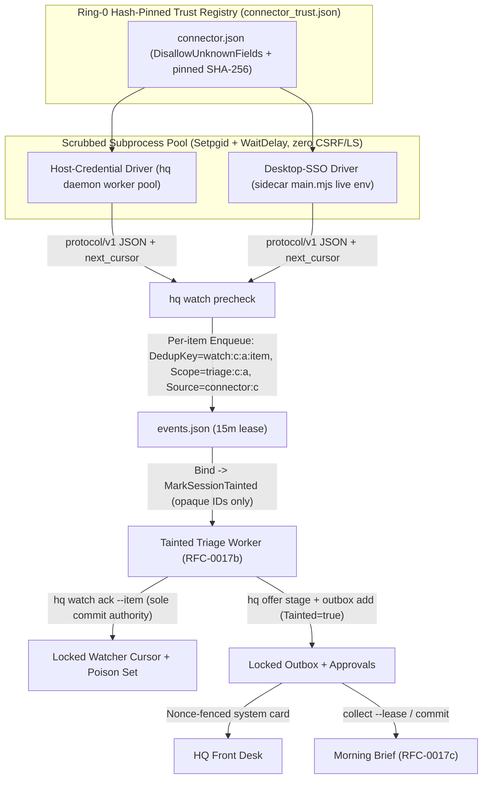

# RFC-0017a: Modular Connector Protocol, Hash-Pinned Trust Registry & 0-Token Watcher Engine

- **Status:** Proposed (Phase 1 Review)
- **Date:** 2026-11-14
- **Suite:** Part 1 of 3 — see also [RFC-0017b (Provenance Taint & Offer Gateway)](0017b-provenance-taint-and-offer-gateway.md) and [RFC-0017c (Lease-Based Morning Brief & Extensions)](0017c-lease-based-morning-brief-and-extensions.md)
- **Depends On:** [RFC-0003](0003-approval-bound-execution.md), [RFC-0005](0005-gmail-integration.md), [RFC-0008](0008-gchat-integration.md), [RFC-0014](0014-proactive-engine-and-living-context.md), [RFC-0015](0015-global-plugin-packaging.md), [RFC-0018](0018-always-on-agent-runtime-hardening.md)
- **Companion Research:** [13 — General Watcher Mechanism, Quarantine Provenance & Pluggable Enterprise Connector Audit](../research/13_proactive_channel_watcher_audit.md), [10 — Meta Muse (`muse.ai`) Deep Dive](../research/10_muse_ai_proactive_and_context_study.md), [14 — Anthropic Always-On Agents Gap Audit](../research/14_anthropic_always_on_agents_gap_audit.md)

---

## 1. Motivation & Scope Boundary

`agy-hq` must operate cleanly across **personal workstations and locked-down enterprise environments** without forking `bin/hq` or coupling core runtime loops to consumer Google Workspace setups. Even for the same vendor product (such as Gmail or Calendar), enterprise deployments diverge in authentication (`AGY_ACCOUNT=user@acme.com` Desktop SSO shims vs. host OAuth/Kerberos CLIs), filtering (`-label:automated-ci`), DLP policy (`draft_only` vs. direct API send), and companion tooling (Slack, Jira / `twg`, GitHub Enterprise, Gerrit, PagerDuty, or internal corporate CLIs).

To keep each security-critical boundary deeply specified and independently verifiable, `RFC-0017` is split into three cohesive specifications:
- **`RFC-0017a` (This Document):** Canonical `connector.json` manifest & hash-pinned trust registry, `hq-connector-protocol/v1` + built-in `jsonmap` adapter, scrubbed subprocess execution & Desktop-session lifecycle, shared locked file stores (`internal/store`), direct per-item `events.Enqueue` watcher engine with single-authority `hq watch ack`, `WaitingOn` thread inspection, quiet-hours/schedule alignment, and reference `gmail` / `gchat` / `gcalendar` connectors.
- **[RFC-0017b](0017b-provenance-taint-and-offer-gateway.md):** Bind-time provenance taint propagation, fail-closed per-conversation taint store, nonce-delimited `QuarantinedThread` reads, `low`-sensitivity context queries, hardened `hq offer stage` gateway, proposal superseding, apply-time thread preconditions, and nonce-fenced Front Desk system cards.
- **[RFC-0017c](0017c-lease-based-morning-brief-and-extensions.md):** Side-effect-free `hq brief collect` + two-phase `--lease` / `hq brief commit`, provenance-safe tainted reader brief synthesis, and structured `brief.d` / `hq-brief` extensions.

---

## 2. End-to-End Architecture (`RFC-0017a` + `0017b` + `0017c`)



---

## 3. Canonical `connector.json` & Hash-Pinned Trust Registry (`internal/connector`)

### 3.1 Fail-Closed `connector.json` Schema (Zero YAML Ambiguity)
Because `agy-hq` enforces `0` external Go dependencies (`ADR-0002` / CI Gate `H4-A`) and the existing line-oriented YAML helper (`internal/kernel/daemon.go:142-283`) splits flow lists on commas and silently ignores unknown keys (turning a typo like `particpant_lock` into a silent security bypass), **`connector.json` is the sole canonical manifest format**:
- Parsed strictly via `encoding/json.NewDecoder` with **`DisallowUnknownFields()`** plus deterministic semantic validation (`hq connector lint`).
- Security booleans default fail-closed: `ParticipantLock *bool` defaults to **`true`** when omitted; setting `false` requires a non-empty `ParticipantLockJustification` string (`>= 16` chars).
- Argument vectors permit `{{param}}` substitution **only** inside the built-in `jsonmap` adapter and **only** fused to a flag (`--flag={{x}}`, `--flag={{?opt}}` omitted when empty, `--flag={{*list}}` expanded per element) or after an explicit `--` separator. Standalone `"{{param}}"` before `--` is rejected by `hq connector lint`.

```json
{
  "schema_version": 1,
  "id": "gmail-corp",
  "section": "Communications",
  "requires_desktop_session": true,
  "env_allow": ["AGY_ACCOUNT"],
  "driver": {
    "argv": ["hq", "connector-driver", "gmail-plugin"]
  },
  "accounts": {
    "work": {
      "env": { "AGY_ACCOUNT": "user@acme.com" },
      "default_query": "in:inbox is:unread -category:promotions -label:automated-ci newer_than:7d"
    }
  },
  "capabilities": {
    "poll": { "enabled": true, "max_pages": 3, "page_size": 50 },
    "inspect_thread": { "enabled": true },
    "read_quarantined": { "enabled": true },
    "brief": { "enabled": true, "quarantined": true, "timeout_ms": 3000 },
    "queries": {
      "list_labels": { "sensitivity": "low" }
    },
    "offers": {
      "draft_only": {
        "creates_remote_draft_on_approve": true,
        "recipient_params": { "to": "email", "cc": "email" },
        "param_patterns": { "subject": "^[^\\r\\n]{1,200}$" },
        "supports_wait_on": false
      },
      "reply": {
        "recipient_params": { "to": "email", "cc": "email" },
        "param_patterns": { "subject": "^[^\\r\\n]{1,200}$" },
        "supports_wait_on": true
      }
    }
  }
}
```

### 3.2 Layered Discovery, Plugin Enablement & `RFC-0015` Project-Scope Resolution
Connectors are discovered in strict precedence order:
1. **`<vault>/connectors/<id>/connector.json`** — Private workstation or enterprise overrides (`enabled: false` cleanly disables any lower-layer connector).
2. **Trusted Enabled Antigravity Plugins** — Both global (`~/.gemini/config/plugins/<plugin>/hq-connectors/<id>/connector.json`) and `RFC-0015` project-scoped (`.agents/plugins/<plugin>/hq-connectors/<id>/connector.json`) roots are eligible **only if**:
   - `<plugin>` is currently enabled in Antigravity's plugin configuration, **and**
   - `<plugin>` is explicitly listed in `<vault>/config.yaml` under `connectors.trusted_plugins: ["<plugin>"]`.
3. **Embedded Reference Connectors (`templates/connectors/{gmail,gchat,gcalendar}/connector.json`)** — Compiled into `bin/hq` via `//go:embed` and activated automatically when an account or Desktop plugin is configured.

### 3.3 Approval-Gated SHA-256 Trust Pinning (`<vault>/private/connector_trust.json`)
To prevent prompt-injected untainted sessions from achieving persistent 15-minute RCE by dropping or modifying a manifest (`B12`), `agy-hq` does **not** rely on shell-bypassable `PreToolUse` path regexes (which also collide with `hq upgrade`):
- `<vault>/private/connector_trust.json` (`0600`, protected by the Universal Credential Vault guard in `hooks.go:800-824`) records pinned `{manifest_path, manifest_sha256, driver_resolved_path, driver_sha256, trusted_at}` entries for every non-embedded connector (embedded templates verify directly against `//go:embed` bytes).
- **`hq connector trust <id>`** stages an approval-bound `connector_trust` proposal (`hq propose` + `ask_question`) displaying the full `connector.json` and resolved driver binary path/hash.
- Before **every** subprocess `exec`, `internal/connector` recomputes the manifest SHA-256 (and local driver SHA-256). Unpinned or modified manifests are **refused fail-closed** and emit **at most one** `brief_rollup` re-trust notice per `(id, manifest_sha256)`.

---

## 4. `hq-connector-protocol/v1` & Built-In `jsonmap` Adapter

### 4.1 JSON-over-stdio Driver Contract (`hq-connector-protocol/v1`)
Non-trivial connectors (Gmail MIME/DKIM, Slack threads, Jira issues, Gerrit reviews) speak **`hq-connector-protocol/v1`**: `bin/hq` writes one JSON request object to `stdin` and parses one JSON response object from `stdout` via `cmd.Output()` (keeping `stderr` strictly separate).

- **Request (`stdin`):**
  ```json
  {
    "protocol_version": "v1",
    "op": "poll",
    "connector": "gmail-corp",
    "account": "work",
    "cursor": "hist_981220",
    "page_token": "",
    "max_items": 50,
    "params": { "query": "in:inbox is:unread -category:promotions newer_than:7d" }
  }
  ```
- **Response (`stdout`):**
  ```json
  {
    "protocol_version": "v1",
    "ok": true,
    "next_cursor": "hist_981299",
    "next_page_token": "",
    "items": [
      {
        "item_id": "193a8f01c2",
        "thread_key": "193a8e9900",
        "timestamp": "2026-11-14T16:10:00Z",
        "sender": "alice@example.com",
        "authenticated_participants": ["alice@example.com", "user@acme.com"],
        "mentions": ["user@acme.com"],
        "is_mention": true,
        "subject_or_room": "Q4 Architecture Sign-Off",
        "permalink": "https://mail.google.com/mail/u/0/#inbox/193a8e9900",
        "is_direct": true,
        "is_automated": false,
        "has_security_override": false,
        "has_schedule": true
      }
    ]
  }
  ```
- **Typed Error Taxonomy & Stderr Sanitization:**
  - When `ok == false` (or exit code $\ne 0$), drivers return `error: {code: "auth_expired" | "transient" | "permanent", message: "..."}`:
    - `auth_expired`: surfaces **one** actionable `brief_rollup` re-auth notice per episode (never every 15m).
    - `transient`: increments per-connector `ConsecutiveErrors`, surfacing only on strike 3.
    - `permanent`: pauses the connector until manifest/config changes.
  - Before recording `LastError` or `stderr`, `internal/connector` strips any `<plugin-card[\s\S]*?</plugin-card>` / `<plugin-card[^>]*>` tags so LLM-targeted CLI auth prompts can never inject unsolicited UI cards into Front Desk.

### 4.2 Zero-Glue Read-Only Enterprise Adapter (`hq connector-driver jsonmap`)
For read-only enterprise CLIs (`twg --json`, `gh api`, `ssh gerrit query --format=JSON` NDJSON, internal incident CLIs), `bin/hq` includes a pure-Go **`jsonmap` driver**:
- Accepts JSON arrays, JSON objects (`items_pointer: "/issues"`), and **NDJSON** streams using **RFC 6901 JSON-Pointer** paths (`item_id: "/key"`, `sender: "/fields/reporter/emailAddress"`, `timestamp: "/fields/updated"`), simple pure-Go transforms (`lower`, `join`, `rfc3339`, `const`), and JSON-Pointer equality predicates for `is_direct` / `is_automated`.
- Ships **`hq connector doctor [<id>]`** and **`hq connector test <id> --fixture=<dir>`** so enterprise authors can contract-test `connector.json` + golden JSON/NDJSON outputs offline and in CI.

---

## 5. Subprocess Sandbox, Worker Pool & Empirical Desktop-SSO Lifecycle

### 5.1 Single Scrubbed Connector-Exec Environment (`internal/connector/exec.go`)
Every connector, precheck, and built-in driver subprocess uses one environment builder reusing `sandbox.SanitizedEnv`:
- Preserves safe base OS variables (`PATH`, `HOME`, `USER`, `LANG`, `TZ`, `SSL_CERT_*`) plus **only** variables declared in the manifest's `env_allow` (e.g., `AGY_ACCOUNT`, `GH_HOST`, `KRB5CCNAME`).
- **Unconditionally strips `ANTIGRAVITY_CSRF_TOKEN` and `ANTIGRAVITY_LS_ADDRESS`** across **all** precheck and connector subprocesses—including fixing `internal/kernel/gatekeeper.go:224` and `internal/gmail/gmail.go:1052`—so no child process can ever call `SendUserCascadeMessage` to forge Front Desk user turns (`B11`).
- **Always sets `ANTIGRAVITY_PLUGIN_SHIM_DIR=/nonexistent-hq-sentinel`** when absent so `language_server plugin-cli` fast-fails (`rc=1`) instead of hanging (>25s) if credentials are missing.

### 5.2 Bounded Worker Pool & Process-Group Kill
To eliminate single-goroutine head-of-line blocking in `hq daemon` (`cmd/hq/main.go:1606-1652`), all connector polls, `WaitingOn` `inspect_thread` calls, and `hq brief collect` fan-outs execute inside a bounded worker pool (`max_workers = 4`, per-call timeout default `10s`) configured with `SysProcAttr{Setpgid: true}`, process-group `syscall.Kill(-pid, SIGKILL)` on context deadline, and `cmd.WaitDelay = 2 * time.Second`.

### 5.3 Host vs. Desktop-SSO Polling (`requires_desktop_session: bool`)
Based on the empirical plugin-CLI findings ([Research 13 §3](../research/13_proactive_channel_watcher_audit.md)):
- **`requires_desktop_session: false`** (OAuth refresh token in `<vault>/private/`, `gh`, Kerberos/corp CLI): polled directly by `hq daemon`.
- **`requires_desktop_session: true`** (Antigravity `plugin-cli` shims relying on live `ANTIGRAVITY_CREDENTIAL_SCOPE`):
  - **Never** caches `/tmp/agy-plugin-cli-*` paths (deleted per command; any `/tmp` binary check enforces `lstat` `uid == os.Getuid()`, mode `0700`, zero symlinks) and **never** writes `ANTIGRAVITY_CREDENTIAL_SCOPE` into `<vault>/memory/`.
  - Polled by the **Antigravity sidecar (`sidecars/agy-hq-console/main.mjs`)**, which inherits the live Desktop session environment and invokes `hq watch precheck --desktop-only` on its schedule; when Desktop is closed, `hq status` reports those connectors as `paused (desktop session inactive)` with `0` errors.
  - **Phase-2 Verification Spike:** Measure `ANTIGRAVITY_CREDENTIAL_SCOPE` validity across conversation end, Desktop restart, sign-out, and `AGY_ACCOUNT` switching before enabling any optional `0600` `<vault>/private/` token bridge.

---

## 6. Locked Stores, Direct Event Enqueue & Single Commit Authority (`internal/store`, `internal/watcher`)

### 6.1 Shared Locked Atomic Store (`internal/store`)
A shared pure-Go `internal/store` package (`syscall.Flock` `.lock` file + temp file + `Sync()` + `os.Rename`, mode `0600`) upgrades `memory/outbox/items.jsonl`, `memory/goals.json`, `memory/trigger_cursors.json`, and `<vault>/memory/watchers/<connector>-<account>.json`, eliminating concurrent lost-update races across parallel triage workers, `OutboxDispatcher`, `hq brief`, and `WaitingOn` sweeps.

### 6.2 Direct Per-Item `events.Enqueue` (Retiring `GatekeeperEnvelope`)
`hq watch precheck` does **not** serialize JSON deltas over 300-rune-truncated gatekeeper `stdout`:
1. Iterates enabled connectors concurrently in the worker pool (paginating up to `max_pages` using `cursor` / `next_cursor` so bursts $> \text{page\_size}$ never drop oldest items).
2. Partitioning:
   - Items with `IsAutomated == true && !HasSecurityOverride && !HasSchedule` and no `WaitingOn` or private `<vault>/config.yaml` `attention.priority_rules` match (`templates/config.yaml` ships `priority_rules: []`, enforced empty by CI) roll directly into a 0-LLM-token `brief_rollup` digest entry and advance in-window ack state. (`HasSecurityOverride` protects 2FA codes, sign-in alerts, and password resets from silent auto-digesting.)
   - Actionable items enqueue **one durable `Event` per item** directly into `events.json`:
     - `DedupKey: "watch:<connector>:<account>:<item_id>"` (`7d` active/done window),
     - `ScopeKey: "triage:<connector>:<account>"` (per-account serialization; `LeaseNextBatches` coalesces ready items of the same scope into one worker run under `15m` `DefaultLeaseTTL`),
     - `Source: "connector:<connector>"` (triggers bind-time auto-taint in [RFC-0017b](0017b-provenance-taint-and-offer-gateway.md)),
     - `Payload`: **opaque IDs and routing enum only** (`{connector, account, item_id, thread_key, recommended_model}`) — zero untrusted `Sender`/`Subject` text!
3. Model tiering: 1–3 routine items select `gemini-4-hydrogen-low`; `WaitingOn` thread matches, `HasSchedule`, `HasSecurityOverride`, `priority_rules` hits, or $\ge 4$ items select `gemini-4-hydrogen-medium`. Spawn quota remains `15` by default in `templates/config.yaml`, adding `min(16, 4 * active_poll_connectors)` dynamically only when watcher connectors are enabled.

### 6.3 Single Commit Authority (`hq watch ack`) & Poison Dead-Letter Set
- **`hq watch ack --item=<item_id>`** is the **sole** authority advancing watcher watermarks (`LastCursor` + bounded in-horizon `AckedItemIDs`), validated server-side against the calling `conversationId`'s currently leased `events.json` batch. (Legacy `state-<alias>.json` migration skips any `item_id` referenced by a still-`pending` `memory/gmail/batches/*.json` batch.)
- **Partial-Batch Safe `Stop` Finalization:** For `Source: "connector:*"` batches, `Stop` marks **only acked** item events `done` and **requeues unacked** item events (`AttemptCount++`), preventing silent item loss on 429s or mid-batch stops.
- **Poison Dead-Letter Set:** When an item event reaches `StatusDropped` (`MaxAttempts` exhausted in `events.go:237, 384`), its `item_id` is recorded in the cursor's `PoisonedItems` map and emits **one** `brief_rollup` dead-letter notice (`connector`, `account`, `item_id`) so poison items never re-enqueue infinitely.

### 6.4 Reference Connectors, `WaitingOn` Inspection & Quiet-Hours Alignment
- **Retiring Legacy Loops & Fixing Reference Drivers:** Retires `RunHeartbeat`'s hardcoded 30m `gmail`/`gchat` prechecks (`kernel.go:2330-2410`); ships embedded `gmail`, `gchat`, and `gcalendar` `connector.json` manifests; fixes Gmail direct OAuth REST (`expiry` token refresh, metadata headers, MIME/base64url decode, REST draft CRUD, default `in:inbox is:unread -category:promotions -category:social newer_than:7d`).
- **Connector-Agnostic `WaitingOn` Sweep (`internal/kernel/goals.go`):** Adds `(Connector, Account, ThreadKey, LastItemID, Priority)` to `GoalWaitingOn`; `SweepWaitingOnObligations` runs `inspect_thread` via the worker pool before firing overdue alerts and restricts tainted `hq goals mark-replied` strictly to `inspect_thread`-verified replies on the batch's leased `ThreadKey` (replacing fuzzy `strings.Contains`).
- **Quiet-Hours & Schedule Hardening (`internal/outbox/outbox.go`, `templates/config.yaml`):**
  - Honors both `tz:` and `timezone:` in `ParseAttentionConfig`, defaults `QuietHours.Enabled = true` whenever `quiet_hours:` is present, defaults `quiet_hours.end` to `"07:30"` (aligned with `/morning-brief`), resolves `tz: local` at `hq init` (removing workstation-specific `America/Los_Angeles` defaults from OSS templates), injects `CRON_TZ=<tz>` into `*/15 7-20 * * *` schedules, and sets `quotaDeferred` `AvailableAt = max(nextQuotaReset, quietHoursEnd)` to prevent midnight spawn bursts.

---

## 7. Phase 2 Verification Plan (`CUJ-30a`)

- **`TestCUJ30a_ConnectorProtocolTrustAndWatcherEngine`:** Verifies `connector.json` `DisallowUnknownFields` + `hq connector lint` rejecting fail-open keys/standalone `{{param}}`, `hq connector trust` SHA-256 pinning blocking tampered manifests, `jsonmap` RFC 6901 JSON/NDJSON parsing, scrubbed subprocess env (`0` `CSRF_TOKEN`/`LS_ADDRESS` leaks + sentinel `SHIM_DIR` + `Setpgid` timeout kill), paginated `hq watch precheck` direct `events.Enqueue`, partial-batch `Stop` requeuing unacked items while committing `hq watch ack` items, `StatusDropped` poison dead-lettering, `WaitingOn` `inspect_thread` reconciliation, and `tz:`/schedule-aware quiet-hours quota deferral.
