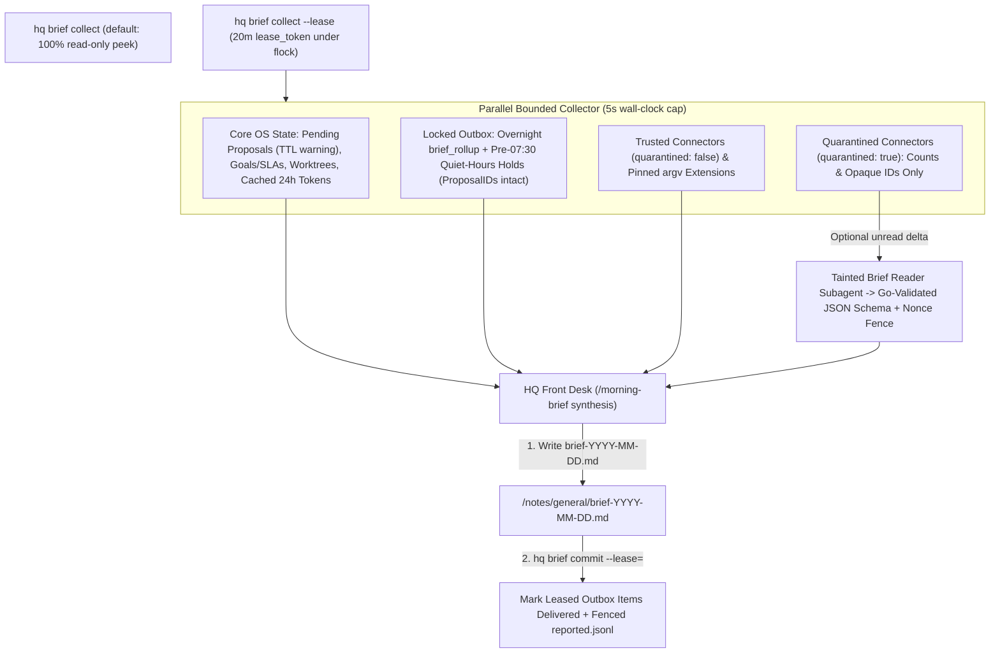

# RFC-0017c: Non-Destructive Lease-Based Morning Brief Collector & Structured Extensions

- **Status:** Proposed (Phase 1 Review)
- **Date:** 2026-11-14
- **Suite:** Part 3 of 3 — see also [RFC-0017a (Connector Protocol & Watcher Engine)](0017a-connector-protocol-and-watcher-engine.md) and [RFC-0017b (Provenance Taint & Offer Gateway)](0017b-provenance-taint-and-offer-gateway.md)
- **Depends On:** [ADR-0003 (Two-Layer Vault)](../decisions/0003-two-layer-oss-and-private-vault.md), [RFC-0014](0014-proactive-engine-and-living-context.md), [RFC-0017a](0017a-connector-protocol-and-watcher-engine.md), [RFC-0017b](0017b-provenance-taint-and-offer-gateway.md), [RFC-0018](0018-always-on-agent-runtime-hardening.md)
- **Companion Research:** [13 — General Watcher Mechanism, Quarantine Provenance & Pluggable Enterprise Connector Audit](../research/13_proactive_channel_watcher_audit.md)

---

## 1. Motivation & Threat Model

`/morning-brief` (`skills/morning-brief/SKILL.md`) currently couples the daily digest directly to consumer `gcalendar`, `hq gmail search`, `hq gchat search`, and `gh pr status`, forcing enterprise workstations (Slack, Jira / `twg`, Gerrit, corporate mail/calendar) to run dead consumer steps and tempting users to place personal or regional checks into tracked OSS skill files.

At the same time, decoupling `/morning-brief` must solve **two critical reliability and security hazards** identified in [Research 13 §4.2–§4.3](../research/13_proactive_channel_watcher_audit.md):
1. **Read-Destructive Outbox Drain (`§5.7`):** `DrainBriefRollup` (`internal/outbox/outbox.go:578-604`) marks items `delivered` and writes `reported.jsonl` **on read**. Running `hq brief collect` manually before the `07:30` cron—or hitting an API `429`/crash mid-turn—permanently loses overnight `brief_rollup` and quiet-hours-held items.
2. **Untrusted Laundering into `front_desk_cron` (`A4`, `A5`):** `templates/triggers.yaml:3-8` runs `morning-brief` as `mode: front_desk_cron` inside **`[HQ] Front Desk`**—the longest-lived, highest-privilege coordinator context. Feeding raw `quarantined: true` connector output or unvetted plugin Markdown instructions (`hq-brief/*.md`) directly into Front Desk exposes it to prompt injection (`</untrusted_content>` tag-closing and cross-plugin privilege escalation).

---

## 2. Architecture Overview



---

## 3. Two-Phase Non-Destructive Collection (`internal/brief` + `hq brief`)

### 3.1 Idempotent Peek vs. `--lease` / `hq brief commit`
1. **Default Read-Only Peek (`hq brief collect [--json]`):**
   - Performs **zero** state mutations on `memory/outbox/items.jsonl` or `reported.jsonl`. Safe for CLI previews, debugging, and dry runs at any time.
2. **Lease Acquisition (`hq brief collect --lease [--ttl=20m] [--json]`):**
   - Acquires `internal/store` `flock` on `memory/outbox/items.jsonl`, generates `lease_token = "blease_<random128>"`, and stamps `LeaseToken` + `LeaseExpiresAt = now + 20m` onto eligible pending `brief_rollup` items (plus overnight quiet-hours-held `interrupt` items created before `quiet_hours.end`, so `07:30` briefs never double-notify alongside a `07:00` flush).
   - Items remain `Status: "pending"` until committed; if a turn crashes or hits `429`, expired leases revert automatically on the next read or `OutboxDispatcher` tick.
3. **Post-Write Commit (`hq brief commit --lease=<token> --brief-file=<path>`):**
   - Verifies that `<brief-file>` exists and is non-empty, then atomically transitions items matching `lease_token` to `Status: "delivered"` and records nonce-fenced entries in `reported.jsonl`.
   - **Legacy `hq outbox drain` Migration:** Updates `skills/morning-brief/SKILL.md` in the same commit to use `--lease` / `commit`; `hq outbox drain` becomes a compatibility wrapper emitting a deprecation notice on `stderr`.

### 3.2 Realistic Bounded Execution & Proposal TTL Warnings (`C14`, `§5.7`)
- **Bounded Parallel Fan-Out:** Connector `brief` capabilities and deterministic `argv` extensions execute inside the [RFC-0017a](0017a-connector-protocol-and-watcher-engine.md) bounded worker pool (`per_connector_timeout` default `3s`, overall collector deadline `5s`). Offline corporate VPNs or expired SSO tokens return `{section, connector, status: "offline", error_code: "transient"|"auth_expired"}` without failing or stalling the brief.
- **Stat-Cached Token Telemetry:** Reads the pre-aggregated stat-cached observability index (`<100ms`) rather than cold-scanning raw transcript JSONLs.
- **Expiring Proposal Alerting:** `hq brief collect` inspects every pending `Proposal` (`24h` TTL) referenced by overnight outbox items or `approvals/pending/`: proposals with `< 4h` remaining TTL (or expired overnight) carry `ttl_warning: "expires_soon" | "expired_overnight"` so `/morning-brief` surfaces them first or offers 1-step re-staging.

---

## 4. Provenance-Safe Brief Synthesis (`A4` Closed)

Because `/morning-brief` runs inside untainted `[HQ] Front Desk`, `hq brief collect` enforces a strict provenance split across connector outputs:
1. **`quarantined: false` Connectors (Trusted Internal State):** Local engineering worktrees, CI/PR status (`gh` metadata), internal telemetry, and deterministic numeric metrics pass structured fields directly into the brief packet.
2. **`quarantined: true` Connectors (`gmail`, `gmail-corp`, `gchat`, `slack`, External Trackers):**
   - `hq brief collect` emits **aggregate counts, authenticated sender domains, and opaque item/thread IDs only**—plus any already-triaged overnight `OutboxItem`s rendered inside [RFC-0017b](0017b-provenance-taint-and-offer-gateway.md) cryptographic nonce fences (`BoundedSubject <= 120` runes + proposal metadata).
   - **Tainted Reader Summarization (`--summarize-quarantined` / `[quick] brief: Quarantined Digest Reader`):** If unread quarantined items exist that were *not* already summarized by overnight watcher triage, they are read exclusively inside an **auto-tainted reader worker** constrained to return a **Go-validated strict JSON array** (`{item_id, urgency_enum, category_enum, bounded_subject}`), which `bin/hq` validates and wraps in a cryptographic nonce fence before `[HQ] Front Desk` ever sees the brief packet. Raw untrusted message bodies **never** enter Front Desk context.

---

## 5. Structured Brief Extensions (`<vault>/brief.d/` & Plugin `hq-brief/`, `A5` Closed)

To support private local checks (such as regional weather or venue notices in git-ignored `<vault>/brief.d/`) and enterprise team checks (such as on-call handoffs or release freezes in plugin `hq-brief/`) without granting unvetted Markdown Front Desk prompt privileges:

### 5.1 Mode 1 — Deterministic `argv` Extensions (Default, Safe for Vault & Trusted Plugins)
A `.json` (or strict frontmatter `.md` with empty body) extension executed deterministically by `hq brief collect` inside the scrubbed worker pool and hash-pinned via `hq connector trust`:
```json
{
  "schema_version": 1,
  "id": "team-oncall-status",
  "section": "Operations",
  "mode": "argv",
  "argv": ["corp-oncall", "current", "--team=platform", "--json"],
  "timeout_ms": 2500,
  "quarantined": false
}
```

### 5.2 Mode 2 — Explicitly Trusted Prompt / Skill Extensions (`<vault>/brief.d/*.md` Only)
Free-form natural-language brief checklists (e.g., `<vault>/brief.d/morning-activities.md`) are **never** loaded from plugins (`hq-brief/` plugins may ship `mode: "argv"` only). Even inside `<vault>/brief.d/`, a `mode: "prompt"` or `skill:` extension is included in `hq brief collect` **only** after:
1. Its `<id>` is listed in `<vault>/config.yaml` under `brief.trusted_extensions: ["morning-activities"]` (default `[]` in `templates/config.yaml`, enforced empty by CI), **and**
2. Its file SHA-256 is pinned in `<vault>/private/connector_trust.json` via approval-gated `hq connector trust --brief-ext=<id>`.

### 5.3 Vendor-Neutral `skills/morning-brief/SKILL.md`
`skills/morning-brief/SKILL.md` becomes a concise, 100% vendor- and persona-neutral 4-step workflow:
1. Run `hq brief collect --lease --json` (and spawn `[quick] brief: Quarantined Digest Reader` only if `unurged_quarantined_ids` is non-empty).
2. Execute any hash-verified `trusted_extensions` checklists and review active `<vault>/notes/` project deltas.
3. Save `<vault>/notes/general/brief-YYYY-MM-DD.md`, run `hq brief commit --lease=<token> --brief-file=<path>`, and output the executive brief directly in chat.
4. Present pending proposals (highlighting any `expires_soon` flags and inline payload previews) via 1-tap `ask_question`.

---

## 6. Personal vs. Enterprise Customization Matrix (`0` Core Code Changes)

| Capability | Personal Workstation Default | Enterprise Workstation Setup | Extension Unit |
|---|---|---|---|
| **Mail & Chat** | Embedded `gmail` + `gchat` | `gmail-corp` (`requires_desktop_session: true`, `draft_only`) + `slack` | `<vault>/connectors/` or trusted plugin |
| **Calendar** | Embedded `gcalendar` (`low` `freebusy` + `create_event`) | Corporate `gcalendar` (`AGY_ACCOUNT=user@acme.com`) or Outlook | Account override in `<vault>/connectors/` |
| **Engineering / Ops** | Local git worktrees + optional `gh` | `jira` (`jsonmap` over `twg`), `gerrit`, `pagerduty` | `hq-connectors/*.json` (`hq connector trust`) |
| **Custom Brief Checks** | Private `<vault>/brief.d/*.md` (pinned in `trusted_extensions`) | Deterministic `mode: "argv"` `hq-brief/*.json` (on-call, freeze status) | `<vault>/brief.d/` or plugin `hq-brief/` |

---

## 7. Phase 2 Verification Plan (`CUJ-30b` & `CUJ-32`)

- **`TestCUJ30b_LeaseBasedMorningBriefAndStructuredExtensions`:** Verifies idempotent `hq brief collect` peek, `--lease` crash/expiry recovery (`0` lost `brief_rollup` items when uncommitted), `hq brief commit` post-file-write delivery + `ProposalIDs` preservation + `< 4h` TTL warnings, `quarantined: true` connectors emitting counts/IDs only (zero raw untrusted text in Front Desk), unpinned `brief.d` / plugin `mode: "prompt"` rejection, and zero consumer Gmail/Calendar errors when disabled on an enterprise-only workstation.
- **`TestCUJ32_OutboxQuietHoursAndFencedSystemDelivery`:** Verifies `tz:`/`enabled` parser fix, `07:30` quiet-hours alignment, `DedupKey` + `ThreadKey` burst superseding (both `OutboxItem` and `Proposal`), nonce-fenced system card formatting, and `hq outbox eval` `100%` pass.
