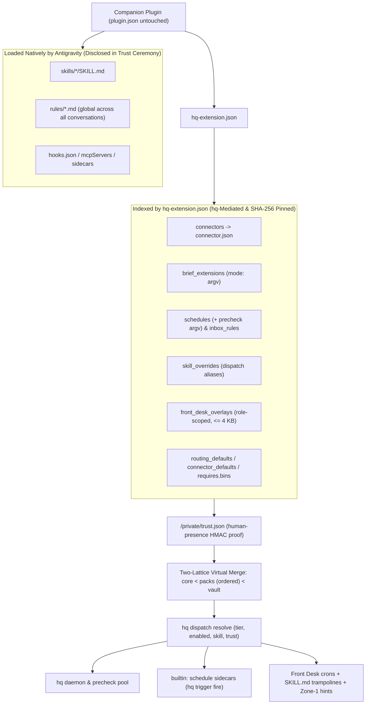

# RFC-0017d: Companion Extension Packs, Unified Trust Registry & Host Portability

- **Status:** Implemented
- **Date:** 2026-11-14
- **Suite:** Part 4 of 4 — see also [RFC-0017a (Connector Protocol & Watcher Engine)](0017a-connector-protocol-and-watcher-engine.md), [RFC-0017b (Provenance Taint & Offer Gateway)](0017b-provenance-taint-and-offer-gateway.md), and [RFC-0017c (Lease-Based Morning Brief & Extensions)](0017c-lease-based-morning-brief-and-extensions.md)
- **Depends On:** [RFC-0003](0003-approval-bound-execution.md), [RFC-0014](0014-proactive-engine-and-living-context.md), [RFC-0015](0015-global-plugin-packaging.md), [RFC-0017a](0017a-connector-protocol-and-watcher-engine.md), [RFC-0017b](0017b-provenance-taint-and-offer-gateway.md), [RFC-0017c](0017c-lease-based-morning-brief-and-extensions.md), [RFC-0018](0018-always-on-agent-runtime-hardening.md)
- **Companion Research:** [13 — General Watcher Mechanism, Quarantine Provenance & Pluggable Enterprise Connector Audit](../research/13_proactive_channel_watcher_audit.md), [11 — Antigravity Global Plugin Packaging & Vault Isolation Audit](../research/11_plugin_packaging_audit.md)

---

## 1. Motivation & Platform Scope

Deploying `agy-hq` across **locked-down enterprise workstations, custom Antigravity host directories, and headless/CLI environments** exposed platform-wide coupling beyond channel connectors alone ([Research 13 §3, §4.4](../research/13_proactive_channel_watcher_audit.md)):
1. **Hardcoded Model IDs (`#1`):** `<vault>/config.yaml` `routing.tiers` is never read by Go code (`internal/kernel/kernel.go:1945-2060` hardcodes model families, as do `timers.go:197`, `events_dispatch.go:359`, `templates/triggers.yaml`, sidecars, and `migrate.go:419`), breaking hosts with enterprise-scoped model catalogs.
2. **Fragmented Companion Customizations (`#4`):** Enterprise teams need a single distributable Antigravity companion plugin packaging connectors, `/morning-brief` extensions, cron/gatekeeper schedules, inbox routing rules, skill overrides, Front Desk policy overlays, routing defaults, and CLI binary checks—without modifying `agy-hq` source or violating `agy plugin validate --strict`.
3. **Sidecar `node` Assumption (`#5`) & Desktop-SSO Sidecar Absence (`N4`):** Headless/CLI installs may lack system `node`, and empirical inspection of `/proc/<pid>/environ` confirmed that **neither `agy-hq-console` sidecar nor `hq daemon` receives `ANTIGRAVITY_CREDENTIAL_SCOPE`**—requiring a conversation-hook-driven Desktop-SSO polling path.
4. **Hardcoded `~/.gemini` Host Paths & Front Desk Prefix Bug (`#6`):** Multiple call sites ignore `ANTIGRAVITY_APP_DATA_DIR` / `ANTIGRAVITY_GEMINI_DIR`, and `internal/hooks/hooks.go:1105` checks Front Desk artifact writes via substring `"/.gemini/antigravity/brain/"`—both breaking relocated hosts and permitting worktree path-substring spoofing.
5. **No Per-Schedule Pause/Resume Without Deleting YAML (`#7`):** Disabling an unused schedule currently requires editing `triggers.yaml` by hand, risking lossy pure-Go YAML round-tripping or lost cursors.

`RFC-0017d` unifies these concerns behind **companion extension packs (`hq-extension.json`)**, **one human-presence-gated trust registry (`<vault>/private/trust.json`)**, **one dispatch resolver (`hq dispatch resolve`)**, and **clean host portability (`internal/routing`, `internal/hostpaths`, `hq sidecar console`)**.

---

## 2. Companion Extension Pack Architecture (`hq-extension.json` & `<vault>/extensions.json`)

### 2.1 One Mental Model: Untouched `plugin.json` + Root `hq-extension.json`

Empirical validation against `agy plugin validate --strict` (`agy 1.5.8`) proved two key invariants:
- Adding any custom field inside `plugin.json` **fails `--strict`** (`unknown field "hq" is ignored`).
- Extra root files and directories (`hq-extension.json`, `hq-connectors/`, `hq-brief/`, `hq-overlays/`) **pass `--strict` cleanly**.

Every companion extension pack is therefore a standard Antigravity plugin whose `plugin.json` remains 100% untouched, paired with a strict JSON index at `<plugin>/hq-extension.json`:



### 2.2 Namespaced FQIDs & Two-Lattice Virtual Merge (`P1-10` Hardened)
- **Reserved & Namespaced Pack Identities:** `core` and `vault` are reserved pack IDs; companion plugins use `<pack>/<id>` (`id` must equal `plugin.json` `name`, resolved root path pinned in `private/trust.json`), with a canonical alias map (`morning-brief` ↔ `core/morning-brief`) so legacy cursor keys and Front Desk crons never duplicate. Unqualified ID collisions across enabled packs fail closed unless `<vault>/extensions.json` names a winner.
- **Discovery Preconditions:** A companion pack participates only when (1) enabled in Antigravity (`agy plugin list --json` / `Roots.ConfigDir`), (2) listed in `<vault>/extensions.json` ordered `enabled_packs`, and (3) hash-verified against `<vault>/private/trust.json` (a mismatch on `hq-extension.json` itself disables the entire pack; component mismatches fail closed per component).
- **Two Merge Lattices:**
  1. **Preference Lattice** (`cron`, `tz`, `tier`, `delivery`, `section`, `order`, `timeout_ms`, `enabled`, `catch_up`): `Vault (<vault>/extensions.json) > packs (in enabled_packs order, scoped to their own <pack>/* FQIDs) > core` (`packs` cannot disable or alter `core/*` schedules or pre-empt core `tax-prep`/`ledger-ingest` inbox rules without an explicit Vault override; `routing_defaults` requires Vault opt-in or empty `routing.tiers`).
  2. **Security Lattice** (`participant_lock: true`, `quarantined: true`, `sensitivity: "private"`, `requires_desktop_session: true`, taint-surface membership): **monotonic-restrictive**. Companion packs may only tighten defaults (`hq extension lint` rejects loosening in packs and rejects companion `PreToolUse`/`PreInvocation` hooks unless explicitly Vault-loosened). Only `<vault>/extensions.json` `security_loosening` (bound to `(fqid, component_sha256)` with a $\ge 16$-char `justification` pinned in `private/trust.json`) may relax a security boolean.

### 2.3 Virtual Schedule / Gatekeeper Merge & Unified `hq triggers` CLI (`#4`, `#7`, `P1-8`, `P1-9`)
- **Per-Schedule Resilient Parsing & Tainted External Prechecks:** `<vault>/triggers.yaml` accepts legacy aliases (`model:`, `precheck_cmd:`, `dedup_mode:`), rejects malformed individual entries with a `doctor` warning rather than dropping healthy schedules like `sleep-consolidate`, and tags non-`hq` gatekeeper `precheck` runs as `Source: "quarantined:precheck:<fqid>"` so external CLI stdout never enters an untainted prompt. `DaemonInfo.SchedulesCount` preserves raw `triggers.yaml` counts (`CUJ-12`) alongside `EffectiveSchedulesCount`.
- **`hq triggers <list|pause|resume|fire> <fqid>` (`#7`):** Writes **only** `<vault>/extensions.json` (`internal/store` `RankExtensions`); FQID cursors remain untouched while paused; unknown/removed FQIDs resolve to `{enabled: false, reason: "unknown"}`; and Front Desk `SessionStart` emits both **arm** and **disarm** lists paired with `[hq-trigger:<fqid>]` Step-0 `hq dispatch resolve --trigger=<fqid>` guards.

### 2.4 Canonical `hq-extension.json` & `<vault>/extensions.json` Schemas
```json
{
  "schema_version": 1,
  "id": "acme-workspace",
  "version": "1.4.0",
  "min_hq_version": "0.3.0",
  "requires": {
    "bins": [{ "name": "corp-mail", "probe_argv": ["corp-mail", "--version"], "min_version": "2.1.0" }],
    "desktop_session": false
  },
  "components": {
    "connectors": ["hq-connectors/corp-mail/connector.json", "hq-connectors/corp-chat/connector.json"],
    "brief_extensions": ["hq-brief/oncall.json"],
    "schedules": [{
      "id": "oncall-digest",
      "cron": "*/30 9-18 * * 1-5",
      "tz": "local",
      "tier": "routine",
      "mode": "isolated_worker",
      "skill": "oncall-digest",
      "delivery": "brief_rollup",
      "enabled": false,
      "catch_up": "none",
      "precheck": { "argv": ["corp-oncall", "changed", "--json"], "dedup_mode": "stdout_sha256", "timeout_ms": 5000 }
    }],
    "inbox_rules": [{ "id": "expense-pdfs", "extensions": [".pdf"], "filename_regex": "(?i)expense", "skill": "expense-ingest" }],
    "skill_overrides": {
      "morning-brief": { "skill": "work-morning-brief", "skill_md": "skills/work-morning-brief/SKILL.md" }
    },
    "front_desk_overlays": [{ "id": "org-policy", "path": "hq-overlays/front-desk.md", "scope": ["front_desk"], "max_bytes": 4096 }],
    "routing_defaults": { "tiers": { "quick": { "model": "<host-fast-model>" }, "routine": { "model": "<host-default-model>" } } },
    "connector_defaults": { "gmail": "hq-connectors/gmail-cli/connector.json", "gchat": "hq-connectors/gchat-cli/connector.json" }
  }
}
```

`<vault>/extensions.json` (`0600`, locked via `internal/store`):
```json
{
  "schema_version": 1,
  "enabled_packs": ["acme-workspace"],
  "order": ["acme-workspace"],
  "overrides": {
    "schedules": {
      "acme-workspace/oncall-digest": { "enabled": true, "tier": "quick" },
      "core/morning-brief": { "cron": "30 8 * * 1-5", "catch_up": "last" }
    },
    "skill_overrides": { "morning-brief": null },
    "security_loosening": [
      {
        "target": "acme-workspace/oncall.quarantined",
        "value": false,
        "justification": "Counts-only JSON emitted by internal metrics service"
      }
    ]
  }
}
```

---

## 3. Unified Pack-Level Trust Registry (`<vault>/private/trust.json`)

`<vault>/private/trust.json` (`0600`) serves as the **single cryptographic trust registry** consumed by [RFC-0017a](0017a-connector-protocol-and-watcher-engine.md), [RFC-0017c](0017c-lease-based-morning-brief-and-extensions.md), and companion packs:
1. **All-Session Ring-0 Write/Read Guard (`N1`):** Added to `internal/hooks/hooks.go:804-810`, `reLocalCredentialShell` (`hooks.go:536`), and `bwrap` `private/` masking so no LLM session (untainted, `[Auto]`, subagent, or tainted) can directly read or mutate `private/trust.json`.
2. **Pack-Level Staging & Native-Surface Disclosure (`hq extension trust <pack|vault>`):**
   - Computes SHA-256 hashes over `hq-extension.json`, every referenced component (`connector.json`, `hq-brief/*.json`, `hq-overlays/*.md`, override target `SKILL.md`, `<vault>/brief.d/*.md`), and resolved external `cli.path` / `precheck.argv[0]` binaries (recording `{sha256, version}`).
   - Pins `hq` self-invocations (`["hq", ...]`) by **embedded `(version, commit)`** rather than file SHA-256 so `hq upgrade` never causes re-trust churn across connectors or schedules.
   - Inventories Antigravity-native surfaces inside the companion plugin (`rules/*.md`, `hooks.json`, `mcpServers`, `sidecars`, `skills/`) in the approval diff; `hq doctor` warns whenever a companion plugin registers a competing `PreToolUse` hook.
3. **Human-Presence Approval Proof & Per-Component Fail-Closed Enforcement:**
   - Committing an `extension_trust` proposal requires the [RFC-0017b §4.3](0017b-provenance-taint-and-offer-gateway.md) human-presence capability (`ask_question` transcript-verified HMAC or `:4242` UI token).
   - Before every subprocess exec, skill override, or overlay injection, `hq` verifies the component SHA-256. Any mismatch fails closed **for that component only** (other trusted components continue operating) and emits at most one `brief_rollup` re-trust diff notice per `(component, sha256)`.

---

## 4. Dispatch Resolver (`hq dispatch resolve`), `skill_overrides` & `front_desk_overlays`

### 4.1 Single Dispatch Resolver (`hq dispatch resolve`)
Every launch surface (`hq daemon`, `builtin: "schedule"` sidecars, `inbox_rules`, watcher triage prompts, `SpawnTask`, and `SKILL.md` trampolines) resolves execution metadata through one deterministic call:
```json
{
  "fqid": "core/morning-brief",
  "enabled": true,
  "skill": "work-morning-brief",
  "skill_origin": "pack:acme-workspace",
  "tier": "routine",
  "model": "<resolved-host-model>",
  "trust": "ok",
  "reason": ""
}
```

### 4.2 `skill_overrides` Without Catalog Surgery (`#4`)
Because Antigravity loads every enabled plugin's `skills/` directory statically, `hq` routes overrides cleanly without mutating plugin files on disk:
1. **Deterministic `hq` Dispatches:** `ScheduleTrigger`, `enqueueQueuedInboxFile`, `Event.Skill`, `SpawnTask`, and `hq trigger fire` resolve logical skill names via `ResolveSkill(logical)` before building prompts.
2. **2-Line Step-0 Trampoline for Interactive `/skill` Turns:** Overridable core `SKILL.md` files (`morning-brief`, `swe-pulse`, `filing-diff`, `thesis-check`, `ledger-ingest`, `tax-prep`) begin with Step 0: `Run hq dispatch resolve --skill=<name>; if an active trusted override is returned, activate that skill and stop following this file.` If unconfigured or untrusted, execution stays safely in the core skill.
3. **Static Zone-1 `SessionStart` Hint:** Injects a deterministic 1-line alias hint in static Zone-1 (`SessionStart`) so prefix caching remains warm.
4. **Non-Overridable Quarantine Skills:** Security-critical quarantine readers (`inbox-triage` and the `0017c` quarantined digest reader) are **non-overridable by companion packs**, and Ring-0 `PreToolUse` hooks enforce taint invariants regardless of `SKILL.md` prose.

### 4.3 Role-Scoped `front_desk_overlays` vs. Global Native `rules/*.md` (`#4`)
- Native `<plugin>/rules/*.md` files are loaded globally by Antigravity across all conversations and are disclosed during `hq extension trust`.
- Companion **`front_desk_overlays`** are injected by `hq` `SessionStart` **exclusively** into untainted role-scoped Zone-1 contexts (`front_desk` and optional `task:<scope>`), hash-pinned in `private/trust.json`, capped at $\le 4\text{ KB}$ per overlay ($\le 16\text{ KB}$ total), **never** injected into `[Auto]` or tainted sessions, and strictly advisory (`hq extension lint` flags approval/taint-bypass phrasing, while `PreToolUse` hooks remain the sole mechanical enforcement layer).

---

## 5. Host Portability & Desktop-SSO Polling (`#1`, `#5`, `#6`, `N4`)

### 5.1 Pure `ResolveModel` + Vault-Scoped `internal/routing` (`#1`, `P0-8`)
- **Preserving Pure `kernel.ResolveModel` (`H3` & `CUJ-4`):** `routing.Builtin(prompt, model, depth, tier)` backs `kernel.ResolveModel` with zero Vault I/O (preserving the exact 3-class `Class` return and CI hermeticity), while **`routing.Resolve(vaultDir, req)`** resolves the 6-tier enum (`quick | routine | standard | heavy | deep-medium | deep`) in order: `<vault>/config.yaml` `routing.tiers` (`deep_routine` accepted as alias for `deep-medium`) → Vault-opted-in pack `routing_defaults.tiers` → `routing.Builtin`.
- **Migrating Runtime Call Sites:** `timers.go:197`, `events_dispatch.go:359`, `gatekeeper.go:298`, `ScheduleTrigger`, `templates/sidecars/hq-*` (`hq triggers fire <fqid>`), `migrate.go:419`, `fallback_on_429`, and `obs` attribution route through `routing.Resolve(vaultDir, ...)`, while `hq doctor` validates configured tiers against `GetCascadeModelConfigData` when LS credentials exist.

### 5.2 Hermetic `hostpaths.Resolve(vaultDir)` & Own-Conversation Brain Guard (`#6`, `S3`, `P0-9`)
- **`hostpaths.Resolve(vaultDir)`** returns `Roots{GeminiDir, ConfigDir, AppDataDir, BrainDir, PluginsDir}`:
  1. Explicit `HQ_{HOME,GEMINI,CONFIG,APP_DATA,BRAIN}_DIR` overrides.
  2. **Test Hermeticity Guard:** When `vault.IsTempPath(EvalSymlinks(vaultDir))` is true, `hostpaths` ignores real host `roots.json` / non-temp `ANTIGRAVITY_*` env and **never** writes `$XDG_CONFIG_HOME/agy-hq/roots.json`, keeping `go test ./...` 100% isolated from the developer's workstation.
  3. Antigravity session env (`ANTIGRAVITY_GEMINI_DIR`, `ANTIGRAVITY_CONFIG_REL_DIR`, `ANTIGRAVITY_APP_DATA_DIR`).
  4. External locator `$XDG_CONFIG_HOME/agy-hq/roots.json` (`0600`, owner-UID, non-symlink, write-protected in `PreToolUse`).
  5. Defaults (`~/.gemini`, `config`, `antigravity`).
- **Own-Conversation Brain Guard (`hooks.go:1105`, `S3`):** Replaces the substring check with canonical prefix matching against **`filepath.Join(Roots.BrainDir, payload.ConversationID)`** (plus `Lstat` no-symlink check) and blocks `**/.system_generated/**` across all sessions.

### 5.3 Go-Native `hq sidecar console` & `builtin: "schedule"` Sidecars (`#5`, `H2-C`)
- **`hq sidecar console`:** Pure-Go subcommand reading `ANTIGRAVITY_SIDECAR_WEB_PORT`, minting an in-memory session secret alongside `ANTIGRAVITY_SIDECAR_UI_TOKEN`, serving/proxying `:4242`, and supervising `hq daemon` under `SanitizedDaemonEnv`. Both copies of `main.mjs` remain byte-identical (`H2-C`) as a minimal trampoline while `plugin.ValidateBundle` accepts both `node` and direct `hq` commands.

### 5.4 `Stop`-Only Detached Desktop-SSO Piggyback (`N4`, `P1-12` Closed)
To avoid adding latency or a new `hooks.json` event on every tool call (`H2-A`), Desktop-SSO piggyback runs **exclusively from `Stop`**: when `ANTIGRAVITY_CREDENTIAL_SCOPE` is non-empty, `Stop` launches a detached (`Setsid: true`, stdio `/dev/null`, `LOCK_EX|LOCK_NB` singleflight, $\ge 15\text{m}$ rate limit) `hq watch precheck --desktop-only` child that verifies account identity against `instance.agy_account` and never persists `SCOPE` to disk (with opt-in `builtin: "schedule"` `core/watch-desktop` fallback).

---

## 6. Phased Rollout Sequence & Verification Plan (`CUJ-33`)

- **Phase 0 (Standalone Portability & Controls — Zero `0017a` Dependency):** `internal/hostpaths` + `hooks.go:1105` canonical `Roots.BrainDir` prefix fix (`#6`), `routing.ResolveTier` across all call sites + `hq doctor` catalog check (`#1`), `Enabled *bool` + `<vault>/extensions.json` `hq triggers pause|resume` + `front_desk_cron` guard (`#7`), and `auto_install_plugin: false` (`#2` partial).
- **Phase 1 (Ring-0 Security Prerequisites):** [RFC-0017b](0017b-provenance-taint-and-offer-gateway.md) `N1`–`N3` (human-presence HMAC approval capability, `SessionStart` `[hq-spawn:<token>]` taint binding, tainted `hq timers set` lockdown) + `<vault>/private/trust.json` all-session guard.
- **Phase 2 (Modular Connectors, Packs & Brief):** Pre-implementation spikes (`(a)` hook env `SCOPE` presence, `(b)` headless sidecar `command` path resolution, `(c)` `SCOPE` lifetime across sign-out/account switch, `(d)` `agy plugin list --json`) → [RFC-0017a](0017a-connector-protocol-and-watcher-engine.md) → `RFC-0017d` (`hq extension lint|list|enable|disable|trust|doctor`, `hq dispatch resolve`, `hq sidecar console`) → [RFC-0017c](0017c-lease-based-morning-brief-and-extensions.md).
- **`TestCUJ33_ExtensionPacksTrustAndHostPortability`:** Verifies `hq-extension.json` strict parsing + `agy plugin validate --strict` compatibility (`plugin.json` untouched), FQID collision rejection, monotonic security lattice blocking pack `quarantined: false` while honoring justified Vault loosening, `private/trust.json` per-component SHA-256 fail-closed enforcement + `hq` version/commit self-pinning, `hq dispatch resolve` + `SKILL.md` trampoline fallback, `routing.ResolveTier` with zero hardcoded model IDs, relocated `ANTIGRAVITY_APP_DATA_DIR` via `$XDG_CONFIG_HOME/agy-hq/roots.json` + `hooks.go:1105` worktree-spoof rejection, `hq triggers pause|resume` preserving FQID cursors, and Go-native `hq sidecar console`.
