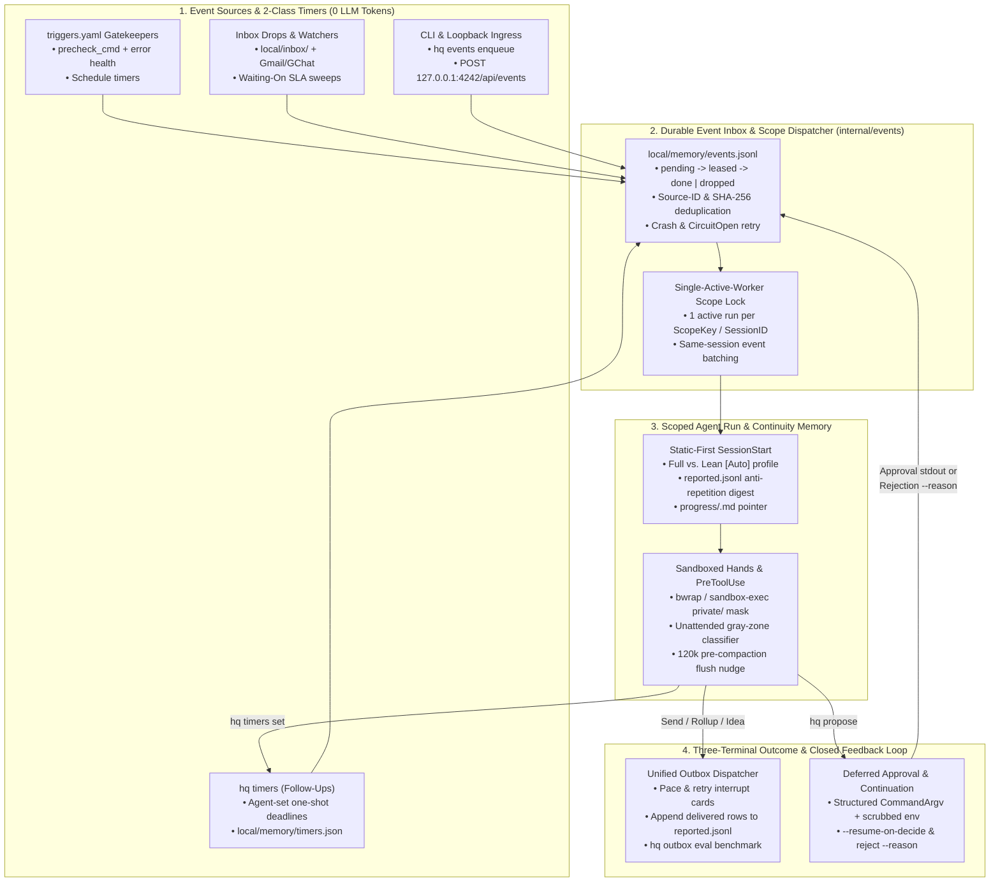

# RFC-0018: Always-On Agent Runtime Hardening — Durable Event Inbox, Self-Scheduled Follow-Up Timers, Deferred Approval Resumption, Cross-Run Progress/Reported Memory & OS Credential Sandboxing

- **Status:** Implemented
- **Author:** `[Task:headquarter] Benchmark Anthropic Always-On Agents` (`gemini-4-carbon-high`)
- **Created:** 2026-11-14
- **Companion Research:** [14 — Anthropic Always-On Agents Architecture & Forensic Gap Audit Against `agy-hq`](../research/14_anthropic_always_on_agents_gap_audit.md)
- **Extends / Integrates With:** [RFC-0003 (Approval-Bound Execution)](./0003-approval-bound-execution.md), [RFC-0004 (Silent Gatekeeper & Channels)](./0004-heartbeat-and-channels.md), [RFC-0006 (4-Layer Memory Engine)](./0006-memory-engine-upgrade.md), [RFC-0009 (Scalable Task Board & Live Console)](./0009-task-board-redesign.md), [RFC-0010 (Bounded Agent RSI)](./0010-agent-recursive-self-improvement.md), [RFC-0012 (Token & Context Observability)](./0012-token-observability.md), [RFC-0014 (Proactive Engine v2)](./0014-proactive-engine-and-living-context.md), [RFC-0015 (Global Plugin Packaging)](./0015-global-plugin-packaging.md)
- **Sibling Branch Coordination:** RFC IDs `0016`–`0017` and Research IDs `12`–`13` are reserved for the concurrent Phase 1 `proactive-gmail-watcher` and `sync-conversation-archive` branches. Section 6.2 specifies clean composition with both branches.

---

## 1. Motivation & Problem Statement

As detailed in [Research 14](../research/14_anthropic_always_on_agents_gap_audit.md), benchmarking Anthropic's production reference architecture ([*Building always-on agents*](https://claude.com/resources/articles/building-always-on-agents) and companion specs on *Agent Memory*, *Auto Mode*, *Deferred Hooks*, *Compaction*, and *Managed Agents*) against `agy-hq` confirms that `agy-hq` already leads on **local Vault sovereignty**, **0-token shell prechecks**, **4-layer ground-truth transcript memory**, **prefix-cache observability**, and **cryptographic SHA-256 outbound gates**.

However, our forensic audit of [`internal/kernel/`](../../internal/kernel/kernel.go), [`internal/approvals/`](../../internal/approvals/approvals.go), [`internal/outbox/`](../../internal/outbox/outbox.go), and [`internal/hooks/`](../../internal/hooks/hooks.go) uncovered **six structural gaps** that prevent `agy-hq` from operating as a crash-safe, closed-loop always-on runtime:

1. **`[P0]` Premature Cursor Mutation, Stranded File Drops & Competing Spawns:** `ProcessInbox` moves dropped files into `local/inbox/queued/` before `SpawnFlashTask` succeeds and skips subdirectories on future ticks—stranding files forever on `CircuitOpen` or `agentapi` errors (`kernel.go:2181-2198`). `EvaluateDaemonGatekeepers` (`gatekeeper.go:188, 234, 255`) and `EnqueueOrFlushCoalescedTriage` (`gatekeeper.go:379`) advance cursors or drain batches *before* worker spawn/completion, while three uncoordinated daemon tickers (`cmd/hq/main.go:1410-1431`) lack single-active-worker serialization per scope.
2. **`[P0]` Missing Agent-Scheduled Durable `Follow-Up` Timers:** Static cron entries in `local/triggers.yaml` (`Schedule`) and passive counterparty SLAs (`WaitingOn`) cannot express an agent's dynamic self-wakeup (*"Wake me in 25 minutes to verify staging CI green, then close the loop"*).
3. **`[P1]` One-Way Approval Dead-End & Raw `sh -c` Execution:** `ApproveProposal` and `RejectProposal` (`approvals.go:301-419`) never route execution outcomes or rejection steering (`hq reject <id> --reason="..."`) back to resume `prop.ConversationID`, breaking multi-step deferred workflows. Meanwhile, `ApproveProposal` runs `exec.Command("sh", "-c", prop.Command)` with unfiltered `os.Environ()`.
4. **`[P1]` Missing `reported` Anti-Repetition Ledger, Missing `progress/<slug>.md` Checkpoints & Heavy `[Auto]` `SessionStart` Tax:** Disjointed runs lack visibility into recently delivered alerts (relying solely on exact lowercase `Title` equality over `4h`), lack structured per-task `progress/` handoff files across runs/compactions, and pay a ~3.5k–5k token full-Vault `SessionStart` injection even on narrow `hydrogen-low` `[Auto]` tasks.
5. **`[P2]` Hook-Only Quarantine vs. OS Credential Sandboxing & Unattended Gray-Zone Commands:** Top-level regex guards in `PreToolUse` cannot stop allowed child binaries/scripts (`go test`, `python3`, `make`) in `[Auto]` or tainted sessions from reading `local/private/` or `~/.ssh` via POSIX syscalls, and unattended `[Auto]` runs lack gray-zone mutating command checks (`curl -X POST`, `gh pr create`, `git push --force`).
6. **`[P2]` Silent Precheck Failure Masking & Missing Offline Signal-to-Noise Evals:** Failed `precheck_cmd` runs (`cmdErr != nil` in `gatekeeper.go:238-242`) increment `zeroTokenSaves++` instead of surfacing watcher errors, and `agy-hq` lacks an offline fixture benchmark (`hq outbox eval`) to test proactive signal-to-noise calibration.

---

## 2. Design Principles & Explicit Non-Goals

### 2.1 Core Invariants
1. **100% Pure Go Stdlib (`0` External Dependencies):** Preserve [ADR-0002](../decisions/0002-go-microkernel-binary.md) and CI Gate `H4-A`—no SQLite CGo, PostgreSQL, or third-party Go modules.
2. **At-Least-Once Durable Event Leasing (`pending` → `leased` → `done`/`dropped`):** No trigger source may spawn an agent directly or advance irreversible state before an event is durably persisted; events transition to `done` only when the worker run completes cleanly.
3. **`0` Idle Compute & Static-First Prompt Prefix Caching:** Waiting for timers, retries, or human approvals consumes `0` tokens and `0` blocked worker slots; `SessionStart` places stable static blocks ahead of dynamic tails.
4. **Uncompromising Human Gate on External Mutations:** Every outbound email, GChat message, third-party PR merge/creation, or financial action remains gated behind SHA-256 `hq propose` human approval ([RFC-0003](./0003-approval-bound-execution.md)).

### 2.2 Explicit Non-Goals
- **No External Database Server:** A personal Agent OS handles `10^2`–`10^4` events/day on a single machine. Append-only JSONL + atomic snapshot compaction guarded by `syscall.Flock` (`0600`) provides sub-millisecond durability with zero operational dependencies.
- **No Autonomous External Sending ("Full Auto Outbound"):** While Anthropic's Auto Mode inspires our local gray-zone classifier for unattended `[Auto]` runs, `agy-hq` explicitly **rejects** letting any classifier auto-approve external emails, chat posts, or third-party git merges.
- **No Duplicate Gmail or Sidebar `.pb` Plumbing:** `RFC-0018` provides the kernel-wide Event Inbox, Timer Store, Deferred Approval Resumption, Memory, and Sandbox primitives so sibling `proactive-gmail-watcher` and `sync-conversation-archive` plug cleanly into one unified loop rather than maintaining bespoke per-adapter queues.

---

## 3. Architecture Overview: Closed-Loop Always-On Runtime



---

## 4. Detailed Subsystem Specifications

### 4.1 Subsystem 1 (`P0`): Unified Durable Event Inbox & Single-Worker Scope Dispatcher (`internal/events`)

#### A. Durable Event Schema (`local/memory/events.jsonl` + `.events.lock`)

We introduce package `internal/events` storing active events in `local/memory/events.json` (`0600`, atomic temp-file + `os.Rename` under `syscall.Flock` on `local/memory/.events.lock`) and appending completed/dropped audit transitions to `local/memory/events_archive.jsonl` (retaining active state O(pending + leased) in `< 1ms`):

```go
type EventStatus string

const (
    StatusPending EventStatus = "pending"
    StatusLeased  EventStatus = "leased"
    StatusDone    EventStatus = "done"
    StatusDropped EventStatus = "dropped"
)

type Event struct {
    ID             string            `json:"id"`               // e.g. "evt-20261114-063012-a1b2c3"
    CreatedAt      string            `json:"created_at"`       // RFC3339 UTC
    AvailableAt    string            `json:"available_at"`     // Supports exponential retry backoff
    Source         string            `json:"source"`           // "inbox_drop" | "gatekeeper" | "timer" | "gmail" | "gchat" | "waiting_on" | "approval_decided" | "webhook"
    DedupKey       string            `json:"dedup_key"`        // Idempotent source event key
    ScopeKey       string            `json:"scope_key"`        // Serialization partition, e.g. "skill:inbox-triage" or "session:<convID>"
    SessionID      string            `json:"session_id,omitempty"` // Empty => spawn new session; non-empty => resume existing session
    Skill          string            `json:"skill,omitempty"`
    Model          string            `json:"model,omitempty"`
    Title          string            `json:"title"`
    Prompt         string            `json:"prompt"`
    Metadata       map[string]string `json:"metadata,omitempty"` // e.g. {"queued_file": "...", "proposal_id": "..."}
    Status         EventStatus       `json:"status"`
    LeaseConvID    string            `json:"lease_conv_id,omitempty"`
    LeaseExpiresAt string            `json:"lease_expires_at,omitempty"` // Default +15m; renewed on PreToolUse, cleared on Stop
    AttemptCount   int               `json:"attempt_count"`
    MaxAttempts    int               `json:"max_attempts"`     // Default 5
    LastError      string            `json:"last_error,omitempty"`
}
```

#### B. Eliminating Premature Ack & Stranded Files Across All Sources
1. **Crash-Safe `ProcessInbox` (`internal/kernel/kernel.go`):**
   - `IngestInboxDrops` scans `local/inbox/` for newly dropped files **and** reconciles `local/inbox/queued/` against active/completed `inbox_drop` events so any file previously stranded in `queued/` without a `pending`/`leased`/`done` event is automatically re-enqueued (`DedupKey = "inbox_drop:" + filename + ":" + sha256(file)`).
   - When the worker finishes (`HandleStop`), `CompleteSessionEvents` moves the processed file from `local/inbox/queued/<name>` to `local/inbox/processed/<YYYY-MM-DD>_<name>` and marks the event `done`.
2. **Gatekeeper Precheck Health & Atomic Enqueue (`internal/kernel/gatekeeper.go`):**
   - Extend `TriggerCursor` with:
     ```go
     ConsecutiveErrors int    `json:"consecutive_errors,omitempty"`
     LastError         string `json:"last_error,omitempty"`
     LastErrorAt       string `json:"last_error_at,omitempty"`
     ```
   - **Bug Fix (`gatekeeper.go:218-242`):** When `cmdErr != nil`, `EvaluateDaemonGatekeepers` **never** increments `zeroTokenSaves` or `SkipsCount`. Instead, it increments `cur.ConsecutiveErrors`, records a truncated sanitized `cur.LastError`, and surfaces degraded watchers (`ConsecutiveErrors >= 3`) on `hq status`, `hq_console.md`, and `:4242` (emitting a single `brief_rollup` alert once per `24h`).
   - When `cmdErr == nil` and the delta matches, `EvaluateDaemonGatekeepers` enqueues an `Event` into `internal/events` first and commits `cur.LastCronSlot` / `cur.LastStdoutSHA256` only after `events.Enqueue` succeeds. If `SpawnTask` subsequently defers due to `CircuitOpen` or transient `agentapi` unavailability, the `Event` remains `StatusPending` in `events.json` and dispatches automatically once quota or `agentapi` recovers.
3. **Batch Coalescer & Sibling `proactive-gmail-watcher` Integration:**
   - `EnqueueOrFlushCoalescedTriage` flushes ready Gmail/GChat batches atomically into `events.Enqueue` inside the same turn before removing them from `triage_coalesce.json`. When `proactive-gmail-watcher` merges, its `StagedLeases` ack/release hooks bind directly to `Event` `StatusDone` / `StatusDropped` callbacks.

#### C. Single-Active-Worker Scope Serialization, Batching & Lifecycle Hooks
- **Single-Worker Dispatch Loop (`DispatchPendingEvents`):** Replaces independent direct-spawn calls across `hq daemon` tickers with one unified `10s` dispatch pass (woken immediately via Go channel on local enqueue).
- **Per-Scope Serialization:** At most **one** `StatusLeased` event batch may be active per `ScopeKey` (defaulting to `"session:"+SessionID` when resuming an existing conversation, or `"skill:"+Skill` for background singleton skills like `inbox-triage` and `sleep-consolidate`).
- **Same-Scope Batching:** If `N` `StatusPending` events share the same `ScopeKey` and `SessionID`, the dispatcher leases all `N` events into one combined prompt (`[Coalesced Events (N)]`) so the model executes a single consolidated run.
- **Deterministic Completion & Crash Reaper:**
  - `HandlePreToolUse` extends `LeaseExpiresAt` (`+15m`) for any active lease bound to `conversation_id`.
  - `HandleStop` (`internal/hooks/hooks.go`) marks all `StatusLeased` events with `LeaseConvID == conversation_id` as `StatusDone` (`0` tokens).
  - If an agent process crashes without firing `Stop` and `now > LeaseExpiresAt`, the reaper resets the event to `StatusPending` with exponential backoff (`30s`, `2m`, `10m`, up to `MaxAttempts = 5`, after which it transitions to `StatusDropped` and logs an `outbox` `brief_rollup` diagnostic).

#### D. CLI & Authenticated Loopback Ingress
- **CLI:** `hq events enqueue --source=<src> --scope=<key> [--session=<convId>] [--dedup=<key>] --title="..." --prompt="..."`, `hq events list [--status=pending|leased]`, `hq events retry <id>`, `hq events drop <id>`.
- **Loopback HTTP Handler (`POST http://127.0.0.1:4242/api/events`):** Fast-acks (`202 Accepted` in `<5ms`), validates `Authorization: Bearer <token>` against `local/private/daemon_token` (`0600`, auto-generated on `hq daemon` start) or same-origin WebUI session token, enforces a `64 KiB` payload cap, enqueues to `internal/events`, and signals the worker channel.

---

### 4.2 Subsystem 2 (`P0`): Two-Class Durable Timers (`internal/timers` & `hq timers`)

Following Anthropic's separation between **Timers** (future deadlines) and the **Event Inbox** (work ready *now*), we introduce `internal/timers` backed by `local/memory/timers.json` (`0600`):

```go
type TimerCategory string

const (
    TimerFollowUp TimerCategory = "follow_up" // Set dynamically by an agent or user; fires once -> "done"
    TimerSchedule TimerCategory = "schedule"  // Synced from triggers.yaml recurring crons -> advances DueAt
)

type Timer struct {
    ID              string        `json:"id"`                 // e.g. "tmr-20261114-070000-f9e8"
    Category        TimerCategory `json:"category"`
    Status          string        `json:"status"`             // "armed" | "done" | "cancelled"
    DueAt           string        `json:"due_at"`             // RFC3339 UTC
    CronExpr        string        `json:"cron_expr,omitempty"`
    ScopeKey        string        `json:"scope_key"`
    SessionID       string        `json:"session_id,omitempty"` // Optional: resume originating session
    Skill           string        `json:"skill,omitempty"`
    Model           string        `json:"model,omitempty"`      // Default "gemini-4-hydrogen-low" for follow-ups
    Title           string        `json:"title"`
    Prompt          string        `json:"prompt"`
    CreatedByConvID string        `json:"created_by_conv_id,omitempty"`
    CreatedAt       string        `json:"created_at"`
    FiredAt         string        `json:"fired_at,omitempty"`
}
```

- **Agent & User CLI (`hq timers`):**
  - `hq timers set --in=25m --scope=swe-pulse [--session=<convId>] --title="Verify staging deploy" --prompt="Check PR #104 deploy status and report if failing."` (also supports `--at=2026-11-14T18:00:00Z` and `--skill=<name>`).
  - `hq timers list [--all]` and `hq timers cancel <id>`.
- **Zero-Spawn Scheduler Rule:** `EvaluateDueTimers(vaultDir, now)` runs every `15s` in `hq daemon` (and during `hq heartbeat`). It **never calls `SpawnTask`**. For each armed timer with `DueAt <= now`:
  1. Enqueues an `Event{Source: "timer", DedupKey: "timer:" + t.ID + ":" + t.DueAt, ScopeKey: t.ScopeKey, SessionID: t.SessionID, ...}` into `internal/events`.
  2. Marks `follow_up` timers `Status = "done"` (`FiredAt = now`), or computes the next cron slot `DueAt` for `schedule` timers.
- **Safety Cap:** Maximum `50` active `follow_up` timers per Vault and minimum `60s` horizon (`--in >= 1m`) so a misbehaving prompt cannot create tight self-triggering loops, while all timer-spawned runs still pass through the existing daily `MaxAutoSpawnsPerDay` / `MaxDailyQBU` quota circuit breaker.

---

### 4.3 Subsystem 3 (`P1`): Deferred Approval Resumption, Structured `CommandArgv` & Unified Outbox Dispatcher

#### A. Closed-Loop Deferred Approval Lifecycle

```mermaid
sequenceDiagram
    participant Agent as "Originating Session (conv-A)"
    participant Prop as "internal/approvals"
    participant Out as "Outbox Dispatcher"
    participant User as "User (Front Desk / :4242 / CLI)"
    participant Inbox as "Event Inbox (internal/events)"

    Agent->>Prop: hq propose --resume-on-decide --continuation="Log 48h WaitingOn SLA" ...
    Prop->>Out: Emit TierInterrupt approval card (prop-123)
    Note over Agent: Run ends cleanly (0 idle tokens; worker free)
    Out->>User: Deliver interactive card (outside quiet hours)
    alt User Approves (hq approve prop-123 --sha256=...)
        User->>Prop: ApproveProposal
        Prop->>Prop: Execute CommandArgv with scrubbed env
        Prop->>Inbox: Enqueue Event(source="approval_decided", session="conv-A", decision="approved")
        Inbox->>Agent: Resume conv-A with stdout + continuation note
    else User Rejects With Steering (hq reject prop-123 --reason="Move to Thu 2pm")
        User->>Prop: RejectProposal(reason)
        Prop->>Inbox: Enqueue Event(source="approval_decided", session="conv-A", decision="rejected", reason)
        Inbox->>Agent: Resume conv-A to revise & re-stage draft
    end
```

#### B. `Proposal` Schema Hardening (`internal/approvals/approvals.go`)
We add four backward-compatible optional fields to `Proposal`:
```go
CommandArgv      []string `json:"command_argv,omitempty"`      // Structured argv execution (no sh -c)
ResumeOnDecide   bool     `json:"resume_on_decide,omitempty"`  // Wake ConversationID on approve
ContinuationNote string   `json:"continuation_note,omitempty"` // Post-approval next step for resumed session
OriginSkill      string   `json:"origin_skill,omitempty"`      // Attribution for RSI rejection mining
```
1. **Eliminating Shell Injection & Env Leakage (`approvals.go:350-369`):**
   - First-party stagers (`hq gmail draft/propose`, `hq gchat propose`, `hq propose -- <bin> <args...>`) populate `CommandArgv`, executed directly via `exec.Command(prop.CommandArgv[0], prop.CommandArgv[1:]...)` **without `sh -c`**. Legacy `--cmd="..."` proposals remain supported for complex pipelines, with `ComputeHash` binding `CommandArgv` canonically whenever populated.
   - Replace `os.Environ()` (`L354`) with a deterministic `SanitizedApprovalEnv(vaultDir)` allowlist (`HOME`, `USER`, `LOGNAME`, `PATH`, `LANG`, `LC_ALL`, `TZ`, `SSH_AUTH_SOCK`, `DISPLAY`, `XDG_RUNTIME_DIR`, `HQ_VAULT_DIR`, `HQ_ROOT_DIR`, `AGY_ACCOUNT`), stripping `ANTIGRAVITY_CSRF_TOKEN` and unrelated ambient secrets.
2. **Resumption Event Routing:**
   - **On `RejectProposal(vaultDir, id, reason)`:** Whenever `strings.TrimSpace(reason) != ""` (or `prop.ResumeOnDecide`) and `prop.ConversationID != ""`, enqueue `Event{Source: "approval_decided", SessionID: prop.ConversationID, ScopeKey: "session:" + prop.ConversationID}` carrying the rejected payload summary and the user's exact `reason` so the session automatically revises its draft.
   - **On `ApproveProposal(vaultDir, id, shaPrefix)`:** When `prop.ResumeOnDecide && prop.ConversationID != ""`, enqueue a resumption `Event` carrying the execution exit status, truncated stdout, and `prop.ContinuationNote` (e.g., registering a `WaitingOn` SLA or advancing `progress/<slug>.md`).

#### C. Unified `OutboxDispatcher` (`internal/outbox/dispatcher.go`)
Building cleanly on `outbox.Item` (`internal/outbox/outbox.go`) and harmonizing with sibling `proactive-gmail-watcher`'s `DeliverPendingInterrupts`:
- Adds `DeliveryStatus` (`"pending" | "delivered" | "deferred_quiet_hours" | "failed"`), `DeliveryAttempts int`, and `NextAttemptAt string` to `outbox.Item`.
- Runs on the daemon dispatch loop: delivers `TierInterrupt` items to `[HQ] Front Desk` (via `agentapi` message injection when Front Desk is leased) and configured `ChannelAdapter`s outside quiet hours, retries transient transport failures with exponential backoff (`30s`, `2m`, `10m`), and appends every delivered user-facing item (`TierInterrupt` + synthesized `TierBriefRollup`) to `local/memory/reported.jsonl`.

---

### 4.4 Subsystem 4 (`P1`): `reported` Anti-Repetition Ledger, `progress/<slug>.md` Checkpoints & Lean `SessionStart`

#### A. `local/memory/reported.jsonl` & Fuzzy Semantic Anti-Repetition
1. **Rolling `reported` Ledger:** Whenever an `outbox` item is delivered to the user (or a `hq propose` card is surfaced), `RecordReported` appends a compact entry (`timestamp`, `tier`, `source`, `title`, `summary_1line`, `entity_keys`) to `local/memory/reported.jsonl` (auto-pruned to `72h` / max `100` rows on disk).
2. **Reasoning-Time Suppression:** `HandleSessionStart` injects the last `<= 12` entries from the past `48h` (`<= 250` tokens) as `[Recently Reported to User — Do Not Repeat Unless Materially Changed]`, preventing reworded duplicate alerts before the agent even calls `hq outbox add`.
3. **Router-Time Fuzzy Guard (`outbox.go`):** Alongside exact `TopicKey` matching (`4h`), `outbox.Add` computes normalized content-token Jaccard overlap over non-stopword tokens within the same `Source`/`Skill` over `12h`; items with `>= 0.75` overlap without an explicit `--force` flag coalesce silently into the existing item (`CoalescedCount++`).

#### B. Structured Cross-Run Task Progress (`local/memory/progress/<slug>.md` & `hq progress`)
1. **CLI & File Format:**
   - `hq progress save --task=<slug> --goal="..." --done="..." --next="..." [--pointers="..."]` writes a clean, deterministic Markdown checkpoint (`<= 60` lines) to `local/memory/progress/<slug>.md` (`0600`).
   - `hq progress show <slug>`, `hq progress list`, and `hq progress archive <slug>` manage lifecycle state alongside `tasks.json` ([RFC-0009](./0009-task-board-redesign.md)).
2. **Pre-Compaction Flush Guard (`120k` Soft Watermark):**
   - Using stat-cached transcript token telemetry from `internal/obs` ([RFC-0012](./0012-token-observability.md)), when `HandlePreToolUse` detects a task conversation's latest prompt token count crossing `120,000` tokens for the first time in that epoch (`< 150,000` `A1` bloat threshold), it emits a non-blocking `systemMessage` nudge: *"Context window passed 120k tokens: save verified progress via `hq progress save --task=<slug>` and durable facts before compacting (` /compact `)."*

#### C. Static-First, Role-Scoped `SessionStart` Profiles (`full` vs. `lean_auto`)
To maximize LLM prefix cache hit rates (`CHR`) and slash ephemeral worker input costs, `HandleSessionStart` (`internal/hooks/hooks.go`) reorganizes context assembly into two strict zones:
1. **Zone 1 — Byte-Stable Cacheable Prefix (Identical Across Runs):**
   - `USER.md` → `MEMORY.md` (`<=80` lines) → Sorted `topics/*.md` & `entities/*.md` pointer index (no volatile timestamps, byte sizes, or run counters).
2. **Zone 2 — Role-Scoped Dynamic Tail:**
   - **`full` Profile (Interactive Task & `[HQ] Front Desk` Sessions):** Active `Goals`/`WaitingOn`, `reported` digest, matching `progress/<slug>.md` pointer, hot Task Board summary, active worktrees, and pending proposals.
   - **`lean_auto` Profile (`[Auto]` Workers & Ephemeral Subagents):** Only `reported` digest (`<=12` lines), any matching `progress/<slug>.md` file for the target scope, and active `Goals` matching the worker's skill—omitting unrelated git worktrees, unrelated hot tasks, and full `triggers.yaml` listings (`~55%` reduction in `SessionStart` tokens).

---

### 4.5 Subsystem 5 (`P2`): Zero-Dep OS Credential Sandbox (`internal/sandbox`), Unattended Action Classifier & Offline Outbox Evals

#### A. Optional OS Subprocess Credential Jail (`internal/sandbox` + `hq exec-sandboxed`)
To close the gap between regex `PreToolUse` inspection and true *Managed Agents* "brain vs. sandboxed hands" isolation without adding Go dependencies:
- Package `internal/sandbox` detects native OS sandboxing primitives at runtime (`hq doctor` reports capability status):
  - **Linux (`bwrap` / Bubblewrap when installed):** Binds `/` read-only (and workspace/worktree read-write as configured), mounts empty `tmpfs` (`--tmpfs`) over `<vault>/private`, `~/.ssh`, `~/.gnupg`, `~/.aws`, and `~/.config/gcloud`, and drops ambient secret env vars. Quarantined reader runs additionally pass `--unshare-net` unless calling an allowlisted `hq` read-only subcommand on the host side.
  - **macOS (`sandbox-exec` Seatbelt):** Applies an inline SBPL profile (`(deny file-read* file-write* (subpath "<vault>/private") (subpath "<home>/.ssh") (subpath "<home>/.gnupg"))`).
- **Integration:** Controlled via `sandbox.mode: "auto" | "required" | "off"` in `local/config.yaml` (default `"auto"`). For quarantined sessions (`IsSessionTainted`) and unattended `[Auto]` skill commands executed via `hq exec-sandboxed`, `agy-hq` enforces kernel-level filesystem credential masking while retaining all existing `PreToolUse` regex checks as Layer-1 defense-in-depth.

#### B. Unattended `[Auto]` Gray-Zone Action Classifier (`internal/hooks/hooks.go`)
When `HandlePreToolUse` evaluates `run_command` inside an **unattended `[Auto]` session** (identified by `ActiveTask.Kind == "auto"` or `[Auto]` task registration), `agy-hq` activates a deterministic second-tier action classifier (`classifyUnattendedCommand`) that blocks and redirects to `hq propose`:
- External mutating HTTP CLI requests (`curl` / `wget` with `-X POST|PUT|PATCH|DELETE`, `--data`, `-d`, `-F`, `--upload-file` targeting non-`127.0.0.1`/`localhost` URLs);
- Forge/repository mutations outside local worktree branches (`gh pr create|close|comment|edit|ready`, `gh issue create|close|comment`, `gh release`, `git push --force`, `git push --delete`);
- Destructive host/package mutations (`rm -rf` outside `<worktree>`, `crontab`, `systemctl`, `launchctl`, `pip/cargo/twine/gem publish`).

Interactive user-driven coding sessions remain completely unaffected so day-to-day SWE velocity is preserved.

#### C. Proposal Rejection RSI Mining & Offline Routing Evals (`hq outbox eval`)
1. **Unified Dismissal + Rejection Mining (`internal/outbox/outbox.go`):** Extend `ComputeSkillDismissalStats` to join `outbox` `dismissed` items with `interventions.jsonl` `rejected` proposals grouped by `OriginSkill` / `ActionType`, surfacing noisy proactive skills (`(dismissed + rejected) / total >= 0.60` for `N >= 5`) to `hq rsi mine` ([RFC-0010](./0010-agent-recursive-self-improvement.md)).
2. **Deterministic Offline Benchmark (`hq outbox eval`):** Evaluates a JSONL fixture suite (`testdata/outbox_eval_fixtures.jsonl` covering urgent KC-1 breaches, duplicate CI alerts, quiet-hours arrivals, low-priority ideas, and expired proposals) against `outbox` + `AttentionConfig`, asserting:
   - `Urgent Interrupt Recall == 100%`
   - `Quiet-Hours Non-Critical Suppression == 100%`
   - `Semantic Duplicate Suppression >= 95%`
   - `False Interrupt Rate <= 5%`

---

## 5. Security, Privacy & Ring-0 TCB Analysis

| Boundary | Guarantee | Enforcement Mechanism |
| :--- | :--- | :--- |
| **Pure Go TCB (`H4-A`)** | `0` third-party Go modules; full auditability. | `internal/events`, `internal/timers`, `internal/sandbox`, and `internal/outbox` use Go stdlib only (`os`, `syscall`, `encoding/json`, `net/http`, `os/exec`). |
| **Zero-PII Tracked Repo (`P1`–`P6`)** | All runtime queues (`events.json`, `timers.json`, `reported.jsonl`, `progress/`) live strictly inside git-ignored `<vault>/memory/` (`0700`/`0600`). | Enforced by `hq ci check-pii` and `hq ci check-pii --history`. |
| **Loopback Ingress Auth** | Local unauthenticated browser tabs/processes cannot spoof events into `:4242/api/events`. | Requires `0600` bearer secret (`local/private/daemon_token`) or validated WebUI CSRF header; rejects non-loopback `RemoteAddr` and bodies `> 64 KiB`. |
| **Approval Command Integrity** | Eliminates `sh -c` metacharacter hazards and `ANTIGRAVITY_CSRF_TOKEN` env leakage on `hq approve`. | `CommandArgv` direct `exec.Command` + `SanitizedApprovalEnv` allowlist + SHA-256 hash verification. |
| **Ring-0 Self-Modification Block** | RSI cannot weaken `internal/events`, `internal/sandbox`, `internal/approvals`, or `internal/hooks`. | Add `internal/events` and `internal/timers` / `internal/sandbox` paths to `Ring0ProtectedPaths` in `internal/rsi` ([RFC-0010](./0010-agent-recursive-self-improvement.md)). |

---

## 6. Prioritized Implementation Plan & Sibling Branch Coordination

### 6.1 Phased Rollout (`Phase 2A` – `Phase 2D`)

| Phase | Priority | Packages & Files Touched | Est. Scope | Summary |
| :--- | :--- | :--- | :--- | :--- |
| **Phase 2A** | **`P0`** | `internal/events/{events,dispatcher}.go`, `internal/kernel/{kernel,gatekeeper}.go`, `internal/webui/server.go`, `internal/hooks/hooks.go`, `cmd/hq/main.go` | `~550` LOC | Durable Event Inbox (`pending` → `leased` → `done`/`dropped`), single-worker scope lock + batching, stranded `inbox/queued/` recovery, `gatekeeper` `ConsecutiveErrors` bug fix, `hq events` CLI, and `POST /api/events`. |
| **Phase 2B** | **`P0`** | `internal/timers/timers.go`, `internal/kernel/kernel.go`, `cmd/hq/main.go`, `.agents/plugins/agy-hq/rules/AGENTS.md` | `~280` LOC | Two-class `timers.json` (`follow_up` + `schedule`), `hq timers <set|list|cancel>`, `15s` timer-to-inbox scheduler pass, and `50`-timer safety cap. |
| **Phase 2C** | **`P1`** | `internal/approvals/approvals.go`, `internal/outbox/{outbox,dispatcher,reported}.go`, `internal/vault/progress.go`, `internal/hooks/hooks.go`, `cmd/hq/main.go` | `~520` LOC | `CommandArgv` + `SanitizedApprovalEnv`, `--resume-on-decide` + `hq reject --reason` resumption events, unified `OutboxDispatcher`, `reported.jsonl` + fuzzy Jaccard dedup, `hq progress`, `120k` pre-compaction nudge, and static-first `lean_auto` `SessionStart`. |
| **Phase 2D** | **`P2`** | `internal/sandbox/sandbox.go`, `internal/hooks/hooks.go`, `internal/outbox/eval.go`, `internal/rsi/`, `cmd/hq/main.go` | `~420` LOC | Optional `bwrap`/`sandbox-exec` credential jail (`hq doctor` + `hq exec-sandboxed`), unattended `[Auto]` gray-zone command classifier, proposal-rejection RSI mining, and `hq outbox eval` + CI golden fixtures. |

### 6.2 Clean Merge Coordination With Sibling Phase 1 Branches
- **`proactive-gmail-watcher` (`RFC-0016`):** Its `StagedLeases` per-thread Gmail cursor and `DeliverPendingInterrupts` Front Desk push map 1:1 onto `internal/events` (`OnEventDone` / `OnEventDropped` hooks) and `internal/outbox/dispatcher.go`. Whichever branch merges second adapts via a thin `25`-line interface adapter without schema conflict.
- **`sync-conversation-archive` (`RFC-0017`):** Its cold `.pb` sidebar archive reconciler pairs naturally with `local/memory/progress/<slug>.md` so `hq reopen <id>` restores both the archived task metadata and the structured `progress/<slug>.md` checkpoint.

---

## 7. Deterministic Verification & Critical User Journeys (`CUJ-25` – `CUJ-28`)

All phases ship with pure-Go unit tests (`go test ./...`) and deterministic E2E journeys in [`internal/e2e/cuj_e2e_test.go`](../../internal/e2e/cuj_e2e_test.go) enforced by `./bin/hq ci pre-push`:

- **`CUJ-25` (Crash-Safe Event Inbox, Stranded Drop Recovery & Precheck Error Health — `Phase 2A`):**
  1. Drop `invoice.pdf` into `local/inbox/` while `CircuitOpen` (`MaxAutoSpawnsPerDay` exhausted); verify `Event` persists as `pending` (not lost in `queued/`), and dispatches cleanly once quota resets, moving `invoice.pdf` to `processed/` only on `HandleStop`.
  2. Configure a `triggers.yaml` watcher whose `precheck_cmd` exits `1`; verify `GatekeeperSavesToday` remains `0`, `ConsecutiveErrors` increments, and `hq status` surfaces the degraded watcher.
  3. Enqueue `3` concurrent events sharing `ScopeKey = "skill:inbox-triage"`; verify single-worker serialization batches them into `1` leased run (`0` competing spawns).
- **`CUJ-26` (Agent Self-Scheduled `Follow-Up` Timer Across Run Exit — `Phase 2B`):**
  1. Simulated session `conv-0001` calls `hq timers set --in=1m --scope=swe-pulse --session=00000000-0000-0000-0000-000000000001 --prompt="Verify CI"` and exits (`HandleStop`).
  2. Advance clock `+61s` and run `EvaluateDueTimers` + `DispatchPendingEvents`; verify timer transitions to `done`, an `Event` enqueues into `events.json`, and session `00000000-0000-0000-0000-000000000001` resumes cleanly.
- **`CUJ-27` (Deferred Approval Resumption, Scrubbed Argv & `reported`/`progress` Continuity — `Phase 2C`):**
  1. Stage proposal with `CommandArgv` and `--resume-on-decide`; verify `hq reject <id> --reason="Change to Thursday"` enqueues a `pending` resumption event targeting `prop.ConversationID` with the rejection reason, and `hq approve` executes `CommandArgv` without exposing `ANTIGRAVITY_CSRF_TOKEN` in child env.
  2. Deliver an `outbox` alert `"PR #42 CI Failing"` and verify `reported.jsonl` appears in the next `[Auto]` `SessionStart` (`lean_auto` profile `>= 50%` smaller than `full`) while a near-duplicate `"CI Failing on PR #42"` within `12h` coalesces cleanly.
- **`CUJ-28` (Unattended Gray-Zone Guard, OS Credential Masking & Offline Outbox Eval — `Phase 2D`):**
  1. Verify `PreToolUse` inside an `[Auto]` task blocks `curl -X POST https://api.example.com/webhook` and `gh pr create` with a redirect to `hq propose`, while allowing normal interactive task sessions to run developer tools cleanly.
  2. When `bwrap` or `sandbox-exec` is available on the test host, verify a child script under `hq exec-sandboxed` cannot read `<vault>/private/gmail/tokens.json`.
  3. Run `hq outbox eval` in CI and assert `100%` urgent recall, `100%` quiet-hours suppression, and `<= 5%` false-interrupt rate.
