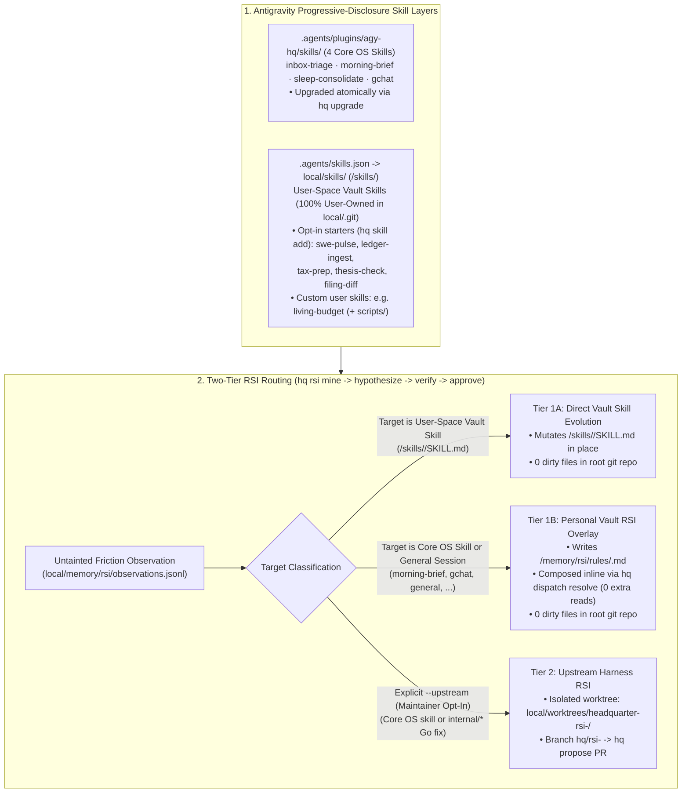

# RFC-0019: OS vs. User-Space Skill Boundary, Vault Skills (`local/skills/`) & Two-Tier RSI Overlays

- **Status:** Proposed (Revision 2 — Post-Review Architecture Alignment)
- **Date:** 2026-11-15
- **Author:** `[Task:agy-hq] Two-Tier RSI & Vault Skill Overlay` (`gemini-4-carbon-high`)
- **Extends:** [ADR-0003 (Two-Layer Vault)](../decisions/0003-two-layer-oss-and-private-vault.md), [ADR-0006 (General Agent & Additive Skills)](../decisions/0006-general-agent-and-skills-over-packs.md), [RFC-0001 (Two-Layer Vault Split)](0001-vault-and-task-isolation.md), [RFC-0003 (Approval-Bound Execution)](0003-approval-bound-execution.md), [RFC-0010 (Agent Recursive Self-Improvement)](0010-agent-recursive-self-improvement.md), [RFC-0015 (Global Plugin Packaging)](0015-global-plugin-packaging.md), [RFC-0017d (Companion Extension Packs & Unified Trust)](0017d-enterprise-extensibility-and-portability.md)
- **Companion Research:** [15 — Two-Tier Recursive Self-Improvement, OS vs. User-Space Skill Boundary & Personal Vault Skill Overlay Audit](../research/15_two_tier_rsi_vault_overlay.md), [07 — Agent Recursive Self-Improvement (RSI)](../research/07_agent_recursive_self_improvement.md)

---

## 1. Motivation & Two Root Architectural Collisions

### 1.1 Collision 1: The RSI Divergence Problem
In [RFC-0010](0010-agent-recursive-self-improvement.md), `agy-hq` introduced a 4-stage bounded Recursive Self-Improvement (RSI) engine (`internal/rsi/`). However, `ResolveSkillFile` in `internal/rsi/mutator.go` targeted tracked plugin source files directly (`.agents/plugins/agy-hq/skills/<slug>/SKILL.md`), and `internal/rsi/miner.go` hardcoded `"swe-pulse"` as the catch-all fallback bucket whenever a friction event did not match a specific skill.

For anyone cloning `agy-hq` or upgrading across releases, tracked skill mutation causes five concrete failures ([Research 15 §1](../research/15_two_tier_rsi_vault_overlay.md)):
1. **Dirty Working Tree:** Routine self-improvement dirties git (`M .agents/plugins/agy-hq/skills/swe-pulse/SKILL.md`).
2. **Upgrade Hazards (`hq upgrade` / `git pull`):** Upstream updates abort with git merge conflicts or overwrite locally learned rules.
3. **PII & Private Workflow Leakage:** Workstation quirks, local CLI flags, and private project habits risk being committed upstream.
4. **Catch-All Misattribution:** General Front Desk session lessons (such as `rsi-rule-swe-pulse-2c42ca` committed on 2026-11-09) were dumped into `swe-pulse/SKILL.md` even when unrelated to software engineering.
5. **Conflating Personal vs. Universal Rules:** Machine-specific flags become baked into the shared upstream plugin.

### 1.2 Collision 2: OS Harness Skills Conflated with Persona / Domain Playbooks
Applying a first-principles microkernel razor exposes an even deeper boundary issue: **Why does the harness need skills at all?**

A skill genuinely belongs in the **Core OS Harness** (`.agents/plugins/agy-hq/skills/`) if and only if **both** conditions hold:
1. **Progressive Disclosure (`0` Idle Token Tax):** Its procedural runbook is too detailed for `always_on` `rules/AGENTS.md` (which is billed on 100% of turns), **and**
2. **Lockstep Binary Coupling (`hq upgrade`):** Its instructions drive internal `hq` Go state machines and Ring-0 security invariants, so it **must** upgrade atomically alongside the `hq` binary.

Auditing the 9 skills currently bundled in `.agents/plugins/agy-hq/skills/` reveals two distinct layers that were previously mixed together:

| Current Skill | Kernel / Binary Coupling | True Layer |
| :--- | :--- | :--- |
| **`inbox-triage`** | Drives Ring-0 Quarantined Reader taint (`hq watch read`, `hq offer stage`, `hq outbox add`). | **Core OS Harness Skill** |
| **`morning-brief`** | Drives lease-based outbox/approval collector (`hq brief collect --lease`, `hq brief commit`). | **Core OS Harness Skill** |
| **`sleep-consolidate`** | Drives nightly 4-layer memory GC, transcript verification & RSI (`hq memory`, `hq rsi`). | **Core OS Harness Skill** |
| **`gchat`** | Bundled CLI driver for `hq gchat` headless CDP, `--body-stdin` `$` safety & `read-quarantined`. | **Core OS Driver Skill** |
| **`swe-pulse`** | Multi-repo GitHub PR/worktree workflow (`hq worktree`/`spawn` basics already live in `AGENTS.md`). | **User-Space Starter Skill** |
| **`ledger-ingest`** | Zero `hq` CLI subcommands; opinionated Beancount/`hledger` expense ingestion. | **User-Space Starter Skill** |
| **`tax-prep`** | Zero `hq` CLI subcommands; US `W-2`/`1099`/`K-1` tax workpaper workflow. | **User-Space Starter Skill** |
| **`thesis-check`** | Personal equity thesis & secondary deal-flow playbook (`local/notes/investing/`). | **User-Space Starter Skill** |
| **`filing-diff`** | Zero `hq` CLI subcommands; SEC `10-K`/`10-Q` section diffing. | **User-Space Starter Skill** |

A user running `agy-hq` to manage **day-to-day living expenses** needs the 4 Core OS skills plus `ledger-ingest` and their own custom skills (e.g. `living-budget`)—without carrying `filing-diff`, `thesis-check`, `tax-prep`, or `swe-pulse` in every turn's `<skills>` catalog, and with full freedom to edit `ledger-ingest` and add helper `scripts/` inside their private Vault.

`RFC-0019` resolves both collisions cleanly through a **Two-Layer Skill Boundary** (`4` Core OS Harness skills + native User-Space Vault skills in `<vault>/skills/`) paired with **Two-Tier RSI**.

---

## 2. Architecture Overview



---

## 3. OS vs. User-Space Skill Boundary & `<vault>/skills/` Convention

### 3.1 Core OS Harness Skills (`.agents/plugins/agy-hq/skills/`)
The tracked `agy-hq` plugin ships **only the 4 domain-agnostic Core OS & Driver skills**:
1. `inbox-triage` — Non-overridable Quarantined Reader boundary (`hq watch read`, `hq offer stage`, `hq outbox add`).
2. `morning-brief` — Lease-based daily outbox & approval digest (`hq brief collect --lease`, `hq brief commit`, `local/brief.d/`).
3. `sleep-consolidate` — Silent nightly 4-layer memory compaction, transcript verification, RSI & Vault commit.
4. `gchat` — Bundled `hq gchat` headless Chrome CDP driver & quote/quarantine rules.

### 3.2 User-Space Vault Skills (`<vault>/skills/<name>/SKILL.md`)
All domain starter skills and user-authored custom skills live uniformly inside **`<vault>/skills/`** (`local/skills/` inside `headquarter`):

1. **Native Antigravity Discovery via `.agents/skills.json`:**
   - The `headquarter` repository tracks `.agents/skills.json`:
     ```json
     {
       "entries": [
         { "path": "local/skills" }
       ]
     }
     ```
   - Antigravity natively scans `local/skills/*/SKILL.md` one level deep with progressive disclosure, registering each directory as a `/<name>` slash command and supporting `scripts/`, `references/`, and `resources/` subdirectories.
   - When attaching `agy-hq` to an external project via `hq plugin install --project=<dir>`, `AttachProjectSkillsManifest` optionally registers `<vault>/skills` in `<project>/.agents/skills.json` alongside `<project>/.agents/plugins.json`.
   - Because `local/` is git-ignored by the root repository, adding, editing, or deleting skills in `local/skills/` produces **`0` dirty files** in `headquarter` while being privately versioned in `local/.git` during `/sleep-consolidate`.

2. **Embedded Opt-In Starter Templates (`templates/skills/` + `hq skill` CLI):**
   - The 5 domain playbooks move out of `.agents/plugins/agy-hq/skills/` into `templates/skills/<slug>/SKILL.md` (embedded into the static `hq` binary via `//go:embed` in `templates/embed.go`):
     - `swe-pulse` *(cleaned of `agy-hq`-maintainer contributor Step 3 leakage and `rsi-rule-swe-pulse-2c42ca` so it is 100% repo-agnostic)*
     - `ledger-ingest` *(living-expense & double-entry CSV/OFX ledger workflow)*
     - `tax-prep` *(tax document checklist & code-calculated workpapers)*
     - `thesis-check` *(investment thesis & kill-criteria monitor)*
     - `filing-diff` *(10-K/10-Q section-by-section semantic diff)*
   - New `hq skill` subcommand suite:
     ```sh
     hq skill list [--json]                   # Lists Core OS skills (4), installed Vault skills, and available starters
     hq skill add <slug|--all> [--force]      # Installs starter skill(s) from templates/skills/ into <vault>/skills/
     hq skill remove <slug>                   # Removes a user-space skill from <vault>/skills/ (blocks Core OS skills)
     ```
   - **Lifecycle Defaults:**
     - `hq init` creates `<vault>/skills/` and `<vault>/memory/rsi/rules/` (`hq init --all-starters` or `--starters=ledger-ingest,...` optionally seeds starters; `templates/triggers.yaml` defaults cleanly to Core OS schedules `morning-brief` and `sleep-consolidate`, while `ClassifyInboxFile` falls back to `inbox-triage` when a domain starter is not installed).
     - `hq migrate` and `hq upgrade` automatically preserve continuity for existing Vaults by seeding previously bundled domain starters into `<vault>/skills/` (never overwriting an already-customized `<vault>/skills/<slug>/SKILL.md`).

### 3.3 Concrete Example: Living-Expense User Layout
For a user managing day-to-day living expenses who customizes `ledger-ingest` and creates `living-budget`:
```text
headquarter/
├── .agents/
│   ├── skills.json                              # {"entries": [{"path": "local/skills"}]}
│   └── plugins/agy-hq/skills/                   # 4 Core OS skills only (0 unused finance/SWE bloat)
└── local/                                       # Private Vault (0 dirty files in root repo; synced in local/.git)
    ├── private/ledger/living.bean               # High-PII ledger (protected by PreToolUse boundary)
    ├── skills/
    │   ├── ledger-ingest/                       # Added via `hq skill add ledger-ingest`, now 100% user-owned:
    │   │   ├── SKILL.md                         # Customized with personal categories & rules
    │   │   └── scripts/parse_bank_csv.py        # Deterministic parser
    │   └── living-budget/                       # Brand-new user skill -> `/living-budget`
    │       ├── SKILL.md
    │       └── scripts/monthly_burn.py
    └── memory/rsi/rules/
        └── morning-brief.md                     # Optional learned RSI tweak on Core OS `morning-brief`
```

---

## 4. Tier 1 RSI: Direct Vault Skill Evolution & Core OS Overlays

### 4.1 Eliminating the `"swe-pulse"` Catch-All Bug
In `internal/rsi/miner.go` (`inferSkillOrPkg`) and `internal/rsi/mutator.go` (`Hypothesize`):
1. `miner.go` dynamically checks installed `<vault>/skills/*/SKILL.md` names in addition to the 4 Core OS skills.
2. When an untainted friction event reflects a general Front Desk or session-wide workflow error rather than a specific skill, `inferSkillOrPkg` returns **`"general"`** instead of hardcoding `"swe-pulse"`.

### 4.2 Tier 1A vs. Tier 1B Target Resolution
When `hq rsi hypothesize` synthesizes a Ring 2 operational rule in default (Tier 1) mode:
1. **Tier 1A — User-Space Vault Skill (`<vault>/skills/<slug>/SKILL.md` exists):**
   - `TargetFiles` resolves directly to `<vault>/skills/<slug>/SKILL.md`.
   - Upon human approval (`hq propose --type=rsi_overlay` + `hq approve`), `ApplyACEDelta` updates the `## Learned Operational Rules (RSI Managed)` section inside `<vault>/skills/<slug>/SKILL.md` directly.
2. **Tier 1B — Core OS Skill (`morning-brief`, `sleep-consolidate`, `gchat`) or `general`:**
   - `TargetFiles` resolves to `<vault>/memory/rsi/rules/<slug>.md` (never touching `.agents/plugins/agy-hq/skills/`).
   - `inbox-triage` and `quarantined-digest-reader` are barred from overlay mutation to preserve the non-overridable Quarantined Reader boundary.

### 4.3 Zero-Round-Trip Runtime Composition (`hq dispatch resolve`)
To compose Core OS skills with `<vault>/memory/rsi/rules/<slug>.md` without costing an extra `read_file` tool call or consuming `[HQ] Front Desk`'s 3-lookup turn cap, `DispatchResolution` in `internal/extension/state.go` is extended:

```go
type DispatchResolution struct {
    FQID         string   `json:"fqid,omitempty"`
    LogicalSkill string   `json:"logical_skill,omitempty"`
    ActiveTarget string   `json:"active_target,omitempty"`
    Skill        string   `json:"skill,omitempty"`
    SkillOrigin  string   `json:"skill_origin,omitempty"` // "core", "vault", or "pack:<id>"
    Overridden   bool     `json:"overridden"`
    SkillPath    string   `json:"skill_path,omitempty"`
    Enabled      bool     `json:"enabled"`
    Tier         string   `json:"tier,omitempty"`
    Model        string   `json:"model,omitempty"`
    Trust        string   `json:"trust,omitempty"`
    Reason       string   `json:"reason,omitempty"`

    // RFC-0019 Additions:
    HasOverlay   bool     `json:"has_overlay"`
    OverlayPath  string   `json:"overlay_path,omitempty"`
    ActiveRules  int      `json:"active_rules,omitempty"`
    OverlayRules []string `json:"overlay_rules,omitempty"`
}
```

Runtime behavior:
1. **Inline `overlay_rules`:** Because each overlay is capped at $\le 50$ lines and $\le 10$ active rules, `hq dispatch resolve --skill=<name> --json` returns `overlay_rules` directly in its JSON output. Core OS skills (`morning-brief`, `sleep-consolidate`, `gchat`) apply `overlay_rules` immediately in Step 0 in **one `0`-cap `hq` command**.
2. **`general.md` Session Rules:** Active rules in `<vault>/memory/rsi/rules/general.md` (capped at $\le 5$ concise bullets) are surfaced in `SessionStart` for untainted sessions so cross-cutting Front Desk/session lessons apply without polluting any skill file.
3. **Overlay Budget & Ablation (`hq rsi ablate`):**
   - Per-overlay cap: **50 lines** and **10 active rules** (`general.md` capped at **5 active rules**); global cap: **50 active rules** across Vault skills and overlays.
   - `hq rsi ablate` scans `<vault>/memory/rsi/rules/*.md` and `<vault>/skills/*/SKILL.md`, pruning rules with `harmful > helpful`, `helpful == 0` after 30 days, or superseded `model_scope`.

---

## 5. Tier 2: Upstream Harness RSI (Opt-In Maintainer Mode)

Maintainers evolving `agy-hq` itself (`internal/*`, `cmd/hq/*`, or universal improvements to the 4 Core OS skills) use explicit opt-in flags that are never triggered by unattended nightly dreaming:
1. **Commands:**
   ```sh
   hq rsi hypothesize --upstream [--obs=<obs-id>]
   hq rsi export --upstream <rule-id-or-hypothesis-id>
   ```
2. **Isolated Worktree & Branch:** Provisions or targets `local/worktrees/headquarter-rsi-<id>/` on branch `hq/rsi-<id>`—never mutating the root checkout inline.
3. **4-Gate Verification + PR Proposal:** Requires Gate 1 (Ring 0 TCB AST check), Gate 2A/2B (counterfactual replay), Gate 3 (`P1`–`P6` PII checks + `go vet` + race/E2E suite), and Gate 4 (token/line budget), then stages `gh pr create` via `hq propose --type=pr_create`.

---

## 6. Deterministic Migration (`hq rsi migrate-overlays`)

1. **Extract Tracked Rules:** Scans any `<!-- rsi:rule ... -->` blocks in tracked `.agents/plugins/agy-hq/skills/*/SKILL.md` (specifically `rsi-rule-swe-pulse-2c42ca`), routes general Front Desk rules into `<vault>/memory/rsi/rules/general.md` (preserving `id`, `source`, `added`, `helpful`, `harmful`), and removes `## Learned Operational Rules (RSI Managed)` from tracked plugin files.
2. **Seed Existing Vault Starters on Upgrade:** `hq migrate` / `hq upgrade` runs `migrate-overlays` automatically and seeds `swe-pulse`, `ledger-ingest`, `tax-prep`, `thesis-check`, and `filing-diff` into `<vault>/skills/` for existing Vaults if absent, guaranteeing zero disruption on upgrade.

---

## 7. User Guide: Where Customizations Belong

| User Goal | Location | Mechanism & Git Behavior |
| :--- | :--- | :--- |
| **Add a domain or custom personal skill**<br>*(e.g. `living-budget`, `ledger-ingest`, `swe-pulse`)* | **`<vault>/skills/<name>/SKILL.md`**<br>(`local/skills/<name>/SKILL.md`) | Native `/<name>` discovery via `.agents/skills.json`; supports `scripts/`; `hq skill add <starter>` for starters; **`0` dirty repo files**; versioned in `local/.git`; `hq rsi` evolves in place. |
| **Learn operational tweaks on Core OS skills**<br>*(e.g. `morning-brief`, `gchat`, or `general`)* | **`<vault>/memory/rsi/rules/<slug>.md`**<br>(`local/memory/rsi/rules/<slug>.md`) | Managed by `hq rsi` + `hq approve`; composed inline via `hq dispatch resolve`; **`0` dirty repo files**; survives `hq upgrade`. |
| **Machine-global non-Vault utility** | **`~/.gemini/config/skills/<name>/SKILL.md`** | Native global Antigravity discovery across all workspaces on one machine. |
| **Enterprise multi-component extension**<br>*(Connectors + Brief + Schedules + Trust)* | **External pack with `hq-extension.json`**<br>([RFC-0017d](0017d-enterprise-extensibility-and-portability.md)) | Managed via `hq extension <enable\|trust>` and `<vault>/extensions.json` with SHA-256 pinning. |

---

## 8. Security, Privacy & TCB Invariants

1. **Ring 0 Immutable TCB:** Neither Tier 1 nor Tier 2 may touch Ring 0 paths (`internal/approvals/`, `internal/ci/`, `internal/rsi/tcb.go`, `.git/hooks/`, `SECURITY.md`) or non-overridable quarantine skills (`inbox-triage`).
2. **Mechanical `PreToolUse` Write-Guard on Overlays:** `<vault>/memory/rsi/rules` is added to `protectedSub` in `internal/hooks/hooks.go` so LLM tools (`write_file` / `edit_file`) cannot silently mutate RSI overlays outside `hq rsi` + `hq approve`. Reads of `SKILL.md` and `<vault>/memory/rsi/rules/*.md` are exempted from `[HQ] Front Desk`'s 3-lookup `Rule C` cap.
3. **Quarantine & Taint Isolation:** `Tainted: true` sessions cannot read `<vault>/memory/rsi/rules/general.md` in `SessionStart` and are rejected by Gate 1 from producing RSI hypotheses.
4. **Cryptographic Human Approval:** Applying any Tier 1 (`rsi_overlay`) or Tier 2 (`rsi_patch`) mutation requires `hq propose` + `ask_question` preview + `hq approve <id> --sha256=<prefix>`.
5. **Anti-Sycophancy Gate (`Gate 2B`):** Mutations targeting `thesis-check` or `filing-diff` in `<vault>/skills/` continue to enforce explicit falsification and kill-criteria preservation.

---

## 9. Phase 2 Test Plan & Acceptance Criteria

1. **Unit Tests (`internal/rsi/`, `internal/vault/`, `internal/plugin/`):**
   - `TestResolveSkillTarget_TwoTier`: Verifies Tier 1A resolves `<vault>/skills/<slug>/SKILL.md`, Tier 1B resolves `<vault>/memory/rsi/rules/<slug>.md` (and `general.md` instead of `"swe-pulse"` fallback), and Tier 2 (`--upstream`) resolves isolated worktree paths.
   - `TestHQSkillCLI_ListAddRemove`: Verifies `hq skill list`, `hq skill add <starter|--all>`, and `hq skill remove <slug>` (blocking removal of the 4 Core OS skills).
   - `TestMigrateOverlaysAndSeedStarters`: Verifies extraction of `rsi-rule-swe-pulse-2c42ca` and idempotent starter seeding on `hq migrate`.
   - `TestAblate_VaultSkillsAndOverlays`: Verifies `hq rsi ablate` prunes stale/harmful rules across `<vault>/memory/rsi/rules/` and `<vault>/skills/` with zero tracked repo changes.
2. **Dispatch & Hook Tests (`internal/extension/`, `internal/hooks/`):**
   - `TestDispatchResolve_InlineOverlayRules`: Verifies `has_overlay`, `overlay_path`, `active_rules`, and inline `overlay_rules`.
   - `TestPreToolUse_BlocksDirectRSIRulesWrite`: Verifies `write_file`/`edit_file` against `<vault>/memory/rsi/rules/*.md` is denied.
3. **CI Gate Contracts (`internal/ci/`):**
   - `H1`: Enforces the 4 Core OS skills in `.agents/plugins/agy-hq/skills/` with **`0` active `<!-- rsi:rule` blocks**, validates all 5 starter templates in `templates/skills/*/SKILL.md`, and verifies `.agents/skills.json`.
   - `H3`: Verifies `ClassifyInboxFile` routes to installed Vault starter skills when present and falls back cleanly to `inbox-triage` when absent.
4. **Critical User Journey E2E Test (`CUJ-35`):**
   - `TestCUJ35_TwoTierRSIVaultSkillsAndOverlays` in `internal/e2e/cuj_e2e_test.go`:
     1. Initializes fresh workspace & Vault, installs `ledger-ingest` starter via `hq skill add ledger-ingest`, and adds a custom `living-budget` skill in `local/skills/living-budget/SKILL.md`.
     2. Simulates friction on both a Core OS skill (`morning-brief`) and a Vault skill (`ledger-ingest`), plus a general session friction event.
     3. Runs `hq rsi mine` → `hypothesize` → `verify` → `propose` → `approve`.
     4. Asserts `<vault>/memory/rsi/rules/morning-brief.md`, `<vault>/memory/rsi/rules/general.md`, and `<vault>/skills/ledger-ingest/SKILL.md` are updated, `hq dispatch resolve --skill=morning-brief --json` returns inline `overlay_rules`, and **`git status -s` in the root repository is 100% empty**.
