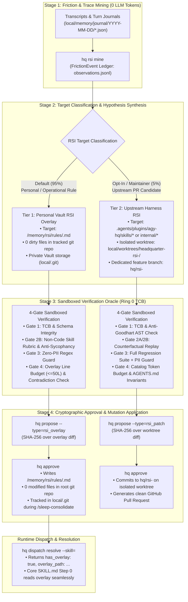

# RFC-0019: Two-Tier RSI & Personal Vault Skill Overlay

- **Status:** Proposed
- **Date:** 2026-11-15
- **Author:** `[Task:agent] two-tier-rsi-vault-overlay` (`gemini-4-carbon-high`)
- **Extends:** [RFC-0001 (Two-Layer Vault Split)](0001-vault-and-task-isolation.md), [RFC-0003 (Approval-Bound Execution)](0003-approval-bound-execution.md), [RFC-0006 (4-Layer Memory & Dreaming)](0006-memory-engine-upgrade.md), [RFC-0010 (Agent Recursive Self-Improvement)](0010-agent-recursive-self-improvement.md), [RFC-0015 (Global Plugin Packaging)](0015-global-plugin-packaging.md), [RFC-0017d (Companion Extension Packs & Unified Trust)](0017d-enterprise-extensibility-and-portability.md)
- **Companion Research:** [15 — Two-Tier Recursive Self-Improvement & Personal Vault Skill Overlay Audit](../research/15_two_tier_rsi_vault_overlay.md), [07 — Agent Recursive Self-Improvement (RSI)](../research/07_agent_recursive_self_improvement.md)

---

## 1. Motivation & The Divergence Problem

### 1.1 Background
In [RFC-0010](0010-agent-recursive-self-improvement.md), `agy-hq` introduced a 4-stage bounded Recursive Self-Improvement (RSI) engine (`internal/rsi/`) to extract operational friction from execution journals, synthesize Agentic Context Engineering (ACE) delta hypotheses, verify them against a 4-gate sandboxed oracle, and apply verified patches under human approval.

### 1.2 The Divergence Problem
Under the RFC-0010 design, `Ring 2` skill rule mutations target tracked plugin files directly:
```go
// internal/rsi/mutator.go:157-169
func ResolveSkillFile(rootDir, skillSlug string) (string, string) {
    relPlugin := filepath.ToSlash(filepath.Join(".agents", "plugins", "agy-hq", "skills", skillSlug, "SKILL.md"))
    absPlugin := filepath.Join(rootDir, filepath.FromSlash(relPlugin))
    // ...
}
```
When `hq rsi apply` executes an approved hypothesis, it writes the new `<!-- rsi:rule ... -->` block into `.agents/plugins/agy-hq/skills/<skillSlug>/SKILL.md`.

For external engineers who `git clone agy-hq` or use the engine in production, this causes severe operational friction ([Research 15 §1](../research/15_two_tier_rsi_vault_overlay.md)):
1. **Dirty Working Tree:** Routine self-improvement dirties git (`modified: .agents/plugins/agy-hq/skills/swe-pulse/SKILL.md`).
2. **Upgrade Hazards (`hq upgrade` / `git pull`):** Upstream updates abort with git merge conflicts or overwrite locally learned rules.
3. **PII and Workflow Leakage:** Personal workstation quirks, internal CLI flags, and private workflow habits risk being committed upstream.
4. **Conflating Personal vs. Universal Rules:** Personal operational habits (e.g. `--no-docker` on a machine without Docker privileges) become baked into the global upstream skill.
5. **Empirical Defect:** The repository currently contains a live instance of this divergence in `.agents/plugins/agy-hq/skills/swe-pulse/SKILL.md` (rule `rsi-rule-swe-pulse-2c42ca` added on 2026-11-09).

`RFC-0019` resolves this divergence by establishing a strict **Two-Tier RSI Architecture** backed by a **Personal Vault Skill Overlay**.

---

## 2. Architecture Overview: Two-Tier RSI



---

## 3. Tier 1: Personal Vault Skill Overlay (Default)

### 3.1 Vault Overlay File Layout
Personal skill rules are stored exclusively within the private Vault:
```text
<vault>/
└── memory/
    └── rsi/
        ├── observations.jsonl       # Deduplicated friction events
        ├── hypotheses/              # Structured candidate hypotheses
        ├── archive.jsonl            # Frequency-adaptive canary records
        └── rules/                   # [RFC-0019] Personal Skill Overlays
            ├── swe-pulse.md         # Additive operational rules for swe-pulse
            ├── morning-brief.md     # Additive operational rules for morning-brief
            └── thesis-check.md      # Additive operational rules for thesis-check
```

Each overlay file (`<vault>/memory/rsi/rules/<skill-slug>.md`) is a lightweight markdown document containing only learned operational rules:
```markdown
# Personal Skill Overlay: swe-pulse

> Managed automatically by `hq rsi`. Do not edit manually unless removing obsolete rules.
> Target Core Skill: `.agents/plugins/agy-hq/skills/swe-pulse/SKILL.md`

## Learned Operational Rules (RSI Managed)

<!-- rsi:rule id="rsi-rule-swe-pulse-2c42ca" source="obs-20261109-2c42ca57" model_scope="all" added="2026-11-09" helpful="3" harmful="0" -->
- **[Learned Rule · worker_aci_or_skill]:** When using `user_feedback` in `swe-pulse`, Never perform multi-file code modifications or test suite runs inline on the Front Desk; dispatch invoke_subagent or hq spawn. *(Observed 2x; prevents: Always delegate multi-file coding and bugfix tasks (>3 tool calls) to a background subagent in local/worktrees/ instead of blocking the [HQ] Front Desk thread.)*
```

### 3.2 Mechanical Zero-Dirty-Tree Invariant
1. When `hq rsi hypothesize` runs in default (Tier 1) mode, `TargetFiles` is set to:
   ```text
   local/memory/rsi/rules/<skill-slug>.md
   ```
   (or relative to `vaultDir`).
2. `hq rsi apply` writes exclusively to the Vault overlay file.
3. The root repository git tree remains completely untouched: `git status -s` produces **zero output**.
4. When the user runs `git pull` or `hq upgrade`, upstream changes to `.agents/plugins/agy-hq/skills/*/SKILL.md` merge cleanly without conflict.
5. Overlay files are versioned in the private Vault repository (`local/.git`), committed silently during the nightly `/sleep-consolidate` workflow (`hq memory commit`).

### 3.3 Runtime Resolution & Composition via `hq dispatch resolve`
To compose the core skill with the personal overlay at runtime, `internal/extension/state.go` extends `DispatchResolution`:

```go
type DispatchResolution struct {
    FQID         string `json:"fqid,omitempty"`
    LogicalSkill string `json:"logical_skill,omitempty"`
    ActiveTarget string `json:"active_target,omitempty"`
    Skill        string `json:"skill,omitempty"`
    SkillOrigin  string `json:"skill_origin,omitempty"`
    Overridden   bool   `json:"overridden"`
    SkillPath    string `json:"skill_path,omitempty"`
    Enabled      bool   `json:"enabled"`
    Tier         string `json:"tier,omitempty"`
    Model        string `json:"model,omitempty"`
    Trust        string `json:"trust,omitempty"`
    Reason       string `json:"reason,omitempty"`

    // RFC-0019 Additions:
    HasOverlay   bool   `json:"has_overlay"`
    OverlayPath  string `json:"overlay_path,omitempty"`
    ActiveRules  int    `json:"active_rules,omitempty"`
}
```

`ResolveSkillDispatch(vaultDir, logicalSkill)` checks if `<vault>/memory/rsi/rules/<logicalSkill>.md` exists:
1. If present and containing active `<!-- rsi:rule ... -->` blocks, `HasOverlay` is set to `true`, and `OverlayPath` is populated.
2. If the skill is also shadowed by a companion pack (`overridden == true`), the companion pack skill takes priority, but the overlay remains accessible if compatible.

### 3.4 Step-0 Trampoline Integration in Core Skills
Every overridable core skill (`.agents/plugins/agy-hq/skills/*/SKILL.md`) updates its Step-0 trampoline:
```markdown
0. **Extension Dispatch Check:** Run `hq dispatch resolve --skill=<skill-slug> --json`:
   - If `overridden == true`, activate the companion skill (`skill_path`) and stop following this file.
   - If `has_overlay == true`, read and apply the personal operational rules from `overlay_path` before proceeding.
```
This requires **zero tokens** when no overlay exists, and loads only the compact overlay markdown ($\le 50$ lines) when rules are present.

### 3.5 Overlay Budget & Invalidation Guards
To prevent personal overlays from accumulating unbounded rules or stale context:
- **Per-Skill Overlay Cap:** Maximum **50 lines** and maximum **10 active rules** per skill overlay file.
- **Global Overlay Cap:** Maximum **50 active rules** across all skills in `<vault>/memory/rsi/rules/`.
- **Ablation Sweep (`hq rsi ablate`):**
  - Rules with `harmful > helpful` are automatically marked for deprecation.
  - Rules with `helpful == 0` after 30 days are ablated.
  - Model-scoped rules (`model_scope="flash-only"`) are automatically ablated when upgrading the primary execution tier.

---

## 4. Tier 2: Upstream Harness RSI (Opt-In / Maintainer)

### 4.1 Purpose & Scope
While Tier 1 handles user-specific operational rules, `agy-hq` maintainers and contributors still require the ability to evolve the core harness:
- Crystallizing recurring LLM tasks into deterministic 0-token Go CLI subcommands (Ring 1).
- Fixing universal bugs in `internal/*` or `cmd/hq/*` (Ring 1).
- Updating upstream core skill instructions that benefit all users (Ring 2).

### 4.2 Explicit Promotion Workflow
Tier 2 is strictly **opt-in** and cannot be triggered by routine background sleep consolidation:
1. **Command:**
   ```sh
   hq rsi export --upstream <rule-id-or-hypothesis-id> [--worktree]
   ```
   Or for maintainer mode:
   ```sh
   hq rsi hypothesize --upstream --obs=<obs-id>
   ```
2. **Worktree & Branch Isolation:**
   - Tier 2 mutations are never applied directly to the current working tree.
   - Instead, `internal/rsi` provisions an isolated worktree at `local/worktrees/headquarter-rsi-<id>/` checked out on a fresh branch `hq/rsi-<id>`.
3. **Generalizability Criteria:**
   - Must pass Gate 1 (TCB AST check) and Gate 2A (counterfactual replay test failing on `main` and passing on branch).
   - Must pass Gate 3 PII Guard (`P1`–`P6` checks with zero local paths or private credentials).
   - Must pass `go vet ./...`, `go test -race ./...`, and all CUJ E2E tests.
   - Must not contain environment-specific assumptions (verified by running tests with cleared environment variables).
4. **Pull Request Staging:**
   - The verified commit is pushed to `origin/hq/rsi-<id>`.
   - `hq propose` generates a clean PR proposal:
     ```sh
     hq propose --type=pr_create --summary="Upstream RSI: Fix <issue> in <subsystem>" --cmd="gh pr create --head hq/rsi-<id> --base main ..."
     ```

---

## 5. User Onboarding: Where Personal Skills Belong

To ensure consistent mental models across documentation and onboarding, `agy-hq` defines clear guidelines for where users should place custom skills and extensions:

| User Goal | Recommended Location | Management Mechanism | Scope & Lifetime |
| :--- | :--- | :--- | :--- |
| **New Standalone Personal Skill**<br>(e.g. `recipe-picker`, `jira-helper`, `home-automation`) | `~/.gemini/config/skills/<name>/SKILL.md`<br>*(or `.agents/skills/<name>/` for project repo)* | Native Antigravity progressive disclosure; triggered via `/<name>` | Available across all workspaces on workstation; survives repo checkouts |
| **Enterprise / Multi-Component Extension**<br>(Connectors + Brief + Schedules + Inbox rules) | External plugin repo with `hq-extension.json` (RFC-0017d) | Managed via `hq extension <enable\|trust>` and `<vault>/extensions.json` | Cohesive enterprise distribution; cryptographic SHA-256 trust pinning |
| **Operational Rules for Core Skills**<br>(Workstation quirks, flag preferences, error recovery) | `<vault>/memory/rsi/rules/<skill-slug>.md` (Tier 1 RSI) | Managed automatically by `hq rsi` (`mine` $\rightarrow$ `hypothesize` $\rightarrow$ `apply`) | Private to user Vault; `0` dirty git files; composed via `hq dispatch resolve` |
| **Upstream Core Engine Fixes**<br>(New `hq` subcommands, core skill enhancements) | Tracked `.agents/plugins/agy-hq/skills/` or `internal/` | Author in isolated worktree (`hq spawn`); submit via GitHub Pull Request | Public open-source codebase; benefits all `agy-hq` users |

---

## 6. Migration Plan for Existing Tracked Rules

### 6.1 Audit of Existing Tracked Rules
Currently, `.agents/plugins/agy-hq/skills/swe-pulse/SKILL.md` contains one learned rule:
- ID: `rsi-rule-swe-pulse-2c42ca`
- Source: `obs-20261109-2c42ca57`
- Category: `worker_aci_or_skill`

### 6.2 Deterministic Migration Tooling (`hq rsi migrate-overlays`)
We introduce a migration utility into `cmd/hq/` and `internal/rsi/`:
1. **Scan:** Reads all tracked `.agents/plugins/agy-hq/skills/*/SKILL.md` files for `<!-- rsi:rule ... -->` blocks.
2. **Extract:** For each tracked rule found:
   - Identifies the owning skill slug (e.g. `swe-pulse`).
   - Appends or merges the rule block into `<vault>/memory/rsi/rules/<skill-slug>.md`.
   - Preserves all attribution counters (`helpful`, `harmful`, `added`, `source`).
3. **Cleanse:** Removes the `## Learned Operational Rules (RSI Managed)` section and rule comments from the tracked `SKILL.md` file.
4. **Idempotence:** Safe to run multiple times. If the rule already exists in the Vault overlay, it is not duplicated.
5. **Auto-Execution on `hq upgrade`:** `hq upgrade` executes `migrate-overlays` automatically prior to updating tracked plugin files, ensuring existing user rules are never lost.

---

## 7. Security, Privacy & TCB Invariants

1. **Ring 0 Immutable TCB Preservation:**
   Neither Tier 1 overlays nor Tier 2 patches may modify Ring 0 paths (`internal/approvals/`, `internal/ci/`, `internal/rsi/tcb.go`, `.git/hooks/`, `SECURITY.md`, etc.).
2. **Quarantine & Taint Isolation Invariant:**
   Sessions that process untrusted external content (e.g. `quarantined-digest-reader`, untrusted email/chat bodies) are marked `Tainted: true`. Gate 1 strictly rejects any hypothesis derived from a tainted observation from generating either a Vault overlay or an upstream patch.
3. **PII Isolation Boundary:**
   Personal Vault overlays reside strictly within `local/`, which is git-ignored by the root repository and enforced by the mathematical PII scanner (`hq ci check-pii`).
4. **Cryptographic Human-in-the-Loop Approval:**
   Applying a Tier 1 overlay requires `hq propose` + `ask_question` + `hq approve <propId> --sha256=<prefix>`. Silent or unattended mutation of skill overlays is strictly prohibited.
5. **Anti-Sycophancy Invariant for Investing & Research Skills:**
   Mutations targeting `thesis-check` or `filing-diff` overlays must preserve explicit falsification, bear case evaluation, and kill-criteria checks (`Gate 2B`).

---

## 8. Phase 2 Test Plan & Acceptance Criteria

When Phase 2 implementation begins, verification must satisfy the following criteria:

### 8.1 Unit Tests (`internal/rsi/`)
- `TestResolveSkillFile_TwoTier`: Verifies that Tier 1 resolves target paths in `<vault>/memory/rsi/rules/` while Tier 2 resolves tracked plugin paths.
- `TestApplyACEDelta_VaultOverlay`: Verifies that applying an `add_skill_rule` delta creates or updates `<vault>/memory/rsi/rules/<skill>.md` with proper headers, preserving existing rules and frontmatter.
- `TestMigrateOverlays`: Verifies that `hq rsi migrate-overlays` extracts `rsi-rule-swe-pulse-2c42ca` into `<vault>/memory/rsi/rules/swe-pulse.md` and leaves `.agents/plugins/agy-hq/skills/swe-pulse/SKILL.md` completely clean.
- `TestAblate_VaultOverlay`: Verifies that `hq rsi ablate` scans and prunes rules from `<vault>/memory/rsi/rules/` rather than modifying tracked repository files.

### 8.2 Dispatch & Extension Tests (`internal/extension/`)
- `TestDispatchResolve_WithOverlay`: Verifies that `hq dispatch resolve --skill=swe-pulse` returns `has_overlay: true` and `overlay_path` when a Vault overlay exists, and `has_overlay: false` when absent.
- `TestDispatchResolve_CompanionShadowing`: Verifies that if a trusted companion pack shadows a skill, the companion target takes precedence while preserving overlay visibility.

### 8.3 CI Gate Contracts (`internal/ci/`)
- `H1 Skill Catalog Integrity`: Enforces that tracked `.agents/plugins/agy-hq/skills/*/SKILL.md` files contain **`0` active `<!-- rsi:rule` blocks** once migration is complete.
- `H4-B Markdown & Docs Integrity`: Enforces that all documentation cross-links to RFC-0019 and Research 15 are valid and indexed in `docs/README.md`.

### 8.4 Critical User Journey E2E Test (`CUJ-35`)
- Add `TestCUJ35_TwoTierRSIAndPersonalVaultOverlay` to `internal/e2e/cuj_e2e_test.go`:
  1. Initialize fresh temporary workspace and Vault.
  2. Simulate tool error-recovery friction in a session journal.
  3. Execute `hq rsi mine` and `hq rsi hypothesize`.
  4. Verify hypothesis specifies `local/memory/rsi/rules/<skill>.md` as target.
  5. Run `hq rsi verify` (all 4 gates PASS).
  6. Propose and approve the mutation via `hq approve`.
  7. **Assert:** The overlay file exists in `<vault>/memory/rsi/rules/`.
  8. **Assert:** `git status -s` in the root repository remains **100% clean**.
  9. Run `hq dispatch resolve --skill=<skill> --json` and assert `has_overlay == true`.
