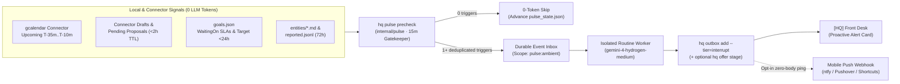

# RFC-0020: Cross-Source Ambient Synthesis Loop, Pre-Meeting / Deadline Nudges & Optional Zero-Body Mobile Push

- **Status:** Superseded by [RFC-0027](./0027-muse-proactive-actions.md) *(superseded 2026-11-22; `RFC-0027` is now Implemented)*
- **Author:** `[Task:headquarter] Proactive Always-On Synthesis` (`gemini-4-carbon-high`)
- **Created:** 2026-11-16
- **Superseded By:** [RFC-0027 (Muse-Informed Proactive Actions)](./0027-muse-proactive-actions.md) & [RFC-0023 (Vendor-Neutral Front Desk Channel Bridge)](./0023-front-desk-channel-bridge.md)
- **Companion Research:** [10 — Meta Muse (`muse.ai`) Deep Dive](../research/10_muse_ai_proactive_and_context_study.md), [13 — General Watcher Mechanism & Quarantine Provenance Audit](../research/13_proactive_channel_watcher_audit.md), [14 — Anthropic Always-On Agents Architecture & Forensic Gap Audit](../research/14_anthropic_always_on_agents_gap_audit.md)
- **Extends / Integrates With:** [RFC-0014 (Proactive Engine v2)](./0014-proactive-engine-and-living-context.md), [RFC-0017a (Connector Protocol & Watcher Engine)](./0017a-connector-protocol-and-watcher-engine.md), [RFC-0017b (Provenance Taint & Offer Gateway)](./0017b-provenance-taint-and-offer-gateway.md), [RFC-0018 (Always-On Runtime Hardening)](./0018-always-on-agent-runtime-hardening.md)

> [!NOTE]
> **Supersession Notice:** All five detectors (`P1`–`P5`) originally proposed here have been subsumed and expanded into `D1`–`D10` of [RFC-0027: Muse-Informed Proactive Actions](./0027-muse-proactive-actions.md) (which adds 3-state readiness ledgers, `BlocksAvailability` ripples, work-native workspace/PR/delegate synthesis, `3m` burst coalescing, 1-tap `DecisionOption` cards, and composable Living Spaces), while mobile interrupt delivery and 1-tap callbacks are handled via the [RFC-0023](./0023-front-desk-channel-bridge.md) `hq-channel-bridge/v1` seam. This document is preserved for historical context.

---

## 1. Motivation & Problem Statement

Following the operational fixes to `agy-hq.service` single-owner supervision, desktop-scoped `plugin-cli` Gmail hydration across ephemeral `/tmp/agy-plugin-cli-*` directories, and 4-tier urgency calibration in [`internal/watcher/watcher.go`](../../internal/watcher/watcher.go), `agy-hq` reliably watches inbound Gmail threads and delivers real-time `interrupt` cards to `[HQ] Front Desk`.

However, comparing `agy-hq`'s current per-connector pipeline against Meta Muse's ambient personal synthesis ([Research 10 §2.2–2.3](../research/10_muse_ai_proactive_and_context_study.md)) reveals a **structural gap between single-item channel triage and cross-source personal proactivity**:

1. **Siloed Connector Events vs. Cross-Source Joining:** `hq watch precheck` evaluates each inbound Gmail or Google Chat message in isolation. It never joins **upcoming Google Calendar events (`T-30m`)**, **unsent Gmail/Chat drafts**, **expiring pending approvals (`hq offer` / `hq propose`)**, **silent counterparty `WaitingOn` SLA breaches**, and **approaching Goal `targetDate` deadlines (`< 24h`)** into unified situational nudges.
2. **Absence-of-Signal Blindness:** Many high-value nudges are triggered not by a *new* email arriving, but by *time passing without action*:
   - A calendar meeting starts in 20 minutes with `alice@example.com`, while an open `WaitingOn` thread or unread message from `alice@example.com` sits unreviewed.
   - An outbound draft or staged `prop-...` approval (`ExpiresAt` in `< 2h`) sits unsent ahead of an external cutoff.
   - An active Goal in `<vault>/memory/goals.json` reaches `T-24h` before `targetDate` with incomplete milestones (`0/3` checked off).
3. **Desktop-Bound Interrupts When Away from Desk:** `DispatchOutboxToFrontDesk` ([`internal/kernel/events_dispatch.go`](../../internal/kernel/events_dispatch.go)) injects `🔔 Proactive Alert` cards into `[HQ] Front Desk`, which works well when Antigravity Desktop or Remote Control is open, but provides no optional out-of-band push ping (e.g., `ntfy`, Pushover, or Apple Shortcuts webhook) to wake the user's phone lock screen when a genuinely urgent `interrupt` or expiring approval lands.

---

## 2. Design Goals & Non-Goals

### Goals
1. **0-Token Cross-Source Precheck (`hq pulse precheck`):** Run a deterministic pure-Go ambient state join every `15m` (`07:00–21:30` local time) across Calendar (`gcalendar` connector), unsent Gmail drafts, pending `approvals`, `goals.json` (`WaitingOn` SLAs + `targetDate` horizons), and `entities/`, consuming **0 LLM tokens** when no actionable cross-source trigger fires.
2. **Untainted Synthesis vs. Quarantined Channel Boundary:** Keep cross-source synthesis strictly provenance-safe: `hq pulse` consumes only **trusted local state** (`goals.json`, `proposals/`, `entities/`) plus **sanitized low-sensitivity calendar metadata & already-triaged outbox/reported digests**, never mixing raw untrusted email bodies into an untainted worker.
3. **Actionable 1-Tap Outputs:** Every `interrupt` nudge emitted by `hq pulse` includes a concrete next step—a pre-meeting prep card, a 1-tap `hq approve` reminder before TTL expiry, or a pre-staged polite follow-up offer (`hq offer stage`).
4. **Zero-Body Optional Mobile Push (`internal/outbox/` Push Hook):** Support an opt-in, zero-PII push notification webhook (`notifications.push` in `<vault>/config.yaml`) that sends **only opaque/sanitized high-level badge + Remote Control deep-link metadata** (never raw email bodies, subjects, or Vault PII) on `interrupt` delivery.

### Non-Goals
- No cloud relay server or third-party data custody (`ADR-0003` local Vault sovereignty remains absolute).
- No autonomous external sending without explicit human `hq approve` (`RFC-0003` / `RFC-0017b`).
- No `go.mod` external dependencies (`ADR-0002` pure Go stdlib).

---

## 3. Architecture Overview



---

## 4. Detailed Subsystem Design

### 4.1 Five Deterministic `hq pulse precheck` Detectors (`internal/pulse/`)

`hq pulse precheck --json` runs under a single-instance lock (`<vault>/memory/pulse/state.json`, `store.RankWatcher`) and evaluates five deterministic detectors against a per-detector dedup ledger (`fired_keys` with TTL):

| Detector ID | Signal Join | Firing Condition | Dedup Key & Cooldown | Output Action |
| :--- | :--- | :--- | :--- | :--- |
| **`P1: pre_meeting_prep`** | `gcalendar` upcoming events (`now` to `now+35m`) $\bowtie$ `goals.json` `WaitingOn` $\bowtie$ `entities/<attendee>.md` $\bowtie$ recent `outbox` items | Non-all-day event with $\ge 1$ external attendee starting in `10m–35m` where Vault holds matching entity/goal/thread context | `meeting:<eventId>:<startISO>` (`24h`) | Spawns `routine` synthesis worker to post a 5-bullet **Pre-Meeting Brief** (`interrupt`) to Front Desk |
| **`P2: expiring_approval`** | `<vault>/memory/proposals/*.json` (`status=pending`) | Resumable or user-facing proposal with `< 2h` remaining before `ExpiresAt` (and not yet nudged) | `prop_expiring:<propId>` (`24h`) | Direct **0-token** `outbox.Add(TierInterrupt)` card with 1-tap `propId` + `sha256` prefix (no LLM spawn needed!) |
| **`P3: unsent_draft_nudge`** | `gmail` connector `drafts` list $\bowtie$ `goals.json` / upcoming meetings | Unsent draft older than `4h` (or `< 60m` before a meeting with that recipient) with no matching pending `Proposal` | `draft_stale:<draftId>` (`24h`) | Emits `ideas_feed` (or `interrupt` if recipient is in an upcoming `<60m` meeting) reminder |
| **`P4: waiting_sla_breach`** | `goals.json` `WaitingOn` entries (`status=waiting`) | `now >= dueAt` and no inbound reply recorded on `threadKey` | `sla_due:<goalId>:<waitId>` (`24h`) | Spawns worker to stage a polite follow-up reply (`hq offer stage`) + `interrupt` nudge |
| **`P5: goal_deadline_horizon`** | `goals.json` active Goals with `targetDate` | `targetDate` within `< 24h` (or newly overdue today) and $\ge 1$ unchecked milestone | `goal_due:<goalId>:<targetDate>` (`24h`) | Direct **0-token** (or `routine` synthesized when linked notes exist) `interrupt` readiness check |

> **Key Token-Efficiency Principle:** Detectors `P2` (expiring approval) and simple `P5` (goal horizon) emit structured `OutboxItem` cards **directly in Go at 0 LLM tokens**; `hq pulse` only enqueues an LLM synthesis event when `P1` (pre-meeting brief across dossier/threads) or `P4` (drafting a contextual follow-up offer) requires natural-language synthesis.

### 4.2 Provenance & Quarantine Invariant

To preserve `RFC-0017b` provenance isolation:
- `hq pulse` workers run **untainted** only when consuming trusted local state (`goals.json`, `entities/*.md`, `proposals/`, low-sensitivity calendar slot/attendee headers, and already-sanitized `outbox`/`reported` summaries).
- If `P4` (`waiting_sla_breach`) needs to inspect raw messages on an untrusted Gmail thread before staging a reply, it delegates to `hq watch read` + `hq offer stage` inside a `TaintOnSpawn: true` quarantined event—never reading raw untrusted thread bodies inside an untainted session.

### 4.3 Optional Zero-Body Mobile Push Notifier (`internal/outbox/push.go`)

When the user configures an opt-in push endpoint in `<vault>/config.yaml` (with secret URL/token stored strictly in `<vault>/private/credentials/push.json`, `0600`):

```yaml
attention:
  mode: proactive
  quiet_hours:
    enabled: true
    start: "22:00"
    end: "07:30"
    timezone: "America/Los_Angeles"
  mobile_push:
    enabled: true
    provider: "ntfy" # ntfy | pushover | webhook
    credential_ref: "private/credentials/push.json"
    include_sanitized_title: false # default false: zero-body Generic Badge mode
```

- **Default Zero-Body Privacy Mode (`include_sanitized_title: false`):** Sends only `"agy-hq: 1 urgent item awaiting review in Front Desk"` (or `"1 approval expiring soon"`), leaking **zero** sender names, tickers, subjects, or personal context to third-party push relays (APNs/FCM/`ntfy`).
- **Quiet-Hours & Coalescing Compliance:** Fires strictly inside `DispatchOutboxToFrontDesk` *after* `EvaluateDelivery` and `InQuietHours` pass, inheriting the exact same 12h semantic dedup, topic cooldown, and DND rules.

---

## 5. Proposed Rollout Plan & Verification

1. **Phase 2A (`internal/pulse/` + Core Detectors `P1`, `P2`, `P4`, `P5`):**
   - Implement `internal/pulse/pulse.go` (`RunPrecheck`, `<vault>/memory/pulse/state.json`), CLI `hq pulse <precheck|status>`, and add `ambient-pulse` (`*/15 7-21 * * *`, `mode: daemon_gatekeeper`) to `templates/triggers.yaml`.
   - Unit tests for all 5 detectors, dedup cooldowns, and provenance isolation.
2. **Phase 2B (`gcalendar` Upcoming Window Verb + Pre-Meeting Synthesis Skill Section):**
   - Extend built-in `gcalendar` connector driver in [`internal/connector/builtin_drivers.go`](../../internal/connector/builtin_drivers.go) with low-sensitivity `upcoming` query (`now..now+35m`, attendee emails + start time + title) and wire into `P1`.
3. **Phase 2C (`internal/outbox/push.go` + `hq notify test` + `CUJ-30` E2E):**
   - Implement `private/credentials/push.json` (`0600`, guarded by `PreToolUse` Credential Vault policy), zero-body default payload, loopback `httptest` E2E verification in `CUJ-30`, and full `./bin/hq ci pre-push`.

---

## 6. Open Design Questions for Review

1. **Mobile Push Provider Preference:** Would you like `mobile_push` in Phase 2C to target **Apple Shortcuts / Pushcut / `ntfy`** first, or rely solely on Antigravity Remote Control in Front Desk for now and ship `P1`–`P5` synthesis first?
2. **Pre-Meeting Lead Time (`P1`):** Is a **`15–30 minute`** lead window before external-attendee calendar events the right default for Pre-Meeting Brief cards in `[HQ] Front Desk`?
