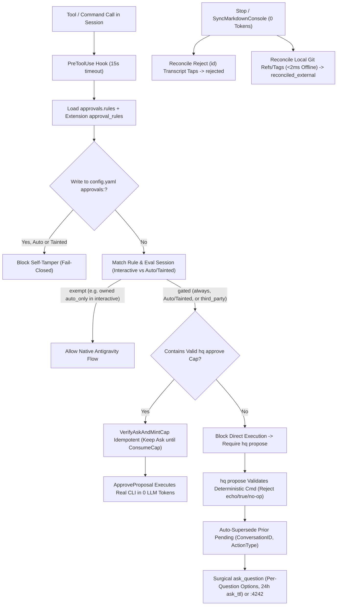

# RFC-0021: Customizable Outbound Approval Policy, Native Coexistence & Lifecycle Hardening

- **Status:** Implemented
- **Created:** 2026-11-16
- **Companion Research:** [Research 16: Empirical Audit of Outbound Approval UX Friction, Native Antigravity Coexistence & Customizable Policy Design](../research/16_approval_ux_and_customizable_policy_audit.md)
- **Extends / Updates:** [RFC-0003](./0003-approval-bound-execution.md), [RFC-0017b](./0017b-provenance-taint-and-offer-gateway.md), [RFC-0017d](./0017d-enterprise-extensibility-and-portability.md), [RFC-0018](./0018-always-on-agent-runtime-hardening.md)
- **Closes Issues:** `#28`

> **Evolution Note (Round 3 M2):** `EvaluateCommand` was folded into `EvaluateCommandForSession`, and `internal/hooks/hooks.go` was split into `{pre_tool,propose_guards,session_start,quarantine,stop}.go`.

---

## 1. Problem Summary (`F1`–`F6`)

Production operation of the `hq propose` / `CONSOLE.md` / `:4242` Web Console approval queue revealed six recurring failure modes (documented empirically in [Research 16](../research/16_approval_ux_and_customizable_policy_audit.md)):

- **`F1` — Policy / Hook Asymmetry & Native Bypass:** Broad instructions in [`.agents/plugins/agy-hq/rules/AGENTS.md`](../../.agents/plugins/agy-hq/rules/AGENTS.md) §4 conflict with a narrow hardcoded regex gate ([`outboundCommandPatterns`](../../internal/hooks/hooks.go)) and Antigravity's native permission presets (`AGENT_PERMISSION_PRESET_TURBO`), causing duplicate prompts on routine single-player actions and leaving orphaned pending entries whenever work ships via unblocked paths.
- **`F2` — Dummy No-Op `--cmd` Placeholders:** Because [`cmd/hq/main.go`](../../cmd/hq/main.go) requires `--cmd`, non-CLI browser/MCP tasks stage fake commands such as `echo 'Approved: post announcement...'`, giving zero cryptographic binding (`ApproveProposal` runs `echo`) and non-functional **Approve** buttons on `:4242`.
- **`F3` — 30-Minute `AskTTL` vs. 24-Hour `ProposalTTL` Mismatch:** [`DefaultAskTTL`](../../internal/approvals/presence.go#L24) expires human-presence records 30 minutes after `ask_question` renders, while proposals remain alive for `24h` ([`DefaultProposalTTL`](../../internal/approvals/approvals.go#L25)). Delayed user taps (40–69 minutes later) fail validation cleanly and push sessions to bypass `hq approve`.
- **`F4` — Blanket `ask_question` Overwrite & Dropped Rejects:** [`HandlePreToolUse`](../../internal/hooks/hooks.go) overwrites the entire `questions` array if any `prop-*` ID appears anywhere in serialized arguments—destroying sibling questions and custom options—and fails to auto-reconcile `Reject (<id>)` UI selections when the model omits `hq reject`.
- **`F5` — Missing Auto-Supersede, Spurious Reject Wakeups & Stale Git Refs:** Sequential drafts from the same `(ConversationID, ActionType)` accumulate duplicates in `Pending Approvals`; [`RejectProposalWithOptions`](../../internal/approvals/approvals.go#L841-L880) triggers an LLM resumption event on any custom `--reason`; `hq propose` omits `ask_question` pairing hints; and already-pushed git tags/commits linger until 24h expiration.
- **`F6` (Issue `#28`) — 5s Hook Timeout & Non-Idempotent `askPath` Deletion:** [`.agents/plugins/agy-hq/hooks.json`](../../.agents/plugins/agy-hq/hooks.json#L17) caps `PreToolUse` at 5 seconds, and [`VerifyAskAndMintCap`](../../internal/approvals/presence.go) deletes `askPath` before `ApproveFromCLI` consumes `approval_caps/<id>.json`. A transient timeout or downstream check error permanently invalidates a valid user confirmation.

---

## 2. First-Principles Boundary Criteria & Non-Goals

### Three Boundary Criteria

Every gating rule in `agy-hq` flows from three explicit criteria:

1. **Session Autonomy (`Auto` / `Tainted` vs. Interactive User-Directed):**
   - Unattended (`[Auto]`) and untrusted (`tainted`) sessions operate without synchronous human oversight; external mutations gate fail-closed via `hq offer stage` / `hq propose`.
   - Interactive, trusted sessions already collaborate live with the user inside Antigravity.
2. **Blast Radius & Reversibility:**
   - **High / Counterparty / Public Blast Radius (`always`):** Human messaging (`messaging`), public/production releases (`release_publish`), merging third-party PRs outside owned repos (`pr_merge`), and Ring-0 TCB self-modification (`rsi_apply`) always require explicit cryptographic approval.
   - **Single-Player / Owned-Repo Reversible Actions (`auto_only` default):** Owned-repo `git push`, `git tag`, and own-repo `gh issue` / `gh pr` operations inside `owned_repos` are exempt during interactive trusted sessions (relying on native git/Antigravity workflows and `AGENTS.md` §3 CI gates), while still gating under `[Auto]` / `tainted` execution.
3. **Deterministic Zero-Token Execution:**
   - `hq propose` must wrap a real, deterministic CLI command or typed connector (`CommandArgv` / `ActionDraft` / `ActionRSIApply`) that Go executes in `0` LLM tokens upon approval. Interactive browser/MCP UI tasks stay on native `ask_question` + markdown blockquote previews; unattended drafts escalate via `hq outbox add`.

### Explicit Non-Goals

- **No `--defer-to-session` "Audit Ticket" Proposal Mode (`YAGNI`):** Non-executable tickets force split UI approval + delayed LLM wakeups to click browser buttons manually, reproducing `F1`–`F2` stale queue bloat. Native `ask_question` (interactive) and `hq outbox add` (`[Auto]`) already solve human-in-the-loop browser steps cleanly without corrupting `Pending Approvals`.
- **No Harness Rebuild Required to Customize Policy or Add Categories:** Users and companion extension packs must be able to change gating modes, declare `owned_repos`, or add wholly new categories (e.g., `cloud_infra`, `payments`) via YAML/JSON configuration alone with zero Go code edits.

---

## 3. Architecture Overview



---

## 4. Detailed Design

### 4.1 Uniform Data-Driven Approval Policy (`config.yaml` + `hq-extension.json`)

To unify built-in defaults, user overrides, and user-defined categories without touching Go source, replace disparate hardcoded Go lists ([`outboundCommandPatterns`](../../internal/hooks/hooks.go) and `classifyUnattendedAutoCommand`) with a single ordered list-of-objects policy loader implemented in `internal/approvals/policy.go` (Phase 2).

#### Vault Configuration Schema ([`templates/config.yaml`](../../templates/config.yaml))

```yaml
approvals:
  # Owned GitHub/Git Forge repository globs used by `third_party_only` rules.
  owned_repos:
    - "alice/*"
    - "alice-org/*"

  # Human-presence ask TTL (matches proposal_ttl so async desktop/mobile taps succeed).
  ask_ttl: "24h"
  proposal_ttl: "24h"

  # Reject dummy placeholder commands (`echo`, `printf`, `true`, `:`) in `hq propose`.
  reject_noop_commands: true

  # Uniform ordered list of rules. Built-in rules and user-added categories share one schema.
  # Modes:
  #   always            -> gate in ALL sessions (interactive + [Auto] + tainted)
  #   third_party_only  -> gate always when target repo is NOT in `owned_repos` (or unparseable);
  #                        when target IS owned, downgrade to `auto_only` behavior
  #   auto_only         -> exempt in trusted interactive sessions; gate in [Auto] and tainted sessions
  #   never             -> disabled (still warns on unsafe overrides in `hq doctor`)
  rules:
    - id: messaging
      description: "Outbound email, chat, and direct external messaging"
      mode: always
      commands:
        - '\b(hq\s+(gmail|gchat)\s+(send|reply|forward)|gws\s+(gmail|chat)\s+(send|create))\b'
      auto_categories: ["external_comms"]

    - id: release_publish
      description: "Public releases, package registries, and production deployments"
      mode: always
      commands:
        - '\b(gh\s+release\s+create|npm\s+publish|pnpm\s+publish|yarn\s+publish|cargo\s+publish|twine\s+upload|vercel\s+--prod|fly\s+deploy|netlify\s+deploy\s+--prod)\b'
      auto_categories: ["pkg_publish", "prod_deploy"]

    - id: pr_merge
      description: "Pull request merges (third-party always gated; owned repos auto-only)"
      mode: third_party_only
      target_resolver: github_pr
      commands:
        - '\bgh\s+pr\s+merge\b'
      auto_categories: ["forge_mutate"]

    - id: forge_git
      description: "Git pushes/tags and owned-repo issue/PR management"
      mode: auto_only
      target_resolver: git_remote
      commands:
        - '\bgit\s+push\b'
        - '\bgh\s+(pr\s+(create|comment|close|reopen)|issue\s+(create|comment|close|reopen)|repo\s+(delete|rename))\b'
      auto_categories: ["forge_mutate"]

    - id: rsi_apply
      description: "Ring-0 self-modification & skill/hook promotion"
      mode: always
      commands:
        - '\bhq\s+rsi\s+apply\b'

    # Example user-added category requiring ZERO Go code or binary rebuilds:
    # - id: cloud_infra
    #   description: "Production infrastructure state changes"
    #   mode: always
    #   commands:
    #     - '\b(terraform|tofu|pulumi)\s+(apply|destroy)\b'
    # - id: payments
    #   description: "Financial billing and payout CLI calls"
    #   mode: always
    #   commands:
    #     - '\bstripe\s+(transfers|payouts|refunds)\s+create\b'
```

#### Extension Pack Support ([`internal/extension/pack.go`](../../internal/extension/pack.go))

Extend `PackComponents` in `hq-extension.json` with optional `approval_rules` (`[]ApprovalRule`) and `owned_repos` (`[]string`), allowing third-party or enterprise companion packs ([RFC-0017d](./0017d-enterprise-extensibility-and-portability.md)) to contribute domain policies declaratively.

**Deterministic Merge Precedence (Lowest -> Highest):**
1. Built-in defaults compiled into `internal/approvals/policy.go`.
2. Installed & enabled extension packs sorted by pack name (`hq-extension.json` `approval_rules`, matching on `id`).
3. User `<vault>/config.yaml` (`approvals.rules`, where a matching `id` replaces/overrides field values cleanly and new `id`s append to the policy table; scalar fields like `ask_ttl` and list `owned_repos` override defaults when specified).

#### Target Repo Resolution (`target_resolver: github_pr | git_remote`)

When a rule specifies `mode: third_party_only` in an interactive trusted session, `PreToolUse` runs a zero-network deterministic resolver (`<10ms`):
- `github_pr`: parses `-R <owner/repo>`, `--repo <owner/repo>`, or full `https://.../<owner>/<repo>/pull/<n>` from command argv; falls back to the shell invocation's working directory `git remote get-url origin` (`owner/repo`).
- `git_remote`: resolves destination remote URL from positional refspecs (`git push <remote> ...`) via `git remote get-url <remote>` (default `origin`).
- **Fail-Closed Rule:** If `owner/repo` cannot be extracted or does not match any glob in `approvals.owned_repos` (Go stdlib `path.Match` per path segment, case-insensitive owner comparison), treat the target as `third_party` -> `always` gated. Only an explicit match against `approvals.owned_repos` classifies as `owned` -> `auto_only` (exempt in interactive trusted sessions, still gated in `[Auto]`/`tainted`).

#### Dynamic `SessionStart` Active Policy Summary & Self-Tamper Guard

- **`HandleSessionStart` Dynamic Rendering:** Replace static rule duplication in [`HandleSessionStart`](../../internal/hooks/hooks.go) with a compact injected block titled `Active Outbound Policy`, listing each active rule's `id`, resolved interactive mode vs. `[Auto]`/`tainted` mode, `owned_repos` count, and the browser/GUI rule (native `ask_question` + blockquote preview in interactive sessions, `hq outbox add` in `[Auto]`). Rule changes in `<vault>/config.yaml` take effect immediately on the next session/hook invocation with zero plugin edits.
- **`PreToolUse` Self-Tamper Protection:** Any shell command or `edit_file` / `write_file` call targeting `<vault>/config.yaml` (or active pack `hq-extension.json`) in an `[Auto]` or `tainted` session is unconditionally blocked (`fail-closed`). Even in interactive sessions, `PreToolUse` validates proposed YAML rule changes before permitting persistence if malformed regexes or unknown modes are detected.
- **Validation & Non-Destructive Migration (`hq doctor` & `hq migrate`):**
  - `hq doctor` compiles every `commands` regex (`regexp.Compile`), verifies unique `id`s, checks `mode` in `{always, third_party_only, auto_only, never}`, parses `ask_ttl` / `proposal_ttl` durations, and warns if `third_party_only` is active while `owned_repos` is empty.
  - `hq migrate` preserves existing user `<vault>/config.yaml` files and appends commented/default `approvals:` blocks only if `approvals:` is absent.

---

### 4.2 Rejecting No-Op Placeholders (`F2`)

`hq propose` creates a contract that `ApproveProposal` executes in `0` tokens using `SanitizedApprovalEnv` and `HashVersion: 2` binding. Allowing dummy no-op shell strings corrupts Queue trust.

1. **`validateDeterministicCommand` in `internal/approvals/policy.go` (called by [`cmd/hq/main.go`](../../cmd/hq/main.go) `propose` & `PreToolUse`):**
   - Inspect parsed shell AST / tokenized pipeline whenever `--cmd` is supplied (`--draft` and `--rsi-id` bypass `--cmd` parsing because they execute typed Go handlers).
   - Reject commands whose effective command leaf (or every segment in an `&&`/`;` chain) is a non-mutating placeholder: `echo`, `printf`, `true`, `:`, bare comment strings, or prose lacking a binary token (when `approvals.reject_noop_commands: true`, default `true`).
   - Also reject obvious `hq propose` shell-evasion idioms like `bash -c "echo ..."` or `sh -c true`.
2. **Actionable Error Message:** Return non-zero with guidance:
   - Interactive browser/GUI workflows: present the full content in a markdown blockquote and call Antigravity's native `ask_question` directly (no `hq propose`).
   - Unattended `[Auto]` workflows requiring browser/human action: stage via `hq outbox add --tier=interrupt --summary="..."`.
3. **Streamlined [`.agents/plugins/agy-hq/rules/AGENTS.md`](../../.agents/plugins/agy-hq/rules/AGENTS.md) §4:** Narrow rule prose to emphasize: (a) deterministic CLI/connector gating follows `Active Outbound Policy`, (b) interactive browser/GUI actions use blockquote + native `ask_question` directly, and (c) dummy `echo` proposals are strictly prohibited.

---

### 4.3 Human-Presence & Hook Reliability Hardening (`Issue #28` + `F3` + `F4`)

#### A. Align `AskTTL` to `24h` ([`internal/approvals/presence.go`](../../internal/approvals/presence.go))
- Update `DefaultAskTTL` from `30 * time.Minute` to `24 * time.Hour` (loaded dynamically from `approvals.ask_ttl` in `<vault>/config.yaml`), matching `DefaultProposalTTL`.
- When `RecordAsk` records a fresh `ask_question` render for an existing `ProposalID`, refresh `ExpiresAt` (`now + ask_ttl`) so long-running review threads remain verifiable until proposal expiry.

#### B. Idempotent Crash-Safe `VerifyAskAndMintCap` — Closing Issue `#28` ([`internal/approvals/presence.go`](../../internal/approvals/presence.go))
Today `VerifyAskAndMintCap` writes `.used-<proposalID>` (`L356–363`) and deletes `askPath` (`L366`) *before* `ApproveFromCLI` consumes `approval_caps/<id>.json`. If `PreToolUse` exceeds its timeout or `hq approve` fails pre-flight validation, both the cap and the original ask become unrecoverable.

RFC-0021 splits human-presence consumption into a two-phase commit:
1. **`VerifyAskAndMintCap` (Mint Phase):** Verify `AskRecord` (`ProposalID`, `Challenge`, user selection matching `Approve`, expiry, transcript proof). Write `approval_caps/<id>.json` atomically (`O_CREATE|O_WRONLY|O_TRUNC`), recording `AskID` inside the cap file, **without** deleting `askPath` or writing `.used-*` yet. If a live unexpired cap for `(ProposalID, Challenge)` already exists due to a hook retry, return/refresh idempotently rather than failing.
2. **`ConsumeCap` (Commit Phase in `ApproveFromCLI`):** Only *after* `ConsumeCap` verifies signature/expiry AND reads/locks the pending `Proposal` right before execution commit does it delete `askPath` and atomically write `.used-<proposalID>` (`0600`).
3. **Replay Protection Preserved:** Once `.used-<proposalID>` is written at execution commit, neither the cap nor the ask can ever be replayed. If `ApproveFromCLI` exits on a transient lock/precheck failure before execution, the retry finds `askPath` intact and succeeds.

#### C. Bump `PreToolUse` Timeout ([`.agents/plugins/agy-hq/hooks.json`](../../.agents/plugins/agy-hq/hooks.json#L17))
- Increase `"PreToolUse"` hook `"timeout"` from `5` seconds to `15` seconds so cold Vault scans or git remote checks never sever valid `hq approve` invocations under load.

#### D. Surgical Per-Question `ask_question` Handling ([`internal/hooks/hooks.go`](../../internal/hooks/hooks.go))
Replace whole-payload `strings.Contains(rawStr, prop.ID)` matching and blanket `questions` replacement (`L1388`) with per-element inspection:
1. Iterate `questions[i]` individually. Match a `ProposalID` only when `questions[i].question` (or existing `questions[i].options[k].label`) references `<prop.ID>` (or `prop.Summary` confirmation phrasing where `prop.ID` is bound).
2. Mutate **only** matching `questions[i].options`: prepend verified options (`Approve (<prop.ID>, code:<challenge>)`, `Reject (<prop.ID>)`) and append any distinct author-supplied secondary options for that question (e.g., `"Edit tone first"`, `"Send tomorrow morning"`) stripped of spoofed `Approve (`/`Reject (` strings.
3. **Leave all non-matching sibling questions `questions[j]` (`j != i`) 100% untouched** (text, `is_multi_select`, custom options). Keep `RecordAsk` tracking every injected `(ProposalID, question index, challenge)`.

---

### 4.4 Proposal Lifecycle, Deduping & Zero-Token Reconciliation (`F4` + `F5`)

1. **Auto-Supersede Per `(ConversationID, ActionType)` in `CreateWithOptions` ([`internal/approvals/approvals.go`](../../internal/approvals/approvals.go)):**
   - Extend `Proposal` and `CreateOptions` with `KeepPrior bool` (exposed on `hq propose` as `--keep-prior`).
   - When creating a new proposal with non-empty `ConversationID` and `ActionType`, if `KeepPrior == false` and `SupersedePrior` isn't disabled, automatically mark older `pending` proposals matching `(ConversationID, ActionType)` (in addition to explicit `ThreadKey` superseding via `SupersedeByThread`) as `superseded` (`SupersedeReason: "superseded by newer proposal in same conversation"`).
   - Batch workflows proposing multiple distinct actions of the same type simultaneously inside one turn pass `--keep-prior`.
2. **`hq reject --dismiss` / `--no-resume` Flag ([`internal/approvals/approvals.go`](../../internal/approvals/approvals.go#L834-L880) + [`cmd/hq/main.go`](../../cmd/hq/main.go)):**
   - Add `SuppressResume bool` to rejection options (`--dismiss` / `--no-resume` on CLI). When true, `RejectProposal` skips `enqueueApprovalDecisionEvent` even when a descriptive `--reason` (such as `"already landed manually"` or `"cleanup"`) is recorded.
   - [`internal/webui/webui.go`](../../internal/webui/webui.go) `/api/reject` defaults `SuppressResume: true` unless the user enters explicit steering instructions intended to wake the conversation.
3. **`hq propose` Stdout Pairing Reminder ([`cmd/hq/main.go`](../../cmd/hq/main.go)):**
   - Print a single concise line after staging:
     `Next: Present a markdown blockquote preview + ask_question referencing <prop.ID> (or run from :4242 Web Console).`
4. **Zero-Token Reconciliation in `HandleStop` ([`internal/hooks/hooks.go`](../../internal/hooks/hooks.go)) & `SyncMarkdownConsole` ([`internal/webui/webui.go`](../../internal/webui/webui.go)):**
   - **Transcript `Reject (<id>)` Reconciler (`0` LLM tokens):** Read recent `ask_records` linked to the current `ConversationID` and inspect bounded trailing transcript entries (`turn` user selections); if the user explicitly tapped `Reject (<prop.ID>)` and `prop.ID` is still `pending` at `Stop` (or console sync), mark it `rejected` with `SuppressResume: true` and `Reason: "reconciled from ask_question reject selection"`.
   - **Offline Local Git Ref / Tag Reconciler (`<2ms`, `0` network calls, `0` LLM tokens):** For `pending` proposals whose command targets an explicit local `WorkDir` git tag creation/push or commit ref (parsed at creation/inspection without invoking network I/O): run `git -C <WorkDir> rev-parse --verify` against local `refs/remotes/origin/<branch>` or `refs/tags/<tag>` with a strict `2ms` per-item context deadline (`git fetch` is strictly forbidden). If local tracking metadata proves the exact proposed commit/tag has already landed, transition the proposal to `reconciled_external` so `Pending Approvals` and `CONSOLE.md` self-clean automatically.

---

## 5. Security & Privacy Invariants

1. **Unattended & Tainted Isolation Never Weakened:** Setting any rule to `mode: auto_only` or `mode: third_party_only` only relaxes synchronous interactive *trusted* prompts. Both `[Auto]` daemons and `tainted` contexts ([RFC-0017b](./0017b-provenance-taint-and-offer-gateway.md)) override `auto_only` -> `always` fail-closed at evaluation time.
2. **Self-Tamper Resistance on Policy Files:** `<vault>/config.yaml` and pack manifests remain inaccessible for `approvals:` edits from `[Auto]` or `tainted` runs via `PreToolUse`.
3. **Pure Go Stdlib & Zero External Dependencies:** Rule YAML/JSON parsing, `path.Match` repo globbing, shell command AST/token inspection, and local `git rev-parse` checks reuse existing stdlib code (`go.mod` stays 0 external deps, enforced by CI Gate `H4-A`).
4. **Canonical Payload Integrity Unchanged:** Every approved command continues using `ComputeProposalHashV2` SHA-256 verification, `/dev/fd/3` `CommandArgv` piping ([`internal/offer/offer.go`](../../internal/offer/offer.go)), `SanitizedApprovalEnv`, and contextual PII scanning (`ScanOutboundContextualPII`).
5. **Replay Safety After Two-Phase Cap Commit:** Retaining `askPath` between `VerifyAskAndMintCap` and `ConsumeCap` does *not* permit double-execution: `ConsumeCap` performs single-writer `.used-<proposalID>` stamping atomically inside the `ApproveFromCLI` proposal lock before spawning the subprocess.

---

## 6. Phase 2 Implementation & Verification Matrix

### Phase 2 Code & Config Changes

1. **[`internal/approvals/policy.go`](../../internal/approvals/policy.go), [`internal/approvals/reconcile.go`](../../internal/approvals/reconcile.go) & [`internal/approvals/policy_test.go`](../../internal/approvals/policy_test.go):**
   - `PolicyConfig`, `Rule`, `Mode` (`always|third_party_only|auto_only|never`), `LoadPolicy`, `EvaluateCommand`, `ResolveRepoTarget` (`github_pr`, `git_remote`), `ValidateDeterministicCommand` (no-op rejection), `FormatActivePolicySummary`, `SupersedeByConvAndType`, `ReconcileAskRejections`, and `ReconcileLocalGitProposals`.
2. **[`internal/extension/pack.go`](../../internal/extension/pack.go):**
   - Parse `approval_rules` and optional `owned_repos` inside `PackComponents`, enforce monotonic security lattice in `LintPack`, and wire `RegisteredExtensionApprovalRulesProvider` to `LoadPolicy`.
3. **[`templates/config.yaml`](../../templates/config.yaml):**
   - Seed documented `approvals:` defaults (`owned_repos`, `ask_ttl: "24h"`, `proposal_ttl: "24h"`, `reject_noop_commands: true`, default `rules:`).
4. **[`internal/approvals/presence.go`](../../internal/approvals/presence.go) & [`internal/approvals/approvals.go`](../../internal/approvals/approvals.go):**
   - Configurable `24h` `DefaultAskTTL` + ask refresh; two-phase idempotent `VerifyAskAndMintCap` -> `ApproveFromCLI` commit cleanup (Issue `#28`); `(ConversationID, ActionType)` auto-supersede + `KeepPrior`; `SuppressResume` (`--dismiss` / `--no-resume`); `reconciled_external` status handling.
5. **[`internal/hooks/hooks.go`](../../internal/hooks/hooks.go), [`internal/hooks/quarantine.go`](../../internal/hooks/quarantine.go) & [`.agents/plugins/agy-hq/hooks.json`](../../.agents/plugins/agy-hq/hooks.json):**
   - Route `PreToolUse` through `LoadPolicy` / `EvaluateCommand`; block `approvals:` self-tamper in `[Auto]`/`tainted` and validate interactive `config.yaml` edits; bump hook timeout `5s -> 15s`; inject `SessionStart` `Active Outbound Approval Policy`; rewrite `ask_question` injection surgically per question; run 0-token `Reject (<id>)` & `<20ms` offline local git ref reconcilers in `Stop`.
6. **[`cmd/hq/main.go`](../../cmd/hq/main.go), [`internal/doctor/doctor.go`](../../internal/doctor/doctor.go), [`internal/webui/webui.go`](../../internal/webui/webui.go) & [`.agents/plugins/agy-hq/rules/AGENTS.md`](../../.agents/plugins/agy-hq/rules/AGENTS.md):**
   - Enforce `ValidateDeterministicCommand` in `hq propose`; add `--keep-prior` (`propose`), `--dismiss`/`--no-resume` (`reject`), policy validation in `hq doctor` & `hq migrate`; wire `SyncMarkdownConsole` 0-token reconciliation & `/api/reject` default `SuppressResume`; update `AGENTS.md` §4 prose.

### Verification Matrix (`Unit Tests` + `CUJ-36`)

| Scenario | Test / Suite | Assertions |
| :--- | :--- | :--- |
| **Uniform Policy & Zero-Go-Change Custom Category** | `policy_test.go` + `CUJ-36` | Adding `cloud_infra` (`terraform apply`, `mode: always`) in `<vault>/config.yaml` blocks direct execution in `PreToolUse` and surfaces in `SessionStart` `Active Outbound Approval Policy` without recompiling `hq`. |
| **Extension Pack Merge Precedence** | `policy_test.go` | Companion `hq-extension.json` `approval_rules` loads automatically; matching rule `id` in `<vault>/config.yaml` cleanly overrides pack defaults; rogue pack weakening `messaging` is rejected by `LintPack`. |
| **`third_party_only` vs `owned_repos` Resolver** | `policy_test.go` + `CUJ-36` | `gh pr merge` on `bob/upstream-repo` gates in interactive sessions; `gh pr merge` & `git push` on `alice/demo-repo` (matching `owned_repos: ["alice/*"]`) pass interactively, yet still gate fail-closed in `[Auto]` and `tainted` sessions. Unparseable remotes fail-closed to gated. |
| **No-Op Placeholder Rejection (`F2`)** | `policy_test.go` + `CUJ-36` | `hq propose --cmd="echo 'Approved'"`, `printf`, `true`, `:` return error directing to `ask_question` or `hq outbox add`; `--draft` & `--rsi-id` continue passing cleanly. |
| **24h `AskTTL` & Issue `#28` Two-Phase Cap** | `policy_test.go` + `CUJ-36` | Simulated tap verified at `+55m` (inside `24h` `ask_ttl`) succeeds; simulated interrupted `VerifyAskAndMintCap` before `ApproveFromCLI` preserves `askPath` so retry after cap expiry succeeds cleanly; post-commit replay fails closed with `.used-*`. `hooks.json` asserts `timeout == 15`. |
| **Surgical Multi-Question `ask_question`** | `hooks_test.go` + `CUJ-36` | Two-question payload (`Q0`: custom confirm w/ `prop-*` + extra option; `Q1`: unrelated question) injects canonical `Approve`/`Reject` into `Q0` while preserving custom option and leaving `Q1` byte-identical. |
| **Deduping, `--dismiss` & 0-Token Reconcilers** | `policy_test.go` + `CUJ-36` | Second `hq propose` in same `(ConversationID, ActionType)` marks first `superseded` (`--keep-prior` retains both); `hq reject --dismiss --reason="cleanup"` emits 0 events; `Stop` reconciles unanswered `Reject (<id>)` tap and locally-verified git tag push offline (`reconciled_external`). |
| **Full Local CI Gates** | `./bin/hq ci pre-commit && ./bin/hq ci pre-push` | 100% pass across `P1`–`P6` PII checks, `H1`–`H4B`, `agy plugin validate --strict`, `go vet ./...`, and full Go test + CUJ E2E suite. |
