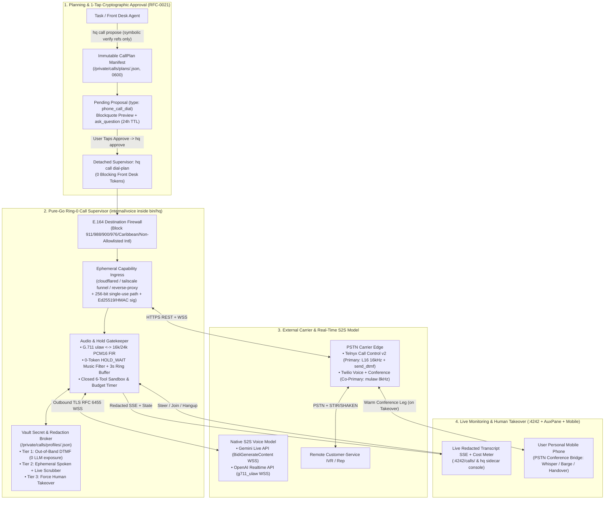
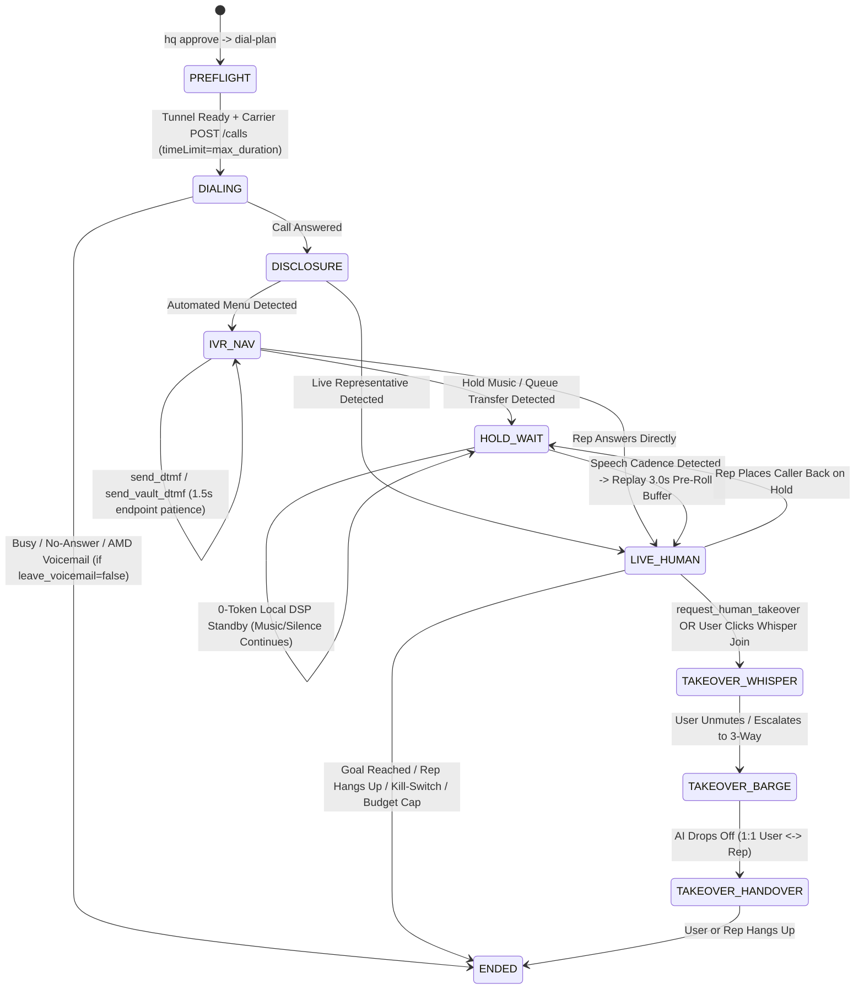

# RFC-0022: Outgoing Customer-Service Phone Calls — Sovereign PSTN Voice Bridge, Approval-Bound Call Plans, Vault Secret Isolation & Human Takeover

- **Status:** Proposed (Phase 1 RFC — Ready for Review)
- **Created:** 2026-11-17
- **Companion Research:** [Research 17: Outgoing Customer-Service Phone Call Architecture — External Telephony, Real-Time Voice Pipelines, Sovereign Vault Privacy & Safety Audit](../research/17_outgoing_phone_call_audit.md)
- **Depends On / Extends:** [RFC-0003](./0003-approval-bound-execution.md), [RFC-0008](./0008-gchat-integration.md), [RFC-0012](./0012-token-observability.md), [RFC-0014](./0014-proactive-engine-and-living-context.md), [RFC-0017a](./0017a-connector-protocol-and-watcher-engine.md), [RFC-0017b](./0017b-provenance-taint-and-offer-gateway.md), [RFC-0017d](./0017d-enterprise-extensibility-and-portability.md), [RFC-0018](./0018-always-on-agent-runtime-hardening.md), [RFC-0019](./0019-two-tier-rsi-vault-overlay.md), [RFC-0021](./0021-customizable-approval-policy-and-ux.md)

---

## 1. Motivation & Design Goals

High-friction administrative errands—negotiating ISP or telecom billing adjustments, rescheduling medical appointments, checking insurance claims, or waiting through airline/utility phone queues—still require real-time PSTN voice calls. Unlike Gmail ([RFC-0005](./0005-gmail-integration.md)) or Google Chat ([RFC-0008](./0008-gchat-integration.md)), an outgoing phone call is a **live, irreversible, stateful audio session** with an untrusted external counterparty, strict sub-second latency requirements (`P50 <= 600ms`), legacy keypad IVRs, multi-minute hold queues, and strict telecommunications compliance mandates (`FCC 24-17`, state all-party wiretapping laws, emergency/toll-fraud blocklists).

Grounded in [Research 17](../research/17_outgoing_phone_call_audit.md), `RFC-0022` specifies a sovereign, zero-bloat outbound voice subsystem (`internal/voice` + `hq call`) governed by six architectural goals:

1. **100% Pure-Stdlib Ring-0 Sovereignty (`Gate H4-A`):** Implement carrier REST control, RFC 6455 bidirectional WebSockets, ITU-T G.711 $\mu$-law / PCM16 resampling, Q.23 DTMF tone generation, and local hold-music DSP directly inside `bin/hq` using **zero external Go module dependencies** ([`go.mod`](../../go.mod)), while exposing a standard [RFC-0017a](./0017a-connector-protocol-and-watcher-engine.md) connector boundary for optional SIP/WebRTC (`hq-voice-sip`) or cloud adapters.
2. **Headless & Remote-Workstation Native:** Operate identically on a local macOS laptop, headless Linux server, or remote SSH VM with **zero reliance on desktop virtual audio cables or physical mics/speakers**.
3. **1-Tap Cryptographic Pre-Call Gate (`hq call propose` + `ask_question`):** Enforce `mode: always` approval ([RFC-0021](./0021-customizable-approval-policy-and-ux.md)) over a SHA-256-pinned **`CallPlan`** binding target E.164 number, caller ID, opening AI disclosure, objective & negotiation guardrails, `max_duration`, `max_cost_usd`, recording mode, and symbolic Vault verification field handles.
4. **Zero-Transcript-Leak Verification Secrets (`local/private/calls/`):** Keep account numbers, PINs, DOBs, and service addresses inside `<vault>/private/calls/profiles/<vendor>.json` (`0600`), injecting `dtmf_only` fields out-of-band without LLM exposure, scrubbing `spoken_redacted` fields from all transcripts/SSE logs in real time, and escalating `human_takeover_only` fields (SSN, payment cards, 2FA OTPs) immediately to the user.
5. **0-Token Hold-Music Survival (`HOLD_WAIT` Gatekeeper):** Suppress continuous audio-token burn during 10–45 minute hold queues via a local Go acoustic classifier + `3.0s` pre-roll pickup ring buffer.
6. **Instant Human-in-the-Loop (HITL) Control & Warm Takeover:** Stream live redacted transcripts to `:4242` Web Console and Antigravity AuxPane ([`internal/webui/webui.go`](../../internal/webui/webui.go)), supporting mid-call **AI Whisper/Steer**, **Mobile PSTN Conference Warm Takeover** (`whisper` coach $\rightarrow$ `barge` $\rightarrow$ `1:1` handover), and a **`< 200ms` Hard Hangup Kill Switch**.

### Explicit Non-Goals (Phase 1 / MVP)

- **No Unsolicited Bulk Dialing, Cold Outreach, or Telemarketing:** `hq call` is strictly a single-concurrency (`max_concurrent_calls: 1`) personal concierge acting on behalf of the user with businesses/institutions the user has an existing relationship or inquiry with. Campaign lists, predictive dialers, and sequential auto-dialing loops are prohibited in Ring 0.
- **No Inbound Public Receptionist Daemon in MVP:** Phase 2 targets **outbound** calls initiated via approved `CallPlan`s (plus active-call warm-takeover legs). Standing `24/7` inbound receptionist answering requires a permanent public webhook/SIP trunk and is deferred to a future extension.
- **No Desktop OS Virtual Audio Loopback (`PulseAudio` / `BlackHole`):** Rejected per [Research 17 §2.1](../research/17_outgoing_phone_call_audit.md).
- **No Emergency (`911`/`988`/`112`/`999`) Calling or Autonomous Payment Card Readout:** Hard-blocked unconditionally in Go.

---

## 2. End-to-End Architecture



---

## 3. Connector Manifest, Private Instance Config & Vault Profiles

Following [RFC-0017a](./0017a-connector-protocol-and-watcher-engine.md) and [RFC-0017d](./0017d-enterprise-extensibility-and-portability.md), voice configuration cleanly separates **pinned connector code** (`templates/connectors/voice/connector.json`), **carrier/model account bindings** (`<vault>/private/connectors/voice/instance.json`), and **per-vendor verification secrets** (`<vault>/private/calls/profiles/<slug>.json`).

### 3.1 Embedded Connector Manifest (`templates/connectors/voice/connector.json`)

```json
{
  "schema_version": 1,
  "id": "voice",
  "driver": { "builtin": "voice" },
  "requires_desktop_session": false,
  "transport": {
    "kind": "builtin",
    "supported_carriers": ["telnyx", "twilio", "external_protocol_v1", "mock"],
    "supported_models": ["gemini-live", "openai-realtime", "mock"]
  },
  "capabilities": {
    "poll": { "enabled": false },
    "read_quarantined": { "enabled": true },
    "brief": { "enabled": true, "quarantined": true, "timeout_ms": 1500 },
    "offers": {
      "phone_call_dial": {
        "recipient_params": { "to": "e164" },
        "supports_wait_on": true
      }
    }
  }
}
```

> **Extensibility via `hq-connector-protocol/v1`:** Enterprise or strict-NAT deployments can override `connectors/voice/connector.json` in a SHA-256-trusted companion pack (`hq-voice-sip` per [RFC-0017d §2](./0017d-enterprise-extensibility-and-portability.md)) to handle `dial`, `send_dtmf`, `bridge_takeover`, and `hangup` over outbound `sips:` TLS/SRTP without modifying `bin/hq`.

### 3.2 Private Carrier, Ingress & Guardrail Instance (`<vault>/private/connectors/voice/instance.json`, `0600`)

Initialized interactively via `hq call init` and protected by all-session read/write guards in [`internal/hooks/hooks.go`](../../internal/hooks/hooks.go):

```json
{
  "schema_version": 1,
  "connector": "voice",
  "default_profile": "primary",
  "profiles": {
    "primary": {
      "enabled": true,
      "carrier": "telnyx",
      "caller_id_e164": "+14155550100",
      "takeover_bridge_caller_id_e164": "+14155550101",
      "takeover_target_e164": "+14155550142",
      "user_display_name": "Alice Smith",
      "voice_model_provider": "gemini-live",
      "voice_model_id": "gemini-live-flash",
      "voice_name": "Puck",
      "ingress": {
        "mode": "cloudflared_ephemeral",
        "public_base_url": "",
        "bind_addr": "127.0.0.1:0"
      },
      "token_refs": {
        "carrier_api": "private/voice/tokens/telnyx-api.json",
        "carrier_webhook_pubkey": "private/voice/tokens/telnyx-ed25519.pub",
        "voice_model_api": "private/voice/tokens/gemini-api.json"
      },
      "guardrails": {
        "allowed_country_prefixes": ["+1"],
        "allow_caribbean_nanp": false,
        "allow_premium_rate": false,
        "max_concurrent_calls": 1,
        "default_max_duration_secs": 900,
        "hard_ceiling_duration_secs": 3600,
        "default_max_cost_usd": 1.50,
        "daily_budget_usd": 5.00,
        "default_recording_mode": "none",
        "calling_hours_local_check": true
      }
    }
  }
}
```

### 3.3 Sovereign Vendor Verification Profiles (`<vault>/private/calls/profiles/<slug>.json`, `0600`)

Users manage vendor-specific verification fields via `hq call profile set <slug>` (interactive TTY prompt reading values via `os.Stdin` / hidden prompt so raw PINs or account numbers **never** appear in shell history or Antigravity transcripts):

```json
{
  "schema_version": 1,
  "slug": "acme-broadband",
  "vendor_name": "Acme Broadband",
  "known_numbers": ["+18005550199"],
  "fields": {
    "account_number": {
      "value": "8492019482",
      "tier": "dtmf_only",
      "label": "10-digit broadband account number"
    },
    "security_pin": {
      "value": "7391",
      "tier": "dtmf_only",
      "label": "4-digit telephone support PIN"
    },
    "billing_zip": {
      "value": "94107",
      "tier": "spoken_redacted",
      "label": "Service & billing ZIP code"
    },
    "service_address": {
      "value": "742 Evergreen Terrace, Apt 4B",
      "tier": "spoken_redacted",
      "label": "Service installation street address"
    },
    "payment_otp": {
      "value": "",
      "tier": "human_takeover_only",
      "label": "One-time SMS verification or payment authorization"
    }
  }
}
```

- **Agent-Safe Metadata Listing (`hq call profile list`):** Returns **only** `slug`, `vendor_name`, `known_numbers`, and field `{name, tier, label}` metadata—**never** `value`. An agent preparing `hq call propose` sees that `acme-broadband` exposes `account_number (dtmf_only)` and `billing_zip (spoken_redacted)` without ever touching a single secret digit.

---

## 4. Approval Gate, `CallPlan` Contract & Ring-0 Destination Firewall

### 4.1 Built-In `phone_call` Approval Policy ([RFC-0021](./0021-customizable-approval-policy-and-ux.md))

Append built-in rule `phone_call` (`mode: always`) to [`internal/approvals/policy.go`](../../internal/approvals/policy.go) and [`templates/config.yaml`](../../templates/config.yaml):

```yaml
    - id: phone_call
      description: "Outgoing PSTN phone calls and live telephony carrier mutations"
      mode: always
      commands:
        - '\bhq\s+call\s+(?:dial|dial-plan|transfer)\b'
        - '\b(?:api\.telnyx\.com/v2/calls|api\.twilio\.com/2010-04-01/Accounts/[^\s/]*/Calls|api\.vapi\.ai/call|api\.retellai\.com/v2/create-phone-call|api\.bland\.ai/v1/calls)\b'
        - '\b(?:twilio\s+api:core:calls:create|telnyx\s+call\s+dial)\b'
      auto_categories: ["external_comms", "telephony"]
```

- **Interactive & `[Auto]` / `tainted` Enforcement:** Because `mode: always`, `PreToolUse` blocks direct `hq call dial-plan` or raw `curl` calls to telephony endpoints in **every** session unless invoked inside `hq approve` with a valid human-presence capability ([`internal/approvals/presence.go`](../../internal/approvals/presence.go)).
- **Safe Mid-Call HITL Exceptions:** Once a call is already active under an approved `CallPlan`, `hq call status <id>`, `hq call hangup <id>`, `hq call steer <id> --note=...` (trusted interactive session only; blocked if session is `tainted`), and `hq call join <id>` (which dials *only* the pre-configured `takeover_target_e164` in `instance.json`) execute immediately without a second proposal round-trip.

### 4.2 Immutable `CallPlan` Schema & 1-Step `hq call propose`

Agents stage a call in **1 tool call**:

```sh
hq call propose \
  --to="+18005550199" \
  --vendor="Acme Broadband" \
  --purpose="Negotiate renewal of $65/mo promotional fiber rate after bill increased to $89/mo" \
  --opening="Hello, I am an automated AI assistant calling on behalf of Alice Smith regarding her residential internet billing." \
  --constraints="May accept 12-month promo rate <= $70/mo with $0 activation fee and no early-termination penalty. MUST NOT cancel service, change speed tier below 500 Mbps, or authorize one-time charges; request human takeover instead." \
  --verify-profile="acme-broadband" \
  --verify-fields="account_number,security_pin,billing_zip" \
  --max-duration="20m" \
  --max-cost-usd="1.50" \
  --record="none"
```

`hq call propose` performs deterministic pre-flight validation before creating `Proposal` (`ActionType: "phone_call_dial"`):
1. **Ring-0 Destination Firewall (`ValidateDialDestination`):**
   - Requires strict E.164 syntax (`^\+[1-9][0-9]{6,14}$`).
   - **Hard-Blocks Emergency & Short Codes (Unoverridable):** Rejects `911`, `988`, `112`, `999`, `000`, `110`, `118`, `119`, `933`, `[2-8]11`, and any E.164-wrapped equivalent (`+1911`, `+1988`, etc.).
   - **Hard-Blocks Premium-Rate & Revenue-Share Ranges:** Rejects `+1900*`, `+1976*`, `+1[2-9][0-9]{2}976[0-9]{4}`, UK `+449*`/`+4470*`, and all 20 Caribbean/Atlantic high-cost NANP area codes (`242`, `246`, `264`, `268`, `284`, `345`, `441`, `473`, `649`, `658`, `664`, `721`, `758`, `767`, `784`, `809`, `829`, `849`, `868`, `869`, `876`) unless `allow_caribbean_nanp: true` is explicitly set in `instance.json`.
   - **Enforces Country Prefix Allowlist & Budget Ceiling:** Verifies country prefix against `allowed_country_prefixes`, verifies `max_duration <= hard_ceiling_duration_secs`, and verifies today's accumulated voice spend in `hq obs` + `max_cost_usd <= daily_budget_usd`.
   - **Recipient Local Calling-Hours Check (`8:00 AM – 9:00 PM`):** Infers recipient timezone for standard geographic NPAs (skipping `800/888/877/866/855/844/833` 24/7 toll-free numbers unless flagged) and warns/blocks outside `08:00–21:00` recipient local time unless `--override-quiet-hours` is explicitly surfaced in `RiskFlags`.
2. **Writes Immutable `CallPlan` (`<vault>/private/calls/plans/call-plan-<hex>.json`, `0600`):** Computes `PayloadSHA256` and stages `Proposal` with `CommandArgv: [hqExe, "call", "dial-plan", "--plan=call-plan-<hex>", "--hash=<sha256>"]`, auto-superseding prior pending `(ConversationID, "phone_call_dial")` drafts per [RFC-0021](./0021-customizable-approval-policy-and-ux.md).

### 4.3 Mandatory Approval Preview & `ask_question` UX

Before calling `ask_question`, the agent renders the structured call card returned by `hq call propose`:

> **📞 Outbound Phone Call Proposal (`prop-1794920100-a1b2c3d4e5f6` · `sha256:9f8e7d6c5b4a`)**
> - **Destination:** `+18005550199` (*Acme Broadband — US Toll-Free*)
> - **Caller ID & Stack:** `+14155550100` via `telnyx` · `gemini-live` (`Puck`) · Takeover Mobile: `***-***-0142`
> - **Opening AI Disclosure:** *"Hello, I am an automated AI assistant calling on behalf of Alice Smith regarding her residential internet billing."*
> - **Objective & Hard Guardrails:** Negotiate renewal of `$65/mo` fiber promo (`<= $70/mo`, `$0` fee, `0` ETF). **Prohibited:** service cancellation, speed downgrade `< 500 Mbps`, or one-time charges (escalates to Human Takeover).
> - **Authorized Vault Fields (`acme-broadband`):** `account_number` (`dtmf_only`), `security_pin` (`dtmf_only`), `billing_zip` (`spoken_redacted`)
> - **Recording / Caps:** `record: none` (ephemeral audio, redacted text log only) · `max_duration: 20m0s` · `max_cost: $1.50`

When the user taps **Approve**, `hq approve` verifies the human-presence capability, re-hashes `call-plan-<hex>.json`, spawns `hq call dial-plan` as a detached background supervisor (`Setsid: true`, scrubbed env), registers the active call in `<vault>/calls/active/<call_id>.json` (`CONSOLE.md` & `:4242`), and returns immediately in `< 150ms` so the conversation never blocks for 20 minutes on hold.

---

## 5. Pure-Go Ring-0 Voice Engine (`internal/voice`)

### 5.1 Package Layout & Ring-0 TCB Protection

Add `"internal/voice/"` and `"templates/connectors/voice/"` to `Ring0ProtectedPaths` in [`internal/rsi/tcb.go`](../../internal/rsi/tcb.go) so no automated RSI self-patch can weaken destination blocklists, recording consent disclosures, or Vault secret redaction:

| Proposed File (Phase 2) | Responsibility | Est. LoC |
| :--- | :--- | :--- |
| `internal/voice/firewall.go` | E.164 normalization, emergency/premium/Caribbean/country-prefix firewall, NPA timezone window check | `~180` |
| `internal/voice/plan.go` | `CallPlan` & `VendorProfile` schemas, SHA-256 verification, 3-tier Vault secret lookup & Aho-Corasick transcript scrubber | `~260` |
| `internal/voice/ws.go` | Pure-stdlib RFC 6455 WebSocket (`http.Hijacker` server + `crypto/tls` client, masking, Ping/Pong, Close, `64KB` frame cap) | `~270` |
| `internal/voice/dsp.go` | ITU-T G.711 $\mu$-law `[256]int16` LUT, `5`-tap integer FIR `8k<->16k/24k` resampler, Q.23 DTMF synth, `HOLD_WAIT` music detector + `3s` ring buffer | `~240` |
| `internal/voice/carrier_telnyx.go` | Telnyx Call Control v2 (`POST /v2/calls`, `streaming_start`, `send_dtmf`, Conference `whisper`/`barge`, Ed25519 webhook verify) | `~250` |
| `internal/voice/carrier_twilio.go` | Twilio Programmable Voice (`POST /Calls.json`, `<Conference>` + `<Stream>`, `<Play digits>`, Coaching takeover, `X-Twilio-Signature` HMAC verify) | `~250` |
| `internal/voice/model_gemini.go` | Gemini Live `BidiGenerateContent` WSS driver (`16kHz` PCM in / `24kHz` out, verbatim transcriptions, `interrupted` barge-in, 6-tool dispatch) | `~260` |
| `internal/voice/model_openai.go` | OpenAI Realtime WSS driver (`g711_ulaw` native `8kHz` pass-through, `input_audio_buffer.speech_started`, 6-tool dispatch) | `~230` |
| `internal/voice/supervisor.go` | Call state machine, ephemeral `cloudflared`/`tailscale` tunnel lifecycle, budget/duration kill-timers, SSE publisher, post-call `events.Enqueue` | `~340` |

### 5.2 Call Lifecycle State Machine & `HOLD_WAIT` Acoustic Gatekeeper



1. **0-Token `HOLD_WAIT` Acoustic Transition:**
   - Entered either when the model calls `set_call_phase(phase="HOLD_WAIT", reason="Transferred to billing queue")` **or** automatically when `dsp.HoldDetector` observes `>= 4.0s` of sustained non-speech harmonic energy (low spectral flatness `< 0.18` combined with missing `3–8 Hz` syllabic amplitude modulation).
   - During `HOLD_WAIT`, `supervisor.go` **halts outbound audio-chunk streaming** to Gemini/OpenAI (`0` audio input/output tokens billed!) while writing every incoming `20ms` PCM frame into a `3.0s` circular ring buffer (`48,000` bytes at `8kHz` PCM16).
   - When `dsp.HoldDetector` detects a speech-cadence onset (`>= 240ms` of `3–8 Hz` syllabic modulation + consonant ZCR transitions), `supervisor.go` transitions to `LIVE_HUMAN`, injects a concise system context marker (`"[Held for 08m14s; audio resuming]"`), and streams the `3.0s` pre-roll buffer at `2.0x` realtime (`1.5s` catch-up) followed by live frames so the agent hears `"Thank you for holding, my name is Sam, how can I help?"` from syllable zero.
   - Every `10` minutes of hold, `supervisor.go` emits a silent status heartbeat to `:4242` / `CONSOLE.md` (`[HOLD 10:00 · $0.11 spent]`).

2. **Barge-In Buffer Flush (`< 50 ms`):**
   - Whenever the S2S model emits `interrupted: true` (Gemini Live) or `input_audio_buffer.speech_started` (OpenAI Realtime) while downlink TTS frames are queued, `supervisor.go` drops unplayed local downlink chunks and immediately sends Twilio `{"event": "clear", "streamSid": "..."}` or Telnyx buffer clear so the AI stops speaking mid-syllable.

### 5.3 Closed 6-Tool Voice Sandbox & 3-Tier Vault Secret Broker

Inside the live S2S WebSocket, the voice model is restricted to **six deterministic Go-enforced tools**—zero shell, zero file read, zero arbitrary Vault lookup:

| Tool Name | Arguments | Ring-0 Go Mechanical Enforcement |
| :--- | :--- | :--- |
| `send_dtmf` | `digits: string` (`^[0-9*#wW]{1,16}$`), `reason: string` | Plays public IVR menu digits (e.g., `"1w2"` for Billing). Logged in transcript (`[DTMF: 1w2]`). |
| `send_vault_dtmf` | `field: string`, `suffix: string` (`"" \| "#" \| "*"`) | Verifies `field` is in `CallPlan.AllowedVerifyFields` and `tier != human_takeover_only`. Reads raw digits from `<vault>/private/calls/profiles/<slug>.json` in Go memory and sends carrier DTMF directly. Returns `{"ok": true, "sent_length": 10}` to model (**model never sees raw digits**). Logs `[REDACTED:DTMF:<field>]`. |
| `read_allowed_verify_field` | `field: string` | **Rejects** if `field` is not in `CallPlan.AllowedVerifyFields`. **Rejects** if `tier == "dtmf_only"` (instructs model to use keypad or request human takeover if rep refuses keypad) or `tier == "human_takeover_only"` (auto-triggers takeover). Only returns value for `tier == "spoken_redacted"` while arming exact/phonetic scrubber. |
| `set_call_phase` | `phase: "IVR_NAV" \| "HOLD_WAIT" \| "LIVE_HUMAN"`, `summary: string` | Adjusts endpointing silence patience (`1,600ms` in `IVR_NAV` vs. `450ms` in `LIVE_HUMAN`) or enters `0`-token `HOLD_WAIT`. |
| `request_human_takeover` | `reason: string`, `urgency: "normal" \| "payment_or_otp" \| "commitment_approval"` | Speaks polite hold phrase (*"One moment please while I bring Alice onto the line"*), alerts user (`interrupt` card + `:4242` banner), and dials pre-pinned `takeover_target_e164` into conference (`0` LLM control over destination number!). |
| `end_call` | `outcome: "resolved" \| "callback_scheduled" \| "unresolved" \| "voicemail_left"`, `summary: string`, `confirmation_code: string` | Delivers polite closing, hangs up carrier leg, tears down ephemeral tunnel, writes scrubbed call record, and enqueues completion summary. |

#### Real-Time Multi-Form Redaction Scrubber (`internal/voice/plan.go`)

Before **any** `inputAudioTranscription`, `outputAudioTranscription`, or `summary` string is written to `<vault>/calls/<call_id>/transcript.jsonl`, `CONSOLE.md`, `:4242` SSE, or post-call `events.Enqueue`:
1. Every secret value in the active `VendorProfile` (across **all** tiers, even fields not authorized for the call, defending against user self-readout during takeover) is compiled into normalized forms:
   - Exact literal (`"94107"`, `"8492019482"`),
   - Spaced/hyphenated digit sequences (`"9 4 1 0 7"`),
   - Spoken English digit/number words (`"nine four one oh seven"`, `"nine four one zero seven"`),
   - Standard regex fallbacks from [`internal/approvals/approvals.go`](../../internal/approvals/approvals.go) (`reOutboundSSN`, `reOutboundCardNum`, `reOutboundFinAcct`).
2. Matches are replaced in-memory with `[REDACTED:<field_name>]`.
3. Whenever the call enters `TAKEOVER_BARGE` or `TAKEOVER_HANDOVER` with `urgency: "payment_or_otp"`, `supervisor.go` **pauses upstream S2S audio streaming and recording completely** (`[TRANSCRIPT PAUSED DURING HUMAN SECRET ENTRY]`) until takeover ends or the user clicks **Resume AI**.

---

## 6. User Experience, Live Console & Human Takeover Flows

### 6.1 CLI Surface (`hq call`)

```sh
# One-time carrier + S2S model + takeover phone setup (writes 0600 files under <vault>/private/)
hq call init [--carrier=telnyx|twilio] [--model=gemini-live|openai-realtime]

# Manage sovereign vendor verification profiles (reads secret values from interactive TTY only)
hq call profile set <vendor-slug>
hq call profile list [--vendor=<vendor-slug>]

# Stage an approval-bound outbound call plan (1 tool call from Front Desk or Task session)
hq call propose --to="+18005550199" --vendor="Acme Broadband" --purpose="..." [flags]

# Internal deterministic executor invoked ONLY by `hq approve` (blocked directly by PreToolUse)
hq call dial-plan --plan=<plan-id> --hash=<sha256>

# Live inspection & HITL controls during an active call
hq call status [<call-id>]
hq call steer <call-id> --note="Accept $68/mo if locked for 24 months"
hq call join <call-id> [--mode=whisper|barge|handover]
hq call hangup <call-id> [--reason="User terminated"]
```

### 6.2 `:4242` Web Console & Antigravity AuxPane Live Call Drawer

Extend [`internal/webui/webui.go`](../../internal/webui/webui.go) (`hq sidecar console` per [RFC-0017d §5.3](./0017d-enterprise-extensibility-and-portability.md)) with an **Active Call Live Drawer** backed by Server-Sent Events (`GET /api/calls/<id>/stream`, loopback `127.0.0.1` + CSRF token):

- **Header Telemetry Pill:** Phase badge (`DIALING` / `IVR_NAV` / `HOLD_WAIT 08:42` / `LIVE_HUMAN` / `TAKEOVER`), elapsed vs. `max_duration` progress bar, live accrued cost (`$0.19 / $1.50`), and carrier signal status.
- **Scrolling Redacted Transcript:** Speaker-tagged turns (`[IVR]`, `[AI]`, `[DTMF]`, `[REP]`, `[STEER]`) with `[REDACTED:*]` chips.
- **4 Deterministic HITL Action Controls:**
  1. **Whisper / Steer Input Box (`POST /api/calls/<id>/steer`):** Appends a `clientContent` text turn (`"[USER WHISPER TO AI — DO NOT READ VERBATIM]: ..."`) into the live Gemini/OpenAI WebSocket so the AI adapts its next utterance immediately.
  2. **Join Mobile (`Whisper` / `Barge` / `Handover` — `POST /api/calls/<id>/join`):** Dials `takeover_target_e164` (`+14155550142`) from `takeover_bridge_caller_id_e164` into the carrier conference:
     - **`whisper`:** User hears both the rep and the AI; user's voice is heard *only* by the AI (via Telnyx `supervisor_role="whisper"` / Twilio `coaching="true"`).
     - **`barge`:** 3-way conversation; AI automatically mutes autonomous speech (`passive_note_taker` mode) unless addressed.
     - **`handover`:** AI disconnects its media stream leg cleanly, leaving a pure 1:1 PSTN call between the user's mobile phone and the customer-service representative!
  3. **Pause / Resume AI Speech (`POST /api/calls/<id>/mute-ai`):** Mutes outbound AI audio instantly while keeping live captioning active.
  4. **End Call (`POST /api/calls/<id>/hangup`):** Red kill-switch button; terminates PSTN conference/call + tunnel in `< 200ms`.

### 6.3 Post-Call Reconciliation, Goal Tracking & Token/Cost Observability

When a call reaches `ENDED`:
1. **Artifact Storage:** Writes `<vault>/calls/<YYYY-MM-DD>/<call_id>/summary.json` and `transcript.jsonl` (`0600`, scrubbed, marked `tainted: true`, `source: "pstn:+18005550199"`).
2. **Closed-Loop Task / Front Desk Notification ([RFC-0018](./0018-always-on-agent-runtime-hardening.md)):** Enqueues a structured `call.completed` event (or `hq outbox add --tier=interrupt` if unresolved/callback required) containing outcome, confirmation reference number, duration, hold time saved, and total USD cost. If the representative promised a follow-up action ("Credit posts within 48 hours"), the originating task can track it via `hq goals wait-on` ([RFC-0014](./0014-proactive-engine-and-living-context.md)).
3. **Observability Attribution ([RFC-0012](./0012-token-observability.md)):** Extends `internal/obs` ledger records with `voice_carrier_secs`, `voice_hold_saved_secs`, `voice_audio_in_tokens`, `voice_audio_out_tokens`, and `voice_total_usd` so `hq obs tokens` and daily budget circuit breakers account for telephony + S2S voice spend alongside text LLM turns.

---

## 7. Failure Modes, Edge Cases & Mitigations (`FM-1`–`FM-12`)

| ID | Failure Mode | Impact Without Mitigation | Ring-0 / Protocol Mitigation |
| :--- | :--- | :--- | :--- |
| **`FM-1`** | **`hq` Supervisor Crash or Power Loss Mid-Call** | Orphaned PSTN call stays connected for hours, racking up carrier charges. | Pass hard `time_limit_secs` (Telnyx) / `TimeLimit` (Twilio) = `CallPlan.MaxDurationSecs` in the initial carrier `POST /calls` request so the **carrier switch hangs up autonomously** even if `hq` vanishes. |
| **`FM-2`** | **Ephemeral Tunnel Drop Mid-Call** | Media WebSocket disconnects while PSTN leg stays silent on the rep's end. | If inside `<Conference>` / Call Control, carrier plays polite `<Say>` hold prompt (*"One moment please, reconnecting audio"*) while `supervisor.go` re-attaches `streaming_start` within `5s`; if unrecovered after `12s`, dials `takeover_target_e164` or hangs up cleanly. |
| **`FM-3`** | **Hold Music Triggers Infinite S2S Speech Loop** | High audio-token burn, context window exhaustion, and awkward chatter when rep answers. | Local Go `HOLD_WAIT` acoustic pre-filter pauses S2S streaming during music + `3.0s` circular pre-roll buffer captures syllable zero of rep pickup + `10m` clean context checkpointing. |
| **`FM-4`** | **IVR Menu Interrupted Before Final Option** | Agent presses wrong digit or speaks over menu enumeration. | `IVR_NAV` phase enforces `1,600ms` silence patience and prefers `send_dtmf` over speech whenever keypad digits are offered. |
| **`FM-5`** | **Twilio `<Connect><Stream>` Lacks WSS Outbound DTMF** | Mid-stream keypad navigation fails or drops audio socket. | Telnyx uses native out-of-band `POST /actions/send_dtmf`; Twilio uses `<Conference>` leg + in-band Q.23 dual-sine PCM fallback. |
| **`FM-6`** | **Callee Refuses AI Assistant ("Put the Account Holder On")** | Rep threatens to disconnect call after 25m hold wait. | System prompt + tool rule triggers immediate `request_human_takeover(reason="Rep requires account holder")` while asking rep to hold `15` seconds as user bridges onto the line. |
| **`FM-7`** | **Rep Requests High-Sensitivity OTP / SSN / Payment Card** | Secret leakage or unauthorized financial charge. | `human_takeover_only` tier blocks AI access mechanically, triggers mobile takeover, and pauses transcription/recording during entry. |
| **`FM-8`** | **Audio Indirect Prompt Injection by Malicious Callee** | Rogue voice attempts to read Vault files, approve proposals, or forward call to `+1-809-*`. | Closed 6-tool sandbox bound to single `CallPlan`; `request_human_takeover` dials *only* pinned `takeover_target_e164`; post-call transcript marked `tainted`. |
| **`FM-9`** | **Wrong Number, Busy Signal, or Answering Machine** | Agent talks to voicemail greeting as if it were a live rep or loops on busy tone. | Enable carrier Answering Machine Detection (`answering_machine_detection: "detect_beep"`); if voicemail and `leave_voicemail: false` (default), hang up cleanly and report status. |
| **`FM-10`** | **Self-Call Loop on Human Takeover (`from == to`)** | Carrier spam/loop filter drops takeover leg when `caller_id == takeover_target`. | `hq doctor` & `hq call init` verify `takeover_bridge_caller_id_e164 != takeover_target_e164` whenever mobile PSTN takeover is enabled (or fall back to Browser WebRTC softphone). |
| **`FM-11`** | **Two-Party Consent Violation via Accidental Recording** | Legal liability in CA/FL/PA/IL/MA/WA/etc. | `record: "none"` default (`Record=false` at carrier + `0` disk WAVs); `disclosed_all_party` injects mandatory carrier-level pre-stream verbal disclosure before audio capture begins. |
| **`FM-12`** | **Runaway Retry / Cost Drain by Background `[Auto]` Loop** | Repeated failed calls drain carrier balance. | `mode: always` in `approvals.rules` blocks unattended `[Auto]` dialing without fresh human `hq approve`, backed by `max_concurrent_calls: 1` and `daily_budget_usd` hard circuit breaker. |

---

## 8. Verification, CI Gates & Phased Implementation Roadmap

### 8.1 Offline Deterministic Testing (`CUJ-25` — Zero External Network/Carrier Calls in CI)

In accordance with [RFC-0011](./0011-ci-pipeline-and-regression-harness.md), `go test ./...` must verify the entire voice pipeline offline in `< 500ms` with `0` real PSTN calls:
- **Mock Carrier + Mock S2S Loopback Harness (`internal/voice/voice_test.go` & `internal/e2e/cuj_e2e_test.go` `CUJ-25`):**
  1. Spins up local `httptest.Server` emulating Telnyx Call Control v2 & Twilio Voice REST + RFC 6455 media WebSocket, paired with a mock `BidiGenerateContent` S2S server.
  2. Verifies `PreToolUse` blocks direct `hq call dial-plan` and `curl https://api.telnyx.com/v2/calls`, while `hq call propose` blocks `911`, `988`, `+19005550199`, and `+18095550199`.
  3. Replays a scripted synthetic call (`DIALING -> DISCLOSURE -> IVR_NAV [send_vault_dtmf(account_number)] -> HOLD_WAIT [synthetic 440Hz+660Hz music frames suppressed for 0 tokens] -> LIVE_HUMAN [3s pre-roll flushed + read_allowed_verify_field(billing_zip)] -> TAKEOVER_WHISPER -> ENDED`).
  4. Asserts `0` occurrences of raw `account_number` or `billing_zip` across `transcript.jsonl`, `CONSOLE.md`, SSE payloads, and `Proposal` JSON (`100%` `[REDACTED:*]` coverage).

### 8.2 Phased MVP Rollout Plan (Phase 2 — Post-RFC Approval)

| Phase | Scope | Key Deliverables |
| :--- | :--- | :--- |
| **Phase 2A: Core TCB Firewall, `CallPlan` Approval & Outbound MVP** | End-to-end approved outbound call with Telnyx + Gemini Live, DTMF IVR navigation, and post-call summary | `internal/voice/{firewall,plan,ws,dsp,carrier_telnyx,model_gemini,supervisor}.go`, `phone_call` rule in [`internal/approvals/policy.go`](../../internal/approvals/policy.go), `Ring0ProtectedPaths` update in [`internal/rsi/tcb.go`](../../internal/rsi/tcb.go), `hq call init|profile|propose|dial-plan|status|hangup`, ephemeral `cloudflared`/`tailscale` ingress, starter skill `templates/skills/phone-call/SKILL.md` (`<= 150` lines). |
| **Phase 2B: `HOLD_WAIT` Acoustic Gatekeeper, Scrubber & Live Console UI** | Zero-token hold survival, multi-form transcript redaction, and live HITL whisper/monitoring | `HOLD_WAIT` DSP classifier + `3.0s` pickup ring buffer, spoken-word/digit redaction scrubber, `:4242` SSE Live Call Drawer + `hq call steer` in [`internal/webui/webui.go`](../../internal/webui/webui.go) & `templates/sidecars/agy-hq-console/main.mjs` (maintaining `H2-C` byte-parity). |
| **Phase 2C: Mobile PSTN Warm Takeover & Co-Primary Twilio + OpenAI Drivers** | Seamless human takeover on mobile + full Twilio & OpenAI `g711_ulaw` parity | Telnyx Conference `whisper`/`barge`/`handover` + `hq call join`, `carrier_twilio.go` (`<Conference>` Coaching), `model_openai.go` (`g711_ulaw`), and `hq-connector-protocol/v1` voice hook for optional `hq-voice-sip` companion packs. |
| **Phase 2D: `CUJ-25` E2E Regression Suite & `hq obs` Voice Cost Ledger** | Full CI hardening & unified token/carrier spend observability | `CUJ-25` offline PSTN/IVR/hold/takeover E2E journey, `hq obs` voice cost fields & `daily_budget_usd` circuit breaker, `hq doctor` voice ingress & self-call loop checks. |

---

## 9. Open Questions for Review

1. **Primary Carrier Default in `hq call init`:** Should `hq call init` default to **Telnyx** (`~$0.0105/min`, native `16kHz` PCM, clean out-of-band `send_dtmf`) with **Twilio** as a co-equal `--carrier=twilio` choice in Phase 2A, or should both carrier drivers ship simultaneously in Phase 2A rather than sequencing Twilio in Phase 2C?
2. **Default Takeover Modality:** Is **Mobile PSTN Conference Warm Bridge** (`hq call join` dialing the user's verified mobile phone in `whisper`/`barge` mode, working anywhere and on headless SSH hosts) sufficient for Phase 2C without building an in-browser WebRTC softphone widget inside `:4242`?
3. **Voicemail Policy Default:** When carrier Answering Machine Detection (`AMD`) hits voicemail on a customer-service callback number, should `leave_voicemail` default to `false` (hang up cleanly and schedule a retry suggestion) unless `--leave-voicemail` is explicitly set in `hq call propose`?
