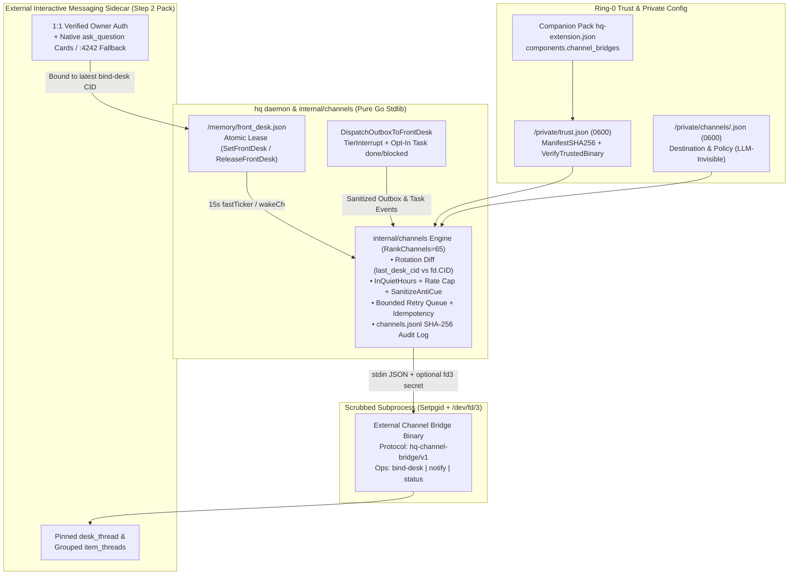
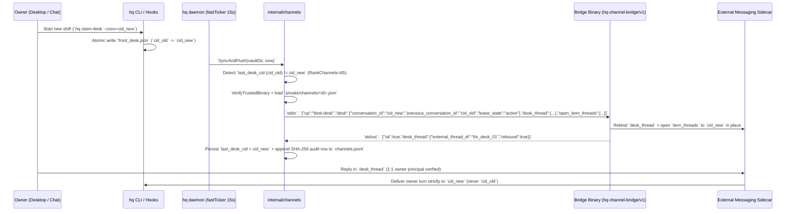

# RFC-0023: Vendor-Neutral Front Desk Channel Bridge & Rotation Tunneling

- **Status:** Proposed (Phase 1 — Awaiting User Review)
- **Created:** 2026-11-17
- **Companion Research:** [Research 18: Vendor-Neutral Front Desk Channel Bridge, Rotation Tunneling & Security Boundary Audit](../research/18_channel_bridge_front_desk_audit.md)
- **Extends / Updates:** [RFC-0004](./0004-heartbeat-and-channels.md), [RFC-0007](./0007-front-desk-initialization-hardening.md), [RFC-0008](./0008-gchat-integration.md), [RFC-0017a](./0017a-connector-protocol-and-watcher-engine.md), [RFC-0017b](./0017b-provenance-taint-and-offer-gateway.md), [RFC-0017d](./0017d-enterprise-extensibility-and-portability.md), [RFC-0020](./0020-proactive-ambient-synthesis-and-mobile-push.md), [RFC-0021](./0021-customizable-approval-policy-and-ux.md)

---

## 1. Motivation & Problem Statement

`agy-hq` coordinates personal and engineering operations through a single leased **`[HQ] Front Desk`** intake conversation (`<vault>/memory/front_desk.json`), complemented by Antigravity Desktop, Antigravity Remote Control, and the local `:4242` Web Console. Many users also operate an external interactive messaging sidecar or chat bot extension (e.g., an enterprise chat bot, self-hosted messenger bridge, or private mobile bot DM) to receive urgent `TierInterrupt` alerts, track task completion/blockers in grouped threads, and send verified owner instructions back to `[HQ] Front Desk`.

As documented in [Research 18](../research/18_channel_bridge_front_desk_audit.md), five architectural gaps (`G1`–`G5`) and four runtime hazards (`R1`–`R4`) currently prevent clean, vendor-neutral Front Desk bridging:

1. **No Vendor-Neutral Companion Bridge Contract (`G1`, `G3`):** [RFC-0004](./0004-heartbeat-and-channels.md) sketched compiled-in Go vendor drivers (`internal/channels/*.go`) reading destination IDs from LLM-readable `<vault>/config.yaml` (`0644`). Compiling chat bot SDKs or enterprise RPC transports into `bin/hq` violates `ADR-0002` (`0` external Go dependencies) and [RFC-0017d](./0017d-enterprise-extensibility-and-portability.md), while [`internal/extension/pack.go`](../../internal/extension/pack.go) lacks a `channel_bridges` manifest component.
2. **Post-Rotation Front Desk Tunnel Split-Brain (`R1`, `R2`):** `[HQ] Front Desk` rotates its `ConversationID` across `hq claim-desk`, `hq release-desk`, `hq adopt` (which demotes the outgoing Front Desk into a `[Task:<scope>]` coding thread), and fresh-Vault bootstrap. Today `hq daemon` never detects `front_desk.json` `ConversationID` changes or notifies external sidecars—leaving external chat sessions pinned to stale or demoted conversations and orphaning open proposal/alert threads.
3. **Outbox Retry Coupling & Desk-Vacancy Blindness (`R3`):** [`DispatchOutboxToFrontDesk`](../../internal/kernel/events_dispatch.go#L481-L495) exits early when `front_desk.json` is vacant and couples delivery status to `DeliverMessageToSession`. Synchronously coupling an external bridge inside `DispatchPendingInterrupts` would either re-inject duplicate `🔔 Proactive Alert` cards into `[HQ] Front Desk` on transient chat-API `429`/`503` errors or drop external alerts permanently.
4. **Connector vs. Control-Bridge Provenance Boundary (`G2`, `R4`):** Multi-sender `connectors` (`hq-connector-protocol/v1`) ingest untrusted external inputs into `TaintOnSpawn: true` quarantined workers and must **never** route into `[HQ] Front Desk`. Conversely, outbound bridge notifications derived from tainted triage workers must strip command/injection cues (`SanitizeAntiCue`) and defang URLs so external chat clients do not auto-fetch attacker tracking beacons.
5. **Human-Presence Approval Integrity (`G5`):** [`VerifyAskAndMintCap`](../../internal/approvals/presence.go#L337-L341) intentionally rejects plain-text `USER_INPUT` messages so injected chat strings cannot forge `hq approve`. Channel bridges must preserve native `ask_question` prompt-card verification plus `:4242` Web Console fallback without leaking secret `NonceCode` challenges or capability tokens.

---

## 2. Design Goals & Non-Goals

### Goals
1. **100% Vendor-Neutral Core Contract (`channel_bridges` + `hq-channel-bridge/v1`):** Allow any companion extension pack (`hq-extension.json` `components.channel_bridges`) to register a SHA-256-pinned executable speaking a 3-verb JSON-over-stdio protocol (`bind-desk`, `notify`, `status`), verified via [`VerifyTrustedBinary`](../../internal/extension/trust.go#L304).
2. **Seamless Front Desk Rotation Tunneling (`<= 15s` Convergence):** Detect `front_desk.json` `ConversationID` transitions (`"" -> new_cid`, `old_cid -> new_cid`, `old_cid -> ""` vacation, and external sidecar restart drift) on `hq daemon`'s `fastTicker` (`15s`) and `wakeCh`, invoking `bind-desk` to rebind the pinned `desk_thread` and open `item_threads` in place.
3. **LLM-Invisible Destination Secrets (`0600`) & Ranked Runtime State (`RankChannels = 65`):** Isolate destination routing/credentials in `<vault>/private/channels/<bridge-id>.json` (`0600`, guarded across all LLM sessions by `PreToolUse` and OS sandboxes) and persist decoupled per-bridge state (`last_desk_cid`, `desk_thread`, LRU `item_threads`, bounded 64-item retry queue) in `<vault>/memory/channels/<bridge-id>.json` (`0600`).
4. **Unified Policy, Anti-Cue Scrubbing & SHA-256 Audit Trail:** Enforce `InQuietHours`, non-urgent hourly rate caps, UTF-8 rune truncation, `SanitizeAntiCue` + tainted URL defanging, and append-only SHA-256 audit logging (`<vault>/memory/channels/channels.jsonl`) uniformly in Go.
5. **Crisp Step 1 / Step 2 Separation:** Keep `agy-hq` core free of vendor chat clients while providing a complete contract for external companion packs (Step 2) to implement bidirectional owner tunneling and native prompt cards cleanly.

### Non-Goals
- **No Compiled-In Third-Party Chat Bot SDKs or Cloud Relays:** `go.mod` remains 100% pure Go stdlib (`ADR-0002` / CI Gate `H4-A`), and Vault data never transits an `agy-hq`-operated server (`ADR-0003`).
- **No Multi-Sender Inbound Polling via `channel_bridges`:** Multi-party email/chat spaces continue using `connectors` + `hq watch precheck` (`TaintOnSpawn: true`). `hq-channel-bridge/v1` has **no** `poll` verb.
- **No Plain-Text Chat `hq approve` Shortcut:** Typing `"approve"` in a plain-text chat message never mints an approval capability; cryptographic human-presence verification remains anchored in `ask_question` (`VerifyAskAndMintCap`) and `:4242` Web Console (`ApproveFromTrustedDaemon`).
- **No Standalone `<vault>/bridges/` Discovery Namespace (`YAGNI`):** Because bidirectional Front Desk bridges pair with a companion sidecar/bot daemon, discovery scopes strictly to `hq-extension.json` companion packs (`<pack>/<id>`); simple 1-way lock-screen webhooks stay on [RFC-0020](./0020-proactive-ambient-synthesis-and-mobile-push.md) `mobile_push`.

---

## 3. Architecture Overview



### Front Desk Shift Handover & Thread Rebinding Sequence



---

## 4. Vendor-Neutral `channel_bridges` Extension Contract & `hq-channel-bridge/v1` Protocol

### 4.1 `hq-extension.json` Manifest Schema & Binary Trust Pinning

Extend `PackComponents` in [`internal/extension/pack.go`](../../internal/extension/pack.go#L120-L131) with `ChannelBridges []ChannelBridgeSpec`:

```json
{
  "schema_version": 1,
  "id": "acme-messaging",
  "version": "1.0.0",
  "min_hq_version": "0.3.1",
  "requires": {
    "bins": [
      { "name": "acme-chat-bridge", "probe_argv": ["acme-chat-bridge", "--version"] }
    ]
  },
  "components": {
    "channel_bridges": [
      {
        "id": "desk-bridge",
        "protocol": "hq-channel-bridge/v1",
        "description": "Bidirectional Front Desk rotation & notification bridge",
        "command": ["acme-chat-bridge", "channel-bridge"],
        "env_allow": ["ACME_CHAT_PROFILE"],
        "requires_desktop_session": false,
        "timeout_ms": 5000,
        "max_body_runes": 2000,
        "capabilities": {
          "desk_binding": true,
          "item_threads": true,
          "task_digests": true,
          "native_ask_cards": true
        }
      }
    ]
  }
}
```

#### Go Types & `LintPack` / `BuildTrustBundle` Enforcement
```go
// BridgeCapabilitiesSpec declares optional capabilities supported by a channel bridge.
type BridgeCapabilitiesSpec struct {
	DeskBinding    bool `json:"desk_binding,omitempty"`
	ItemThreads    bool `json:"item_threads,omitempty"`
	TaskDigests    bool `json:"task_digests,omitempty"`
	NativeAskCards bool `json:"native_ask_cards,omitempty"`
}

// ChannelBridgeSpec declares a vendor-neutral Front Desk channel bridge in hq-extension.json.
type ChannelBridgeSpec struct {
	ID                     string                 `json:"id"`
	Protocol               string                 `json:"protocol"` // must be "hq-channel-bridge/v1"
	Description            string                 `json:"description,omitempty"`
	Command                []string               `json:"command"`
	EnvAllow               []string               `json:"env_allow,omitempty"`
	RequiresDesktopSession bool                   `json:"requires_desktop_session,omitempty"`
	TimeoutMs              int                    `json:"timeout_ms,omitempty"`
	MaxBodyRunes           int                    `json:"max_body_runes,omitempty"`
	Capabilities           BridgeCapabilitiesSpec `json:"capabilities,omitempty"`
}
```

1. **Strict Static Validation (`LintPack` in [`internal/extension/pack.go`](../../internal/extension/pack.go#L197)):**
   - `id` matches `^[a-z0-9][a-z0-9-]{1,62}$` and is unique within the pack; runtime FQID is `<pack>/<id>` (e.g., `acme-messaging/desk-bridge`).
   - `protocol` must equal `"hq-channel-bridge/v1"`.
   - `command` must be non-empty; `command[0]` must **not** be a shell or generic interpreter wrapper (`sh`, `bash`, `zsh`, `dash`, `ksh`, `ssh`, `env`, `xargs`, `python*`, `node`, `perl`, `ruby`), ensuring `VerifyTrustedBinary` hashes the actual compiled bridge executable rather than `/bin/sh`.
   - `env_allow` cannot include any key in `unconditionallyBlockedEnv` (`ANTIGRAVITY_CSRF_TOKEN`, `ANTIGRAVITY_LS_ADDRESS`, `ANTIGRAVITY_AGENTAPI_EXE`, `ANTIGRAVITY_CONVERSATION_ID`, `ANTIGRAVITY_TRAJECTORY_ID`, `ANTIGRAVITY_PROJECT_ID`, `ANTIGRAVITY_SOURCE_METADATA`).
   - `EnablePack` (`pack.go:474`) rejects unqualified `id` collisions across enabled packs unless `<vault>/extensions.json` `winner_overrides[<id>]` names a winner.
2. **SHA-256 Pinning & Execution Cache ([`internal/extension/trust.go`](../../internal/extension/trust.go)):**
   - `BuildTrustBundle` (`trust.go:617`) iterates `manifest.Components.ChannelBridges`, resolves `cb.Command[0]` via `pinBinaryRef`, and records `{raw_ref, resolved_path, sha256}` in `<vault>/private/trust.json` (`Targets["pack:<packID>"].Binaries`), alongside `ManifestSHA256` over `hq-extension.json`.
   - Before every bridge invocation, `internal/channels/` verifies `hq-extension.json` (`LoadActiveTrustedPacks`) and calls `extension.VerifyTrustedBinary(vaultDir, sourceID, cb.Command[0])`, executing the immutable `0500` binary staged in `<vault>/private/exec-cache/<sha256>/<basename>` via [`connector.RunSubprocess`](../../internal/connector/exec.go#L271). Any hash mismatch fails closed for that bridge and emits at most one deduplicated `brief_rollup` re-trust notice.

---

### 4.2 `hq-channel-bridge/v1` Wire Protocol

All operations execute as bounded, short-lived stdio calls (`default timeout = 5s`, `max = 15s`, `Setpgid: true` process-group kill on timeout):
- **`stdin`:** Single UTF-8 JSON request object (zero routing IDs, message bodies, or metadata ever appear on CLI `argv` / `/proc/<pid>/cmdline`).
- **`/dev/fd/3` (`ExtraFiles[0]`):** Optional read-only pipe carrying raw bytes from `<vault>/private/channels/<bridge-id>.json`'s `credential_file` when configured (`has_credential_fd3: true`), eliminating temp-file TOCTOU and environment-variable secret exposure.
- **`stdout`:** Single UTF-8 JSON response object (`<= 64 KiB`).
- **`stderr`:** Diagnostic text only; scrubbed via [`connector.SanitizeStderr`](../../internal/connector/exec.go#L216) (`<= 400` runes, `<plugin-card>` tags and control characters stripped).

#### Operation 1: `bind-desk` (Initial Claim, Shift Rotation & Vacation)

**Request (`stdin`):**
```json
{
  "protocol": "hq-channel-bridge/v1",
  "op": "bind-desk",
  "bridge_id": "acme-messaging/desk-bridge",
  "idempotency_key": "bind-desk:acme-messaging/desk-bridge:00001111:9a41bc10:2026-11-17T21:15:00Z",
  "timestamp": "2026-11-17T21:15:02Z",
  "has_credential_fd3": true,
  "silent": false,
  "destination": {
    "room_id": "room_01HXYZ9876",
    "account": "work"
  },
  "desk": {
    "lease_state": "active",
    "conversation_id": "9a41bc10-7712-4c11-8a00-112233445566",
    "previous_conversation_id": "00001111-2222-4333-8444-555566667777",
    "project_id": "proj_default",
    "workspace_name": "agy-hq",
    "updated_at": "2026-11-17T21:15:00Z"
  },
  "desk_thread": {
    "external_thread_id": "thr_desk_01",
    "metadata": { "pinned": "true" }
  },
  "open_item_threads": [
    {
      "item_key": "proposal:prop-1794904000-a1b2c3d4e5f6",
      "kind": "proposal",
      "external_thread_id": "thr_item_42",
      "status": "open"
    }
  ]
}
```
- When `hq release-desk` or `hq adopt` vacates `front_desk.json` without an immediate successor, `desk.lease_state` is `"vacated"` and `desk.conversation_id` is `""`, instructing the external sidecar to **immediately unbind `previous_conversation_id`** so inbound chat messages are never misrouted into a demoted `[Task:<scope>]` session (`Finding R1`).
- During quiet hours, `silent: true` instructs the bridge to update its internal routing table silently without posting a visible chat banner that would buzz the user's device.

**Response (`stdout`):**
```json
{
  "protocol": "hq-channel-bridge/v1",
  "ok": true,
  "deduplicated": false,
  "desk_thread": {
    "external_thread_id": "thr_desk_01",
    "permalink": "https://chat.example.com/room/room_01HXYZ9876/thread/thr_desk_01",
    "rebound": true,
    "metadata": { "pinned": "true" }
  },
  "item_threads": [
    {
      "item_key": "proposal:prop-1794904000-a1b2c3d4e5f6",
      "external_thread_id": "thr_item_42",
      "rebound": true
    }
  ]
}
```

#### Operation 2: `notify` (Interrupts, Task `done`/`blocked` Digests & Connectivity Test)

**Request (`stdin`):**
```json
{
  "protocol": "hq-channel-bridge/v1",
  "op": "notify",
  "bridge_id": "acme-messaging/desk-bridge",
  "idempotency_key": "outbox:idea-1794904100-7f8e9d0c",
  "timestamp": "2026-11-17T21:16:05Z",
  "has_credential_fd3": true,
  "destination": {
    "room_id": "room_01HXYZ9876",
    "account": "work"
  },
  "desk_conversation_id": "9a41bc10-7712-4c11-8a00-112233445566",
  "thread_hint": {
    "mode": "item_thread",
    "desk_external_thread_id": "thr_desk_01",
    "item_key": "proposal:prop-1794904000-a1b2c3d4e5f6",
    "existing_external_thread_id": "thr_item_42"
  },
  "notification": {
    "kind": "interrupt",
    "severity": "high",
    "source_skill": "inbox-triage",
    "scope": "watch:gmail:work",
    "title": "Actionable reply needed on Q4 partner contract",
    "body_markdown": "Counterparty requested sign-off before 5:00 PM PST. Staged reply draft for review.",
    "proposal_ids": ["prop-1794904000-a1b2c3d4e5f6"],
    "task_slug": "",
    "tainted_origin": true
  }
}
```
- Supported `notification.kind` values: `"interrupt"`, `"critical_breach"`, `"task_done"`, `"task_blocked"`, `"test_ping"`.
- Supported `thread_hint.mode` values: `"item_thread"` (open or reply inside `existing_external_thread_id` keyed by `item_key`, when `capabilities.item_threads == true`) or `"desk_thread"` (post inside `desk_external_thread_id`).

**Response (`stdout`):**
```json
{
  "protocol": "hq-channel-bridge/v1",
  "ok": true,
  "delivery_id": "msg_998120",
  "deduplicated": false,
  "external_thread_id": "thr_item_42",
  "desk_external_thread_id": "thr_desk_01"
}
```

#### Operation 3: `status` (Health, Auth & Sidecar Drift Probe)

**Request (`stdin`):**
```json
{
  "protocol": "hq-channel-bridge/v1",
  "op": "status",
  "bridge_id": "acme-messaging/desk-bridge",
  "timestamp": "2026-11-17T21:20:00Z",
  "has_credential_fd3": true,
  "destination": { "room_id": "room_01HXYZ9876", "account": "work" },
  "desk_conversation_id": "9a41bc10-7712-4c11-8a00-112233445566",
  "desk_external_thread_id": "thr_desk_01"
}
```

**Response (`stdout`):**
```json
{
  "protocol": "hq-channel-bridge/v1",
  "ok": true,
  "healthy": true,
  "auth_state": "authenticated",
  "inbound_tunnel_bound_cid": "9a41bc10-7712-4c11-8a00-112233445566",
  "detail": "Connected to room_01HXYZ9876 (owner principal verified)"
}
```
- **Self-Healing Sidecar Drift Check:** If an external interactive sidecar restarts independently and loses its in-memory binding (`inbound_tunnel_bound_cid != fd.ConversationID`), `hq channel status` / periodic daemon health checks detect the mismatch and automatically enqueue an idempotent `bind-desk` call.

#### Typed Error Taxonomy & End-to-End Idempotency

When `ok == false` (or exit status $\ne 0$), bridges return `error: {"code": "...", "message": "...", "retry_after_seconds": 0}`:

| Error `code` | Examples | `internal/channels/` Runtime Behavior |
| :--- | :--- | :--- |
| **`transient`** | Network timeout, `502`/`503`/`504`, subprocess deadline, unstructured non-zero exit | Retain item in `retry_queue` with bounded exponential backoff (`15s -> 1m -> 5m -> 15m -> 30m`, max `6` attempts). Emit 1 `brief_rollup` alert only on strike 3; downgrade exhausted item to `brief_rollup` on strike 6. |
| **`rate_limited`** | Provider HTTP `429` / burst quota | Retain item; schedule `next_attempt_at = now + clamp(retry_after_seconds, 5s, 1h)` (defaulting to exponential backoff) without tripping permanent pause. |
| **`auth_expired`** | Expired OAuth/SSO token or revoked bot session | Pause bridge dispatches (`health.status = "paused_auth"`) until `hq channel status`/`test` or refreshed `credential_file` mtime clears it; emit **at most one** `brief_rollup` re-auth notice per episode. |
| **`destination_not_found`** / **`permission_denied`** / **`invalid_request`** / **`permanent`** | Deleted chat room, bot removed from room, malformed schema | **Permanent classification:** drop item immediately (`0` futile retries). For destination-wide codes (`destination_not_found`, `permission_denied`), pause bridge (`paused_permanent`) until `<vault>/private/channels/<bridge-id>.json` `config_sha256` or pack manifest hash changes, logging 1 `brief_rollup` diagnostic. |

- **Idempotency Guarantee:** Every mutating call (`bind-desk`, `notify`) carries a deterministic `idempotency_key` (`^[A-Za-z0-9._:/-]{8,160}$`). Bridges pass `idempotency_key` as the provider's client dedup key (returning `ok: true, deduplicated: true` on replays), while `internal/channels/` maintains a 256-entry `recent_delivered_keys` ring buffer so `hq daemon` never re-sends an already-delivered item.

---

## 5. `internal/channels/` Runtime, Private Config & Shared Policy Pipeline

### 5.1 LLM-Invisible Destination Config (`<vault>/private/channels/<bridge-id>.json`)

Destination coordinates and per-bridge policy live strictly inside `<vault>/private/channels/<safe-id>.json` (`0600`, where `<safe-id>` maps `<pack>/<id>` to `<pack>--<id>.json` with `^[a-z0-9][a-z0-9._-]{1,80}$` validation):

```json
{
  "schema_version": 1,
  "bridge_id": "acme-messaging/desk-bridge",
  "enabled": true,
  "credential_file": "private/channels/credentials/desk-bridge.token",
  "destination": {
    "room_id": "room_01HXYZ9876",
    "account": "work",
    "thread_mode": "grouped"
  },
  "policy": {
    "deliver_interrupts": true,
    "deliver_task_done": false,
    "deliver_task_blocked": true,
    "respect_quiet_hours": true,
    "allow_critical_breach": true,
    "max_non_urgent_per_hour": 6,
    "max_body_runes": 1600,
    "privacy_mode": "sanitized_digest"
  }
}
```

- **Strict Data-Only Schema (`DisallowUnknownFields()`):** Any executable fields (`command`, `argv`, `path`, `env`) inside `<vault>/private/channels/*.json` are rejected at parse time (matching `connector/instance.json` in [RFC-0017a §3.1](./0017a-connector-protocol-and-watcher-engine.md)).
- **Three-Layer LLM Invisibility & Exfiltration Guard:**
  1. **`PreToolUse` Universal Credential Guard ([`internal/hooks/hooks.go`](../../internal/hooks/hooks.go#L646), `L1276–1510`):** Add `"channels"` to `protectedPrivateSubs` and `reLocalCredentialShell`, denying `read_file`, `write_file`, `edit_file`, `grep_search`, `find_by_name`, and `run_command` access to `<vault>/private/channels/**` across **all** sessions (untainted Front Desk, Task, Subagent, `[Auto]`, and tainted).
  2. **OS Credential Sandbox ([`internal/sandbox/sandbox.go`](../../internal/sandbox/sandbox.go#L250-L270)):** `<vault>/private` is already masked by `--tmpfs` (`bwrap`) and Seatbelt `(deny file-read* file-write*)` for all sandboxed commands.
  3. **Zero-Recipient CLI & Redacted Diagnostics:** `hq channel` outbound/test verbs accept **no `--to` / `--room` / `--url` flags**; `hq status`, `CONSOLE.md`, and `:4242` `/api/state` surface only `bridge_id`, `enabled`, `health.status`, and `dest_sha256[:12]` (never raw room IDs or webhook URLs). Modifying `<vault>/private/channels/<bridge-id>.json` from inside an agent session requires an approval-gated `hq channel apply-config` proposal (`rsi_apply` rule in [`templates/config.yaml`](../../templates/config.yaml#L113)).

### 5.2 Ranked Bridge State Store (`<vault>/memory/channels/<bridge-id>.json`, `RankChannels = 65`)

Runtime cursor, thread mapping, and retry state live in `<vault>/memory/channels/<safe-id>.json` (`0600`, protected from direct LLM `write_file`/`edit_file` in `hooks.go:1525–1549`):

- **Lock Hierarchy ([`internal/store/store.go`](../../internal/store/store.go#L23-L32)):**
  - Define `RankChannels Rank = 65` (`RankOutbox (60) < RankChannels (65) < RankTaint (70)`), acquiring `<vault>/memory/channels/.channels.lock` via `store.With`.
  - **3-Phase Lock-Free Subprocess Execution:**
    - **Phase A (under `RankChannels`):** Inspect `front_desk.json` diff and `retry_queue`, claim due `PendingDeskBind` / `QueuedBridgeNotification` work items, and release `RankChannels`.
    - **Phase B (unlocked):** Resolve pack manifest, run `VerifyTrustedBinary` (which may safely call `outbox.Add` under `RankOutbox = 60` without rank inversion), read `<vault>/private/channels/<safe-id>.json`, and execute `connector.RunSubprocess`.
    - **Phase C (under `RankChannels`):** Reload state, commit updated `last_desk_cid`, `desk_thread`, LRU `item_threads` (`<= 256` entries, `14d` TTL), `recent_delivered_keys` (`<= 256` entries, `72h` TTL), `rate_window`, and `retry_queue` (`<= 64` entries; on overflow, evict oldest `task_done` before `task_blocked`, never evicting `critical_breach` / `interrupt` ahead of non-urgent items), and append audit lines to `channels.jsonl`.

### 5.3 Shared Policy Enforcement & `channels.jsonl` SHA-256 Audit Log

1. **Quiet-Hours Integration:** Evaluates [`outbox.InQuietHours`](../../internal/outbox/outbox.go#L246) when `policy.respect_quiet_hours` is `true` (default). During quiet hours, `task_done`/`task_blocked` digests roll into `/morning-brief` (`brief_rollup`), `interrupt` items hold until quiet hours end unless `it.Critical && !it.Tainted && attCfg.QuietHours.AllowCriticalBreach && policy.allow_critical_breach`, and `bind-desk` executes with `silent: true`.
2. **Non-Urgent Rate Caps & Silent Task Filtering:**
   - Enforces `policy.max_non_urgent_per_hour` (default `6/hour`) across `task_done` and `task_blocked` notifications; rate-capped items coalesce into `brief_rollup`.
   - Enforces a runaway circuit-breaker ceiling (`30/hour`) even on `interrupt` storms.
   - **Strict Layer-1 & Silent Consolidation Filter:** Nested child subagents (`IsNestedSubagentConversation`) and silent/routine `[Auto]` tasks (`sleep-consolidate`, quiet gatekeeper sweeps) **never** emit `task_done` channel notifications, preserving `AGENTS.md` §1–2 invariants.
3. **`SanitizeAntiCue`, URL Defanging, Privacy Modes & Rune Truncation:**
   - Every outbound `title`, `source_skill`, `scope`, and `body_markdown` passes through [`outbox.SanitizeAntiCue`](../../internal/outbox/dispatcher.go#L24).
   - When `tainted_origin == true`, `http://` and `https://` URLs inside `body_markdown` are defanged (`hxxp://`, `hxxps://`) so external chat apps never unfurl attacker beacons (`Finding R4`).
   - When `policy.privacy_mode == "zero_body"`, `title` and `body_markdown` are replaced with generic zero-PII text (`"agy-hq: 1 urgent item awaiting review in Front Desk"`), unifying cleanly with [RFC-0020 §4.3](./0020-proactive-ambient-synthesis-and-mobile-push.md).
   - UTF-8 rune-safe truncation caps `body_markdown` at `min(spec.MaxBodyRunes, policy.MaxBodyRunes, 4000)` (default `1600` runes).
4. **SHA-256 Audit Log (`<vault>/memory/channels/channels.jsonl`, `0600`):**
   - Appended via `store.AppendLineNoFollow` (`<= 5000` hot lines, compacted during `/sleep-consolidate`), storing **zero raw room IDs and zero message bodies**:
     ```json
     {"ts":"2026-11-17T21:16:05Z","bridge_id":"acme-messaging/desk-bridge","op":"notify","kind":"interrupt","idempotency_key":"outbox:idea-1794904100-7f8e9d0c","desk_cid":"9a41bc10-7712-4c11-8a00-112233445566","dest_sha256":"e3b0c44298fc","external_thread_hash":"8f434346648f","payload_sha256":"6b86b273ff34fce19d6b804eff5a3f5747ada4eaa22f1d49c01e52ddb7875b4b","outcome":"delivered","attempt":1,"latency_ms":142}
     ```

---

## 6. Daemon Rotation Detection, Outbox Fan-Out & CLI Surface

### 6.1 Atomic Front Desk Lease & `fastTicker` Rotation Hook

1. **Atomic `front_desk.json` Writes (`Finding R2`):** Update `saveFrontDeskLease` in [`internal/kernel/kernel.go`](../../internal/kernel/kernel.go#L1701-L1710) to use `store.WriteAtomic(frontDeskPath(vaultDir), data, 0o644)` so concurrent `15s` daemon reads never observe partial JSON.
2. **Daemon Loop Integration ([`cmd/hq/main.go`](../../cmd/hq/main.go#L1742-L1793)):**
   - Call `channels.SyncAndFlush(vaultDir, now, *dryRun)` at daemon startup (`L1743`), on `wakeCh` (`L1759`), and on every `15s` `fastTicker` tick (`L1771`).
   - **Zero-Overhead Steady State:** An in-process cached `(lastDeskCID, nextRetryAt, activeBridgesHash)` fast check skips disk locks and subprocess spawns in `<50µs` whenever `front_desk.json` is unchanged and `retry_queue` has no due items.
   - **Rotation State Machine:** Whenever `(fd.ConversationID, hasFD)` diverges from `state.LastDeskCID`, enqueue `PendingDeskBind` (`lease_state: "active"` when `hasFD`, `"vacated"` when `!hasFD` after `release-desk`/`adopt`) and execute `bind-desk` across all enabled trusted bridges with `capabilities.desk_binding == true`, passing up to `32` open `item_threads` for in-place rebinding.

### 6.2 Decoupled `DispatchOutboxToFrontDesk` & Task Digest Hooks

1. **`TierInterrupt` Outbox Fan-Out ([`internal/kernel/events_dispatch.go`](../../internal/kernel/events_dispatch.go#L481-L495)):**
   - **When `[HQ] Front Desk` is leased (`fd.ConversationID != ""`):** `outbox.DispatchPendingInterrupts` delivers to `fd.ConversationID` as today and returns `delivered []OutboxItem`; `DispatchOutboxToFrontDesk` passes `delivered` to `channels.EnqueueOutboxInterrupts(vaultDir, fd.ConversationID, delivered, now)` followed by `channels.FlushPending(vaultDir, now, dryRun)`. Transient bridge failures retry inside `channels`'s per-bridge queue **without** reverting `OutboxItem.Status` or double-waking `fd.ConversationID`.
   - **When `[HQ] Front Desk` is temporarily vacated (`fd.ConversationID == ""`):** `OutboxItem` remains `StatusPending` for the next Front Desk shift, while `channels.EnqueuePendingInterruptsWhenDeskVacant(vaultDir, now)` peeks eligible non-brief-leased `TierInterrupt` items and delivers them to enabled bridges under `idempotency_key = "outbox:" + it.ID`. When a new Front Desk later claims the lease and `DispatchPendingInterrupts` marks the item `StatusDelivered`, `recent_delivered_keys["outbox:"+it.ID]` prevents any duplicate send to the external channel!
   - **Deterministic `item_key` Selection:** `proposal:<propID>` when `len(it.ProposalIDs) > 0`, else `thread:<connector>:<threadKey>` when present, else `outbox:<it.ID>`.
2. **Opt-In Layer-1 Task `done` & Default `blocked` Digests:**
   - **`task_done` (`policy.deliver_task_done: false` default; opt-in `true`):** Hook explicit Layer-1 `kind: "task"` completions in [`kernel.CompleteTask`](../../internal/kernel/kernel.go#L857) under `max_non_urgent_per_hour` (`6/h`), enqueuing `idempotency_key = "task-done:" + slug + ":" + completedAt` (`item_key = "task:" + slug`). Inline subagents (whose takeaways `[HQ] Front Desk` already summarizes directly) and `[Auto]` background runs never emit `task_done`.
   - **`task_blocked` (`policy.deliver_task_blocked: true` default):** Hook `approvals.CreateWithOptions` (when `prop.ConversationID != "" && prop.ConversationID != fd.ConversationID`) to notify the user that a background task/worker staged `prop-...` and is awaiting human review (`idempotency_key = "task-blocked:" + prop.ID`, `item_key = "proposal:" + prop.ID`).

### 6.3 CLI & `hq doctor` Surface

Add top-level `hq channel` subcommand (and register `"channel"` in `validHQTopSubcmd` in [`internal/ci/harness.go`](../../internal/ci/harness.go#L291)):
- `hq channel list [--json]` — Lists discovered `channel_bridges` across companion extension packs with enabled, trust, and redacted health state.
- `hq channel status [<bridge-fqid>] [--json]` — Invokes `op: "status"`, checks `inbound_tunnel_bound_cid` alignment against `front_desk.json`, and triggers self-healing `bind-desk` on drift.
- `hq channel test <bridge-fqid>` — Sends a synthetic `kind: "test_ping"` notification to the pre-configured `<vault>/private/channels/<bridge-id>.json` destination (zero recipient flags).
- `hq channel pause <bridge-fqid> [--reason="..."]` / `hq channel resume <bridge-fqid>` — Toggles `ChannelBridgeOverrides` in `<vault>/extensions.json`.
- `hq channel audit [--limit=20]` — Displays recent SHA-256 audit rows from `channels.jsonl`.
- `hq doctor` — Validates `<vault>/private/channels/*.json` strict schemas (`0600` permissions, non-symlink), `private/trust.json` binary pins, and `health.status`.

---

## 7. Security Invariants & Step 2 Companion Pack Integration Boundary

### 7.1 Five Non-Negotiable Ring-0 Security Invariants

1. **Inbound Multi-Sender Quarantine Never Bypassed:** `hq-channel-bridge/v1` has no `poll` operation, and `hq watch precheck` never routes multi-sender connector items into `[HQ] Front Desk`. Inbound Front Desk tunneling is restricted exclusively to trusted Step 2 interactive sidecars enforcing cryptographic 1:1 owner-principal authentication (`verified_sender_id == pinned_owner_id` inside a dedicated owner-only DM/control channel).
2. **Human-Presence Approval Proof Unchanged:** `VerifyAskAndMintCap` ([`presence.go`](../../internal/approvals/presence.go#L337-L341)) continues rejecting `USER_INPUT` transcript steps. `internal/channels/` never reads `private/approval_asks/` or transmits `NonceCode` / `rawCap` tokens. Interactive bridges broker native `ask_question` prompt cards through the host's native tool-completion channel; non-interactive bridges display `prop-...` IDs for 1-tap approval in Antigravity Remote Control or `:4242` Web Console.
3. **Zero LLM Destination Exfiltration:** Because `<vault>/private/channels/<bridge-id>.json` (`0600`) is blocked across all sessions by `PreToolUse` + OS sandboxes and `hq channel` accepts no destination flags, even a prompt-injected session cannot redirect outbound notifications to an external recipient.
4. **Subprocess Privilege Isolation:** Bridge binaries must be SHA-256-pinned in `<vault>/private/trust.json` (`VerifyTrustedBinary`), execute from `<vault>/private/exec-cache/`, receive `SanitizedSubprocessEnv` with `ANTIGRAVITY_CSRF_TOKEN` and `ANTIGRAVITY_LS_ADDRESS` unconditionally stripped, and receive credentials only via `/dev/fd/3`.
5. **Zero-Internal-Leak Open-Source Purity:** All protocol identifiers (`hq-channel-bridge/v1`, `channel_bridges`), schemas, tests, and CLI surfaces remain 100% vendor-neutral and pure Go stdlib (`0` external dependencies).

### 7.2 How an External Companion Pack Implements Step 2 Cleanly

An external extension pack (living in its own private or third-party repository) builds full bidirectional Front Desk chat tunneling in five clean steps with **zero patches to `agy-hq` core**:

1. **Plugin Packaging:** Keep `<pack>/plugin.json` standard (`agy plugin validate --strict` clean) and add `components.channel_bridges` in `<pack>/hq-extension.json` pointing to its compiled adapter binary (`protocol: "hq-channel-bridge/v1"`).
2. **`bind-desk` Handler:** Persist `{conversation_id, lease_state, desk_thread, item_threads}` in the companion sidecar's private local state (`0600`). On first bind, create or pin the external `desk_thread`; on `old_cid -> new_cid`, update routing in place (posting a concise shift divider unless `silent: true`); on `lease_state == "vacated"`, suspend `previous_conversation_id` forwarding immediately.
3. **`notify` & `status` Handlers:** Map `thread_hint` (`desk_thread` vs `item_thread`) and `idempotency_key` to the target chat API, returning `external_thread_id` so subsequent updates on the same `prop-...` or `task:<slug>` group under one thread, and report the live bound `inbound_tunnel_bound_cid` in `status`.
4. **Inbound Owner Tunnel & Native `ask_question` Cards:** In the companion sidecar's inbound listener, verify platform transport signatures + `sender_id == owner_id`, look up the active `bind-desk` `conversation_id`, inject verified owner prompts via sanctioned host session APIs (or `POST /api/events` with `daemon_token`), and—where supported by the host—render native `ask_question` approval cards (falling back to `:4242` Web Console links otherwise).
5. **Activation & Trust Ceremony:** Run `hq extension enable <pack>`, approve `hq extension trust <pack>` (`private/trust.json`), write `<vault>/private/channels/<pack>--<id>.json` (`0600`), and verify with `hq channel test <pack>/<id>`.

---

## 8. Phase 2 Implementation Plan, Verification Matrix & Resolved Decisions

### Phase 2 Implementation Breakdown

1. **`internal/store/store.go` & `internal/extension/{pack,state,trust}.go`:** Add `RankChannels = 65`; add `ChannelBridgeSpec`, `LintPack` validation, `EnablePack` collision check, `ChannelBridgeOverrides` in `VaultState`, and `BuildTrustBundle` binary pinning.
2. **`internal/channels/` (`protocol.go`, `config.go`, `state.go`, `policy.go`, `dispatcher.go`, `channels_test.go`):** Implement `hq-channel-bridge/v1` client (`connector.RunSubprocess` + `/dev/fd/3`), strict `0600` private config loader, 3-phase `RankChannels` state/retry manager, `InQuietHours` + rate cap + `SanitizeAntiCue` + tainted URL defanging, and `channels.jsonl` SHA-256 audit logger.
3. **`internal/kernel/{kernel,events_dispatch}.go` & `internal/hooks/hooks.go`:** Switch `saveFrontDeskLease` to `store.WriteAtomic`; wire `SyncAndFlush` into `cmd/hq/main.go` (`fastTicker` & `wakeCh`); hook `DispatchOutboxToFrontDesk` (active + vacated desk fan-out), default `task_blocked`, and opt-in Layer-1 `kind: "task"` `task_done` digests; add `"channels"` to `protectedPrivateSubs`, `reLocalCredentialShell`, and `memory/channels` write-guards.
4. **`cmd/hq/main.go`, `internal/doctor/doctor.go`, `internal/ci/harness.go` & `internal/e2e/cuj_e2e_test.go`:** Add `hq channel <list|status|test|pause|resume|audit|configure>`, `hq doctor` checks, `validHQTopSubcmd["channel"]`, and `TestCUJ38_FrontDeskChannelBridgeAndRotationTunneling`.

### Verification Matrix (`Unit Tests` + `CUJ-38`)

| Scenario | Test / Gate | Key Assertions |
| :--- | :--- | :--- |
| **Manifest Lint & `private/trust.json` Pinning** | `extension_test.go` + `CUJ-38` | `LintPack` rejects shell-wrapper `command[0]` and blocked `ANTIGRAVITY_*` `env_allow`; `VerifyTrustedBinary` blocks tampered bridge binary and emits 1 `brief_rollup` notice. |
| **Rotation Rebinding (`claim-desk`, `release-desk`, `adopt`)** | `channels_test.go` + `CUJ-38` | `"" -> cid1 -> cid2` invokes `bind-desk` rebinding `desk_thread` and open `item_threads` in place; `hq adopt` (`cid2 -> ""`) sends `lease_state: "vacated"` within 1 tick; `status` drift self-heals. |
| **Decoupled Outbox Retry & Vacated-Desk Delivery** | `channels_test.go` + `CUJ-38` | Simulated bridge `transient` / `rate_limited` errors back off and succeed on retry with **zero** duplicate `[HQ] Front Desk` deliveries; `permanent` errors drop immediately without retry storms; vacated-desk interrupts deliver once across subsequent desk claim. |
| **Credential Guard, Anti-Cue Scrubbing & Audit Hash** | `hooks_test.go` + `channels_test.go` + `CUJ-38` | `PreToolUse` blocks all LLM reads/greps/shell cats on `private/channels/**` and writes on `memory/channels/**`; tainted summaries scrub command cues and defang URLs; `channels.jsonl` contains SHA-256 hashes and zero raw room IDs or bodies. |
| **Full Pre-Push CI Gate** | `./bin/hq ci pre-push` | 100% pass across `P1`–`P6` PII checks, `H1`–`H4B` harness/markdown contracts, `agy plugin validate --strict`, `go vet ./...`, and full unit + E2E test suites. |

### Resolved Design Decisions

1. **Action-Required Default (`deliver_task_done: false`):** Outbound bridge policy defaults to `deliver_interrupts: true`, `deliver_task_blocked: true`, and **`deliver_task_done: false`** so chat notifications remain strictly high-signal and action-required out of the box. When opted in (`"deliver_task_done": true`), `task_done` scopes strictly to explicit Layer-1 `kind: "task"` completions (`hq complete`) under `max_non_urgent_per_hour: 6`, excluding inline subagents and `[Auto]` runs.
2. **Companion-Pack-Only Discovery (`hq-extension.json`, `YAGNI` on `<vault>/bridges/`):** Phase 2 scopes `channel_bridges` discovery strictly to enabled, trust-verified companion extension packs (`<pack>/hq-extension.json` -> `<pack>/<id>`), avoiding a second `vault/<id>` discovery namespace while stateful bidirectional bridges ship alongside companion sidecars.
