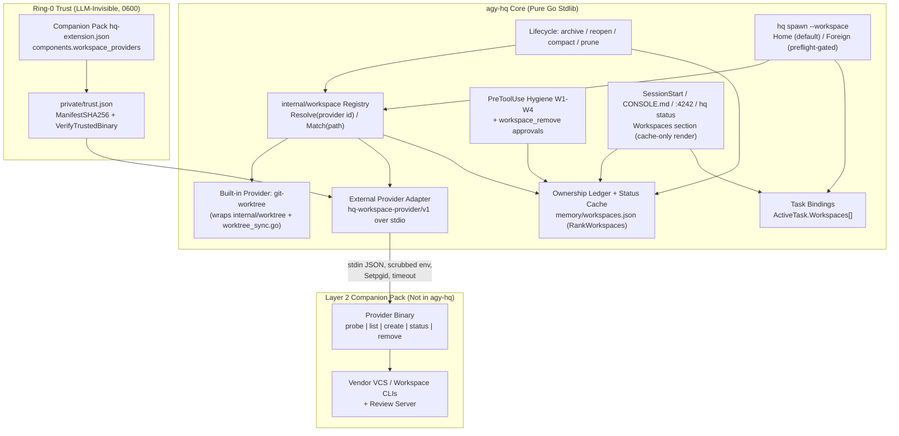
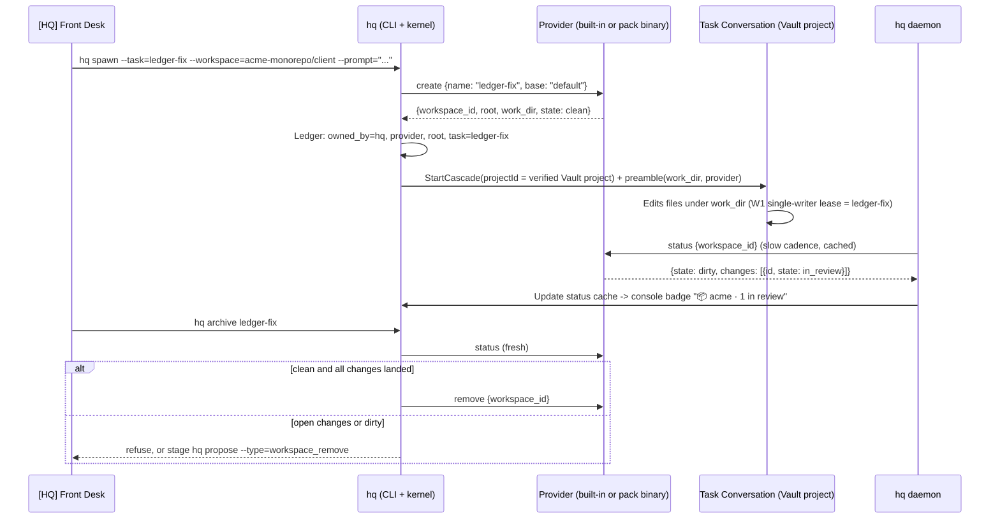

# RFC-0025: Pluggable Workspace Providers

- **Status:** Implemented
- **Created:** 2026-11-19
- **Companion Research:** [Research 20: Git-Worktree Coupling Audit, Non-Git Workspace Requirements & Pluggable Workspace Provider Design Space](../research/20_pluggable_workspace_providers_audit.md)
- **Extends / Updates:** [RFC-0001](./0001-vault-and-task-isolation.md), [RFC-0009](./0009-task-board-redesign.md), [RFC-0016](./0016-sidebar-conversation-archive-sync.md), [RFC-0017d](./0017d-enterprise-extensibility-and-portability.md), [RFC-0021](./0021-customizable-approval-policy-and-ux.md), [RFC-0023](./0023-front-desk-channel-bridge.md)

---

## 1. Motivation & Problem Statement

`agy-hq` gives every parallel engineering task an isolated **git worktree** under `<vault>/worktrees/<repo>-<task>/`, tracks it on the Task Board, gates it with `PreToolUse` hygiene rules, and cleans it up when the task is archived. [Research 20](../research/20_pluggable_workspace_providers_audit.md) shows that git is wired into seven subsystems (`C1`–`C7`): creation, the Ring-0 removal guard, task metadata, the archive/reopen/compact lifecycle, spawn routing, Front Desk hygiene, and every console surface.

Engineers who work in **non-git workspace systems** (virtual-filesystem monorepo clients, centralized-VCS clients, or DVCS front-ends with shared-history workspaces) get none of this. Their workspaces are created by a vendor CLI at a vendor-chosen mount root, hold server-side *changes* rather than branches, and are "done" when a review server says the change *landed*, not when `git merge-base` says so. Today such a workspace is:

1. **Not creatable** by `hq spawn --repo` (`C1`).
2. **Not attachable** to a task, because the Ring-0 guard equates "created by hq" with "lives under `<vault>/worktrees/`" (`C2`).
3. **Not tracked**: no field records which tool owns it or what changes it holds (`C3`).
4. **Never cleaned up**, and never checked for dirtiness before archive (`C4`).
5. **Unsafe to "open" directly**: starting the task conversation in the workspace's own Antigravity project silently drops `agy-hq` hooks under a project-scoped plugin install and breaks cross-project report-backs (`C5`). This is why users keep every task in the Vault project and paste absolute paths by hand.
6. **Unguarded**: two tasks can write into the same workspace, and destructive workspace verbs have no default approval gate (`C6`).
7. **Invisible** on the Task Board, console, WebUI, `SessionStart`, and `hq status` (`C7`).

This RFC introduces a **vendor-neutral Workspace Provider seam** so that a companion extension pack can teach `hq` any workspace system, while `agy-hq` core keeps owning safety, lifecycle, placement, hygiene, and surfacing.

---

## 2. Design Goals & Non-Goals

### Goals
1. **One Provider interface, two implementations.** A Go `workspace.Provider` interface in core, implemented by (a) a **built-in `git-worktree` provider** that preserves today's behavior byte-for-byte and (b) an **external provider adapter** that speaks `hq-workspace-provider/v1` to a SHA-256-pinned pack binary.
2. **Pack-registered providers.** A companion pack declares providers in `hq-extension.json` `components.workspace_providers`, reusing the `channel_bridges` trust and execution path ([RFC-0023 §4.1](./0023-front-desk-channel-bridge.md)): `LintPack` → `BuildTrustBundle` → `VerifyTrustedBinary` → `exec-cache` → `connector.RunSubprocess`.
3. **Ownership-based safety.** Replace "path under `<vault>/worktrees/`" with an **ownership ledger** as the authority for destructive operations. `hq` removes only workspaces it created, and removing one that still holds unlanded changes requires human approval.
4. **Hook-preserving placement.** By default a task conversation stays in the verified Vault project and the workspace is bound as data (**Home placement**). Opening the conversation in the workspace's own project (**Foreign placement**) is opt-in and refused unless a deterministic preflight proves `agy-hq` hooks will load there.
5. **Provider-delegated lifecycle.** Archive, reopen, compact, and prune ask the provider *dirty? open changes? all landed?* through a normalized state vocabulary instead of shelling out to `git`.
6. **Generic hygiene.** Core enforces a single writer per workspace, no Front Desk claims from inside provider workspaces, and approval for provider-declared destructive verbs.
7. **Change and review surfacing without new injection surface.** Provider-neutral **Workspaces** sections replace every `Active Git Worktrees` surface, rendered from a daemon-refreshed cache that exposes only enums, opaque IDs, and sanitized short titles.

### Non-Goals
- **No vendor code in core.** No VCS-specific binaries, mount roots, server APIs, or review-tool names appear in `bin/hq`, its tests, or its docs. `go.mod` stays pure stdlib (`ADR-0002`, CI Gate `H4-A`).
- **No generic review client.** Core shows change *state*; it does not fetch review comments, diffs, or reviewer identities. Review workflows stay in skills and approval-gated CLI commands.
- **No replacement of agent-driven VCS operations.** Committing, uploading, syncing, and rebasing stay the agent's job inside its workspace (guided by pack skills). The provider covers workspace *lifecycle and inventory*, not every VCS verb.
- **No change to git-worktree defaults.** `hq spawn --repo`, `hq worktree *`, and `<vault>/worktrees/` keep working unchanged; they become the `git-worktree` provider's CLI aliases.

---

## 3. Architecture Overview



### Spawn → Work → Archive Sequence (Home Placement)



---

## 4. Core Seam: `internal/workspace`

### 4.1 Go Interface

```go
package workspace

// State is the normalized workspace cleanliness reported by a provider.
type State string

const (
	StateClean   State = "clean"
	StateDirty   State = "dirty"
	StateMissing State = "missing"
	StateUnknown State = "unknown"
)

// ChangeState is the normalized review lifecycle of a change held by a workspace.
type ChangeState string

const (
	ChangeLocal     ChangeState = "local"     // not yet uploaded for review
	ChangeDraft     ChangeState = "draft"
	ChangeInReview  ChangeState = "in_review"
	ChangeApproved  ChangeState = "approved"
	ChangeLanded    ChangeState = "landed"    // replaces git "merged into default branch"
	ChangeAbandoned ChangeState = "abandoned"
)

// ChangeRef is an opaque, display-safe reference to a change held by a workspace.
type ChangeRef struct {
	ID            string      `json:"id"`              // opaque, <= 64 runes, [A-Za-z0-9._/:#-]
	State         ChangeState `json:"state"`
	NeedsOwner    bool        `json:"needs_owner"`     // waiting on the workspace owner
	Title         string      `json:"title,omitempty"` // sanitized, <= 80 runes
	URL           string      `json:"url,omitempty"`   // optional, https only, never fetched by hq
	UpdatedAt     string      `json:"updated_at,omitempty"`
}

// Info describes one workspace.
type Info struct {
	Provider    string      `json:"provider"`     // FQID, e.g. "core/git-worktree" or "<pack>/<id>"
	WorkspaceID string      `json:"workspace_id"` // stable within the provider
	Name        string      `json:"name"`
	Root        string      `json:"root"`         // absolute, canonical
	WorkDir     string      `json:"work_dir"`     // where the agent should run (may equal Root)
	Flavor      string      `json:"flavor,omitempty"` // provider-defined short label, display only
	Kind        string      `json:"kind,omitempty"`   // "primary" | "auxiliary" (auxiliary hidden by default)
	State       State       `json:"state"`
	Changes     []ChangeRef `json:"changes,omitempty"`
	Base        string      `json:"base,omitempty"`   // opaque sync point, display only
}

// Provider is implemented by the built-in git-worktree provider and the external stdio adapter.
type Provider interface {
	ID() string
	Capabilities() Capabilities
	Probe(ctx context.Context, path string) (Info, bool, error)
	List(ctx context.Context, req ListRequest) ([]Info, string /*next cursor*/, error)
	Create(ctx context.Context, req CreateRequest) (Info, error)
	Status(ctx context.Context, workspaceID string) (Info, error)
	Remove(ctx context.Context, req RemoveRequest) error
}

type Capabilities struct {
	Create, Remove, Changes, SharedHistory bool
	ForeignPlacement                       bool // workspace can be registered as its own Antigravity project
}
```

### 4.2 Built-in `core/git-worktree` Provider

- `Create` → `worktree.Add` ([`internal/worktree/worktree.go`](../../internal/worktree/worktree.go#L14-L91)); `Remove` → `removeManagedWorktree` ([`worktree_sync.go`](../../internal/kernel/worktree_sync.go#L423-L452)); `List` → `InspectWorktrees` ([`worktree_sync.go`](../../internal/kernel/worktree_sync.go#L487-L573)).
- `Status` maps `ManagedWorktreeStatus` to the normalized model: `Clean` → `StateClean|StateDirty`; the branch becomes one `ChangeRef{ID: "branch:hq/<task>"}` whose state is `landed` when `MergedIntoMain`, `in_review` when `PushedToOrigin`, else `local`.
- It keeps `IsManagedWorktreeDir` as its **own** additional invariant (git worktrees must still live under `<vault>/worktrees/`). The ledger (§6) is the cross-provider authority; the git provider is stricter on top.
- The refactor is behavior-preserving: `TestCUJ*` worktree cases and `worktree_sync_test.go` must pass unchanged before any external provider code lands.

### 4.3 Registry & Path Matching

`workspace.Registry` holds `core/git-worktree` plus every trusted pack provider (`LoadActiveTrustedPacks`). `Registry.Match(path)` finds the owner of an absolute path **without spawning a subprocess** in this order:

1. Ledger hit: the longest ledger `root` prefix of the canonical path.
2. Static `root_patterns` declared in the provider manifest (§5.1), matched with `filepath.Match` per path segment.
3. Otherwise unowned. `Probe` subprocesses are only issued from `hq workspace adopt` and the daemon, never from `PreToolUse` or render paths.

---

## 5. Pack Contract: `workspace_providers` in `hq-extension.json`

### 5.1 Manifest Schema

```json
{
  "schema_version": 1,
  "id": "acme-monorepo",
  "version": "1.0.0",
  "min_hq_version": "0.4.0",
  "requires": {
    "bins": [{ "name": "acme-ws", "probe_argv": ["acme-ws", "--version"], "min_version": "1.0.0" }]
  },
  "components": {
    "workspace_providers": [
      {
        "id": "client",
        "protocol": "hq-workspace-provider/v1",
        "description": "Per-change monorepo clients managed by acme-ws",
        "command": ["acme-ws", "hq-provider"],
        "env_allow": ["ACME_WS_PROFILE"],
        "timeout_ms": 20000,
        "root_patterns": ["/srv/ws/*/*"],
        "work_subdir": "src",
        "capabilities": {
          "create": true,
          "remove": true,
          "changes": true,
          "shared_history": true,
          "foreign_placement": false
        },
        "status_refresh_seconds": 600,
        "destructive_commands": [
          "\\bacme-ws\\s+[^;&|\\n]*?\\b(?:delete|purge)\\b"
        ],
        "skill": "acme-workspace-guide"
      }
    ]
  }
}
```

Go types extend [`PackComponents`](../../internal/extension/pack.go#L179-L191) with `WorkspaceProviders []WorkspaceProviderSpec`, decoded under the existing `DisallowUnknownFields()` strict parser.

### 5.2 `LintPack` Rules

Added as step 7 of [`LintPack`](../../internal/extension/pack.go#L257-L431), mirroring the `channel_bridges` checks:

1. `id` matches `^[a-z0-9][a-z0-9-]{1,62}$`, unique in the pack; runtime FQID is `<pack>/<id>`. `core` is reserved.
2. `protocol` equals `hq-workspace-provider/v1`.
3. `command[0]` is not a shell or generic interpreter (reuses `isBlockedBridgeCommand0`) and is not `hq` itself.
4. `env_allow` passes `reValidBridgeEnvKey` and excludes `blockedBridgeEnv` (`ANTIGRAVITY_CSRF_TOKEN`, `ANTIGRAVITY_LS_ADDRESS`, `ANTIGRAVITY_PROJECT_ID`, …).
5. `timeout_ms` ∈ `[0, 60000]` (workspace creation on virtual filesystems can take tens of seconds); `status_refresh_seconds` ∈ `{0} ∪ [120, 86400]`.
6. `root_patterns` entries must be absolute, contain no `..`, and must not match `/`, the user's home directory, the Vault, or `<vault>/worktrees/` (packs cannot claim git-provider territory).
7. `destructive_commands` compile as Go regexps and are registered as `approval_rules` entries with `mode: "always"` under the synthetic rule ID `workspace_destructive:<fqid>` (monotonic: packs can add gates, never remove them).
8. `skill`, when set, must resolve to `skills/<skill>/SKILL.md` inside the pack (pinned like any other component).

### 5.3 Trust & Execution

- `BuildTrustBundle` pins `command[0]` via `pinBinaryRef` and records it under `Targets["pack:<id>"].Binaries`, exactly as for `channel_bridges`.
- Every invocation calls `extension.VerifyTrustedBinary(vaultDir, "pack:<id>", command[0])` and executes the staged `0500` copy from `<vault>/private/exec-cache/<sha256>/` through `connector.RunSubprocess` (scrubbed env + `env_allow`, `Setpgid`, process-group kill on timeout, `SanitizeStderr`). A hash mismatch disables that provider only and emits one deduplicated `brief_rollup` re-trust notice.
- Mutating verbs (`create`, `remove`) refuse to run from tainted sessions (`denyIfCallerTainted`) and from `[Auto]` sessions. Read verbs (`list`, `status`, `probe`) are allowed for `[Auto]` maintenance but never for tainted sessions.

---

## 6. Protocol: `hq-workspace-provider/v1`

All verbs are short-lived stdio calls: one UTF-8 JSON request on `stdin`, one JSON response on `stdout` (≤ 256 KiB for `list`, ≤ 64 KiB otherwise), diagnostics on `stderr`. No identifiers, names, or paths are ever placed on `argv`. Every request carries `protocol`, `op`, `provider_id`, `request_id`, and `timestamp`. Every response carries `protocol`, `ok`, and on failure `error: {code, message}` with `code` ∈ `not_found | conflict | dirty | has_open_changes | unsupported | unavailable | invalid`.

### 6.1 `probe`: Does This Provider Own a Path?

```json
{ "protocol": "hq-workspace-provider/v1", "op": "probe", "provider_id": "acme-monorepo/client",
  "request_id": "req-01", "timestamp": "2026-11-19T08:00:00Z",
  "path": "/srv/ws/user/ledger-fix/src/billing" }
```
```json
{ "protocol": "hq-workspace-provider/v1", "ok": true, "owned": true,
  "workspace": { "workspace_id": "ledger-fix", "name": "ledger-fix", "root": "/srv/ws/user/ledger-fix",
                 "work_dir": "/srv/ws/user/ledger-fix/src", "flavor": "dvcs", "kind": "primary", "state": "unknown" } }
```

### 6.2 `list`: Paginated Inventory

Request fields: `cursor`, `limit` (≤ 200), `include_auxiliary` (default `false`; hides tooling-created auxiliary workspaces). Response: `workspaces: [Info]`, `next_cursor`. `list` never reports `changes` (cheap enumeration); `status` does.

### 6.3 `create`: Isolated Workspace for a Task

```json
{ "protocol": "hq-workspace-provider/v1", "op": "create", "provider_id": "acme-monorepo/client",
  "request_id": "req-02", "timestamp": "2026-11-19T08:01:00Z",
  "name": "ledger-fix", "base": "", "share_from": "", "idempotency_key": "create:acme-monorepo/client:ledger-fix" }
```
- `name` is derived by core from the task slug (`^[a-z0-9][a-z0-9_-]{0,62}$`), never free text.
- `base` is an opaque optional sync point; `share_from` requests a shared-history sibling of an existing **ledger-owned** workspace (core rejects `share_from` values not in the ledger).
- Idempotent: repeating the same `idempotency_key` returns the existing workspace with `ok: true, existed: true`. Core records `existed` so a pre-existing workspace is ledgered as `attached`, not `owned` (§7.1).

### 6.4 `status`: Fresh State + Changes

Request: `workspace_id`. Response: `workspace: {...}` (the same `Info` shape as `probe`, now including `state`, `base`, and `changes[]`). Core validates and clamps every field (§11.3) before caching.

### 6.5 `remove`: Delete a Workspace

```json
{ "protocol": "hq-workspace-provider/v1", "op": "remove", "provider_id": "acme-monorepo/client",
  "request_id": "req-03", "timestamp": "2026-11-19T09:00:00Z",
  "workspace_id": "ledger-fix", "expected_root": "/srv/ws/user/ledger-fix",
  "require_clean": true, "require_no_open_changes": true }
```
- Core only sends `remove` for **owned** ledger entries after its own preconditions pass (§8.1). The provider must still re-check `require_clean` / `require_no_open_changes` atomically on its side and return `dirty` or `has_open_changes` instead of deleting. Defense in depth: neither side alone can destroy unlanded work.
- `expected_root` must equal the provider's resolved root for `workspace_id`; a mismatch returns `conflict` (guards against ID reuse).

---

## 7. Data Model: Ownership Ledger & Task Bindings

### 7.1 Ownership Ledger: `<vault>/memory/workspaces.json`

Locked via `internal/store` at a new rank `RankWorkspaces = 78` (between `RankTasks = 75` and `RankSubagentQueue = 80` in [`store.go`](../../internal/store/store.go#L24-L35), so a task update may nest a ledger update but never the reverse), written atomically, and write-protected from LLM sessions by `PreToolUse` (added to the `extensions.json` / `tasks.json` protected list in [`hooks.go`](../../internal/hooks/hooks.go#L1715-L1733)).

```json
{
  "schema_version": 1,
  "entries": {
    "acme-monorepo/client:ledger-fix": {
      "provider": "acme-monorepo/client",
      "workspace_id": "ledger-fix",
      "root": "/srv/ws/user/ledger-fix",
      "work_dir": "/srv/ws/user/ledger-fix/src",
      "ownership": "owned",
      "created_by_task": "ledger-fix",
      "created_at": "2026-11-19T08:01:03Z",
      "writer_task": "ledger-fix",
      "status": { "state": "dirty", "changes": [{ "id": "c-4821", "state": "in_review", "needs_owner": false }],
                  "refreshed_at": "2026-11-19T08:40:00Z", "error": "" }
    }
  }
}
```

- `ownership: "owned"`: created by `hq` (`create` with `existed: false`). Eligible for removal.
- `ownership: "attached"`: pre-existing workspace bound via `hq workspace adopt` or `create` with `existed: true`. **Never removed by `hq`**, only unbound. Promotion to `owned` requires `hq workspace own <key>` staged through `hq propose --type=workspace_own` (human approval).
- Git worktrees are recorded in the same ledger with `provider: "core/git-worktree"`, so one inventory covers both.

### 7.2 Task Bindings

```go
type WorkspaceBinding struct {
	Key      string `json:"key"`      // ledger key "<provider>:<workspace_id>"
	Provider string `json:"provider"`
	Root     string `json:"root"`
	WorkDir  string `json:"workDir,omitempty"`
	Role     string `json:"role"`     // "primary" | "secondary" | "readonly"
}

type ActiveTask struct {
	// ... existing fields ...
	Workspaces []WorkspaceBinding `json:"workspaces,omitempty"`
	// WorktreeDir / WorktreeDirs / RepoRoot are retained for one release as read-compat fields.
}
```

- **Lossless migration on read:** `ListTasks` converts legacy `WorktreeDir`/`WorktreeDirs`/`RepoRoot` into `core/git-worktree` bindings (primary first), and `saveTasksUnlocked` writes both forms during the compat window so older `hq` binaries and the sidecar keep working.
- `AllWorktreeDirs()` / `ExistingWorktreeDirs()` become thin views over `Workspaces` filtered to `core/git-worktree`.
- Change and status data live **only** in the ledger cache, never in `tasks.json`, so the hot Task Board file stays small and `UpdateTasks` callbacks stay pure (no subprocesses under `RankTasks`).

### 7.3 Auto-Binding from `Stop`

`HandleStop` already computes `filesModified`. For a tracked non-Front-Desk task, core runs `Registry.Match` (§4.3, no subprocess) on each modified path. On a ledger hit it adds a `secondary` binding. On a `root_patterns` hit with no ledger entry it enqueues a **daemon probe** (`events.Enqueue` with `Source: "workspace:probe"`, not an LLM spawn), and the daemon ledgers the workspace as `attached`. This closes the "edited a workspace but the Task Board never knew" gap ([Research 20 §3](../research/20_pluggable_workspace_providers_audit.md)) without adding latency to `Stop`.

---

## 8. Lifecycle Integration

| Step | Today (git-only) | With providers |
| :--- | :--- | :--- |
| **Archive** (`ArchiveTaskWithOptions`) | `git status --porcelain` on managed worktrees, then `git worktree remove` | For each binding: fresh `Status`. Refuse (unless `--force`) if any binding is `dirty`. For `owned` bindings whose changes are all `landed`/`abandoned` (or none), call `Remove`. For `owned` bindings with open changes: keep the workspace, unbind it from the task, and mark the ledger entry `orphaned_open_changes`. `attached` bindings are only unbound. |
| **`--force` archive** | `git worktree remove --force` | Never forces deletion of a workspace with **open changes**: that path always stages `hq propose --type=workspace_remove` (§9.4). `--force` only overrides the `dirty` check for workspaces whose changes are all landed. |
| **Reopen** (`ReopenTaskWithOptions`) | `git worktree add` from `hq/<slug>` | If the ledger entry still exists and `Status` ≠ `missing`, rebind. If it is missing and the provider supports `create`, call `create` with the original `name` and `idempotency_key`. The git provider keeps its branch-restore logic. |
| **Dormant auto-archive** (`CompactTasks`) | `areAllTaskWorktreesMergedAndClean` | Uses the cached status: eligible only when every binding is `clean` and every change is `landed`/`abandoned`, and the cache is fresher than `2 × status_refresh_seconds`. A stale or errored cache means **not eligible** (fail-closed). |
| **Orphan prune** (`PruneOrphanWorktrees`) | `keep:linked/dirty/recent/unmerged` | `PruneOrphanWorkspaces` iterates **owned** ledger entries with no live owning task and applies `keep:linked`, `keep:dirty`, `keep:recent` (1h), and `keep:open_changes`. Git keeps `keep:unmerged` as its provider-specific reason. |

All provider subprocess calls happen **outside** `UpdateTasks` / ledger locks: core snapshots, calls the provider, then re-acquires the lock and applies the result with compare-and-set on `refreshed_at`, matching the existing "pure callback" rule documented on [`UpdateTasks`](../../internal/kernel/kernel.go#L347-L361).

---

## 9. Placement & Spawn Routing

### 9.1 CLI

```sh
hq spawn --task=<slug> --workspace=<provider-fqid>[:<existing-workspace-id>] [--placement=home|foreign] --prompt="..."
hq subagent --role="..." --workspace=<provider-fqid>[:<id>] --prompt="..."
```

- `--repo=<path|slug>` remains as an alias for `--workspace=core/git-worktree` with today's semantics.
- Without `:<id>`, core calls `create` with `name = <slug>` (owned). With `:<id>`, core calls `status` and ledgers the workspace as `attached` (or reuses an existing ledger entry).
- `hq spawn` pre-registers the task **with the binding** before `SpawnTask` (preserving the [RFC-0007](./0007-front-desk-initialization-hardening.md) race fix), and on spawn failure rolls back the binding and removes only a workspace it just created (`existed: false`), mirroring today's `wtExistedBefore` rollback in [`main.go`](../../cmd/hq/main.go#L1089-L1094).

### 9.2 Home Placement (Default)

- `resolveSpawnTarget` is **unchanged**: the conversation starts in the verified Vault project, so `SessionStart` / `PreToolUse` / `Stop` hooks, Task Board linking, approvals, and `send_message` report-backs behave exactly as today.
- The prompt preamble generalizes today's `"Work inside the isolated git worktree at %s"` to a provider-neutral, machine-parsable header:

  ```text
  [hq-workspace provider="acme-monorepo/client" id="ledger-fix" role="primary"]
  Work inside the isolated workspace at /srv/ws/user/ledger-fix/src.
  Provider guide: load the `acme-workspace-guide` skill before running VCS commands.
  ```
- `SessionStart` for a task with bindings injects a short **Active Task Workspaces** block (provider, work dir, role, state, change summary) so the binding survives context compaction without the agent re-deriving paths.

### 9.3 Foreign Placement (Opt-In, Preflight-Gated)

Foreign placement starts the conversation in the workspace's own Antigravity project (e.g. when per-workspace rule discovery matters). Core performs a deterministic preflight and **refuses** (with the reason) unless all of these hold:

1. The provider declares `capabilities.foreign_placement: true`.
2. The `agy-hq` plugin is installed **globally** (`hq plugin status` reports global scope), so hooks load in every project. Under a project-scoped install, foreign placement is impossible by construction ([Research 20 `C5`](../research/20_pluggable_workspace_providers_audit.md)).
3. `ResolveVerifiedWorkspaceProjectID(vaultDir, work_dir, "")` returns a non-empty, registry-verified project ID for the workspace (no guessing, no `workspaceUris` fallback).
4. The agent-API cross-project policy allows parent ↔ child messaging for this pair. If it does not, report-back falls back to the Vault-side `Stop` hook journal and outbox (`hq outbox add`), and the task row shows `↗ foreign`.

On success the task is registered with `placement: "foreign"` and its `projectId`, so [RFC-0016](./0016-sidebar-conversation-archive-sync.md) sidebar sync and `checkCascadeStep1Error` operate against the right project.

---

## 10. Workspace Hygiene (`PreToolUse` & Approvals)

All rules are evaluated in Go inside `handlePreToolUse` using only the ledger and `Registry.Match` (no subprocesses on the hot path).

| Rule | Scope | Behavior |
| :--- | :--- | :--- |
| **W1: Single-writer lease** | All sessions, `write_file` / `edit_file`, and `run_command` whose cwd or `cd` target is inside an owned/attached workspace root | Each ledger entry has one `writer_task`. A session whose owning Layer-1 task (resolved by walking nested-subagent parents, as in `AttachWorktreeToTaskWithOptions`) is not the writer is **denied** with a pointer to the writer task. Readonly bindings may read but not write. `hq workspace handoff <key> --to=<task>` transfers the lease. |
| **W2: Front Desk exclusion** | Front Desk thread | Existing Rule A already denies edits outside the artifact dir. Additionally, `run_command` with a cwd inside any provider-owned root counts as a lookup and can never run `destructive_commands`. |
| **W3: No lease claims from workspaces** | `SessionStart` / `Stop` auto-claim | `shouldAutoClaimVacantFrontDesk` returns `false` when the workspace path or cwd matches `Registry.Match` (ledger or `root_patterns`), closing the cwd-fallback gap in [Research 20 `C6`](../research/20_pluggable_workspace_providers_audit.md). |
| **W4: Destructive verbs** | All sessions | Provider `destructive_commands` compile into `approval_rules` (`mode: "always"`, rule ID `workspace_destructive:<fqid>`) through the [RFC-0021](./0021-customizable-approval-policy-and-ux.md) engine, so deleting, purging, or dropping work inside a provider workspace requires `hq propose` + `ask_question` approval. |

### 10.1 New Core Approval Categories

| Category | Default mode | Staged by |
| :--- | :--- | :--- |
| `workspace_remove` | `always` when the workspace has open changes or is dirty; otherwise executes directly from `hq archive` / `hq workspace remove` | `hq workspace remove <key>` / archive fallback |
| `workspace_own` | `always` | `hq workspace own <key>` (promote attached → owned) |

Both commands are deterministic `hq` argv (`hq workspace remove <key> --approved-sha=...`), satisfying the "no dummy `echo`" rule.

---

## 11. Surfacing: Task Board, Console, WebUI, `SessionStart`, `hq status`

### 11.1 Status Refresh

`hq daemon` refreshes ledger entries bound to live tasks on each provider's `status_refresh_seconds` cadence (default 600s; `0` = on demand only), bounded to 4 concurrent provider calls and a per-tick budget of 20 entries. `hq workspace status --refresh` forces a refresh. **Render paths never call providers**; they read the ledger cache only.

### 11.2 Surfaces

| Surface | Change |
| :--- | :--- |
| `SessionStart` Zone 2 | `## Active Git Worktrees` → `## Active Workspaces`: only entries bound to live Layer-1 tasks, grouped by provider, capped at 15 lines plus a `(+N more: hq workspace list)` footer. |
| `CONSOLE.md` / `hq_console.md` | `## 🌿 3. Active Parallel Git Worktrees` → `## 🌿 3. Active Workspaces`: table `Provider · Workspace · Owner Task · State · Changes`. Orphaned owned entries with open changes are listed under a `⚠️ Orphaned with open changes` sub-row so they are never silently forgotten. |
| Task Board badge | `🌿 wt` → `🌿 <provider-short>` plus a change summary such as `· 1 in review · 1 ⏳ needs you`. |
| `:4242` WebUI | `DashboardState.Worktrees []string` → `Workspaces []workspace.Info` (the old field is kept for one release), with per-entry Refresh, Unbind, Handoff, and Remove buttons. Remove routes through the same `workspace_remove` approval rules. |
| `hq status` | `Active Worktrees: N` → `Workspaces: N (git: a, <provider>: b) · open changes: c · needs you: d`. |

### 11.3 Injection & Privacy Controls

Provider output is not under the user's direct control (change titles can be authored by collaborators), so core treats it like the [RFC-0017c](./0017c-lease-based-morning-brief-and-extensions.md) quarantined brief:

- **Strict schema:** unknown response fields are rejected; enums are validated; `ChangeRef.ID` must match `^[A-Za-z0-9._/:#-]{1,64}$`; `url` must be `https://` and is rendered as a link but never fetched by `hq`.
- **Titles:** passed through `SanitizeAntiCue`, control characters stripped, clamped to 80 runes. They appear only in `CONSOLE.md` / `hq_console.md` / WebUI. `SessionStart` shows IDs, states, and counts only.
- **No free-text fields** exist for comments, reviewers, or diffs, so the protocol cannot carry them.
- **Paths** stay in the Vault (`memory/workspaces.json`), which is git-ignored and covered by the P1/P3 PII invariants.

---

## 12. CLI Surface

```sh
hq workspace providers                                  # list registered providers + trust/health
hq workspace list [--provider=<fqid>] [--all] [--json]  # ledger view; --all pages through provider list
hq workspace create <provider-fqid> <name> [--task=<slug-or-conv>]
hq workspace adopt <path> [--task=<slug-or-conv>] [--role=primary|secondary|readonly]
hq workspace status [<key>] [--refresh] [--json]
hq workspace handoff <key> --to=<slug-or-conv>
hq workspace unbind <key> [--task=<slug-or-conv>]
hq workspace remove <key> [--force]                     # stages workspace_remove when required
hq workspace own <key>                                  # stages workspace_own
hq workspace prune [--dry-run] [--json]
```

`hq worktree add|list|attach|remove|prune` remain as aliases that pin `--provider=core/git-worktree`. `validHQTopSubcmd` in the harness gate adds `workspace`.

---

## 13. Security Analysis

| Threat | Mitigation |
| :--- | :--- |
| Malicious or modified provider binary | SHA-256 pin + `exec-cache` staging (`VerifyTrustedBinary`); per-component fail-closed; no shell interpreters as `command[0]`. |
| Provider deletes the wrong directory | Core sends `remove` only for **owned** ledger entries, with `expected_root`; provider must re-check cleanliness atomically; core never passes paths it did not get from that provider's own `create`/`probe`. |
| Agent tricks `hq` into deleting user work | `remove` with open changes or dirty state always requires human approval (`workspace_remove`); `attached` workspaces are never removable without `workspace_own` approval; ledger is write-protected from LLM tools. |
| Pack claims git territory or the Vault | `LintPack` rejects `root_patterns` matching `/`, home, the Vault, or `<vault>/worktrees/`. |
| Prompt injection via change titles | Strict schema, `SanitizeAntiCue`, title clamp, IDs/enums only in `SessionStart`, no comment/diff fields in the protocol. |
| Tainted session creates or removes workspaces | `denyIfCallerTainted` on mutating verbs; tainted `run_command` allowlist (`validateTaintedHQArgv`) excludes `hq workspace create|remove|own|handoff`. |
| Hooks silently skipped in a foreign project | Foreign placement is refused unless the global-plugin + verified-project preflight passes (§9.3). |
| Concurrent writers corrupting a shared-history workspace | W1 single-writer lease enforced in `PreToolUse`. |
| Secrets leak through provider env | `RunSubprocess` scrubbing + `env_allow` + `blockedBridgeEnv`; no identifiers on `argv`. |

---

## 14. Phased Rollout & Verification Plan

- **Phase 0 — Behavior-Preserving Refactor:** add `internal/workspace` with the `Provider` interface and `core/git-worktree`; route `hq spawn --repo`, `hq worktree *`, archive, reopen, compact, and prune through it; add the ledger with git entries backfilled from `<vault>/worktrees/`; add `ActiveTask.Workspaces` with dual-write compat. Exit criterion: all existing tests pass unmodified.
- **Phase 1 — Pack Contract:** `workspace_providers` schema, `LintPack` step 7, trust pinning, external stdio adapter, `hq workspace providers|list|status|adopt|create`, and Home-placement `hq spawn --workspace`.
- **Phase 2 — Lifecycle & Hygiene:** provider-delegated archive/reopen/compact/prune, `workspace_remove` / `workspace_own` approvals, W1–W4, and `Stop` auto-binding with daemon probes.
- **Phase 3 — Surfacing:** daemon status refresh, Workspaces sections across all five surfaces, and sanitization.
- **Phase 4 — Foreign Placement:** preflight, `placement: "foreign"` task metadata, and sidebar-sync awareness.

**`TestCUJ39_PluggableWorkspaceProviders`** (fake provider binary in a temp dir, pinned in a temp trust registry) verifies:
1. Strict manifest parsing and every `LintPack` rejection (shell `command[0]`, bad `root_patterns`, blocked env, bad timeout).
2. Trust mismatch disables only that provider.
3. `hq spawn --workspace` creates an owned workspace, pre-registers the binding, keeps the verified Vault `projectId`, and rolls back on spawn failure.
4. Archive removes a clean, all-landed owned workspace; refuses or stages `workspace_remove` for open changes; never removes `attached` workspaces.
5. W1 denies a second task writing into a leased workspace and allows readonly reads.
6. W3 prevents Front Desk auto-claim from a `root_patterns` cwd.
7. Status cache sanitization: injected titles are scrubbed and absent from `SessionStart`.
8. Foreign placement is refused under a project-scoped plugin install.
9. Legacy `tasks.json` with `worktreeDir` round-trips losslessly.

---

## 15. Open Questions

1. **Ledger location:** keep `memory/workspaces.json` separate (proposed) or fold the cache into the [RFC-0018](./0018-always-on-agent-runtime-hardening.md) event store? A separate file keeps the status cache out of event-lease contention.
2. **Change-landed notifications:** should a transition to `landed` emit a `brief_rollup` outbox item ("ledger-fix: change landed; workspace eligible for cleanup")? Proposed: yes, deduplicated per `(key, change id)`.
3. **Multiple writers by design:** some shared-history systems support several working copies per task (one per subagent). Should W1 lease per `(task, workspace)` instead of per workspace, so a task's own subagents can each hold a sibling workspace created via `share_from`? Proposed: per workspace, with `share_from` as the sanctioned way to parallelize.
4. **Foreign placement messaging:** confirm empirically which agent-API cross-project paths succeed for parent ↔ child report-backs before Phase 4 is scheduled.

---

## 16. Implementation Decisions for the First Landing (v1)

Approved for implementation on 2026-11-19. These decisions resolve §15 Q1–Q3 and narrow the first landing. Where they conflict with earlier sections, this section wins.

1. **Ledger scope (resolves Q1).** The ledger is a separate `<vault>/memory/workspaces.json` at `RankWorkspaces = 78`. It records **provider** workspaces only. Git worktrees keep their existing storage (`WorktreeDir`/`WorktreeDirs`/`RepoRoot`) and their existing `<vault>/worktrees/` guard, and `hq workspace list` merges both views. There is no backfill and no dual-write (supersedes the last bullet of §7.1 and the migration bullets of §7.2).
2. **Task bindings.** `ActiveTask.Workspaces []workspace.Binding` stores provider bindings only. `ActiveTask.AllWorkspaceBindings()` synthesizes read-only `core/git-worktree` bindings from the legacy fields. Existing git code paths (`spawn --repo`, archive, reopen, compact, prune) are **not** refactored; provider bindings are handled alongside them (supersedes "route through it" in §4.2 and the Phase 0 rerouting in §14).
3. **Single-writer lease (resolves Q3).** W1 leases are per workspace and enforced only when the ledger entry has `lease_enforced: true`. That flag is set by `hq spawn --workspace`, `hq workspace create --task`, and `hq workspace adopt --task`. Entries auto-attached from `Stop` record `writer_task` but stay advisory until confirmed with `hq workspace handoff` or `adopt --task`. W1 v1 covers `write_file`/`edit_file`; `run_command` relies on the spawn preamble and W4. Parallel subagents use `share_from` sibling workspaces.
4. **Landed notifications (resolves Q2).** A transition to `landed` emits one deduplicated `brief_rollup` outbox item per `(ledger key, change id)`.
5. **Foreign placement** (§9.3) is deferred. v1 ships Home placement only and does not expose `--placement`.
6. **WebUI** is read-only in v1 (no Refresh/Unbind/Handoff/Remove buttons); actions go through the CLI.
7. **Protocol freeze.** `hq-workspace-provider/v1` is exactly §6: common request fields `protocol`, `op`, `provider_id`, `request_id`, `timestamp`; common response fields `protocol`, `ok`, `error{code,message}`. `probe`, `create`, and `status` return the workspace under a `workspace` key; `create` also returns `existed`; `list` returns `workspaces` and `next_cursor`. `provider` is filled in by core, never by the provider.
8. **`Stop` auto-binding** records candidate paths in the ledger's bounded, deduplicated `probe_candidates` list. The daemon drains it with `probe` calls; no event-inbox entries and no LLM spawns.
9. **Destructive `hq` verbs.** `hq workspace remove` stages a `workspace_remove` proposal whenever the workspace is dirty or has open changes. The approval-only execution form (`--approved-proposal=<id>`) is denied for direct LLM invocation by a core approvals rule, the same way `hq gmail send-draft` is.

---

## 17. Implementation Notes (v1)

This section records how the first landing behaves and every deviation from §16 (and, through §16, from earlier sections). Where it conflicts with §1–§16, this section wins.

### 17.1 Code Map

| Area | Location |
| :--- | :--- |
| Provider interface, registry, ownership ledger, stdio adapter, sanitization, shared surface helpers | [`internal/workspace`](../../internal/workspace/types.go) |
| Pack contract: `workspace_providers` schema, `LintPack` step 7, trust pinning, `wsd-` approval rules | [`internal/extension/pack.go`](../../internal/extension/pack.go), [`trust.go`](../../internal/extension/trust.go) |
| Acquire/rollback, adopt, handoff, unbind, remove/own, archive/reopen/compact/prune, daemon refresh, built-in `core/git-worktree` | [`internal/kernel/workspace_lifecycle.go`](../../internal/kernel/workspace_lifecycle.go) and its `workspace_*.go` siblings |
| W1, W3, `Stop` auto-binding, `SessionStart` sections | [`internal/hooks/workspace_surfaces.go`](../../internal/hooks/workspace_surfaces.go) |
| `hq workspace …`, `hq spawn --workspace`, `hq subagent --workspace` | [`cmd/hq/workspace_cli.go`](../../cmd/hq/workspace_cli.go) |
| `CONSOLE.md` section, Task Board badge, read-only WebUI cards | [`internal/webui/workspaces.go`](../../internal/webui/workspaces.go) |
| End-to-end journey | `TestCUJ41_PluggableWorkspaceProviders` ([CUJ-41](../product/0003-critical-user-journeys.md)) |

### 17.2 Deviations and Clarifications

1. **Destructive-command rule IDs.** Each provider's `destructive_commands` compile into one `always` approval rule with ID `wsd-<pack>-<id>` (shortened with a stable hash suffix past 63 characters), not `workspace_destructive:<fqid>` (§5.2 rule 7, §10 W4): `:` and `/` are not valid rule-ID characters. These rules are appended after all pack-declared `approval_rules`, and `LintPack` rejects pack rules that use the reserved `wsd-` prefix, so no pack can shadow or weaken the gate.
2. **Ledger lock rank.** `RankWorkspaces` shares rank `78` with `RankMemory` instead of sitting alone between `RankTasks` and `RankSubagentQueue` (§7.1). Both are leaf stores whose callbacks never nest each other; task and ledger updates are separate, non-nested lock acquisitions.
3. **Built-in git provider.** `core/git-worktree` creates worktrees through `kernel.RegisterGitWorktreeAdder`, which `cmd/hq` wires to `worktree.Add` at startup (the kernel cannot import `internal/worktree` without an import cycle). Its workspace IDs are canonical worktree paths, so its ledger keys match the bindings synthesized by `ActiveTask.AllWorkspaceBindings()`.
4. **Approval forms.** `hq workspace remove <key>` never deletes a dirty workspace or one with open changes; it prints `hq propose --type=workspace_remove … --cmd='hq workspace remove <key> --force'`. The approved form is `hq workspace remove <key> --force`, which the core `workspace_remove` rule gates for direct LLM use (instead of `--approved-sha=` in §10.1 or `--approved-proposal=` in §16.9). Promotion is `hq workspace own <key>`, gated by the core `workspace_own` rule. Both rule IDs are core non-disableable rules that packs cannot weaken.
5. **Live bindings block removal.** A non-`--force` `hq workspace remove` refuses a workspace that is still bound to a live task; unbind it or archive the task first. The approved `--force` form also drops the workspace's binding from every live task.
6. **Archived tasks keep bindings.** Archiving releases the task from each entry's `bound_tasks` and writer lease but keeps `ActiveTask.Workspaces` as history, like `WorktreeDir`. `hq reopen` rebinds the entries that still exist and re-creates only the primary binding's workspace when it is gone and the provider supports `create`.
7. **Additive surfaces.** The Workspaces sections are added next to the git ones, which are unchanged: `## Active Git Worktrees`, `## 🌿 3. Active Parallel Git Worktrees`, `DashboardState.Worktrees`, and `Active Worktrees: N` keep their names and contents (§11.2 described renames). A missing or empty ledger renders byte-identical surfaces.
8. **`Stop` auto-binding scope.** `Stop` binds only paths written with `write_file`/`edit_file` in the current turn. It resolves each with `workspace.FindOwningEntry`, which never matches a path inside the Vault, caps lookups at 20 per turn, and queues `root_patterns` hits as `probe_candidates` (§16.8).
9. **Readonly bindings.** W1 denies writes through a `readonly` binding only on lease-enforced entries; advisory entries never block (§16.3).
10. **Landed notices.** The first status observation of an entry is a baseline, so changes already `landed` when first seen emit nothing. Later transitions emit at most one `brief_rollup` per `(ledger key, change id)`, recorded in the entry's `notified_landed` before delivery.
11. **Spawn → first-write race.** The child conversation receives its prompt inside `SpawnTask`, so a task linked only after `SpawnTask` returned was invisible to W1 during the child's first turn, and the child's first write into its own workspace could be denied. `hq spawn --workspace` now calls `kernel.SpawnTaskWithOptions` with an `OnCascadeCreated` hook that links the pre-registered task to the new conversation after `StartCascade` succeeds and before `SendUserCascadeMessage`; `SpawnTask` keeps its signature and behavior for every other caller. The `agentapi` fallback creates and prompts a conversation in one step, so it still links when the spawn returns (the child's `SessionStart` can also link the pending task); W1 tells an unresolved caller to find its slug with `hq tasks` and retry once. `hq subagent --workspace` needed no hook: `AcquireWorkspace` records the writer lease before the spawn, and `SpawnSubagent` registers the Layer-1 subagent task (Front Desk parent) or records the nested parent edge (task parent) before it sends the prompt. The CLI now passes `SpawnSubagent` the same parent it derived the workspace owner from.
12. **Journey numbering.** The §14 journey ships as `TestCUJ41_PluggableWorkspaceProviders`, because CUJ-39 (Memory v2) and CUJ-40 were already allocated. §14 item 8 (foreign placement) is covered by the `LintPack` rejection of `capabilities.foreign_placement: true` (§16.5).

### 17.3 Known Limitations

- An approved `hq workspace remove <key> --force` runs through the approvals executor with a sanitized environment, so the pack's `env_allow` variables are absent when the provider runs. A provider that needs them for `remove` fails closed (the workspace is kept) until the executor forwards them.

---

## Appendix A: Generic Provider Skeleton (Illustrative)

A minimal provider is a single compiled binary that reads one request and writes one response:

```go
func main() {
	var req struct {
		Protocol, Op, ProviderID, RequestID string
		Path, Name, WorkspaceID, ExpectedRoot  string `json:",omitempty"`
		RequireClean, RequireNoOpenChanges     bool   `json:",omitempty"`
	}
	if err := json.NewDecoder(io.LimitReader(os.Stdin, 1<<20)).Decode(&req); err != nil {
		writeErr("invalid", err)
		return
	}
	switch req.Op {
	case "probe":
		// map req.Path to a workspace root using the vendor CLI; reply owned:false if not ours
	case "list":
		// enumerate primary workspaces; hide auxiliary ones unless include_auxiliary
	case "create":
		// create via vendor CLI; idempotent on name; report existed:true if it already existed
	case "status":
		// cleanliness + normalized change states from the vendor CLI / review server
	case "remove":
		// re-check cleanliness and open changes atomically; refuse with dirty / has_open_changes
	default:
		writeErr("unsupported", fmt.Errorf("op %q", req.Op))
	}
}
```

Vendor-specific adapters, mount roots, and review-server mappings live entirely in Layer 2 companion packs and are out of scope for this repository.
