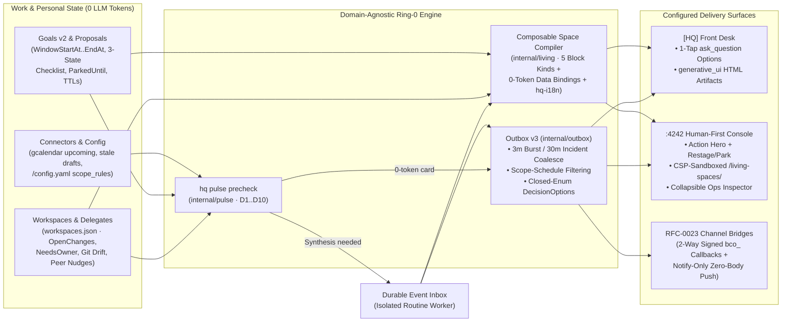

# RFC-0027: Muse-Informed Proactive Actions — Lifecycle Anticipation Engine, Structured Decision Cards, Composable Living Spaces & Horizon-Aware Steering

- **Status:** Proposed (Phase 1 — Awaiting User Review)
- **Author:** `[Task:agy-hq] Muse Proactive Actions Research & RFC` (`gemini-4-carbon-high`)
- **Created:** 2026-11-21
- **Updated:** 2026-11-22
- **Supersedes:** [RFC-0020 (Cross-Source Ambient Synthesis Loop & Mobile Push)](./0020-proactive-ambient-synthesis-and-mobile-push.md)
- **Extends:** [RFC-0014 (Proactive Engine v2)](./0014-proactive-engine-and-living-context.md)
- **Companion Research:** [22 — Meta Muse (`muse.ai`) Proactive Actions, Temporal Anticipation & Living Interactive Spaces Audit](../research/22_muse_proactive_actions_and_living_artifacts_audit.md), [10 — Meta Muse (`muse.ai`) Deep Dive](../research/10_muse_ai_proactive_and_context_study.md)
- **Integrates With:** [ADR-0003 (Two-Layer OSS & Private Vault)](../decisions/0003-two-layer-oss-and-private-vault.md), [RFC-0017b (Provenance Taint & Offer Gateway)](./0017b-provenance-taint-and-offer-gateway.md), [RFC-0017c (Lease-Based Morning Brief & `brief.d` Extensions)](./0017c-lease-based-morning-brief-and-extensions.md), [RFC-0018 (Durable Event Inbox & Timers)](./0018-always-on-agent-runtime-hardening.md), [RFC-0019 (OS vs. User-Space Skill Boundary)](./0019-two-tier-rsi-vault-overlay.md), [RFC-0021 (Customizable Approval Policy)](./0021-customizable-approval-policy-and-ux.md), [RFC-0023 (Front Desk Channel Bridge)](./0023-front-desk-channel-bridge.md), [RFC-0025 (Pluggable Workspace Providers)](./0025-pluggable-workspace-providers.md), [RFC-0026 (Unified Session Authorization Lattice & Scoped Delegates)](./0026-declarative-scoped-delegates.md)

---

## 1. Motivation & Problem Statement

Across [RFC-0014](./0014-proactive-engine-and-living-context.md) through [RFC-0026](./0026-declarative-scoped-delegates.md), `agy-hq` established strong Ring-0 proactive plumbing: 0-token `TriggerCursor` gatekeepers, quarantined channel watchers (`hq watch`), cryptographic nonce-fenced reply offers (`hq offer stage`), a 4-tier Outbox (`interrupt`, `brief_rollup`, `ideas_feed`, `silent_ledger`), durable `Events`/`Timers`, mobile Channel Bridges, Pluggable Workspace Providers (`internal/workspace`), and Scoped Delegates (`internal/delegates`).

However, contrasting **Meta Muse (`https://muse.ai/`)** ([Research 22](../research/22_muse_proactive_actions_and_living_artifacts_audit.md)) against `agy-hq`'s current behavior across **both engineering/knowledge work and personal operations** exposes three major user-facing gaps:

1. **Reactive Single-Item Triage vs. Work & Life Anticipation (`Superseding RFC-0020`):**
   - `hq watch precheck` evaluates inbound Gmail/GChat threads in isolation, while the earlier draft [RFC-0020](./0020-proactive-ambient-synthesis-and-mobile-push.md) (`internal/pulse/`) was never implemented.
   - `Goal` ([`internal/kernel/goals.go`](../../internal/kernel/goals.go)) models only a flat `TargetDate` and boolean `Milestone` list. It cannot express **bounded availability/freeze windows** (`WindowStartAt..WindowEndAt`, `Timezone`, `BlocksAvailability`), **horizon countdown escalations** (`T-168h` $\rightarrow$ `T-72h` $\rightarrow$ `T-24h`), **window-boundary transition pings**, **backward deadline ripples** (flagging a review signoff or form due *during* an offsite/trip so it is finished beforehand), **generic interval-overlap & coverage-span gaps**, or **3-state readiness** (`confirmed` vs. `open` vs. `skipped`).
   - Crucially for **software engineering & leadership work**, `agy-hq` already tracks rich repository/PR/CL state in `workspaces.json` ([RFC-0025](./0025-pluggable-workspace-providers.md)) and peer requests in `delegates_queues/` ([RFC-0026](./0026-declarative-scoped-delegates.md)), yet nothing joins `NeedsOwner` transitions, CI/branch conflict drift, or teammate delegate requests into pre-1:1 briefs or release-cutoff nudges.
   - Meanwhile, `AttentionConfig.CoalesceWindow` is parsed in [`internal/outbox/outbox.go`](../../internal/outbox/outbox.go) (`L185`) **but never enforced**, and `AttentionConfig.Mode` is a single global scalar with no work-vs-personal scope scheduling.
2. **Walls of Markdown vs. Composable Living Interactive Spaces (For Work War-Rooms & Life Guides Alike):**
   - `ConsoleSpace` ([`internal/webui/spaces.go`](../../internal/webui/spaces.go)) renders only plain-text `[]string` bullet slices (`SpaceWidgetOutput`). Release readiness war-rooms, RFC/vendor trade-off matrices, investment thesis cockpits, and multi-day itineraries are emitted as static Markdown prose rather than self-contained interactive micro-apps supporting **0-token live CLI/kernel data bindings**, **0-token client-side `i18n` locale switching** (when configured), **generic multi-perspective lenses** (e.g., `Exec / Eng / On-Call` or `In-Depth / Kids`), live countdowns, and readiness bars.
3. **Passive Dead-End Text Alerts, Silent Proposal Timeouts & CLI Steering Friction:**
   - `FormatInterruptCard` ([`internal/outbox/dispatcher.go`](../../internal/outbox/dispatcher.go)) emits plain text with zero structured `DecisionOption` choices; when no `hq offer` proposal is attached, `[HQ] Front Desk` ends alerts with passive *"Let me know if you need help"* prose instead of 1-tap decision pills (`[Spawn Rebase/Fix Worker]` · `[Mark Handled]` · `[Park Until Horizon]`).
   - Proposals that expire during the day (`> 12h` before the 7:30 AM Morning Brief) fall into a blind spot in `collectProposalAlerts` ([`internal/brief/brief.go`](../../internal/brief/brief.go) `L329`), leaving users unaware that an approved/staged action never executed and offering no 1-command `hq approvals restage <id>`.
   - `hq_console.md` and `:4242` lead with harness telemetry (token burn, CHR %, raw 5-field cron strings) rather than human decisions, lack horizon-aware `"Park until X"` (`ParkedUntil`) holds, and omit `interrupt` noise outcomes from `hq rsi mine`.

This RFC supersedes [RFC-0020](./0020-proactive-ambient-synthesis-and-mobile-push.md) and specifies a four-phase upgrade (**Phases 2A–2D**) built strictly around `agy-hq`'s **Two-Layer OS vs. Private Vault boundary** ([ADR-0003](../decisions/0003-two-layer-oss-and-private-vault.md), [RFC-0019](./0019-two-tier-rsi-vault-overlay.md)): the open-source engine provides **domain-agnostic, locale-neutral primitives** serving SWE, investing, and personal workflows equally, while personal preferences live strictly inside `<vault>/`.

---

## 2. Design Goals, Non-Goals & Architectural Invariants

### 2.1 Design Goals
1. **Strict Framework vs. Personal Configuration Separation:** Keep `cmd/` and `internal/` 100% free of hardcoded personal locales, consumer-travel categories, or persona assumptions; expose declarative configuration hooks in `<vault>/config.yaml`, `<vault>/skills/`, and `<vault>/living_spaces/`.
2. **Unified Work + Life Anticipation (`internal/pulse/` `D1`–`D10` + `Goal` v2):** Subsuming all of [RFC-0020](./0020-proactive-ambient-synthesis-and-mobile-push.md) (`P1`–`P5`) and extending into SWE/workspace state, evaluate pre-meeting context (joining Calendar + Dossiers + `WaitingOn` + `Workspaces` + `Tasks` + `Delegates`), horizon countdowns, `BlocksAvailability` deadline ripples, interval/coverage-tag conflicts, **workspace `NeedsOwner` / merge-drift transitions**, stale unsent drafts, and expiring/expired proposals in pure Go (`0` LLM tokens when quiet).
3. **Burst Coalescing & Scope-Scheduled Attention (`internal/outbox/`):** Enforce `attention.coalesce_window` (`3m` default for non-critical interrupts), `incident_correlation_window` (`30m`), and optional `attention.scope_rules` so weekday coding focus prioritizes `repo:*` / `work` interrupts while holding non-critical `personal` items for off-hours/brief rollups (and vice versa).
4. **Ring-0-Safe Structured Decision Cards & Timeout Recovery (`DecisionOption` + `hq approvals restage`):** Attach 2–4 closed-enum, anti-cue-sanitized decision options to proactive cards—actionable in 1 tap via `ask_question`, `:4242` WebUI, or `hq-channel-bridge/v1`—and guarantee 100% visibility + 1-tap re-staging for timed-out proposals.
5. **Composable Living Interactive Spaces with 0-Token Data Bindings (`internal/living/`):** Compile canonical `<vault>/living_spaces/<slug>/space.json` models built from **5 domain-neutral UI block primitives** + optional `trust.json`-verified `mode: "argv"` / kernel data sources (`workspaces`, `goals`, `delegates`, `obs`) into self-contained HTML5 micro-apps with generic `1..N` BCP-47 `i18n` dictionaries, generic `0..N` perspective/group filters, live JS countdowns, and readiness bars.
6. **Human-First Console Hierarchy, Horizon Parking & Full-Funnel SNR:** Re-order `:4242` and `hq_console.md` around human actions/Spaces, add `NextRunAt` countdowns on schedules, support `"Park until <date|after:goal>"` (`ParkedUntil`) + `hq cancel` reversals, and wire `interrupt` dismissal/expiry metrics into `hq rsi mine`.

### 2.2 Non-Goals
- **No Cloud Hosting or Duplicate Push Pipelines:** Living Spaces live strictly inside `<vault>/living_spaces/` and `<artifactDir>/`. Opt-in stateless zero-body mobile push (`ntfy`/Shortcuts from `RFC-0020`) routes cleanly as a notify-only adapter on the existing [RFC-0023](./0023-front-desk-channel-bridge.md) `hq-channel-bridge/v1` seam rather than introducing a second notification subsystem.
- **No Domain-Specific Bloat in Ring-0 Go Packages:** Release war-rooms, RFC trade-off matrices, thesis trackers, and travel itineraries are **user-space instances/skills** composed out of generic `Goal` and `LivingSpace` primitives—never hardcoded structs in `internal/`.
- **No Unapproved External Mutations or External Go Dependencies (`H4-A` & `H5`):** `RFC-0003`/`RFC-0017b`/`RFC-0021` approval invariants and pure Go stdlib (`0` external deps) remain absolute, keeping all monolith files strictly below their `Gate H5` LOC ceilings.

### 2.3 Two-Layer Boundary: Framework Infrastructure vs. Personal Vault Configuration

| Dimension | Layer 1: `agy-hq` Framework & Core Plugin (Tracked Repo) | Layer 2: Personal Configuration & Vault (`<vault>/` — Git-Ignored) |
| :--- | :--- | :--- |
| **Localization (`i18n`)** | Locale-agnostic `LocalizedText` (`string` or `map[bcp47]string`) + `<script id="hq-i18n" type="application/json">` client-side switcher. **Neutral engine default:** `default_locales: ["en"]` (language toggle auto-hidden when `len(locales) == 1`). | User sets `living_spaces.default_locales: ["en", "zh"]` and optional `locale_labels: {"en": "English", "zh": "中文"}` in `<vault>/config.yaml` (or passes `--locales=en,zh` per Space). |
| **Perspectives & Sub-Groups** | Generic `perspectives: []PerspectiveSpec{ID, Label}` (`0..N` arbitrary view lenses) and `groups: []string` (`0..N` arbitrary lane filters); UI controls auto-hidden when `0` are defined. | Space/skill author defines domain lenses in `<vault>/` (e.g., `Exec / Eng / On-Call` for release war-rooms, `Bull / Kill Criteria` for investing, or `In-Depth / Kids` for family travel). |
| **Space Layout & Live Data** | **5 Composable Block Primitives** (`kpi_strip`, `timeline_accordion`, `comparison_table`, `checklist_ledger`, `callout_notes`) + `data_sources` binding to `hq` state (`workspaces`, `goals`, `delegates`, `obs`) or `trust.json`-pinned `mode: "argv"` JSON scripts. | Personal workflows, custom `argv` repo/metrics scripts, and domain presets live in `<vault>/skills/<slug>/SKILL.md` (`RFC-0019`) and `<vault>/living_spaces/<slug>/space.json`. |
| **`Goal` & `hq pulse` Math** | Domain-neutral interval & work algebra: `WindowStartAt..WindowEndAt`, `Timezone`, `BlocksAvailability`, `RequiredCoverageTag`, `workspaces.json` `NeedsOwner`/conflict checks, and 3-state `ChecklistItem` (`open` \| `confirmed` \| `skipped`). | User's actual work/life goals (cutovers, RFC signoffs, filings, trips), custom `pulse:` lead windows in `<vault>/config.yaml`, and Channel Bridge / push credentials in `<vault>/private/channels/`. |
| **Attention & Scope Rules** | Enforces `coalesce_window` (`3m` default, `0s` for `Critical: true`), `incident_correlation_window` (`30m`), optional `scope_rules` schedule/tier mapping, and closed-enum `DecisionOption` dispatch. | User's `attention.mode`, `quiet_hours`, weekday work-focus vs. weekend personal `scope_rules`, and learned per-skill RSI tier overrides in `<vault>/memory/rsi/rules/`. |

Declarative `<vault>/config.yaml` surface (neutral framework defaults + optional `scope_rules` hook):

```yaml
# Framework defaults shipped in templates/config.yaml (all fields optional):
attention:
  mode: balanced
  cooldown_per_topic: "4h"
  coalesce_window: "3m"              # 0s for Critical: true; set "0s" to disable burst holding
  incident_correlation_window: "30m" # Annotates follow-up cards sharing IncidentKey
  # Optional user-configured work vs. personal focus schedules (empty by default):
  # scope_rules:
  #   - scopes: ["personal", "family"]
  #     schedule: "weekdays 09:00-17:30 America/Los_Angeles"
  #     downgrade_non_critical_interrupt_to: "brief_rollup"

pulse:
  enabled: true
  pre_meeting_lead: "30m"
  countdown_horizons: ["168h", "72h", "24h"]
  cutoff_lead: "6h"
  min_slot_buffer: "45m"
  stale_draft_age: "4h"

living_spaces:
  default_locales: ["en"]                 # Personal Vault override example: ["en", "zh"]
  default_surfaces: ["webui", "artifact"] # "webui" (:4242) and/or "artifact" (Antigravity generative_ui)
```

### 2.4 Lock Hierarchy & Ring-0 Security Invariants
- **Strict `internal/store` Lock Ordering:**
  - `RankPulse = 32` (`<vault>/memory/pulse/.pulse.lock`, positioned strictly above `RankTriggerCur = 20` and `RankWatcher = 30`, and strictly below `RankTimers = 35`, `RankEvents = 40`, `RankGoals = 50`, and `RankOutbox = 60`). `pulse.RunPrecheck` uses a snapshot-then-commit pattern so `RankPulse` is never held across connector subprocesses, `events.Enqueue`, or `outbox.Add`.
  - `RankLivingSpaces = 77` (`<vault>/living_spaces/<slug>/.space.lock`, pure leaf store alongside `RankWorkspaces = 76` and `RankMemory = 78`).
- **Non-Interference Preservation (`RFC-0026` `NI-1`–`NI-4`):**
  - `ProfileQuarantinedReader` (`tainted`) sessions may emit `DecisionOption` items **only** with closed-enum `ActionKind` values (`approve_proposal`, `reject_proposal`, `park_until`, `dismiss_handled`, `dismiss_noisy`, `skip_checklist`, `promote_goal`) referencing `ProposalIDs` staged by that session or its own `OutboxItem`. `ActionKind: "spawn_investigation"` must reference a registered Core or Vault skill slug (`[a-z0-9-]+`) and always spawns an isolated `unattended_auto` / `quarantined_reader` worker—never executing inline shell commands in `[HQ] Front Desk`.
  - Any external `data_sources` command in `space.json` must use `mode: "argv"` (no `sh -c`) and pass `extension.VerifyTrustedBinary` against `<vault>/private/trust.json` (identical to [RFC-0017c](./0017c-lease-based-morning-brief-and-extensions.md) `brief.d` extensions).
  - `:4242/living-spaces/<slug>` serves HTML with `Content-Security-Policy: default-src 'none'; style-src 'unsafe-inline'; script-src 'unsafe-inline'; img-src data:; base-uri 'none'; form-action 'none'` inside `<iframe sandbox="allow-scripts">` (omitting `allow-same-origin`), guaranteeing zero access to `:4242` `/api/*` endpoints or `X-HQ-CSRF-Token`.

---

## 3. Architecture Overview



---

## 4. Subsystem 1 (Phase 2A — P0): Work + Life Anticipation (`D1`–`D10`), 3-State Readiness & Coalescing

### 4.1 Domain-Agnostic `Goal` v2 Schema (`internal/kernel/goals.go` + `goals_readiness.go`)

We extend `Goal` backward-compatibly in `<vault>/memory/goals.json` using **domain-neutral interval, readiness, and dependency primitives** (existing `Milestones` and `WaitingOn` round-trip unchanged):

```go
const (
    ChecklistOpen      = "open"
    ChecklistConfirmed = "confirmed"
    ChecklistSkipped   = "skipped" // Tombstone: suppresses repeat nudges on declined items
)

type ChecklistItem struct {
    ID                       string `json:"id"`                                 // e.g. "chk-1"
    Title                    string `json:"title"`                              // Gate, PR/signoff, or booking item
    Tag                      string `json:"tag,omitempty"`                      // Freeform caller tag (e.g. "canary", "signoff", "lodging")
    Status                   string `json:"status"`                             // open | confirmed | skipped
    WindowStartAt            string `json:"windowStartAt,omitempty"`            // Optional RFC3339 slot/gate start
    WindowEndAt              string `json:"windowEndAt,omitempty"`              // Optional RFC3339 slot/gate end
    ConstraintNote           string `json:"constraintNote,omitempty"`           // e.g. "Finish before code freeze"
    Group                    string `json:"group,omitempty"`                    // Optional owner lane / sub-group
    ExternalRef              string `json:"externalRef,omitempty"`              // PR #, ticket ID, or confirmation code
    StatusNote               string `json:"statusNote,omitempty"`               // Verification note, CI link, or terms
    CutoffAt                 string `json:"cutoffAt,omitempty"`                 // Optional RFC3339 freeze/submission/cancellation cutoff
    MustCompleteBeforeWindow bool   `json:"mustCompleteBeforeWindow,omitempty"` // Must finish before parent Goal.WindowStartAt
    ActionURL                string `json:"actionUrl,omitempty"`                // Optional deep link
    SkipReason               string `json:"skipReason,omitempty"`               // Populated when Status == "skipped"
    UpdatedAt                string `json:"updatedAt"`
}

// Added optional fields on Goal (internal/kernel/goals.go):
type Goal struct {
    // ... existing Slug, Title, Scope, Status, TargetDate, Milestones, WaitingOn, CreatedAt, UpdatedAt, CompletedAt ...
    WindowStartAt       string          `json:"windowStartAt,omitempty"`       // RFC3339 start of release/offsite/sprint/trip window
    WindowEndAt         string          `json:"windowEndAt,omitempty"`         // RFC3339 end of window
    Timezone            string          `json:"timezone,omitempty"`            // Optional IANA TZ for window-local rendering/pings
    BlocksAvailability  bool            `json:"blocksAvailability,omitempty"`  // Ripples overlapping external deadlines prior to WindowStartAt
    RequiredCoverageTag string          `json:"requiredCoverageTag,omitempty"` // Optional tag whose confirmed items must span WindowStartAt..EndAt
    ParkedUntil         string          `json:"parkedUntil,omitempty"`         // RFC3339, YYYY-MM-DD, or "after:<goal-slug>"
    SpaceSlug           string          `json:"spaceSlug,omitempty"`           // Optional linked Space in <vault>/living_spaces/<slug>
    Checklist           []ChecklistItem `json:"checklist,omitempty"`
}
```

### 4.2 Ten Deterministic `hq pulse precheck` Detectors (`internal/pulse/`)

`hq pulse precheck --json` runs every `15m` (`mode: daemon_gatekeeper`, `dedup_mode: precheck_enqueues`) in-process inside `EvaluateDaemonGatekeepers`, covering all 5 detectors from superseded `RFC-0020` (`P1`–`P5`) plus lifecycle, coverage, and SWE workspace detectors (`D1`–`D10`):

| Detector | Generic Inputs Joined (0 LLM Tokens) | Firing Condition | Dedup Key / Cooldown | Output Mode |
| :--- | :--- | :--- | :--- | :--- |
| **`D1: pre_meeting_prep`** *(expands `RFC-0020 P1`)* | `gcalendar` (`now+10m..now+lead`) $\bowtie$ `entities/*.md` $\bowtie$ `WaitingOn` $\bowtie$ **`Tasks` + `Workspaces` (`OpenChanges`/`NeedsOwner`) + `delegates_queues/`** $\bowtie$ unsent drafts | External/teammate event within `pulse.pre_meeting_lead` (`30m` default) with matching dossier, open PR/workspace, pending delegate nudge, `WaitingOn`, or unsent draft | `meet:<eventId>:<startISO>` (`24h`) | Enqueues `routine` synthesis event $\rightarrow$ 5-bullet Pre-1:1/Review/Meeting Card + `DecisionOption`s |
| **`D2: horizon_countdown`** *(expands `RFC-0020 P5`)* | `Goal` (`WindowStartAt`, `TargetDate`, `Checklist.CutoffAt`) | Crosses `pulse.countdown_horizons` (`168h` $\rightarrow$ `brief_rollup`; `72h`/`24h` with open items $\rightarrow$ `interrupt` with *"ignore if handled"* note) or `CutoffAt - cutoff_lead` (`6h`) | `phase:<slug>:<bucket>` (`7d`) | **0-token Go card** (or `routine` worker if Space refresh is bound) |
| **`D3: blocking_window_ripple`** | Active `Goal` with `BlocksAvailability: true` $\bowtie$ other active `Goals`, `ChecklistItem`, `WaitingOn` | Obligation's `TargetDate`/`FollowUpAfter` falls inside `WindowStartAt..WindowEndAt + 24h` (or `MustCompleteBeforeWindow` is `open`) and `WindowStartAt` is within `72h` | `ripple:<blockSlug>:<targetId>` (`48h`) | **0-token Go `interrupt` card** highlighting pre-window cutoff + `[Mark Handled]` / `[Park Until After Window]` |
| **`D4: window_transition_ping`** | `Goal` (`WindowStartAt`, `WindowEndAt`, `Timezone`) + `timers.json` (`reason=settlement_check`) | Within `15m` of `WindowStartAt` transition or due `settlement_check` timer | `trans:<id>:<phase>` (`once`) | **0-token Go `interrupt` card** formatted in `Goal.Timezone` + `[Confirmed — Close]` / `[Keep Open]` |
| **`D5: interval_and_coverage_conflict`** | `Goal` (`WindowStartAt..WindowEndAt`, `RequiredCoverageTag`, `Checklist` windows) $\bowtie$ `gcalendar` events | (a) Two confirmed windows overlap or violate `pulse.min_slot_buffer` (`45m`); (b) `RequiredCoverageTag != ""` has uncovered spans inside `WindowStartAt..WindowEndAt` | `conflict:<hash16>` (`72h`) | **0-token Go `interrupt` card** listing conflicting intervals or uncovered spans + options |
| **`D6: proposal_ttl_and_expiry`** *(expands `RFC-0020 P2`)* | `<vault>/memory/proposals/*.json` + `interventions.jsonl` | (a) Pending proposal has `< 2h` before `ExpiresAt`; (b) Proposal transitioned to `expired` with `NotifiedExpired == false` (**eliminates `12h` brief blind spot**) | `prop_ttl:<id>` / `prop_exp:<id>` (`once`) | **0-token Go `interrupt` card** with `[Approve Now]` or `[Re-Stage Confirmation Card]` (`restage_proposal`) |
| **`D7: waiting_sla_breach`** *(expands `RFC-0020 P4`)* | `Goal.WaitingOn` (`status=waiting`) $\bowtie$ `interventions.jsonl` (expired offers on `threadKey`) | `now >= FollowUpAfter` and parent `Goal` is not `ParkedUntil > now` | `sla:<goalSlug>:<waitId>` (`24h`) | Annotates whether a prior staged reply on `threadKey` expired unsent; enqueues follow-up offer worker |
| **`D8: parked_horizon_wakeup`** | `Goal.ParkedUntil` & `OutboxItem` (`status=snoozed`, `ParkHorizon`) | `now >= ParkedUntil` or `"after:<goalSlug>"` has `now > WindowEndAt` | `wake:<id>:<horizon>` (`once`) | Wakes parked items cleanly into `brief_rollup` / consolidated digest |
| **`D9: workspace_and_review_pulse`** *(SWE/Work native)* | `workspaces.json` (`OpenChanges`, `NeedsOwner`, dirty/ahead-behind state) $\bowtie$ `Tasks` $\bowtie$ `delegates_queues/` $\bowtie$ `Goal.CutoffAt` | (a) Owned workspace transitions `NeedsOwner: 0 -> N` (review feedback / CI blocker); (b) Active worktree drifts into merge conflict with `origin/main` or sits dirty/unpushed `< 6h` before a linked `Goal` `CutoffAt` | `ws:<wsKey>:<stateHash12>` (`12h`) | **0-token Go `interrupt` / `brief_rollup` card** with `[Spawn Rebase/Fix Worker]` (`swe-pulse`) · `[Park]` · `[Mark Handled]` |
| **`D10: stale_unsent_draft`** *(retains `RFC-0020 P3`)* | Connector `drafts` list (`gmail` when desktop-reachable) $\bowtie$ `proposals/*.json` | Unsent draft older than `pulse.stale_draft_age` (`4h` default) with no matching pending `Proposal` | `draft_stale:<draftId>` (`24h`) | **0-token Go `ideas_feed` card** (escalated to `interrupt` by `D1` if recipient is in a `< 60m` meeting) |

### 4.3 Outbox Burst Coalescing & Scope-Scheduled Attention (`internal/outbox/`)

1. **Enforce `attention.coalesce_window` (`3m` Default for Non-Critical `interrupt`s):**
   - Non-critical `interrupt` items set `AvailableForDispatchAt = CreatedAt + cfg.CoalesceWindow` (`Critical: true` or `--immediate` items dispatch immediately on the `15s` fast tick).
   - Undispatched `pending` `interrupt` items sharing `IncidentKey = lower(Connector) + "|" + senderDomainOrScope + "|" + categoryClass` within `CoalesceWindow` **merge into a single multi-bullet `OutboxItem`**; follow-ups arriving within `incident_correlation_window` (`30m`) after delivery carry **`↪ Correlated Update (#2 in 30m — follows <prevTitle>)`**.
2. **Scope- & Schedule-Aware Routing (`attention.scope_rules`):**
   - Reusing `MatchesSpaceSchedule` (`weekdays 09:00-17:30 America/Los_Angeles`, `weekends`, etc.), `EvaluateDelivery` checks optional `scope_rules` in `<vault>/config.yaml` so non-critical `personal` interrupts can automatically roll into `brief_rollup` during deep-work blocks while `repo:*` / `work` / `investing` interrupts pass through (and vice versa on evenings/weekends).

---

## 5. Subsystem 2 (Phase 2B — P0): Structured Decision Cards, Timeout Recovery & Portfolio Context

### 5.1 Closed-Enum `DecisionOption` Schema (`internal/outbox/decisions.go`)

```go
const (
    ActionApproveProposal    = "approve_proposal"    // Executes approvals.Approve (requires human presence / WebUI / signed bridge cap)
    ActionRejectProposal     = "reject_proposal"     // Executes approvals.Reject
    ActionRestageProposal    = "restage_proposal"    // Clones an expired proposal into a fresh 24h pending Proposal
    ActionParkUntil          = "park_until"          // Parks OutboxItem / Goal until Horizon (e.g. "24h", "2026-12-02", "after:<goal-slug>")
    ActionDismissHandled     = "dismiss_handled"     // Marks Status="acted_handled" (positive SNR signal: valid catch, handled offline)
    ActionDismissNoisy       = "dismiss_noisy"       // Marks Status="dismissed" + Reason="noisy" (negative SNR signal -> hq rsi mine)
    ActionSkipChecklist      = "skip_checklist"      // Marks Goal ChecklistItem Status="skipped" (tombstone)
    ActionPromoteGoal        = "promote_goal"        // Promotes item into an active Goal
    ActionSpawnInvestigation = "spawn_investigation" // Enqueues an isolated worker bound to a registered Core/Vault skill slug
)

type DecisionOption struct {
    ID          string `json:"id"`                    // "opt-1".."opt-4" (max 4 options per card)
    Label       string `json:"label"`                 // <= 60 runes, SanitizeAntiCue-scrubbed
    Description string `json:"description,omitempty"` // <= 160 runes, SanitizeAntiCue-scrubbed
    Recommended bool   `json:"recommended,omitempty"`
    ActionKind  string `json:"actionKind"`            // Must be one of the 9 closed constants above
    TargetID    string `json:"targetId,omitempty"`    // Verified prop-..., goal/chk ID, item ID, or registered skill slug
    Horizon     string `json:"horizon,omitempty"`     // Duration, YYYY-MM-DD, or "after:<goal-slug>"
}
```

### 5.2 Taint Validation, 3-Surface Parity & Timeout Recovery
1. **Quarantine Validation (`ValidateDecisionOptions`):** Caps `len(Decisions) <= 4`, scrubs `Label`/`Description` via `SanitizeAntiCue`, and restricts `tainted` (`ProfileQuarantinedReader`) callers to referencing only `ProposalIDs` staged by `CallerConvID`, their own `OutboxItem`, or registered skill slugs—never raw shell commands or free-form prompts.
2. **Three-Surface 1-Tap Execution (`0` LLM Tokens):** Executed via `hq outbox act <item-id> --option=<opt-id>` from `[HQ] Front Desk` (`ask_question`), `:4242` (`/api/outbox/act`), and [RFC-0023](./0023-front-desk-channel-bridge.md) Channel Bridges (`bco_` signed callbacks; stateless zero-body mobile push adapters also plug into `hq-channel-bridge/v1` with `notify_only: true`).
3. **`hq approvals restage <expired-prop-id>` & Thread Unsent Context:** Re-mints a fresh `24h` pending proposal from an `expired` intervention in **0 LLM tokens** (re-checking `connector.InspectThread` on `offer_send` items), and injects `[Prior Staged Reply Expired Unsent: prop-... on YYYY-MM-DD]` when `hq watch precheck` enqueues future messages on that thread.

---

## 6. Subsystem 3 (Phase 2C — P1): Composable Living Spaces & 0-Token Work Data Bindings (`internal/living/`)

### 6.1 Composable, Locale- & Domain-Neutral `space.json` Schema (`<vault>/living_spaces/<slug>/space.json`)

`internal/living/` compiles canonical `space.json` models built from **generic `LocalizedText`**, **optional `perspectives` & `groups` dimensions**, **5 domain-neutral UI block primitives** (`kpi_strip`, `timeline_accordion`, `comparison_table`, `checklist_ledger`, `callout_notes`), and **optional 0-token `data_sources`**:

```json
{
  "schema_version": 1,
  "slug": "q4-release-war-room",
  "schedule": "weekdays 07:00-20:00 America/Los_Angeles",
  "goal_slug": "q4-release-cutover",
  "default_locale": "en",
  "locales": ["en"],
  "title": "Q4 Release Readiness & PR War-Room",
  "perspectives": [
    { "id": "exec",   "label": "Stakeholder TL;DR" },
    { "id": "eng",    "label": "PRs & Architecture" },
    { "id": "oncall", "label": "Rollback & Runbook" }
  ],
  "groups": ["All", "Kernel", "Plugin", "Security"],
  "data_sources": [
    { "id": "live_workspaces", "kind": "hq_builtin", "source": "workspaces", "scope": "agy-hq" },
    { "id": "ci_gate_probe",   "kind": "trusted_argv", "argv": ["hq", "ci", "check-harness", "--json"], "timeout_ms": 5000 }
  ],
  "kpis": [
    { "kind": "countdown", "target_at": "2026-12-01T17:00:00Z", "tz": "America/Los_Angeles", "label": "until release freeze" },
    { "kind": "readiness", "sync_from_goal": true, "label": "release gates confirmed" }
  ],
  "sections": [
    { "id": "prs",      "nav_label": "WORKSPACES", "kind": "comparison_table",   "bind_source": "live_workspaces" },
    { "id": "timeline", "nav_label": "CUTOVER",    "kind": "timeline_accordion", "items": [] },
    { "id": "gates",    "nav_label": "GATES",      "kind": "checklist_ledger",   "sync_from_goal": true }
  ]
}
```

### 6.2 Work + Personal Capabilities in One Runtime (`0` LLM Tokens on Refresh/Toggle)
1. **0-Token `hq_builtin` & `trusted_argv` Data Sources (`hq space refresh <slug>`):**
   - Built-in sources (`workspaces`, `goals`, `delegates`, `obs`) and `trust.json`-verified `mode: "argv"` JSON scripts refresh Work Space tables/badges (open PRs, `NeedsOwner` counts, token budgets, CI checks) in **0 LLM tokens**.
2. **Locale-Neutral `1..N` Client-Side `i18n`:** Framework defaults to `["en"]` (hiding the locale toggle when `len(locales) == 1`). Vaults configuring `living_spaces.default_locales: ["en", "zh"]` emit `<script id="hq-i18n" type="application/json">`, switching `[data-i18n]` nodes in `< 5ms` and `0` LLM tokens.
3. **Configurable Dual-Surface Delivery (`living_spaces.default_surfaces`):** Served on `:4242/living-spaces/<slug>` (`<iframe sandbox="allow-scripts">` + strict `default-src 'none'` CSP) and/or exported via `hq space export-artifact <slug>` to Antigravity's native `generative_ui` side pane (`tailwindcss.min.js` + semantic host theme tokens).

---

## 7. Subsystem 4 (Phase 2D — P1/P2): Human-First Console Hierarchy, Reversal & Closed-Loop SNR

### 7.1 Human-First Re-Ordering of `:4242` & `hq_console.md`
1. **Section 1 — Action Required & Active Horizons:** Pending Approvals (`[Approve]`, `[Reject]`, `[Re-Stage]`), Active `DecisionOption` Cards, and `< 48h` `pulse` Countdowns / Workspace `NeedsOwner` Alerts / Blocking-Window Ripples.
2. **Section 2 — Active Living Spaces & Scheduled Console Spaces:** Visual readiness bars, countdowns, live workspace badges, and `[Open Interactive Space]` links.
3. **Section 3 — Active Goals, Readiness, Parked Horizons, Workspaces & Layer-1 Tasks:** `Confirmed / Open / Skipped` ratios, `ParkedUntil` badges, sanitized Workspace summaries, and active Task Conversations.
4. **Section 4 — Collapsible Ops Inspector (`Activity · Schedules · Quota · Health`):** Moves Token Burn, Prefix CHR %, Watermarks, Delegate Counters, and `hq doctor` into `<details>` / an Inspector tab, and computes human-readable **`NextRunAt`** (`Tomorrow 07:30 AM · in 18h 42m`) on `ScheduleSummaryRow` via `timers.NextCronOccurrence`.

### 7.2 Mid-Flight Reversal (`hq cancel`) & Full-Funnel SNR $\rightarrow$ `hq rsi mine`
1. **`hq cancel <event-id|task-slug|prop-id> [--reason="..."]`:** Cancels queued/leased events and armed follow-up timers in scope, dismisses pending proposals, and logs `reverted_by_user` in the Console Activity stream.
2. **Full-Funnel SNR Telemetry (`internal/outbox/` $\rightarrow$ `internal/rsi/miner.go`):** Tracks `InterruptActedCount`, `InterruptParkedCount`, `InterruptNoisyCount`, and `ProposalExpiredCount`; expands `hq outbox eval` from `10` to `20` fixtures (including work-focus `scope_rules` and workspace review transitions); and proposes Tier-1 Vault RSI overlays in `<vault>/memory/rsi/rules/<skill>.md` when `InterruptNoisyRate >= 0.40` or `ProposalExpiredRate >= 0.50`.

---

## 8. Prioritized Implementation Plan & Verification (`CUJ-45`–`CUJ-47`)

| Phase | Priority | Framework Packages & CLI Deliverables | Monolith Impact (`Gate H5`) | E2E / CI Verification |
| :--- | :--- | :--- | :--- | :--- |
| **Phase 2A** | **P0** | **`internal/pulse/`** (`D1`–`D10` work + life detectors, `RankPulse=32`), domain-neutral `Goal` v2 windows + `BlocksAvailability` + `RequiredCoverageTag` + 3-state `ChecklistItem` + `ParkedUntil` (`internal/kernel/goals_readiness.go`), Outbox `CoalesceWindow` (`3m`) + `IncidentKey` (`30m`) + `scope_rules`, neutral defaults in `templates/config.yaml`. | `0` LOC added to `kernel.go` (new `goals_readiness.go` + `internal/pulse/`). | **`CUJ-45`:** Verifies 0-token `hq pulse precheck` across work-enriched `D1`, `BlocksAvailability` ripple (`D3`), workspace `NeedsOwner` pulse (`D9`), `3m` burst coalescing, `scope_rules`, and `20`-case `hq outbox eval`. |
| **Phase 2B** | **P0** | **`internal/outbox/decisions.go`** (`DecisionOption` closed-enum validation, `hq outbox act`), **`hq approvals restage`**, thread unsent-expiry metadata in `watcher.go`, WebUI `/api/outbox/act` + `RFC-0023` Channel Bridge `bco_` / `notify_only` push support, Core OS skill updates. | `< 10` LOC dispatch hook in `cmd/hq/`; handlers in `internal/webui/outbox_actions.go`. | **`CUJ-46`:** Verifies Ring-0 taint rejection of unauthorized `DecisionOption` kinds, 1-tap `hq outbox act`, `>12h` expired proposal catch (`D6`), and 0-token `hq approvals restage`. |
| **Phase 2C** | **P1** | **`internal/living/`** (5 composable block primitives, `hq_builtin` & `trust.json`-verified `trusted_argv` `data_sources`, `RankLivingSpaces=77`, locale-neutral `1..N` BCP-47 `hq-i18n`, generic `perspectives`/`groups`, `hq space` CLI), `:4242/living-spaces/<slug>` CSP-sandboxed route, Antigravity `generative_ui` exporter. | `0` LOC in `webui.go` beyond 1 mux registration call. | **`CUJ-47`:** Verifies 0-token `workspaces`/`trusted_argv` Space refresh, single-locale vs. Vault-configured multi-locale compilation, `Goal` $\rightarrow$ Space sync, and strict CSP + `sandbox="allow-scripts"`. |
| **Phase 2D** | **P1/P2** | Human-first `console_md.go` / `console.html` layout + collapsible Ops Inspector, `NextRunAt` on `ScheduleSummaryRow`, `hq cancel` reversal verb, and full-funnel `InterruptNoisyRate` / `ProposalExpiredRate` mining into `<vault>/memory/rsi/rules/`. | Keeps all 5 `Gate H5` monolith files strictly below ceiling; passes `./bin/hq ci pre-push` (`100%`). | Unit + E2E coverage for `ParkedUntil` suppression, `NextRunAt` formatting, `hq cancel` reversal audit, and Vault-scoped RSI noise-downgrade mining. |

---

## 9. Recorded Design Decisions & Phase 1 Review Gate

1. **`RFC-0020` Supersession:** [RFC-0020](./0020-proactive-ambient-synthesis-and-mobile-push.md) is formally marked `Superseded by RFC-0027`, with 100% of its detector scope (`P1`–`P5`, including standalone `D10: stale_unsent_draft`) folded into `internal/pulse/` (`D1`–`D10`) and stateless zero-body mobile push unified onto the [RFC-0023](./0023-front-desk-channel-bridge.md) `hq-channel-bridge/v1` notify-only seam.
2. **Framework Defaults vs. Personal Vault Configuration:** Neutral engine defaults (`default_locales: ["en"]`, `coalesce_window: "3m"`, `incident_correlation_window: "30m"`, `default_surfaces: ["webui", "artifact"]`) live in `templates/config.yaml`, while personal locales (e.g., `["en", "zh"]`), `scope_rules`, and domain workflows live strictly in `<vault>/`.
3. **Implementation Gate:** `RFC-0027` remains in **`Proposed (Phase 1 — Awaiting User Review)`** with zero implementation code started until you finish reviewing at your own pace.
