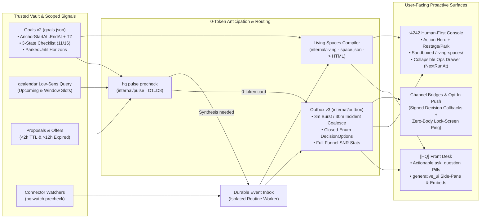

# RFC-0027: Muse-Informed Proactive Actions — Lifecycle Anticipation Engine, Structured Decision Cards, Living Interactive Spaces & Horizon-Aware Steering

- **Status:** Proposed (Phase 1 — Awaiting User Review)
- **Author:** `[Task:agy-hq] Muse Proactive Actions Research & RFC` (`gemini-4-carbon-high`)
- **Created:** 2026-11-21
- **Companion Research:** [22 — Meta Muse (`muse.ai`) Proactive Actions, Temporal Anticipation & Living Interactive Spaces Audit](../research/22_muse_proactive_actions_and_living_artifacts_audit.md), [10 — Meta Muse (`muse.ai`) Deep Dive](../research/10_muse_ai_proactive_and_context_study.md)
- **Extends & Subsumes:** [RFC-0014 (Proactive Engine v2)](./0014-proactive-engine-and-living-context.md), [RFC-0020 (Ambient Synthesis & Mobile Push — Subsumed & Expanded)](./0020-proactive-ambient-synthesis-and-mobile-push.md)
- **Integrates With:** [RFC-0017b (Provenance Taint & Offer Gateway)](./0017b-provenance-taint-and-offer-gateway.md), [RFC-0017c (Lease-Based Morning Brief)](./0017c-lease-based-morning-brief-and-extensions.md), [RFC-0018 (Durable Event Inbox & Timers)](./0018-always-on-agent-runtime-hardening.md), [RFC-0021 (Customizable Approval Policy)](./0021-customizable-approval-policy-and-ux.md), [RFC-0023 (Front Desk Channel Bridge)](./0023-front-desk-channel-bridge.md), [RFC-0026 (Unified Session Authorization Lattice & Scoped Delegates)](./0026-declarative-scoped-delegates.md)

---

## 1. Motivation & Problem Statement

Across [RFC-0014](./0014-proactive-engine-and-living-context.md) through [RFC-0026](./0026-declarative-scoped-delegates.md), `agy-hq` established strong Ring-0 proactive plumbing: 0-token `TriggerCursor` gatekeepers, quarantined channel watchers (`hq watch`), cryptographic nonce-fenced reply offers (`hq offer stage`), a 4-tier Outbox (`interrupt`, `brief_rollup`, `ideas_feed`, `silent_ledger`), durable `Events`/`Timers`, mobile Channel Bridges, and an 8-profile Session Capability Lattice (`internal/authz`).

However, our live product and UX audit of **Meta Muse (`https://muse.ai/`)** ([Research 22](../research/22_muse_proactive_actions_and_living_artifacts_audit.md)) demonstrates why `agy-hq`'s day-to-day proactive behavior still lags behind a human-grade proactive agent across **three user-facing dimensions**:

1. **Reactive Single-Item Triage vs. Lifecycle Anticipation & Cross-Stream Synthesis:**
   - `hq watch precheck` evaluates inbound Gmail/GChat threads in isolation, while [RFC-0020](./0020-proactive-ambient-synthesis-and-mobile-push.md) (`internal/pulse/`) remains unimplemented.
   - `Goal` ([`internal/kernel/goals.go`](../../internal/kernel/goals.go)) models only a flat `TargetDate` and boolean `Milestone` list. It cannot express **event windows** (`AnchorStartAt..AnchorEndAt`, `LocationTZ`), **countdown escalations** (`T-72h` $\rightarrow$ `T-24h` check-in/cutoff sweeps), **arrival/transition pings** (`T+landing` or `T+72h` offline settlement follow-ups), **backward deadline ripples** (flagging a form due `Dec 2` *before* a `Nov 22 – Dec 1` trip), **cross-stream schedule/lodging gap conflicts**, or **3-state readiness** (`Confirmed` vs. `Open` vs. `Decided: Skipped`).
   - Meanwhile, `AttentionConfig.CoalesceWindow` is parsed in [`internal/outbox/outbox.go`](../../internal/outbox/outbox.go) (`L185`) **but never enforced**, causing back-to-back vendor alerts (e.g., *"Password changed"* followed 15 minutes later by *"MFA changed"*) to trigger separate `110k+`-token Front Desk wakes.
2. **Walls of Markdown vs. Living Interactive Spaces (`EN / 中文` & Multi-Audience Micro-Apps):**
   - `ConsoleSpace` ([`internal/webui/spaces.go`](../../internal/webui/spaces.go)) renders only plain-text `[]string` bullet slices (`SpaceWidgetOutput`). Complex itineraries, deal comparison matrices, and event-prep guides are emitted as static Markdown prose rather than self-contained interactive micro-apps with **0-token client-side language toggles (`English / 中文`)**, **dual-audience lenses** (`Adult In-Depth` vs. `Kids Fun Guide`, `Executive` vs. `Deep-Dive`, split-party schedules), live countdown headers, and visual readiness bars (`11 of 16 Confirmed`)—even though Antigravity natively supports `generative_ui` HTML artifacts and `:4242` runs a local loopback web server.
3. **Passive Dead-End Text Alerts, Silent Proposal Timeouts & CLI Steering Friction:**
   - `FormatInterruptCard` ([`internal/outbox/dispatcher.go`](../../internal/outbox/dispatcher.go)) emits plain text with zero structured `DecisionOption` choices; when no `hq offer` proposal is attached, `[HQ] Front Desk` ends alerts with passive *"Let me know if you need help"* prose instead of 1-tap decision pills (`[Verify — My Action]` · `[Investigate Auth Logs]` · `[Park Until Return]`).
   - Proposals that expire during the day (`> 12h` before the 7:30 AM Morning Brief) fall into a blind spot in `collectProposalAlerts` ([`internal/brief/brief.go`](../../internal/brief/brief.go) `L329`), leaving users unaware that an approved/staged email never went out and offering no 1-command `hq approvals restage <id>`.
   - `hq_console.md` and `:4242` lead with harness telemetry (token burn, CHR %, raw 5-field cron strings) rather than human decisions, lack horizon-aware `"Park until X"` (`ParkedUntil`) holds, and omit `interrupt` noise outcomes from `hq rsi mine`.

This RFC specifies a cohesive, four-phase upgrade (**Phases 2A–2D**) that brings Muse's best anticipation, interactive Space, and 1-tap steering mechanics to `agy-hq` while preserving **100% local Vault sovereignty, 0 external Go dependencies, and Ring-0 `NI-1`–`NI-4` provenance safety**.

---

## 2. Design Goals, Non-Goals & Architectural Invariants

### 2.1 Design Goals
1. **0-Token Lifecycle & Cross-Stream Anticipation (`internal/pulse/` + `Goal` v2):** Subsuming and expanding [RFC-0020](./0020-proactive-ambient-synthesis-and-mobile-push.md), evaluate temporal phase windows (`T-7d`, `T-72h`, `T-24h`, arrival pings, `T+72h` settlement checks), backward away-window deadline collisions, schedule/buffer conflicts, unbooked night gaps, 3-state readiness (`confirmed` / `open` / `skipped`), and expiring/expired proposals in pure Go (`0` LLM tokens when quiet).
2. **Correlated Incident Burst Coalescing (`internal/outbox/`):** Enforce a real coalescing hold and 30-minute incident correlation window so related multi-step alerts from the same `(Connector, SenderDomain, Scope)` merge or thread cleanly rather than spamming `[HQ] Front Desk`.
3. **Ring-0-Safe Structured Decision Cards & Timeout Recovery (`DecisionOption` + `hq approvals restage`):** Attach 2–4 closed-enum, anti-cue-sanitized decision options to proactive cards—actionable in 1 tap via `ask_question`, `:4242` WebUI, or `hq-channel-bridge/v1`—and guarantee 100% visibility + 1-tap re-staging for timed-out proposals.
4. **Local-First Living Interactive Spaces (`internal/living/`):** Compile canonical `<vault>/living_spaces/<slug>/space.json` models into self-contained HTML5 micro-apps featuring `0ms / 0-token` client-side language switches (`English / 中文`), dual-audience & split-party filter tabs, live local-timezone countdowns, and 3-state readiness bars—served both as Antigravity `generative_ui` artifacts and inside CSP-sandboxed iframes on `:4242`.
5. **Human-First Console Hierarchy, Horizon Parking & Full-Funnel SNR:** Re-order `:4242` and `hq_console.md` around human actions/Spaces, add `NextRunAt` countdowns on schedules, support `"Park until <date|after:goal>"` (`ParkedUntil`) + `hq cancel` reversals, and wire `interrupt` dismissal/expiry metrics into `hq rsi mine`.

### 2.2 Non-Goals
- **No Cloud Hosting or External Artifact Relays:** Living Spaces live strictly inside `<vault>/living_spaces/` and `<artifactDir>/`; `agy-hq` will never upload personal itineraries or dashboards to a public CDN unless the user explicitly exports a static file.
- **No Unapproved External Mutations:** `RFC-0003`, `RFC-0017b`, and `RFC-0021` remain absolute—neither `hq pulse` nor `DecisionOption` can send external messages or execute gated mutations without verified human approval.
- **No External Go Dependencies or Monolith Growth (`H4-A` & `H5`):** `go.mod` remains 100% pure Go stdlib, and new logic lives in dedicated packages (`internal/pulse`, `internal/living`, `internal/outbox/decisions.go`) keeping `kernel.go`, `cmd/hq/main.go`, `hooks.go`, and `webui.go` strictly below their `Gate H5` LOC ceilings.

### 2.3 Lock Hierarchy & Ring-0 Security Invariants
- **Strict `internal/store` Lock Ordering:**
  - `RankPulse = 32` (`<vault>/memory/pulse/.pulse.lock`, positioned strictly above `RankTriggerCur = 20` and `RankWatcher = 30`, and strictly below `RankTimers = 35`, `RankEvents = 40`, `RankGoals = 50`, and `RankOutbox = 60`). `pulse.RunPrecheck` uses a lock-free snapshot-then-commit pattern so `RankPulse` is never held across connector subprocesses or `events.Enqueue` / `outbox.Add`.
  - `RankLivingSpaces = 77` (`<vault>/living_spaces/<slug>/.space.lock`, pure leaf store alongside `RankWorkspaces = 76` and `RankMemory = 78`).
- **Non-Interference Preservation (`RFC-0026` `NI-1`–`NI-4`):**
  - `ProfileQuarantinedReader` (`tainted`) sessions may emit `DecisionOption` items **only** with closed-enum `ActionKind` values (`approve_proposal`, `reject_proposal`, `park_until`, `dismiss_handled`, `skip_checklist`, `promote_goal`) referencing `ProposalIDs` staged by that session or its own `OutboxItem`. `ActionKind: "spawn_investigation"` from a tainted item always spawns an isolated `unattended_auto` / `quarantined_reader` worker—never executing inline shell commands in `[HQ] Front Desk`.
  - `:4242/living-spaces/<slug>` serves HTML with `Content-Security-Policy: default-src 'none'; style-src 'unsafe-inline'; script-src 'unsafe-inline'; img-src data:; base-uri 'none'; form-action 'none'` and embeds inside `:4242` via `<iframe sandbox="allow-scripts">` (omitting `allow-same-origin`), guaranteeing zero access to `:4242` `/api/*` endpoints or `X-HQ-CSRF-Token`.

---

## 3. Architecture Overview



---

## 4. Subsystem 1 (Phase 2A — P0): Lifecycle Anticipation, 3-State Readiness & Incident Coalescing

### 4.1 `Goal` v2 Schema: Event Horizons, `ParkedUntil` & 3-State Readiness (`internal/kernel/goals.go` + `goals_readiness.go`)

We extend `Goal` backward-compatibly in `<vault>/memory/goals.json` (existing `Milestones` and `WaitingOn` round-trip unchanged):

```go
// ChecklistStatus models Muse's 3-state readiness ledger (Confirmed vs. Open vs. Skipped).
const (
    ChecklistOpen      = "open"
    ChecklistConfirmed = "confirmed"
    ChecklistSkipped   = "skipped" // Tombstone: never re-nag about declined options!
)

type ChecklistItem struct {
    ID                       string `json:"id"`                                 // e.g. "chk-1"
    Title                    string `json:"title"`                              // e.g. "Tower of London Timed Entry"
    Category                 string `json:"category,omitempty"`                 // flight | lodging | rail | dining | ticket | prep
    Status                   string `json:"status"`                             // open | confirmed | skipped
    SlotStartAt              string `json:"slotStartAt,omitempty"`              // RFC3339
    SlotEndAt                string `json:"slotEndAt,omitempty"`                // RFC3339
    SlotConstraint           string `json:"slotConstraint,omitempty"`           // e.g. "Finish before 14:00 split"
    PartyGroup               string `json:"partyGroup,omitempty"`               // e.g. "Alice + Maya"
    ConfirmationRef          string `json:"confirmationRef,omitempty"`          // e.g. "CONF-884210"
    PaymentNote              string `json:"paymentNote,omitempty"`              // e.g. "$40 card hold (not charge)"
    CancelCutoffAt           string `json:"cancelCutoffAt,omitempty"`           // RFC3339 free-cancellation cutoff
    MustCompleteBeforeAnchor bool   `json:"mustCompleteBeforeAnchor,omitempty"` // Pre-trip physical/shipping tasks
    ActionURL                string `json:"actionUrl,omitempty"`                // Official booking/portal URL
    SkipReason               string `json:"skipReason,omitempty"`               // Populated when Status == "skipped"
    UpdatedAt                string `json:"updatedAt"`
}

// Added fields on Goal (internal/kernel/goals.go):
type Goal struct {
    // ... existing Slug, Title, Scope, Status, TargetDate, Milestones, WaitingOn, CreatedAt, UpdatedAt, CompletedAt ...
    AnchorStartAt string          `json:"anchorStartAt,omitempty"` // RFC3339 start of trip/conference/launch window
    AnchorEndAt   string          `json:"anchorEndAt,omitempty"`   // RFC3339 end of window (away-mode horizon)
    LocationTZ    string          `json:"locationTz,omitempty"`    // IANA TZ at destination (e.g. "Asia/Tokyo")
    ParkedUntil   string          `json:"parkedUntil,omitempty"`   // RFC3339 or "after:<goal-slug>"
    SpaceSlug     string          `json:"spaceSlug,omitempty"`     // Linked Living Space in <vault>/living_spaces/
    Checklist     []ChecklistItem `json:"checklist,omitempty"`
}
```

- **Readiness Computation (`Goal.ReadinessProgress()`):** Computes `(confirmed, open, skipped, activeDenominator)` where `activeDenominator = confirmed + open` (`skipped` items are excluded from the denominator and displayed separately as `Decided: Skipped`, matching Muse's `11 OF 16 BOOKED` + `Decided: Skipped` UX).
- **CLI Additions (`cmd/hq/proactive_cli.go` / `goals_cli.go`):**
  - `hq goals add --slug=<slug> --title="..." [--anchor-start=...] [--anchor-end=...] [--tz=...]`
  - `hq goals checklist add --goal=<slug> --title="..." [--category=...] [--slot-start=...] [--cancel-cutoff=...] [--before-anchor]`
  - `hq goals checklist confirm --goal=<slug> <id-or-title> [--ref=...] [--note=...]`
  - `hq goals checklist skip --goal=<slug> <id-or-title> [--reason="..."]`
  - `hq goals park <slug> --until=<RFC3339|YYYY-MM-DD|after:goal-slug>` (and `hq goals unpark <slug>`).

### 4.2 Eight Deterministic `hq pulse precheck` Detectors (`internal/pulse/`)

`hq pulse precheck --json` runs every `15m` (`CRON_TZ=... */15 7-22 * * *`, `mode: daemon_gatekeeper`, `dedup_mode: precheck_enqueues`) in-process inside `EvaluateDaemonGatekeepers` (just like `hq watch precheck`), maintaining deduplicated firing keys in `<vault>/memory/pulse/state.json` under `store.RankPulse = 32`:

| Detector | Inputs Joined (0 LLM Tokens) | Firing Condition | Dedup Key / Cooldown | Output Mode |
| :--- | :--- | :--- | :--- | :--- |
| **`D1: pre_meeting_prep`** | `gcalendar` (`now+10m..now+35m`) $\bowtie$ `entities/*.md` $\bowtie$ `WaitingOn` $\bowtie$ unsent drafts | External-attendee event in `10–35m` with matching Vault dossier, open `WaitingOn`, or unsent draft | `meet:<eventId>:<startISO>` (`24h`) | Enqueues `routine` synthesis event $\rightarrow$ 5-bullet Pre-Meeting Card + `DecisionOption`s |
| **`D2: phase_countdown`** | `Goal` (`AnchorStartAt`, `TargetDate`, `Checklist.CancelCutoffAt`) | Crosses `T-7d` (`brief_rollup`), `T-72h` (`interrupt` if open blockers), `T-24h` check-in/final sweep (`interrupt` with *"ignore if handled"* note), or `CancelCutoffAt - 6h` refundable hold alert | `phase:<slug>:<bucket>` (`7d`) | **0-token Go card** (or `routine` worker when linked Space/weather update is due) |
| **`D3: away_deadline_ripple`** | Active `Goal` with `AnchorStartAt..AnchorEndAt` $\bowtie$ other active `Goals`, `ChecklistItem`, `WaitingOn` | Obligation `TargetDate`/`FollowUpAfter` falls *inside* `AnchorStartAt..AnchorEndAt + 24h` (or `MustCompleteBeforeAnchor` is still `open`) and `AnchorStartAt` is within `72h` | `ripple:<awaySlug>:<targetId>` (`48h`) | **0-token Go `interrupt` card** flagging backward pre-departure cutoff + `[Mark Handled]` / `[Park Until Return]` |
| **`D4: transition_and_settlement`** | `Goal` (`AnchorStartAt`, `AnchorEndAt`, `LocationTZ`) + `timers.json` (`reason=offline_settlement`) | Within `15m` after arrival/landing timestamp in `LocationTZ`, or `T+72h` after an unconfirmed offline transaction/meetup | `trans:<id>:<phase>` (`once`) | **0-token Go `interrupt` card** with local-time arrival checklist or `[Confirmed — Close]` / `[Keep Open]` |
| **`D5: schedule_and_gap_conflict`** | `Goal` (`AnchorStartAt..AnchorEndAt`, `Checklist` slots) $\bowtie$ `gcalendar` events | (a) Two confirmed/calendar transit-requiring slots have `< 45m` buffer or overlap; (b) `AnchorStartAt..AnchorEndAt` spans $\ge 2$ nights with uncovered `category=lodging` dates | `conflict:<hash16>` (`72h`) | **0-token Go `interrupt` card** detailing exact conflicting timestamps / missing nights + options |
| **`D6: proposal_ttl_and_expiry`** | `<vault>/memory/proposals/*.json` + `interventions.jsonl` | (a) Pending proposal has `< 2h` before `ExpiresAt`; (b) Proposal transitioned to `expired` and has `NotifiedExpired == false` (**eliminating the `12h` brief blind spot!**) | `prop_ttl:<id>` / `prop_exp:<id>` (`once`) | **0-token Go `interrupt` card** with `[Approve Now]` or `[Re-Stage Confirmation Card]` (`restage_proposal`) |
| **`D7: waiting_sla_breach`** | `Goal.WaitingOn` (`status=waiting`) $\bowtie$ `interventions.jsonl` (unsent expired proposals on `threadKey`) | `now >= FollowUpAfter` (unless parent `Goal` is `ParkedUntil > now`) | `sla:<goalSlug>:<waitId>` (`24h`) | Annotates whether prior draft on `threadKey` expired unsent; enqueues follow-up offer worker |
| **`D8: parked_horizon_wakeup`** | `Goal.ParkedUntil` & `OutboxItem` (`status=snoozed`, `ParkHorizon`) | `now >= ParkedUntil` or referenced `"after:<goalSlug>"` has `now > AnchorEndAt` | `wake:<id>:<horizon>` (`once`) | Transitions parked items back to active `brief_rollup` / consolidated post-trip digest |

> **Optional Zero-Body Mobile Push (Subsumed from [RFC-0020 §4.3](./0020-proactive-ambient-synthesis-and-mobile-push.md)):** `internal/outbox/push.go` delivers opt-in zero-PII generic lock-screen badges (`"agy-hq: 1 time-sensitive decision in Front Desk"`) via `private/credentials/push.json` (`0600`) strictly after `DispatchPendingInterrupts` and `InQuietHours` pass.

### 4.3 Outbox Burst & Correlated Incident Coalescing (`internal/outbox/outbox.go` + `dispatcher.go`)

1. **Enforce `CoalesceWindow` (Default `3m` for Non-Critical `interrupt`s):**
   - `DefaultAttentionConfig()` sets `CoalesceWindow: 3 * time.Minute` (`0` for `Critical: true` items, which still dispatch on the next `15s` fast tick).
   - Non-critical `interrupt` items set `AvailableForDispatchAt = CreatedAt + CoalesceWindow` unless `--immediate` / `Critical: true` is set.
2. **Same-Incident Correlation (`IncidentKey`):**
   - Compute deterministic `IncidentKey = lower(Connector) + "|" + senderDomainOrScope + "|" + categoryClass` (e.g., `gmail|@notifications.example.com|security` or `gmail|@airline.example.com|travel`).
   - If a second `pending` (undispatched) `interrupt` arrives within `CoalesceWindow` sharing `IncidentKey`, **merge it into a single multi-bullet `OutboxItem` (`CoalescedItems []CoalescedBullet`)** so `[HQ] Front Desk` wakes **once** with both events!
   - If a prior `interrupt` with the same `IncidentKey` was already `delivered` within the last `30m`, tag the follow-up card header with **`↪ Correlated Update (#2 in 30m — follows <prevTitle>)`** so Front Desk frames it concisely as part of the ongoing sequence.

---

## 5. Subsystem 2 (Phase 2B — P0): Structured Decision Cards, Timeout Recovery & Portfolio Context

### 5.1 Closed-Enum `DecisionOption` Schema (`internal/outbox/decisions.go`)

We extend `OutboxItem` with structured, Ring-0-validated decision options and optional portfolio framing:

```go
const (
    ActionApproveProposal    = "approve_proposal"    // Executes approvals.Approve (requires human presence / WebUI / signed bridge cap)
    ActionRejectProposal     = "reject_proposal"     // Executes approvals.Reject
    ActionRestageProposal    = "restage_proposal"    // Clones an expired proposal into a fresh 24h pending Proposal
    ActionParkUntil          = "park_until"          // Parks OutboxItem / Goal until Horizon (e.g. "24h", "2026-12-02", "after:uk-trip")
    ActionDismissHandled     = "dismiss_handled"     // Marks Status="acted_handled" (positive signal: valid catch, user handled offline)
    ActionDismissNoisy       = "dismiss_noisy"       // Marks Status="dismissed" + Reason="noisy" (negative signal -> hq rsi mine)
    ActionSkipChecklist      = "skip_checklist"      // Marks Goal ChecklistItem Status="skipped" (tombstone)
    ActionPromoteGoal        = "promote_goal"        // Promotes item into an active Goal
    ActionSpawnInvestigation = "spawn_investigation" // Enqueues a bounded template-scoped background check (never raw untrusted shell!)
)

type DecisionOption struct {
    ID          string `json:"id"`                    // "opt-1".."opt-4" (max 4 options per card)
    Label       string `json:"label"`                 // <= 60 runes, SanitizeAntiCue-scrubbed
    Description string `json:"description,omitempty"` // <= 160 runes, SanitizeAntiCue-scrubbed
    Recommended bool   `json:"recommended,omitempty"`
    ActionKind  string `json:"actionKind"`            // Must be one of the 9 closed constants above
    TargetID    string `json:"targetId,omitempty"`    // Verified prop-..., goal/chk ID, or item ID
    Horizon     string `json:"horizon,omitempty"`     // Duration, YYYY-MM-DD, or "after:<goal-slug>"
}
```

### 5.2 Taint & Authorization Rules for `DecisionOption`
- **Validation at `outbox.Add` (`ValidateDecisionOptions`):**
  1. Caps `len(Decisions) <= 4`; scrubs `Label` and `Description` via `SanitizeAntiCue`.
  2. When `item.Tainted == true` (`ProfileQuarantinedReader`), `ActionKind` is restricted to `{approve_proposal, reject_proposal, park_until, dismiss_handled, dismiss_noisy, skip_checklist, promote_goal}`, and any `TargetID` on `approve_proposal`/`reject_proposal` **must** match an ID in `item.ProposalIDs` staged by `CallerConvID`. `ActionSpawnInvestigation` is rejected from tainted sessions unless bound to a pre-declared `InvestigationTemplateID` (`check_auth_activity`, `compare_schedule_slots`).
- **Unified 1-Tap Execution Across All Three Surfaces (`0` LLM Tokens):**
  - **CLI / Front Desk (`ask_question`):** `FormatInterruptCard` renders `Decisions` cleanly; `[HQ] Front Desk` presents them via native `ask_question` (recommended option first) and runs `hq outbox act <item-id> --option=<opt-id>` on selection.
  - **`:4242` WebUI (`/api/outbox/act`):** Renders inline pill buttons directly on the hero card.
  - **Channel Bridges (`hq-channel-bridge/v1`):** Extends signed callback tokens (`bco_<token>`) to execute non-destructive `park_until` / `dismiss_handled` / `restage_proposal` actions from mobile messaging apps in 1 tap.

### 5.3 Proposal Expiry Recovery (`hq approvals restage` & Thread Unsent Context)
1. **`hq approvals restage <expired-prop-id>` (`internal/approvals/`):**
   - Looks up `<expired-prop-id>` in `interventions.jsonl` (`Decision == "expired"`).
   - For `offer_send` proposals (`internal/offer/`), re-runs `connector.InspectThread` to verify whether the remote thread advanced since original staging (if the counterparty already sent a newer message, warns the user so they can update wording; otherwise stages a fresh `24h` proposal with identical `participant_lock` and body in **0 LLM tokens**!).
   - For standard CLI proposals (`hq propose`), mints a fresh `prop-...` with identical `CommandArgv`, `ActionType`, and `Summary`, marking the expired intervention `RestagedBy: "<new-prop-id>"`.
2. **Thread-Level Unsent Memory in `hq watch precheck` & `inbox-triage`:**
   - When `hq watch precheck` enqueues a thread that has an `expired` (unsent, unrestaged) offer in `interventions.jsonl` within the last `14d`, it injects `[Prior Staged Reply Expired Unsent: prop-... on YYYY-MM-DD — thread still has 0 sent replies from this proposal]` into the trusted metadata header—reproducing Muse's exact *"Note: your Nov 14 reply timed out and never went out"* situational awareness!

---

## 6. Subsystem 3 (Phase 2C — P1): Living Interactive Spaces (`internal/living/`)

### 6.1 Canonical `space.json` Data Model (`<vault>/living_spaces/<slug>/space.json`)

Rather than regenerating fragile raw HTML from scratch on every background update, `agy-hq` separates **canonical structured Space state (`space.json`)** from a **deterministic Go HTML5 micro-app compiler (`internal/living/render.go`)**:

```json
{
  "schema_version": 1,
  "slug": "kyoto-autumn-trip",
  "template": "itinerary",
  "schedule": "daily 06:30-22:30 America/Los_Angeles",
  "goal_slug": "kyoto-autumn-trip",
  "default_locale": "en",
  "locales": ["en", "zh"],
  "title": { "en": "Kyoto & Tokyo Family Trip", "zh": "京都与东京家庭秋日行" },
  "subtitle": {
    "en": "Ten days, two cities — temples, bullet trains, and museum adventures.",
    "zh": "十天双城记 —— 古寺、新干线与博物馆奇遇。"
  },
  "audiences": [
    { "id": "adult", "label": { "en": "Grown-Ups (In-Depth)", "zh": "成人深度版" } },
    { "id": "kids",  "label": { "en": "Kids Fun Guide", "zh": "儿童趣味寻宝版" } }
  ],
  "party_groups": ["All (4)", "Alice + Maya (10)", "Bob + Leo (4)"],
  "hero_kpis": [
    { "kind": "countdown", "target_at": "2026-11-22T20:50:00Z", "tz": "Asia/Tokyo", "label": { "en": "until departure", "zh": "距离出发" } },
    { "kind": "readiness", "confirmed": 11, "open": 5, "skipped": 1, "label": { "en": "11 of 16 booked", "zh": "已预订 11 / 16 项" } },
    { "kind": "badge", "value": "CONF-884210", "label": { "en": "Primary Flight Ref", "zh": "航班确认号" } }
  ],
  "sections": [
    {
      "id": "itinerary",
      "nav_label": { "en": "DAYS", "zh": "每日行程" },
      "kind": "timeline_accordion",
      "items": [
        {
          "id": "day-2",
          "header": { "en": "MON NOV 23 · Eastern Kyoto Split Afternoon", "zh": "11月23日 周一 · 东山分头探索" },
          "status": "confirmed",
          "party_group": "All (4)",
          "stops": [
            {
              "time": "14:00",
              "status": "confirmed",
              "party_group": "Alice + Maya (10)",
              "title": { "en": "Kiyomizu-dera Architectural Walk", "zh": "清水寺古建深度漫步" },
              "ref": "KYT-99201",
              "maps_url": "https://www.google.com/maps/dir/?api=1&destination=Kiyomizu-dera+Kyoto"
            }
          ],
          "audience_callouts": {
            "adult": { "en": "Built in 1633 using traditional joinery without a single nail.", "zh": "建于1633年，整座悬空舞台采用传统榫卯结构，未用一颗铁钉。" },
            "kids":  { "en": "Look under the giant wooden veranda — it stands as tall as a 4-storey building with zero nails!", "zh": "抬头看大舞台底下——四层楼高的木架子居然没有用一颗钉子哦！" }
          },
          "traps_and_tips": [
            { "kind": "legend_vs_fact", "text": { "en": "Main hall roof restoration completed; arrive before 14:30 tour buses.", "zh": "本堂修缮已完工，建议赶在14:30旅游大巴高峰前入场。" } }
          ],
          "sub_space_slug": "kiyomizu-dera-guide"
        }
      ]
    }
  ]
}
```

### 6.2 Built-In Templates & Zero-Token Client-Side Capabilities
`internal/living/` ships 4 domain-agnostic schema templates (`itinerary`, `deal_matrix` for side-by-side secondary/IPO/vendor comparisons, `event_prep`, and `project_hub`) compiled into a single self-contained HTML file (`< 45 KB`, zero external fonts/scripts required on `:4242`):
1. **0-Token Instant Language Switch (`[English | 中文]`):** Switching locale toggles `[data-i18n-en]` / `[data-i18n-zh]` attributes in `<5ms` via ~25 lines of inline vanilla JS (persisted in `URLSearchParams` `?lang=zh` without touching `localStorage` so sandboxed `null`-origin iframes work identically everywhere).
2. **0-Token Audience & Split-Party Filters:** One-click pills filter or highlight `All` vs. `Grown-Ups` vs. `Kids` callouts and `Party Group` splits (`Alice + Maya` $\parallel$ `Bob + Leo`).
3. **Live Client-Side Countdown & Destination Clock:** Updates every `60s` in JS (`2d 08h until departure · 05:45 JST in Tokyo`), transitioning automatically from *Pre-Event Countdown* $\rightarrow$ *Live Day Stop Highlight ("Happening Today: Day 2")* $\rightarrow$ *Completed Archive*.
4. **Incremental 0-UI-Rewrite Updates (`hq space sync-goal <slug>`):** Confirming or skipping a `Goal` `ChecklistItem` via `hq goals checklist confirm` automatically updates `space.json` readiness counts and recompiles `index.html` in **0 LLM tokens**!

### 6.3 Dual-Surface Delivery (Antigravity `generative_ui` + `:4242` Sandboxed Viewer)
1. **Antigravity Native `generative_ui` Export (`hq space export-artifact <slug> --artifact-dir=<dir>`):**
   - Emits a host-compliant HTML artifact (`<artifactDir>/space_<slug>.html`) including Antigravity's allowlisted `https://www.gstatic.com/antigravity/web/dev/tailwindcss.min.js` and host semantic CSS tokens (`--background`, `--card`, `--foreground`, `--muted-foreground`, `--border`, `--primary`, minimum `12px` typography floor) so users can open and interact with the Space directly in Antigravity's native side pane—or inline a compact `<500px` readiness summary widget via `<agent-embed>`.
2. **`:4242/living-spaces/<slug>` Sandboxed Viewer (`internal/webui/living_spaces_http.go`):**
   - Served strictly over loopback (`127.0.0.1:4242`) with strict CSP (`default-src 'none'; style-src 'unsafe-inline'; script-src 'unsafe-inline'; img-src data:`) and embedded in the Console via `<iframe sandbox="allow-scripts">`.

---

## 7. Subsystem 4 (Phase 2D — P1/P2): Human-First Console Hierarchy, Reversal & Closed-Loop SNR

### 7.1 Human-First Re-Ordering of `:4242` & `hq_console.md`
We restructure both `hq_console.md` and `:4242` (`console.html`) from infrastructure-first to **decision-and-context-first**:

1. **Section 1 — Action Required & Active Horizons (`0` clutter when empty):**
   - Pending Approvals (with `[Approve]`, `[Reject]`, and `[Re-Stage Expired]` buttons), Active `DecisionOption` Cards (`[Park Until...]`, `[Mark Handled]`, `[Skip]`), and `< 48h` `pulse` Countdowns / Backward Deadline Ripples.
2. **Section 2 — Pinned & Scheduled Living Spaces (`internal/living/` + `ConsoleSpace`):**
   - Renders active Living Spaces with visual `11 / 16 Confirmed` progress bars, live countdown badges, and `[Open Interactive Space (EN / 中文)]` links.
3. **Section 3 — Active Goals, Readiness & Parked Horizons + Active Tasks:**
   - Displays Goals with `Confirmed / Open / Skipped` ratios, active `ParkedUntil` badges (`⏸️ Parked until 2026-12-02`), and Layer-1 Task Conversations.
4. **Section 4 — Collapsible Inspector Drawer (`Activity · Schedules · Quota · Health`):**
   - Moves Token Burn, Prefix CHR %, Front Desk Watermark, Delegate Counters, and `hq doctor` into a collapsible `<details>` block in `hq_console.md` and a dedicated right/bottom Inspector tab in `:4242` (matching Muse's `Activity / Scheduled Tasks` drawer).
   - Enriches `ScheduleSummaryRow` with deterministic **`NextRunAt`** + relative countdown (`Tomorrow 07:30 AM · in 18h 42m`) computed via `timers.NextCronOccurrence`.

### 7.2 Mid-Flight Conversational Reversal (`hq cancel`) & Full-Funnel SNR $\rightarrow$ `hq rsi mine`
1. **`hq cancel <event-id|task-slug|prop-id> [--reason="..."]`:**
   - Atomically cancels queued/leased `events.json` items, cancels armed `timers.json` follow-ups in that scope, dismisses any pending `proposals`, and appends a visible `reverted_by_user` entry to the Console Activity stream so mid-flight user overrides (*"Don't delete / Hold off"*) take effect immediately.
2. **Full-Funnel Proactive SNR Telemetry (`internal/outbox/` $\rightarrow$ `internal/rsi/miner.go`):**
   - Extend `SkillDismissalStat` to track **`InterruptActedCount`** (`approve_proposal`, `dismiss_handled`, `promote_goal`), **`InterruptParkedCount`** (`park_until`), **`InterruptNoisyCount`** (`dismiss_noisy`), and **`ProposalExpiredCount`**.
   - Expand `hq outbox eval` from `10` to `18` golden fixtures covering incident coalescing, away-window horizon suppression, backward deadline ripples, and expired-proposal recovery.
   - When `hq rsi mine` detects a trigger/skill with `InterruptNoisyRate >= 0.40` (over $\ge 5$ resolved interrupts) or `ProposalExpiredRate >= 0.50`, `/sleep-consolidate` proposes a verified Tier-1 Vault RSI rule overlay (`<vault>/memory/rsi/rules/<skill>.md`) downgrading that pattern from `interrupt` to `brief_rollup` or `ideas_feed`.

---

## 8. Prioritized Implementation Plan & Verification (`CUJ-45`–`CUJ-47`)

| Phase | Priority | Deliverable Packages & CLI | Monolith Impact (`Gate H5`) | E2E / CI Verification |
| :--- | :--- | :--- | :--- | :--- |
| **Phase 2A** | **P0** | **`internal/pulse/`** (`D1`–`D8` detectors, `RankPulse=32`), `Goal` v2 horizons + 3-state `ChecklistItem` + `ParkedUntil` (`internal/kernel/goals_readiness.go`), Outbox `CoalesceWindow` + `IncidentKey` correlation, optional zero-body push (`internal/outbox/push.go`), `ambient-pulse` in `templates/triggers.yaml`. | `0` LOC added to `kernel.go` (new `goals_readiness.go` + `internal/pulse/`). | **`CUJ-45`:** Verifies 0-token `hq pulse precheck` across backward away-window deadline ripple (`D3`), schedule/lodging gap detection (`D5`), `3m` incident burst coalescing, and `18`-case `hq outbox eval`. |
| **Phase 2B** | **P0** | **`internal/outbox/decisions.go`** (`DecisionOption` closed-enum validation, `hq outbox act`), **`hq approvals restage`**, thread unsent-expiry metadata in `watcher.go`, WebUI `/api/outbox/act` + Channel Bridge `bco_` callbacks, updated `AGENTS.md` & `inbox-triage`/`morning-brief` skills. | `< 10` LOC dispatch table hook in `cmd/hq/`; handlers in `internal/webui/outbox_actions.go`. | **`CUJ-46`:** Verifies Ring-0 taint rejection of unauthorized `DecisionOption` kinds, 1-tap `hq outbox act`, `>12h` expired proposal catch (`D6`), and 0-token `hq approvals restage`. |
| **Phase 2C** | **P1** | **`internal/living/`** (`space.json` schema, `RankLivingSpaces=77`, 4 templates, bilingual `EN/中文` + dual-audience HTML5 compiler, `hq space` CLI), `:4242/living-spaces/<slug>` CSP-sandboxed route (`internal/webui/living_spaces_http.go`), Antigravity `generative_ui` artifact exporter. | `0` LOC in `webui.go` beyond 1 mux registration call. | **`CUJ-47`:** Verifies `space.json` $\rightarrow$ HTML compilation, client-side `EN/中文` & `Adult/Kids` data attributes, `Goal` checklist $\rightarrow$ Space 0-token sync, and strict CSP + `sandbox="allow-scripts"` header enforcement. |
| **Phase 2D** | **P1/P2** | Human-first `console_md.go` / `console.html` layout + collapsible Ops Inspector, `NextRunAt` on `ScheduleSummaryRow`, `hq cancel` reversal verb, and full-funnel `InterruptNoisyRate` / `ProposalExpiredRate` mining in `internal/rsi/miner.go`. | Keeps all 5 `Gate H5` monolith files strictly below ceiling; passes `./bin/hq ci pre-push` (`100%`). | Unit + E2E coverage for `ParkedUntil` suppression, `NextRunAt` formatting, `hq cancel` reversal audit, and RSI noise-downgrade hypothesis mining. |

---

## 9. Open Design Questions for Review

1. **Default Burst Coalescing Window (`Phase 2A`):** Is a **`3-minute` coalescing hold** for non-critical `interrupt` items (while `Critical: true` breaches still fire immediately on the `15s` fast tick) the right default to merge back-to-back vendor/itinerary emails into a single Front Desk card?
2. **Living Spaces Default Languages & Surface (`Phase 2C`):** Should `hq space create` default to **`["en", "zh"]`** client-side bilingual toggles when user preferences/context include Chinese (falling back to `["en"]` otherwise), and should complex plans surface **both** as an Antigravity side-pane `generative_ui` HTML artifact and on `:4242/living-spaces/<slug>` by default?
3. **Phase Sequencing (`Phase 2A+2B` First vs. `Phase 2C` Parallel):** Once approved, would you like us to ship **Phase 2A + 2B (`hq pulse` anticipation, 3-state readiness, incident coalescing, `DecisionOption` cards, & `hq approvals restage`)** first as PR/commit 1, followed immediately by **Phase 2C + 2D (`Living Spaces` bilingual/dual-audience micro-apps & Human-First Console)**, or build a specific Space template (`itinerary` + `deal_matrix`) first?
