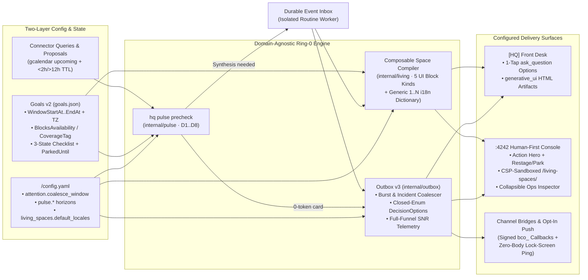

# RFC-0027: Muse-Informed Proactive Actions — Lifecycle Anticipation Engine, Structured Decision Cards, Composable Living Spaces & Horizon-Aware Steering

- **Status:** Proposed (Phase 1 — Revised for Framework vs. Personal Vault Separation)
- **Author:** `[Task:agy-hq] Muse Proactive Actions Research & RFC` (`gemini-4-carbon-high`)
- **Created:** 2026-11-21
- **Companion Research:** [22 — Meta Muse (`muse.ai`) Proactive Actions, Temporal Anticipation & Living Interactive Spaces Audit](../research/22_muse_proactive_actions_and_living_artifacts_audit.md), [10 — Meta Muse (`muse.ai`) Deep Dive](../research/10_muse_ai_proactive_and_context_study.md)
- **Extends & Subsumes:** [RFC-0014 (Proactive Engine v2)](./0014-proactive-engine-and-living-context.md), [RFC-0020 (Ambient Synthesis & Mobile Push — Subsumed & Expanded)](./0020-proactive-ambient-synthesis-and-mobile-push.md)
- **Integrates With:** [ADR-0003 (Two-Layer OSS & Private Vault)](../decisions/0003-two-layer-oss-and-private-vault.md), [RFC-0017b (Provenance Taint & Offer Gateway)](./0017b-provenance-taint-and-offer-gateway.md), [RFC-0017c (Lease-Based Morning Brief)](./0017c-lease-based-morning-brief-and-extensions.md), [RFC-0018 (Durable Event Inbox & Timers)](./0018-always-on-agent-runtime-hardening.md), [RFC-0019 (OS vs. User-Space Skill Boundary)](./0019-two-tier-rsi-vault-overlay.md), [RFC-0021 (Customizable Approval Policy)](./0021-customizable-approval-policy-and-ux.md), [RFC-0023 (Front Desk Channel Bridge)](./0023-front-desk-channel-bridge.md), [RFC-0026 (Unified Session Authorization Lattice & Scoped Delegates)](./0026-declarative-scoped-delegates.md)

---

## 1. Motivation & Problem Statement

Across [RFC-0014](./0014-proactive-engine-and-living-context.md) through [RFC-0026](./0026-declarative-scoped-delegates.md), `agy-hq` established strong Ring-0 proactive plumbing: 0-token `TriggerCursor` gatekeepers, quarantined channel watchers (`hq watch`), cryptographic nonce-fenced reply offers (`hq offer stage`), a 4-tier Outbox (`interrupt`, `brief_rollup`, `ideas_feed`, `silent_ledger`), durable `Events`/`Timers`, mobile Channel Bridges, and an 8-profile Session Capability Lattice (`internal/authz`).

However, our comparative product and UX audit of **Meta Muse (`https://muse.ai/`)** ([Research 22](../research/22_muse_proactive_actions_and_living_artifacts_audit.md)) demonstrates why `agy-hq`'s day-to-day proactive behavior still lags behind a human-grade proactive agent across **three user-facing dimensions**:

1. **Reactive Single-Item Triage vs. Lifecycle Anticipation & Cross-Stream Synthesis:**
   - `hq watch precheck` evaluates inbound Gmail/GChat threads in isolation, while [RFC-0020](./0020-proactive-ambient-synthesis-and-mobile-push.md) (`internal/pulse/`) remains unimplemented.
   - `Goal` ([`internal/kernel/goals.go`](../../internal/kernel/goals.go)) models only a flat `TargetDate` and boolean `Milestone` list. It cannot express **bounded availability/event windows** (`WindowStartAt..WindowEndAt`, `Timezone`, `BlocksAvailability`), **horizon countdown escalations** (`T-168h` $\rightarrow$ `T-72h` $\rightarrow$ `T-24h`), **window-boundary transition pings**, **backward deadline ripples** (flagging an obligation due *during* or right after an unavailable window so it is completed beforehand), **generic interval-overlap & coverage-span gaps**, or **3-state readiness** (`confirmed` vs. `open` vs. `skipped`).
   - Meanwhile, `AttentionConfig.CoalesceWindow` is parsed in [`internal/outbox/outbox.go`](../../internal/outbox/outbox.go) (`L185`) **but never enforced**, causing back-to-back vendor alerts (e.g., *"Password changed"* followed 15 minutes later by *"MFA changed"*) to trigger separate `110k+`-token Front Desk wakes.
2. **Walls of Markdown vs. Composable Living Interactive Spaces:**
   - `ConsoleSpace` ([`internal/webui/spaces.go`](../../internal/webui/spaces.go)) renders only plain-text `[]string` bullet slices (`SpaceWidgetOutput`). Multi-step plans, option comparison matrices, and readiness boards are emitted as static Markdown prose rather than self-contained interactive micro-apps supporting **0-token client-side `i18n` locale switching** (when a user configures multiple locales), **generic multi-perspective lenses & sub-group filters**, live countdown headers, and visual readiness bars—even though Antigravity natively supports `generative_ui` HTML artifacts and `:4242` runs a local loopback web server.
3. **Passive Dead-End Text Alerts, Silent Proposal Timeouts & CLI Steering Friction:**
   - `FormatInterruptCard` ([`internal/outbox/dispatcher.go`](../../internal/outbox/dispatcher.go)) emits plain text with zero structured `DecisionOption` choices; when no `hq offer` proposal is attached, `[HQ] Front Desk` ends alerts with passive *"Let me know if you need help"* prose instead of 1-tap decision pills (`[Mark Handled]` · `[Run Scoped Check]` · `[Park Until Horizon]`).
   - Proposals that expire during the day (`> 12h` before the 7:30 AM Morning Brief) fall into a blind spot in `collectProposalAlerts` ([`internal/brief/brief.go`](../../internal/brief/brief.go) `L329`), leaving users unaware that an approved/staged action never executed and offering no 1-command `hq approvals restage <id>`.
   - `hq_console.md` and `:4242` lead with harness telemetry (token burn, CHR %, raw 5-field cron strings) rather than human decisions, lack horizon-aware `"Park until X"` (`ParkedUntil`) holds, and omit `interrupt` noise outcomes from `hq rsi mine`.

This RFC specifies a cohesive, four-phase upgrade (**Phases 2A–2D**) engineered strictly around `agy-hq`'s **Two-Layer OS vs. Private Vault boundary** ([ADR-0003](../decisions/0003-two-layer-oss-and-private-vault.md), [RFC-0019](./0019-two-tier-rsi-vault-overlay.md)): the open-source engine provides **domain-agnostic, locale-neutral, zero-assumption primitives**, while personal preferences (such as bilingual `["en", "zh"]` defaults, audience personas, custom horizons, and domain workflows) live strictly in the user's private `<vault>/`.

---

## 2. Design Goals, Non-Goals & Architectural Invariants

### 2.1 Design Goals
1. **Strict Framework vs. Personal Configuration Separation:** Keep `cmd/` and `internal/` 100% free of hardcoded personal locales, consumer-travel categories, or household/persona assumptions; expose declarative configuration hooks in `<vault>/config.yaml`, `<vault>/skills/`, and `<vault>/living_spaces/`.
2. **0-Token Lifecycle & Constraint Anticipation (`internal/pulse/` + `Goal` v2):** Subsuming and expanding [RFC-0020](./0020-proactive-ambient-synthesis-and-mobile-push.md), evaluate configurable horizon windows, blocking-window deadline collisions, interval/buffer overlaps, required coverage-tag spans, 3-state readiness (`confirmed` / `open` / `skipped`), and expiring/expired proposals in pure Go (`0` LLM tokens when quiet).
3. **Correlated Incident Burst Coalescing (`internal/outbox/`):** Enforce `attention.coalesce_window` (default `3m` for non-critical interrupts) and `attention.incident_correlation_window` (`30m`) so related multi-step alerts from the same `(Connector, SenderDomainOrScope, Category)` merge or thread cleanly.
4. **Ring-0-Safe Structured Decision Cards & Timeout Recovery (`DecisionOption` + `hq approvals restage`):** Attach 2–4 closed-enum, anti-cue-sanitized decision options to proactive cards—actionable in 1 tap via `ask_question`, `:4242` WebUI, or `hq-channel-bridge/v1`—and guarantee 100% visibility + 1-tap re-staging for timed-out proposals.
5. **Composable Living Interactive Spaces (`internal/living/`):** Compile canonical `<vault>/living_spaces/<slug>/space.json` models built from **5 domain-neutral UI block primitives** into self-contained HTML5 micro-apps with generic `1..N` BCP-47 client-side `i18n` dictionaries (`0` toggle UI when single-locale; `<5ms / 0-token` switching when multi-locale), generic `0..N` perspective/group filters, live JS countdowns, and readiness bars—served across configurable surfaces (`webui` `:4242` CSP sandbox and/or Antigravity `generative_ui` artifacts).
6. **Human-First Console Hierarchy, Horizon Parking & Full-Funnel SNR:** Re-order `:4242` and `hq_console.md` around human actions/Spaces, add `NextRunAt` countdowns on schedules, support `"Park until <date|after:goal>"` (`ParkedUntil`) + `hq cancel` reversals, and wire `interrupt` dismissal/expiry metrics into `hq rsi mine`.

### 2.2 Non-Goals
- **No Cloud Hosting or External Artifact Relays:** Living Spaces live strictly inside `<vault>/living_spaces/` and `<artifactDir>/`; `agy-hq` never uploads personal data to external servers.
- **No Domain-Specific Bloat in Ring-0 Go Packages:** Travel itineraries, secondary-market deal tables, or family guides are **user-space instances/skills** composed out of generic `Goal` and `LivingSpace` primitives—never hardcoded structs in `internal/`.
- **No Unapproved External Mutations or External Go Dependencies (`H4-A` & `H5`):** `RFC-0003`/`RFC-0017b`/`RFC-0021` approval invariants and pure Go stdlib (`0` external deps) remain absolute, keeping all monolith files strictly below their `Gate H5` LOC ceilings.

### 2.3 Two-Layer Boundary: Framework Infrastructure vs. Personal Vault Configuration

Every capability in `RFC-0027` cleanly separates **Layer 1 (Open-Source Framework / Infra)** from **Layer 2 (Personal Configuration & User Space)**:

| Dimension | Layer 1: `agy-hq` Framework & Core Plugin (Tracked Repo) | Layer 2: Personal Configuration & Vault (`<vault>/` — Git-Ignored) |
| :--- | :--- | :--- |
| **Localization (`i18n`)** | Locale-agnostic `LocalizedText` (`string` or `map[bcp47]string`) + `<script id="hq-i18n" type="application/json">` client-side switcher. **Neutral engine default:** `default_locales: ["en"]` (language toggle auto-hidden when `len(locales) == 1`). | User sets `living_spaces.default_locales: ["en", "zh"]` and optional `locale_labels: {"en": "English", "zh": "中文"}` in `<vault>/config.yaml` (or passes `--locales=en,zh` per Space). |
| **Perspectives & Sub-Groups** | Generic `perspectives: []PerspectiveSpec{ID, Label}` (`0..N` arbitrary view lenses) and `groups: []string` (`0..N` arbitrary lane filters); UI controls auto-hidden when `0` are defined. | Space/skill author defines domain-relevant lenses in `<vault>/` (e.g., `Executive vs. Runbook` for SRE, `Bull vs. Kill Criteria` for investing, or `In-Depth vs. Kids` for family travel). |
| **Space Layout Schema** | **5 Composable Domain-Neutral Block Primitives:** `kpi_strip`, `timeline_accordion`, `comparison_table`, `checklist_ledger`, and `callout_notes`. Configurable `default_surfaces` (`["webui", "artifact"]`). | Personal workflows, starter prompts, and domain conventions live in `<vault>/skills/<slug>/SKILL.md` (`RFC-0019`), `<vault>/USER.md`, and `<vault>/living_spaces/<slug>/space.json`. |
| **`Goal` & `hq pulse` Math** | Domain-neutral interval algebra: `WindowStartAt..WindowEndAt`, `Timezone`, `BlocksAvailability bool`, `RequiredCoverageTag string`, `MinSlotBuffer`, and 3-state `ChecklistItem` (`open` \| `confirmed` \| `skipped`) with freeform `Tag string` and `CutoffAt`. | User's actual goals (product launches, tax deadlines, trips, lease buyouts), custom `pulse:` lead windows in `<vault>/config.yaml`, and push webhook secrets in `<vault>/private/credentials/push.json`. |
| **Attention & Coalescing** | Enforces `attention.coalesce_window` (neutral default `3m`, `0s` for `Critical: true`) + `incident_correlation_window` (`30m`) + closed-enum `DecisionOption` dispatcher. | User's `attention.mode` (`focused` \| `balanced` \| `proactive`), `quiet_hours`, custom `coalesce_window`, and learned per-skill RSI tier overrides in `<vault>/memory/rsi/rules/`. |

Declarative `<vault>/config.yaml` surface (showing neutral framework defaults vs. optional personal overrides):

```yaml
# Framework defaults shipped in templates/config.yaml (all fields optional):
attention:
  mode: balanced
  cooldown_per_topic: "4h"
  coalesce_window: "3m"              # 0s for Critical: true; set "0s" to disable burst holding
  incident_correlation_window: "30m" # Annotates follow-up cards sharing IncidentKey

pulse:
  enabled: true
  pre_meeting_lead: "30m"
  countdown_horizons: ["168h", "72h", "24h"]
  cutoff_lead: "6h"
  min_slot_buffer: "45m"

living_spaces:
  default_locales: ["en"]            # Personal Vault override example: ["en", "zh"]
  default_surfaces: ["webui", "artifact"] # "webui" (:4242) and/or "artifact" (Antigravity generative_ui)
```

### 2.4 Lock Hierarchy & Ring-0 Security Invariants
- **Strict `internal/store` Lock Ordering:**
  - `RankPulse = 32` (`<vault>/memory/pulse/.pulse.lock`, positioned strictly above `RankTriggerCur = 20` and `RankWatcher = 30`, and strictly below `RankTimers = 35`, `RankEvents = 40`, `RankGoals = 50`, and `RankOutbox = 60`). `pulse.RunPrecheck` uses a snapshot-then-commit pattern so `RankPulse` is never held across connector subprocesses, `events.Enqueue`, or `outbox.Add`.
  - `RankLivingSpaces = 77` (`<vault>/living_spaces/<slug>/.space.lock`, pure leaf store alongside `RankWorkspaces = 76` and `RankMemory = 78`).
- **Non-Interference Preservation (`RFC-0026` `NI-1`–`NI-4`):**
  - `ProfileQuarantinedReader` (`tainted`) sessions may emit `DecisionOption` items **only** with closed-enum `ActionKind` values (`approve_proposal`, `reject_proposal`, `park_until`, `dismiss_handled`, `dismiss_noisy`, `skip_checklist`, `promote_goal`) referencing `ProposalIDs` staged by that session or its own `OutboxItem`. `ActionKind: "spawn_investigation"` from a tainted item must reference a registered Core or Vault skill slug (`[a-z0-9-]+`) and always spawns an isolated `unattended_auto` / `quarantined_reader` worker—never executing inline shell commands in `[HQ] Front Desk`.
  - `:4242/living-spaces/<slug>` serves HTML with `Content-Security-Policy: default-src 'none'; style-src 'unsafe-inline'; script-src 'unsafe-inline'; img-src data:; base-uri 'none'; form-action 'none'` and embeds inside `:4242` via `<iframe sandbox="allow-scripts">` (omitting `allow-same-origin`), guaranteeing zero access to `:4242` `/api/*` endpoints or `X-HQ-CSRF-Token`.

---

## 3. Architecture Overview



---

## 4. Subsystem 1 (Phase 2A — P0): Lifecycle Anticipation, 3-State Readiness & Incident Coalescing

### 4.1 Domain-Agnostic `Goal` v2 Schema (`internal/kernel/goals.go` + `goals_readiness.go`)

We extend `Goal` backward-compatibly in `<vault>/memory/goals.json` using **domain-neutral interval, readiness, and dependency primitives** (existing `Milestones` and `WaitingOn` round-trip unchanged):

```go
// ChecklistStatus models a 3-state readiness ledger (Confirmed vs. Open vs. Skipped tombstone).
const (
    ChecklistOpen      = "open"
    ChecklistConfirmed = "confirmed"
    ChecklistSkipped   = "skipped" // Tombstone: suppresses repeat nudges on declined items
)

type ChecklistItem struct {
    ID                        string `json:"id"`                                  // e.g. "chk-1"
    Title                     string `json:"title"`                               // Human-readable deliverable/item
    Tag                       string `json:"tag,omitempty"`                       // Freeform caller tag (e.g. "lodging", "signoff", "cutover")
    Status                    string `json:"status"`                              // open | confirmed | skipped
    WindowStartAt             string `json:"windowStartAt,omitempty"`             // Optional RFC3339 slot start
    WindowEndAt               string `json:"windowEndAt,omitempty"`               // Optional RFC3339 slot end
    ConstraintNote            string `json:"constraintNote,omitempty"`            // e.g. "Complete before 14:00 split"
    Group                     string `json:"group,omitempty"`                     // Optional sub-group / owner lane
    ExternalRef               string `json:"externalRef,omitempty"`               // Confirmation ID, PR #, or ticket ref
    StatusNote                string `json:"statusNote,omitempty"`                // Terms, hold note, or verification detail
    CutoffAt                  string `json:"cutoffAt,omitempty"`                  // Optional RFC3339 cancellation/freeze/submission cutoff
    MustCompleteBeforeWindow  bool   `json:"mustCompleteBeforeWindow,omitempty"`  // Must finish before parent Goal.WindowStartAt
    ActionURL                 string `json:"actionUrl,omitempty"`                 // Optional deep link
    SkipReason                string `json:"skipReason,omitempty"`                // Populated when Status == "skipped"
    UpdatedAt                 string `json:"updatedAt"`
}

// Added optional fields on Goal (internal/kernel/goals.go):
type Goal struct {
    // ... existing Slug, Title, Scope, Status, TargetDate, Milestones, WaitingOn, CreatedAt, UpdatedAt, CompletedAt ...
    WindowStartAt       string          `json:"windowStartAt,omitempty"`       // RFC3339 start of bounded event/sprint/trip window
    WindowEndAt         string          `json:"windowEndAt,omitempty"`         // RFC3339 end of window
    Timezone            string          `json:"timezone,omitempty"`            // Optional IANA TZ for window-local rendering/pings
    BlocksAvailability  bool            `json:"blocksAvailability,omitempty"`  // Ripples overlapping external deadlines prior to WindowStartAt
    RequiredCoverageTag string          `json:"requiredCoverageTag,omitempty"` // Optional tag whose confirmed items must span WindowStartAt..EndAt
    ParkedUntil         string          `json:"parkedUntil,omitempty"`         // RFC3339, YYYY-MM-DD, or "after:<goal-slug>"
    SpaceSlug           string          `json:"spaceSlug,omitempty"`           // Optional linked Space in <vault>/living_spaces/<slug>
    Checklist           []ChecklistItem `json:"checklist,omitempty"`
}
```

- **Readiness Computation (`Goal.ReadinessProgress()`):** Returns `(confirmed, open, skipped, activeDenominator)` where `activeDenominator = confirmed + open` (`skipped` tombstones are excluded from the denominator and surfaced separately as `Decided: Skipped`).
- **CLI Additions (`cmd/hq/goals_cli.go`):**
  - `hq goals add --slug=<slug> --title="..." [--window-start=...] [--window-end=...] [--tz=...] [--blocks-availability] [--coverage-tag=...]`
  - `hq goals checklist add --goal=<slug> --title="..." [--tag=...] [--window-start=...] [--cutoff=...] [--before-window]`
  - `hq goals checklist confirm --goal=<slug> <id-or-title> [--ref=...] [--note=...]`
  - `hq goals checklist skip --goal=<slug> <id-or-title> [--reason="..."]`
  - `hq goals park <slug> --until=<RFC3339|YYYY-MM-DD|after:goal-slug>` (and `hq goals unpark <slug>`).

### 4.2 Eight Deterministic `hq pulse precheck` Detectors (`internal/pulse/`)

`hq pulse precheck --json` runs every `15m` (`mode: daemon_gatekeeper`, `dedup_mode: precheck_enqueues`) in-process inside `EvaluateDaemonGatekeepers`, reading thresholds from `<vault>/config.yaml` (`pulse:`) and persisting dedup state in `<vault>/memory/pulse/state.json` under `store.RankPulse = 32`:

| Detector | Generic Inputs Joined (0 LLM Tokens) | Firing Condition | Dedup Key / Cooldown | Output Mode |
| :--- | :--- | :--- | :--- | :--- |
| **`D1: pre_meeting_prep`** | `gcalendar` (`now+10m..now+lead`) $\bowtie$ `entities/*.md` $\bowtie$ `WaitingOn` $\bowtie$ unsent drafts | External-attendee event within `pulse.pre_meeting_lead` (`30m` default) with matching dossier, open `WaitingOn`, or unsent draft | `meet:<eventId>:<startISO>` (`24h`) | Enqueues `routine` synthesis event $\rightarrow$ 5-bullet Pre-Meeting Card + `DecisionOption`s |
| **`D2: horizon_countdown`** | `Goal` (`WindowStartAt`, `TargetDate`, `Checklist.CutoffAt`) | Crosses configured `pulse.countdown_horizons` (`168h` $\rightarrow$ `brief_rollup`; `72h`/`24h` with open items $\rightarrow$ `interrupt` with *"ignore if handled"* note) or `CutoffAt - cutoff_lead` (`6h`) | `phase:<slug>:<bucket>` (`7d`) | **0-token Go card** (or `routine` worker if Space refresh is bound) |
| **`D3: blocking_window_ripple`** | Active `Goal` with `BlocksAvailability: true` $\bowtie$ other active `Goals`, `ChecklistItem`, `WaitingOn` | Another obligation's `TargetDate`/`FollowUpAfter` falls inside `WindowStartAt..WindowEndAt + 24h` (or `MustCompleteBeforeWindow` is `open`) and `WindowStartAt` is within `72h` | `ripple:<blockSlug>:<targetId>` (`48h`) | **0-token Go `interrupt` card** highlighting effective pre-window cutoff + `[Mark Handled]` / `[Park Until After Window]` |
| **`D4: window_transition_ping`** | `Goal` (`WindowStartAt`, `WindowEndAt`, `Timezone`) + `timers.json` (`reason=settlement_check`) | Within `15m` of `WindowStartAt` transition or due `settlement_check` follow-up timer (for offline actions invisible to digital connectors) | `trans:<id>:<phase>` (`once`) | **0-token Go `interrupt` card** formatted in `Goal.Timezone` + `[Confirmed — Close]` / `[Keep Open]` |
| **`D5: interval_and_coverage_conflict`** | `Goal` (`WindowStartAt..WindowEndAt`, `RequiredCoverageTag`, `Checklist` windows) $\bowtie$ `gcalendar` events | (a) Two confirmed time windows overlap or violate `pulse.min_slot_buffer` (`45m` when transit/gap flagged); (b) `RequiredCoverageTag != ""` has uncovered day spans inside `WindowStartAt..WindowEndAt` | `conflict:<hash16>` (`72h`) | **0-token Go `interrupt` card** listing exact conflicting intervals or uncovered dates + options |
| **`D6: proposal_ttl_and_expiry`** | `<vault>/memory/proposals/*.json` + `interventions.jsonl` | (a) Pending proposal has `< 2h` before `ExpiresAt`; (b) Proposal transitioned to `expired` with `NotifiedExpired == false` (**eliminating the `12h` brief blind spot**) | `prop_ttl:<id>` / `prop_exp:<id>` (`once`) | **0-token Go `interrupt` card** with `[Approve Now]` or `[Re-Stage Confirmation Card]` (`restage_proposal`) |
| **`D7: waiting_sla_breach`** | `Goal.WaitingOn` (`status=waiting`) $\bowtie$ `interventions.jsonl` (expired offers on `threadKey`) | `now >= FollowUpAfter` and parent `Goal` is not `ParkedUntil > now` | `sla:<goalSlug>:<waitId>` (`24h`) | Annotates whether a prior staged reply on `threadKey` expired unsent; enqueues follow-up offer worker |
| **`D8: parked_horizon_wakeup`** | `Goal.ParkedUntil` & `OutboxItem` (`status=snoozed`, `ParkHorizon`) | `now >= ParkedUntil` or `"after:<goalSlug>"` has `now > WindowEndAt` | `wake:<id>:<horizon>` (`once`) | Wakes parked items cleanly into `brief_rollup` / consolidated digest |

> **Optional Zero-Body Mobile Push (Subsumed from [RFC-0020 §4.3](./0020-proactive-ambient-synthesis-and-mobile-push.md)):** `internal/outbox/push.go` delivers opt-in zero-PII generic badges (`"agy-hq: 1 time-sensitive decision in Front Desk"`) via `<vault>/private/credentials/push.json` (`0600`) strictly when configured by the user and after `DispatchPendingInterrupts` + `InQuietHours` pass.

### 4.3 Outbox Burst & Correlated Incident Coalescing (`internal/outbox/outbox.go` + `dispatcher.go`)

1. **Enforce `attention.coalesce_window` (Framework Default `3m` for Non-Critical `interrupt`s):**
   - Non-critical `interrupt` items set `AvailableForDispatchAt = CreatedAt + cfg.CoalesceWindow` (`Critical: true` or `--immediate` items bypass the hold and dispatch on the next `15s` fast tick; users wanting zero hold can set `coalesce_window: "0s"` in `<vault>/config.yaml`).
2. **Same-Incident Correlation (`IncidentKey`):**
   - Compute `IncidentKey = lower(Connector) + "|" + senderDomainOrScope + "|" + categoryClass`.
   - Undispatched `pending` `interrupt` items arriving within `CoalesceWindow` with matching `IncidentKey` **merge into a single multi-bullet `OutboxItem`**, waking `[HQ] Front Desk` once instead of `N` times.
   - If a prior `interrupt` sharing `IncidentKey` was already `delivered` within `cfg.IncidentCorrelationWindow` (`30m` default), prepend **`↪ Correlated Update (#2 in 30m — follows <prevTitle>)`** so Front Desk frames the sequence coherently.

---

## 5. Subsystem 2 (Phase 2B — P0): Structured Decision Cards, Timeout Recovery & Portfolio Context

### 5.1 Closed-Enum `DecisionOption` Schema (`internal/outbox/decisions.go`)

```go
const (
    ActionApproveProposal    = "approve_proposal"    // Executes approvals.Approve (requires human presence / WebUI / signed bridge cap)
    ActionRejectProposal     = "reject_proposal"     // Executes approvals.Reject
    ActionRestageProposal    = "restage_proposal"    // Clones an expired proposal into a fresh 24h pending Proposal
    ActionParkUntil          = "park_until"          // Parks OutboxItem / Goal until Horizon (e.g. "24h", "2026-12-02", "after:<goal-slug>")
    ActionDismissHandled     = "dismiss_handled"     // Marks Status="acted_handled" (positive SNR signal: valid catch, handled offline)
    ActionDismissNoisy       = "dismiss_noisy"       // Marks Status="dismissed" + Reason="noisy" (negative SNR signal -> hq rsi mine)
    ActionSkipChecklist      = "skip_checklist"      // Marks Goal ChecklistItem Status="skipped" (tombstone)
    ActionPromoteGoal        = "promote_goal"        // Promotes item into an active Goal
    ActionSpawnInvestigation = "spawn_investigation" // Enqueues an isolated worker bound to a registered Core/Vault skill slug
)

type DecisionOption struct {
    ID          string `json:"id"`                    // "opt-1".."opt-4" (max 4 options per card)
    Label       string `json:"label"`                 // <= 60 runes, SanitizeAntiCue-scrubbed
    Description string `json:"description,omitempty"` // <= 160 runes, SanitizeAntiCue-scrubbed
    Recommended bool   `json:"recommended,omitempty"`
    ActionKind  string `json:"actionKind"`            // Must be one of the 9 closed constants above
    TargetID    string `json:"targetId,omitempty"`    // Verified prop-..., goal/chk ID, item ID, or registered skill slug
    Horizon     string `json:"horizon,omitempty"`     // Duration, YYYY-MM-DD, or "after:<goal-slug>"
}
```

### 5.2 Taint Validation & 1-Tap Execution (`0` LLM Tokens)
- **Quarantine Validation (`ValidateDecisionOptions`):** Caps `len(Decisions) <= 4`, scrubs `Label`/`Description` via `SanitizeAntiCue`, and restricts `tainted` (`ProfileQuarantinedReader`) callers to referencing only `ProposalIDs` staged by `CallerConvID`, their own `OutboxItem`, or registered skill slugs—never free-form shell commands or arbitrary prompts.
- **Three-Surface Parity:** `[HQ] Front Desk` surfaces `Decisions` via native `ask_question` (recommended option first) and runs `hq outbox act <item-id> --option=<opt-id>`; `:4242` renders pill buttons via `/api/outbox/act`; and `hq-channel-bridge/v1` supports signed `bco_` callback buttons on mobile.

### 5.3 Proposal Expiry Recovery (`hq approvals restage` & Thread Unsent Context)
1. **`hq approvals restage <expired-prop-id>`:** Re-mints a fresh `24h` pending proposal from an `expired` record in `interventions.jsonl` in **0 LLM tokens** (re-running `connector.InspectThread` on `offer_send` items to warn if the remote thread advanced since original staging).
2. **Thread Unsent Context Injection:** When `hq watch precheck` enqueues a thread with an unrestaged `expired` offer in the past `14d`, it injects `[Prior Staged Reply Expired Unsent: prop-... on YYYY-MM-DD — 0 replies sent from that proposal]` into the trusted event metadata header.

---

## 6. Subsystem 3 (Phase 2C — P1): Composable Living Interactive Spaces (`internal/living/`)

### 6.1 Composable, Locale- & Domain-Neutral `space.json` Schema (`<vault>/living_spaces/<slug>/space.json`)

Rather than hardcoding domain templates (`itinerary`, `deal_matrix`) or specific languages (`en`/`zh`) in Go, `internal/living/` implements a **composable micro-app runtime** built from **generic `LocalizedText`**, **optional `perspectives` & `groups` dimensions**, and **5 domain-neutral section primitives** (`kpi_strip`, `timeline_accordion`, `comparison_table`, `checklist_ledger`, `callout_notes`):

```json
{
  "schema_version": 1,
  "slug": "q4-launch-cutover",
  "schedule": "weekdays 07:00-20:00 America/Los_Angeles",
  "goal_slug": "q4-launch-cutover",
  "default_locale": "en",
  "locales": ["en"],
  "locale_labels": { "en": "English" },
  "title": "Q4 Launch & Readiness Hub",
  "perspectives": [
    { "id": "exec", "label": "Executive Summary" },
    { "id": "ops",  "label": "On-Call Runbook" }
  ],
  "groups": ["All", "Backend", "Security"],
  "kpis": [
    { "kind": "countdown", "target_at": "2026-12-01T17:00:00Z", "tz": "America/Los_Angeles", "label": "until cutover" },
    { "kind": "readiness", "confirmed": 11, "open": 5, "skipped": 1, "label": "11 of 16 gates ready" }
  ],
  "sections": [
    { "id": "timeline", "nav_label": "TIMELINE", "kind": "timeline_accordion", "items": [] },
    { "id": "matrix",   "nav_label": "OPTIONS",  "kind": "comparison_table",   "columns": [], "rows": [] },
    { "id": "status",   "nav_label": "READINESS","kind": "checklist_ledger",   "sync_from_goal": true }
  ]
}
```

> **How Personal Preferences Compose Cleanly on Top of This Primitive:**
> - **Single-Locale Users (Framework Default):** `hq space create` inherits `living_spaces.default_locales: ["en"]` from `config.yaml`. Every text field accepts a plain JSON string (`"Q4 Launch"`), and because `len(locales) == 1`, **zero language switcher UI is rendered**.
> - **Multilingual Users (Personal `<vault>/config.yaml` Override):** Setting `living_spaces.default_locales: ["en", "zh"]` (or `["en", "ja", "es"]`) tells agents/skills creating Spaces in that Vault to populate `LocalizedText` maps (`{"en": "...", "zh": "..."}`). The Go compiler embeds a generic `<script id="hq-i18n" type="application/json">` dictionary and renders `[English | 中文]` toggle pills that switch all `[data-i18n]` nodes client-side in **`< 5ms` and `0` LLM tokens** (persisting `?lang=<code>` in `URLSearchParams` without `localStorage`).
> - **Domain Workflows in User Space (`<vault>/skills/`):** Personal trip guides (with `perspectives: ["in_depth", "kids"]` and split-party `groups`), secondary-market comparison matrices (`comparison_table`), or sprint hubs live strictly in `<vault>/living_spaces/` and `<vault>/skills/`—zero personal logic in `internal/living/`.

### 6.2 Incremental `Goal` Sync & Configurable Rendering Surfaces
1. **0-Token Readiness Sync (`hq space sync-goal <slug>`):** Confirming or skipping a `Goal` `ChecklistItem` automatically updates any linked `space.json` (`sync_from_goal: true`) and recompiles `index.html` in **0 LLM tokens**.
2. **Configurable Dual-Surface Output (`living_spaces.default_surfaces`):**
   - **`"webui"` (`:4242/living-spaces/<slug>`):** Loopback HTTP route in `internal/webui/living_spaces_http.go` with strict CSP (`default-src 'none'; style-src 'unsafe-inline'; script-src 'unsafe-inline'; img-src data:`) inside `<iframe sandbox="allow-scripts">`.
   - **`"artifact"` (Antigravity `generative_ui`):** `hq space export-artifact <slug>` writes `<artifactDir>/space_<slug>.html` using Antigravity's allowlisted `tailwindcss.min.js` and host semantic CSS tokens (`--background`, `--card`, `--foreground`, `--border`, $\ge 12\text{px}$ floor) for native side-pane viewing or compact `<500px` `<agent-embed>` cards.

---

## 7. Subsystem 4 (Phase 2D — P1/P2): Human-First Console Hierarchy, Reversal & Closed-Loop SNR

### 7.1 Human-First Re-Ordering of `:4242` & `hq_console.md`
1. **Section 1 — Action Required & Active Horizons:** Pending Approvals (`[Approve]`, `[Reject]`, `[Re-Stage]`), Active `DecisionOption` Cards, and `< 48h` `pulse` Countdowns / Blocking-Window Ripples.
2. **Section 2 — Active Living Spaces & Scheduled Console Spaces:** Visual readiness bars, countdowns, and `[Open Interactive Space]` links.
3. **Section 3 — Active Goals, Readiness, Parked Horizons & Layer-1 Tasks:** `Confirmed / Open / Skipped` ratios, `ParkedUntil` badges, and active Task Conversations.
4. **Section 4 — Collapsible Ops Inspector (`Activity · Schedules · Quota · Health`):** Moves Token Burn, Prefix CHR %, Watermarks, Delegate Counters, and `hq doctor` into `<details>` / an Inspector tab, and computes human-readable **`NextRunAt`** (`Tomorrow 07:30 AM · in 18h 42m`) on `ScheduleSummaryRow` via `timers.NextCronOccurrence`.

### 7.2 Mid-Flight Reversal (`hq cancel`) & Full-Funnel SNR $\rightarrow$ `hq rsi mine`
1. **`hq cancel <event-id|task-slug|prop-id> [--reason="..."]`:** Cancels queued/leased events and armed follow-up timers in scope, dismisses pending proposals, and logs `reverted_by_user` in the Console Activity stream.
2. **Full-Funnel SNR Telemetry (`internal/outbox/` $\rightarrow$ `internal/rsi/miner.go`):** Tracks `InterruptActedCount`, `InterruptParkedCount`, `InterruptNoisyCount`, and `ProposalExpiredCount`; expands `hq outbox eval` from `10` to `18` fixtures; and proposes Tier-1 personal RSI overlays in `<vault>/memory/rsi/rules/<skill>.md` (never mutating tracked Core OS skills) when `InterruptNoisyRate >= 0.40` or `ProposalExpiredRate >= 0.50`.

---

## 8. Prioritized Implementation Plan & Verification (`CUJ-45`–`CUJ-47`)

| Phase | Priority | Framework Packages & CLI Deliverables | Monolith Impact (`Gate H5`) | E2E / CI Verification |
| :--- | :--- | :--- | :--- | :--- |
| **Phase 2A** | **P0** | **`internal/pulse/`** (`D1`–`D8` generic detectors, `RankPulse=32`), domain-neutral `Goal` v2 windows + `BlocksAvailability` + `RequiredCoverageTag` + 3-state `ChecklistItem` + `ParkedUntil` (`internal/kernel/goals_readiness.go`), Outbox `CoalesceWindow` (`3m` default) + `IncidentKey` correlation (`30m`), opt-in zero-body push (`internal/outbox/push.go`), neutral defaults in `templates/config.yaml`. | `0` LOC added to `kernel.go` (new `goals_readiness.go` + `internal/pulse/`). | **`CUJ-45`:** Verifies 0-token `hq pulse precheck` across `BlocksAvailability` deadline ripple (`D3`), interval/coverage-tag conflict detection (`D5`), `3m` burst coalescing, and `18`-case `hq outbox eval`. |
| **Phase 2B** | **P0** | **`internal/outbox/decisions.go`** (`DecisionOption` closed-enum validation, `hq outbox act`), **`hq approvals restage`**, thread unsent-expiry metadata in `watcher.go`, WebUI `/api/outbox/act` + Channel Bridge `bco_` callbacks, Core OS skill updates. | `< 10` LOC dispatch hook in `cmd/hq/`; handlers in `internal/webui/outbox_actions.go`. | **`CUJ-46`:** Verifies Ring-0 taint rejection of unauthorized `DecisionOption` kinds, 1-tap `hq outbox act`, `>12h` expired proposal catch (`D6`), and 0-token `hq approvals restage`. |
| **Phase 2C** | **P1** | **`internal/living/`** (5 composable block primitives, `RankLivingSpaces=77`, locale-neutral `1..N` BCP-47 `hq-i18n` dictionary, generic `perspectives`/`groups`, `hq space` CLI), `:4242/living-spaces/<slug>` CSP-sandboxed route (`internal/webui/living_spaces_http.go`), Antigravity `generative_ui` exporter. | `0` LOC in `webui.go` beyond 1 mux registration call. | **`CUJ-47`:** Verifies single-locale (`["en"]`, hidden toggle) vs. Vault-configured multi-locale (`["en", "zh"]`) compilation, generic `perspectives` filtering, `Goal` $\rightarrow$ Space 0-token sync, and strict CSP + `sandbox="allow-scripts"`. |
| **Phase 2D** | **P1/P2** | Human-first `console_md.go` / `console.html` layout + collapsible Ops Inspector, `NextRunAt` on `ScheduleSummaryRow`, `hq cancel` reversal verb, and full-funnel `InterruptNoisyRate` / `ProposalExpiredRate` mining into `<vault>/memory/rsi/rules/`. | Keeps all 5 `Gate H5` monolith files strictly below ceiling; passes `./bin/hq ci pre-push` (`100%`). | Unit + E2E coverage for `ParkedUntil` suppression, `NextRunAt` formatting, `hq cancel` reversal audit, and Vault-scoped RSI noise-downgrade mining. |

---

## 9. Recorded Design Decisions & Open Review Gate

1. **Framework Default vs. Personal Vault Configuration (Resolved):**
   - **Framework (`templates/config.yaml` & `internal/`):** Ships neutral, domain- and locale-agnostic defaults (`living_spaces.default_locales: ["en"]` with language toggle hidden when single-locale; `living_spaces.default_surfaces: ["webui", "artifact"]`; `attention.coalesce_window: "3m"` for non-critical interrupts + `30m` `incident_correlation_window`, while `Critical: true` breaches dispatch immediately on the `15s` fast tick).
   - **Personal Vault (`<vault>/config.yaml`):** Personal preferences—such as bilingual `living_spaces.default_locales: ["en", "zh"]`, custom perspective conventions, or personal horizon rules—are configured strictly inside the git-ignored Vault, never hardcoded into the open-source engine.
2. **Implementation Gate:** Holding in Phase 1 review until you confirm any additional revisions to `RFC-0027` and give the green light for Phase 2 implementation.
