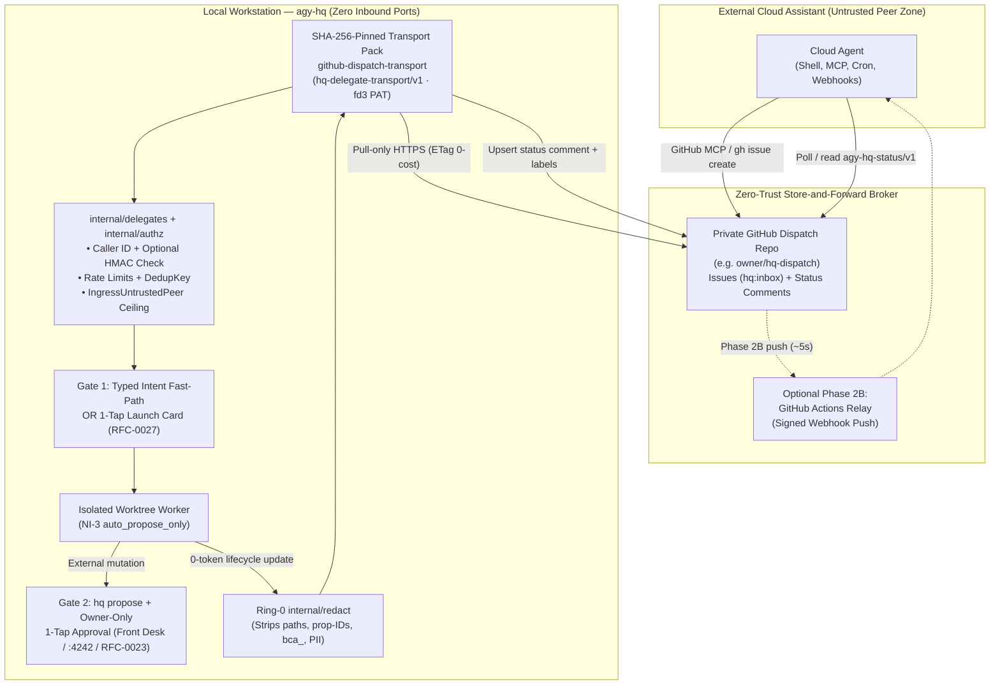

# RFC-0028: External Cloud Agent Interoperability — Scoped Handoff, Structured Status & Approval Isolation

- **Status:** Proposed (Phase 1 Design RFC — pending review)
- **Created:** 2026-11-22
- **Builds On:** [RFC-0018 (Durable Event Inbox & Resumption)](./0018-always-on-agent-runtime-hardening.md), [RFC-0021 (Approval Policy & UX)](./0021-customizable-approval-policy-and-ux.md), [RFC-0023 (Front Desk Channel Bridge)](./0023-front-desk-channel-bridge.md), [RFC-0026 (Session Authorization Lattice & Scoped Delegates)](./0026-declarative-scoped-delegates.md), [RFC-0027 (1-Tap Decisions & Timeout Recovery)](./0027-muse-proactive-actions.md)
- **Research:** [23 — External Cloud Agent & `agy-hq` Interoperability Audit](../research/23_external_agent_interop_audit.md)

---

## 1. One-Page Summary (TL;DR)

Users who run both an **external cloud assistant** (such as a Cursor Grok Bot or hosted Linux agent with Shell, browser, MCP connectors, and cron) and **`agy-hq`** on their local workstation currently have no clean machine-to-machine bridge. Driving `antigravity.google.com/remote` through a headless browser is both **brittle** (SSO/2FA expiry, fragile DOM selectors, Front Desk rotations, zero structured status) and **unsafe** (it injects untrusted cloud-bot text as the human owner `⊤`, bypassing `agy-hq`'s taint lattice and approval boundary).

Instead of inventing a new daemon or exposing loopback `:4242`, this RFC builds directly on `agy-hq`'s existing **`RFC-0026` Scoped Delegates (`hq-delegate-transport/v1`)** and **`RFC-0027` 1-Tap Decisions**:

| Problem Today | What We Propose (Minimal v1) |
| :--- | :--- |
| **1. No safe intake path from a cloud assistant** | **Pull-Only GitHub Issue/Label Dispatch (`hq-delegate-transport/v1`):** The cloud assistant opens a structured issue (`hq:inbox`) on a **dedicated private dispatch repo** (or an allowlisted OSS repo for public engineering tasks). Local `hq daemon` polls via conditional `ETag` (`0` rate-limit cost, `0` LLM tokens, **zero inbound ports**). |
| **2. No structured progress or result reporting** | **Idempotent Milestone Status Comments (`agy-hq-status/v1`):** Extend `hq-delegate-transport/v1` with an optional `update_status` verb that syncs `hq:state/*` labels and updates one pinned JSON+Markdown status comment (`task_slug`, `event_id`, `state`, sanitized `summary`, `branch`/`pr_url`) in **0 LLM tokens** after Ring-0 redaction. |
| **3. Free-form cloud briefs vs. taint isolation** | **Two-Gate Human Control (`Gate 1` + `Gate 2`):** Pre-approved typed intents run immediately (`RFC-0026`). Free-form task briefs pause at **Gate 1** with a 1-tap `RFC-0027` launch card (`[Approve & Spawn Worktree]` · `[Reject]`). All outbound mutations still pass **Gate 2** (`hq propose` + human-presence `hq approve`). |
| **4. Risk of leaking `:4242`, `daemon_token`, or Vault data** | **Zero Loopback Exposure & Strict `NI-1`–`NI-4` Isolation:** `:4242` stays strictly on `127.0.0.1`; `daemon_token` never leaves the host; cloud intake is unconditionally clamped to `IngressUntrustedPeer` (never `RFC-0023` owner bridge); outbound status strips local paths, `prop-` IDs, and `bca_`/`bcr_` tokens. |

---

## 2. What It Looks Like in Practice (Before vs. After)

### Example A — Cloud Assistant Delegates an Engineering Research & Draft PR Task
- **Today:** The cloud assistant opens a headless browser, tries to log into `antigravity.google.com/remote`, types a raw prompt into Front Desk (or breaks on 2FA/shift rotation), and has no reliable way to know the resulting branch name, draft PR URL, or failure reason.
- **With RFC-0028:**
  1. Cloud assistant uses its GitHub MCP connector to open Issue `#12` on the private dispatch repo (`<owner>/hq-dispatch`) with label `hq:inbox` and an `agy-hq-handoff/v1` block (`intent: research_rfc`, `target_repo`, `deliverable: draft_pr`).
  2. Within `15–30s`, `hq daemon` pulls Issue `#12` (`0` tokens), validates caller numeric `user.id` (+ optional HMAC), and sends a 1-tap card to the owner: **`[Approve & Spawn Worktree]` · `[Reject]`**.
  3. Owner taps **Approve**; `agy-hq` flips Issue `#12` to `hq:state/running`, works in an isolated worktree, opens the draft PR, and updates the pinned status comment to `hq:state/done` with `task_slug`, `branch`, `commit_sha`, and `pr_url`.
  4. Cloud assistant reads the JSON status block on its next check (or receives a `~5s` GitHub Actions webhook push in Phase 2B) and reports the PR link back to the user.

### Example B — Delegated Task Stages an Outbound Email / External Action
- **Today:** Either the cloud assistant cannot trigger local Vault-backed drafts at all, or driving Front Desk via browser risks auto-approving external side effects without genuine human presence.
- **With RFC-0028:**
  1. The cloud-initiated worker stages the reply via `hq propose` (forced by `NI-3` `auto_propose_only`—never `low_friction` or `ModeAutoOnly`).
  2. `agy-hq` updates the dispatch issue to `hq:state/awaiting-approval` with `approvals: { pending_count: 1, categories: ["messaging"] }` (**no** `prop-` IDs, **no** `bca_` tokens, **no** private message text).
  3. **Only the human owner** receives the full payload preview + 1-tap `[Approve]` / `[Reject]` button (in `[HQ] Front Desk`, `:4242` Console, or an owner-verified `RFC-0023` mobile bridge).
  4. Once the owner taps **Approve**, `agy-hq` executes the deterministic command in `0` LLM tokens, resumes the task, and marks the dispatch issue `hq:state/done` (or `hq:state/approval-expired` if `24h` passes unclicked).

---

## 3. Options Evaluated & Tradeoffs

We evaluated four concrete interoperability architectures ([full audit in Research 23 §3](../research/23_external_agent_interop_audit.md)):

| Option | Intake & Status Mechanism | Pros | Cons / Risks | Verdict |
| :--- | :--- | :--- | :--- | :--- |
| **A. GitHub Issues & Labels (`hq-delegate-transport/v1`)** | Pull-only `gh api` (`ETag` 0-cost polling) on a **private dispatch repo** (plus optional allowlisted OSS repo); upsert JSON+Markdown status comment + `hq:state/*` labels. | **Zero local inbound ports**; native to cloud GitHub MCP; survives laptop sleep; great mobile audit UI; reuses `RFC-0026` + `internal/redact`; `~5s` status push via opt-in GitHub Actions. | `15–30s` intake poll latency; public repos must never carry personal/PII briefs (private dispatch repo required for personal tasks). | **Recommended v1** |
| **B. Signed HTTPS Webhook + Edge Queue** | Cloud bot sends `HMAC-SHA256` webhooks to a cloud edge queue (e.g., Cloudflare Worker + Queue / Tailscale proxy) → local pull adapter → `delegates`. | `< 2s` bidirectional push latency; clean machine-to-machine JSON API. | Requires external relay/queue infra, TLS/HMAC key rotation, and edge ops; overkill for 5–30m async tasks. *(Direct `:4242` exposure is strictly forbidden.)* | **Optional Phase 2C** (same transport contract) |
| **C. Email (`gmail` Connector) / `RFC-0023` Bridge** | C1: Labeled emails via `gmail-inbox-watch`. C2: Reuse `RFC-0023` `channel_bridges`. | C1 uses existing Gmail MCPs with 0 new accounts. | C1 has `15m` cadence, MIME fragility, inbox clutter, and owner-vs-bot sender ambiguity. **C2 is unsafe (`NI-3` violation)**: `RFC-0023` trusts callers as `owner_interactive (⊤)`. | **Rejected** for bot intake *(C2 stays owner-only for approvals)* |
| **D. Private Git Mailbox Repo** | Cloud bot pushes signed `inbox/*.json` commits; `hq daemon` fetches & pushes `status/*.json`. | Strong SSH/GPG commit auth; zero API rate limits; offline-safe. | Branch merge friction for cloud MCPs; no native mobile UI or comment webhooks. | **Not chosen** (Option A gives same durability + better UX) |

---

## 4. Architecture & End-to-End Flow



```mermaid
sequenceDiagram
    participant B as Cloud Assistant
    participant G as Private GitHub Dispatch Repo
    participant H as hq daemon (Local)
    participant O as Human Owner (Front Desk / Mobile Bridge)

    B->>G: Open Issue #12 (label: hq:inbox, agy-hq-handoff/v1)
    H->>G: Conditional poll (ETag; 0 rate-limit / 0 LLM tokens)
    H->>H: Verify numeric user.id (+ optional HMAC) & rate limits
    H->>G: update_status -> state: awaiting_intake_approval
    H->>O: 1-tap DecisionOption card ([Approve & Spawn] / [Reject])
    O->>H: Tap [Approve & Spawn] (human presence)
    H->>G: update_status -> state: running (task_slug, event_id)
    H->>H: Run isolated worktree worker (NI-3 auto_propose_only)
    H->>G: update_status -> state: awaiting_approval (pending_count: 1, NO prop/bca)
    H->>O: Full payload blockquote + 1-tap [Approve] / [Reject]
    O->>H: Tap [Approve] (0-token deterministic execution)
    H->>G: update_status -> state: completed (summary, branch, pr_url)
    G-->>B: Cloud assistant reads status comment (or Phase 2B GH Actions push)
```

---

## 5. Protocol, Repo Hygiene & Vault Boundary

### 5.1 Structured Contracts (`agy-hq-handoff/v1` & `agy-hq-status/v1`)
1. **Inbound (`agy-hq-handoff/v1`):** Strict JSON block (`DisallowUnknownFields`) with `external_ref` (dedup key), `intent` (allowlisted policy ID), `target_repo` (allowlisted `owner/repo`), `base_branch`, `deliverable`, `priority`, and optional `signature` (`hmac-sha256:...`). The Markdown brief below the block is capped at `8 KiB` and stored opaquely in `<vault>/private/delegates/requests/<reqID>.json` (`0600`).
2. **Outbound (`agy-hq-status/v1`):** Single pinned issue comment updated via a backward-compatible `hq-delegate-transport/v1` verb (`op: "update_status"`, `upsert_marker: "agy-hq-status:v1"`, `labels_add`/`labels_remove`). Exposes ONLY `request_id`, `external_ref`, `task_slug`, `event_id`, fixed-enum `state`, redacted `summary` (`<= 600` runes), safe `artifacts` (`branch`, `commit_sha`, `pr_url`), aggregate `approvals` (`pending_count`, `categories`), and `updated_at`.
3. **Private Dispatch Repo vs. Public OSS Repo Rule:**
   - **Default (all personal or cross-repo tasks):** Use a dedicated **private** dispatch repository (e.g., `<owner>/hq-dispatch`, `0` collaborators).
   - **Optional (OSS engineering tasks only):** Allow an explicit public repo in `<vault>/private/delegates/transports/` strictly for public code intents (`research_rfc`, `ci_check`), guarded by numeric `user.id` allowlist, optional `HMAC-SHA256` signature, and Ring-0 `internal/redact`.

### 5.2 Open-Source Framework vs. Private Vault Split

| Layer | What Lives Here |
| :--- | :--- |
| **Open-Source `agy-hq` (`internal/delegates`, `internal/authz`, reference pack)** | Vendor-neutral `update_status` verb, Gate 1 `DecisionOption` handoff flow, 0-token status callbacks, Ring-0 `internal/redact` scrubbing, and generic `github-dispatch-transport` pack template. Zero personal names, repo names, or tokens. |
| **Private Vault (`<vault>/private/delegates/`)** | `policy.json` (allowlisted intents, repos, caller numeric IDs, rate caps, `sensitive_terms`) and `transports/<pack>__<id>.json` (`0600`, piped via `/dev/fd/3`: repo slug, fine-grained `Issues: R/W` PAT, optional HMAC signing key). |

---

## 6. Security & Approval Invariants

1. **Zero Exposure of `:4242` or `daemon_token`:** Loopback enforcement (`IsLoopbackAddr`) and `<vault>/private/daemon_token` (`0600`) remain strictly local-only. `agy-hq` never opens an inbound listening port to the cloud box.
2. **Transport Trust Ceiling (`IngressUntrustedPeer`):** Every item arriving via `delegate_transports` is clamped below `⊤`—even if the cloud assistant temporarily shares the owner's GitHub account in v1. It can **never** enter `[HQ] Front Desk` directly or mint `owner_interactive` capabilities.
3. **Human-Presence Approval Integrity (`NI-3`):** The cloud assistant cannot approve `hq propose` items, trigger `ApproveFromTrustedDaemon`, or see `prop-` IDs / `bca_`/`bcr_` tokens. Approvals occur solely via Antigravity `ask_question` (`VerifyAskAndMintCap`), `:4242` CSRF, or owner-verified `RFC-0023` mobile bridges.
4. **Least-Privilege Credentials & Anti-Spoofing:** The GitHub transport PAT is scoped **strictly** to `Issues: Read & Write` on the configured dispatch repo(s)—no `Contents`, `Pull Requests`, or `Admin` scopes. Callers are matched by immutable GitHub numeric `user.id` (never display name), optionally strengthened with a shared `HMAC-SHA256` envelope key.
5. **Quota & Replay Safety:** Deduplicated on `external_ref` + GitHub `issue_id`, rate-limited pre-preflight under `RankDelegates = 66`, bounded by `hq daemon` daily spawn quota (`RankQuota = 85`), and dead-lettered cleanly via `PoisonedItems`.

---

## 7. Phased Implementation Plan & Rough Effort

| Phase | Scope | Rough Effort | Verification |
| :--- | :--- | :--- | :--- |
| **v1 / Phase 2A (`P0`)** | Add optional `update_status` verb + multi-milestone state tracking to `internal/delegates`; wire Gate 1 `DecisionOption` launch card (`RFC-0027`) + 0-token Ring-0-redacted status callbacks (`agy-hq-status/v1`); ship SHA-256-pinned `github-dispatch-transport` companion pack (`gh api`, conditional `ETag`, numeric `user.id`, optional HMAC). | **3–5 eng days** (~600–900 LOC) | **`CUJ-48`:** Synthetic GitHub transport E2E covering intake → Gate 1 launch → worktree run → Gate 2 `hq propose` → `awaiting_approval` (zero `prop-`/`bca_` leak) → owner approve → `completed` with PR URL + spoofed caller / PII egress rejection tests. |
| **Phase 2B (`P1`)** | Opt-in GitHub Actions workflow template pushing signed status-comment webhooks to the cloud assistant (`~5s` latency, 0 local ports); optional Vault-blind `external_task_worker` profile (`ContextProjection: none`, repo-worktree jail) for zero-click pre-approved research/draft-PR tasks. | **2–3 eng days** | Unit + E2E tests proving `external_task_worker` holds `NI-1`/`NI-2` (zero Vault/inbox read, `auto_propose_only` egress). |
| **Phase 2C (`P2`, Optional)** | Edge-queued HTTPS webhook transport (Cloudflare Worker + Queue or Tailscale edge proxy → local pull adapter) speaking the **exact same** `hq-delegate-transport/v1` protocol—zero core kernel changes. | **4–6 eng days** | Replay/timestamp skew tests, offline queue recovery, and `IsLoopbackAddr` invariance check. |
