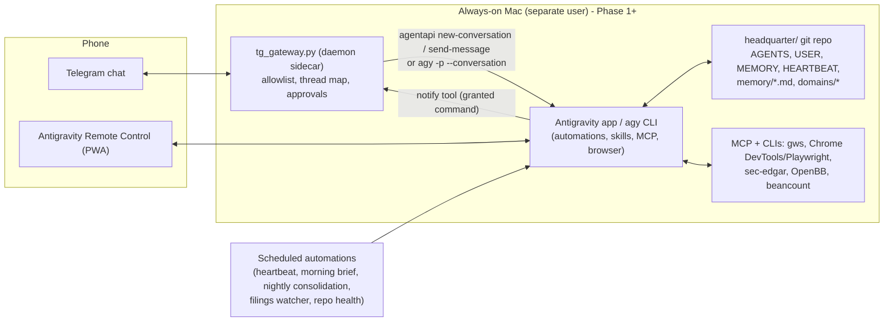

# 03 — Technical Build Options for a Proactive Personal Assistant Agent

*Research date: 2026-11-07. Scope: side-project SWE, investment research, and life admin (email, reservations, taxes, bookkeeping). The user wants a light build.*

> [!NOTE]
> **Method.** I pulled GitHub stats live from the GitHub API on 2026-11-07. I checked Antigravity's local surfaces directly with `agentapi --help`, `agy --help`, the bundled SDK and sidecar docs, and the SDK README on GitHub. Everything else came from web search. Where a claim comes only from secondary or aggregator sources, it is marked **(verify)**.

---

## 0. TL;DR

1. **Don't fork OpenClaw or Hermes for this user.** Both are very capable. OpenClaw has about 394k stars, Hermes about 261k. But both are large, fast-moving, Node/Python monoliths with a documented record of security problems: OpenClaw has had CVEs, the "ClawJacked" gateway hijack, and malware campaigns on its ClawHub skill marketplace. Both also make you pay API prices; Anthropic has blocked subscription OAuth in third-party harnesses since April 2026. **Borrow their design patterns instead**: SOUL/USER/MEMORY/HEARTBEAT files, a silent-unless-needed heartbeat, channel adapters, and DM pairing/allowlists.
2. **Antigravity already exposes more automation surface than the two options on the table assume.** I checked these locally:
   - `agy -p/--print`, with `--conversation <id>` (resume), `--output-format stream-json`, `--input-format stream-json` and `--json-schema`.
   - `agy acp`, an Agent Client Protocol stdio server.
   - `agy remote-control`, which lets you drive sessions from a phone with push notifications.
   - `agy --remote-agent`, which runs conversations on Google-managed cloud VMs.
   - `agentapi new-conversation | send-message | get-conversation-metadata`.
   - Sidecars can be **continuous daemon commands**, not just cron, and each scheduled automation can carry its own `agent_permissions.access_grants`.

   Together this makes a **hybrid** cheap: Antigravity does the work, and a thin gateway adds messaging, heartbeat and memory.
3. **Recommended path: "Light first, extensible later."**
   - **Phase 0 (1–2 days): Option 1.** A git-backed `headquarter/` workspace with OpenClaw-style memory files, 3–6 scheduled automations, and Remote Control as the mobile channel.
   - **Phase 1 (2–4 days):** add a ~200-line **Telegram gateway** that runs as an Antigravity daemon sidecar, plus a `notify` tool and a `HEARTBEAT.md` automation.
   - **Phase 2 (when needed):** move the always-on loop into an **Antigravity SDK daemon** on an always-on Mac mini (Option 2). This brings code-level policies, custom triggers such as Gmail push and file watch, and per-domain sub-agents.
   - **Phase 3:** optional memory index (SQLite FTS5 + embeddings), virtual-card payments, voice.
   - Keep skills (`SKILL.md`), MCP servers and markdown memory **portable**, so you can switch harnesses later to Claude Agent SDK, OpenAI Agents SDK or Hermes with little rework.
4. **Life admin is limited by security and integrations, not by the framework.** Use a read-only triage agent separate from an action agent. Require human approval for anything that sends, pays or files. Cap spend with merchant-locked virtual cards. Inject credentials through 1Password agent autofill, never through the model's context.

---

## 1. Evaluation criteria

| Criterion | What it means here |
|---|---|
| **Effort to MVP** | Calendar days for one engineer to reach a daily-useful assistant: morning brief, inbox triage, repo checks, research digest. |
| **Power ceiling** | How far it scales: custom triggers, multi-agent, durable long-running work, voice, payments, arbitrary integrations. |
| **Lock-in** | Model lock-in, runtime lock-in, and whether memory, skills and tools are portable. |
| **Security posture** | Defaults, sandboxing, permission model, supply-chain exposure, attack surface such as open ports, and track record. |
| **Cost** | Recurring model, hosting and SaaS costs for one heavy personal user. |
| **Use-case fit** | SWE = side-project engineering; INV = investment research; ADMIN = email, reservations, taxes, bookkeeping. |

The core security frame for every option is Simon Willison's **"lethal trifecta"**: an agent that (a) has private data, (b) reads untrusted content, and (c) can communicate externally can be prompt-injected into exfiltrating data. An email assistant has all three by default. The architecture has to break at least one leg per agent.

---

## 2. Baseline options (already on the table), with new findings

### Option 1 — Native Antigravity (desktop app + scheduled automations + skills/rules/MCP/plugins/hooks + file memory)

**What I verified locally:**
- Scheduled automations are sidecars with `"builtin": "schedule"`, a cron string (with `CRON_TZ=`) and `agentapi new-conversation -- "<prompt>"`. Each one is **a fresh conversation** with its own **`agent_permissions.access_grants`**, for example `command(gh pr list)`. Non-granted commands are auto-denied when unattended. That is a good least-privilege primitive for background jobs.
- The automation skill notes that sidecars can also be **"continuous generic command/daemon sidecars"** and **UI sidecars**. Sidecars live in `~/.gemini/config/sidecars/<id>/sidecar.json` or inside plugins, with restart policies `always | on-failure | never` ([antigravity.google/docs/sidecars](https://antigravity.google/docs/sidecars)).
- `agentapi new-conversation [--model=flash_lite|flash|pro|<id>] [--title] [--profile] <prompt>`, `agentapi send-message <recipient_id> <content>`, `agentapi get-conversation-metadata <id>`.
- The `agy` CLI has:
  - `--print` with `--output-format json|stream-json` and `--input-format stream-json`
  - `--conversation <id>` / `--continue`
  - `--json-schema` for structured output
  - `--mode accept-edits|auto|plan`, `--sandbox`, `--settings` (ephemeral JSON settings)
  - `--remote-agent` (cloud VMs)
  - `remote-control start|status|stop`
  - `acp` (Agent Client Protocol stdio server)
  - `mcp` and `plugin` management
- App settings include **"Keep computer awake"** and **"run in background"**.

**From the docs (secondary):**
- `/schedule` timers wake the *same* conversation. Sidecar automations start fresh ones ([antigravity.google/docs](https://antigravity.google/docs)).
- Remote Control is a mobile web dashboard tied to your Google account. If you add it to the home screen as a PWA, you get **push notifications when an agent finishes a turn or needs approval**.
- Remote Agents run in Google-managed VMs and need Google AI Pro/Ultra **(verify exact tiers)**.
- Known pitfalls: long multi-line prompts in `args` can truncate, so point the sidecar at a skill or a script instead. A project context is needed.

**Pricing (secondary):**
- Bundled with Google AI plans: Free, Pro \$19.99, and Ultra \$99.99 (5×) or \$199.99 (20×).
- Quota refreshes every 5 hours, with a weekly cap.
- Optional overage via AI credits.
- Source: [antigravity.google/pricing](https://antigravity.google/pricing) **(verify current numbers)**.

| | Assessment |
|---|---|
| Effort to MVP | **1–2 days.** Write `AGENTS.md`/`USER.md`/`MEMORY.md`, 3–6 automations and a few skills, and connect MCP servers (Workspace, browser, EDGAR). |
| Power ceiling | **Medium.** Excellent "hands": coding, browser, terminal, subagents, artifacts. Weak spots: proactive *messaging*, event-driven triggers (only cron, unless you write a daemon sidecar), and cross-run memory (only files you maintain). |
| Lock-in | **Low–medium.** Gemini-centric harness, but skills/rules/MCP are open formats and memory is markdown in git. |
| Security | **Good defaults.** Per-automation grants, permission prompts, terminal sandbox, browser allowlist, hooks. The main risk is giving unattended runs broad grants together with an email MCP. |
| Cost | **\$20–200/mo** flat subscription plus optional overage. No hosting cost if it runs on your Mac. |
| Fit | SWE ★★★★★ · INV ★★★★☆ (browser + EDGAR/OpenBB MCP + artifacts) · ADMIN ★★★☆☆ (good for triage and drafts; reservations need a browser; no inbound chat channel) |

**Main gap:** the agent can't reach *you* proactively except through Remote Control push notifications **(verify that sidecar-started conversations trigger them)**. And everything stops when the Mac sleeps or the app quits.

### Option 2 — Python daemon on the Antigravity SDK (`pip install google-antigravity`)

**Verified from the repo** ([google-antigravity/antigravity-sdk-python](https://github.com/google-antigravity/antigravity-sdk-python); 3,958★, created 2026-04-29, Apache-2.0):
- Ships a **compiled runtime binary inside platform wheels**. This is the same harness Antigravity uses.
- Auth is `GEMINI_API_KEY` or Vertex (`vertex=True`, Express API key or ADC). That means **pay-per-token, not the consumer subscription**.
- **Layers:** `Agent`, `Conversation`/`ChatResponse`/`HookRunner`/`ToolRunner`/`TriggerRunner`, and `Connection`/`LocalConnection`.
- **Tools and integrations:** custom Python tools, `McpStdioServer`, and multimodal inputs.
- **Policies:** `deny("*")`, `allow()`, `ask_user(handler=…)`.
- **Hooks:** inspect, decide and transform.
- **Triggers** run in the background and can only `ctx.send()`:
  - `every(seconds, cb)`
  - `on_file_change(path, cb)` using `watchfiles`
  - custom `@trigger` async functions
  - Exceptions are isolated, with **no auto-restart**. A TriggerRunner is 1:1 with a connection/session.
- **Local models:** Gemma 4 26B via LiteRT-LM, recommended 24 GB+ unified memory.
- Default capabilities are **read-only** until you pass `CapabilitiesConfig()`.

| | Assessment |
|---|---|
| Effort to MVP | **4–7 days.** Daemon, launchd/systemd unit, chat bridge, persistence, policy set, error handling and restarts. |
| Power ceiling | **High.** Arbitrary triggers (Gmail Pub/Sub push, webhooks, file drops, market events), code-level policies, multiple specialised agents, offline local model. |
| Lock-in | **Medium.** Gemini-only harness (plus local Gemma). Tools, MCP and memory stay portable. |
| Security | **Very good if you use it.** Deny-by-default policy plus `ask_user` routed to Telegram gives approval-gated actions, enforced in code rather than prompts. |
| Cost | Gemini API usage: roughly **\$5–60/mo** for a Flash-heavy heartbeat and triage loop, more for Pro-heavy coding **(estimate)**. Plus an always-on host. |
| Fit | SWE ★★★★☆ (the desktop app is nicer for interactive work) · INV ★★★★☆ · ADMIN ★★★★☆ (best place to put approval gates and event triggers) |

**When Option 2 beats Option 1:** event-driven triggers, approval round-trips through chat, headless Linux/VM hosting, and strict programmatic policies.

---

## 3. Other options

### Option 3 — HYBRID: Antigravity as the "hands" plus a thin custom gateway (messaging + heartbeat + memory) ✅ *recommended path*

**Question: can Antigravity be driven from a Telegram or iMessage bot?** Yes, through documented surfaces only. There are four ways, from lightest to heaviest:

| Approach | How it works | Pros | Cons / unknowns |
|---|---|---|---|
| **A. Remote Control only** (`agy remote-control start`, or the app setting) | Use Antigravity's own mobile web/PWA as the channel, with push on turn-complete or approval-needed. | Zero code. Approvals from the phone. | Not a chat app. Proactive pushes depend on conversations finishing **(verify for sidecar runs)**. Needs the host awake. |
| **B. Daemon sidecar + `agentapi`** | A `sidecar.json` with `command: python3 /abs/tg_gateway.py`, `restart_policy: always`. Inbound Telegram message → `agentapi new-conversation --title=… -- "<msg + context>"` or `agentapi send-message <conv_id> "<msg>"`. Outbound: the agent calls a granted `command(tg-send)` CLI or a tiny MCP `notify` tool. | Antigravity owns the lifecycle and restarts. Conversations appear in the desktop app. Outbound is a deliberate, auditable tool call. | `new-conversation` output and id-return semantics are undocumented, so test them. Multi-line prompt truncation, so pass a short prompt pointing at a file. Only runs while the app runs. |
| **C. Gateway shells out to `agy -p`** | `agy -p --conversation <id> --output-format stream-json --json-schema schema.json "<msg>"`. The gateway relays the final message to chat. | Synchronous request/response with structured output. Works from any process, including launchd. Can resume threads. | The CLI may keep a separate app-data dir from the desktop app (`--app-data-dir`, default `antigravity-cli`), so threads may not show in the desktop UI **(verify)**. `--dangerously-skip-permissions` must **not** be used for admin agents. |
| **D. Gateway embeds the SDK** (= Option 2 with a chat front end) | The bot process owns `Agent`/`Conversation` objects, policies and triggers. `ask_user` handler → Telegram inline "Approve/Deny" buttons. | Most control. Headless. Approvals in chat. | Pay-per-token. You own reliability. |

`agy acp` (Agent Client Protocol) is a fifth route if you later want an ACP-speaking client such as Zed or a custom UI to host Antigravity sessions.

**Gateway responsibilities (keep it under about 300 LOC):**
1. **Channel adapter.** Use the [Telegram Bot API](https://core.telegram.org/bots/api) via [python-telegram-bot](https://github.com/python-telegram-bot/python-telegram-bot) (29.6k★), long-polling, so there are **no inbound ports**. Allowlist your own chat ID: OpenClaw/Hermes-style DM pairing.
2. **Thread map.** chat thread ⇄ Antigravity conversation id, stored in SQLite.
3. **Heartbeat.** A cron automation every 30–60 minutes reads `HEARTBEAT.md` (checklist) and `heartbeat-state.json`. It replies `HEARTBEAT_OK` silently unless something needs attention. This is OpenClaw's token-saving pattern.
4. **Memory conventions.** Files in the workspace: `SOUL.md` (persona), `USER.md` (profile), `MEMORY.md` (curated facts), `memory/YYYY-MM-DD.md` (daily log), `AGENTS.md` (rules). Commit to git nightly.
5. **Approval relay.** Any "send / pay / submit / delete" goes back to chat as a confirm button.

| | Assessment |
|---|---|
| Effort to MVP | **+2–4 days** on top of Option 1, for B or C. |
| Power ceiling | **High.** Grows into Option 2 (D) without a rewrite: same files, same skills, same MCP. |
| Lock-in | **Low.** The gateway is yours, and the "hands" can be swapped for `claude -p`, `codex exec` or Hermes later. |
| Security | **Good.** No open ports, allowlisted chat, outbound only via an explicit tool, and per-automation grants. |
| Cost | Subscription (B/C) or API (D), plus \$0 hosting on a Mac or about \$6–20/mo on a VPS. |
| Fit | SWE ★★★★★ · INV ★★★★★ · ADMIN ★★★★☆ |

### Option 4 — Adopt OpenClaw (formerly Clawdbot/Moltbot)

- **Repo:** [openclaw/openclaw](https://github.com/openclaw/openclaw). **394,095★, 82.8k forks, 7,657 open issues/PRs**, TypeScript, created 2025-11-24, still very active. MIT. Governed by the **OpenClaw Foundation** (501(c)(3)) after creator Peter Steinberger joined OpenAI in Feb 2026 ([openclaw.ai](https://openclaw.ai), [steipete.me](https://steipete.me)).
- **Architecture:**
  - A Node/TS **Gateway daemon** handles session routing, WebSockets, tool execution, sandboxing and model-provider abstraction (Anthropic, OpenAI, Gemini, Ollama).
  - **Channels:** WhatsApp, Telegram, Signal, Discord, Slack, and iMessage (now via [`steipete/imsg`](https://github.com/steipete/imsg) JSON-RPC; BlueBubbles support was **removed**).
  - **Workspace** `~/.openclaw/workspace` holds `SOUL.md`, `USER.md`, `AGENTS.md`, `MEMORY.md`, `memory/YYYY-MM-DD.md` (today and yesterday auto-loaded, older ones searchable) and `HEARTBEAT.md`. HEARTBEAT is now migrating to `openclaw automations` jobs.
  - **Cron** handles exact-time jobs.
  - **Skills** use `SKILL.md`, from the **ClawHub** registry ([openclaw/clawhub](https://github.com/openclaw/clawhub), 9.5k★).
- **Security record (serious):**
  - **CVE-2026-24763**: Docker sandbox escape via `PATH` handling ([NVD](https://nvd.nist.gov/vuln/detail/CVE-2026-24763)).
  - **"ClawJacked"**: malicious websites hijacking a local gateway with no user interaction ([Oasis Security](https://www.oasis.security/)).
  - **"Claw Chain"**: webpage → token theft → RCE → persistence.
  - **ClawHavoc**: hundreds of malicious ClawHub skills dropping infostealers such as AMOS.
  - Analyses from Cisco, CrowdStrike, SentinelOne and Palo Alto Unit 42.
  - Recommended hardening: bind the gateway to localhost, run in containers under a low-privilege user, allowlist skills, and scan with community tools like "Declawed" **(verify specific tool)**.
- **Cost gotcha:** since **2026-04-04**, Anthropic blocks Claude Pro/Max OAuth tokens in third-party harnesses, starting with OpenClaw. You need API keys and pay per token ([HN discussion](https://news.ycombinator.com/)). Heavy heartbeats on frontier models can reach **\$50–300+/mo** **(community estimates; verify)**.

| | Assessment |
|---|---|
| Effort to MVP | **0.5–2 days** to install. **Weeks** to harden and to understand about 430k LOC if you fork. |
| Power ceiling | **Very high.** Most channels, biggest skill ecosystem, multi-model. |
| Lock-in | **Low** on models. **Medium** on runtime: you inherit its gateway, config and upgrade churn. |
| Security | **Weakest of the options by track record.** Huge attack surface and a supply-chain-exposed registry. |
| Cost | API tokens plus host. |
| Fit | SWE ★★★☆☆ (coding is delegated, weaker than Antigravity/Claude Code) · INV ★★★★☆ · ADMIN ★★★★☆ (channels + iMessage) |

**Verdict:** adopt the *patterns*, not the codebase. Use it only if multi-channel reach, especially iMessage and WhatsApp, matters more than security. If you do, run it on a dedicated Mac mini or VM with no personal data and no community skills.

### Option 5 — Adopt Hermes Agent (Nous Research)

- **Repo:** [NousResearch/hermes-agent](https://github.com/NousResearch/hermes-agent). **261,303★, 57.9k forks**, Python, MIT, created 2025-07-22. `open_issues_count` reads **53,443**, which includes PRs. Treat that as a triage-backlog signal.
- **Features:**
  - **Self-improving loop:** the agent writes its own skills to `~/.hermes/skills/` in the `agentskills.io` format, with progressive disclosure.
  - **Memory:** `MEMORY.md` plus `session_search` and compaction.
  - **Gateway:** 20+ platforms (Telegram, Discord, Slack, WhatsApp, Signal, Teams…).
  - **Cron:** first-class JSON cron jobs that push to channels.
  - 40+ tools, subagents, TTS, browser.
  - **Execution backends:** local, Docker, Modal, Singularity.
  - **Approvals:** dangerous-command approval modes (`smart/manual/off`, with `cron_mode`/`unattended_mode`), credential filtering for MCP subprocesses, DM pairing/allowlists.
  - Desktop apps.
  - Sources: [hermes-agent.org](https://hermes-agent.org), [nousresearch.com](https://nousresearch.com).
- **Risks:** the agent can rewrite its own skills, so prompt injection can poison them. The gateway is a single process with high fan-in. Version churn.

| | Assessment |
|---|---|
| Effort to MVP | **0.5–1 day.** Python is easier to audit and extend than OpenClaw's TS monolith. |
| Power ceiling | **Very high.** Native cron+channels+learning loop is close to exactly the "proactive assistant" shape. |
| Lock-in | **Low** (model-agnostic: OpenRouter, OpenAI, local, Nous Portal). |
| Security | **Better designed than OpenClaw** (explicit unattended modes, sandboxes), but large and young. |
| Cost | API tokens plus host. |
| Fit | SWE ★★★☆☆ · INV ★★★★☆ · ADMIN ★★★★☆ |

**Verdict:** the strongest "adopt instead of build" choice if the user ever leaves Antigravity. It's also worth reading for the cron/approval-mode design.

### Option 6 — Lightweight "claw" forks: NanoClaw / nanobot

- **[nanocoai/nanoclaw](https://github.com/nanocoai/nanoclaw)** (31,089★, TS, created 2026-01-31). Built on the **Claude Agent SDK**.
  - **Container-per-agent/chat isolation:** Docker sandboxes, only mounted folders visible, credentials proxied through OneCLI.
  - Channels: WhatsApp, Telegram, Slack, Discord, Gmail. Memory and scheduled jobs.
  - Small enough to read. There's a Google Workspace "EA" flavor ([taslim/nanoclaw-gws-ea](https://github.com/taslim/nanoclaw-gws-ea)) and an AWS cloud-native sample.
- **[HKUDS/nanobot](https://github.com/HKUDS/nanobot)** (49,898★, Python, about 4k LOC, created 2026-02-01). Model-agnostic (OpenAI-compatible, Ollama, vLLM). Telegram, Discord, Slack, WhatsApp, Feishu, email, WebUI. MCP, cron, subagents, memory. Less sandboxing by default.

| | Assessment |
|---|---|
| Effort to MVP | **1–2 days** to adopt, **3–5 days** to fork and customise. |
| Power ceiling | Medium–high. You extend it yourself. |
| Lock-in | NanoClaw is tied to the Claude Agent SDK (Anthropic API). nanobot is low. |
| Security | **NanoClaw is best in class** among claws (OS-level isolation). nanobot is auditable but flat. |
| Cost | API tokens plus host. |
| Fit | SWE ★★★☆☆ · INV ★★★☆☆ · ADMIN ★★★★☆ |

**Verdict:** the best *reference code* for the Phase 1 gateway. nanobot is a near drop-in skeleton for a Python Telegram + cron + memory loop, and its agent call can be replaced with `agy -p` or the Antigravity SDK.

### Option 7 — Letta (stateful agents server) / Letta Code

- **[letta-ai/letta](https://github.com/letta-ai/letta)** (25,373★, Apache-2.0): the MemGPT lineage. Persistent agents with **memory blocks** (always in context, edited by the agent), archival memory, **sleep-time compute** (a background agent consolidates memory between sessions), a REST server, and a cloud option.
- **[letta-ai/letta-code](https://github.com/letta-ai/letta-code)** (3,794★): a memory-first coding harness with git-backed "MemFS", skill learning, and model-agnostic support ([letta.com](https://www.letta.com)).

| | Assessment |
|---|---|
| Effort to MVP | 3–5 days. A server plus your own channels and tools. |
| Power ceiling | High for *memory*. Average for tools and channels. |
| Lock-in | Medium (Letta's agent and state model). |
| Security | You run a server holding all personal memory. Standard hardening. |
| Cost | API plus host, or Letta Cloud. |
| Fit | SWE ★★★☆☆ · INV ★★★☆☆ · ADMIN ★★★☆☆ |

**Verdict:** use it as a **memory service** only if markdown memory stops scaling. Steal the "sleep-time consolidation" idea now: a nightly automation that rewrites `MEMORY.md` from daily logs.

### Option 8 — Custom agent on a framework

| Framework | Stars (2026-11-07) | Lang | Strengths | Better than the Antigravity SDK when… |
|---|---|---|---|---|
| **Claude Agent SDK** ([py](https://github.com/anthropics/claude-agent-sdk-python) 8.4k / [ts](https://github.com/anthropics/claude-agent-sdk-typescript)) | 8.4k | Py/TS | The Claude Code loop as a library: tools, permissions, hooks (`PreToolUse`/`PostToolUse`/…), subagents, skills, sessions, MCP. Powers NanoClaw. | You want Claude models, want the Claude Code skill/plugin ecosystem, or want **Claude Code Channels** (official Telegram/Discord/iMessage bridge plugins, research preview; only works while a session is open). Note: third-party harnesses need **API billing**, not Pro/Max OAuth. |
| **OpenAI Agents SDK** ([py](https://github.com/openai/openai-agents-python) 30.5k, [js](https://github.com/openai/openai-agents-js)) | 30.5k | Py/TS | Lightweight handoffs and guardrails, tracing, **harness/sandbox split** (Modal, Unix and other sandbox clients), `SQLiteSession`/`RedisSession`, sandbox "workspace memory", realtime voice agents. | You want GPT models, built-in **tracing**, **voice** (Realtime API), or sandboxed execution on a cloud provider. |
| **Google ADK** ([adk-python](https://github.com/google/adk-python) 22.1k) | 22.1k | Py/Java/Go/TS | Code-first agent graphs, callbacks (`before_model_callback`…), eval tooling. **Vertex Agent Engine** sessions + **Memory Bank** (managed long-term memory). Deploy to Cloud Run/GKE/Agent Engine. A2A. | You want a **serverless, cloud-hosted** assistant with managed sessions and memory on GCP, deterministic app logic rather than an autonomous coder, or multi-agent A2A. The Antigravity SDK is the opposite: an opinionated autonomous harness. |
| **LangGraph** ([repo](https://github.com/langchain-ai/langgraph) 44.6k) | 44.6k | Py/TS | Explicit state graphs, Postgres checkpointing, `interrupt()` human-in-the-loop, LangSmith. | Deterministic multi-step workflows with pauses lasting days, such as tax-doc collection or approval chains. Caveat: nodes re-execute on resume, so side-effecting tools need idempotency keys. |
| **Pydantic AI** ([repo](https://github.com/pydantic/pydantic-ai) 21.1k) | 21.1k | Py | Typed end to end, any model, **durable execution via Temporal / DBOS / Restate** (journaled replay, no duplicate side effects), Logfire. | You want **crash-safe** long-running jobs that pay or send email exactly once, or strict typed outputs such as ledger entries and filings. |
| **Mastra** ([repo](https://github.com/mastra-ai/mastra) 29.4k) | 29.4k | TS | Agents + workflows + memory + evals, `DurableAgent` via Inngest/Temporal, Next.js-friendly. | Your gateway or UI is TypeScript, or you want a web dashboard for the assistant. |
| **Cloudflare Agents SDK** ([docs](https://developers.cloudflare.com/agents/)) | n/a | TS | One Durable Object per agent with built-in SQLite, alarms for self-scheduling, hibernation (no cost when idle), WebSockets. | You want a **true serverless always-on** gateway and heartbeat that never sleeps, at low cost. It can't run local tools, so pair it with a home or VM "hands" machine. |

| | Assessment (generic custom framework build) |
|---|---|
| Effort to MVP | **1–3 weeks** for parity with Option 1's coding and browser capability, because you rebuild the harness. |
| Power ceiling | **Highest.** |
| Lock-in | Low to medium depending on framework. Pydantic AI and LangGraph are the most model-neutral. |
| Security | Whatever you build. Full control. |
| Cost | API plus infra (plus Temporal Cloud or similar if used). |
| Fit | SWE ★★☆☆☆ (you'd be re-implementing a coding agent) · INV ★★★★☆ · ADMIN ★★★★★ (best for durable, audited, approval-gated workflows) |

**Verdict:** not for the MVP. Keep it as the Phase 3+ answer for specific *workflows* (bookkeeping import → reconcile → approve, or tax-doc checklist), not for the whole assistant.

### Option 9 — Vendor-native alternative: Claude Code / Codex as the harness

For comparison: Claude Code now has Channels (Telegram/Discord/iMessage via MCP-based plugins), skills, hooks, subagents, `-p` headless mode, and cloud "routines" **(verify routine availability)**. Codex CLI ([openai/codex](https://github.com/openai/codex), 133.5k★) is similar. Structurally, these equal Option 1 plus a messaging bridge, on another vendor's models. They're a good fallback harness for Option 3's gateway (`claude -p` / `codex exec`), and a reason to keep skills and MCP portable.

---

## 4. Integration building blocks

### 4.1 Email / calendar / docs
- **Google official remote Workspace MCP servers:** per-product Streamable HTTP endpoints such as `https://calendarmcp.googleapis.com/mcp/v1`, OAuth, Gmail and Calendar tools. Partly via the Workspace Developer Preview **(verify GA status)** ([developers.google.com/workspace](https://developers.google.com/workspace)).
- **[googleworkspace/cli](https://github.com/googleworkspace/cli)** (32.2k★, Rust): one CLI generated from the Discovery Service, **ships agent skills**. Very good for Antigravity: grant `command(gws gmail list)` per automation instead of a broad MCP.
- **[taylorwilsdon/google_workspace_mcp](https://github.com/taylorwilsdon/google_workspace_mcp)** (3.5k★): community, comprehensive, local.
- Antigravity marketplace plugins also exist for Docs, Sheets and Slides.
- **Event-driven inbox:** Gmail API `users.watch` → Cloud Pub/Sub push → gateway webhook, or polling. This needs Option 2/3D or a daemon sidecar.
- **Security:** start with **read + draft only**. Gate sending behind chat approval. Treat every email body as untrusted (trifecta).

### 4.2 Browser automation (reservations, portals, bill pay)
| Tool | Notes |
|---|---|
| Antigravity built-in browser + [Chrome DevTools MCP](https://github.com/ChromeDevTools/chrome-devtools-mcp) (54.9k★) | Already available. Good for logged-in sessions on your own Chrome profile. Use the browser allowlist. |
| [Playwright MCP](https://github.com/microsoft/playwright-mcp) (39.3k★) | Accessibility-tree driven, deterministic, headless. |
| [browser-use](https://github.com/browser-use/browser-use) (120.2k★) | Python browser agent plus cloud stealth browsers. |
| [Stagehand](https://github.com/browserbase/stagehand) (26.0k★) / [Browserbase](https://www.browserbase.com) | Hosted headless browsers with sessions. **Partnered with 1Password for agent autofill.** Best when the agent runs on a VM. |

Reservations: OpenTable, Resy and SevenRooms have partner-gated APIs, so browser automation, or a voice agent calling the restaurant, is the practical route.

### 4.3 Messaging bridges
| Channel | Feasibility | Notes |
|---|---|---|
| **Telegram** | ★★★★★ | Official Bot API, free, long-polling (no ports), inline approve/deny buttons. **Default choice.** |
| **iMessage** | ★★★☆☆ | Needs a Mac signed into your Apple ID. [`steipete/imsg`](https://github.com/steipete/imsg) (reads `chat.db`, JSON-RPC; private-API mode for tapbacks/typing) or [BlueBubbles server](https://github.com/BlueBubblesApp/bluebubbles-server) (1.1k★, REST + webhooks). Needs Full Disk Access, which widens the blast radius. Apple can break it. |
| **WhatsApp** | ★★☆☆☆ | Unofficial (Baileys/whatsapp-web.js) violates ToS, with a **risk of permanent number bans**. The official Cloud API **bans general-purpose AI assistants** ([WhatsApp Business policy](https://business.whatsapp.com/policy)). Avoid. |
| **Slack/Discord** | ★★★★☆ | Easy bots. Good if you already live there. Free Slack has a history limit. |
| **Antigravity Remote Control** | ★★★★☆ | Zero-code, has approvals, not a chat app. |
| **Email-to-self** | ★★★☆☆ | Universal fallback for digests. |

### 4.4 Voice
- Inbound (talk to the assistant): Gemini Live API, OpenAI Realtime, or open-source pipelines [Pipecat](https://github.com/pipecat-ai/pipecat) (17.1k★) and [LiveKit Agents](https://github.com/livekit/agents) (15.1k★). Telegram voice notes → STT is the cheapest "voice" MVP.
- Outbound phone calls (reservations, appointments): Vapi, ElevenLabs Agents, Bland, Retell, at per-minute pricing. Disclose AI and follow local call-recording and robocall laws. Phase 3+.

### 4.5 Agentic payments
| Rail | Status (late 2026, secondary sources) | Personal-agent usefulness now |
|---|---|---|
| **Google AP2** ([repo](https://github.com/google-agentic-commerce/AP2) 3.3k★) | Signed Intent/Cart/Payment **mandates**. 60+ partners. Donated to FIDO Alliance **(verify)**. Tied to Google's UCP. | Low for DIY today. Watch it. Mandate semantics are a good design model for approval logs. |
| **OpenAI/Stripe ACP** ([agenticcommerce.dev](https://www.agenticcommerce.dev)) | Checkout inside ChatGPT, Shared Payment Tokens. | Only via ChatGPT or merchant integrations. Not for your own agent. |
| **Visa Intelligent Commerce / Trusted Agent Protocol** | Agent identity + tokenised credentials, Cloudflare partnership, pilots expanding. | Issuer/merchant side. Not directly usable by an individual developer yet. |
| **Mastercard Agent Pay** | Agentic tokens + agent risk scoring, live in the US. | Same. |
| **Virtual cards (Privacy.com)** | Per-card spend limits and merchant locks, API. Reported official MCP (`mcp.privacy.com`) and CLI **(verify)**. | **Best practical control today.** One merchant-locked, capped card per agent task. The issuer enforces the hard limit, not the prompt. |

### 4.6 Credentials
- **1Password for Agents / Secure Agentic Autofill:** the agent requests a credential, you approve on your phone, and 1Password fills the page directly, so the **secret never enters the model context**. Integrations with Browserbase, Claude Code and Cursor via MCP **(verify exact list)** ([1password.com](https://1password.com), [developer.1password.com](https://developer.1password.com)). 1Password service accounts + `op run` inject env secrets into MCP servers.
- **Rule:** no secrets in `MEMORY.md`, prompts, or git. Use per-integration scoped tokens and short-lived OAuth.

### 4.7 Investment research data
- **SEC EDGAR:** free official APIs ([sec.gov EDGAR APIs](https://www.sec.gov/search-filings/edgar-application-programming-interfaces)). Requires a User-Agent header and has about a 10 req/s limit. [sec-edgar-mcp](https://github.com/stefanoamorelli/sec-edgar-mcp) (386★) gives filings, XBRL financials and insider trades.
- **OpenBB:** [OpenBB Platform](https://github.com/OpenBB-finance/OpenBB) plus `openbb-mcp-server` (exposes `equity/economy/news/fixedincome/etf…` routes as MCP tools, streamable HTTP at `127.0.0.1:8001/mcp`). Aggregates 100+ providers including FRED. Free and paid keys.
- Others: FRED API, broker APIs for read-only portfolio data, and an Antigravity scheduled "earnings/filings watcher" that writes a markdown digest.
- **Guardrail:** research-only. No trading permissions in v1.

### 4.8 Bookkeeping & taxes
- **Plain-text accounting:** [beancount](https://github.com/beancount/beancount) (6.2k★) + [Fava](https://github.com/beancount/fava) (2.6k★) web UI. Text files in git are ideal for agents: diffable, reviewable, and testable via `bean-check`.
- **Bank feeds:** [Plaid](https://plaid.com/docs/) Transactions API (developer account; personal use is possible but has KYC and production-approval friction) **or** CSV/OFX exports dropped in a folder → `on_file_change` trigger → agent categorises → proposes a beancount diff → you approve → commit. A community `beancount-mcp` exists **(verify package)**.
- **Taxes:** the agent maintains a `taxes/2026/checklist.md`, collects documents from email/Drive into a folder, and reconciles them against the ledger. Filing stays human, or goes through a CPA.

---

## 5. Memory infrastructure

| Option | Effort | Strengths | Weaknesses | When |
|---|---|---|---|---|
| **Markdown + git** (OpenClaw/Hermes pattern) | ~0 | Transparent, diffable, portable across every harness, works with Antigravity rules/skills. Independent tests suggest it is competitive with DB memory on LoCoMo-style tasks (towardsai.net analysis, **verify**). | No semantic recall at scale. Needs pruning or consolidation. Stale-fact drift. | **Phase 0–1 (default).** |
| **SQLite FTS5 + embeddings** (e.g. `sqlite-vec`) | 1–2 days | Local, single file, hybrid keyword + vector search over daily logs, emails and filings. Exposed as an MCP `memory_search` tool. | You maintain the indexer. | Phase 2, once daily logs exceed ~3 months. |
| **Mem0** ([repo](https://github.com/mem0ai/mem0) 68.5k★) | 0.5–1 day | Drop-in fact extraction, vector + graph, MCP server, high vendor-reported LongMemEval scores. | Opaque extraction. Vector stores can return stale and new facts together. | If you want automatic preference capture. |
| **Zep / Graphiti** ([repo](https://github.com/getzep/graphiti) 32.6k★) | 2–3 days | **Bi-temporal** knowledge graph (facts have validity windows): good for changing facts like addresses, holdings, and who's my accountant. | Needs Neo4j/FalkorDB. Heavier. | Investment and entity tracking at scale. |
| **Letta** | 3–5 days | Agent-managed memory blocks + sleep-time consolidation. | You adopt Letta's runtime. | If memory becomes the product. |
| **Vertex Memory Bank** (ADK) | 1–2 days | Managed, GCP-native. | Cloud lock-in. | If you go the ADK/Cloud Run route. |

**Recommended memory layout (Phase 0):**
```
headquarter/
  AGENTS.md          # rules: approval policy, tone, never-do list
  SOUL.md            # persona
  USER.md            # profile, preferences, timezone, accounts map (no secrets)
  MEMORY.md          # curated durable facts (<= ~2k tokens; nightly consolidation)
  HEARTBEAT.md       # checklist for the periodic check
  memory/2026-11-07.md   # daily episodic log (append-only)
  domains/{swe,invest,admin}/  # per-domain notes, watchlists, ledgers, checklists
  .agents/skills/…   # SKILL.md files (portable)
```
Plus a nightly "sleep-time" automation that summarises the day's logs into `MEMORY.md` and commits to git.

---

## 6. Hosting

| Host | Pros | Cons | Cost |
|---|---|---|---|
| **Your laptop (Mac)** | Zero setup. Has your browser sessions and iMessage. | **Sleeps.** Automations miss windows or run late. Agent shares your personal disk and keychain, so the blast radius is your whole life. | \$0 |
| **Dedicated always-on Mac mini** | Always on. Can host iMessage, Antigravity desktop + sidecars, local Gemma 4 (24 GB+). Separate macOS user/Apple ID limits the blast radius. | Home network exposure (use a VLAN/guest network and no inbound ports; reach it via Tailscale). Power and ISP outages. | ~\$599+ once + \$5–12/mo power |
| **Cloud VM** (Hetzner/DO/GCE) | Reliable, snapshot/wipe, isolated from personal data. Good for SDK daemon, gateway, browser workers. | No iMessage. Desktop app is not the natural fit, so use the SDK/CLI. Harden SSH, firewall and fail2ban. | \$6–40/mo |
| **Antigravity Remote Agents** | Coding tasks continue with the laptop shut. Google-managed isolation. | Scope and limits are tied to plan **(verify)**. Not a general always-on daemon. | Included in Pro/Ultra (verify) |
| **Serverless** (Cloudflare Agents/DO, Cloud Run + Scheduler, Modal) | Never sleeps, pay-per-use, ideal for **gateway + heartbeat + webhooks**. | No local tools or files. Coding and browser work must call out to "hands" elsewhere. | ~\$0–10/mo |

**Recommendation:** Phase 0 on the laptop with "Keep computer awake" (accept missed runs). Phase 1–2 on a **dedicated Mac mini under a separate macOS user** with only the `headquarter` repo and scoped tokens, reached via Tailscale with no open ports. Optionally put the Telegram gateway and heartbeat on Cloudflare/Cloud Run so pings still arrive when the Mac is down. Use Remote Agents for long coding jobs.

---

## 7. Security architecture (applies to every option)

1. **Split agents by trifecta leg.**
   - **Triage agent:** reads email and web (untrusted), *cannot* send or pay, writes only to `inbox/summary.md`.
   - **Action agent:** gets only your messages and the triage summary, can draft, and needs approval to send, pay or submit.
   - **Coding agent:** repo-scoped, no email tools.
2. **Least-privilege grants per automation.** Use Antigravity `access_grants` or SDK `deny("*")` + `allow(...)`. Never use `command(*)` or `--dangerously-skip-permissions` for anything touching personal data.
3. **Human-in-the-loop for irreversible actions.** `ask_user` → Telegram inline buttons, or a Remote Control approval. Log every approval (AP2-mandate style: what, amount, merchant, timestamp).
4. **Money caps at the issuer.** Merchant-locked virtual cards with hard limits.
5. **Secrets via 1Password** (agent autofill or `op run`). Never in context or git.
6. **Supply chain.** No community skill marketplaces (ClawHub lesson). Vendor and review every `SKILL.md` and MCP server, and pin versions.
7. **Network.** No inbound ports. Telegram long-poll, Tailscale for admin access, gateway bound to localhost.
8. **Audit.** Git-commit memory and ledgers, and keep a daily action log.

---

## 8. Comparison matrix

Legend for fit: ★ = poor … ★★★★★ = excellent. Costs are per month for one heavy personal user and are **estimates**.

| # | Option | Effort to MVP | Power ceiling | Lock-in | Security posture | Cost/mo | SWE | INV | ADMIN |
|---|---|---|---|---|---|---|---|---|---|
| 1 | Antigravity native | **1–2 d** | Medium | Low–Med (Gemini harness; open skills/MCP/md) | Good (per-automation grants, sandbox) | \$20–200 sub | ★★★★★ | ★★★★ | ★★★ |
| 2 | Antigravity SDK daemon | 4–7 d | High | Medium (Gemini API) | Very good (code policies) | \$5–60 API + host | ★★★★ | ★★★★ | ★★★★ |
| **3** | **Hybrid: Antigravity + thin gateway** | **+2–4 d over #1** | **High (grows into #2)** | **Low** | **Good–very good** | **\$20–200 sub (+API if D) + \$0–20 host** | **★★★★★** | **★★★★★** | **★★★★** |
| 4 | Adopt OpenClaw | 0.5–2 d install / weeks to harden | Very high | Low (models) / Med (runtime) | **Weak track record** (CVEs, ClawHavoc) | \$50–300+ API + host | ★★★ | ★★★★ | ★★★★ |
| 5 | Adopt Hermes Agent | 0.5–1 d | Very high | Low | Fair–good (approval modes, sandboxes; self-editing skills risk) | API + host | ★★★ | ★★★★ | ★★★★ |
| 6 | NanoClaw / nanobot fork | 1–5 d | Med–High | NanoClaw: Anthropic; nanobot: low | NanoClaw: **strong isolation**; nanobot: fair | API + host | ★★★ | ★★★ | ★★★★ |
| 7 | Letta | 3–5 d | High (memory) | Medium | Fair (central memory server) | API + host/cloud | ★★★ | ★★★ | ★★★ |
| 8 | Custom framework (Claude/OpenAI SDK, ADK, Pydantic AI, LangGraph, Mastra, CF Agents) | 1–3 wk | **Highest** | Low–Med | Whatever you build | API + infra | ★★ | ★★★★ | ★★★★★ (durable, audited flows) |
| 9 | Claude Code / Codex + channels | 1–2 d | Medium–High | Med (vendor) | Good | \$20–200 sub / API | ★★★★★ | ★★★★ | ★★★ |

---

## 9. Recommended architecture(s)

### 9.1 Primary: "Antigravity hands, thin gateway, markdown brain"



### 9.2 Light first, extensible later: phased path

| Phase | Duration | Build | Exit criteria |
|---|---|---|---|
| **0: Native** | 1–2 days | `headquarter/` repo with the memory layout in §5. Automations: (1) 07:30 morning brief (calendar + inbox triage *read-only* + watchlist filings + repo CI), (2) hourly `HEARTBEAT.md` check (silent unless needed), (3) 23:30 nightly memory consolidation + git commit, (4) weekly finance/ledger import reminder. Skills: `inbox-triage`, `filing-digest`, `repo-health`, `ledger-import`. MCP/CLI: `gws`, Chrome DevTools, sec-edgar-mcp/OpenBB. Mobile: **Remote Control**. | You read the brief daily. Fewer than 1 false alarm a day. |
| **1: Gateway** | 2–4 days | Telegram bot as a **daemon sidecar** (approach B) or launchd job (approach C). `notify` CLI granted to automations. Inline approve/deny for drafts. Move to a **dedicated Mac mini**. Add 1Password. | You can ask anything from your phone and get proactive pings. Approvals work. |
| **2: SDK daemon** | 1 week | Port the always-on loop to the **Antigravity SDK** (approach D): `deny("*")` policies, `ask_user` → Telegram, triggers for Gmail Pub/Sub push, a `~/Inbox/statements` file watcher, and market-hours `every()`. Split triage/action/coding agents. SQLite FTS5 + embeddings `memory_search` MCP. | Event-driven (not just cron). No broad grants anywhere. |
| **3: Power-ups (opt-in)** | per feature | Privacy.com capped cards for bookings. Browserbase + 1Password autofill for portals. Voice notes → STT. Outbound voice for reservations. Graphiti for entity/holding timelines. Pydantic AI + DBOS/Temporal for exactly-once finance workflows. Cloudflare/Cloud Run gateway for 100% uptime. | Each power-up has its own approval and spend policy. |

### 9.3 Alternatives by user priority
- **"I want multi-channel (iMessage/WhatsApp) reach on day 1"** → Hermes Agent on a dedicated Mac mini, with Antigravity still used interactively for coding. Accept API costs and the extra hardening work.
- **"I want maximum isolation"** → NanoClaw-style container-per-agent, or Option 2 on a cloud VM with zero personal files except scoped tokens.
- **"I want serverless and never-down"** → Cloudflare Agents (gateway, heartbeat, memory in DO SQLite) calling Antigravity Remote Agents or a VM running the SDK for work.
- **"I may leave Gemini"** → keep `SKILL.md`, MCP and markdown memory portable. The gateway's "hands" call can be swapped among `agy -p`, `claude -p`, `codex exec` or the Hermes API.

---

## 10. Open questions and things to verify before building

1. Does `agentapi new-conversation` print the new conversation id to stdout, so the gateway can map threads? Test it.
2. Are conversations started via `agy -p` visible in the Antigravity desktop app, or does the CLI use a separate app-data dir?
3. Does Remote Control send push notifications for **sidecar-started** conversations, or only for conversations opened from the UI?
4. Remote Agents: which plans include them, and their limits and runtime caps.
5. Google Workspace remote MCP: GA vs Developer Preview for consumer Gmail accounts.
6. Privacy.com MCP/CLI and 1Password agent autofill: availability for individual (non-enterprise) accounts.
7. Gemini API cost at the user's real volume. Measure for one week in Phase 2 before committing.

---

## 11. Sources

**Antigravity**
- SDK repo + README (triggers/hooks/policies/MCP/local models): https://github.com/google-antigravity/antigravity-sdk-python · Triggers README: https://github.com/google-antigravity/antigravity-sdk-python/blob/main/google/antigravity/triggers/README.md · PyPI: https://pypi.org/project/google-antigravity/
- Docs: https://antigravity.google/docs · Sidecars: https://antigravity.google/docs/sidecars · Hooks: https://antigravity.google/docs/hooks · Permissions: https://antigravity.google/docs/permissions · Sandbox: https://antigravity.google/docs/sandbox · CLI reference: https://antigravity.google/docs/cli/reference · Pricing: https://antigravity.google/pricing
- Local verification: `agentapi --help`, `agy --help`, `agy help acp`, `agy help remote-control`, and the bundled `automation` skill (sidecar schema, `access_grants`).

**Open-source personal agents**
- OpenClaw: https://github.com/openclaw/openclaw · https://openclaw.ai · ClawHub: https://github.com/openclaw/clawhub · imsg: https://github.com/steipete/imsg
- OpenClaw security: CVE-2026-24763 https://nvd.nist.gov/vuln/detail/CVE-2026-24763 · Oasis Security (ClawJacked) https://www.oasis.security/ · SentinelOne, CrowdStrike, Palo Alto Unit 42 and Cisco Talos write-ups on OpenClaw/ClawHub (via search; see vendor blogs) · Foundation / Steinberger at OpenAI: https://openclaw.ai , https://steipete.me
- Anthropic OAuth-in-third-party-harness enforcement (Apr 2026): secondary coverage via Hacker News, daily.dev and Medium (verify against Anthropic's consumer terms: https://www.anthropic.com/legal)
- Hermes Agent: https://github.com/NousResearch/hermes-agent · https://hermes-agent.org · https://nousresearch.com
- NanoClaw: https://github.com/nanocoai/nanoclaw · https://nanoclaw.dev · nanobot: https://github.com/HKUDS/nanobot
- Letta: https://github.com/letta-ai/letta · https://github.com/letta-ai/letta-code · https://www.letta.com

**Frameworks**
- Claude Agent SDK: https://github.com/anthropics/claude-agent-sdk-python · https://github.com/anthropics/claude-agent-sdk-typescript · Claude Code docs (hooks, channels): https://docs.claude.com
- OpenAI Agents SDK: https://github.com/openai/openai-agents-python · https://openai.github.io/openai-agents-python/
- Google ADK: https://github.com/google/adk-python · https://google.github.io/adk-docs/ · Vertex Agent Engine Memory Bank: https://cloud.google.com/vertex-ai/generative-ai/docs/agent-engine
- LangGraph: https://github.com/langchain-ai/langgraph · Pydantic AI (durable execution): https://github.com/pydantic/pydantic-ai , https://ai.pydantic.dev · Mastra: https://github.com/mastra-ai/mastra , https://mastra.ai · Cloudflare Agents: https://developers.cloudflare.com/agents/ · Temporal: https://github.com/temporalio/temporal

**Integrations**
- Google Workspace: https://developers.google.com/workspace · https://github.com/googleworkspace/cli · https://github.com/taylorwilsdon/google_workspace_mcp
- Browser: https://github.com/ChromeDevTools/chrome-devtools-mcp · https://github.com/microsoft/playwright-mcp · https://github.com/browser-use/browser-use · https://github.com/browserbase/stagehand · https://www.browserbase.com
- Messaging: https://core.telegram.org/bots/api · https://github.com/python-telegram-bot/python-telegram-bot · https://github.com/BlueBubblesApp/bluebubbles-server · WhatsApp Business policy: https://business.whatsapp.com/policy
- Voice: https://github.com/pipecat-ai/pipecat · https://github.com/livekit/agents · https://vapi.ai · https://elevenlabs.io · https://www.bland.ai
- Payments: https://github.com/google-agentic-commerce/AP2 · https://www.agenticcommerce.dev · https://developer.visa.com/capabilities/visa-intelligent-commerce · https://www.mastercard.com (Agent Pay) · https://privacy.com
- Credentials: https://1password.com · https://developer.1password.com · https://github.com/1Password/onepassword-sdk-python
- Finance data: https://www.sec.gov/search-filings/edgar-application-programming-interfaces · https://github.com/stefanoamorelli/sec-edgar-mcp · https://github.com/OpenBB-finance/OpenBB · https://pypi.org/project/openbb-mcp-server/
- Bookkeeping: https://github.com/beancount/beancount · https://github.com/beancount/fava · https://plaid.com/docs/
- Memory: https://github.com/mem0ai/mem0 · https://github.com/getzep/graphiti · https://www.getzep.com

**GitHub stats snapshot (2026-11-07, GitHub API):** openclaw 394,095★ · hermes-agent 261,303★ · codex 133,516★ · browser-use 120,232★ · gemini-cli 108,758★ · MCP servers 91,844★ · mem0 68,547★ · chrome-devtools-mcp 54,907★ · nanobot 49,898★ · langgraph 44,602★ · playwright-mcp 39,286★ · graphiti 32,615★ · googleworkspace/cli 32,150★ · nanoclaw 31,089★ · openai-agents-python 30,541★ · mastra 29,391★ · python-telegram-bot 29,564★ · stagehand 25,976★ · letta 25,373★ · temporal 24,244★ · adk-python 22,129★ · pydantic-ai 21,069★ · pipecat 17,107★ · livekit/agents 15,121★ · clawhub 9,549★ · claude-agent-sdk-python 8,447★ · beancount 6,151★ · antigravity-sdk-python 3,958★ · letta-code 3,794★ · google_workspace_mcp 3,482★ · AP2 3,265★ · fava 2,602★ · bluebubbles-server 1,133★ · sec-edgar-mcp 386★.
