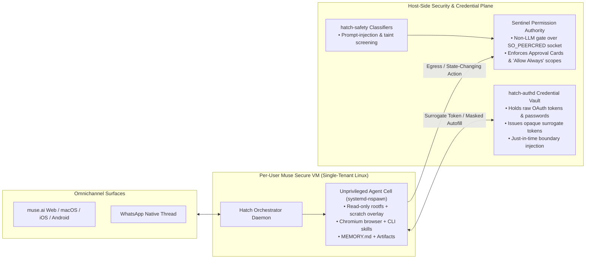

# 10 — Meta Muse (`muse.ai`) Deep Dive: Personal Context Architecture, Proactive Workflows & Comparative Audit Against `agy-hq`

- **Date:** 2026-11-12
- **Task Scope:** `[Task:research] Learn from Muse.ai Proactive Work` (`hq/research-muse-proactive`)
- **Companion Specification:** [RFC-0014: Proactive Engine v2 — Event-Driven Gatekeepers, Calibrated Attention Routing, Stateful Goals, Scheduled Console Spaces & Living Context](../design/0014-proactive-engine-and-living-context.md)
- **Related Documents:** [01 — Frontier Personal Agent Product Landscape](01_products.md), [08 — Empirical Token Telemetry & Cold-Cache Audit](08_token_observability_and_telemetry.md), [RFC-0003 (Approval-Bound Execution)](../design/0003-approval-bound-execution.md), [RFC-0004 (Heartbeat & Channels)](../design/0004-heartbeat-and-channels.md), [RFC-0006 (4-Layer Memory Engine)](../design/0006-memory-engine-upgrade.md), [RFC-0007 (Front Desk Lifecycle)](../design/0007-front-desk-initialization-hardening.md), [RFC-0012 (Token Observability)](../design/0012-token-observability.md)

---

## 1. Executive Summary

Meta launched **Muse AI** (`https://muse.ai/`) on September 8, 2026—followed by the **Muse Wonder** model family (October 2026) and **Muse Spaces** (November 6, 2026)—positioning it as a consumer and small-business autonomous personal agent (*"An AI agent that actually does the work"*). Whereas first-generation AI assistants wait passively for prompts and return text, Muse combines a persistent per-user Linux cloud VM, continuous multi-connector personal context synthesis, event- and schedule-driven background workflows, a four-surface attention model, and a kernel-enforced supervisor gate (**Sentinel**).

To extract concrete architectural and UX lessons for **`agy-hq`**, we conducted a live browser inspection of `https://muse.ai/` and its linked engineering, design, security, and Meta Newsroom publications, then audited Muse layer-by-layer against `agy-hq`'s current implementation (`AGENTS.md`, `internal/kernel`, `internal/hooks`, `internal/approvals`, `internal/webui`, and the `morning-brief`, `inbox-triage`, `sleep-consolidate`, and `thesis-check` skills).

### Key Takeaways

1. **Where `agy-hq` Already Outperforms Muse:**
   - **Local Sovereignty vs. Cloud Custodianship:** Muse stores user files, browser sessions, and connectors inside Meta-hosted cloud VMs (sparking public privacy pushback and opt-out training friction). `agy-hq` keeps 100% of personal state in a git-ignored local Vault (`local/`) guarded by mathematical PII invariants (`P1`–`P6` in [`internal/ci/pii.go`](../../internal/ci/pii.go)).
   - **Ground-Truth Verified Memory & Self-Improvement:** Muse relies on a flat `MEMORY.md` file plus black-box model retrieval. `agy-hq` enforces a 4-layer memory hierarchy ([RFC-0006](../design/0006-memory-engine-upgrade.md)) with ground-truth `transcript.jsonl` verification during `/sleep-consolidate` and a 4-gate counterfactual RSI harness ([RFC-0010](../design/0010-agent-recursive-self-improvement.md)).
   - **Multi-Repo Software Engineering & Cost Telemetry:** `agy-hq` natively orchestrates isolated git worktrees (`local/worktrees/<repo>-<task>/`), frontier coding models, and 0-token prefix-cache observability ([RFC-0012](../design/0012-token-observability.md))—areas where consumer cloud agents trail.
2. **Six High-Leverage Gaps Exposed in `agy-hq`'s Current Proactive System:**
   - **G1 — Front Desk Cold-Cache Cron Tax & Hardcoded Daemon Pre-Checks:** Arming recurring crons directly inside `[HQ] Front Desk` via `schedule(IsDaemon=true)` wakes a `150k–252k`-token conversation after idle cache expiry (`0%` CHR, burning `~200k+` uncached input tokens per wake), while `RunHeartbeat` in [`internal/kernel/kernel.go`](../../internal/kernel/kernel.go) ignores custom `precheck_cmd` entries declared in `local/triggers.yaml`.
   - **G2 — Binary Notification Model (Chat Interrupt vs. Silent File):** `agy-hq` lacks calibrated delivery tiers (`interrupt` vs. `brief_rollup` vs. non-interruptive `ideas_feed` vs. `silent_ledger`), quiet hours, and a structured scratchpad for low-urgency proactive suggestions.
   - **G3 — Ephemeral Task Conversations vs. Multi-Day `Goals`:** `ActiveTask` models single conversations (`idle` at `6h`, archived at `48h`), leaving multi-week objectives and *"waiting-on-reply"* follow-up obligations trapped as static prose bullets in `local/MEMORY.md`.
   - **G4 — Static Console Layout vs. Context-Scheduled `Spaces`:** `hq_console.md` and the `:4242` Sidecar render the same static infrastructure view 24/7 rather than contextually surfacing 0-token domain lenses (e.g., *SWE Pulse*, *Market Watch*, *Personal Logistics*) on workday vs. evening/weekend schedules.
   - **G5 — Missing Surgical `forget` Cascade & Entity/Obligation Dossiers:** `hq memory prune-fact` expires a single `facts.jsonl` row by ID, but `agy-hq` lacks a single deterministic `hq memory forget` cascade across all Vault stores and lacks structured contact/entity dossiers resolving multi-channel context (Gmail + Google Chat + Calendar).
   - **G6 — Raw Credential File Readability & Unbounded Pending Proposals:** While quarantined sessions block `local/private/`, untainted agent turns can still read raw OAuth token/cookie files on disk into LLM context (unlike Muse's `hatch-authd` credential surrogation), and pending proposals in `local/memory/pending/` lack TTL expiration, structured risk badges, and narrow expiring standing policies.

---

## 2. Inside Meta Muse (`muse.ai`): System, Context & Proactive Architecture

### 2.1 Runtime Sandbox, Model Stack & Credential Isolation ("Hatch")

Muse was engineered internally under the codename **Hatch** around a containment-first cloud architecture:

1. **Per-User Secure VM (`systemd-nspawn` Runtime Cell):**
   - Every user receives an isolated single-tenant Debian Linux cloud VM with a headless/shared Chromium browser and persistent workspace storage.
   - Inside the VM, the agent executes as an unprivileged user inside a `systemd-nspawn` container with filtered syscalls (`io_uring` disabled to block kernel privilege-escalation chains), cgroup resource limits, and a read-only root filesystem paired with an ephemeral scratch overlay.
   - Meta's published roadmap extends this boundary to hardware-enforced **Confidential VMs** (AMD SEV / Intel TDX) encrypted under user-held keys.
2. **Agentic Model Stack (`Muse Spark 1.3` & `Muse Wonder`):**
   - **Muse Spark 1.3:** Trained specifically for CLI/skill orchestration, noisy cross-connector synthesis, and indirect prompt-injection resistance.
   - **Muse Wonder & Muse Wonder Full (Oct 2026):** Introduce two explicit long-horizon behaviors:
     - **Active Memory:** Cross-session retrieval that pulls relevant preferences, prior decisions, and relationship context across separate threads without waiting for manual file mentions.
     - **Active Focus:** Persistent goal execution that retries alternative tool paths when blocked, verifies intermediate results, and escalates to the user only when human judgment or authorization is genuinely required.
3. **Zero-Access Credential Surrogation (`hatch-authd`):**
   - Raw OAuth refresh tokens, passwords, and payment secrets are never placed in the agent's filesystem or LLM context window.
   - Instead, `hatch-authd` issues zero-privilege **surrogate tokens** to the runtime cell (or autofills browser login inputs directly from the host vault while masking password DOM nodes and vision frames from the model) and swaps real credentials at the network boundary only after `Sentinel` authorization.

---

### 2.2 Personal Context & Data Management

Muse structures personal context around **human-auditable transparency** combined with **continuous ambient synthesis**:

| Mechanism | How Muse Implements It | UX & Reliability Impact |
| :--- | :--- | :--- |
| **Editable `MEMORY.md`** | Stores learned preferences, routines, constraints, and key relationships in a plain Markdown `MEMORY.md` file directly inspectable and editable in the UI. | Eliminates "black-box profile" anxiety; users can read and hand-correct wrong assumptions in seconds. |
| **Surgical `forget` Skill** | Users say *"Forget my old address"* or *"Forget Project Titan"*; Muse invokes a dedicated `forget` skill that deletes matching memory nodes and purges associated scratch artifacts. | Provides 1-command user control over stale or sensitive personal context without manual file hunting. |
| **Ambient + Explicit Dossier Engine** | Continuously ingests read-scoped signals from Gmail, Google Calendar, M365, Notion, Slack, Granola, Stripe, Shopify, and social saves, resolving conflicting timestamps or updates into living relationship/obligation context. | Enables proactive nudges grounded in real life changes (e.g., rescheduled flights, unanswered client invoices, upcoming birthdays). |
| **Granular Connector Scopes** | Each integration exposes independent read vs. write/act toggles (e.g., read Gmail autonomously, but gate outbound sends through `Sentinel`). | Matches user comfort levels incrementally as trust builds. |

> [!WARNING]
> **Observed Real-World Failure Modes in Muse's Context Model:**
> External security reviews and launch post-mortems documented three critical pitfalls `agy-hq` must avoid:
> 1. **Cloud Custodianship & Default Training Opt-Out Friction:** Storing Gmail, financial records, and private dossiers in a hyperscaler cloud VM—with AI training opt-out buried under `Settings > Data controls`—generated severe trust pushback from security practitioners.
> 2. **Contextual PII Over-Sharing During Autonomous Negotiation:** In a widely reported incident, an autonomous marketplace negotiation workflow inadvertently revealed a reviewer's residential address from personal memory to an external counterparty—proving that *outbound payload previews and contextual PII checks* must gate external messages even when no raw API secret is present.
> 3. **Anti-Bot & Cloud IP Blocking:** Running a cloud-hosted headless browser caused major commerce and banking sites (e.g., Amazon, retail banks) to block Muse's datacenter IP ranges.

---

### 2.3 Proactive Workflows, Attention Surfaces & `Sentinel` Governance

Meta's design post-mortem (*"How We Designed Muse"*) highlights a foundational UX insight: **if a proactive agent dumps every background thought, check, and status log into one chat stream, users mute it within 48 hours.** Muse solves this by decoupling **background execution** from **calibrated attention surfaces**:

1. **Three Background Trigger Loops:**
   - **Event-Driven Connector Listeners:** Webhooks and lightweight connector pollers wake `Hatch` only when an external state change occurs (flight delay email, school schedule change, receipt arrival, Stripe dispute).
   - **Scheduled Routines:** Morning digests, recurring subscription/expense audits, and weekly planning sweeps.
   - **Goal-Driven Watch Loops:** Continuous background monitoring attached to an active user Goal (e.g., price-drop tracking, waiting on vendor replies, milestone check-ins).
2. **Four Distinct User-Facing Surfaces (Anti-Noise Architecture):**
   - **Main Chat + Chat Bubbles (High-Signal Interrupts):** Main Chat stays anchored to a clean WhatsApp-like messaging flow ("Mom Test"). When background work finishes or hits an urgent anomaly/approval gate, Muse surfaces a compact out-of-turn **Chat Bubble** governed by user-configurable interruption settings (frequency & quiet hours).
   - **Side Chats (Isolated Focus Threads):** Complex deep-dives branch into dedicated Side Chats so exploratory back-and-forth never pollutes the main thread—directly analogous to `agy-hq`'s `[HQ] Front Desk` + `[Task:<scope>]` split.
   - **Goals Tab (Stateful Long-Running Intentions):** Promotes multi-day or multi-week objectives out of scrolling chat into persistent milestone checklists that Muse advances asynchronously.
   - **Ideas Tab / Feed (Zero-Interrupt Serendipity Surface):** Low-urgency proactive discoveries—forgotten recurring subscriptions, suggested follow-ups, weekend planning ideas—land silently in the **Ideas** feed rather than pinging the user's phone. Users convert good ideas into Goals/Tasks with 1 tap or dismiss them.
   - **Spaces (Self-Updating, Context-Scheduled Micro-Apps — Nov 2026):** Users describe a workflow in plain language (e.g., *Client Hub*, *Trip Planner*, *School Tracker*, *Deal Watch*) and Muse generates a persistent sidebar dashboard wired to background connectors. Crucially, **Spaces can be scheduled by day and time**—automatically surfacing work/market trackers Monday–Friday and swapping to personal/family planners on evenings and weekends.
3. **`Sentinel` Approval Cards & Narrow `"Allow Always"` Policies:**
   - **Independent Non-LLM Gatekeeper:** `Sentinel` runs outside the LLM process over kernel-authenticated `SO_PEERCRED` Unix domain sockets, intercepting outbound HTTP writes, sends, deletes, and checkouts.
   - **Anti-Banner-Blindness Approval Cards:** Cards highlight the exact recipient/domain, action type, cost/diff preview, and reversibility rather than raw command strings.
   - **Narrow `"Allow Always"` Standing Rules:** For repetitive low-risk actions (e.g., updating a specific calendar category or filing receipts to a specific folder), users can grant narrow, domain-scoped standing permissions that remain auditable and 1-click revocable in Settings—while high-stakes actions (payments via single-use *Link by Stripe* virtual cards, external blasts) remain per-action gated.

---

## 3. Architectural Comparison: Meta Muse vs. `agy-hq` (`HEAD`)

| Dimension | Meta Muse (`muse.ai`) | `agy-hq` Current (`HEAD`) | Assessment & Opportunity for `agy-hq` |
| :--- | :--- | :--- | :--- |
| **1. Data Residency & Privacy Boundary** | Single-tenant cloud Linux VM in Meta's cloud; opt-out model training; cloud-stored connectors. | 100% local git-ignored `local/` Vault (`0600` perms) + mathematical `P1`–`P6` PII CI scanner ([RFC-0011](../design/0011-ci-pipeline-and-regression-harness.md), [RFC-0013](../design/0013-open-source-launch-strategy.md)). | **`agy-hq` Leads.** Never compromise local Vault sovereignty. Add outbound contextual-PII warning badges on external proposals to prevent Muse-style address/PII oversharing. |
| **2. Coordinator vs. Focus Thread Split** | **Main Chat** + **Side Chats** + live avatar status snippet + **Activity Log**. | **`[HQ] Front Desk`** (non-blocking, $\le 3$ lookups) + **`[Task:<scope>]`** worktree threads + `hq_console.md` ([RFC-0007](../design/0007-front-desk-initialization-hardening.md), [RFC-0009](../design/0009-task-board-redesign.md)). | **Parity / `agy-hq` Stronger for SWE.** `agy-hq` backs each task thread with a real git worktree and mechanical `PreToolUse` non-blocking hooks. |
| **3. Trigger & Pre-Check Execution** | Out-of-band `Hatch` webhook/connector pollers wake isolated background workers only on real deltas. | Split brain: `RunHeartbeat` runs 0-token Go checks for `local/inbox/`, Gmail, and GChat, **but** `triggers.yaml` schedules (`morning-brief`, `edgar-close-watch`, `sleep-consolidate`) run as `schedule(IsDaemon=true)` inside `[HQ] Front Desk`, causing `200k+`-token cold-cache wakeups ([Research 08](08_token_observability_and_telemetry.md)) and ignoring custom `precheck_cmd` deltas. | **Major Gap (`G1`).** Move conditional/polled watchdogs to 0-token `hq daemon` stateful cursor pre-checks (`triggers.yaml` v2) and execute heavy scheduled runs in isolated workers rather than bloating Front Desk context. |
| **4. Proactive Attention & Interruption UX** | 4 calibrated tiers: **Chat Bubbles** (urgent/completed) + customizable interruption controls, **Morning Digest**, **Ideas Tab** (non-interruptive suggestions), and silent **Space** updates. | Binary: either posts directly into Front Desk chat (or spawns a top-level `[Auto]` sidebar conversation per triage batch) or runs 100% silently (`sleep-consolidate`). No quiet hours or `Ideas` queue. | **Major Gap (`G2`).** Introduce a 4-tier Attention Router (`interrupt`, `brief_rollup`, `ideas_feed`, `silent_ledger`), configurable Quiet Hours, and a **Proactive Ideas Queue** in Console/WebUI. |
| **5. Long-Horizon Intention Tracking (`Goals`)** | First-class **Goals** primitive with milestone decomposition, *Active Focus* retries, and proactive follow-up nudges. | `ActiveTask` tracks *conversations* (`idle` after `6h`, archived after `48h`). Multi-week goals & *"waiting on Alice's reply"* live only as static text in `MEMORY.md`. | **Major Gap (`G3`).** Add stateful `Goals` & `WaitingOn` obligation watchdogs (`local/memory/goals.json` + `./bin/hq goals`) checked in 0 tokens during `RunHeartbeat` and `/morning-brief`. |
| **6. Dynamic Domain Dashboards (`Spaces`)** | Conversational **Spaces** pinned to sidebar with background connector refresh and day/time visibility scheduling. | Static single-layout `hq_console.md` and `:4242` WebUI Sidecar showing identical system tables 24/7. | **High-Value Gap (`G4`).** Add declarative, 0-LLM-token **Console Spaces** (`swe-pulse`, `market-watch`, `personal-ops`) with cron/day-of-week auto-scheduling in `hq_console.md` and `:4242`. |
| **7. Memory Hierarchy & Verification** | Editable flat `MEMORY.md` + *Active Memory* cross-chat retrieval; no ground-truth transcript falsification. | 4-Layer hierarchy (`MEMORY.md` $\le 80$-line index, `topics/*.md` Wiki, bi-temporal `facts.jsonl`, raw `transcript.jsonl` verification in `/sleep-consolidate` — [RFC-0006](../design/0006-memory-engine-upgrade.md)). | **`agy-hq` Leads on Integrity.** Keep the 4-layer verified architecture; never regress to an unverified flat file. |
| **8. User Memory Control (`forget`) & People Context** | 1-command **`forget` skill** purges memory + scratch files; **Dossier Engine** resolves messy multi-app person/obligation updates. | `hq memory prune-fact <id>` only soft-expires one `facts.jsonl` row; stale mentions can persist in `MEMORY.md` / `topics/` / `notes/`. No structured person/entity dossiers. | **Moderate Gap (`G5`).** Build `./bin/hq memory forget` cascading across all Vault layers + lightweight on-demand **Entity Dossiers** (`local/memory/entities/<slug>.md`). |
| **9. Credential Secret Isolation** | **`hatch-authd`** keeps raw OAuth/password secrets completely outside the agent filesystem and context window via surrogate tokens. | Quarantined sessions block `local/private/`, **but** normal untainted agent turns can still read `local/private/{gmail,gchat}/` token/cookie files via `read_file` or shell commands. | **Security Gap (`G6a`).** Enforce a `PreToolUse` Zero-Context Credential Read-Guard across *all* sessions so only the compiled `./bin/hq` binary reads raw credential blobs. |
| **10. Action Approval & Standing Policies** | **`Sentinel`** non-LLM socket gate + structured Approval Cards + narrow, auditable `"Allow Always"` domain rules + single-use virtual cards. | `PreToolUse` blocklist + `hq propose` SHA-256 0-LLM Go execution + mandatory chat blockquote preview ([RFC-0003](../design/0003-approval-bound-execution.md)). No proposal TTL expiry and no narrow standing policies. | **UX/Safety Gap (`G6b`).** Add proposal TTL expiration (`24h`), reversibility/PII risk badges, and strictly bounded, expiring standing rules (`hq policy`) for low-risk non-financial actions. |
| **11. Self-Improvement Loop** | Vendor-side model updates (*Spark* $\rightarrow$ *Wonder*); user training opt-out. | Local 4-stage trace-mined RSI with 4-gate sandboxed counterfactual verification & canary rollback ([RFC-0010](../design/0010-agent-recursive-self-improvement.md)). | **`agy-hq` Leads.** Wire proactive Idea/Nudge dismissal rates into `hq rsi mine` to automatically tune trigger noise! |
| **12. Token & Quota Efficiency** | Cloud subscription tiers (`Free` / `$20` / `$100`); opaque internal token accounting. | Exact 0-token `transcript.jsonl` telemetry (`CHR %`, QBU, `A1`–`A5` anomaly guards — [RFC-0012](../design/0012-token-observability.md)) + `max_daily_spawns` circuit breaker. | **`agy-hq` Leads on Telemetry—Now Act on It.** Eliminating Front Desk cron cold-starts (`G1`) directly cuts ~24% of workspace uncached input burn! |

---

## 4. Deep Audit of `agy-hq`'s Current Proactive Bottlenecks

Cross-referencing Muse's operational patterns against `agy-hq`'s codebase and empirical telemetry ([Research 08](08_token_observability_and_telemetry.md)) pinpoints four concrete mechanical bottlenecks in `agy-hq` today:

### 4.1 The Front Desk Cron Cold-Start & Context-Growth Loop
In [RFC-0007](../design/0007-front-desk-initialization-hardening.md), we armed `triggers.yaml` schedules (`morning-brief`, `edgar-close-watch`, `sleep-consolidate`) via Antigravity's native `schedule(IsDaemon=true)` inside `[HQ] Front Desk`. While that solved dormant triggers, [Research 08 §4](08_token_observability_and_telemetry.md) proved its hidden cost:
- Every scheduled firing arrives after an idle interval (`53m`–`285m`) exceeding the LLM prefix cache TTL (`~5 minutes`), resulting in `cache_read_tokens = 0`.
- When `[HQ] Front Desk` sits at `206k–252k` context tokens, **a single scheduled check burns `206,233` to `252,166` uncached input tokens just to wake up**—even on days when zero 8-K filings or secondary deals arrived!
- Furthermore, in [`templates/triggers.yaml`](../../templates/triggers.yaml), `edgar-close-watch` declares `precheck_cmd: ["./bin/hq", "status", "--quiet"]`, yet [`RunHeartbeat`](../../internal/kernel/kernel.go) (`L2048–2121`) never iterates over `triggers.yaml` `schedules` or `watchers` to run custom pre-checks or compare state cursors!

### 4.2 Top-Level Sidebar Clutter from Micro-Batch Spawns
When [`RunHeartbeat`](../../internal/kernel/kernel.go) (`L2055–2093`) detects unread Gmail or Google Chat batches or dropped `local/inbox/` files, it calls `SpawnFlashTask` (`agentapi new-conversation`), creating a brand-new top-level `[Auto] Gmail Triage (...)` or `[Auto] GChat Triage (...)` conversation for every batch—and still leaves the synthesized result parked in `local/notes/` without a unified **Proactive Outbox** determining whether the finding should (a) immediately alert the user, (b) wait for the 7:30 AM Morning Brief, or (c) land as an optional **Idea** card in `hq_console.md`.

### 4.3 Missing "Waiting-On" & Multi-Day Goal Continuity
Consider a classic proactive workflow Muse excels at:
> *"You sent a contract review email to `bob@example.com` on Tuesday morning and need his sign-off before Friday's launch."*

In `agy-hq` today:
1. `/inbox-triage` processes inbound mail, and `/morning-brief` scans *unread* messages (`is:unread`).
2. Once Tuesday's thread is read/replied to, **nothing tracks the silent absence of a reply**. Because `bob@example.com` *hasn't* emailed back, `is:unread` returns nothing on Thursday morning, and the slipped obligation goes unnoticed unless the user manually remembers to ask.
3. Modeling **Goals** + **`WaitingOn` SLAs** in pure Go (`local/memory/goals.json`) allows `hq daemon` to detect overdue silent threads in **0 LLM tokens** and proactively stage a polite follow-up draft for 1-tap approval!

### 4.4 Proactivity Feedback Loop Blindness
In Muse, dismissing or acting on an **Idea** or nudge teaches the system what level of proactivity the user values. In `agy-hq`, [RFC-0010](../design/0010-agent-recursive-self-improvement.md) (`hq rsi mine`) already mines `PreToolUse` denials, tool errors, and draft edit-diffs—but has zero visibility into **proactive signal-to-noise ratio** (which scheduled watchdogs or triage suggestions the user acts upon vs. ignores/rejects). Recording structured `outbox` outcomes (`acted`, `snoozed`, `dismissed`) closes that loop in 0 LLM tokens.

---

## 5. Synthesized Design Principles for `agy-hq` ([RFC-0014](../design/0014-proactive-engine-and-living-context.md))

From this investigation, we distill six architectural rules that capture Muse's best product and safety innovations while preserving `agy-hq`'s local-first microkernel ethos:

1. **Gate in Go (`0` Tokens), Reason in Isolated Workers, Deliver Compact Cards:** Never wake a `200k`-token `[HQ] Front Desk` thread just to poll whether external state changed. Run stateful cursor/hash pre-checks in `hq daemon` (`0` LLM tokens), spawn isolated `flash` workers only when deltas exist, and write structured outputs to `local/memory/outbox/`.
2. **Calibrate Interruption to Urgency & Time-of-Day:** Separate proactive outputs into `interrupt` (urgent anomalies & breaches), `brief_rollup` (queued for 7:30 AM `/morning-brief`), `ideas_feed` (non-interruptive Console/Sidecar cards), and `silent_ledger` (background maintenance), governed by user Quiet Hours.
3. **Promote Multi-Day Intentions & "Waiting-On" Deadlines to First-Class State:** Track cross-conversation `Goals` and `WaitingOn` reply SLAs deterministically in `local/memory/goals.json` so *missing* events (unanswered emails, approaching deadlines) trigger proactive drafts just as reliably as *arriving* events.
4. **Make the Console Context-Aware via 0-Token Scheduled `Spaces`:** Evolve `hq_console.md` and `:4242` from a static ops table into context-scheduled domain lenses (Weekday Market/SWE vs. Evening/Weekend Life Admin) rendered in pure Go with zero LLM token overhead.
5. **Pair Deep Memory with Surgical `forget` & Living Entity Dossiers:** Give users a 1-command `./bin/hq memory forget` cascade across all Vault files and maintain lightweight, conflict-resolved entity/contact dossiers (`local/memory/entities/<slug>.md`) loaded strictly on demand.
6. **Keep Raw Secrets Out of Context & Bound Approval Fatigue Safely:** Enforce a global `PreToolUse` read-guard on `local/private/` credential blobs (`hatch-authd` pattern), add outbound contextual-PII warning badges and `24h` proposal TTLs, and support narrow, expiring, revocable standing policies (`hq policy`) only for low-risk reversible actions.

Full schemas, CLI contracts, UI layouts, trade-offs, and phased implementation milestones are specified in companion design document **[RFC-0014](../design/0014-proactive-engine-and-living-context.md)**.

---

## 6. Primary Sources & URLs Inspected

### Direct Live Site & Engineering Blog Inspection (`muse.ai` & `about.fb.com`)
1. `https://muse.ai/` — Product landing page, core workflows, platform availability, and feature overview.
2. `https://muse.ai/blog` — Official Muse engineering, product, and safety blog index.
3. `https://muse.ai/blog/how-we-designed-muse` — *"How We Designed Muse"* (Mona Sarantakos & Christine Awad): Main Chat vs. Side Chats, Chat Bubbles, live avatar status snippets, Activity Log, Goals tab, Ideas tab, and anti-banner-blindness Approval Cards.
4. `https://muse.ai/blog/security-and-safety-for-ai-agents-our-approach-with-muse` — *"How We Built Safety Into Muse"* (Tarek Sheasha): Muse Secure VM, `systemd-nspawn` isolation, `Hatch` orchestrator, `Sentinel` independent permission gate (`SO_PEERCRED`), `hatch-authd` credential surrogation, `hatch-safety` classifiers, and `MEMORY.md` + `forget` skill.
5. `https://muse.ai/blog/securing-muse` — *"Securing Muse: More Than $1 Million in Bug Bounties Paid Out"* (David Singleton): Agentic attack vectors, indirect prompt injection mitigations, and sandbox hardening.
6. `https://muse.ai/security-and-privacy` — Connector permission scopes, Secure Credentials Store disclosures, Confidential VM roadmap, and `MEMORY.md` user controls.
7. `https://muse.ai/business` — *"Muse for Small Business"*: Multi-connector SMB workflows (Shopify, Stripe, QuickBooks, Asana, Klaviyo) and autonomous client/order operations.
8. `https://muse.ai/privacy` & `https://muse.ai/terms` — Data firewalling from Meta Ads, AI training opt-out controls, and autonomous action boundaries (CAPTCHA/paywall prohibitions).
9. `https://about.fb.com/news/2026/09/introducing-muse-personal-ai-agent/` — Meta Newsroom launch announcement (Sep 8, 2026).
10. `https://about.fb.com/news/2026/09/introducing-muse-small-business/` — Meta Newsroom SMB workflow announcement.
11. `https://about.fb.com/news/2026/10/introducing-muse-wonder-models/` — Meta Newsroom launch of *Muse Wonder* and *Muse Wonder Full* frontier models (*Active Memory* & *Active Focus*).
12. `https://about.fb.com/news/2026/11/introducing-spaces-customize-muse-app/` — Meta Newsroom launch of *Muse Spaces* (Nov 6, 2026): natural-language custom micro-apps, connector auto-updates, and day/time sidebar scheduling.
