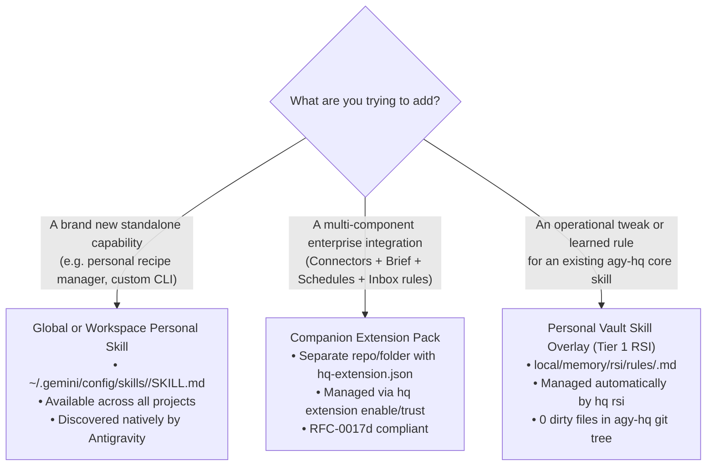

# 15 — Two-Tier Recursive Self-Improvement & Personal Vault Skill Overlay Audit

- **Date:** 2026-11-15
- **Author:** `[Task:agent] two-tier-rsi-vault-overlay` (`gemini-4-carbon-high`)
- **Status:** Complete / Research Memo
- **Related Documents:**
  - [RFC-0010: Bounded Agent Recursive Self-Improvement (RSI)](../design/0010-agent-recursive-self-improvement.md)
  - [RFC-0017d: Companion Extension Packs, Unified Trust Registry & Host Portability](../design/0017d-enterprise-extensibility-and-portability.md)
  - [RFC-0019: Two-Tier RSI & Personal Vault Skill Overlay](../design/0019-two-tier-rsi-vault-overlay.md)
  - [04 — Google Antigravity Capability Audit](04_antigravity_audit.md)
  - [07 — Agent Recursive Self-Improvement (RSI): Literature Survey & Safety Invariants](07_agent_recursive_self_improvement.md)

---

## 1. Executive Summary & The Divergence Problem

### 1.1 The Upstream vs. Personal Dilemma
In [RFC-0010](../design/0010-agent-recursive-self-improvement.md), `agy-hq` established a 4-stage bounded Recursive Self-Improvement (RSI) engine (`internal/rsi/`) to mine execution friction from turn journals, synthesize structured Agentic Context Engineering (ACE) delta hypotheses, verify them through a 4-gate sandboxed oracle, and apply verified patches under cryptographic human-in-the-loop approval (`hq propose` + `hq approve`).

However, production deployment across multiple developer machines and external git checkouts has exposed a fundamental architectural collision: **The Divergence Problem**.

Currently, `internal/rsi/mutator.go` defines `ResolveSkillFile`:
```go
// ResolveSkillFile locates the SKILL.md path for a skill slug in rootDir
func ResolveSkillFile(rootDir, skillSlug string) (string, string) {
    relPlugin := filepath.ToSlash(filepath.Join(".agents", "plugins", "agy-hq", "skills", skillSlug, "SKILL.md"))
    absPlugin := filepath.Join(rootDir, filepath.FromSlash(relPlugin))
    if _, err := os.Stat(absPlugin); err == nil {
        return relPlugin, absPlugin
    }
    // ...
}
```
When `hq rsi hypothesize` generates an `add_skill_rule` mutation and `hq rsi apply` executes it, the mutator writes directly into tracked repository source code (`.agents/plugins/agy-hq/skills/<skillSlug>/SKILL.md`).

### 1.2 Five Concrete Failure Modes of Monolithic Tracked RSI

1. **Dirty Working Tree Friction for Cloned Users:**
   When an external engineer clones `agy-hq`, or a contributor works in their repository, applying a learned rule via `hq approve` dirties git:
   ```sh
   $ git status -s
    M .agents/plugins/agy-hq/skills/swe-pulse/SKILL.md
   ```
   A clean development workspace is violated by routine runtime self-adaptation.

2. **Upgrade Abort & Merge Conflict Hazards (`hq upgrade` / `git pull`):**
   When upstream publishes engine improvements or updates core skills, `git pull` fails closed:
   ```text
   error: Your local changes to the following files would be overwritten by merge:
       .agents/plugins/agy-hq/skills/swe-pulse/SKILL.md
   Please commit your changes or stash them before you merge.
   ```
   For non-developer users or automated upgrade daemons, this causes broken upgrades, dropped rules, or git conflict markers (`<<<<<<< HEAD`).

3. **PII and Private Workflow Leakage into Upstream PRs:**
   While `internal/rsi/mutator.go:sanitizePIIForTrackedSkill` scrubs basic home directory paths and common email patterns, it cannot detect company-specific internal CLI tool flags, private project codes, personal alias conventions, or local workstation quirks. If the user contributes an upstream PR or pushes a branch to public GitHub, their personal habits and internal patterns are inadvertently published.

4. **Conflating Personal Operational Idiosyncrasies with Upstream Engine Code:**
   A rule such as *"When running `swe-pulse` on this machine, always pass `--no-docker`"* is a valid personal operational rule for a specific user whose workstation lacks Docker permissions. However, committing that rule to upstream `swe-pulse/SKILL.md` degrades the experience for all other users who rely on Docker containers.

5. **Empirical Forensic Evidence in the Tracked Repository:**
   Auditing the current repository reveals that this divergence has already occurred. In `.agents/plugins/agy-hq/skills/swe-pulse/SKILL.md`:
   ```markdown
   ## Learned Operational Rules (RSI Managed)

   <!-- rsi:rule id="rsi-rule-swe-pulse-2c42ca" source="obs-20261109-2c42ca57" model_scope="all" added="2026-11-09" helpful="0" harmful="0" -->
   - **[Learned Rule · worker_aci_or_skill]:** When using `user_feedback` in `swe-pulse`, Never perform multi-file code modifications or test suite runs inline on the Front Desk; dispatch invoke_subagent or hq spawn. *(Observed 2x; prevents: Always delegate multi-file coding and bugfix tasks (>3 tool calls) to a background subagent in local/worktrees/ instead of blocking the [HQ] Front Desk thread.)*
   ```
   A runtime operational observation from a live session on 2026-11-09 was committed directly into the tracked plugin source tree.

---

## 2. Theoretical Grounding: The Three Learning Substrates

To resolve the divergence cleanly, we must map the boundaries between **Declarative Memory**, **Personal Procedural Adaptation**, and **Upstream Harness Evolution**:

```mermaid
flowchart TD
    subgraph Layer1["Layer 1: Declarative & Episodic Memory (Dreaming)"]
        D1["Source: Transcripts & Daily Turn Journals"]
        D2["Mechanism: /sleep-consolidate (Nightly Dreaming)"]
        D3["Storage: local/MEMORY.md, local/memory/topics/*.md, facts.jsonl"]
        D4["Nature: Declarative World & User Knowledge ('What is true')"]
        D1 --> D2 --> D3 --> D4
    end

    subgraph Layer2["Layer 2: Personal Procedural Adaptation (Tier 1 RSI)"]
        P1["Source: Session Friction & Error-Recovery Chains"]
        P2["Mechanism: hq rsi mine -> hypothesize -> verify -> propose"]
        P3["Storage: local/memory/rsi/rules/<skill>.md (Private Vault)"]
        P4["Nature: User-Specific Tool & Workflow Rules ('How to act on my machine')"]
        P1 --> P2 --> P3 --> P4
    end

    subgraph Layer3["Layer 3: Upstream Harness Evolution (Tier 2 RSI)"]
        U1["Source: Verified General Defects & Crystallized Go Tools"]
        U2["Mechanism: hq rsi export --upstream -> PR Feature Branch"]
        U3["Storage: .agents/plugins/agy-hq/skills/*, internal/*, cmd/hq/*"]
        U4["Nature: Universal Engine Fixes ('How the harness works for everyone')"]
        U1 --> U2 --> U3 --> U4
    end
```



### 2.1 Comparative Substrate Matrix

| Dimension | Layer 1: Dreaming (`/sleep-consolidate`) | Layer 2: Tier 1 Personal RSI Overlay | Layer 3: Tier 2 Upstream Harness RSI |
| :--- | :--- | :--- | :--- |
| **Knowledge Type** | Declarative & Episodic (Facts, entities, project milestones) | Procedural & Operational (Tool flags, error avoidance, local quirks) | Structural & Algorithmic (Kernel Go code, universal skill instructions) |
| **Target Storage** | `<vault>/MEMORY.md`, `<vault>/memory/topics/`, `facts.jsonl` | `<vault>/memory/rsi/rules/<skill>.md` (Private Vault Overlay) | Tracked Git repo (`.agents/plugins/agy-hq/skills/`, `internal/`) |
| **Git Working Tree** | Clean (`0` repo files modified; committed to `local/.git`) | Clean (`0` repo files modified; committed to `local/.git`) | Tracked feature branch (`hq/rsi-<id>`) intended for upstream PR |
| **Execution Trigger** | Nightly 0-token cron or explicit `/sleep-consolidate` | Friction recurrence ($\ge 2\times$) during daily work or nightly dreaming | Explicit opt-in export (`hq rsi export --upstream`) or maintainer run |
| **Verification Gate** | Transcript claim verification (`hq memory verify-transcript`) | 4-Gate Sandboxed Oracle (AST check, schema, PII, budget) | 4-Gate Oracle + Full E2E CUJ Suite + Generalizability Review |
| **Model Dependency** | Model-agnostic markdown facts | Model-scoped (`model_scope="all"` or `"flash-only"`) + ablation | Model-agnostic deterministic Go code or foundational prompt |
| **Upstream Portability** | Private to user; never exported | Private to user; portable across user's machines via Vault | Public; submitted as GitHub Pull Request |

---

## 3. Interaction with Antigravity Customization Architecture

### 3.1 Antigravity Skill Discovery & Precedence
As documented in [Antigravity Customization Audit (Research 04 §5)](04_antigravity_audit.md) and `agy-customizations`:
Antigravity discovers skills across three hierarchical layers:
1. **Workspace Project**: Hierarchical discovery walking up from CWD to repo root (`.agents/skills/` or `.agents/plugins/<name>/skills/`).
2. **Global Discovery**: `~/.gemini/config/skills/<name>/SKILL.md` (or `~/.gemini/config/plugins/`).
3. **Built-in Customizations**: Application-bundled default skills.

### 3.2 Why Native Precedence Cannot Solve Additive Overlays Alone
If a user creates an override skill in `~/.gemini/config/skills/<skill>/SKILL.md`:
1. **Workspace Plugin Trumps Global Customizations:** When working inside the `agy-hq` repository, workspace skills take precedence over global ones.
2. **Wholesale Shadowing (No Additive Merge):** Antigravity's native resolution treats skill discovery as all-or-nothing shadowing by skill directory name. If a user duplicates `swe-pulse` into their personal skills directory just to add one operational rule, they must copy all 100+ lines of the core skill. When upstream `agy-hq` releases improvements or bug fixes to `swe-pulse`, the user's duplicated skill remains frozen, missing all upstream updates.
3. **No Incremental Delta Lifecycle:** Antigravity does not have built-in concepts for rule IDs (`rsi-rule-...`), attribution counters (`helpful`, `harmful`), or automated model-upgrade ablation.

### 3.3 The Dispatch Resolver Pathway (`hq dispatch resolve`)
In [RFC-0017d](../design/0017d-enterprise-extensibility-and-portability.md), `agy-hq` introduced `hq dispatch resolve --skill=<name>` and companion pack skill overrides. Overridable core skills start with a Step-0 trampoline:
```markdown
0. **Extension Dispatch Check:** Run `hq dispatch resolve --skill=swe-pulse --json`; if `overridden == true`, activate the resolved companion skill (`skill_path`) and stop following this file.
```

This mechanism can be elegantly extended to support **Personal Vault Skill Overlays**:
- Instead of requiring a complete companion plugin pack (`hq-extension.json`), `hq dispatch resolve` can check for the existence of `<vault>/memory/rsi/rules/<skill-slug>.md`.
- `hq dispatch resolve` returns:
  ```json
  {
    "logical_skill": "swe-pulse",
    "active_target": "core/swe-pulse",
    "overridden": false,
    "overlay_path": "/home/user/.../local/memory/rsi/rules/swe-pulse.md",
    "has_overlay": true
  }
  ```
- The core skill remains active, but the agent reads and applies the personal overlay rules seamlessly during Step 0.

---

## 4. User Onboarding & "Where to Put Personal Skills"

A frequent point of confusion for new `agy-hq` users is deciding where custom instructions, extensions, and skills should be authored. We establish three clear tiers:



### 4.1 Tier Distinction for Documentation & Onboarding

1. **New Independent Skills (`~/.gemini/config/skills/<slug>/SKILL.md`):**
   - For novel capabilities not provided by `agy-hq` (e.g. `time-skill`, `math-skill`, `blog-poster`).
   - Native Antigravity discovery, auto-registered as slash command `/<slug>`.

2. **Enterprise Companion Packs (`<pack>/hq-extension.json`):**
   - For enterprise teams packaging private connectors (e.g. corporate Slack, Jira, on-call watcher) with structured brief collectors and policy overlays.
   - Pinned cryptographically in `<vault>/private/trust.json`.

3. **Personal Skill Overlays (`<vault>/memory/rsi/rules/<slug>.md`):**
   - For operational rules, failure workarounds, and environment preferences attached to core `agy-hq` skills (`swe-pulse`, `morning-brief`, `thesis-check`, etc.).
   - Managed automatically by `hq rsi` with zero git footprint.

---

## 5. Architectural Recommendations for RFC-0019

Based on this audit, RFC-0019 should implement:

1. **Two-Tier Separation in `internal/rsi/`:**
   - **Tier 1 (Personal Vault Overlay - Default):** `hq rsi hypothesize` targets `<vault>/memory/rsi/rules/<skill>.md`. `hq rsi apply` writes strictly to the private Vault.
   - **Tier 2 (Upstream Harness RSI - Opt-In):** `hq rsi export --upstream <rule-id>` or `hq rsi propose --upstream` generates clean commits in an isolated git worktree for upstream PR submission.

2. **Non-Invasive Overlay Composition:**
   - Extend `hq dispatch resolve` to disclose `overlay_path` and `has_overlay`.
   - Update core `SKILL.md` Step-0 trampolines to inspect both companion overrides and personal overlays.

3. **Automated Migration for Tracked Rules:**
   - Provide `hq rsi migrate-overlays` to extract existing rules (such as `rsi-rule-swe-pulse-2c42ca`) from tracked `SKILL.md` files into `<vault>/memory/rsi/rules/`, leaving the tracked repository 100% clean.

4. **Security & Boundary Enforcement:**
   - Retain all Gate 1 (TCB), Gate 2 (Counterfactual), Gate 3 (PII Guard), and Gate 4 (Budget) verifications.
   - Ensure Vault overlays are tracked in the private `local/.git` repository during `/sleep-consolidate`.
