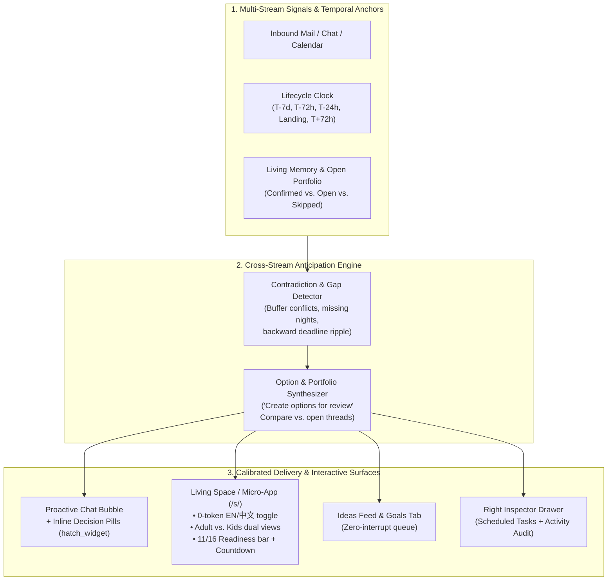

# 22 — Meta Muse (`muse.ai`) Proactive Actions, Temporal Anticipation & Living Interactive Spaces: Live Product Audit & Gap Analysis Against `agy-hq`

- **Date:** 2026-11-21
- **Task Scope:** `[Task:agy-hq] Muse Proactive Actions Research & RFC` (`hq/muse-proactive-actions`)
- **Companion Specification:** [RFC-0027: Muse-Informed Proactive Actions — Lifecycle Anticipation Engine, Structured Decision Cards, Living Interactive Spaces & Horizon-Aware Steering](../design/0027-muse-proactive-actions.md)
- **Related Documents:** [10 — Meta Muse (`muse.ai`) Deep Dive (Architecture & Hatch Sandbox)](10_muse_ai_proactive_and_context_study.md), [14 — Anthropic Always-On Agents Audit](14_anthropic_always_on_agents_gap_audit.md), [16 — Outbound Approval UX & Customizable Policy Audit](16_approval_ux_and_customizable_policy_audit.md), [18 — Front Desk Channel Bridge Audit](18_channel_bridge_front_desk_audit.md), [21 — Unified Session Authorization Spectrum & Scoped Delegates Audit](21_declarative_scoped_delegates_audit.md), [RFC-0014 (Proactive Engine v2)](../design/0014-proactive-engine-and-living-context.md), [RFC-0020 (Ambient Synthesis Proposal)](../design/0020-proactive-ambient-synthesis-and-mobile-push.md), [RFC-0026 (Unified Lattice & Scoped Delegates)](../design/0026-declarative-scoped-delegates.md)

---

## 1. Executive Summary

Our earlier study of Meta Muse ([Research 10](10_muse_ai_proactive_and_context_study.md), Nov 12, 2026) focused on Muse's **macro-infrastructure**: its single-tenant Linux VM (`Hatch`), non-LLM permission socket (`Sentinel`), credential surrogation (`hatch-authd`), and 4-surface attention split. That study directly drove [RFC-0014](../design/0014-proactive-engine-and-living-context.md), giving `agy-hq` 0-token `TriggerCursor` gatekeepers, a 4-tier Outbox (`interrupt`, `brief_rollup`, `ideas_feed`, `silent_ledger`), basic `Goals`/`WaitingOn` SLAs, line-item `ConsoleSpace` cards, and `hq memory forget`. Subsequent milestones ([RFC-0017a](../design/0017a-connector-protocol-and-watcher-engine.md)–[RFC-0026](../design/0026-declarative-scoped-delegates.md)) hardened provenance taint, lease-based Morning Briefs, durable Event/Timer stores, mobile Channel Bridges, Memory v2, Pluggable Workspaces, and Scoped Delegates.

Yet a hands-on comparative inspection of **how Muse actually anticipates, formats, and steers day-to-day proactive actions** against `agy-hq` (`HEAD` at `78b2f5e`) reveals why Muse's user-facing proactivity feels like an attentive human chief of staff while `agy-hq` often still behaves like a backend log dispatcher:

1. **Temporal Lifecycle & Cross-Stream Anticipation vs. Single-Item Polling (`G1`):** Muse models events across **temporal phases** (live hero countdowns, `T-7d` $\rightarrow$ `T-72h` $\rightarrow$ `T-24h` cutoff escalation, timezone-aware arrival/landing pings, and `T+72h` post-meetup settlement checks), **ripples dependent deadlines backward** when away windows overlap due dates, **joins incoming confirmations across streams** to flag schedule/capacity contradictions and missing lodging nights, and tracks **3-state readiness ledgers** (`Confirmed ✓` `11 of 16` · `Still to Book` · `Decided: Skipped`). In `agy-hq`, [RFC-0020](../design/0020-proactive-ambient-synthesis-and-mobile-push.md) (`internal/pulse/`) remains unimplemented, `Goal` milestones are flat booleans with no event horizons or `Skipped` tombstones, and `DispatchOutboxToFrontDesk` defaults to `CoalesceWindow: 0`—waking `[HQ] Front Desk` multiple times on back-to-back correlated alerts from the same vendor.
2. **Living Interactive Micro-Apps (`Spaces` / `/s/<slug>`) vs. Static Markdown Walls (`G2`):** When organizing multi-day plans, itineraries, or option matrices, Muse generates self-contained, sandboxed HTML micro-apps (`*.cf.metaaiusercontent.com`) featuring **instant 0-token client-side language toggles** (`English / 中文`), **dual-audience lenses** (`Grown-Ups` deep-dive history vs. `Kids` treasure-hunt stories, plus split-party timelines), live JS countdowns, and `Legend vs. Fact` trap callouts. By contrast, `agy-hq`'s `ConsoleSpace` ([`internal/webui/spaces.go`](../../internal/webui/spaces.go)) only renders plain-text `[]string` bullet slices (`SpaceWidgetOutput`), leaving Morning Briefs and plans trapped in static Markdown files despite Antigravity's native `generative_ui` HTML capabilities and `:4242` local HTTP server.
3. **Inline Multi-Option Decision Widgets vs. Passive Dead-End Alerts (`G3`):** Muse's background workers run a *"Create options for review"* step that renders **2–4 concrete, portfolio-aware decision buttons** (`[Send Draft A]` · `[Send Draft B]` · `[Send Both]` · `[Hold Until Return]`) directly beneath proactive messages. In `agy-hq`, `FormatInterruptCard` ([`internal/outbox/dispatcher.go`](../../internal/outbox/dispatcher.go)) emits plain Markdown text with no structured `DecisionOption` schema, causing `[HQ] Front Desk` to end non-proposal alerts with passive *"Let me know if you want me to check"* prose.
4. **Silent Proposal Expiry vs. Transparent Timeout Recovery (`G4`):** When an approval card times out unclicked in Muse, the agent explicitly informs the user (*"Nothing went out because the confirmation card timed out — re-open now?"*) and remembers the unsent state when counterparties follow up. In `agy-hq`, `collectProposalAlerts` ([`internal/brief/brief.go`](../../internal/brief/brief.go)) drops expired proposals older than `12h` (missing daytime expirations before the next 7:30 AM brief) and offers no 1-command `hq approvals restage <id>`.
5. **Horizon-Aware Parking, Instant Reversal & Human-First Hierarchy (`G5`–`G6`):** Muse supports natural 3-word horizon holds (*"Hold until after trip"*), immediate mid-flight cancellation with Activity audit entries, and a calm human-first UI that tucks cron/activity telemetry into a collapsible right-hand drawer with human-readable next-run timestamps. `agy-hq` leads `hq_console.md` and `:4242` with raw harness metrics (token burn, CHR %, watermarks, raw 5-field cron expressions) and lacks `ParkedUntil` horizon suppression or `interrupt` usefulness telemetry in `hq rsi mine`.

---

## 2. Inspection Methodology & Primary Sources

1. **Subagent & Browser Inspection Note:** Per workspace workflow rules, we first invoked Antigravity's built-in `browser` subagent (`webview_browser`). Because this background task conversation (`hq spawn`) was not attached to an active Hub UI window (`conversation is not open in any Hub window`), we performed read-only DOM and accessibility-tree inspections via the workspace's installed `chrome-devtools` MCP server (using an isolated browser context for public `muse.ai` navigation and read-only snapshots) supplemented by `search_web`. All real-world workflows observed during product analysis have been **100% abstracted into synthetic personas, itineraries, and tickers** in this document to uphold `agy-hq`'s strict Two-Layer Vault privacy invariant (`P1`–`P6`).
2. **Primary `muse.ai` Surfaces & Publications Audited (Through Nov 21, 2026):**
   - `https://muse.ai/` — Product landing page, Secure VM overview, Approval & Goal panels, and guided tour structure.
   - `https://muse.ai/blog` & `https://muse.ai/blog/how-we-designed-muse` (*"How We Designed Muse"*, Mona Sarantakos & Christine Awad) — Chat Bubbles, Side Chats, Avatar live status snippet, Activity/Permissions drawer, Goals tab, deterministic Approval Cards, rich Artifacts, and Ideas onboarding/serendipity loops.
   - `https://muse.ai/blog/poppy-personal-agent-protocol` (*"More Ways for Muse to Work With Businesses"*, Johan Duramy, **Nov 13, 2026**) — Publication of **Personal Agent Protocol v1.0 (`poppy.json`)** for structured agent-to-business discovery (`website`, `API/MCP`, or `business-agent` + OAuth grants).
   - Live Muse Workspace Chrome (`Chat`, `Feed`, `Ideas`, `Goals`, `Library`, `Create a space`, `[[hatch_widget:...]]` decision widgets, and right-hand `Activity` · `Approvals` · `Identity` · `Mail` + `Scheduled tasks` inspector).
   - Live Muse Shareable Space / Interactive Guide (`https://muse.ai/s/<slug>` rendered inside an origin-isolated `https://<id>.cf.metaaiusercontent.com/index.html` iframe with nested `spaces/v2/<sub-guide>/` companion guides).
3. **`agy-hq` Source Audit (`HEAD` `78b2f5e`):** Full source inspection across `cmd/hq/ops_cli.go`, `internal/kernel/`, `internal/watcher/`, `internal/timers/`, `internal/delegates/`, `internal/outbox/`, `internal/brief/`, `internal/approvals/`, `internal/offer/`, `internal/channels/`, `internal/webui/`, `.agents/plugins/agy-hq/skills/`, and Antigravity's built-in `generative_ui` skill contract.

---

## 3. Deep Analysis: How Meta Muse Executes & Presents Proactive Actions

### 3.1 Trigger & Anticipation Model

Unlike cron scripts that summarize a single new email in isolation, Muse's proactive triggers combine **temporal phase awareness** with **cross-record constraint checking**:

| Anticipation Pattern | Concrete Mechanism Observed in Muse | Why It Feels High-Signal (Zero Nag Noise) |
| :--- | :--- | :--- |
| **1. Phase-Anchored Countdowns & Window Escalation** | Attaches progressive checkpoints to dated events and expiring quotes: weekly horizon (`T-6d`), countdown alert (`T-72h`: *"Buyout quote of $32,000 expires Saturday — still blocked on lender payoff message"*), and final pre-departure/cutoff day sweep (`T-24h`: *"Tomorrow you fly out; today is the last window for these 4 items — ignore if already handled"*). | Urgency and tone adapt to remaining decision time; every final-window nudge includes an explicit *"if you already handled this or chose Plan B, ignore"* escape hatch. |
| **2. Arrival, Transition & Offline-Settlement Pings** | Schedules timezone-aware transition triggers (`"Landing reminder set: ping at 7:30 AM local time just after flight lands"`) and `T+72h` post-event follow-ups for **offline actions invisible to APIs** (e.g., asking 3 days after an in-person peer-to-peer sale whether cash/Zelle cleared before removing the listing). | Bridges the digital/physical gap: tracks real-world state transitions where no webhook will ever fire. |
| **3. Cross-Stream Contradiction & Missing-Gap Synthesis** | Joins newly arrived confirmations against existing household/calendar records. *Synthetic Example:* User books a compact sedan pickup at `12:00 PM` Dec 24 and return at `4:00 PM` Jan 2; partner's flight email arrives showing arrival at `3:29 PM` Dec 24 (`3.5h` idle gap), departure at `4:15 PM` Jan 2 (`15m` impossible airport return buffer!), 4 travelers + luggage requesting an SUV, and a dropped child seat—plus pricing for SUV/minivan alternatives and an epistemic caveat (*"Assuming you are on the same flight..."*). Similarly detects unbooked hotel nights (`arrival night` + `last 4 nights`) when comparing a 2-night hotel confirmation against a 9-day school absence notice, then auto-updates once the missing booking arrives. | Catches expensive human coordination errors *across* separate emails/senders that single-thread triage completely misses. |
| **4. Backward Dependency Ripple Across Away Windows** | When a trip or offsite spans `Nov 22 – Dec 1` and a school permission slip or required outfit order has a nominal deadline of `Dec 2` (return day), Muse computes that physical signing or shipping cannot wait until `Dec 2` and escalates the deadline **backward to `Nov 20–21` (pre-departure)**. When the flight moves 1 day earlier, dependent prep deadlines automatically pull 1 day earlier too. | Computes *effective actionable windows* rather than naive `due_date - 24h` math. |
| **5. Micro-Horizon Operational Deltas** | For an outdoor afternoon event (`1:30–3:30 PM`), reports the **hourly precipitation curve** across the exact event window (`1 PM: 21% → 3 PM: 45% → 6 PM: 87%`) rather than a generic daily icon, recommending confirming indoor backup with the host. | Actionable operational granularity tied to a calendar slot. |
| **6. Three-State Readiness Ledger (`Confirmed` · `Open` · `Skipped`)** | Tracks multi-part plans with an explicit numerator/denominator (`11 OF 16 BOOKED`): (a) **`Booked ✓`** with confirmation codes, seat assignments, card-hold vs. charge distinctions (`£40 hold released on seating`), and free-cancellation cutoffs (`Fri 17:00 local`); (b) **`Still to book`** with time-slot constraints (`morning slot before 2:00 PM split`) and live availability/price checks; and (c) **`Decided: Skipped`** recording explicitly declined options so Muse never re-suggests them. | Eliminates repetitive nagging on rejected ideas while making remaining gaps scannable in 2 seconds. |
| **7. Transparent Failure & Timeout Disclosure** | Never fails silently when user expectations are at stake: (a) if an approved outbound email's confirmation card times out unclicked, Muse reports *"That email never went out — confirmation card timed out; want me to re-open it?"* and remembers days later that the thread has `0` sent replies; (b) if a morning API check hits `HTTP 429` or timeout, it notes *"Baseline preserved; will retry tomorrow"*; (c) if an active schedule was accidentally archived, it restores it and informs the user. | Builds deep user trust ("You can't trust what you can't see"). |

---

### 3.2 Response & Artifact Presentation

Muse draws a sharp product line: **"Sometimes a block of text just isn't the right shape for the answer. If you asked a person to plan a trip, you wouldn't want a 2,000-word reply; you'd want an itinerary."**

#### A. Sandboxed Interactive Micro-Apps (`Spaces` / `muse.ai/s/<slug>`)
Inspecting the live DOM and accessibility tree of a shared Muse Space (`https://muse.ai/s/<slug>`) reveals a clean, repeatable frontend architecture:
1. **Origin-Isolated Sandbox Shell:** The outer `muse.ai/s/<slug>` banner renders minimal chrome (Muse mark, title, unverified-content notice, `More actions` menu) and embeds the generated micro-app inside a dedicated cross-origin `<iframe>` (`https://<id>.cf.metaaiusercontent.com/index.html`) so generated JS/CSS can never touch session cookies or main-app credentials.
2. **Sticky Section Navigation + Hero KPI Strip:**
   - Top navigation bar jumps cleanly between `DAYS`, `FLIGHTS & HOTELS`, `BOOKING STATUS`, and `NOTES`, paired right beside an **instant client-side language toggle (`中文` | `English`)**.
   - Hero banner displays structured KPI tiles: **Live Countdown** (`2 days until departure`), **Stay Breakdown** (`8 nights · 6 City A · 2 City B`), **Anchor Highlights** (`2 shows`), and **Primary Confirmation Badge** (`CONF-884210`), plus traveler roster tags with ages (`Maya · 10`, `Leo · 4`).
3. **Zero-Token Client-Side Bilingual Switching (`中文 / English`):**
   - Toggling `中文` $\leftrightarrow$ `English` flips UI copy immediately in the browser (`0ms`, `0` LLM tokens) without round-tripping to the agent—essential when household members or external collaborators prefer different languages.
4. **Dual-Audience Lenses & Split-Party Choreography:**
   - Every expandable day stop (modeled visually like stops on a transit line) includes:
     - Chronological slot badges (`Booked ✓` vs. `(still to book)`), inline `Directions · Origin → Destination` Google Maps deep links, and official venue URLs.
     - **Parallel Audience Callouts:** **`GROWN-UPS`** (architectural/historical context, e.g., 1066 coronation history or 111-year hidden crown jewels) paired right beside **`FOR THE KIDS`** (concrete visual scale, e.g., *"taller than 40 double-decker buses"*, *"one-o'clock cannon BOOM!"*, gravestone treasure hunts).
     - **Nested Companion Sub-Spaces (`spaces/v2/<venue>-guide/`):** Dedicated deep-dive venue guides offering dual editions (*Adult In-Depth Edition / Kids Fun Guide*).
     - **First-Class Split-Party Blocks & Cross-Day Threads:** Explicitly models parallel sub-groups (`Parent A + Older Child` at Historical Museum $\parallel$ `Parent B + Younger Child` at Children's Bus Tour $\rightarrow$ `4:45 PM Reunion`), enforces age/stroller eligibility warnings (`⚠️ Under-5s not admitted — plan café stop`), flags **`Legend vs. Fact`** traps (e.g., famous artifact relocated to another city in 2024—don't promise it to the kids!), and weaves saved social-media bookmarks into route-ordered walking stops with zero detour.

#### B. Inline Decision Widgets (`[[hatch_widget:...]]`) & Portfolio Framing in Chat
In main chat (`pageId` inspection of Muse's live message log and Activity feed):
- **Structured Multi-Choice Action Pills:** Background triage runs end with a discrete `Create options for review` / `Create options for next steps` step that renders inline buttons directly under the message—for example:
  - Two inbound recruiter threads triaged together: `[Send Reply A]` · `[Send Reply B]` · `[Send Both]` · `[Hold Both for Now]`.
  - Executive follow-up on a thread with an earlier unsent draft: `[Send Updated Draft to CEO]` · `[Send Original to Recruiter]` · `[Hold Until Return]`.
- **Portfolio-Relative Framing:** Rather than summarizing a new inbound opportunity in a vacuum, Muse compares its terms, price/valuation premium, lockup, and role track **against all currently open options and recent closed outcomes** (e.g., contrasting a new secondary deal at `+7%` over Series C against two open secondary offers and a recently sold IPO allocation, noting *"No closing cutoff in email — safe to revisit after your trip"*).

#### C. Visual Hierarchy & Three-Layer Transparency Drawer
- **Left Rail (Calm Navigation):** `Chat` (`Main chat` + collapsible `Side chats`), `Search (Ctrl+K)`, `Feed`, `Ideas`, `Goals`, `Library` (persistent home for generated Artifacts/Spaces), and `Create a space`.
- **Right Inspector Drawer (On-Demand Transparency):** Clicking the agent's named avatar (`Connected`) reveals tabs for **`Activity`**, **`Approvals`**, **`Identity`**, and **`Mail`**, headed by a collapsible **`N scheduled tasks`** card showing human-readable next-run times (`Tomorrow 7:48 am`, `Every 30 minutes`, `Every hour`) above a day-grouped chronological audit log (`Today`, `Yesterday`, ...) of every option set presented, memory search, and user override.

---

### 3.3 Feedback, Approval, & Steering Loop

1. **Zero-Friction Horizon Holds (`"先放着"` / `"回来再说"`):** Users never have to type CLI IDs or ISO timestamps to defer a nudge. Replying *"Hold for now"* or clicking `[Hold Until Return]` parks the obligation until the inferred horizon (e.g., return from travel or `T-48h` before hard cutoff), silencing intermediate reminders.
2. **Immediate Conversational Reversal:** When a user confirms two offline sales (`"Both completed"`), Muse dispatches a delegated Side Chat to remove both marketplace listings—and when the user immediately sends `"Don't delete — I have more units"` (`"别删 / 我还有"`), Muse aborts/reverts the action in seconds and logs `"Reverted deletion to kept after user said '别删'"` in the Activity timeline.
3. **Anti-Banner-Blindness Approval Cards & `Poppy` v1.0:** Irreversible external mutations (sending mail, checkout, modifying reservations) pause on structured deterministic cards highlighting recipient, diff/cost, and reversibility, while **Poppy (`poppy.json`, Nov 13, 2026)** lets businesses publish verified API/MCP/agent endpoints so personal agents avoid fragile DOM scraping and bot blocks.

---

## 4. Codebase Audit of `agy-hq`'s Current Proactive Architecture (`HEAD` `78b2f5e`)

We audited all ten proactive layers in `agy-hq` to separate **where `agy-hq` already leads** from **where concrete structural gaps remain**:

| `agy-hq` Subsystem | Key Implementation Files | Current Strengths (`HEAD` `78b2f5e`) | Concrete Limitations vs. Muse |
| :--- | :--- | :--- | :--- |
| **1. Triggers & Daemon Loop** | [`cmd/hq/ops_cli.go`](../../cmd/hq/ops_cli.go) (`L115–191`), [`internal/kernel/daemon.go`](../../internal/kernel/daemon.go), [`internal/kernel/gatekeeper.go`](../../internal/kernel/gatekeeper.go), [`templates/triggers.yaml`](../../templates/triggers.yaml) | `15s` fast tick (timers, inbox drops, delegates, outbox, channel bridges), `30s` gatekeeper tick (`SHA-256` / `precheck_enqueues` 0-token dedup + `3`-error rollup alert), `30m` heartbeat, split-brain `systemd` detector. | `ScheduleSummaryRow` exposes raw 5-field cron strings without `NextRunAt` countdowns; `morning-brief` still defaults to `front_desk_cron`; no `ambient-pulse` gatekeeper in `triggers.yaml` ([RFC-0020](../design/0020-proactive-ambient-synthesis-and-mobile-push.md) unimplemented). |
| **2. Connector Watchers & Timers** | [`internal/watcher/watcher.go`](../../internal/watcher/watcher.go), [`internal/timers/timers.go`](../../internal/timers/timers.go) | Monotonic `AckedItemIDs` + `PoisonedItems`, HTML/CSS hidden-span stripping, `waitingThreads` + `goalTokens` urgency boost (`L238–333`), durable `follow_up` & `schedule` timers (`timers.json`, `NextCronOccurrence`). | Evaluates each connector batch in isolation: zero cross-connector/calendar conflict detection, zero timezone-aware arrival/transition timers attached to `Goal` anchors, and zero micro-horizon event prep checks. |
| **3. Scoped Delegates & Nudges** | [`internal/delegates/dispatcher.go`](../../internal/delegates/dispatcher.go), [`internal/delegates/nudge.go`](../../internal/delegates/nudge.go) | Ring-0 8-profile `internal/authz` lattice (`NI-1`–`NI-4`), 0-token regex fast-path CaMeL nudges (`queue_only` & `spawn_sandboxed_worker`), pre-preflight rate-limit reservation, egress redaction gateway. | Peer-facing delegate pipeline is strong, but owner-facing proactive nudges (`internal/outbox/`) lack an analogous typed `DecisionOption` template/action mechanism! |
| **4. Kernel Event Dispatch & `Goals`** | [`internal/kernel/events_dispatch.go`](../../internal/kernel/events_dispatch.go), [`internal/kernel/goals.go`](../../internal/kernel/goals.go), [`internal/events/events.go`](../../internal/events/events.go) | Single-worker `ScopeKey` leases, crash recovery, quota circuit breaker, parallel `connector.InspectThread` auto-resolution of `WaitingOn` SLAs (`L470–670`). | `Goal` (`L60–72`) has only `TargetDate`, flat `Milestone{ID, Title, Done}`, and `WaitingOn`. **Missing:** `AnchorStartAt`/`AnchorEndAt` event windows, `LocationTZ`, `ParkedUntil` away/hold horizons, backward dependency checks, and 3-state `Confirmed / Open / Skipped` readiness items. |
| **5. Outbox Tiers, Coalescing & Eval** | [`internal/outbox/outbox.go`](../../internal/outbox/outbox.go), [`internal/outbox/dispatcher.go`](../../internal/outbox/dispatcher.go), [`internal/outbox/eval.go`](../../internal/outbox/eval.go) | 4-tier routing (`interrupt`, `brief_rollup`, `ideas_feed`, `silent_ledger`), quiet hours, 12h Jaccard title dedup (`>= 0.75`), 3-phase lock-safe delivery, `reported.jsonl` anti-repetition, `hq outbox eval` 10-case golden suite. | `CoalesceWindow` defaults to `0` (`outbox.go:126`) and `ParseAttentionConfig` parses `coalesce_window` (`L185`) **but `EvaluateDelivery` / `DispatchPendingInterrupts` never actually uses `CoalesceWindow`!** Back-to-back distinct alerts from the same vendor/incident (`"Password changed"` + `"MFA changed"`) trigger separate cold Front Desk wakes. |
| **6. Outbound Approvals & Offer Gateway** | [`internal/approvals/approvals.go`](../../internal/approvals/approvals.go), [`internal/offer/offer.go`](../../internal/offer/offer.go) | SHA-256 deterministic execution, RFC 5322 `participant_lock`, `24h` `ask_ttl`, `PreToolUse` 1-tap `ask_question` injection, contextual PII `RiskFlags`. | Silent daytime proposal expiry: no proactive nudge before `< 2h` TTL expiry, `collectProposalAlerts` (`brief.go:329`) ignores expirations `> 12h` old, and there is no `hq approvals restage <id>` or thread-level memory that a prior reply expired unsent. |
| **7. Morning Brief & Sleep Consolidation** | [`internal/brief/brief.go`](../../internal/brief/brief.go), [`morning-brief/SKILL.md`](../../.agents/plugins/agy-hq/skills/morning-brief/SKILL.md), [`sleep-consolidate/SKILL.md`](../../.agents/plugins/agy-hq/skills/sleep-consolidate/SKILL.md) | Non-destructive `blease_` two-phase commit, nonce-fenced tainted digests, `brief.d` argv extensions, ground-truth `verify-transcript` dreaming, 4-gate RSI harness (`hq rsi`). | Brief output is purely a flat Markdown file (`brief-YYYY-MM-DD.md`) + chat summary; `ComputeSkillDismissalStats` (`outbox.go:882`) tracks `ideas_feed` and `OriginSkill` proposals but ignores `interrupt` dismissal/park/noise outcomes. |
| **8. `:4242` WebUI, `ConsoleSpace` & `hq_console.md`** | [`internal/webui/webui.go`](../../internal/webui/webui.go), [`internal/webui/spaces.go`](../../internal/webui/spaces.go), [`internal/webui/console_md.go`](../../internal/webui/console_md.go), [`console.html`](../../internal/webui/assets/console.html) | Loopback + CSRF/Origin guards, `sidecar://agy-hq-console/`, weekday/time-window `MatchesSpaceSchedule` (`spaces.go:230`), 1-click Proposal Approve/Reject in WebUI. | `ConsoleSpace` renders only plain `[]string` lines (`SpaceWidgetOutput`); zero interactive Living Spaces, zero bilingual/audience toggles, zero countdown/readiness bars; `hq_console.md` leads with infrastructure telemetry and prints raw CLI commands (`run ./bin/hq ideas promote ...`) instead of human-first action cards. |
| **9. Chat & Channel Delivery** | [`internal/channels/dispatcher.go`](../../internal/channels/dispatcher.go), [`.agents/plugins/agy-hq/rules/AGENTS.md`](../../.agents/plugins/agy-hq/rules/AGENTS.md) | Vendor-neutral SHA-256-pinned `hq-channel-bridge/v1`, Front Desk rotation rebinding, signed `bca_`/`bcr_` approval callbacks. | `FormatInterruptCard` (`dispatcher.go:81`) emits passive text; `AGENTS.md` forces Front Desk to relay non-proposal alerts passively, leaving users without 1-tap `ask_question` or Bridge decision options (`Park`, `Handled`, `Investigate`, `Restage`). |
| **10. Host `generative_ui` Integration** | Antigravity built-in `generative_ui` (`<agent-embed>` + side-pane `.html` artifacts) | Native host support for theme-aware (`--background`, `--card`, `--foreground`) Tailwind HTML micro-apps in `<artifactDir>` with strict CSP isolation. | **Completely unused by `agy-hq` Core OS skills and Console Spaces today!** |

---

## 5. Gap Matrix & Prioritized Design Principles for [RFC-0027](../design/0027-muse-proactive-actions.md)

| Gap ID | Problem Summary | Priority | Target Subsystem in [RFC-0027](../design/0027-muse-proactive-actions.md) |
| :--- | :--- | :--- | :--- |
| **`G1`** | Missing temporal lifecycle windows (`T-72h`, `T-24h`, arrival/landing pings, backward away-window dependency checks), cross-stream schedule/gap conflict detection, 3-state readiness (`Confirmed` / `Open` / `Skipped`), and unimplemented `CoalesceWindow` (`RFC-0020` unbuilt). | **P0 (Phase 2A)** | **`internal/pulse/` Anticipation Engine + `Goal` Readiness/Horizons + Outbox Incident Coalescing** |
| **`G3` & `G4`** | Passive dead-end `🔔 Proactive Alert` text cards with zero structured multi-choice options (`DecisionOption`), plus silent proposal TTL expiry (`>12h` blind spot) and no 1-tap re-staging. | **P0 (Phase 2B)** | **Typed Ring-0-Safe `DecisionOption` Cards (`hq outbox act`) + `hq approvals restage` + Thread Unsent-Expiry Context** |
| **`G2`** | Static Markdown walls and `[]string` `ConsoleSpace` widgets instead of composable interactive micro-apps with 0-token client-side `i18n` locale toggles, multi-perspective lenses, group filters, and live countdown/readiness bars. | **P1 (Phase 2C)** | **`internal/living/` Composable Living Spaces (`1..N` BCP-47 `hq-i18n` + 5 Generic Block Primitives $\rightarrow$ `:4242` CSP Sandbox & Antigravity `generative_ui`)** |
| **`G5` & `G6`** | Infrastructure-heavy `:4242` / `hq_console.md` hierarchy, missing `NextRunAt` schedule labels, no horizon-aware `"Park until X"` (`ParkedUntil`) or `hq cancel` conversational reversal, and blind `interrupt` SNR telemetry in `hq rsi mine`. | **P1/P2 (Phase 2D)** | **Human-First Console Redesign + `ParkedUntil` / Away Mode + Mid-Flight Reversal + Full-Funnel Outbox SNR $\rightarrow$ RSI** |
| **`G7`** | Emerging external business agent discovery (`Poppy` `poppy.json` v1.0) vs. brittle browser scraping. | **P3 (Future)** | **Optional `poppy.json` / MCP Read-Query Import Adapter on `hq-connector-protocol/v1`** |

### Six Architectural Invariants Governing `RFC-0027`

1. **Two-Layer Separation (Domain-Neutral OS Primitives vs. Personal Vault Configuration):** Keep the open-source `agy-hq` engine (`cmd/`, `internal/`, `templates/config.yaml`) 100% locale- and domain-neutral (e.g., `default_locales: ["en"]` with language toggle hidden when single-locale, generic `perspectives`/`groups`, and generic interval/coverage-tag math), while personal preferences (such as bilingual `["en", "zh"]`, audience personas, custom horizons, and domain workflows) live strictly inside the git-ignored `<vault>/`.
2. **Local Vault Sovereignty Without Cloud Custody:** Reproduce Muse's sandboxed micro-app UX (`*.cf.metaaiusercontent.com`) **100% locally** via `:4242` `sandbox="allow-scripts"` CSP iframes and Antigravity local `generative_ui` `.html` artifacts—never uploading personal itineraries, financials, or Vault state to any external cloud.
3. **0-Token Deterministic State & Client-Side Toggles:** Store Space state as canonical JSON (`space.json`) and compile `1..N` BCP-47 `hq-i18n` dictionaries, generic `perspectives`, countdowns, and readiness views deterministically in Go + vanilla client JS so toggling languages, lenses, or checklist filters costs **0 LLM tokens and 0ms network latency**.
4. **Closed-Enum Decision Options Preserve Ring-0 Quarantine (`NI-1`–`NI-4`):** Untrusted `tainted` workers may attach structured `DecisionOption` buttons **only** from a closed, Go-validated action vocabulary (`approve_proposal`, `reject_proposal`, `restage_proposal`, `park_until`, `dismiss_handled`, `dismiss_noisy`, `skip_checklist`, `promote_goal`) with `SanitizeAntiCue`-bounded labels—never arbitrary shell commands or free-form prompts.
5. **Gate in Go (`0` Tokens), Escalate by Horizon, Coalesce Bursts:** `hq pulse precheck` evaluates countdowns, blocking-window deadline collisions, interval buffers, coverage-tag spans, and expiring/expired proposals in pure Go (`0` tokens on quiet ticks), while Outbox incident coalescing merges back-to-back same-entity alerts before waking `[HQ] Front Desk`.
6. **Zero External Go Dependencies & Zero Monolith Bloat (`H4-A` & `H5`):** Implement new capabilities in modular packages (`internal/pulse`, `internal/living`) using 100% Go stdlib while keeping all monolith files strictly below their `Gate H5` LOC ceilings.
