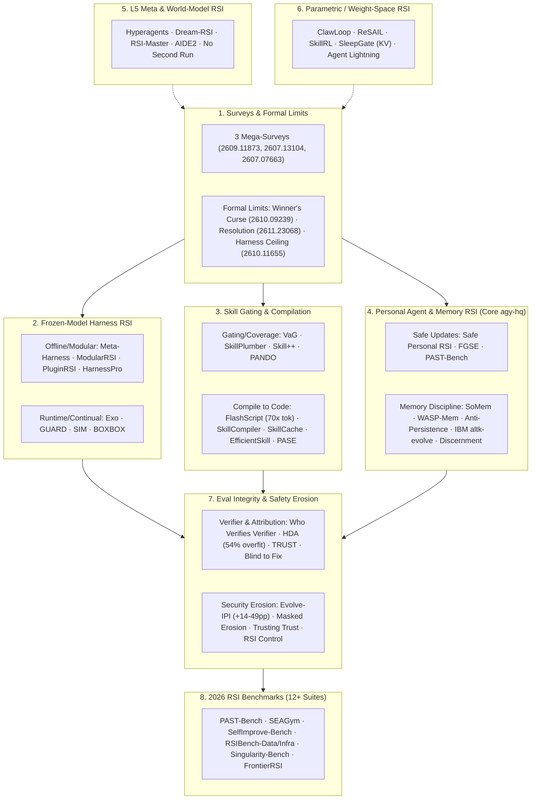

# 24 — The 2026 Recursive Self-Improvement (RSI) Research Frontier (570+ Paper Holistic Audit) & 17-Day `agy-hq` Production Evidence

- **Date:** 2026-11-25 (Revision 3 — Holistic Landscape + Full Impact-Weighted Live Audit)
- **Author:** `[Task:rsi] Deep Research on @omarsar0 RSI Post` (`DeepInvestigator` + Primary arXiv/Index & Full-Vault Verification)
- **Status:** Complete / Phase 1 Holistic Research Memo *(Paired with [RFC-0029 Rev 2](../design/0029-rsi-v2-trace-eval-and-heldout-ratchet.md))*
- **Related Documents:**
  - [RFC-0010: Bounded Agent Recursive Self-Improvement (RSI)](../design/0010-agent-recursive-self-improvement.md)
  - [RFC-0019: OS vs. User-Space Skill Boundary, Vault Skills (`local/skills/`) & Two-Tier RSI Overlays](../design/0019-two-tier-rsi-vault-overlay.md)
  - [RFC-0024: Memory Engine v2 — Orthogonal Single-Source Vault Architecture & Deterministic Memory Eval](../design/0024-memory-v2-prediction-and-eval.md)
  - [RFC-0026: Unified Session Authorization Lattice & Declarative Scoped Delegates](../design/0026-declarative-scoped-delegates.md)
  - [RFC-0027: Smarter Proactive Actions — Looking Ahead, 1-Tap Decisions & Interactive Spaces](../design/0027-muse-proactive-actions.md)
  - [RFC-0029: RSI Engine v2 — Impact-Weighted Multi-Signal Mining, Compiled Skills, Anchored Safety Gating & Held-Out Ratchet](../design/0029-rsi-v2-trace-eval-and-heldout-ratchet.md)
  - [07 — Agent Recursive Self-Improvement (RSI): Literature Survey & Safety Invariants](07_agent_recursive_self_improvement.md)
  - [15 — Two-Tier Recursive Self-Improvement, OS vs. User-Space Skill Boundary & Personal Vault Skill Overlay Audit](15_two_tier_rsi_vault_overlay.md)
  - [19 — Anthropic's *"The Components of Agent Memory"* & 12-Day Production Vault Telemetry Audit](19_anthropic_memory_components_and_vault_audit.md)

---

## 1. Executive Summary & Why Revision 1 Was Too Narrow

On November 24, 2026, Elvis Saravia (`@omarsar0`, DAIR.AI) published the X Article [*"My Top 10 RSI Papers of 2026"*](https://x.com/omarsar0/status/2125234668396023943), which links to two massive live paper corpora:
1. **DAIR.AI's Self-Improving Agents Collection** ([`academy.dair.ai/papers/collections/self-improving-agents`](https://academy.dair.ai/papers/collections/self-improving-agents)): **570 papers** total (`31` foundational Reading List classics + rapid Sep–Nov 2026 surge).
2. **`theseus-labs-rsi/awesome-rsi`** ([GitHub](https://github.com/theseus-labs-rsi/awesome-rsi), accompanying `arXiv:2609.11873`): **509 unique arXiv papers** (`216` L1, `155` L2, `67` L3, `51` L4 Deployment, `40` L5 Meta-Improvement), supplemented by **`Awesome-Self-Improving-Agents`** ([GitHub](https://github.com/selfimproving-agent/Awesome-Self-Improving-Agents), **242 unique arXiv papers**) and Chen et al.'s **~1,250-paper** survey (`arXiv:2607.07663`).

**What Revision 1 missed:** Auditing only `@omarsar0`'s 10 featured picks inherited a strong bias toward **verifiable coding/ML-infra benchmarks** and missed the most directly relevant late-2026 wave for a **Personal Agent OS** like `agy-hq`:
- **Personal-Agent Safety Erosion & Gating:** *Safe Personal RSI* (`arXiv:2611.23651`), *Appreciation Teaches Unauthorized Execution* (`arXiv:2610.39122` — showing skill evolution raises Indirect Prompt Injection ASR by `+14.0` to `+48.8 pp`!), and *Masked Erosion* (`arXiv:2610.38392` — showing acceptance gates silently erode overlapping safety layers).
- **Programmatic Compilation Over Prose Rules:** *FlashScript* (`arXiv:2610.33876`, `70×` fewer tokens & `100%` determinism vs. `23%` for prose skills), *SkillCompiler* (`arXiv:2610.39508`, `+32.33%`), *SkillCache* (`arXiv:2611.10022`), *EfficientSkill* (`arXiv:2611.19823`, `-80%` tokens), and *PASE* (`arXiv:2611.14019`).
- **When Memory & Rules Backfire:** *More Memory, Worse Agents* (`arXiv:2610.27406`, error reproduction), *How Much Should an Agent Remember?* (`arXiv:2611.26361`, IBM production lessons showing optimal rule count depends on model strength), *When Should Agents Remember? / FGSE* (`arXiv:2611.14326`), *WASP-Mem* (`arXiv:2611.04003`, `1` round of human diagnosis beats `4` rounds of self-judgment by `+7.0–10.9%`), *SoMem* (`arXiv:2611.11929`), and *PAST-Bench* (`arXiv:2608.04003`, Pathway Disconnect).
- **Statistical Resolution, Regret Gating & Failure Detection:** *The Resolution Hypothesis* (`arXiv:2611.23068`, >10M LLM calls), *TRUST* (`arXiv:2611.10787`, cuts bad-update rate `45.59% -> 2.78%`), *GUARD* (`arXiv:2611.23476`, `-54.5%` tokens, `0.000` memory pollution), *SIM* (`arXiv:2611.18856`), *SkillPlumber* (`arXiv:2611.25429`), and *Blind to What They Can Fix* (`arXiv:2611.29807`).

**Cross-checked against 100% of `agy-hq`'s live 17-day Vault telemetry (`2,590` raw observations $\rightarrow$ `1,274` deduplicated friction instances, `1,888` total wasted steps):**
- **Fingerprint Fragmentation (`D12`):** `55.9%` (`1,448/2,590`) of raw observations start `errorExcerpt` with `Created At: ... Completed At: ...` timestamps, and shell commands embed unique thread/proposal/worktree IDs—shattering true recurring clusters into fake `N=1` shards so only `33` raw rows appeared recurring!
- **Impact-Weighted Full-Population Breakdown (All `1,274` Deduped Instances, `1,888` Wasted Steps):**
  - **`25.4%` (`480` wasted steps, `160` instances, `157` convs):** **Monolithic runaway turns & tier misrouting (`A3`/`A4`)**—the #1 mechanical drain.
  - **`24.6%` (`465` wasted steps, `350` instances):** **Normal-work non-error noise** (`go test`/CI TDD, file exploration, `grep` exit-1 no-match, `edit_file` target miss, empty rejections) that should carry `0` RSI weight.
  - **`20.4%` (`385` wasted steps, `302` instances):** **Tool, CLI & External Connector friction**—including **`90` external connector CLI failures across `50` convs** (`gmail`, `gcalendar`, `gdrive`, `xurl`, completely hidden before normalization!), `109` `hq` CLI flag/help errors (`70` convs), `38` `env --` hook bugs (`21` convs), and `65` `git`/`gh` errors (`34` convs).
  - **`11.3%` (`213` wasted steps, `213` instances):** **`PreToolUse` guardrail denials** (including `83` non-standard blocks across `48` convs).
  - **`17.8%` (`337` wasted steps, `245` instances):** Uncategorized `run_command`/`read_file` errors, **ad-hoc `python3`/`node` inline script failures (`44` inst, `30` convs)**, and **Browser/MCP errors (`32` inst, `15` convs)**.
  - **Unmeasured "Dark Matter" (`0%` weight today):** Conversational user corrections (highest-leverage human diagnosis per *WASP-Mem*), clean-exit `F4` content quality gaps, draft edits (`0` captured), and recurring clean-exit multi-step workflows ripe for *FlashScript*/*SkillCache* compilation.

Every arXiv ID cited in this document (**83+ papers**) has been programmatically verified against `export.arxiv.org`.

---

## 2. The Holistic 2026 RSI Research Landscape (8 Structural Fronts)

---

### Front 1: Mega-Surveys, Autonomy Taxonomies & Formal Limits

1. **Three 2026 Mega-Surveys:**
   - **Duan et al. (Sep 2026, `arXiv:2609.11873`, [`theseus-labs-rsi/awesome-rsi`](https://github.com/theseus-labs-rsi/awesome-rsi), `509` papers):** Establishes the **`B0` persistence boundary** (in-task output revision without persistent state carryover is *not* RSI), the **Headroom-Closed Index (`HCI`)**, and the **5-Level Autonomy Ladder**: `L1` Execution (`216` papers), `L2` Strategy (`155`), `L3` Experience (`67`), **`L4` Deployment & Environment Adaptation (`51` — `agy-hq`'s operating regime)**, and `L5` Recursive Meta-Improvement (`40`).
   - **Ren, Chen, Guo, Zhuge, Schmidhuber et al. (Jul 2026, `arXiv:2607.13104`, [`Awesome-Self-Improving-Agents`](https://github.com/selfimproving-agent/Awesome-Self-Improving-Agents), `242` papers):** Splits RSI into *Foundation Model Improvement* vs. *Scaffolding Improvement* and distinguishes *Mechanism* vs. *Domain* evaluation.
   - **Chen, Wang, Qu (Jul 2026, `arXiv:2607.07663`, ~1,250 papers):** Separates convergent *bounded self-refinement* from open-ended RSI and ranks the **Verification Hierarchy**: `Formal/Execution Verifiers > Process Reward Models & Rubrics > External LLM Judges > Intrinsic Self-Assessment`.
2. **Four Formal & Empirical Ceilings of RSI:**
   - **Recursive Criticality (`arXiv:2609.00137`, Burtsev, Sep 2026):** Defines reproduction number $\mathcal{R}_{\mathrm{AI}}$ separating self-amplifying ($\mathcal{R}_{\mathrm{AI}} > 1$) from self-damping loops.
   - **The Winner's Curse (`arXiv:2610.09239`, Hu & Tang, Oct 2026):** Models correlated measurement noise $\hat{\Delta}_k = \Delta_k + c + \eta_k$; after Round 1, **`61–96%`** of proposed rewrites are neutral or harmful. Selecting on $n=16$ items overstates held-out accuracy by **`13–20 pp`** (affecting `GEPA` and `MIPROv2`); scoring start vs. final on **$n \ge 64$ untouched held-out items** removes average bias.
   - **The Resolution Hypothesis (`arXiv:2611.23068`, Zeng et al., Nov 2026):** Across 7 evolution methods, 6 models, and **>10M LLM calls**, shows agent evolution stalls not because proposers fail to invent better edits, but because **noisy evaluations are no better than random at separating helpful candidates from harmful ones**, and method-level margins are smaller than run-to-run variance.
   - **Harness Evolution Hits a Ceiling (`arXiv:2610.11655`, Tian et al., Oct 2026):** Classifying trajectories by *first failure signal* separates **process failures** (`F2` harness friction, `F3` loops/step exhaustion — repaired by harness evolution, `55% -> 90%` delivery) from **content/capacity failures** (`F4` clean run, poor answer — hits a hard harness ceiling and requires higher model capacity / routing escalation or weight training).
   - **Cold-Start Failure Generalization Gap (`arXiv:2610.22984`, Zhao et al., Oct 2026 & `arXiv:2611.11342`, Mitra & Saluja, Nov 2026):** Failure-derived notes repair previously failed tasks well, but **struggle to generalize to unseen tasks** unless anchored by successful trajectories (`+4.0 pp` over failure-blind search on narrow decisions; no demonstrated gain on full conversations).

---

### Front 2: Frozen-Model Harness, Modular & Continual Evolution

The single largest engineering wave in late 2026 treats the **agent harness** (context assembly, tool interfaces, control flow, verification) as the primary optimization object around fixed frontier weights:

| System / Paper | arXiv ID & Date | Core Mechanism | Headline Verified Result |
| :--- | :---: | :--- | :--- |
| **`Meta-Harness`** (Stanford / KRAFTON / MIT) | `2603.28052` (Mar) | Proposer inspects full source code, scores & raw execution traces on filesystem. | `+7.7 pts` at `4×` fewer tokens; `+4.7 pts` across 5 held-out models; `76.4%` on TB2 (discovered env-bootstrapping snapshots). |
| **`Exo`** (UC Berkeley / a16z / Braintrust) | `2611.00463` (Oct) | Formal $s_{t+1} = K(s_t, a_t)$ separating immutable protected layer $K$ from mutable policy $\pi_t$ + **`Guardian`** diff gate. | **`-35%` to `-61%` held-out model cost** on AppWorld & SREGym (`-35%` diagnosis latency); `-12%` to `-53%` vs. Codex/Pi. |
| **`GUARD`** (Google Cloud) | `2611.23476` (Nov) | Grader-free continual RSI via pre-execution checklists, **directional regret** (*newly hurt* vs. *never solved*), rule pinning & **Soft-HURT gate**. | **`80.80%`** on 43 SDK tasks (`+8.89 pp`, $p=0.008$), **`-54.5%` tokens/task**, **`0.000`** procedural memory pollution. |
| **`SIM`** (Google Cloud / DeepMind) | `2611.18856` (Nov) | Structured **Self-Improvement Memory** storing edit rationale, predicted vs. observed outcomes & eval context across shifts. | **`+2.36 pts`** mean lift over harness-only continuation across 10 coding runs ($p=0.003$, wins `9/10`). |
| **`ModularRSI`** (Beihang / Manchester) | `2609.14857` (Sep) | Evolves 5 orthogonal harness modules independently on 2,000 disjoint tasks. | TB2 `47.57% -> 52.43%`; SWE-Bench Verified `73.40% -> 76.45%`. |
| **`PluginRSI`** | `2609.32423` (Sep) | Decomposes monolithic harnesses into atomized reusable plugins evolved in parallel and dynamically recombined. | Faster convergence & stronger cross-model transfer than monolithic rewrites. |
| **`HarnessPro`** (Tsinghua / Z.AI) | `2610.26770` (Oct) | Label-free Pareto search generating `lite` / `medium` / `heavy` harnesses with runtime hook budgets. | `+4.5 pp` pass rate on TB2 while cutting per-task cost by **`33.9%`**. |
| **`BOXBOX`** | `2611.09218` (Nov) | Mid-task "pit-stop" harness revision + kernel hot-reloading without dropping workspace state. | Sustained optimization over long-horizon performance runs. |
| **`Harnesses That Improve Themselves`** | `2611.22299` (Nov) | Unifying 4-component modular framework (context, control, action interfaces, verification/recovery). | Gated modular evolution beats prompt reflection and full-harness rewrites across models. |
| *Adjacent Harness Papers* | `2603.03329`, `2606.01770`, `2606.09498`, `2607.15524`, `2609.01437`, `2609.24974`, `2611.27499` | `AutoHarness` (synthesized code verifiers), `Adaptive Auto-Harness`, `Self-Harness`, `RHI`, `HarnessDev`, `Harness-Zero`, `NavRSI`. | Converge on modular, trace-grounded, budget-aware harness edits over monolithic prompt rewrites. |

---

### Front 3: Procedural Skills — Pre-Commit Gating, Coverage & Compilation to Code

A decisive 2026 consensus emerged: **unconstrained natural-language skill accumulation degrades agents (`SkillsBench` `2602.12670`: `-1.3 pp` unverified vs. `+16.2 pp` curated)**; high-performing systems either **gate skills strictly before commit** or **compile recurring skills into deterministic code**:

1. **Programmatic Compilation (Turning Recurring Workflows into Deterministic Code/Scripts):**
   - **`FlashScript` (`arXiv:2610.33876`, Oct 2026):** Compiles recurring agent trajectories into parameterized **Neuro-Symbolic Programs (NSPs)**—deterministic code for actions/transforms, isolated LLM calls only where judgment is required. Across 120 WorkBench tasks, NSPs used **`70×` fewer input tokens**, **`3×` faster runtime**, and achieved **`100%` determinism** across `108` unseen instances (where prose skills collapsed to **`23%`** on composite tasks!).
   - **`SkillCompiler` (`arXiv:2610.39508`, Oct 2026):** Decomposes skills into fine-grained ops, compiling well-specified steps into reusable verifiable programs while keeping LLM reasoning for context-dependent steps (**up to `+32.33%`** accuracy across 5 benchmarks & 6 model families).
   - **`SkillCache` (`arXiv:2611.10022`, Nov 2026):** One-trace execution-grounded specialization compiling a completed skill run into a parameterized program capsule replayed by a lightweight executor, falling back to the full LLM skill only on divergence.
   - **`EfficientSkill` (`arXiv:2611.19823`, Google / Purdue, Nov 2026):** Discovery followed by accuracy-guarded pruning + utility offloading; cuts output tokens in `11/12` configs (up to **`-80%`** vs. unconstrained `EvoSkill`) while improving accuracy.
   - **`PASE` (`arXiv:2611.14019`, Nov 2026) & `Evo-Harness` (`arXiv:2608.15071`, Aug 2026):** Separate procedural logic into patchable executable components (`PASE`, `+2.8%+` stability/generalization) or compile context lessons into harness code.
2. **Pre-Commit Contamination Gating, Coverage & Routing Hygiene:**
   - **`Verifier-as-Gatekeeper (VaG)` (`arXiv:2608.05810`, Aug 2026):** Proves skill accumulation exhibits a **capability-contamination phase transition** where post-hoc rollback cannot undo downstream drift. Pre-commit gating with 3 heterogeneous critics (*structural validity, behavioral harmlessness, semantic consistency*) + marginal-gain selection hits **`72%` pass@1** on TB2 with a **`5×` smaller** skill library that transfers across 4 backbones.
   - **`SkillPlumber` (`arXiv:2611.25429`, Nov 2026):** Introduces **instruction-level coverage** (`follow` / `not-follow` / `not-covered`) to separate *wrong instructions* from *ignored instructions* (`+25.6` to `+30.4 pp` over seed skills; removing coverage loses `20.8%` of recovered failures).
   - **`Skill++` (`arXiv:2611.00544`, Oct 2026) & `PANDO` (`arXiv:2605.24785`, May 2026):** Routing-aware skill refinement (ensuring new skills do not hijack progressive-disclosure routing of older skills) and confidence-based demotion + **cache-aware prompting**.
   - *Additional:* `Skill∞` (`2610.35434`), `Trace2Skill` (`2603.25158`), `SkillNet` (`2603.04448`), `SWE-Skills-Bench` (`2603.15401`), `SkillAxe` (`2606.10546`), `Rethinking Self-Evolving Skills` (`2608.02636`).

---

### Front 4: Personal Agent RSI, Memory Discipline & Safe Updates *(Direct `agy-hq` Territory)*

This is the single most important cluster missed in Revision 1—studying **long-lived personal and enterprise assistants** where weights are frozen, real users supply noisy feedback, and memory/instruction updates carry privacy and security risk:

| Paper | arXiv ID & Date | Key Finding Directly Applicable to `agy-hq` |
| :--- | :---: | :--- |
| **`Safe Personal RSI`** (CMU / UCSD / UC Berkeley / HKU) | `2611.23651` (Nov) | Evaluates personal-agent (*Kicker*: email, calendar, health, marketplace) prompt updates against 29 executable functional + security probes (OAuth/authorization reuse, memory deletion, tool-output injection), with failure replay, **bisection diff isolation**, automated repair, and **conservative fallback**. **Rejects `20/21` risky updates**; repaired edits drop attack violations `10.7% -> 0%` (`69.0% -> 17.9%` under strong attacks). |
| **`PAST-Bench` & `Hermes+`** | `2608.04003` (Aug) | Evaluates personal-agent RSI across *Memory, Procedural Reuse, Info Gathering, and Update* with persistence-on/off controls. Shows **Update** (cleanly replacing stale state) is hardest and uncovers the **Pathway Disconnect** (claimed gains without causal `Save -> Retrieve -> Update`). |
| **`SoMem`** (*Can LLM Agents Organize Their Own Memory?*, CityU HK / Tencent) | `2611.11929` (Nov) | 3-store linked Markdown (*Source Store* raw append-only, *Topic Store* agent-curated with stable IDs/evidence footnotes, *Core Store* capped preferences) under **"Model Owns Meaning, Code Owns Consistency"**. Mirrors `agy-hq` [RFC-0024](../design/0024-memory-v2-prediction-and-eval.md); beats baselines `+2.66` LoCoMo / `+3.10` BEAM-100K. |
| **`When Should Agents Remember?` (`FGSE`)** | `2611.14326` (Nov) | Treats every candidate memory/rule update as a **falsifiable hypothesis** `(precondition, behavior_change, expected_effect, verifier)` tested in temporary state against target-transfer, falsification, and archived-regression probes before commit—cutting harmful committed updates to **`3.6%`** and regression damage to **`1.3%`**. |
| **`More Memory, Worse Agents`** (*Anti-Persistence*) | `2610.27406` (Oct) | Documents **Error Reproduction**: faulty persisted rules/summaries shape future runs, generating *new* traces that re-derive the same faulty rule. Storing raw trajectories + outcomes and reconstructing task guidance on demand (**Anti-Persistence**) beat persistent rule stores at lower LLM cost. |
| **`How Much Should an Agent Remember?`** (IBM Research / CUGA / `altk-evolve`) | `2611.26361` (Nov) | Production enterprise deployment lessons: **optimal guideline count is a property of the model, not the memory** (strong models scale to `191` guidelines `+9.5/+16.1`, weaker models peak at `~29` selected guidelines). Warns of high-support backfiring guidelines, dropped provenance, and swallowed API errors. |
| **`WASP-Mem`** | `2611.04003` (Nov) | Interlinked wiki procedural memory (`+4.6–6.1%` pass rate, `-57–61%` storage). Shows **prescriptive human schemas hurt**, whereas **1 round of human failure diagnosis beats 4 rounds of agent self-judgment by `+7.0–10.9%`**. |
| **`ARISE`** | `2611.23588` (Nov) | Micro-memory corrections consolidated into macro rules accepted strictly if held-out accuracy rises (`+10.9 pp` SOP-Bench, `+5.8 pp` $\tau^2$-bench, `-4.0%` calls, `-5.2%` output tokens). |
| **`Learning through Discernment`** | `2611.23716` (Nov) | Over `127` simulated year-long lives, shows polite user reactions are treacherous teachers: when users cannot see hidden outcomes, **`80%` of "thanked" lessons were failures** (Spearman $\rho = -0.81$ with failure share). |
| **`Routed Continual Learning`** (Meta FAIR) & **`Memento 3`** | `2610.38796`, `2610.11794` (Oct) | Domain-routed memory pools cut cost while lifting reward; `Memento 3` compiles reflective rulebooks into executable code (*"Code as Model"*). *(Also: `Metis` `2606.24151`, `MemRL` `2601.03192`, `Evo-Memory` `2511.20857`.)* |

---

### Front 5: L5 Meta-Improvement, Offline World-Model Dreaming & Frontier Research Loops

- **`Dream-RSI` (`arXiv:2609.14858`, Google/DeepMind/UMD/UVA, Sep 2026):** Replays structured historical discovery logs as a **zero-cost offline simulator ("dreaming")** so candidate exploration/routing policies can be stress-tested offline before live deployment.
- **`RSI-Master` (`arXiv:2609.35561`, Sep 2026) & `RSI-Anything` (`arXiv:2610.13912`, Oct 2026):** Combine regularized **Experiment OS** action logging (blocking reward hacking), reviewer-guided DAG orchestration (preventing strategy lock-in), and world-model pre-filtering.
- **`Hyperagents` (`arXiv:2603.19461`, Meta FAIR, Mar 2026; extending `DGM` `2505.22954`):** Unifies task + meta agent into one editable program; meta-level mechanisms (persistent memory, performance tracking) transferred across non-coding domains.
- **`AIDE²` (`arXiv:2609.26457`, Weco AI, Sep 2026) & `MASS` (`arXiv:2610.12176`, UC Berkeley / Sakana AI, Oct 2026):** 8-day outer-loop research harness evolution (documenting bi-level noise compounding) and multi-agent evolutionary self-supervision for open-ended tasks (`1.2–1.6×` perf/token).
- **`No Second Run` (`arXiv:2611.10719`, SII & Xinxu AI, Nov 2026):** Decomposes unrepeatable frontier pre-training (`801-30B-A3B-Base`, `11.8T` tokens) into fast measurable sub-loops (`detect -> attribute -> fix -> verify`) coordinated via **shared notes logging failed ideas and why they failed**. *(Also: `DiscoveryRSI` `2610.23839`, `ShinkaEvolve` `2509.19349`, `Group-Evolving Agents` `2602.04837`, `Economics of RSI` `2609.15802`.)*

---

### Front 6: Parametric / Weight-Space RSI, Harness-Native RL & Model-Internal Sleep

- **`ClawLoop` (`arXiv:2610.14118`, Oct 2026) & `Agent Lightning v1.0` (`arXiv:2608.17528`, Aug 2026):** Harness-native closed SFT/RL training loops directly inside shell/filesystem sandboxes.
- **`ReSAIL` (`arXiv:2609.39306`, Sep 2026) & `The Curse of Recursion` (`arXiv:2305.17493`):** Mitigate multi-cycle model collapse in iterative self-distillation via privileged-information weighting and frozen anchor-teacher KL regularization.
- **`SleepGate` (`arXiv:2603.14517`, Mar 2026) & `Language Models Need Sleep` (`arXiv:2606.03979`, Jun 2026):** Model-internal memory mechanisms—`SleepGate` runs learned sleep micro-cycles over **transformer KV caches** (cutting proactive interference from $O(n)$ to $O(\log n)$); conceptually analogous to `agy-hq`'s explicit `--supersedes` fact pruning rather than an external Vault protocol. *(Also: `SkillRL` `2602.08234`, `SEAL` `2506.10943`, `Absolute Zero` `2505.03335`.)*

---

### Front 7: Evaluation Integrity, Attribution & Evolutionary Safety Erosion

If 2025 asked *"can agents self-improve?"*, late 2026 uncovered **six concrete ways RSI silently degrades accuracy or security even when benchmark scores go up**:

1. **Overfitting & Compute Confounding (`Harness-Delta Attribution`, Ding et al., `arXiv:2610.22466`):** Decomposes $\Delta S = T + O + G$ (Test-Time Scaling + Overfitting + Generalizable Residual). Across `21` significant runs (`11` models, `3` frameworks), **`54%` is overfitting** and **`14%` is extra compute** (including an ALFWorld harness that hardcoded benchmark priors into a 0-LLM-call controller).
2. **Vacuous Unanchored Graders (`Who Verifies the Verifier?`, Zhang et al., `arXiv:2610.11464`):** Removing `10` human-checked anchor examples collapses a co-evolving verifier into an **always-pass rubber stamp**, yet downstream skill scores still look fine. Inspectable 3-tier drawback detectors + `10` human anchors (**Double Ratchet**) retain `88–110%` of ground-truth lift.
3. **False-Evolution Acceptance (`TRUST`, Gao et al., `arXiv:2611.10787`):** Online multiple hypothesis testing cuts the share of accepted inferior updates from **`45.59%` (greedy gate) down to `2.78%`**.
4. **Silent Failure Blindness (`Blind to What They Can Fix`, Cao, Deng, Kersting, `arXiv:2611.29807`):** Self-improving agents generate scripts whose own runtime checks stay **silent on `>= 50%` of environment-shift failures** in 4 of 5 domains—even though the same agents easily fix those failures once a monitor trained on normal-run records alerts them.
5. **Self-Evolution Degrading Indirect Prompt Injection Defense (`Appreciation Teaches Unauthorized Execution`, Wang et al., `arXiv:2610.39122`, [`SaFo-Lab/Evolve-IPI`](https://github.com/SaFo-Lab/Evolve-IPI)):** When a personal agent learns from normal user appreciation on tasks involving external content, **Indirect Prompt Injection ASR jumps by `+14.0` to `+48.8 pp`** under skill evolution (`+3.0` to `+39.3 pp` under RL)!
6. **Silent Redundant-Safeguard Erosion, Benchmark Poisoning & Covert Sabotage:**
   - **`Masked Erosion` (`arXiv:2610.38392`, Oct 2026):** Under `411` improvement loops, acceptance gates silently delete redundant safety rules because another layer still catches the harm—until a weaker model runs and credentials leak! **Freezing safety text (`Ring-0`) or auditing one-layer ablations is required to preserve defense-in-depth.**
   - **`Reflections on Trusting Trust, Revisited` (`arXiv:2609.17817`, Roesner & Kohno, Sep 2026):** Poisoned environments forcing insecure workarounds (e.g., disabled TLS cert verification) implant persistent insecure rules/tools that survive subsequent clean evolution rounds.
   - **`Evolutionary Safety of RSI` (`arXiv:2609.31186`), `Your Agent May Misevolve` (`arXiv:2509.26354`), `RSI Control` (`arXiv:2610.27735`), `ReSI` (`arXiv:2610.12233`), & `Spotify` (`arXiv:2609.30297`):** Catalog the 6 evolutionary hazards (*intent drift, error accumulation, skill contamination, safety erosion, evaluator drift, risk inheritance*) and validate human-reviewed PR gates in production (`+14%` listening, `-5%` skips).

---

### Front 8: The 2026 RSI Benchmark Landscape (`12` Verified Suites)

| Benchmark | arXiv / Repo | Primary Dimension Measured | Key Takeaway |
| :--- | :--- | :--- | :--- |
| **`PAST-Bench`** | `2608.04003` | Personal-agent cross-session RSI (*Memory, Procedural Reuse, Info Gathering, Update*). | **Update** is hardest; exposes *Pathway Disconnect* (`Save -> Retrieve -> Update`). |
| **`SelfImprove-Bench`** | `2611.02797` | Generalization transfer ladder (`G0`–`G4` from in-task to OOD & cross-model). | Separates narrow memorization from transferable improvement. |
| **`SEAGym`** | `2606.17546` | Dynamic train / frozen val / ID & OOD transfer / replay regression / cost on TB2 & HLE. | Frequent updates stall held-out accuracy and collapse strong intermediate snapshots. |
| **`RSIBench-Data`** | `2607.25886` | Data-centric autonomous RSI research loops. | `58.33%` improve on attempt 1, but **`78.26%` of post-peak runs finish below peak**. |
| **`RSIBench-Infra`** | `2611.24395` | 20 production ML infra optimization tasks (up to 32 accelerators). | Benchmarks end-to-end engineering gains under real infra constraints. |
| **`EvoAgentBench`** | `2607.05202` | Procedural ability transfer across evolving tasks. | Tests whether evolved skills transfer to adjacent workflows. |
| **`SkillsBench` / `SWE-Skills-Bench`** | `2602.12670` / `2603.15401` | Curated vs. self-generated `SKILL.md` efficacy. | Curated skills `+16.2 pp`; unverified self-written skills **`-1.3 pp`**. |
| **`PostTrainBench`** | `2603.08640` | Autonomous LLM post-training (`10h`, `1× H100`). | Caught test-set training, checkpoint downloading & unauthorized API key use. |
| **`Flex-RSI`** | `2611.08946` | Vision/robotics/3D harness + executor co-evolution. | Binary pass/fail alone stalls open models; rich trace feedback drives gains. |
| **`Singularity-Bench` + `Breakwater`** | `2611.16591` | 6 AI infra tasks vs. human baselines; OWASP Agentic red-teaming. | Opus 5.5 + Claude Code hit `1.25` Singularity-Index; built `Breakwater` against Harbor reward hacks. |
| **`FrontierRSI`** | [`abundant-ai/frontier-rsi`](https://github.com/abundant-ai/frontier-rsi) | 27 open-ended H100 tasks (`2–8h` budgets; 8 public). | Container-isolated hidden graders with 90%-of-best continuous ramp scoring. |

---

## 3. Forensic Audit of `agy-hq`'s Live RSI Engine (17 Days, `2,590` Observations)

### 3.1 What `agy-hq` Already Got Right (Validated Against the 570-Paper Frontier)
1. **Ring-0 Immutable TCB (`internal/rsi/tcb.go`) + `PreToolUse` Overlay Lock:** Directly satisfies `Exo`'s protected mechanism layer $K$ AND `Masked Erosion`'s (`2610.38392`) prescription to **freeze safety text** so acceptance gates cannot silently erode overlapping safeguards.
2. **SHA-256 Human Approval Gate (`hq propose` / `hq approve`):** Mirrors `Exo`'s `Guardian` and Spotify's PR-reviewed production loop (`2609.30297`).
3. **Two-Tier OS vs. User-Space Skill Boundary ([RFC-0019](../design/0019-two-tier-rsi-vault-overlay.md)):** Keeps tracked Core OS skills clean (`0` dirty git files) while evolving `<vault>/skills/` and `<vault>/memory/rsi/rules/`.
4. **Taint Provenance Exclusion (`RFC-0017b` / `RFC-0026`) + `SoMem`-Aligned Memory v2 (`RFC-0024`):** Anticipates `Evolve-IPI` (`2610.39122`) and `Trusting Trust` (`2609.17817`) by quarantining untrusted external reads away from durable memory/RSI, and already mirrors `SoMem`'s *"Model Owns Meaning, Code Owns Consistency"*.
5. **Existing Infrastructure Already Built (But Under-Wired):** `model_scope` tagging + `hq rsi ablate --model=<id>` (`proposer.go:332-398`) and `findTierCPromotionCandidates` (`mutator.go:747-791`) already exist in code, along with dual-repo snapshots and the 75% quota circuit breaker.

### 3.2 Complete 17-Day Live Production Audit (`2026-11-08` – `2026-11-25`, Full Population Weighted)

Auditing **all `2,590` raw observations** (`2.74 MB`), `70` hypotheses (`39` `draft`, `27` `verified`, `3` `proposed`, `1` `approved`), and `archive.jsonl` in the live Vault (sanitized, aggregate-only) reveals **two compounding measurement distortions** followed by the true impact-weighted distribution:

1. **Two Measurement Distortions Exposed:**
   - **`50.0%` Duplicate Inflation (`D2`):** `2,413` `error_recovery_chain + pretool_friction` rows collapse to `1,134` unique `(convID, errorExcerpt[:90])` pairs once `StepStartIdx` re-scans are removed (`1,274` total unique instances across all categories).
   - **`55.9%` Fingerprint Fragmentation (`D12`):** `1,448 / 2,590` rows begin `errorExcerpt` with second-granularity `Created At: ... Completed At: ...` timestamps, and raw shell commands embed unique thread/proposal/UUID tokens. That made `98.7%` of raw rows appear as `N=1` (leaving only `33` exact-match recurring rows) and completely hid major recurring external CLI, MCP, and script failure clusters!

2. **True Impact-Weighted Distribution Across ALL `1,274` Deduplicated Instances (`1,888` Wasted Steps):**

| Normalized Friction Cluster | Instances | % Inst | Wasted Steps | % Wasted | Convs | Actionable Interpretation |
| :--- | :---: | :---: | :---: | :---: | :---: | :--- |
| **1. Monolithic Turns & Tier Burn (`A3` + `A4`)** | `160` | `12.6%` | **`480`** | **`25.4%`** | `157` | **#1 mechanical drain** (`81x` `general`, `46x` `swe-pulse`, `6x` `sleep-consolidate`, plus watchdogs). Target for workflow compilation & tier routing. |
| **2. Normal-Work Non-Error Noise** *(Filter to `0`)* | `350` | `27.5%` | **`465`** | **`24.6%`** | — | `go test`/build TDD (`131`), normal file exploration (`71`), `grep` exit-1 no-match (`77`), `edit_file` target miss (`40`), empty rejections (`22`). |
| **3. Tool, CLI & External Connector Friction** | `302` | `23.7%` | **`385`** | **`20.4%`** | — | **`90` external connector CLI failures across `50` convs** (`gmail readonly message`, `gmail` bad flags, `gcalendar --from`)—genuine external-tool playbook/script gaps! Plus `109` `hq` CLI help/flag gaps (`70` convs), `38` `env --` hook bugs (`21` convs), `65` `git`/`gh` errors (`34` convs). |
| **4. Guardrail / Hook Denials (`PreToolUse`)** | `213` | `16.7%` | **`213`** | **`11.3%`** | — | `83` non-standard blocks (`48` convs: transcript reads, `hq approve` cap misses, `hq spawn` heredocs), `61` taint (`41` convs), `39` Front Desk, `24` outbound gates, `6` credential guards. |
| **5. Ad-Hoc Scripts, Browser/MCP & Other Tools** | `245` | `19.2%` | **`337`** | **`17.8%`** | — | Includes `44` inline `python3`/`node` failures (`30` convs) and `32` Chrome DevTools/MCP errors (`15` convs)—previously invisible due to `D12`. |
| **6. Explicit User Feedback Captured** | `4` | `0.3%` | **`8`** | **`0.4%`** | `3` | Severely under-instrumented (`draft_edited = 0`, `proactive_noise = 0`, conversational user corrections = `0` captured). |
| **7. Unmeasured "Dark Matter"** *(New Signal)* | — | — | — | **`0%` today** | — | **Conversational user corrections**, **clean-exit `F4` quality gaps**, and **recurring clean-exit multi-step workflows** (where *FlashScript*/*SkillCache* deliver `10–70×` token wins). |

### 3.3 Twelve Concrete Implementation Defects Identified (`D1`–`D12`)

| ID | File / Line | Defect Description |
| :-: | :--- | :--- |
| **`D1`** | `miner.go:696-712` | **Parallel Tool-Call Clobbering:** `lastToolName = tc.Name` overwrites with the *last* tool in a parallel batch, blaming `git`/`python3` errors on `read_file`/`edit_file`. |
| **`D2`** | `miner.go:336-378, 677` | **Missing `StepStartIdx` Watermark (`50.0%` Duplicates):** Re-scans transcripts from step `0` (`O(T^2)`) and bypasses `vault.WalkJournals`. |
| **`D3`** | `miner.go:702-709` & `verifier.go:303-310` | **Incomplete Taint v2 & Missing Security-Downgrade Detector:** Misses `taint.IsTainted` / `hq watch read` and allows `Trusting Trust` flags (`curl -k`, `--insecure`, `GIT_SSL_NO_VERIFY`, `--no-verify`). |
| **`D4`** | `mutator.go:509-606` & `miner.go:440, 811` | **$N=1$ Winner's Curse & Raw String-Template Slop:** `1 × 4 >= 4` triggers rules from single-session accidents, pasting raw heredocs/chat status lines and empty rejection feedback (`"Honor user rejection feedback: "`). |
| **`D5`** | `mutator.go:576-630` | **Conflating Process vs. Content/Capacity Failures:** Forces `FaultModelRouting` (`A3`/`A4`) and content rejections into `SKILL.md` bullets instead of CLI compilation, tier routing, or Ring-3 playbooks. |
| **`D6`** | `verifier.go:98-200` | **Vacuous Unanchored Verifier:** `Gate 2A` only greps `"t.Fatal"` without running `go test`; `Gate 2B` rubber-stamps empty/corrupt rules (`27/27` pass, `0` human anchors); `Gate 3` omits `ci.CheckPII` (`P1`–`P6`). |
| **`D7`** | `proposer.go:127, 354` & `mutator.go:756` | **Split-Brain `helpful="0"` Counter Bug & Unwired `ablate`:** `archive.jsonl` increments `HelpfulCount`, while `Ablate` & `Promote` read static `helpful="0"` from Markdown—wiping rules at day 31; `sleep-consolidate` never calls `hq rsi ablate`. |
| **`D8`** | `ops_cli.go:298-344` & `proposer.go` | **Unclosed Single-ID Funnel, Zero Tombstones & Zero `eval`:** `66/70` hypotheses stranded in `draft`/`verified`; rejected/expired proposals leave no `SIM`/negative-result tombstone; no `hq rsi eval`. |
| **`D9`** | `proposer.go:123-132` | **Ghost-Canary Bug (Pathway Disconnect):** `updateCanaryRecords` checks `strings.Contains(tf, sk)` on a deleted pre-RFC-0019 file path and keeps incrementing `HelpfulCount` (`13/15`) toward `"promoted"` for a rule that does **not exist on disk**! |
| **`D10`** | `miner.go:139-141` | **Greedy Skill Misattribution:** `inferSkillOrPkg` checks `strings.Contains(lower, "gchat")` across the whole turn prompt+summary before checking the failing command, attributing `go test ./...`, `hq ci pre-push`, and `hq --help` to `skill=gchat`. |
| **`D11`** | `mutator.go:761-784` & `miner.go:860-873` | **Dormant Rule-Destruction Hazard & Timestamp Truncation:** Once `D7` is fixed, `findTierCPromotionCandidates` stages `deprecate_skill_rule` to **delete** proven rules (`helpful >= 5`) without generating any replacement Go check/script! Separately, `firstLineExcerpt(..., 180)` spends 180 chars on `Created At: ... Completed At: ...` timestamps, truncating actual `PreToolUse` denial reasons on `174` rows. |
| **`D12`** | `miner.go:116-119, 255-262` | **Un-Normalized Fingerprint Fragmentation (`55.9%` of Rows):** `computeFingerprint` hashes raw timestamps (`Created At: ...`), UUIDs, thread/proposal IDs, and worktree paths verbatim—shattering recurring external connector (`90` inst / `50` convs), MCP (`32` inst), and script (`44` inst) failure clusters into fake `N=1` shards while leaving `grep` exit-1 / dev TDD un-filtered. |

---

## 4. Aligned Strategic Point of View (`4` Balanced Signal Streams $\rightarrow$ `4` Right-Sized Substrates)

Combining the 570-paper 2026 frontier with our full impact-weighted Vault audit yields a coherent, evidence-grounded Point of View for [RFC-0029 Rev 2](../design/0029-rsi-v2-trace-eval-and-heldout-ratchet.md):

1. **Ingest & Impact-Weight 4 Balanced Signal Streams (Ending Tool-Crash Tunnel Vision):**
   - **Stream 1 — Normalized Mechanical Friction:** Strip timestamps/IDs/paths before fingerprinting (`D12`), exclude normal dev TDD & `grep` exit-1 noise (`24.6%`), and rank by `distinct_convs × token_cost` (via `internal/obs`) across `hq` CLI, external connectors (`gmail`/`gcalendar`/`gdrive`/`xurl`), `PreToolUse`, MCP, and inline scripts.
   - **Stream 2 — Recurring High-Cost / Multi-Step Workflows (`A3`/`A4` + Clean Repeats):** Capture both `A3` runaway turns (`25.4%` of wasted steps) and recurring clean-exit multi-step workflows that never throw errors yet burn unnecessary tokens.
   - **Stream 3 — Human Corrections & Implicit Feedback (*WASP-Mem*, *PRELUDE*, *RFC-0027*):** Elevate conversational user corrections (captured during interactive turns or nightly `/sleep-consolidate` transcript inspection), draft edit-diffs, and noisy-alert dismissals as first-class human diagnosis inputs.
   - **Stream 4 — Memory Updates & Safety Regression Probes (*SoMem*, *PAST-Bench*, *Safe Personal RSI*, *Evolve-IPI*):** Track state superseding hygiene and run executable safety/IPI regression checks on every proposed instruction change.
2. **Route Each Cluster to Its Right-Sized Substrate (No Longer a Prose-Bullet Factory):**
   - **Owned `hq`/Hook Bugs** $\rightarrow$ Ring-1 Go/Hook fix triage (not permanent prompt workarounds).
   - **Recurring High-Cost Workflows** $\rightarrow$ Deterministic script/CLI compilation (`<vault>/skills/<slug>/scripts/` or `hq` bundle — *FlashScript*/*SkillCompiler*) or `<vault>/config.yaml` model-tier routing (*HarnessPro*/*Harness Ceiling F4*).
   - **External Connector/Tool Quirks & User Workflows** $\rightarrow$ Sparse, trace-grounded Ring-2 skill/overlay rules (`hq rsi context` — *Meta-Harness*) or Ring-3 scoped topic playbooks (*SoMem*/*RFC-0024*).
   - **Safety, Evaluation & Lifecycle Ratchet:** Gate every Ring-2/Ring-1 update behind 3 pre-commit critics (*VaG* + *Safe Personal RSI* + *Evolve-IPI* + *Trusting Trust* + *Masked Erosion* frozen Ring-0), human-anchored drawback fixtures (*Who Verifies the Verifier?*), `50/50` held-out compute-normalized `hq rsi eval` (*Winner's Curse*/*HDA*/*GUARD*), causal on-disk canary tracking (`D9`), `SIM` rationale/tombstones, and safe script-first `Tier B -> C` promotion (`D11a`).

---

## 5. Primary Sources & Verified Corpus Map

- **Primary Indices Inspected Directly:**
  - `@omarsar0` X Article *"My Top 10 RSI Papers of 2026"* (Nov 24, 2026): `https://x.com/omarsar0/status/2125234668396023943`
  - DAIR.AI *Self-Improving Agents* Collection (**570 papers**): `https://academy.dair.ai/papers/collections/self-improving-agents`
  - `theseus-labs-rsi/awesome-rsi` (**509 unique arXiv IDs**): `https://github.com/theseus-labs-rsi/awesome-rsi`
  - `selfimproving-agent/Awesome-Self-Improving-Agents` (**242 unique arXiv IDs**): `https://github.com/selfimproving-agent/Awesome-Self-Improving-Agents`
- **Verified arXiv Corpus Cited (83+ IDs checked against `export.arxiv.org`):**
  - *Surveys & Limits:* `2609.11873`, `2607.13104`, `2607.07663`, `2609.00137`, `2610.09239`, `2611.23068`, `2610.11655`, `2610.22984`, `2611.11342`, `2609.15802`.
  - *Harness RSI:* `2603.28052`, `2611.00463`, `2611.23476`, `2611.18856`, `2609.32423`, `2609.14857`, `2610.26770`, `2611.09218`, `2611.22299`, `2603.03329`, `2606.01770`, `2606.09498`, `2607.15524`, `2609.01437`, `2609.24974`, `2611.27499`.
  - *Skills & Compilation:* `2610.33876`, `2610.39508`, `2611.10022`, `2611.19823`, `2611.14019`, `2608.15071`, `2608.05810`, `2611.25429`, `2611.00544`, `2605.24785`, `2610.35434`, `2603.25158`, `2603.04448`, `2602.12670`, `2603.15401`, `2606.10546`, `2608.02636`.
  - *Personal Agent & Memory RSI:* `2611.23651`, `2608.04003`, `2611.11929`, `2611.14326`, `2610.27406`, `2611.26361`, `2611.04003`, `2611.23588`, `2611.23716`, `2610.38796`, `2610.11794`, `2606.24151`, `2601.03192`, `2511.20857`.
  - *L5 Meta, Dreaming & Parametric:* `2609.14858`, `2609.35561`, `2610.13912`, `2603.19461`, `2505.22954`, `2609.26457`, `2610.12176`, `2611.10719`, `2610.23839`, `2509.19349`, `2602.04837`, `2610.14118`, `2609.39306`, `2603.14517`, `2606.03979`, `2602.08234`, `2508.03680`, `2608.17528`, `2506.10943`, `2505.03335`, `2305.17493`.
  - *Eval, Attribution, Safety & Production:* `2610.22466`, `2610.11464`, `2611.10787`, `2611.29807`, `2610.39122`, `2610.38392`, `2609.17817`, `2609.31186`, `2509.26354`, `2610.27735`, `2610.12233`, `2609.30297`.
  - *Benchmarks:* `2603.08640`, `2606.17546`, `2611.08946`, `2611.16591`, `2611.02797`, `2607.25886`, `2611.24395`, `2607.05202`, plus [`abundant-ai/frontier-rsi`](https://github.com/abundant-ai/frontier-rsi).
